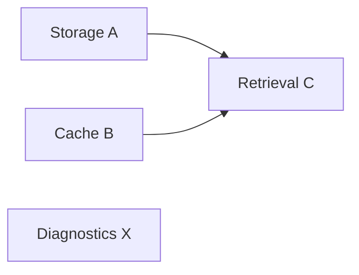
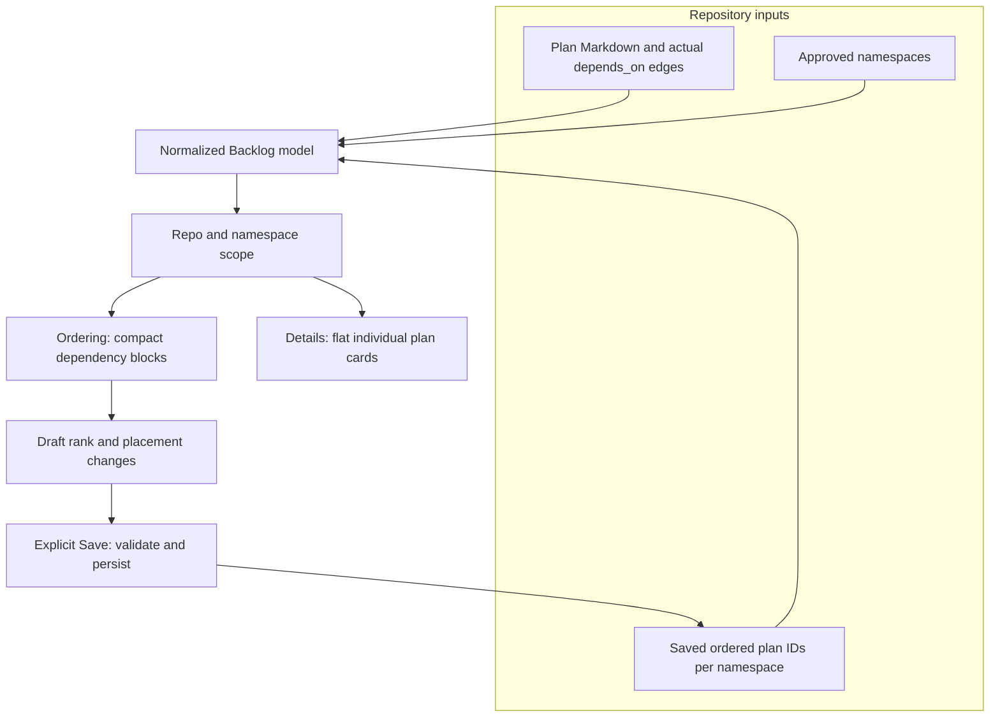

# Architecture addendum: namespace-scoped Backlog ordering

**Status:** Technical design companion to `plans-backlog-roadmap-ordering.md`  
**Scope:** Schema, persistence, dependency grouping, consistency rules, and a normative Backlog UI reference. The implementation plan remains the source of truth for overall feature goals.

## Purpose

Keep plan documents as Markdown, preserve existing stable IDs and real dependency edges, and add one repository-local priority sequence per namespace. The UI derives movable dependency blocks rather than storing a second hierarchy. Changes affect the Backlog UI only; other lifecycle views retain their existing presentation. **Details is always flat; only Ordering displays derived dependency containers.**

## Existing contracts

The published `plan-write` schema currently establishes:

- `docs/plans/<lifecycle>/<namespace>-<slug>.md`; the directory determines lifecycle.
- An opaque, immutable, repository-local `id` (normally 6–8 lowercase base36 characters).
- `depends_on` as an array of plan IDs, supporting more than one prerequisite.
- Approved project namespaces from `docs/plans/plans-config.json`, supplemented by plan-suite universal namespaces.

See the repository's `plan-write/SKILL.md` and `references/plan-schema.md`. `docs/user/reference/plans-portal.md` describes the behavior as implemented; this note records the design and the UI contract.

## Proposed storage layout

```text
docs/plans/
  plans-config.json
  plans-order.json
  backlog/
    portal-context-storage.md
    portal-context-retrieval.md
    portal-agent-diagnostics.md
  ready/
  active/
  review/
  completed/
  archived/
```

`plans-order.json` is one file **per repository**. There is no central cross-repository priority ranking. Files outside approved namespaces remain readable for recovery, but cannot be placed in the namespace order until corrected.

### Priority placement and individual rank retention

`depends_on` supersedes manual **initial** placement when a new plan directly attaches to a ranked same-namespace Backlog group; `plan-write` should auto-attach the plan rather than ask for a position. This does **not** mean only groups have an order: the registry retains every ranked plan ID in its dependency-valid sequence.

For example, if B and C each depend on A, the ranked registry can store `[A, B, C]` even while Ordering shows one movable `[A, B, C]` block. When A leaves Backlog, B and C become independent movable entries in that same B-before-C order. Their individual positions are **already saved**; no new prioritization prompt is required, and leaving a group is not a reason to clear a rank. A new sibling is inserted in a stable, deterministic order while respecting all actual prerequisite edges.

New plans that depend only on *unprioritized* prerequisites remain unprioritized with their connected group. Manual Ordering-mode changes require explicit Save. Automatic placement persists through `roborepo plans order place`, using revision checks to avoid overwriting an unsaved UI draft; a hand edit to `depends_on` has no write path of its own, so it takes effect on the next read and persists at the next write.

### 1. Plan document: identity and hard dependencies

```yaml
---
id: c4n9q2
next_action: Implement context retrieval
blocked_by: []
depends_on:
  - a8f3k2
  - b7m5p1
related: []
reviewed_commit:
worktree:
---

# Improve context retrieval
```

- `id` survives renames, title edits, and lifecycle moves.
- `depends_on` contains **actual** hard prerequisites, not display adjacency.
- `related` remains an informational relationship, not a priority or grouping mechanism.
- `blocked_by` retains its existing meaning; it is not automatically converted to a dependency edge.
- Remove `priority` from current non-Completed/non-Archived plan frontmatter, validators, writers, templates, skill instructions, and UI. Historic Completed/Archived values may remain inert.
- Do **not** add `group`, `series`, `rank`, `unprioritized`, or `status` to individual plans.

### 2. Repository namespace vocabulary

`docs/plans/plans-config.json` remains the authority for project namespaces. The plan-suite universal namespaces remain permitted under the existing rules.

A reader resolves the namespace using the **longest valid namespace prefix followed by `-`**. This matters when both `plan` and `plan-lifecycle` are legal prefixes. `plan-lifecycle-foo.md` must resolve to `plan-lifecycle`, not `plan`.

**Decision: derive namespace from the filename; do not add `namespace` to frontmatter.** The parser publishes `namespace` as a computed field on the normalized plan model for filters, rendering, and writers. The filename and approved vocabulary are the single source of truth.

- Resolve the prefix once per indexed filename, using the longest approved `<namespace>-` match; keep the parsed field in the indexed plan model so list rendering does not reparse it.
- Load the vocabulary once per repository snapshot and reuse a deterministic matcher. Filename matching is a cheap in-memory operation; unlike YAML/frontmatter parsing, it requires no additional file I/O. Add a focused correctness and performance regression test rather than relying on assumed speed.
- An unknown, ambiguous, or malformed prefix yields `namespace: null` plus a validation finding, not a guessed namespace. Such plans appear in **No namespace** for repair.
- The Backlog namespace badge is **rendered** from the validated namespace, not added to the authored H1. Namespace is exposed to callers as a read-only derived value, not a second stored field.

### 2a. Observing `plans-config.json` changes

Namespace classification is a derived index keyed by **repository, approved namespace vocabulary revision, and plan filename**. The resolver must not cache a vocabulary indefinitely. Watch or invalidate on `docs/plans/plans-config.json` create/edit/delete, repository/branch switch, and plan snapshot refresh; verify the config revision on Backlog load and again before committing an Ordering draft. Use the existing repository observation mechanism when available; watcher notifications alone are not a correctness guarantee.

| Event | Classification / UI | Ordering registry |
| --- | --- | --- |
| Add namespace | Reindex: matching files leave **No namespace** and appear under the new namespace if Backlog plans exist | Restore any still-valid stored positions; otherwise **Needs prioritization**, unless a ranked dependency anchors automatic placement |
| Remove namespace | Reindex: affected plans move to **No namespace** with repair findings | Keep orphaned raw entries for diagnosis/recovery; exclude from effective order, never silently delete |
| Rename namespace | Equivalent to removal + addition; no silent file renames | Reconcile on explicit filename repair, preserving stable plan IDs where valid |
| Malformed/unreadable config | Display actionable config error; no fabricated namespace | Block invalid ordering writes; avoid silently using a stale vocabulary |
| Config changed with dirty Ordering draft | Flag stale namespace snapshot and present refresh/reconciliation | Reject Save against old revision; do not overwrite newer configuration/order |

Normalize and validate universal namespaces separately from repository namespaces. With overlapping prefixes, longest valid prefix wins. Config changes can split or merge derived Backlog dependency groups as files enter or leave an approved namespace; apply the existing dependency reconciliation policy only after reclassification. An empty namespace need not appear in the directory. None of these operations changes non-Backlog UI presentation.

**Tests:** open Backlog while adding/removing/renaming a namespace; reclassify existing unknown filenames; overlapping prefix resolution; saved order from a deleted namespace; malformed configs; branch switching; dirty draft Save rejection after config changes; correct namespace counts and **No namespace** placement.

### 3. Repository-local priority registry

```json
{
  "schemaVersion": 1,
  "namespaces": {
    "portal": ["a8f3k2", "b7m5p1", "c4n9q2", "x6t2v8"],
    "plan": ["p3q7r8"]
  }
}
```

Each array contains **individual stable plan IDs**, not filenames or group objects. Entries are ordered within a single namespace. Reads tolerate whatever the file holds: an entry for a plan outside Backlog is ignored and pruned at the next write, and an unknown ID is excluded with a finding and preserved. Lifecycle transitions never touch the file.

A Backlog plan not in the effective saved order is **Needs prioritization**, unless a dependency mutation is being reconciled to auto-attach it to an already-ranked group. The attachment is calculated on read and reaches the file at the next write; do not maintain a second hidden order.

## Derived grouping: Option A

Hard dependencies form a directed graph. For Ordering-mode presentation, remaining related Backlog plans form contiguous movable blocks. Details shows these plans as separate cards in the same flattened order. The group has **no stored group ID**. Order inside each block is a stable topological ordering of actual prerequisites; unrelated members preserve their previous relative order when possible.



If the saved order is `[A, X, B]` and C is added as dependent on A and B, the proposed result is `[A, B, C, X]`. The Ordering block `[A, B, C]` moves together; Details renders A, B, and C as separate cards. A and B **remain independent in data**. The merge anchors at the earliest previously ranked member. Unaffected plans keep their relative order.

- **Join:** C depends on A and B → one display block `[A, B, C]`.
- **Fork:** B and C depend on A → one display block `[A, B, C]`, without a made-up B→C edge.
- **Multiple disconnected blocks:** remain separate reorderable units.
- **Cycle / missing prerequisite:** validation finding; do not synthesize a misleading valid-looking order.
- **Cross-namespace dependency:** still constrains execution, but never merges namespace priority lists.
- **Active/Completed prerequisites:** remain actual dependency facts but are not nodes in the Backlog grouping graph. Do not use an out-of-Backlog prerequisite to connect otherwise-independent Backlog plans.
- **Grouping boundary (confirmed):** build connected components using **only direct dependency edges for which both endpoint plans are currently in the same namespace's Backlog**. Never traverse through a completed, active, archived, or cross-namespace prerequisite to merge groups.

For example, if B and C both depend on A, `[A, B, C]` is one group while all three are in Backlog. When A leaves Backlog, B and C become **independent ranked rows**, because neither depends directly on the other; their existing relative priority is retained. Their `depends_on: [A]` entries remain intact, and they can still be blocked until A completes. If B depends on A and C directly depends on B, `[B, C]` stays grouped after A leaves Backlog. Leaving Backlog does **not** make B or C unprioritized merely because their group splits; removing a dependency edge is a separate reconciliation event.

## UI reference: Backlog navigation and paired list projections

**This section is the visual implementation contract.** It records the agreed screens and behaviors so developers should not need to re-design Backlog during implementation. These are schematic wireframes, not pixel-exact styling specifications. All examples use illustrative plan IDs (`A`, `B`, `C`, `X`, `N`). Actual IDs remain stable plan IDs from frontmatter.

### Shared state and projections



**Invariant:** Details and Ordering receive the **same saved (or in-session draft) plan sequence**; Details expands every group into **individual, un-nested cards**, while Ordering **alone** draws group containers and moves connected Backlog plans as units. Do not store group objects. Never show nested dependency groups or group headings in Details. In particular, the sentence “same dependency blocks in both modes” is incorrect; only the flattened sequence is shared.

### Navigation wireframes (Backlog only)

**1. No repository selected:** a repository directory, not an all-repositories plan feed.

```text
┌───────────────────────── Plans · Backlog ────────────────────────┐
│ All repos                                                       │
│                                                                  │
│  📁 roborepo                 26 plans       3 unprioritized   ›  │
│  📁 web-app                  13 plans       1 unprioritized   ›  │
│  📁 tooling                   8 plans                         ›  │
└──────────────────────────────────────────────────────────────────┘
```

**2. Repository selected:** its populated namespace directory; invalid namespace files appear **last**, if any.

```text
┌───────────────────────── Plans · Backlog ────────────────────────┐
│ All repos / roborepo                                             │
│                                                                  │
│  ◫ AGENTS                    12 plans                         ›  │
│  ◫ CLI                        8 plans       2 unprioritized   ›  │
│  ◫ RUNTIME                    6 plans       1 unprioritized   ›  │
│                                                                  │
│  ! No namespace               2 plans       Repair needed    ›  │
└──────────────────────────────────────────────────────────────────┘
```

**3. Repository and namespace selected:** one persistent list, with the mode toggle. **Needs prioritization is first in Ordering if nonempty**; Details shows a banner with its count. No congratulatory empty-state text appears when all plans are ranked.

### Details mode: full, independent plan cards

A joined dependency (`C` depends on `A` and `B`), an unrelated `X`, and an independent unprioritized `N` are used below. `N` is counted in the banner, and appears as a row in Ordering rather than a card here. **Despite the logical A/B/C grouping, Details never wraps or nests their cards.** It has no reordering controls.

```text
┌───────────────────────── Plans · Backlog ──────────────────────────┐
│ All repos / roborepo / AGENTS                     [Details] Ordering │
│                                                                    │
│ 1 plan needs prioritization                       [Prioritize Now] │
│                                                                    │
│ Ordered                                                            │
│ ┌────────────────────────────────────────────────────────────────┐ │
│ │ AGENTS · Context storage (A)                                   │ │
│ │ Persist reusable context.                                      │ │
│ │ Backlog                                                0%     │ │
│ └────────────────────────────────────────────────────────────────┘ │
│ ┌────────────────────────────────────────────────────────────────┐ │
│ │ AGENTS · Context indexing (B)                                  │ │
│ │ Build a searchable context index.                              │ │
│ │ Backlog                                                0%     │ │
│ └────────────────────────────────────────────────────────────────┘ │
│ ┌────────────────────────────────────────────────────────────────┐ │
│ │ AGENTS · Context retrieval (C)                                 │ │
│ │ Find relevant context for each run.                            │ │
│ │ Requires: A, B                                                 │ │
│ │ Backlog                                                0%     │ │
│ └────────────────────────────────────────────────────────────────┘ │
│ ┌────────────────────────────────────────────────────────────────┐ │
│ │ AGENTS · Agent diagnostics (X)                                 │ │
│ │ Inspect agent errors and failures.                             │ │
│ │ Backlog                                                0%     │ │
│ └────────────────────────────────────────────────────────────────┘ │
└────────────────────────────────────────────────────────────────────┘
```

- Preserve existing rich Backlog card fields, actions, and progress presentation. The content lines are illustrative, not a mandate to invent new card properties.
- Show the plain title; the breadcrumb names the namespace. Do not add a prefix to the authored H1 or a namespace badge to the card footer.
- List unfinished prerequisites under `Waiting on:`, where a namespace other than the plan's appears as a badge; the list does **not** imply grouping or enforce adjacency visually.
- After a successful ordering Save, Details uses the new order. A mode switch does not reset repo/namespace context or scroll unnecessarily.

### Ordering mode: derived dependency group containers

Same plans, same flattened sequence as Details, but only Ordering draws the contiguous A/B/C group and exposes reordering controls. Each group has **one** set of controls; individual rows inside it are not independently draggable. The rightmost control is always the drag handle.

```text
┌───────────────────────── Plans · Backlog ──────────────────────────┐
│ All repos / roborepo / AGENTS                      Details [Ordering]│
│                                                                    │
│ Needs prioritization (1)                                           │
│  AGENTS · Agent trace export (N)               [↓] [⇣] [⠿]        │
│                                               top  end  drag       │
│                                                                    │
│ Ordered                                                            │
│ ┌────────────────────────────────────────────────────────────────┐ │
│ │ 🔗 3 linked plans                        [⇡][↑][↓][⇣][⠿]     │ │
│ │   A · Context storage                                         │ │
│ │   B · Context indexing                                        │ │
│ │   C · Context retrieval              Requires: A, B           │ │
│ └────────────────────────────────────────────────────────────────┘ │
│  X · Agent diagnostics                      [⇡][↑][↓][⇣][⠿]      │
│                                                                    │
│ ┌────────────── Sticky bar while scrolling ─────────────────────┐ │
│ │ Unsaved changes                             [Cancel] [Save]   │ │
│ └────────────────────────────────────────────────────────────────┘ │
└────────────────────────────────────────────────────────────────────┘
```

Control meanings (the visual arrows are shorthand; actual buttons use accessible names and tooltips):

- **Ordered row or block, right side only:** **Move to top**, **Move up**, **Move down**, **Move to bottom**, **Drag handle** — exactly this order.
- **Needs prioritization row or block, right side only:** **Move down** (insert as first Ordered entry), **Move to bottom** (append as last Ordered entry), **Drag handle** — exactly this order. There is **no position dropdown or numeric field**.
- Every mutation affects the **local draft** only; a placed item leaves Needs prioritization immediately in the draft but does not persist until Save.
- Sticky **Save/Cancel** appears when dirty, remains visible on long lists, and protects navigation away from Ordering, namespace, repository, lifecycle, and Plans page. Confirm with “Your prioritization changes have not been saved.” Actions: **Save and continue** or **Cancel** (remain). Cancel in the action bar discards after confirmation. Browser reload/close can use native wording.
- When there are no unprioritized items, omit the Needs prioritization section entirely. When there are no edits, no unsaved warning should be shown.

### Complete three-plan topology gallery and larger UI cases

The following **six T-cases are exhaustive for three distinct plans, up to renaming plan IDs, when we treat graphs as equivalent under renaming and retain the directed edges**: no edges, one edge, two-edge chain, two-edge fork, two-edge join, and all three acyclic edges. (In all cases `A → B` means B requires A.) The additional G/L/P/M/E-cases cover the important combinations and mutations for larger real projects. There are increasingly many graphs for larger numbers of plans, so this gallery is not a literal enumeration of every graph size. The *graph algorithm*, rather than hard-coded screen cases, must handle arbitrary valid acyclic inputs.

Each example deliberately shows **real Details-mode card shapes**, not just a shorthand `A | B | C`: independent full cards with title, summary, actual prerequisites (where present), lifecycle and progress. **Ordering alone** renders contiguous draggable groups, with the agreed five controls on the right. The controls are schematic; they must be accessible buttons and drag interactions. Parent groups receive controls, not their child rows. Numeric rank fields are never shown. The `AGENTS ·` drawn in these examples stands for the filename-derived namespace; the portal shows the plain title.

For compactness, these examples omit the page's repo/namespace breadcrumbs and Details/Ordering toggle; those are defined above and do not change between scenarios. All illustrative plans are Backlog unless an external prerequisite is explicitly mentioned. Where a plan was created/edited, views show the *resulting* projected state. The existing Details card component remains authoritative for its precise fields/actions; these layouts establish grouping and ordering rules, not a replacement card implementation.

#### T0 — No dependencies

**Actual dependency edges:** *none*

**Details — flat plan cards**

```text

┌─────────────────────────────────────────────────────────┐
│ AGENTS · Context storage (A)                            │
│ Persist context for later reuse.                        │
│ Backlog                                              0% │
└─────────────────────────────────────────────────────────┘

┌─────────────────────────────────────────────────────────┐
│ AGENTS · Context indexing (B)                           │
│ Index stored context for retrieval.                     │
│ Backlog                                              0% │
└─────────────────────────────────────────────────────────┘

┌─────────────────────────────────────────────────────────┐
│ AGENTS · Context retrieval (C)                          │
│ Find relevant context at runtime.                       │
│ Backlog                                              0% │
└─────────────────────────────────────────────────────────┘

```

**Ordering — movable blocks / rows**

```text
  A · Context storage    [⇡][↑][↓][⇣][⠿]
  B · Context indexing    [⇡][↑][↓][⇣][⠿]
  C · Context retrieval    [⇡][↑][↓][⇣][⠿]
```

**Rule:** All three plans are independent; each is a separate movable unit.

#### T1 — Single edge + independent plan

**Actual dependency edges:** `A → B`

**Details — flat plan cards**

```text

┌─────────────────────────────────────────────────────────┐
│ AGENTS · Context storage (A)                            │
│ Persist context for later reuse.                        │
│ Backlog                                              0% │
└─────────────────────────────────────────────────────────┘

┌─────────────────────────────────────────────────────────┐
│ AGENTS · Context indexing (B)                           │
│ Index stored context for retrieval.                     │
│ Requires: A                                             │
│ Backlog                                              0% │
└─────────────────────────────────────────────────────────┘

┌─────────────────────────────────────────────────────────┐
│ AGENTS · Context retrieval (C)                          │
│ Find relevant context at runtime.                       │
│ Backlog                                              0% │
└─────────────────────────────────────────────────────────┘

```

**Ordering — movable blocks / rows**

```text
┌─ 2 linked plans ────────────────────── [⇡][↑][↓][⇣][⠿] ┐
│  A · Context storage
│  B · Context indexing  Requires: A
└──────────────────────────────────────────────────────────┘
  C · Context retrieval    [⇡][↑][↓][⇣][⠿]
```

**Rule:** B requires A. C is separate; A/B move together.

#### T2 — Linear chain

**Actual dependency edges:** `A → B`, `B → C`

**Details — flat plan cards**

```text

┌─────────────────────────────────────────────────────────┐
│ AGENTS · Context storage (A)                            │
│ Persist context for later reuse.                        │
│ Backlog                                              0% │
└─────────────────────────────────────────────────────────┘

┌─────────────────────────────────────────────────────────┐
│ AGENTS · Context indexing (B)                           │
│ Index stored context for retrieval.                     │
│ Requires: A                                             │
│ Backlog                                              0% │
└─────────────────────────────────────────────────────────┘

┌─────────────────────────────────────────────────────────┐
│ AGENTS · Context retrieval (C)                          │
│ Find relevant context at runtime.                       │
│ Requires: B                                             │
│ Backlog                                              0% │
└─────────────────────────────────────────────────────────┘

```

**Ordering — movable blocks / rows**

```text
┌─ 3 linked plans ────────────────────── [⇡][↑][↓][⇣][⠿] ┐
│  A · Context storage
│  B · Context indexing  Requires: A
│  C · Context retrieval  Requires: B
└──────────────────────────────────────────────────────────┘
```

**Rule:** A precedes B precedes C. This is a true three-phase chain.

#### T3 — Fork

**Actual dependency edges:** `A → B`, `A → C`

**Details — flat plan cards**

```text

┌─────────────────────────────────────────────────────────┐
│ AGENTS · Context storage (A)                            │
│ Persist context for later reuse.                        │
│ Backlog                                              0% │
└─────────────────────────────────────────────────────────┘

┌─────────────────────────────────────────────────────────┐
│ AGENTS · Context indexing (B)                           │
│ Index stored context for retrieval.                     │
│ Requires: A                                             │
│ Backlog                                              0% │
└─────────────────────────────────────────────────────────┘

┌─────────────────────────────────────────────────────────┐
│ AGENTS · Context retrieval (C)                          │
│ Find relevant context at runtime.                       │
│ Requires: A                                             │
│ Backlog                                              0% │
└─────────────────────────────────────────────────────────┘

```

**Ordering — movable blocks / rows**

```text
┌─ 3 linked plans ────────────────────── [⇡][↑][↓][⇣][⠿] ┐
│  A · Context storage
│  B · Context indexing  Requires: A
│  C · Context retrieval  Requires: A
└──────────────────────────────────────────────────────────┘
```

**Rule:** B and C both require A, but B and C are independent; their relative order is soft priority only.

#### T4 — Join

**Actual dependency edges:** `A → C`, `B → C`

**Details — flat plan cards**

```text

┌─────────────────────────────────────────────────────────┐
│ AGENTS · Context storage (A)                            │
│ Persist context for later reuse.                        │
│ Backlog                                              0% │
└─────────────────────────────────────────────────────────┘

┌─────────────────────────────────────────────────────────┐
│ AGENTS · Context indexing (B)                           │
│ Index stored context for retrieval.                     │
│ Backlog                                              0% │
└─────────────────────────────────────────────────────────┘

┌─────────────────────────────────────────────────────────┐
│ AGENTS · Context retrieval (C)                          │
│ Find relevant context at runtime.                       │
│ Requires: A, B                                          │
│ Backlog                                              0% │
└─────────────────────────────────────────────────────────┘

```

**Ordering — movable blocks / rows**

```text
┌─ 3 linked plans ────────────────────── [⇡][↑][↓][⇣][⠿] ┐
│  A · Context storage
│  B · Context indexing
│  C · Context retrieval  Requires: A, B
└──────────────────────────────────────────────────────────┘
```

**Rule:** A and B are independent prerequisites of C; B does not depend on A.

#### T5 — Transitive triangle

**Actual dependency edges:** `A → B`, `A → C`, `B → C`

**Details — flat plan cards**

```text

┌─────────────────────────────────────────────────────────┐
│ AGENTS · Context storage (A)                            │
│ Persist context for later reuse.                        │
│ Backlog                                              0% │
└─────────────────────────────────────────────────────────┘

┌─────────────────────────────────────────────────────────┐
│ AGENTS · Context indexing (B)                           │
│ Index stored context for retrieval.                     │
│ Requires: A                                             │
│ Backlog                                              0% │
└─────────────────────────────────────────────────────────┘

┌─────────────────────────────────────────────────────────┐
│ AGENTS · Context retrieval (C)                          │
│ Find relevant context at runtime.                       │
│ Requires: A, B                                          │
│ Backlog                                              0% │
└─────────────────────────────────────────────────────────┘

```

**Ordering — movable blocks / rows**

```text
┌─ 3 linked plans ────────────────────── [⇡][↑][↓][⇣][⠿] ┐
│  A · Context storage
│  B · Context indexing  Requires: A
│  C · Context retrieval  Requires: A, B
└──────────────────────────────────────────────────────────┘
```

**Rule:** C explicitly requires A and B; B requires A. The display is a chain but retains both actual C dependencies.

#### G1 — Diamond

**Actual dependency edges:** `A → B`, `A → C`, `B → D`, `C → D`

**Details — flat plan cards**

```text

┌─────────────────────────────────────────────────────────┐
│ AGENTS · Context storage (A)                            │
│ Persist context for later reuse.                        │
│ Backlog                                              0% │
└─────────────────────────────────────────────────────────┘

┌─────────────────────────────────────────────────────────┐
│ AGENTS · Context indexing (B)                           │
│ Index stored context for retrieval.                     │
│ Requires: A                                             │
│ Backlog                                              0% │
└─────────────────────────────────────────────────────────┘

┌─────────────────────────────────────────────────────────┐
│ AGENTS · Context retrieval (C)                          │
│ Find relevant context at runtime.                       │
│ Requires: A                                             │
│ Backlog                                              0% │
└─────────────────────────────────────────────────────────┘

┌─────────────────────────────────────────────────────────┐
│ AGENTS · Context UI (D)                                 │
│ Present context to users.                               │
│ Requires: B, C                                          │
│ Backlog                                              0% │
└─────────────────────────────────────────────────────────┘

```

**Ordering — movable blocks / rows**

```text
┌─ 4 linked plans ────────────────────── [⇡][↑][↓][⇣][⠿] ┐
│  A · Context storage
│  B · Context indexing  Requires: A
│  C · Context retrieval  Requires: A
│  D · Context UI  Requires: B, C
└──────────────────────────────────────────────────────────┘
```

**Rule:** B and C can swap places within the display, but both precede D.

#### G2 — Branch in middle

**Actual dependency edges:** `A → B`, `B → C`, `B → D`

**Details — flat plan cards**

```text

┌─────────────────────────────────────────────────────────┐
│ AGENTS · Context storage (A)                            │
│ Persist context for later reuse.                        │
│ Backlog                                              0% │
└─────────────────────────────────────────────────────────┘

┌─────────────────────────────────────────────────────────┐
│ AGENTS · Context indexing (B)                           │
│ Index stored context for retrieval.                     │
│ Requires: A                                             │
│ Backlog                                              0% │
└─────────────────────────────────────────────────────────┘

┌─────────────────────────────────────────────────────────┐
│ AGENTS · Context retrieval (C)                          │
│ Find relevant context at runtime.                       │
│ Requires: B                                             │
│ Backlog                                              0% │
└─────────────────────────────────────────────────────────┘

┌─────────────────────────────────────────────────────────┐
│ AGENTS · Context UI (D)                                 │
│ Present context to users.                               │
│ Requires: B                                             │
│ Backlog                                              0% │
└─────────────────────────────────────────────────────────┘

```

**Ordering — movable blocks / rows**

```text
┌─ 4 linked plans ────────────────────── [⇡][↑][↓][⇣][⠿] ┐
│  A · Context storage
│  B · Context indexing  Requires: A
│  C · Context retrieval  Requires: B
│  D · Context UI  Requires: B
└──────────────────────────────────────────────────────────┘
```

**Rule:** After B, C and D are independent even though they are in the same movable block.

#### G3 — Two disconnected chains

**Actual dependency edges:** `A → B`, `C → D`

**Details — flat plan cards**

```text

┌─────────────────────────────────────────────────────────┐
│ AGENTS · Context storage (A)                            │
│ Persist context for later reuse.                        │
│ Backlog                                              0% │
└─────────────────────────────────────────────────────────┘

┌─────────────────────────────────────────────────────────┐
│ AGENTS · Context indexing (B)                           │
│ Index stored context for retrieval.                     │
│ Requires: A                                             │
│ Backlog                                              0% │
└─────────────────────────────────────────────────────────┘

┌─────────────────────────────────────────────────────────┐
│ AGENTS · Context retrieval (C)                          │
│ Find relevant context at runtime.                       │
│ Backlog                                              0% │
└─────────────────────────────────────────────────────────┘

┌─────────────────────────────────────────────────────────┐
│ AGENTS · Context UI (D)                                 │
│ Present context to users.                               │
│ Requires: C                                             │
│ Backlog                                              0% │
└─────────────────────────────────────────────────────────┘

```

**Ordering — movable blocks / rows**

```text
┌─ 2 linked plans ────────────────────── [⇡][↑][↓][⇣][⠿] ┐
│  A · Context storage
│  B · Context indexing  Requires: A
└──────────────────────────────────────────────────────────┘
┌─ 2 linked plans ────────────────────── [⇡][↑][↓][⇣][⠿] ┐
│  C · Context retrieval
│  D · Context UI  Requires: C
└──────────────────────────────────────────────────────────┘
```

**Rule:** Two independent movable blocks; their priority relative to each other is adjustable.

#### G4 — Join plus unrelated plan

**Actual dependency edges:** `A → C`, `B → C`

**Details — flat plan cards**

```text

┌─────────────────────────────────────────────────────────┐
│ AGENTS · Context storage (A)                            │
│ Persist context for later reuse.                        │
│ Backlog                                              0% │
└─────────────────────────────────────────────────────────┘

┌─────────────────────────────────────────────────────────┐
│ AGENTS · Context indexing (B)                           │
│ Index stored context for retrieval.                     │
│ Backlog                                              0% │
└─────────────────────────────────────────────────────────┘

┌─────────────────────────────────────────────────────────┐
│ AGENTS · Context retrieval (C)                          │
│ Find relevant context at runtime.                       │
│ Requires: A, B                                          │
│ Backlog                                              0% │
└─────────────────────────────────────────────────────────┘

┌─────────────────────────────────────────────────────────┐
│ AGENTS · Agent diagnostics (X)                          │
│ Inspect agent errors.                                   │
│ Backlog                                              0% │
└─────────────────────────────────────────────────────────┘

```

**Ordering — movable blocks / rows**

```text
┌─ 3 linked plans ────────────────────── [⇡][↑][↓][⇣][⠿] ┐
│  A · Context storage
│  B · Context indexing
│  C · Context retrieval  Requires: A, B
└──────────────────────────────────────────────────────────┘
  X · Agent diagnostics    [⇡][↑][↓][⇣][⠿]
```

**Rule:** The prerequisite group remains together while X is an independent unit.

#### G5 — Many-to-many connected graph

**Actual dependency edges:** `A → D`, `B → D`, `D → E`, `D → F`, `E → G`, `F → G`

**Details — flat plan cards**

```text

┌─────────────────────────────────────────────────────────┐
│ AGENTS · Context storage (A)                            │
│ Persist context for later reuse.                        │
│ Backlog                                              0% │
└─────────────────────────────────────────────────────────┘

┌─────────────────────────────────────────────────────────┐
│ AGENTS · Context indexing (B)                           │
│ Index stored context for retrieval.                     │
│ Backlog                                              0% │
└─────────────────────────────────────────────────────────┘

┌─────────────────────────────────────────────────────────┐
│ AGENTS · Context UI (D)                                 │
│ Present context to users.                               │
│ Requires: A, B                                          │
│ Backlog                                              0% │
└─────────────────────────────────────────────────────────┘

┌─────────────────────────────────────────────────────────┐
│ AGENTS · Search tuning (E)                              │
│ Improve ranking and filtering.                          │
│ Requires: D                                             │
│ Backlog                                              0% │
└─────────────────────────────────────────────────────────┘

┌─────────────────────────────────────────────────────────┐
│ AGENTS · Telemetry (F)                                  │
│ Record diagnostic events.                               │
│ Requires: D                                             │
│ Backlog                                              0% │
└─────────────────────────────────────────────────────────┘

┌─────────────────────────────────────────────────────────┐
│ AGENTS · Context delivery (G)                           │
│ Connect retrieval to agents.                            │
│ Requires: E, F                                          │
│ Backlog                                              0% │
└─────────────────────────────────────────────────────────┘

```

**Ordering — movable blocks / rows**

```text
┌─ 6 linked plans ────────────────────── [⇡][↑][↓][⇣][⠿] ┐
│  A · Context storage
│  B · Context indexing
│  D · Context UI  Requires: A, B
│  E · Search tuning  Requires: D
│  F · Telemetry  Requires: D
│  G · Context delivery  Requires: E, F
└──────────────────────────────────────────────────────────┘
```

**Rule:** General joins and forks still form one group. The UI labels only actual prerequisites.

#### L1 — Shared prerequisite has left Backlog

**Outside current Backlog group:** A (Active/Completed)

**Actual dependency edges:** `A → B`, `A → C`

**Details — flat plan cards**

```text

┌─────────────────────────────────────────────────────────┐
│ AGENTS · Context indexing (B)                           │
│ Index stored context for retrieval.                     │
│ Requires: A                                             │
│ Backlog                                              0% │
└─────────────────────────────────────────────────────────┘

┌─────────────────────────────────────────────────────────┐
│ AGENTS · Context retrieval (C)                          │
│ Find relevant context at runtime.                       │
│ Requires: A                                             │
│ Backlog                                              0% │
└─────────────────────────────────────────────────────────┘

```

**Ordering — movable blocks / rows**

```text
  B · Context indexing (requires A)    [⇡][↑][↓][⇣][⠿]
  C · Context retrieval (requires A)    [⇡][↑][↓][⇣][⠿]
```

**Rule:** A is Active or Completed. B and C retain Requires A, but do not move together.

#### L2 — Direct dependency survives prerequisite leaving

**Outside current Backlog group:** A (Active/Completed)

**Actual dependency edges:** `A → B`, `A → C`, `B → C`

**Details — flat plan cards**

```text

┌─────────────────────────────────────────────────────────┐
│ AGENTS · Context indexing (B)                           │
│ Index stored context for retrieval.                     │
│ Requires: A                                             │
│ Backlog                                              0% │
└─────────────────────────────────────────────────────────┘

┌─────────────────────────────────────────────────────────┐
│ AGENTS · Context retrieval (C)                          │
│ Find relevant context at runtime.                       │
│ Requires: A, B                                          │
│ Backlog                                              0% │
└─────────────────────────────────────────────────────────┘

```

**Ordering — movable blocks / rows**

```text
┌─ 2 linked plans ────────────────────── [⇡][↑][↓][⇣][⠿] ┐
│  B · Context indexing  Requires: A
│  C · Context retrieval  Requires: A, B
└──────────────────────────────────────────────────────────┘
```

**Rule:** A is outside Backlog. B and C remain grouped because C directly requires B.

#### L3 — Cross-namespace prerequisite

**Outside current Backlog group:** Q (another namespace)

**Actual dependency edges:** `Q → B`

**Details — flat plan cards**

```text

┌─────────────────────────────────────────────────────────┐
│ AGENTS · Context indexing (B)                           │
│ Index stored context for retrieval.                     │
│ Requires: Q                                             │
│ Backlog                                              0% │
└─────────────────────────────────────────────────────────┘

┌─────────────────────────────────────────────────────────┐
│ AGENTS · Agent diagnostics (X)                          │
│ Inspect agent errors.                                   │
│ Backlog                                              0% │
└─────────────────────────────────────────────────────────┘

```

**Ordering — movable blocks / rows**

```text
  B · Context indexing (requires Q)    [⇡][↑][↓][⇣][⠿]
  X · Agent diagnostics    [⇡][↑][↓][⇣][⠿]
```

**Rule:** Q is outside AGENTS. B still requires Q, but cross-namespace edges never join backlog units. The portal labels this `Waiting on 1` and lists Q with its namespace and status, in place of the `Requires:` text drawn in these wireframes. It also drops the `AGENTS · ` title prefix drawn throughout this document: rows show the plain title, and the namespace appears as a badge only on Next up cards and prerequisites.

#### P1 — Unprioritized independent plan

**Actual dependency edges:** `A → B`

**Details — flat plan cards**

```text
Needs prioritization (1)


┌─────────────────────────────────────────────────────────┐
│ AGENTS · Trace export (N)                               │
│ Export diagnostic traces.                               │
│ Backlog                                              0% │
└─────────────────────────────────────────────────────────┘
Ordered


┌─────────────────────────────────────────────────────────┐
│ AGENTS · Context storage (A)                            │
│ Persist context for later reuse.                        │
│ Backlog                                              0% │
└─────────────────────────────────────────────────────────┘

┌─────────────────────────────────────────────────────────┐
│ AGENTS · Context indexing (B)                           │
│ Index stored context for retrieval.                     │
│ Requires: A                                             │
│ Backlog                                              0% │
└─────────────────────────────────────────────────────────┘

```

**Ordering — movable blocks / rows**

```text
  N · Trace export              [↓][⇣][⠿]  (unprioritized)
  ─────────── Ranked ───────────
┌─ 2 linked plans ────────────────────── [⇡][↑][↓][⇣][⠿] ┐
│  A · Context storage
│  B · Context indexing  Requires: A
└──────────────────────────────────────────────────────────┘
```

**Rule:** N appears above the ranked list in both modes. Ordering gives N its two insertion buttons and drag handle.

#### P2 — New dependent plan auto-attaches

**Actual dependency edges:** `A → B`, `B → C`

**Details — flat plan cards**

```text

┌─────────────────────────────────────────────────────────┐
│ AGENTS · Context storage (A)                            │
│ Persist context for later reuse.                        │
│ Backlog                                              0% │
└─────────────────────────────────────────────────────────┘

┌─────────────────────────────────────────────────────────┐
│ AGENTS · Context indexing (B)                           │
│ Index stored context for retrieval.                     │
│ Requires: A                                             │
│ Backlog                                              0% │
└─────────────────────────────────────────────────────────┘

┌─────────────────────────────────────────────────────────┐
│ AGENTS · Context retrieval (C)                          │
│ Find relevant context at runtime.                       │
│ Requires: B                                             │
│ Backlog                                              0% │
└─────────────────────────────────────────────────────────┘

```

**Ordering — movable blocks / rows**

```text
┌─ 3 linked plans ────────────────────── [⇡][↑][↓][⇣][⠿] ┐
│  A · Context storage
│  B · Context indexing  Requires: A
│  C · Context retrieval  Requires: B
└──────────────────────────────────────────────────────────┘
```

**Rule:** New C requires already ranked B. It joins the group automatically and is not unprioritized.

#### M1 — Joining previously separate ranked plans

**Transition:** `A | X | Y | B (existing ranks); add C requiring A and B → A | B | C | X | Y`

**Actual dependency edges:** `A → C`, `B → C`

**Details — flat plan cards**

```text

┌─────────────────────────────────────────────────────────┐
│ AGENTS · Context storage (A)                            │
│ Persist context for later reuse.                        │
│ Backlog                                              0% │
└─────────────────────────────────────────────────────────┘

┌─────────────────────────────────────────────────────────┐
│ AGENTS · Context indexing (B)                           │
│ Index stored context for retrieval.                     │
│ Backlog                                              0% │
└─────────────────────────────────────────────────────────┘

┌─────────────────────────────────────────────────────────┐
│ AGENTS · Context retrieval (C)                          │
│ Find relevant context at runtime.                       │
│ Requires: A, B                                          │
│ Backlog                                              0% │
└─────────────────────────────────────────────────────────┘

┌─────────────────────────────────────────────────────────┐
│ AGENTS · Agent diagnostics (X)                          │
│ Inspect agent errors.                                   │
│ Backlog                                              0% │
└─────────────────────────────────────────────────────────┘

┌─────────────────────────────────────────────────────────┐
│ AGENTS · Run history (Y)                                │
│ Review prior agent executions.                          │
│ Backlog                                              0% │
└─────────────────────────────────────────────────────────┘

```

**Ordering — movable blocks / rows**

```text
┌─ 3 linked plans ────────────────────── [⇡][↑][↓][⇣][⠿] ┐
│  A · Context storage
│  B · Context indexing
│  C · Context retrieval  Requires: A, B
└──────────────────────────────────────────────────────────┘
  X · Agent diagnostics    [⇡][↑][↓][⇣][⠿]
  Y · Run history    [⇡][↑][↓][⇣][⠿]
```

**Rule:** Option A merges at the earliest ranked member. X and Y retain their relative order but may move down.

#### M2 — Remove a dependency from a ranked plan

**Transition:** `A → B (ranked group), X (ranked); remove B.requires A`

**Actual dependency edges:** *none*

**Details — flat plan cards**

```text
┌─────────────────────────────────────────────────────────┐
│ AGENTS · Context storage (A)                            │
│ Persist context for later reuse.                        │
│ Backlog                                              0% │
└─────────────────────────────────────────────────────────┘

┌─────────────────────────────────────────────────────────┐
│ AGENTS · Context indexing (B)                           │
│ Index stored context for retrieval.                     │
│ Backlog                                              0% │
└─────────────────────────────────────────────────────────┘

┌─────────────────────────────────────────────────────────┐
│ AGENTS · Agent diagnostics (X)                          │
│ Inspect agent errors.                                   │
│ Backlog                                              0% │
└─────────────────────────────────────────────────────────┘
```

**Ordering — movable blocks / rows**

```text
  A · Context storage    [⇡][↑][↓][⇣][⠿]
  B · Context indexing    [⇡][↑][↓][⇣][⠿]
  X · Agent diagnostics    [⇡][↑][↓][⇣][⠿]
```

**Rule:** A removed dependency keeps the rank. The plans stay at their positions as separate rows, and nothing moves to Needs prioritization: the data cannot tell a detached plan from one ranked on its own.

#### E1 — Cycle — invalid

**Actual dependency edges:** `B → A`, `A → B`

**Details — flat plan cards**

```text

┌─────────────────────────────────────────────────────────┐
│ AGENTS · Context storage (A)                            │
│ Persist context for later reuse.                        │
│ Requires: B                                             │
│ Backlog                                              0% │
└─────────────────────────────────────────────────────────┘

┌─────────────────────────────────────────────────────────┐
│ AGENTS · Context indexing (B)                           │
│ Index stored context for retrieval.                     │
│ Requires: A                                             │
│ Backlog                                              0% │
└─────────────────────────────────────────────────────────┘
⚠ Dependency validation error — repair required


```

**Ordering — movable blocks / rows**

```text
┌─ 2 linked plans ────────────────────── [blocked] ┐
│  A · Context storage  Requires: B
│  B · Context indexing  Requires: A
└──────────────────────────────────────────────────────────┘
  ⚠ Invalid dependency graph — repair required
```

**Rule:** No valid topological order exists. Plans stay discoverable, but the UI shows a validation error and blocks misleading order saves.

#### E2 — Missing prerequisite — invalid

**Actual dependency edges:** `Z → B`

**Details — flat plan cards**

```text

┌─────────────────────────────────────────────────────────┐
│ AGENTS · Context indexing (B)                           │
│ Index stored context for retrieval.                     │
│ Requires: Z                                             │
│ Backlog                                              0% │
└─────────────────────────────────────────────────────────┘

┌─────────────────────────────────────────────────────────┐
│ AGENTS · Agent diagnostics (X)                          │
│ Inspect agent errors.                                   │
│ Backlog                                              0% │
└─────────────────────────────────────────────────────────┘
⚠ Dependency validation error — repair required


```

**Ordering — movable blocks / rows**

```text
  B · Context indexing (requires Z)    [blocked]
  X · Agent diagnostics    [blocked]
  ⚠ Invalid dependency graph — repair required
```

**Rule:** Unknown Z is shown as a validation finding; do not silently treat the dependency as satisfied.

### Behavior and edge-case decision matrix

| Case | Must happen | Must not happen |
| --- | --- | --- |
| Three independent | Three independent reordering rows | Invent group or hard edges |
| One dependency + unrelated plan | One two-plan group and one single row | Lock the unrelated plan into the group |
| Chain | All connected Backlog plans reorder together | Allow child row to violate prerequisites |
| Fork | Shared parent and children grouped while parent remains in Backlog | Claim sibling children depend on each other |
| Join | Independent parents before shared child | Invent dependency from first parent to second |
| Transitive edges | Preserve every authored `depends_on` edge | Drop a redundant-but-real edge from stored data |
| Diamond / multi-branch | One connected group, stable topological order | Require a branching graph UI |
| Multiple disconnected components | Independently movable group controls | Drag individual members of a connected group |
| External prerequisite (lifecycle or namespace) | Show real prerequisite on Details card; do not group through external node | Pull other lifecycle/namespace plans into current Backlog |
| Shared prerequisite leaves Backlog | Children split without losing rank unless directly linked | Treat former sibling grouping as permanent |
| New independent plan | Show first under Needs prioritization | Append to the ranked order by default |
| New dependent plan | Auto-attach to ranked connected group when eligible | Require manual prioritization solely for adding dependency |
| New dependency merges ranked groups | Propose, then automatically apply contiguous merge (Option A); surface changed positions | Persist a false dependency to force linear order |
| Removed dependency detaches ranked member | Keep the plan at its current position | Move it to Needs prioritization |
| Invalid graph or missing target | Show visible validation finding and recovery path | Show a trustworthy looking but invalid reorder/save |

### UI assertions per gallery case

Test both projections from **one normalized input** and one shared flattened order. Assert that each Backlog ID is rendered once per mode, regardless of whether it is pending or ranked. Assert that the actual dependency edges are represented by the plan's `Requires` text, not inferred from adjacency. Verify that Details never creates a wrapper for two or more linked cards; Ordering renders exactly one move-controls cluster per connected ranked block, including the complete right-side order `top → up → down → bottom → drag`. Unprioritized items receive `insert first → append last → drag` and appear before ranked entries. The shared sticky Save/Cancel workflow and dirty-navigation guard apply to every case that permits a change. Unchanged other lifecycle views must not pick up any of these containers or controls.

---

### Acceptance checks for the wireframes

1. At the same repo/namespace scope, every visible plan ID appears **once** in each mode, in the same flattened sequence (subject to local Ordering draft not yet saved).
2. Details **never** renders group headers, nested child rows, drag handles, rank buttons, or containers around dependency-connected plans.
3. Ordering renders one movable block for each dependency-connected component of **current** same-namespace Backlog plans, and one movable row for each independent plan.
4. All group internal orders are topologically valid; a join or fork never implies an extra hard edge.
5. Needs prioritization is first in **both** modes if nonempty; only Ordering offers placement controls.
6. Save/Cancel, unsaved navigation guard, and persistent action bar appear only where applicable; changes in Ordering are not saved on each move.
7. The UI directory steps affect **Backlog only**; all other lifecycle views retain their current layout and behavior.

## State transitions and reconciliation

| Event | Expected effect |
| --- | --- |
| New independent Backlog plan | Starts in Needs prioritization; never appended silently |
| New plan depends on a ranked same-namespace block | Auto-attach to that block and persist the expanded order |
| New plan depends on multiple ranked blocks | Option A: propose and automatically apply a merged contiguous block, reporting moved entries |
| New dependency added to an already ranked plan | Reconcile groups and order automatically; report changed ranks |
| Dependency removed, leaving a formerly grouped plan independent | Keep every plan at its current position, as separate rows or smaller groups |
| Plan leaves Backlog (including Active or Completed) | Ignore its ID on read and prune it at the next write, recalculate groups using only direct remaining Backlog edges, retain relative order of ranked survivors and retain dependency facts in Markdown |
| Plan renamed | ID order unchanged; namespace reclassification requires validation and reconciliation |
| Plan deleted or namespace invalid | Surface a finding and repair path; never silently discard a broken reference |

## Calculation and persistence boundary

```text
Plan Markdown + namespaces config + saved order
                 ↓
          Parse and validate
                 ↓
          Derive dependency blocks
                 ↓
          Propose effective order
                 ↓
       Manual draft or automatic change
                 ↓
        Validate and apply registry
```

Keep three operations separate:

1. `deriveGroups(plans, lifecycle)` returns groups, dependency findings, and constraints without writing files.
2. `proposeOrder(savedOrder, groups, change)` returns `{ order, moves, findings }` without writing files.
3. `applyOrder(proposal, expectedRevision)` revalidates and persists the proposed order.

Automatic dependency changes calculate and apply the valid order without an approval dialog. Separate pure grouping, ordering, and persistence operations for determinism, testing, and atomic saves. The UI's **Ordering** mode uses the same operations against a local draft; the **Details** mode reads the flattened committed order without grouping; **Save** commits the whole namespace order, **Cancel** discards it, and leaving a dirty session triggers a confirmation prompt. The Save/Cancel bar stays visible on long lists.

The save should check the repository snapshot or revision used to create the draft. If plans or dependencies changed meanwhile, do not overwrite the newer state silently; show a conflict and require refresh/reconciliation. When a command edits both a plan file and `plans-order.json`, validate both and commit as one coherent repository change where possible.

## Strict writing, tolerant reading

- **Creation/rename/build:** reject unapproved filename prefixes; do not require or write a `namespace` frontmatter key. Integrate the shared prefix validator in `plan-write`, CLI/API, portal writer, and repository build checks that actually own plan validation.
- **Reading:** never hide existing bad files. At the end of a repository's namespace directory, show **No namespace** only when invalid or unmatched Backlog files exist, with filename, validation error, and repair path.
- Keep **No namespace** distinct from **Unclassified**: the former is a classification error; the latter is a lifecycle-folder condition.
- Preserve every non-Backlog lifecycle screen and its presentation.

## Validation contracts to add

- Namespace parsing recognizes long/overlapping prefixes and rejects unknown prefixes.
- Schema changes remove `priority` from current plans while tolerating untouched Completed/Archived history.
- Registry IDs are unique, resolvable, same-repository, same-namespace, and appropriate to Backlog.
- Topological grouping supports single chains, joins, forks, and unrelated interleaved plans; cycles fail clearly.
- Shared Backlog prerequisite A joins B and C; after A leaves Backlog, B and C split if they have no direct dependency edge, retain their rank, and preserve their hard dependency on A. A direct B→C edge keeps them grouped.
- Automatic merges and detachments produce deterministic results with no phantom dependency edges.
- New independent plans cannot become implicitly last priority; new dependent plans attach when eligible.
- Manual Save/Cancel, stale revisions, and navigation guards work without changing other lifecycle views.
- Invalid namespace files are visible and repairable, while new invalid files are rejected.

## Remaining implementation discovery

- **Mutation ownership:** identify the authoritative CLI/module owning plan edits and ordering writes, especially when `plan-write` is invoked outside the portal.
- **Enforcement reach:** determine which repositories run plan filename validation in build/CI, then apply the shared validator wherever plan-suite is used.
- **Parsing performance:** measure filename-prefix resolution on representative repository indexes and ensure namespace vocabularies are loaded once per repository snapshot.

This note is a design record with a visual Backlog UI contract, not a managed plan document. It intentionally has no plan frontmatter or lifecycle location and has not been run through the repository's plan validator.
