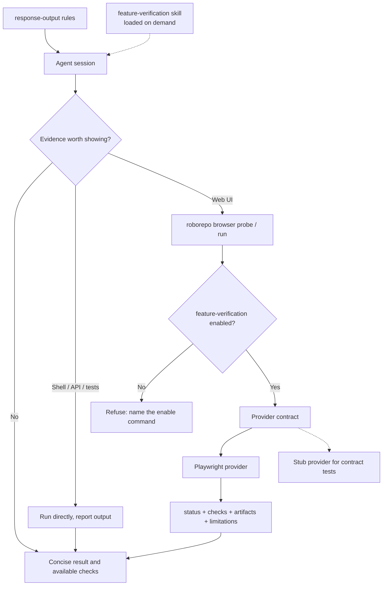

# Make Agent Conversations Easier to Understand and Results Easier to Verify

## Summary

Improve **interactive conversations in RoboRepo-managed agent sessions**, not just sessions developing
RoboRepo. Agents should communicate outcomes before implementation mechanics, adapt depth to the
task, surface consequential architectural decisions, and show real evidence that completed work
behaves as claimed. Agents should perform safe verification themselves instead of routinely
assigning it to the user.

The work is two layers, shipped as two independent optional packages:

| Package | Answers | Loaded | Holds |
| --- | --- | --- | --- |
| `response-output` (renames today's `response-shape`) | How does the agent write to me? | Every turn while enabled | The current response rules, consolidated, plus short additions: adaptive depth, meaningful progress updates, evidence by kind, caveman precedence |
| `feature-verification` (new) | How does the agent prove the work is right? | Only when the agent decides proof is worth showing | An evidence skill (server and API output, `curl`, tests, measured numbers, screenshots) and the `roborepo browser probe` / `browser run` command, which drives a local web app through a provider (Playwright first) |

Each works without the other: verification evidence without `response-output` is just reported in
plainer prose, and `response-output` without verification still reports evidence honestly. Only the
browser gets a dedicated command: server output, API calls, and tests already run through the
agent's normal shell, and a browser is the one place an agent cannot observe results without extra
tooling. Optimize **total time to understanding**: agent execution time plus human comprehension time.

## Goals

- Make agent responses easier to understand without merely minimizing word count or hiding technical depth.
- Lead with the user-relevant result, significance, or decision; explain mechanisms when they help.
- Adapt explanations to investigation, architecture, debugging, implementation, and completion without explicit personas or modes.
- Keep meaningful alternatives, risks, uncertainty, and decisions visible to the human who owns architecture.
- Prefer concrete examples and visual representations when they communicate faster than dense prose.
- Verify behavior autonomously when safe and feasible; present **actual, accessible evidence**, not just verification instructions.
- Support Claude Code, Codex, and Gemini CLI through the same rendered rules and one portable browser command.
- Give each layer a name that says what it does; keep tooling optional, startup lazy, and implementation maintainable.

## Non-goals

- Changing the primary format of plan documents, skill documentation, or formal closeout artifacts.
- Building a new browser engine, general visualization framework, browser-action DSL, video editor, evidence portal, or session analytics platform.
- Requiring screenshots or videos for every code change, or prescribing word limits.
- Treating screenshots, videos, or conceptual diagrams as substitutes for executed assertions/tests.
- Requiring individual projects to install Playwright or alter their dependency/test configuration to obtain ad hoc evidence.
- Wrapping shell, API, or test evidence in a RoboRepo command; the agent runs those directly.
- Folding verification into `test-harness`. That skill chooses and runs a repo's tests; `feature-verification` shows the human the result. They share only the verification-line format.
- Forking conversational policy by harness, adopting one harness's native output style as the common standard, or adding a second harness adapter hierarchy.
- Storing full transcripts or sensitive user data for evaluation, or automating production/destructive actions to capture evidence.
- Turning either package on by default (`defaultEnabled`), or folding either into the Plan Suite category.
- Changing how Plan Suite packages are toggled; that question belongs to [[o9zwxuav]].
- Migrating existing installs across the `response-shape` rename. RoboRepo is unreleased, so the breaking rename is accepted.

## Current state

Verified on `main` at `8ec0adb7`.

| Area | Today | Gap this plan closes |
| --- | --- | --- |
| Rule rendering | `scripts/cli/rules-render.mjs` renders `globals/system/rules/shared/` + `globals/system/rules/<harness>/` + enabled packages' `rules.md` into each harness's global file (Claude, Codex, Gemini); `scripts/build/render-rules.sh` regenerates tracked snapshots | None; reuse as is |
| Answer-first and form | `globals/packages/response-shape/rules.md` (optional, category `chat-time-output`, 78 lines: intro 8, Opening 11, Form 15, Separators 19, example 7, Close 12) requires re-orientation, answer first, corrections up front, tables/code/Mermaid over prose, namespaced findings, bolded load-bearing claims, `━`/`┈` separators, and a DONE/DEFERRED/NEXT STEPS close | Adaptive depth, explaining unfamiliar terms, meaningful progress updates, choosing visual evidence, and evidence categories are missing; the Separators section and intro carry more rationale than instruction |
| Name | `response-shape` describes a mechanism, not what the user gets | Rename to `response-output` |
| Evidence honesty | Shared `04-claims-and-evidence.md` requires verified causes and marking unverified reasoning ("likely", "I have not checked") | Does not separate *passed* checks from *observed but unasserted* behavior or conceptual illustrations |
| Verification line format | `response-shape` asks for verification results in a fenced block; `test-harness`'s SKILL.md asks for `Verified: <command> -> <pass\|fail\|blocked>` and already recommends Playwright when unit tests mock away behavior | Two formats for one thing |
| Surfacing decisions | Shared `07-decide-dont-ask.md` defines when to decide vs. escalate and forbids narrating settled decisions; `impact-awareness` flags collisions | None; the new rules defer to these rather than restate them |
| Shared communication baseline | Deliberately absent: an earlier rules audit deleted the shared `00-communication.md` fragment and moved chat-output behavior into toggleable packages (`docs/internal/rules-parity-and-layering.md`) | None; this plan follows that convention |
| Marker packages | `impact-awareness`, `convention-capture`, and `skill-visibility` each declare `requires: ["response-shape"]` and say "Placement: see `response-shape`". Commit `9115323f` added this solely to share one placement rule ("own line, never mid-paragraph, together at the end") | Turning on any marker forces the whole formatting package on, and the sticky-dependency bug keeps it on. These are the only live `requires` users |
| Terse mode | Optional `caveman`: rule "terse, no filler, fragments OK"; Codex SessionStart hook "Drop articles/filler/pleasantries/hedging"; on Claude, an external plugin (`JuliusBrussee/caveman`) whose instructions are not in this repo | No precedence with these rules; "drop hedging" already conflicts with `04-claims-and-evidence.md`'s required uncertainty markers |
| CLI routing | Core commands are JSON definitions under `manifests/platform/cli/command-definitions/<namespace>/` (`namespace.json` + `<name>.command.json` with a `module`/`export` execution). No `browser` namespace or reserved-name collision (`manifests/inventory/reserved-commands.json`) | Add `browser` |
| Package CLI commands | Package `cli-command` resources (`scripts/cli/package-commands.mjs`) only wrap an external process (`commandOrUrl` + `args`) that a core command such as `index code` spawns; they cannot register a namespace | `browser` is a core namespace gated on `feature-verification`, the way `index code` resolves its enabled owning package |
| Playwright | `@playwright/test` is a **devDependency** only, so `npm install -g` of RoboRepo never installs it, and `package.json` `files` does not ship it. The repo's own browser suite in `scripts/test/portal-ui/` shows screenshot capture (`capture.mjs`) and a clean skip when Chromium is absent (`run.mjs`) | The shipped CLI cannot import Playwright; the provider resolves it from the target project or a RoboRepo-managed tool directory |
| Optional-tool provisioning | No general facility. `scripts/cli/index.mjs` `requireUvx()` probes for a binary and exits with an install hint | Smallest equivalent: probe, report, install only with permission |
| Running local apps | `roborepo runtime --json` reports discovered local HTTP apps and origins while the user's auto-discovery consent is on (`modules/developer-runtime/`) | One source of already-running URLs; never a source of processes to stop |
| Bounded storage | `modules/retention/registry.mjs` `retentionStores(stateRoot)` lists every bounded store; `roborepo maintenance stores` and doctor read it; `assertBounded` enforces a bound. `measureFileSet` measures flat directories of files (default filter `.json`) | Evidence needs a registered store; per-run grouping needs flat naming or a directory-aware measurement |
| Agent command permissions | `manifests/inventory/agent-permissions.json` + `scripts/cli/agent-run-policy.mjs`: a prefix allowlist entry authorizes every payload behind the prefix | `browser run` executes scripts and must never be prefix-allowlisted |
| References to rename | `globals/packages/response-shape/`, the three marker packages' `package.config.json` and `rules.md`, `docs/user/reference/config-control-panel.md` (lines 68-70), `scripts/dev/docs-screenshots.mjs` (line 44) | Update all |

Reported friction includes walls of prose, unexplained jargon, buried conclusions, implementation
details presented without meaning, incomplete context, and verification delegated to the human.
These are observed user problems, not a measured baseline.

## Proposed design

### 1. `response-output`: rename and consolidate the rules

Rename `globals/packages/response-shape/` to `globals/packages/response-output/` (id, label
"Response output", description saying how the agent structures and words every response). Keep it
optional and in `chat-time-output`. Rewrite `rules.md` by **consolidating while adding**, so the
file ends near or below its current 78 lines; it loads every turn.

| Existing content | Change |
| --- | --- |
| Intro (8 lines) | One sentence of purpose |
| Opening › Re-orient | Merge with the new "provide sufficient context": explain unfamiliar terms and reconnect to the user's goal without repeating the conversation |
| Opening › Answer first, correction up front | Keep |
| Form › Match form to content | Merge with "choose the clearest medium": add examples, screenshots, recordings, and actual output to the existing tables/code/Mermaid list |
| Form › Namespace mixed-domain findings | Remove; headers for distinct parts already cover long responses |
| Separators (19 lines + example) | Keep the `━`/`┈` rule; cut to the instruction and a one-clause reason |
| Close › Verification in a fenced block | Align with `test-harness`'s `Verified: <command> -> <result>` line so there is one format |
| Close › DONE / DEFERRED / NEXT STEPS | Fold in the completion priorities: result, best available evidence, what needs attention |
| Close › Fixed-format lines together | Keep; it refines the marker packages' own placement line (Section 2) |

New items, each a bullet or two:

- **Adapt detail:** default to outcomes; explain architecture/tradeoffs when material and code-level mechanics when necessary or requested.
- **Use meaningful updates:** report changed understanding, actual progress, or blockers rather than narrating each tool call.
- **Report evidence by kind:** distinguish passed checks, observed but unasserted behavior, conceptual illustrations, and unavailable verification. Extends `04-claims-and-evidence.md`; does not restate it. This lives here, not in `feature-verification`, because it governs how any result is worded, with or without verification tooling.
- **Precedence:** an explicit user request for more or less detail wins, and enabling `caveman` counts as one, so caveman governs length and style. Even then, keep the outcome, decisions the human must make, material uncertainty, and whether a check passed or was only observed. Marking something unverified is required evidence status, not hedging.

Surfacing consequential choices stays with `07-decide-dont-ask.md` and `impact-awareness`; the new
text must not reintroduce narration of settled decisions. No new mandated headings, fixed
verbosity levels, personas, or universal visualization requirement.

| Conversation | Default information | More depth when |
| --- | --- | --- |
| Investigation | Finding, significance, uncertainty | Evidence changes the conclusion |
| Architecture | Decision, options, tradeoffs | Interfaces, maintainability, or future changes are affected |
| Debugging | Symptom, supported cause/hypothesis, next check | Logs or reproduction are relevant |
| Progress | Meaningful change and blocker, if any | Assumptions or decisions change |
| Completion | Outcome, real verification/evidence, attention needed | Failures, untested conditions, or significant risks remain |

These are selection cues for the rules, not modes or sections.

### 2. Marker packages stand alone

Remove `requires: ["response-shape"]` from `impact-awareness`, `convention-capture`, and
`skill-visibility`. Replace each "Placement: see `response-shape`" with one self-contained line:
the marker goes on its own line at the end of the response, never inside a paragraph. When
`response-output` is also enabled, its "fixed-format lines together after the separator" rule
applies on top without conflict. The `requires` mechanism itself stays; [[o9zwxuav]] and the
`implementation-review` dependency it serves still need it.

### 3. `feature-verification`: the evidence skill

New optional package `globals/packages/feature-verification/` (`lifecycle: "optional"`, no
`defaultEnabled`, no `requires`) with one auto-invoked skill and trigger fixtures following existing
skill-package conventions. Choose a category in `manifests/inventory/package-categories.json` that
fits verification rather than chat-time output; add one only if none fits.

The skill holds the operational guidance that should not load every turn. Choose the **fastest
sufficient** form of evidence, reuse artifacts already produced by relevant testing, plan capture
before verification when a recording is needed, and don't rerun work just to improve presentation.

| Change or question | Default evidence | Use more when |
| --- | --- | --- |
| Static UI | One screenshot or before/after frames (`roborepo browser run`) | Additional states are necessary |
| Interactive UI | Key frames; short recording if sequence or motion matters | Still frames cannot show the behavior clearly |
| Browser failure | Failure and selective screenshot | A trace is required to diagnose it |
| Server, API, CLI | Executed input/output (`curl`, the command, the request) and test/assertion result, run directly | An unexpected result needs diagnosis |
| Architecture / workflow | Mermaid when relationships are difficult to explain | Alternatives or tradeoffs need additional context |
| Performance | Measured before/after values | A chart conveys trends/distributions better |
| Simple or nonvisual work | Brief result and proportionate checks | A material question remains |

A diagram is **explanatory**, not proof that code ran. A screenshot or recording shows observed
behavior, not necessarily correctness. Only executed checks support a claim that behavior
**passed**. Trace capture is for diagnostics and is not enabled indiscriminately. The skill also
carries the safety rules (Section 6), presentation guidance (Section 7), and short before/after
examples for architecture, investigation, debugging, progress, and completion responses. It reports
results with the shared `Verified:` line format rather than defining its own.

### 4. `roborepo browser` namespace and provider contract



The command is a core namespace at `manifests/platform/cli/command-definitions/browser/`
(`namespace.json`, `probe.command.json`, `run.command.json`) executing a module under
`scripts/cli/`; it checks that `feature-verification` is effective and otherwise exits non-zero with
`roborepo package enable feature-verification` in the message.

```sh
roborepo browser probe --json
roborepo browser run --provider playwright --scenario ./tests/search.spec.js --capture screenshot --json
```

Exact flags follow live CLI conventions; `browser probe` and `browser run` and their
machine-readable results are the contract. No server, plugin protocol, or session command.

```js
probe() -> { available, capabilities }
run({ scenario, capture }) -> { status, checks, artifacts, limitations }
```

- `scenario` is an **existing provider-supported test/script path** or an ephemeral provider-specific script, not a RoboRepo browser-action DSL.
- `capture` requests evidence types (screenshot, video, trace); unsupported capture produces a limitation or `blocked` result, never fabricated output.
- `status` is `passed` (executed assertions passed), `failed` (execution or assertion failed), `unverified` (interaction ran without a meaningful assertion), or `blocked` (could not execute, including missing tool or refused install). Check outcomes are reported independently from capture success.
- `artifacts` are actual file paths with types; `limitations` explain missing capabilities, incomplete checks, or delivery constraints.
- Replacing Playwright must not change the result shape or the rules, **but script portability is not promised**.

Implement the Playwright provider plus a stub used only by contract tests; a static map of the two,
no registry machinery. Per `code-style`, the CLI entry orchestrates (gate, parse, call provider,
print); provider execution, result validation, and artifact/retention helpers are separate units.

### 5. Playwright provider and lazy provisioning

Installing RoboRepo never installs Playwright, and enabling `feature-verification` does not either.
The provider resolves it the first time a browser run needs it:

1. The target project's own installed `playwright` or `@playwright/test`, resolved from the scenario's directory. No prompt. Prefer the project's existing tests.
2. Otherwise `blocked`, with the exact install command in `limitations`. The agent asks to run it through the harness's normal permission prompt, and on approval installs the npm package and the browser binary into a RoboRepo-managed tool directory under the state root (for example `<stateRoot>/browser/tools/`). Never write to the target project's manifest or lockfile.
3. If the user declines, the result stays `blocked` and the agent falls back to other evidence.

- `probe` reports availability and each capture capability independently, without launching a browser or downloading anything.
- Never initialize Playwright, start a browser, or download binaries for unrelated conversations.
- When recording, set it up before execution; videos finalize only after the browser context closes. Do not rerun passing tests just to get a video.
- A captured interaction alone is not an assertion; mark ad hoc, unasserted runs `unverified`.
- Reuse the approach of `scripts/test/portal-ui/capture.mjs` and `run.mjs`, not their hermetic-portal specifics.

### 6. Safe autonomous execution and application lifecycle

For changed behavior in a locally runnable web app, agents exercise relevant behavior where safe and
permitted. Browser work is never forced onto backend-only tasks or unrelated conversations.

1. **Reuse:** first look for already running services (including `roborepo runtime --json` when the user's auto-discovery is on), existing tests, and their evidence. If sufficient, do not launch or repeat anything.
2. **Start when justified:** use only an established development command and known local URL. Track processes and browser contexts **started by this run**; never terminate pre-existing or user-owned services, and never use Runtime's stop action for them.
3. **Verify and capture together:** run checks and requested capture in one workflow where practical; prefer the smallest useful artifact.
4. **Clean up safely:** stop only owned temporary processes and contexts, keep still-needed evidence, report cleanup errors, and respect timeouts.
5. **Fallback truthfully:** missing tools, blocked access, unavailable apps, or unasserted behavior are stated as such, with actual alternative test/CLI evidence if available.

**Permissions.** `browser run` executes scripts, so a prefix allowlist entry such as
`Bash(roborepo browser run:*)` would authorize arbitrary code without a prompt (the problem
`scripts/cli/agent-run-policy.mjs` documents). Do not add `browser run` to
`manifests/inventory/agent-permissions.json`; it stays under the harness's normal approval.
`browser probe` is read-only and may be allowlisted.

Do not guess production endpoints or deployments. No purchases, emails, external mutations, or
irreversible actions to stage evidence. Prefer mock data and fixtures, limit capture scope, and
avoid credentials, tokens, private tabs, and unnecessary network payloads. Traces deserve extra care
because they can include page and network state.

### 7. Artifact handling and accessible delivery

- Write evidence under the state root (for example `<stateRoot>/browser/evidence/`), outside tracked files, grouped per run.
- Register the store in `modules/retention/registry.mjs` with explicit bounds so `roborepo maintenance stores` and doctor report it. Either flatten names (`<run-id>-<n>.png`) with a matching filter or add the smallest directory-aware measurement; decide during implementation.
- Retain current-result artifacts long enough to inspect; never delete evidence referenced by the current completion response.
- Return exact paths and confirm each file exists. Before calling evidence *inspectable*, confirm the active session can open it; a provider success does not guarantee that.
- Show or link **one primary evidence item**; reference secondary artifacts only if needed.
- When the harness cannot deliver a viewable artifact, give a real verification summary and disclose the limitation. Never invent a URL or pretend a local path works remotely.

### 8. Completion responses

The default is short and outcome-oriented: the **result**, the **best available evidence**, and
**what needs attention**, within `response-output`'s close. Include architecture details when a
consequential decision, uncertainty, or risk needs the human's judgment. Do not block a useful
response for decorative captures.

Example (illustrative; not an actual verification claim):

> Search results now update while typing. Browser assertions passed; one screenshot shows the filtered state. No decisions or follow-up required.

## Related plans

| Plan | Relationship | Classification |
| --- | --- | --- |
| [[o9zwxuav]] One package state model (backlog) | Its Current-state row ("Three packages use it … each require `response-shape`") and its sticky-dependency example (`convention-capture` → `response-shape`) describe relationships this plan removes. Its mechanism is still needed for `implementation-review` ([[ejsc769o]]). Also the home for the Plan Suite all-or-nothing question | Plan-vs-plan prose conflict, superseded here. This plan does not edit o9zwxuav; refresh its example and test row (`scripts/test/package-lifecycle-check.mjs` case) with a fixture or the `implementation-review` case when it is next promoted. Not a dependency in either direction; the only shared touchpoint is `effectiveEnabledIds`, which o9zwxuav moves to `scripts/cli/package-state.mjs` and the `browser` gate calls, so whichever lands second updates that import |
| [[0jped168]] Agent behavior evals (backlog) | Headless agent eval runner could later score comprehension | Unlanded, not a dependency; this plan's clarity check stays a small manual sample |
| [[package-cli-test-guide]] (backlog) | Its prose says Playwright is "not currently installed"; `@playwright/test` and `scripts/test/portal-ui/` have since landed | Plan-vs-code prose drift in that plan; no conflict with this one |
| `agent-config-code-quality-conventions` (completed) | Rewrote `code-style` guidance this plan's module layout follows | Landed (`eafd8e25`, ancestor of HEAD) |

## Implementation checklist

- [x] Rename `globals/packages/response-shape/` to `globals/packages/response-output/` and update every reference listed in Current state.
- [x] Rewrite `rules.md` per Section 1: consolidate while adding, remove namespaced findings, end near or below 78 lines, and avoid duplicating `04-claims-and-evidence.md` or `07-decide-dont-ask.md`. Align the verification-line format with `test-harness`.
- [x] Remove `requires` from the three marker packages and give each its own one-line placement rule (Section 2).
- [x] Regenerate tracked snapshots with `scripts/build/render-rules.sh` (`--check` verifies) and confirm Claude, Codex, and Gemini outputs match.
- [x] Create `globals/packages/feature-verification/` with the evidence skill and trigger fixtures (Section 3); pick or add a category.
- [x] Add the `browser` namespace under `manifests/platform/cli/command-definitions/browser/` and its `scripts/cli/` module; gate both commands on `feature-verification`.
- [x] Implement the provider contract, result-shape validation, and a stub provider; status values `passed` / `failed` / `unverified` / `blocked`.
- [x] Implement the Playwright provider with the Section 5 resolution order, independent capability probing, and recording lifecycle.
- [x] Implement evidence paths under the state root and register a bounded retention store (Section 7).
- [x] Keep `browser run` out of `manifests/inventory/agent-permissions.json`; decide whether `browser probe` is allowlisted.
- [x] Add tests (see Validation) and register each new check in `scripts/test/check-groups.json`.
- [x] Run a small set of real workflows in Claude Code and Codex, including one with `caveman` enabled; compare comprehension and extra agent time, and record findings in this plan. — Moved to `## Not tested`: judging comprehension needs a human reviewer (see Decision Log).
- [x] Update documentation of record (see Documentation impact).

### Implementation notes

- `globals/packages/response-output/rules.md` is 70 lines (budget 78). Generated snapshots carry
  only shared fragments, so `scripts/build/render-rules.sh --check` reports them current with no
  diff; package rules render through `scripts/cli/rules-render.mjs`, which
  `scripts/test/response-output-rules-check.mjs` checks for Claude, Codex, and Gemini.
- The rename check excludes all of `docs/plans/`, not only `completed/` and `archived/`: this plan
  and the backlog plan [[o9zwxuav]] describe the old id as history, and this plan does not edit
  o9zwxuav.
- Real-environment runs done by hand: a script scenario against a throwaway server (passed, with a
  real screenshot of the filtered list), a capture-only scenario (`unverified`), a project spec
  file with one failing test (`failed`, screenshots and traces adopted, video reported as not
  enabled by the config, a pre-existing server left running), and the exact `npm install --prefix
  … playwright@1.62.1` command from a `blocked` result followed by a passing run from that tool
  directory.

## Validation

| Criterion | Acceptance evidence |
| --- | --- |
| Rename complete | No live reference to `response-shape` outside `docs/plans/completed/` and `docs/plans/archived/`; `scripts/test/package-catalog-check.mjs` passes |
| Shared policy | Rendered rules for Claude, Codex, and Gemini contain the same `response-output` text when enabled and none of it when disabled; no sentence duplicates a shared fragment |
| Rules size | `globals/packages/response-output/rules.md` is no longer than today's 78-line `response-shape/rules.md`, or the plan records why |
| Package independence | Enabling `feature-verification` alone leaves `response-output` disabled and vice versa; `browser run` works with `response-output` off |
| Marker independence | Enabling `impact-awareness`, `convention-capture`, or `skill-visibility` alone leaves `response-output` disabled, and each rendered marker rule carries its own placement line |
| Caveman coexistence | With `caveman` and `response-output` enabled, the rendered file contains the precedence sentence; in real sample responses, outcome, decisions, and evidence status survive and unverified claims are still marked |
| Package gate | With `feature-verification` disabled, `roborepo browser probe` and `browser run` exit non-zero with the enable command in the message |
| Portable invocation | Both harnesses invoke the same `roborepo browser` commands; no harness-specific browser code |
| Provider replaceability | The stub provider passes the same probe/run contract tests as Playwright without changes to the result shape |
| Proof integrity | `passed` requires executed assertions; a capture-only run is `unverified`; failures and blocked runs never report `passed` |
| Lazy availability | Enabling `feature-verification` downloads nothing; `browser probe` with no Playwright reachable reports unavailable without installing or launching anything; missing video support and an unavailable local service return actionable `limitations` |
| No target mutation | A `browser run` against a fixture project leaves its `package.json` and lockfile byte-identical |
| Safe lifecycle | A process started by the run is gone afterward; a pre-existing fixture server is still running |
| Accessible evidence | Every artifact path in a result exists on disk; the response falls back to text when the session cannot open it |
| Retention | The evidence store appears in `roborepo maintenance stores` with non-null bounds (`assertBounded` passes) |
| Permissions | `browser run` does not appear in rendered agent allowlists |
| Clarity | In a small before/after sample of real responses, a reviewer can find the outcome, next action, uncertainty, and consequential choices; technical depth remains available |
| Regression | `npm run check` passes |

Targeted checks while iterating: new `scripts/test/browser-*-check.mjs` files (contract, CLI gate,
provider), `scripts/test/package-catalog-check.mjs`, `scripts/test/maintenance-stores-check.mjs`,
`scripts/test/cli-command-catalog-check.mjs`, `scripts/test/rules-render-characterization-check.mjs`,
the marker-package assertions in `scripts/test/test-cli.sh`, and `scripts/build/render-rules.sh --check`.
The Playwright provider check skips with a visible `skip:` line when Chromium is absent, matching
`scripts/test/portal-ui/run.mjs`. Completion gate: `npm run check`.

Compare a small representative set of responses for **human time to comprehension** and record
**additional agent execution time** separately. Do not build an evaluation service; [[0jped168]]
is where automated scoring would go.

## Risks and safeguards

| Risk | Safeguard |
| --- | --- |
| Rules grow; they load every turn | Consolidate while adding; size criterion in Validation; verification guidance lives in the on-demand skill |
| Concision obscures decisions, especially under caveman | Precedence sentence keeps outcome, decisions, uncertainty, and evidence status; real caveman sample |
| Marker placement drifts without the shared rule | One explicit placement line per marker; `response-output` refines, never contradicts |
| `feature-verification` and `test-harness` drift into duplicate guidance | One shared `Verified:` line format; the skill shows results, `test-harness` chooses and runs tests |
| Provider abstraction grows into a browser platform | Two operations, provider-native scenarios, one real provider plus a stub |
| Extra evidence work slows answers | Prefer existing evidence, combine verify/capture, no decorative reruns |
| Capture mistaken for passed verification | Explicit `unverified`, `failed`, and `blocked` states |
| `browser run` becomes an unprompted code-execution path | Never prefix-allowlisted; stays under harness approval |
| First browser run pauses for an install approval | Accepted: nothing downloads until a run needs it, and the project's own Playwright is used when present |
| Browser capture exposes secrets | Local fixtures, narrow capture, minimal traces, permission boundaries |
| Artifacts inaccessible or removed early | Check deliverability; registered bounded store; never delete referenced evidence |
| Existing installs lose `response-shape` on update | Accepted: unreleased, breaking rename allowed |

## Documentation impact

- `docs/user/reference/config-control-panel.md`: replace the response-shape description (lines 68-70) with `response-output`, note that marker packages no longer pull it in, and add `feature-verification`.
- `docs/user/reference/roborepo-cli.md` and `docs/internal/cli-internals.md`: `browser probe` / `browser run`, the package gate, how Playwright is provisioned on first use, and result fields.
- `docs/user/reference/roborepo-cli.md` maintenance-stores rows and `docs/user/reference/architecture.md`: the evidence store, its location, and retention.
- `docs/internal/docs-map.md`: a Feature Areas row for `feature-verification`.
- `docs/internal/rules-parity-and-layering.md`: only if the caveman precedence needs a layering note.

Each doc explains what agents show, how optional browser prerequisites work, where evidence lives,
how to open it, and what capture does **not** prove.

## Decision log

- Applies to RoboRepo-managed sessions with the relevant package enabled, across projects and harnesses.
- Optimize **total time to understanding**, not short responses or polished reports in isolation.
- Preserve architectural tradeoffs and human decision ownership while reducing cognitive effort.
- Use progressive evidence; visual artifacts are optional, not mandatory.
- Normalize probe/run capabilities, results, and artifact locations; **do not** promise portable Playwright scripts or design a browser DSL.
- Distinguish passed assertions from capture-only observations, failures, and blocked verification.
- Prefer external, optional tooling; never require target repositories to add Playwright.
- Reuse existing runtime-storage and retention machinery; keep evidence truthful, temporary, and privacy-conscious.
- 2026-10-21: The communication policy lives in a package, not a shared fragment, keeping the earlier audit's decision that chat-output behavior is toggleable.
- 2026-10-21: Response format and verification are separate packages, `response-output` and `feature-verification`, because they answer different questions, load at different times, and each works without the other; a combined package could not be named clearly.
- 2026-10-21: `response-shape` is renamed `response-output`; no install migration, because RoboRepo is unreleased.
- 2026-10-21: The namespaced-findings rule is removed from the response rules.
- 2026-10-21: `impact-awareness`, `convention-capture`, and `skill-visibility` drop `requires`; each states its own placement.
- 2026-10-21: Neither package is default-enabled, and neither joins Plan Suite.
- 2026-10-21: Caveman, when enabled, governs length; outcome, required decisions, uncertainty, and evidence status are never dropped, and marking something unverified is not hedging.
- 2026-10-21: Only the browser gets a RoboRepo command (`roborepo browser`); shell, API, and test evidence run directly.
- 2026-10-21: `roborepo browser` is a core namespace gated on `feature-verification`, because package `cli-command` resources cannot register namespaces.
- 2026-10-21: Playwright is provisioned on first browser use, after a harness permission prompt, never at RoboRepo install or package enable.
- 2026-10-21: `browser run` is never prefix-allowlisted for agents.
- 2026-10-21 (implementation): `feature-verification` uses the existing `code-conventions` category
  ("skills auto-loaded when relevant"), beside `test-harness`. Alternatives: a new verification
  category (one package would sit alone in it) or `chat-time-output` (that category is rules that
  load every turn, which this package deliberately is not).
- 2026-10-21 (implementation): Evidence retention is flat: `<run-id>-<n>-<type>.<ext>` in one
  directory, with a per-store `filter` (`isBrowserEvidenceFile`) that `maintenance stores` now
  passes to the file-set measurement. Alternative: a directory-aware measurement, which would add a
  third store shape for no gain. Bounds: 14 days / 250 MB; pruned when a run starts so a run never
  deletes what it reports. The engine's never-empty guard keeps the newest file even when stale.
- 2026-10-21 (implementation): `browser probe` is not added to the agent allowlist. It stays under
  the default prompt, which changes no permission; adding it later is one manifest entry. `browser` is listed in `INTENTIONALLY_UNCLASSIFIED` in `scripts/test/agent-run-coverage-check.mjs`, which now asserts it is never bucketed.
  Alternative: allowlist it as read-only, which the plan allowed but which widens agent
  permissions without a request to.
- 2026-10-21 (implementation): Two scenario kinds. A project test file (`*.spec.*`, `*.test.*`)
  runs under the project's own runner and config; screenshot and video then follow the project's
  config, and a requested capture it does not produce is a limitation (trace is a runner flag).
  Alternative: generate a wrapper config that forces capture, which would rewrite relative paths
  in the project's config and change what its tests do. A JavaScript script scenario receives
  `{ page, context, url, check, screenshot }`; only `check()` earns `passed`.
- 2026-10-21 (implementation): Service lifecycle is in the command: `--url` reuses anything that
  already answers and never stops it; `--serve` starts a dev command in its own process group only
  when nothing answers, and stops that group afterward. Alternative: leave starting to the agent,
  which would leave the "owned process is gone afterward" guarantee untestable.
- 2026-10-21 (implementation): The stub provider ships in the static provider map but is
  selectable only with `ROBOREPO_BROWSER_STUB=1`, so the CLI-level checks run without a browser
  while an agent cannot pick a provider that reports fixture results as evidence.
- 2026-10-21 (implementation): Exit codes: 0 when probe reports or a run passes; 1 for the package
  gate or any non-passing run; 2 for usage. Set through `process.exitCode`, because `main.mjs`
  ignores values returned by module commands.
- 2026-10-21 (implementation): The pinned install version is read from this repo's
  `@playwright/test` devDependency, so the browser suite and the provisioned tool share one
  version.
- 2026-10-21 (implementation): An `unverified` browser run gets no `Verified:` line; it is
  reported as observed evidence, the way `response-output` already treats unasserted behavior.
  `passed`, `failed`, and `blocked` map onto `pass`, `fail`, and `blocked`. Validation pass 1
  classed this `escalate` because the shared line has no `unverified` value; resolved without
  changing that shared format (which `test-harness` also uses), so no contract changes.
  Alternative: add `unverified` to the shared line, which would change the `test-harness` contract
  outside this plan.
- 2026-10-21 (implementation): The real-workflow comprehension sample moved to `## Not tested`.
  Running it here would mean enabling the renamed packages in the user's live harness homes, and
  the criterion asks a reviewer to judge comprehension, which the implementing agent cannot do for
  its own responses.

## Review

### Findings

- [x] `--serve` that backgrounds its server left it running: the stop skipped the process group once the shell exited — fixed (58871592)
- [x] Scenario load, browser launch, or capture errors printed a stack trace instead of a `blocked` result — fixed (58871592)
- [x] Probe reported Chromium available without the headless shell a headless launch needs — fixed (58871592)
- [x] `--timeout` above Node's 32-bit timer range fired after 1ms — fixed (58871592)
- [x] The never-allowlisted check skipped the rendered Gemini policy file — fixed (58871592)
- [x] The no-ffmpeg branch was never asserted on a machine that has ffmpeg — fixed with partial browser caches (58871592)
- [x] `next_action` named a gate run that had already passed — fixed (58871592)
- [x] Shared `Verified:` line has no value for an `unverified` run — classed escalate by the Validator; resolved in the skill without changing the shared format (see Decision Log) (58871592)

### Verification

- Gate: `npm run check` passed at f7528de4 (447 CLI tests, 42/42 check suites, Docker clean-machine suites, 103 portal UI specs; Windows installer parity skipped, no `pwsh`).
- Validation pass 1 at f7528de4 (fresh-context subagent): 7 fix, 1 escalate.

## Not tested

- [ ] Clarity and caveman sample: in real Claude Code and Codex sessions with `response-output`
      enabled (and once with `caveman` too), a reviewer can find the outcome, next action,
      uncertainty, and consequential choices, technical depth is still available, and unverified
      claims stay marked. Record extra agent time separately. Needs a human judging real
      responses; automated scoring belongs to [[0jped168]].
- [ ] In a real session with `feature-verification` enabled, the agent picks proportionate
      evidence, asks before running the Playwright install command through the harness prompt,
      and falls back to a text summary when it cannot show an artifact. Skill behavior in a live
      model session; no deterministic check covers model choices.

## Implementation-time choices

- Exact module file names and CLI flags, preserving the `browser probe` / `browser run` contract.
- Evidence skill id, its trigger phrasing, and the `feature-verification` category.
- Flat vs. directory-aware evidence retention (Section 7).
- Whether `browser probe` joins the agent allowlist.
- Which existing local browser tests and real responses to use for the acceptance sample.
