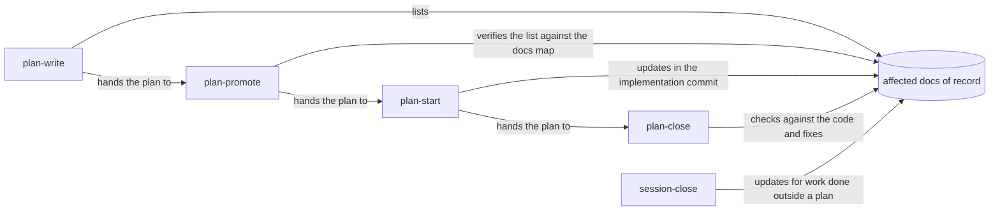

# Keep User and Maintainer Docs Current With Every Change

## Summary

The user guides and maintainer reference docs drift because no part of the plan workflow asks
anyone to update them. This plan does two things:

1. **Prevents new drift.** The plan skills tell agents which docs a change affects, update them with
   the code, and check them before a plan closes. A CI check catches broken references.
2. **Repairs existing drift.** It fixes the broken references found so far, then reviews each feature
   area's docs against the code, starting with the areas that changed most.

## Context

### Who owns doc upkeep today

[`docs/internal/docs-map.md`](../../internal/docs-map.md) names a **doc of record** for each feature
area: the one doc that owns the current behavior, which supporting docs link to instead of restating
it. No skill tells an agent to consult that map or update the doc it names.

| Skill | What it says about `docs/user/` and `docs/internal/` |
| --- | --- |
| `plan-write` | Nothing. A plan has no place to list the docs a change affects. |
| `plan-promote` | Reads documentation to verify the plan's claims; never says to update it. |
| `plan-start` | Nothing. "Keep the plan synchronized" covers only the plan document. |
| `plan-close` | Nothing. Step 3 checks the plan against the code, never the docs. |
| `session-close` | Step 2 updates "project-specific tracking docs" (ADR, changelog) but does not name guides or reference docs, and it defers to a "doc-refresh skill" that does not exist. |
| `builtin-support` | Step 5 updates README/docs tables, only while authoring skills. |

Commit `2d0ae02` removed the telemetry control from `/agents`. The current
`docs/user/reference/config-control-panel.md` still instructs readers to toggle a telemetry switch
on that page. This is a confirmed example of semantic drift that a path checker cannot catch.

### Drift found so far

At this review, the **reader-facing docs** are 54 Markdown files written for people rather than harnesses:
`README.md`, `docs/**/*.md` outside `docs/plans/`, and `manifests/inventory/README.md`. A throwaway
scan checked them for broken links, broken anchors, cited repo paths that no longer exist, and
removed CLI commands. The current-behavior errors confirmed by hand are:

| Doc | Broken reference | Current reality |
| --- | --- | --- |
| `docs/user/reference/roborepo-cli.md:111` | Links `developer-runtime.md` | The file is `runtime.md` |
| `docs/internal/root-domains.md` | `globals/agents/skills`, `globals/commands` | Directories no longer exist |
| `docs/internal/rules-parity-and-layering.md`, `docs/user/guides/setup-and-daily-use.md` | `generated/gemini/GEMINI.md` is a generated rules file | `manifests/platform/rule-targets.tsv` renders rules for Claude and Codex only; `generated/gemini/` holds only `policies/` |
| `docs/internal/cli-internals.md` | `scripts/cli/telemetry-transcript.mjs` | File no longer exists |
| `docs/internal/skill-reference-observation.md` | `globals/packages/skill-visibility/hooks/skill-reference-observer.mjs` | Path no longer exists |
| `docs/architecture/config-code-separation.md` | `manifests/platform/prompts/non-root-conflict.md` | File no longer exists |
| `docs/architecture/developer-runtime-container-support.md` | `docs/plans/active/developer-runtime-workspace-model.md` | Plan has left `active/` |
| `docs/architecture/documentation-map-and-audit.md` | `docs/user/reference/roborepo.md`, `docs/internal/permissions.md`; claims 25 reviewed files | `roborepo.md` was deleted in PR #16, leaving `roborepo-cli.md` and `cli-internals.md` to own the CLI; `permissions.md` was never written; there are now 54 docs |

Two mentions of `globals/claude/skills/` in `skills-and-commands.md` and `harness-anatomy.md`
correctly say that directory does not exist. `docs/internal/rename-readiness.md` is explicitly a
2026-09-13 snapshot and records an older generated policy name. The checker must not demand that
historical or explicitly absent paths exist; the semantic audit should make their dated or negative
status clear to readers.

**That scan can't see semantic drift.** User docs such as `plans-portal.md`, `runtime.md`,
`plan-suite.md` and `repositories.md` can pass reference checks while still describing old behavior.
The confirmed telemetry-control error shows why the code-to-prose audit remains necessary.

### Where the churn is

The original scan counted commits to each doc's cited code after the doc last changed. Combined
with the PR history at that time, it gives this audit starting order. Recheck the order against
current code and docs before each area; the counts and PR numbers are historical signals, not
current findings:

| Area | Docs | Evidence of churn |
| --- | --- | --- |
| Plans portal and plan suite | `docs/user/reference/plans-portal.md`, `docs/user/guides/plan/lifecycle/plan-suite.md`, `docs/internal/plans-portal-internals.md` | 12 commits to cited code since the internals doc changed; PRs #23, #25, #31, #33 |
| Home and repositories | `docs/user/reference/repositories.md`, `docs/internal/portal-architecture.md` | PRs #22, #24, #26 |
| Runtime | `docs/user/reference/runtime.md`, `docs/internal/developer-runtime-internals.md`, `docs/architecture/developer-runtime-container-support.md` | PRs #19, #20 |
| Onboarding and config panel | `docs/user/reference/config-control-panel.md`, `docs/internal/config-panel-internals.md`, `docs/user/guides/first-time-setup.md` | PR #28, `c2d1c13`, `2d0ae02` |
| Permissions and hooks | `docs/user/reference/claude-hooks.md`, `docs/user/reference/codex-hooks.md`, `docs/internal/hooks-internals.md` | `be7e441` |
| Telemetry and tokens | `docs/user/reference/telemetry.md`, `docs/user/guides/telemetry.md`, `docs/internal/telemetry-internals.md`, `docs/internal/tokens-portal-review.md` | 6 commits to cited code since 2026-10-01 |
| Harness and architecture | `docs/architecture/config-code-separation.md`, `docs/architecture/manifest-and-symlinks.md`, `docs/internal/harness-anatomy.md`, `docs/internal/harnesses-explained.md`, `docs/internal/skills-and-commands.md`, `docs/internal/rules-parity-and-layering.md`, `docs/internal/root-domains.md`, `docs/internal/roborepo-command-path.md` | `config-code-separation.md` unchanged since 2026-08-10, with 76 commits to its cited code since; PR #32 |

## Goals

- Every new or materially revised plan names the docs of record its change affects, or explains
  why no reader-facing doc is affected. Implementation updates affected docs with the behavior.
- `plan-close` checks affected docs against the landed code, fixes in-scope drift, and refuses
  closure if required drift remains.
- `npm run check` fails on a broken link, broken anchor, missing path asserted as current, or
  removed CLI command presented as current guidance in any reader-facing doc.
- Every doc in the churn table has been read against current code and corrected.
- `docs/internal/docs-map.md` is the single doc-ownership map.

## Non-goals

- Restructuring or merging docs beyond what correcting drift requires.
- Checking paths cited inside plan documents. That belongs to `p3vbk03v`.
- A machine-readable code-to-doc ownership map, or a check that flags a diff touching owned code
  without its doc. See Open Questions.
- Making the docs section of a plan a validator-required section.

## Related-plan reconciliation

| Plan | Current relationship | Consequence for this plan |
| --- | --- | --- |
| `p3vbk03v` (plan reference integrity) | **Plan-vs-code conflict, with unlanded path-check work.** Its backlog prose says `roborepo plans validate` is missing, but commit `b91f03f` landed that command and its command-catalog tests on `main`. `DOC_LINK_NOT_FOUND` and a plan-prose path extractor are still absent. | Use the existing validator now. Keep reader-facing docs outside its plan-document scope. Reuse its path extraction rules if they land first; otherwise make the docs checker independently correct and reconcile the two when the other plan is implemented. The other plan needs a separate prose sync; this plan does not change its lifecycle. |
| `q6lj4w96` (validation tiers) | **Unlanded related work, no dependency.** `package.json` has focused `test:*` scripts and `npm run check`, but none of the proposed `check:*` tier scripts; `scripts/test/ci.sh` runs the `ci` unit group. | Put the docs checker in today's `ci` group. If tiers land later, classify the docs checker as doc-relevant fast coverage so a docs-only change still runs it. |

Neither related plan blocks this work. The selected plan does not supersede the landed `plans
validate` contract or require the validation-tier design to be decided first.

## Proposed Design

### Doc freshness through the plan lifecycle

The skills are global and run in other repositories, so their wording must not assume roborepo's
layout. They refer to "the repository's doc-of-record map, when one exists". In roborepo, that is
`docs/internal/docs-map.md`.

| Skill | Change |
| --- | --- |
| `plan-write` | `references/writing-guidelines.md` and `references/workflow-create.md` add `## Documentation impact` guidance. New or materially revised plans list each affected doc of record and expected change, or say why none is affected. Existing plans without this section are not bulk-migrated. |
| `plan-promote` | Its workflow checks the documentation-impact list against the repository's doc map, when one exists, and the actual implementation scope; it fills an obvious omission before declaring readiness. |
| `plan-start` | The Implementation Workflow updates each listed doc with the code change and checks for newly affected docs discovered during implementation. Add a Completion Condition and final-report line `Docs updated: <list> \| none needed (<reason>)`. Its final implementation commit includes those doc changes. |
| `plan-close` | Step 3 checks the affected docs against landed code, fixes in-scope drift, and records the docs checked in `## Verification`; unresolved required drift prevents closure. |
| `session-close` | Step 2 names user guides and reference docs explicitly, uses a doc-of-record map when present, and removes the unused "doc-refresh skill" instruction. |

The skill sources live under `globals/packages/<package>/skills/<skill>/`. The `agents/openai.yaml`
files hold only display metadata, so Codex needs no parallel edit.

### Deterministic reference check

`scripts/test/docs-reference-check.mjs` scans `README.md`, Markdown under `docs/` except
`docs/plans/`, and `manifests/inventory/README.md`. A small pure scanning module under
`scripts/test/` owns extraction and resolution; the command reports a file, line, and reason for
each finding. `scripts/test/docs-reference-fixtures-check.mjs` exercises it against temporary docs
trees.

For each reader-facing doc it checks:

| Check | Source of truth |
| --- | --- |
| Inline and reference-style relative Markdown link targets exist, including images | Filesystem; strip URL fragments and queries before resolving the target |
| A local `#anchor` fragment resolves to a heading, including repeated headings | Export the existing `slugify` from `scripts/cli/markdown-render.mjs` so the check uses the renderer's heading IDs |
| Backticked literal repository paths asserted as current exist (`modules/`, `portal/`, `scripts/`, `globals/`, `manifests/`, `generated/`, `docs/`, ...) | Filesystem; exclude fenced examples, placeholders, globs, documented generated or gitignored outputs such as `docs/.jdm-indexed`, and explicit descriptions of absent or historical paths |
| Current guidance does not present a removed CLI command as executable | `manifests/platform/cli/removed.json`; historical descriptions and migration explanations remain allowed |

It joins the `ci` group in `scripts/test/check-groups.json`, which `scripts/test/ci.sh` runs. Keep
the existing command-catalog check: it protects a different, explicitly enumerated set of code and
doc files. If `p3vbk03v`'s extractor lands first, reuse its treatment of fenced blocks and
forward references. If it has not landed, implement the reader-doc rules here without waiting for
it; a future shared extractor must preserve each check's different scope.

## Implementation Plan

### Phase 1: Mechanical repair and the reference check

- [ ] Export `slugify` from `scripts/cli/markdown-render.mjs`; `scripts/test/markdown-render-check.mjs` stays green.
- [ ] Write the docs scanner and `scripts/test/docs-reference-check.mjs`. Add `scripts/test/docs-reference-fixtures-check.mjs` with seeded failures for link targets, anchors, literal paths, and removed commands, plus skip cases for fences, placeholders, generated paths, negative and dated historical descriptions, migration explanations, and external URLs.
- [ ] Fix every confirmed finding in the Context table, verifying each replacement against the code.
- [ ] Fix any further findings the new check reports.
- [ ] Add both docs check suites to the `ci` group in `scripts/test/check-groups.json`.

### Phase 2: Doc freshness in the plan skills

- [ ] `plan-write`: add the `## Documentation impact` guidance to `references/writing-guidelines.md` and `references/workflow-create.md`.
- [ ] `plan-promote`: extend workflow step 3 to verify the documentation-impact list.
- [ ] `plan-start`: add the doc-update step, Completion Condition and final-report line.
- [ ] `plan-close`: extend step 3 and the `## Verification` contents.
- [ ] `session-close`: rewrite step 2 as described in Proposed Design.

### Phase 3: Semantic audit

For each area, read every listed doc against the relevant current code, tests, and UI behavior.
Correct confirmed drift and record the evidence in the implementation notes. Keep the edits scoped
to each area so they can be reviewed independently.

- [ ] Plans portal and plan suite
- [ ] Home and repositories
- [ ] Runtime
- [ ] Onboarding and config panel, including the confirmed stale telemetry-switch instruction in `docs/user/reference/config-control-panel.md`
- [ ] Permissions and hooks
- [ ] Telemetry and tokens
- [ ] Harness and architecture

### Phase 4: Ownership record

- [ ] Keep `docs/architecture/documentation-map-and-audit.md` as a dated historical audit, remove its duplicate live ownership map and current-state claims, and point readers to `docs/internal/docs-map.md` for current ownership.
- [ ] Update `docs/internal/docs-map.md` for any doc added, renamed or retired during the audit.

## Validation

- `node scripts/test/docs-reference-check.mjs` reports zero findings on the live reader-facing docs.
- `node scripts/test/docs-reference-fixtures-check.mjs` passes; each seeded break produces the expected finding and non-zero checker exit, while each exclusion stays silent.
- `npm run check` passes with both docs check suites in the `ci` group.
- `roborepo plans validate irpw877r --json` reports no blocking findings.
- `node scripts/test/skill-trigger-fixtures-check.mjs` and `node scripts/test/skill-trigger-fixtures-shipping-check.mjs` pass after the skill edits; run the repository's skill/package checks for changed package sources.
- Each Phase 2 skill edit can be found by reading the skill: the instruction is in the step named in
  Proposed Design.
- No automated test can show an agent following the new instructions. The first plan that runs
  through `plan-start` and `plan-close` after Phase 2 confirms it: its final report carries the
  `Docs updated:` line, and its `## Verification` names the docs it checked. Record that run as a
  `## Not tested` entry until it happens.
- The implementation report lists each Phase 3 area's docs, the current code or UI checked, and any correction made; a doc with no change gets an explicit checked-and-current result.

## Risks

| Risk | Mitigation |
| --- | --- |
| The path check flags legitimate non-paths and gets ignored | Phase 1 tunes it to zero findings on the live tree before it joins CI; fixtures pin each skip rule |
| The plan-close doc check becomes a box-ticking step | It names the specific docs from the plan's list rather than "the docs", and `## Verification` records what was compared |
| The global skill wording assumes roborepo's layout | Wording refers to "the repository's doc-of-record map, when one exists" and never to roborepo paths |
| Phase 3 grows into a rewrite | Each area corrects drift only; structural ideas go to a follow-up plan |

## Decision Log

- Keep `documentation-map-and-audit.md` as a historical audit. Retiring its duplicate map makes
  `docs/internal/docs-map.md` the current ownership source while preserving the earlier findings.
- Defer machine-readable code-to-doc ownership. The plan workflow and deterministic reference
  check can ship without a new manifest; evaluate missed semantic updates after the workflow has
  been used on several plans.

## Open Questions

None blocks implementation.
