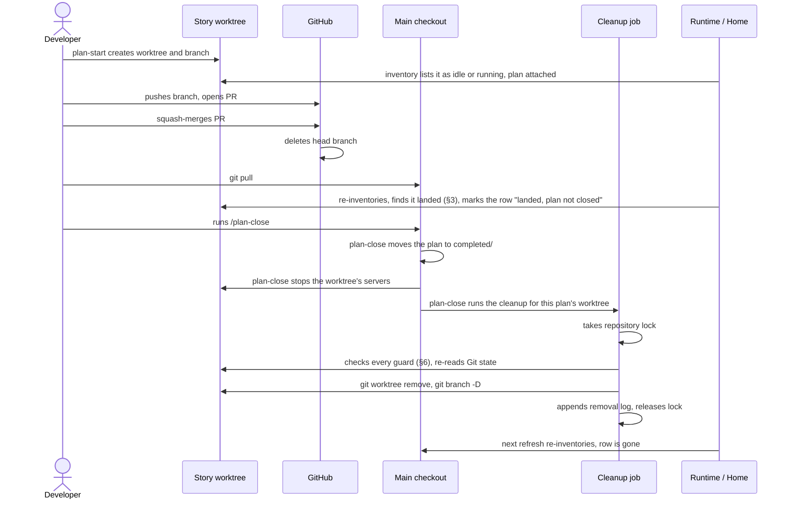
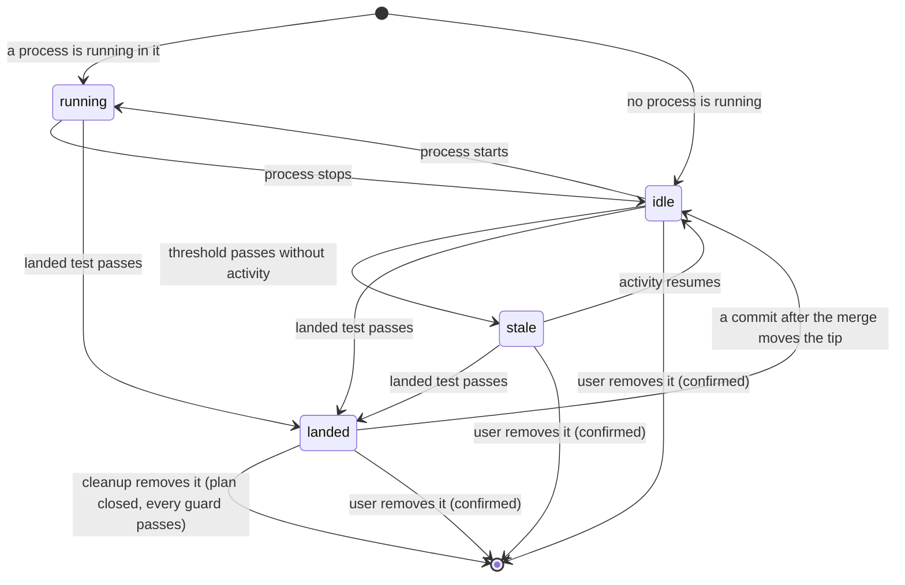
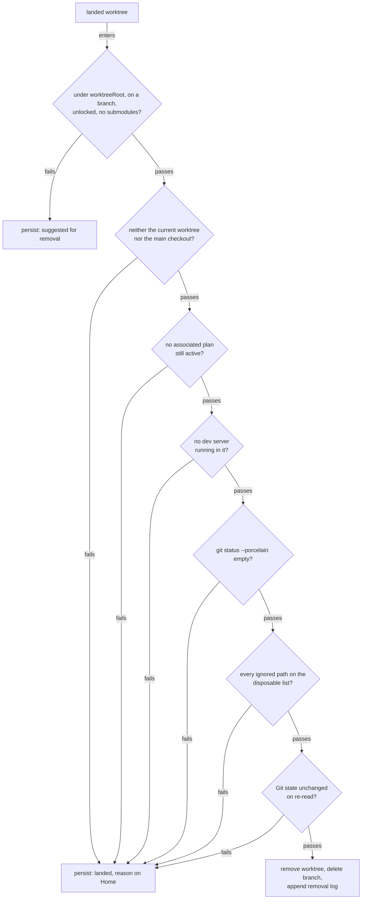
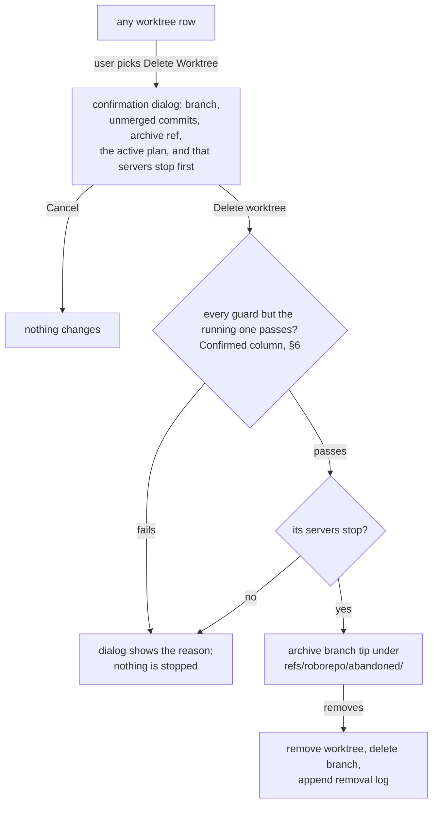

# Retire Story Worktrees When Their Work Lands

## Summary

Each story gets its own linked worktree, created by `plan-start`, and the work stays there until
its branch merges. Nothing removes the worktree afterward, and Home stops showing a worktree as soon
as nothing is running in it. At `f877579` this repository had eleven linked worktrees and sixteen
local branches besides `main`. Eleven of those branches had landed in `main` by the test in §3, and
Home lists a worktree only while something runs in it.

This plan gives every worktree a lifecycle state that Home shows, and splits removal by whether the
work landed:

| Worktree | Removed by | How |
| --- | --- | --- |
| Landed, with an associated plan | `/plan-close`, as its last step | after moving the plan to `completed/` and stopping the worktree's servers, it removes the worktree and branch behind the guards in §6 (§9) |
| Landed, no associated plan | the cleanup job, once the user turns it on | pulling `main` triggers cleanup behind the guards in §6; Home offers to turn it on when the plan-close package is disabled (§8) |
| Any worktree the user no longer wants (abandoned, superseded, an experiment) | the user, explicitly | Delete Worktree in the row's menu, with confirmation; it stops the worktree's servers, and the branch tip stays restorable (§7) |

Worktrees untouched past a configurable threshold are marked `stale` and suggested for removal. It
all works on plain Git; the GitHub CLI is not required.

## Goals

- [x] Show every linked worktree of a known repository on Home, running or not and without
      collapsing them behind a count, so a story's worktree and its associated plan stay visible for
      the whole story.
- [x] Derive one lifecycle state per worktree: `running`, `idle`, `stale`, or `landed`.
- [x] Decide "landed" from content, so squash and rebase merges count, without the `gh` CLI, and
      keep the answer stable as `main` moves on.
- [x] Remove landed, clean worktrees and their local branches automatically, along with landed
      local branches that have no worktree, behind the guards in this plan.
- [x] Never remove a worktree before `/plan-close` has closed its plan, and have `/plan-close`
      remove it as the last step of closing, so one command finishes the story.
- [x] Let the user remove any worktree from a menu on its Home row, after a confirmation, keeping
      its branch tip restorable.
- [x] Suggest stale worktrees for removal after a threshold that defaults to 7 days and is
      configurable in settings and through an environment variable.
- [x] Trigger automatic removal from an opt-in Git `post-merge` hook, so a pull of `main` after a
      GitHub merge cleans up, and let a user without the plan suite turn it on from Home.

## Non-goals

- Deleting remote branches. GitHub's **Automatically delete head branches** repository setting
  owns that, and `fetch.prune` keeps local remote-tracking refs in step with it.
- Automatically removing a worktree that has not landed. Stale means not merged; it is suggested,
  and only the user removes it.
- Collapsing idle and stale worktrees behind a count on Home, or hiding them. The user decided on
  2026-10-02 that Home lists every worktree, and on 2026-10-11 that removal is the per-worktree
  action (§7).
- Installing the hook where the plan suite already closes stories. With the plan-close package
  enabled, `/plan-close` is the removal path and Home does not offer the hook (§8).
- Installing a global `core.hooksPath`. That would disable every repository's own hooks.
- Plan closeout. Closing a plan belongs to `/plan-close` ([[age4cm7r]]); see §9.
- Requiring the `gh` CLI, or treating its presence as changing which worktrees are eligible.
- Pruning worktree records whose directory was deleted by hand. `git worktree prune` owns that.

## Current State

Verified on `main` at `f877579`, except where a subsection gives its own measurement.

### Home shows only running worktrees

For a running repository, the Runtime snapshot lists each checkout that has a live member plus the
main checkout, and nothing else (`modules/developer-runtime/snapshot.mjs`, the `idleMainCheckouts`
loop: "other stopped worktrees stay off the card"). A repository with nothing running shows the
checkouts its registry record lists (`collectPersistedRepositories` in
`scripts/cli/developer-runtime.mjs`). Home's checkout list is built from those roots in
`scripts/cli/repository-overview-sources.mjs#projectWorkspace`.

The plan↔worktree association from `wk7p4n2` joins only against those listed checkouts (its
decision 6), so a plan whose worktree has nothing running falls back to Additional Plans. Observed
on 2026-10-02: Home listed `main` plus the two worktrees with listeners (ports 59468 and 4317), while
`codex/telemetry-analytics-oracle` and `claude/plan-worktree-home-association` existed on disk with
nothing running and did not appear.

### Plans already enumerates every worktree; Home does not

`modules/plan-suite/checkouts.mjs#repositoryCheckouts` lists the main checkout and every linked
worktree of a known repository by reading Git's administrative files
(`<commonDir>/worktrees/<name>/gitdir`), with no subprocess. `canonical-scan.mjs` uses it to read
plan copies from every checkout. Nothing on the Runtime or Home side calls it.

### What is already persisted

| Fact | Where | Granularity |
| --- | --- | --- |
| Checkouts seen, with `firstSeenAt` / `lastSeenAt` | registry `localRoots[]` on each repository record, plus the top-level `localRootPaths` index (`modules/repositories/schema.mjs`) | per checkout |
| `active` / `idle` / `stale` lifecycle, 30-day age-out | `modules/repositories/lifecycle.mjs` (`deriveLifecycle`, `AGE_OUT_MS`) | per repository |
| Hidden from the normal list, returned through "Show hidden" | registry `visibility: "hidden"` (`modules/repositories/schema.mjs`) | per repository |
| Agent session events with `repository_id` and `branch` | `scripts/cli/telemetry-capture.mjs` | per event |

Checkouts reach the registry two ways, both through `registerLocalRoot`:

- `recordRepositoryDiscovery` in `scripts/cli/repositories.mjs`, for projects Runtime sees running.
- `scripts/cli/repository-source-refresh.mjs`, for repositories found under a configured directory
  source. Linked worktrees are not roots of their own there (`modules/repositories/discovery-walk.mjs`).

A worktree used only for editing is therefore never recorded.

### Nothing removes a worktree, and nothing hooks Git

No module, CLI script, or skill runs `git worktree remove` or deletes a merged branch. A search of
`modules/`, `scripts/` (excluding `scripts/test/`), `bin/`, `portal/`, and the package skills found
none. `/plan-close` step 8 stops a closed worktree's servers but leaves the worktree in place. The
repository installs no Git hooks and never sets `core.hooksPath` in a repository's config.

### Git runs through one hardened seam

`modules/repositories/git-exec.mjs` runs Git with hooks disabled (`core.hooksPath=/dev/null`), no
optional locks, no prompts, and a 1.5 s timeout:

| Entry | Allows | Used by |
| --- | --- | --- |
| `defaultRunGit` / `defaultRunGitSync` | only the read-only `GIT_READONLY_COMMANDS` allow-list | branch status, idle-checkout reads |
| `runGitProcess` | any subcommand, same hardening, caller-chosen timeout | `git-remote-operations.mjs` (`fetch`, `push`, 20 s timeout) |

`merge-tree --write-tree`, `worktree remove`, `branch -D`, and `update-ref` are not on the
allow-list, and should not be added to it; they belong on the `runGitProcess` path, as fetch and
push already are. Three older private `git()` helpers predate the seam
([[git-exec-consolidation]]).

### Squash merges hide landing from ancestry

This repository squash-merges pull requests, so a landed branch's commits are never ancestors of
`main`. Comparing content settles it instead. A `main` commit **absorbs** a branch when merging the
branch into that commit changes nothing:

```bash
git merge-tree --write-tree <main-commit> <branch>   # prints a tree id on its first line
git rev-parse <main-commit>^{tree}                   # equal ⇒ <main-commit> absorbs <branch>
```

Checking each first-parent commit of `origin/main` since the branch's fork, and stopping at the
first that absorbs it, finds every merged branch at its PR's squash commit and reports both unmerged
branches as not landed:

| Branch | Worktree | Own work | First-parent scan |
| --- | --- | --- | --- |
| `claude/plan-worktree-home-association` | under `worktreeRoot` | yes | landed at `14b1ed6` (#23) |
| `claude/portal-home-plan-first-hierarchy` | under `worktreeRoot` | yes | landed at `bff0bf4` (#24) |
| `claude/plan-suite-atomic-commands` | under `worktreeRoot` | yes | landed at `b91f03f` (#25) |
| `claude/portal-repository-sources` | under `worktreeRoot` | yes | landed at `8aef67f` (#26) |
| `codex/portal-repository-home-and-detail` | under `worktreeRoot` | yes | landed at `701061f` (#22) |
| `codex/portal-onboarding-settings` | under `worktreeRoot` | yes | landed at `c94820e` (#28) |
| `claude/localhost-runtime-layout-b3215c` | `.claude/worktrees/` | yes | landed at `85390e9` (#20) |
| `claude/localhost-runtime-ui-updates-14cbbd` | `.claude/worktrees/` | no (tip is a `main` commit) | not landed by §3 |
| `docs/simplify-public-docs`, `fix/test-portal-leaks`, `rename-prep`, `tokens2` | none | yes | landed (#16, #18, #15, #14) |
| `claude/plan-localhoster-row-layout-2b92cb`, `claude/runtime-row-layout-skill-f8086e` | none | no (tips are `main` commits) | not landed by §3 |
| `codex/telemetry-analytics-oracle`, `codex/telemetry-tokens-conditions-report` | under `worktreeRoot` | yes | not landed (25 and 27 commits scanned) |

A detached worktree (`.claude/worktrees/runtime-row-layout-skill-f8086e`) sits on `d19c7b1`, a
`main` commit. `merge-tree --write-tree` needs Git 2.38 or later; these measurements used Git 2.50.1.

### `git worktree remove` deletes ignored files without asking

Git calls a worktree clean when it has no tracked modifications and no untracked files. Ignored
files do not count, so `git worktree remove` deletes them even without `--force`. Measured on
2026-10-02 with Git 2.50.1, in a scratch repository whose `.gitignore` lists `.env`:

```console
$ echo SECRET > ../w1/.env
$ git -C ../w1 status --porcelain     # prints nothing: the worktree counts as clean
$ git worktree remove ../w1           # exits 0
$ ls ../w1
ls: ../w1: No such file or directory
```

The ignored files present in this repository's worktrees on 2026-10-02 were disposable. Both
`codex/telemetry-analytics-oracle` and `.claude/worktrees/localhost-runtime-layout-b3215c` listed
only these under `git status --ignored --porcelain`:

```text
!! node_modules/
!! test-results/
```

A worktree holding a local `.env`, a SQLite file, or `.claude/settings.local.json` would lose it
silently. §6's ignored-files guard exists for exactly this.

## Proposed Design

### 1. Happy path: a story from start to removal



Every other path in this design is a branch off this one: a guard that fails keeps the worktree
(§6), and a story that never merges waits for the user to remove it (§7). A worktree with no
associated plan has nothing for `/plan-close` to close; the opt-in hook removes it on the first pull
after it lands (§8), and without the hook the user removes it from its row. If a guard blocks the
`/plan-close` removal (say, an untracked file), the row stays "landed" with the reason shown, and
the user clears the reason and removes it from the row, or any later cleanup run removes it.

### 2. Inventory every linked worktree

For each known repository with a readable main checkout, list every linked worktree from Git's
administrative files, the way `repositoryCheckouts` already does, and record per worktree:

| Field | Read from `<commonDir>/worktrees/<name>/` |
| --- | --- |
| Path | `gitdir` |
| Administrative name (the plan `worktree` join key) | the directory name |
| Branch, or detached commit | `HEAD`: `ref: refs/heads/<branch>`, or a bare commit id |
| Locked | a `locked` file is present |

An entry whose `gitdir` points at a missing directory is reported as prunable and never acted on.

The admin-file reader moves from `modules/plan-suite/checkouts.mjs` into `modules/repositories/`,
which already owns `resolveGitDir`, so Plans and cleanup share one enumerator. This replaces "seen
running" as the way a worktree becomes known, so a story worktree is listed from the moment
`plan-start` creates it.

### 3. Decide "landed" from content, never from a fresh branch

A branch with no work of its own trivially passes a content test, because its tree already equals
`main`. A brand-new story worktree would therefore read as landed and be removed. Landed requires
both conditions:

| Condition | Test |
| --- | --- |
| The branch carried its own work | at least one commit in `<start>..<branch>` is not on `<base>`'s first-parent history (`git rev-list --first-parent <base>`) |
| That work reached the base | some commit `M` in `git rev-list --first-parent --reverse <fork>..<base>` absorbs it: `git merge-tree --write-tree M <branch>` exits 0 and prints `M^{tree}` |

| Term | Resolved as |
| --- | --- |
| `<base>` | the remote's default branch (`refs/remotes/origin/HEAD`), falling back to the local default branch |
| `<start>` | where the branch began: the oldest entry of its reflog (`git reflog show <branch>`), falling back to the branch tip when the reflog has expired or never existed so missing history cannot establish own work |
| `<fork>` | `git merge-base <base> <branch>` |

The scan stops at the first absorbing commit, which for a squash merge is the PR's own commit, so a
merged branch usually costs one `merge-tree`. An unmerged branch costs one per first-parent commit
since its fork. The scan is capped (500 commits to start); past the cap the branch counts as not
landed. Because `M` is fixed history, a branch that landed stays landed however `main` changes
later, until a new commit on the branch moves its tip.

How the own-work condition classifies common histories:

| History | Own work? | Why |
| --- | --- | --- |
| Fresh worktree, no commits | no | `<start>..<branch>` is empty |
| `plan-start` fast-forwarded a fresh worktree to its transition commit | no | that commit is on `main`'s first-parent history |
| Created from another branch's tip, no commits since | no | `<start>..<branch>` is empty |
| Squash- or rebase-merged on GitHub | yes | the branch's own commits never reach `main` |
| Merged with a merge commit, reflog present | yes | its commits are reachable from `main` only through a second parent |
| Merged with a merge commit, reflog expired | no | the fallback `<start>` is the branch tip, so the range is empty; it ages into `stale` instead |
| Fast-forwarded into `main` locally | no | its commits are now first-parent history; it ages into `stale` instead |
| Merged into another feature branch (stacked PR) | yes | own work exists, but no first-parent `<base>` commit absorbs it until the stack lands |

And how the base condition handles what happens to `main` after a merge:

| After the merge | Landed? | Why |
| --- | --- | --- |
| `main` later edits, moves, or deletes files the branch touched | yes | the squash commit still absorbs the branch |
| A commit is added to the branch | no | no `main` commit contains the new tip |
| `main` reverts the merge | yes | the work is in history at `M`; the removal log records the tip for restore |

The test runs Git through `runGitProcess` in `modules/repositories/git-exec.mjs` with an explicit
timeout. `merge-tree --write-tree` writes unreferenced tree objects, which `git gc` collects.

### 4. One state per worktree



Each state decides what Home shows and what may remove the worktree:

| State | Meaning | Home | Automatic action | Delete Worktree in the row menu |
| --- | --- | --- | --- | --- |
| `running` | A Runtime member runs in it | today's row | none | stops its servers, then deletes; Stop Server is offered beside it |
| `idle` | No process, recent activity, not landed | dimmed row with no port (no "idle" label: a missing port already says it); its plan attaches | none | with confirmation |
| `stale` | Idle past the threshold, not landed | dimmed row, a neutral "stale" pill | none | with confirmation |
| `landed` | Passes §3 | a purple "merged" pill (tooltip "Merged into <base>") before the Git warnings; a note only for a blocking reason ("plan not closed", "not in worktree folder") or "removed on next pull" when the hook is installed | removed when every guard passes and a trigger runs (§8) | with confirmation |

`landed` takes precedence over the others, but a running landed worktree is never removed (§6). No
row shows an action inline: they live in the row's menu (§7), so the card reads as a status list. A
merged row also drops the Git drift warning (behind, unpushed), which only matters for work in
progress; the checkout tooltip and the worktree dropdown keep the facts.

### 5. Last activity is the latest of several signals

"Last run" alone would mark a story stale while it is being edited without a dev server.

| Signal | Source |
| --- | --- |
| Runtime last saw a member running in it | registry `localRoots[].lastRunningAt`, written by the inventory when Runtime reports a member running in the worktree |
| Last commit on the branch | `git log -1 --format=%cI <branch>` |
| Last agent session on the branch | telemetry events matching `repository_id` and `branch` |

`lastSeenAt` is not the signal: registering a worktree found by inventory stamps it with nothing
running, which would keep every worktree from reading `stale` until the threshold had passed since
its first inventory.

The threshold defaults to 7 days. Precedence: the `ROBOREPO_WORKTREE_STALE_DAYS` environment
variable, then the `worktreeStaleDays` preference beside `historyRetentionDays` in
`modules/developer-runtime/settings-schema.mjs`, then the default. A non-positive or non-numeric
value is rejected with a finding rather than silently ignored.

### 6. Removal guards

Two kinds of removal share one set of guards. Automatic removal applies only to `landed` worktrees;
confirmed removal (§7) applies to any worktree the user picks. They differ where the user's
confirmation can stand in for evidence, and agree wherever data could be lost.

The gates automatic removal passes through, in order:



A persisted worktree is reconsidered on the next pull or cleanup run, so clearing the reason (say,
committing the stray file, or closing the plan) is enough for the next pass to remove it.

Every guard, with its outcome for each kind of removal:

| Edge case | Guard | Automatic | Confirmed (§7) |
| --- | --- | --- | --- |
| Not landed: brand-new, commits after the merge, or never merged | §3's landed test | not a candidate | allowed; the confirmation replaces the test and the branch tip is archived |
| Outside the repository's worktree folder, such as the desktop app's `.claude/worktrees/` | path check against `worktreeRoot` from `docs/plans/plans-config.json`, or else the folder the user confirmed when turning cleanup on (§8); a repository with neither gets suggestions only | suggest only | allowed |
| Detached HEAD | the worktree's `HEAD` holds a commit id | suggest only | allowed; there is no branch to delete, so HEAD is archived under the worktree's administrative name |
| Locked, or has submodules | `locked` file; `.gitmodules` present | suggest only | refused; Git itself requires `--force` |
| The current worktree or the main checkout (the hook also fires when merging `main` into a feature branch) | path comparison | refused | refused |
| Its plan is still `active` | an active plan whose `worktree` frontmatter equals the worktree's administrative name; an active plan that names no worktree cannot protect one | skipped, "plan not closed" shown | allowed; the confirmation names the plan |
| A dev server is running in it | Runtime reports a live member; under `/plan-close`, its step 8 has already stopped them | skipped, reason shown | refused, reason shown |
| Uncommitted or untracked changes | `git status --porcelain` is empty | skipped, reason shown | refused, reason shown |
| Valuable ignored files (`.env*`, local databases, `.claude/settings.local.json`) | `git status --ignored --porcelain` lists only paths on the disposable list; see Current State for why | skipped, blocking path shown | refused, blocking path shown |
| Another session changed the state after the survey | re-read Git state immediately before each removal | skipped | refused |
| Two cleanups start together (quick successive pulls, or pulls in two worktrees) | a per-repository lock file under the state root | second run exits | refused while the lock is held |

The disposable list starts as the paths observed in this repository's worktrees: `node_modules/`
and `test-results/`. Anything else ignored blocks removal and names itself in the reason.

Removal runs `git worktree remove <path>` (never `--force`), then `git branch -D <branch>`, because
squash-merged branches need `-D`. Both go through `runGitProcess` with a timeout long enough for a
large `node_modules`. A landed local branch with no worktree is deleted the same way, unless it is
checked out anywhere; it has no worktree to join a plan on, so the plan guard does not apply. Each
removal appends path, branch, and commit to a removal log under the state root, so
`git branch <branch> <commit>` and `git worktree add <path> <branch>` can restore it.

### 7. Removing a worktree from Home

A story can end without merging: abandoned, superseded by another branch, or an experiment. A
landed worktree can also stay behind when a guard blocked its cleanup, or when no trigger has run.
Every worktree row on Home therefore offers two actions, never inline:

| Row | Where the actions live |
| --- | --- |
| A worktree an active plan claims (the plan is the row) | the foot of the row's worktree dropdown, styled as menu items |
| A worktree no plan claims | a right-aligned ⋮ menu, the shared `mountActionMenu` that repository cards already use |

| Action | Shown | Does |
| --- | --- | --- |
| Stop Server | while something runs in the worktree | SIGTERMs the dev servers listening from it, as `/plan-close` step 8 does |
| Delete Worktree | always | opens the confirmation; confirming stops the worktree's servers, then removes it |



Checking the other guards before stopping anything means a deletion that would be refused anyway,
say for uncommitted changes, never takes the user's servers down. After the stop, the full guard
pass runs again, including the running guard, so a container or the portal itself still keeps the
worktree.

The confirmation is a portal dialog, not the browser's native `confirm`, so it matches the rest of
Home and can show the guard's reason in place when removal is refused. Removal is reversible with
`git branch <branch> refs/roborepo/abandoned/<branch>`, then `git worktree add <path> <branch>`.

The archive ref keeps an unmerged branch's commits reachable, so `git gc` cannot collect them after
the branch is deleted. Archive refs stay until the user deletes them; they do not appear in
`git branch` output. A remote copy of the branch is never touched.

The Home actions call token-guarded `POST` routes in `scripts/cli/portal-routes-repositories.mjs`,
which share the cleanup orchestrator and `stopCheckoutServers` with the command and `/plan-close`,
so Home and the CLI cannot disagree about a guard.

### 8. Triggers

| Trigger | When it fires | Does |
| --- | --- | --- |
| `post-merge` hook (opt-in) | after `git merge` completes, which includes the merge step of `git pull` | starts the cleanup detached, with output to a log, and returns at once |
| Home cleanup notice | when the user picks **Turn on automatic cleanup** in a card's footer notice | confirms the worktree folder, records it, and installs the hook for that repository |
| `/plan-close`, last step | after it closes a complete plan and stops its servers | runs the cleanup command scoped to that plan's worktree, and reports the removal or the guard that blocked it |
| `roborepo` cleanup command | when invoked | dry run by default; applies with an explicit flag; takes a plan to scope to that plan's worktree, as `roborepo plans stop-servers <plan>` does; removes a named branch with `--remove <branch> --confirm` |
| Home Delete Worktree / Stop Server | when the user confirms Delete Worktree, or picks Stop Server, in a row's menu | stops that worktree's servers; Delete then runs the command's confirmed removal for it |
| Runtime refresh | each snapshot | derives and displays states; never removes |

The hook does not fire on `git fetch`, on the GitHub merge button itself, or on a merge stopped by
conflicts. Its behavior on a fast-forward `git pull`, on a pull that is already up to date, and on
`git pull --rebase` is unmeasured here; Phase 4 measures all three. Because worktrees share one
hooks directory, the hook also fires in feature worktrees, which is why the current-worktree guard
exists.

Installation is per repository and opt-in. Who is offered it depends on the plan suite:

| Plan-close package on this machine | Removal path | Home offers the hook |
| --- | --- | --- |
| enabled | `/plan-close` removes each story's worktree; Delete Worktree in the row menu covers the rest | no |
| disabled | the hook, once the user turns it on; Delete Worktree in the row menu | yes, in the card footer |

The offer is a notice in the repository card's footer, where token warnings already appear, because
it changes one repository's Git hooks. It appears when the plan-close package is disabled, the
repository has at least one linked worktree, and the hook is not installed there; the user can
dismiss it for that repository. **Turn on automatic cleanup** opens a dialog that confirms the
worktree folder automatic removal may act in:

- With `docs/plans/plans-config.json` naming a `worktreeRoot`, that folder is used and shown.
- Otherwise the dialog proposes the deepest folder containing every linked worktree outside
  `.claude/worktrees/`, which the user can edit. RoboRepo records the confirmed folder on the
  repository's registry record, and the guards in §6 read it.

Confirming calls a token-guarded `POST` route that runs the same installer as
`roborepo git worktrees hook install`. A foreign `post-merge` hook or a global `core.hooksPath`
cannot be handled automatically, so the dialog reports it: the line to add to the existing hook, or
the refusal reason. The command stays available for scripted setups.

The installer writes into the directory Git runs hooks from. If a foreign `post-merge` hook is
already present, the installer does not overwrite it; it prints the one line to add instead.

| `core.hooksPath` | Installer writes to | Hook fires for merges in |
| --- | --- | --- |
| unset | the common Git directory's `hooks/` | every checkout |
| absolute, in repository config | that directory | every checkout |
| relative, in repository config (Husky sets one) | that path under the main checkout | the main checkout only; the installer says so |
| in worktree config | that path in the checkout that set it | that checkout only |
| in global or system config | nothing; it refuses | — |

Git resolves a relative `core.hooksPath` inside the working tree that runs the hook, so a linked
worktree looks for its own copy. Measured with Git 2.50.1: with `core.hooksPath=.githooks` and the
hook in the main checkout's `.githooks/`, a merge in a linked worktree ran no hook and a merge in
the main checkout did. Pulling `main` happens in the main checkout, and one cleanup run covers every
worktree, so the main-checkout hook still serves the design.

The hook calls absolute paths to `node` and the roborepo CLI entry, recorded at install time.
Git clients run hooks with their own `PATH`, and GUI clients often omit the npm prefix where
`roborepo` lives. The installer refuses a CLI path inside one of the repository's linked worktrees,
because the cleanup the hook starts removes that worktree once it lands.

Git exports `GIT_DIR` to a hook running in a linked worktree. `runGitProcess` drops the
repository-locating variables that `git rev-parse --local-env-vars` lists, so the cleanup a hook
starts reads each candidate worktree's own status rather than the hooked worktree's index.

A hook stays correct if the user enables the plan-close package later. Cleanup reads
`docs/plans/active/*.md` directly, not the package state, so a worktree whose active plan names it
waits for `/plan-close`, and the hook keeps removing landed worktrees no plan claims. An active plan
that does not name its worktree (one written before plans recorded worktrees) cannot protect it: if
its branch lands, the hook may remove the worktree first and `/plan-close` then reports
`landed: unconfirmed`. The work is in the base branch and the removal log holds the tip, so this is
documented rather than guarded.

### 9. Relationship to `/plan-close`

This plan owns worktree and branch lifecycle end to end: the inventory, the landed test, the guards,
automatic removal of landed work, and confirmed removal of any worktree from Home. `/plan-close`
([[age4cm7r]]) owns closing the plan, needs the worktree to still exist to do that, and then hands
the worktree to this plan's cleanup as its last step.

| Step | `/plan-close` today | With this plan |
| --- | --- | --- |
| Find the branch | resolves it from the plan's `worktree` through `git worktree list --porcelain`; refuses with `landed: unconfirmed` when it no longer resolves | unchanged; the plan-active guard keeps the worktree until the plan closes |
| Decide landed | `merge-base --is-ancestor`, then a file-by-file comparison of the branch's implementation files against the base | the same first-parent test as §3, described in tool-neutral prose so the skill stays usable outside roborepo |
| After closing | stops the worktree's servers (step 8) | unchanged |
| Last step | none; the worktree and branch stay | new step 9 runs the repository's canonical worktree cleanup command for the plan, in the same tool-neutral wording as step 8, and reports what was removed or which guard blocked it; skipped for an archived or refused plan, or in a repository with no such command |

Reconciliation notes for related plans, recorded here rather than edited into them:

- [[age4cm7r]] is `active` although PR #25 landed at `b91f03f`. Its `next_action` expects
  `/plan-close` to report `landed: unconfirmed` until this plan exists. Its prose says `/plan-close`
  already uses this plan's landed test, which is not yet true of the skill. The first-parent scan
  finds `claude/plan-suite-atomic-commands` landed at `b91f03f`, so Phase 1's skill change unblocks
  its close. It also `depends_on` this plan; this plan does not depend on it.
- [[6q16tocb]] makes an active plan's assigned worktree the authority for its plan copy. Because
  automatic removal waits for the plan to leave `active`, it never removes an authoritative copy.
  Confirmed removal of an active plan's worktree can, and the archive ref keeps that copy's commits.

## Affected Repository Files

| Area | Path | Change |
| --- | --- | --- |
| Inventory | `modules/repositories/worktree-inventory.mjs` | New: the admin-file enumerator moved from `checkouts.mjs`, extended with branch, detached, locked, and prunable |
| Landed test | `modules/repositories/worktree-landed.mjs` | New: the §3 own-work check and first-parent scan, through `runGitProcess` |
| Plans checkout listing | `modules/plan-suite/checkouts.mjs` | Consume the shared enumerator instead of its private `linkedWorktrees` |
| State derivation | `modules/repositories/worktree-state.mjs` | New: §4 and §5, a pure function of inventory, activity, threshold, and clock |
| Guards | `modules/repositories/worktree-guards.mjs` | New: §6 guards as single-purpose checks, each taking the removal kind and returning pass or a reason |
| Git seam | `modules/repositories/git-exec.mjs` | Drop the repository-locating environment variables a hook inherits, so `cwd` alone chooses the repository |
| Removal | `modules/repositories/worktree-removal.mjs` | New: worktree and branch removal, archive ref, removal log, lock, all through `runGitProcess` |
| Cleanup orchestration | `scripts/cli/worktree-cleanup.mjs` | New: the command, hook, and Home-action entry; sequences inventory → state → guards → removal |
| Cleanup policy | `scripts/cli/worktree-policy.mjs` | New: the worktree folder (plans config, else the recorded one), the folder proposal, and active plans' worktree claims |
| Cleanup opt-in | `scripts/cli/worktree-cleanup-optin.mjs` | New: Home's turn-on (folder validation, record, install) and dismissal |
| Registry | `modules/repositories/schema.mjs`, `modules/repositories/registry.mjs` | Allow recording linked worktrees found by inventory, with an optional `lastRunningAt`; an optional per-repository record of the confirmed worktree folder and a dismissed cleanup notice |
| Runtime snapshot | `scripts/cli/developer-runtime.mjs`, `modules/developer-runtime/snapshot.mjs` | The CLI reads the inventory and injects it, as it already injects `idleMainCheckouts`; the snapshot adds those worktrees as roots |
| Home projection | `scripts/cli/repository-overview-sources.mjs`, `scripts/cli/repository-overview-projections.mjs` | Carry worktree state and the guard reason in `projectWorkspace`, and the cleanup-notice state per repository |
| Home actions | `scripts/cli/portal-routes-repositories.mjs`, `scripts/cli/worktree-hook.mjs` | Token-guarded `POST` routes for remove and for turning cleanup on, calling the cleanup orchestrator and the installer |
| Home and Runtime rows | `portal/shared/repository-row-template.js`, `portal/developer-runtime/repository-root-row.js`, `portal/home/` (`templates.js`, `worktree-details.js`, `worktree-dialogs.js`, `index.html`, `styles.css`), `portal/developer-runtime/styles.css` | Dimmed idle row; stale and landed markers with the landed note; Remove in the worktree dropdown or the ⋮ menu; the confirmation dialog; the card-footer cleanup notice and its dialog |
| CLI | `manifests/platform/cli-commands.json` | Register the cleanup command and hook install/uninstall |
| Settings | `modules/developer-runtime/settings-schema.mjs` | `worktreeStaleDays` in `DEFAULT_PREFERENCES` |
| `/plan-close` | `globals/packages/plan-close/skills/plan-close/SKILL.md`, then the rendered `generated/packages/plan-close/` commands | Step 6 describes the §3 test; new step 9 removes the plan's worktree |
| Checks | `scripts/test/worktree-lifecycle-check.mjs` (new), `scripts/test/check-groups.json`, `scripts/test/portal-ui/portal-ui.spec.mjs` | Fixture-repository coverage in the `ci` group; Home rows and actions |
| Docs | `docs/user/reference/repositories.md`, `docs/user/reference/plans-portal.md` | Worktree states, the plan-close wait, Remove and restoring from, listing, and deleting archive refs, the hook and the Home notice, the threshold |

## Implementation Plan

### Phase 1 — Inventory and landed test

- [x] Add `modules/repositories/worktree-inventory.mjs`: move the admin-file enumerator out of
      `modules/plan-suite/checkouts.mjs`, extend it per §2, and point `checkouts.mjs` at it with no
      change to `repositoryCheckouts`' output.
- [x] Add `modules/repositories/worktree-landed.mjs` with the §3 landed test: own-work check and
      first-parent scan with the cap, both through `runGitProcess`.
- [x] Add `scripts/test/worktree-lifecycle-check.mjs`, building temporary repositories for every
      row of both §3 tables, plus detached, locked, and prunable worktrees, an expired reflog, and a
      fork older than the cap.
- [x] List the check in the `ci` group of `scripts/test/check-groups.json`, which `npm run check`
      runs through `scripts/test/ci.sh`.
- [x] Rewrite `/plan-close` step 6 to describe the §3 test (own work, then the first absorbing
      first-parent commit), keeping the `landed: unconfirmed` refusal when the branch cannot be
      resolved, and regenerate its rendered commands with `scripts/build/render-slash-commands.mjs`.

### Phase 2 — States, activity, and threshold

- [x] Add `modules/repositories/worktree-state.mjs` deriving the four states from §4 and §5, taking
      the clock as an argument so the check can age a worktree without waiting.
- [x] Add the `worktreeStaleDays` preference and `ROBOREPO_WORKTREE_STALE_DAYS`, with a finding for
      invalid values; cover default, setting, and environment precedence in the check.
- [x] Record inventoried worktrees in the registry so Runtime and Home share one list.

### Phase 3 — Home and Runtime presentation

- [x] Inject the inventory from `scripts/cli/developer-runtime.mjs` and add idle, stale, and landed
      worktrees as roots in the Runtime snapshot.
- [x] Add the dimmed idle row and the stale and landed markers to the shared row template, keeping
      `repository-root-row.js` free of Plans knowledge.
- [x] Add Home cases to `portal-ui.spec.mjs` using `patchRoboRepo`: an idle worktree is listed with
      its plan beneath it, and stale and landed rows show their markers, selected by role and text.

### Phase 4 — Automatic removal and triggers

- [x] Add `modules/repositories/worktree-guards.mjs` with every guard in §6, including the
      plan-active guard joined on the `worktree` frontmatter, and
      `modules/repositories/worktree-removal.mjs` with removal, the removal log, and the lock,
      re-reading Git state before each removal.
- [x] Add `scripts/cli/worktree-cleanup.mjs` as the orchestrator the command and the hook share.
- [x] Add the cleanup command: dry run by default, apply on an explicit flag, one line per worktree
      with its state and any guard that blocked it.
- [x] Add hook install and uninstall, honoring `core.hooksPath` and refusing to overwrite a foreign
      hook.
- [x] Add step 9 to `/plan-close`: after step 8, run the repository's canonical worktree cleanup
      command for the plan and report the result; regenerate its rendered commands.
- [x] Measure whether `post-merge` fires on a fast-forward `git pull`, on an up-to-date pull, and on
      `git pull --rebase` with no local commits, and record all three results in this plan.
- [x] Write the removal log and document restoring from it.
- [x] Extend the check with a bare remote and a clone: install the hook, squash-merge on the remote
      side, `git pull` in the clone, and assert that a worktree with an active plan is kept with
      "plan not closed", that the plan-scoped cleanup removes and logs it once its plan is in
      `completed/`, and that the worktree the pull ran in survives.

### Phase 5 — Confirmed removal

- [x] Add confirmed remove to the cleanup command, running the Confirmed column of §6 and writing
      `refs/roborepo/abandoned/<branch>` before deleting.
- [x] Add the token-guarded `POST` route in `scripts/cli/portal-routes-repositories.mjs`, calling
      the same orchestrator.
- [x] Extend the fixture check: remove an unmerged branch, restore it from the archive ref, and
      compare the restored tip.

### Phase 6 — Verify against this repository

- [x] Dry run here and compare with the Current State table, adjusted for anything removed by hand
      since `f877579`. Expected:
      - landed worktrees under `worktreeRoot` whose plans are closed are removed unless a guard
        names a reason;
      - `claude/plan-suite-atomic-commands` is kept with "plan not closed" while [[age4cm7r]] is
        active;
      - `claude/localhost-runtime-layout-b3215c`, landed but under `.claude/worktrees/`, is
        suggested only;
      - the four landed branches without worktrees are deleted;
      - branches with no own work and both unmerged branches are not offered.
- [ ] Merge a throwaway PR on GitHub whose plan names its worktree, pull `main`, and confirm Home
      shows the worktree "landed" with "plan not closed"; run `/plan-close` and confirm it removes
      and logs the worktree. This repository has the plan-close package enabled, so no hook is
      installed here.
- [x] From the live Home page, open Remove on an unlanded worktree, check that the dialog names the
      branch, the unmerged commit count, and the archive ref, and Cancel.
- [x] Update `docs/user/reference/repositories.md`.

### Phase 7 — Remove from row menus, and opt-in cleanup from Home

- [x] Drop Hide: the cleanup command's `--hide` and `--unhide`, their routes, the registry's
      `hiddenAt`, the hidden branch of §4's derivation, the card's "N hidden" list, and the plan
      badge "worktree hidden".
- [x] Move Remove off the row: into the worktree dropdown on a plan's row, and into a right-aligned
      ⋮ menu built with `mountActionMenu` on a row no plan claims; disabled with "stop its servers
      first" on a running row.
- [x] Replace the native `confirm` with a portal dialog naming the branch, its unmerged commit
      count, the archive ref, and the active plan when one claims the worktree; show a refused
      removal's reason in the dialog.
- [x] Show the blocking reason as visible text on a blocked landed row, and on an eligible one
      "removed on next pull" with the hook installed or "ready for cleanup" without it.
- [x] Add the card-footer cleanup notice for repositories with linked worktrees and no hook while
      the plan-close package is disabled, with per-repository dismissal; its dialog confirms the
      worktree folder (from `plans-config.json`, else a proposed folder the user can edit), records
      it in the registry, and installs the hook through a token-guarded route, reporting a foreign
      hook or a refused `core.hooksPath`.
- [x] Make the §6 worktree-folder guard read the recorded folder when `plans-config.json` names
      none.
- [x] Extend the fixture check: a repository without `plans-config.json` removes landed worktrees
      only under its recorded folder, and none without one.
- [x] Add Home cases to `portal-ui.spec.mjs`: Remove in each menu opens the dialog and Cancel leaves
      the row; a running row's Remove is disabled; the notice appears only with the plan-close
      package disabled and no hook, and its dialog installs the hook.
- [x] Update `docs/user/reference/repositories.md` and `docs/user/reference/plans-portal.md` for
      Remove, the notice, and the removed Hide.
- [x] Record `lastRunningAt` when Runtime sees a worktree running and read it for §5's Runtime
      signal instead of `lastSeenAt`.
- [x] Show a landed worktree as a purple "merged" pill before the Git warnings, with a note only
      when it says something actionable; move "idle" into the actions column; name a detached
      worktree by its folder; word the folder guard as "not in your worktree folder".

### Phase 8 — Row actions and alignment

- [x] Split the row actions into Stop Server (while something runs) and Delete Worktree, which stops
      the worktree's servers after the other guards pass; add the token-guarded stop route.
- [x] Style the worktree dropdown's actions as menu items, matching the ⋮ menu.
- [x] Drop the "idle" label (no port already says nothing runs); only a row with a ⋮ menu takes
      the ⋮ cell.
- [x] One surface for every dropdown, menu, popover, and tooltip (`--popover-bg`, set apart from the
      cards in both themes and held there by `portal-surface-layers-check.mjs`), and one dropdown
      item style with an accent hover and focus fill.
- [x] Fixed popovers follow their trigger on scroll and resize instead of staying put.
- [x] Worktree dropdown: a copy confirms with its check alone so the panel keeps its width; one
      status line (`dirty · 12 ahead · 0 behind remote`); the row's drift rules for warnings; stop
      and trash icons on Stop Server and Delete Worktree, in the ⋮ menu too.
- [x] Drop the Git drift warning on merged rows; keep the facts in the tooltip and dropdown.
- [x] Share one inset for status pills (`--pill-padding`): merged, done, and plan badges.

## Validation

- [x] A fresh worktree with no commits is never `landed`.
- [x] Squash- and rebase-merged branches are `landed`, and so is a merge-commit-merged branch
      whose reflog is present; with its reflog expired it is not.
- [x] A squash-merged branch stays `landed` after `main` later moves its plan file to `completed/`
      and edits files the branch touched.
- [x] A branch with a commit after its merge is not `landed`.
- [x] A branch whose fork is older than the scan cap is not `landed`.
- [x] A landed branch with no worktree is deleted and logged; one checked out in any worktree is
      kept.
- [x] A landed worktree whose plan is `active` is kept with "plan not closed", and the plan-scoped
      cleanup removes it once the plan is in `completed/`.
- [x] Each guard in §6 produces its stated outcome for both automatic and confirmed removal, in the
      fixture check.
- [x] A worktree holding an ignored `.env` is kept by both kinds of removal, with `.env` named in
      the reason.
- [x] Confirmed removal of an unmerged branch writes `refs/roborepo/abandoned/<branch>`, and
      restoring from it yields the original tip.
- [x] The candidate list is identical with `gh` absent from `PATH`.
- [x] Home lists every linked worktree of a known repository, including ones with nothing
      running.
- [x] `repositoryCheckouts` returns the same list before and after it moves onto the shared
      enumerator; `plan-suite-canonical-check.mjs` passes unchanged.
- [x] `ROBOREPO_WORKTREE_STALE_DAYS=1` makes a two-day-idle worktree `stale`; unset, it is `idle`.
- [x] In the fixture check, the hook removes a landed worktree after `git pull` and never removes
      the worktree it runs in.
- [x] A second cleanup started while one holds the lock exits without acting.
- [x] `npm run test:portal-ui` and `npm run check` pass.
- [x] A relative `core.hooksPath` installs into the main checkout and reports that scope; a merge in
      a linked worktree runs no cleanup, and a merge in the main checkout does.
- [x] A hook firing in a linked worktree, where Git exports `GIT_DIR`, removes a clean landed
      worktree instead of reading it against the hooked worktree's index.
- [x] The installer refuses a global `core.hooksPath` and a CLI path inside a linked worktree,
      writing no hook.
- [x] A lock left by a dead cleanup process is taken over; a live or not-yet-written lock is held.
- [x] An ignored `node_modules/` of 30,000 files passes the ignored-files guard.
- [x] A quoted `worktree:` field in an active plan still protects its worktree.
- [x] No worktree row shows Remove inline; Remove in either menu opens a dialog naming the branch,
      unmerged commits, archive ref, and any active plan, and Cancel changes nothing.
- [x] Turning cleanup on from Home installs the hook and records the confirmed folder; automatic
      removal in a repository without `plans-config.json` stays inside that folder.
- [x] With the plan-close package enabled, Home shows no cleanup notice.
- [x] Delete Worktree refused by a guard stops no server; one whose server keeps running keeps the
      worktree; otherwise it stops the servers and removes the worktree.
- [x] A worktree whose only activity is a ten-day-old commit reads `stale` on its first inventory;
      after Runtime sees it running, it reads `idle`.

The fixture repository covers Git inventory, historical landing, removal guards, the archive ref,
hook installation, and a squash merge followed by a pull. A real-repository dry run on 2026-10-10
from `main` at `d191c31`, with the QA fixes applied, found six eligible landed worktrees and four
eligible landed branches without worktrees, and removed nothing. `plan-suite-atomic-commands`
became eligible once [[age4cm7r]] moved to `completed/`; an earlier run had kept it with "plan not
closed". The landed `.claude/worktrees/localhost-runtime-layout-b3215c` checkout is suggested for
manual removal, and every other branch is not landed: no own work, or no absorbing base commit.
`npm run check` passed with 427 unit checks and 59 browser tests (2 skipped documentation
screenshots). The post-merge fixture measured fast-forward pull: hook fired; already up-to-date
pull: did not fire; pull with `--rebase` and no local commits: hook fired.

## Not tested

- [ ] Merge a throwaway GitHub PR whose plan names its worktree, pull `main`, and close that plan
      with `/plan-close` to confirm live removal and logging. The fixture exercises the same
      sequence locally, but the live run merges an external PR; it awaits the approval in Open
      Questions.
- [x] Open Remove on an unlanded worktree from the live Home page, check the dialog, and Cancel.
      Done on 2026-10-11 in the built-in browser against this repository's portal: the ⋮ menu on
      `codex/telemetry-analytics-oracle` and the worktree dropdown on the Package-Owned Trigger
      Fixtures plan each opened a dialog naming the branch, unmerged commits, and archive ref (and
      the active plan for the plan row); Cancel closed both without a request.
- [ ] Turn on automatic cleanup from the Home notice in a live repository while the plan-close
      package is disabled, then pull after a merge and confirm the hook's removal. Fixture and
      browser tests cover the pieces; a live run changes that repository's Git hooks.

## Risks

| Risk | Mitigation |
| --- | --- |
| Automatic removal deletes work that only looks landed | Own-work condition plus first-parent content test; clean-tree and ignored-file guards; never `--force`; removal log |
| Removing a worktree before its plan is closed breaks `/plan-close` | The plan-active guard keeps it until the plan leaves `active` |
| Confirmed removal discards unmerged work the user later wants | Archive ref keeps the commits; same clean-tree and ignored-file guards; the confirmation names the unmerged commit count |
| Scanning a long-lived unmerged branch costs many `merge-tree` calls | Capped scan; the cleanup runs detached from the pull; Runtime refresh can cache verdicts by branch tip and base tip |
| `main` reverts a merge after the worktree was removed | Accepted: the work is in history at the absorbing commit, and the removal log names the tip to restore |
| Deleting a large `node_modules` blocks `git pull` | The hook backgrounds the cleanup and returns immediately |
| Removal pulls the directory out from under an agent session still open in the worktree | Only clean, landed worktrees are removed, so the session loses its directory, not work: unsaved edits fail the clean-tree guard, and a new commit moves the tip off landed. The current-worktree guard refuses when the cleanup itself runs inside it |
| Telemetry is off, so session activity is unknown | Activity falls back to commits and Runtime; worktrees may read stale sooner |
| Listing every worktree crowds a repository card | Accepted on 2026-10-02; actions sit in row menus, and the user removes what they no longer want |
| Archive refs accumulate | They cost a ref each and hold no checkout; the reference doc shows how to list and delete them |

## Decision Log

- 2026-10-02 — Home lists every worktree, never a collapsed count.
- 2026-10-10 — "Landed" means some first-parent commit of the base since the fork absorbs the
  branch, not that today's base tip does. A tip-only test goes stale once `main` changes a file the
  branch touched, which `/plan-close` does to every story by moving its plan to `completed/`.
  Measured: `claude/plan-worktree-home-association` passed the tip-only test at `14b1ed6` and fails
  it at `f877579`, as do all seven merged story branches that have a worktree; the scan recognizes
  all of them and still rejects both unmerged branches. Chosen over persisting the first passing
  verdict, which misses merges no run observed in time.
- 2026-10-10 — Automatic removal waits until the worktree's associated plan leaves `active`, so
  `/plan-close` can still resolve the branch, and `/plan-close` removes the worktree as its last
  step so closing a plan finishes the story in one command. The hook remains for worktrees with no
  plan and as a backstop when a guard blocked the `/plan-close` removal. Chosen over teaching
  `/plan-close` to read roborepo's removal log, and over leaving removal to the next pull.
- 2026-10-10 — No "agent session touched the branch in the last hour" guard. Work in progress is
  already protected: unsaved edits fail the clean-tree guard, and a new commit means the branch is
  no longer landed. The signal also depends on the optional telemetry package, which can be
  disabled, so it was an unreliable guard that `/plan-close` would have had to waive anyway.
- 2026-10-10 — Keep the disposable ignored-path list fixed at `node_modules/` and `test-results/`.
  A per-repository setting could allow more automatic removals, but a short fixed list preserves
  unfamiliar ignored files and only costs a manual cleanup when it blocks removal.
- 2026-10-10 — Treat an expired or absent branch reflog as insufficient evidence of own work.
  Falling back to the fork can falsely classify a branch whose starting point is unknown;
  falling back to the tip keeps the worktree for review. The fixture confirms this on a merged
  branch after reflog expiry.
- 2026-10-10 — Fail cleanup when running-process discovery fails. Assuming no processes would
  let an incomplete survey remove a worktree used by a server; a failed cleanup can be retried.
- 2026-10-10 — Use one cleanup lock per repository. A global lock would make an unrelated
  repository wait for another repository's deletion; repository keys preserve concurrency without
  allowing two removals in the same Git common directory.
- 2026-10-10 — With a relative `core.hooksPath`, install into the main checkout's resolved path and
  report that the hook fires only there. Copying the hook into every worktree would leave an
  untracked or ignored file that fails the clean-tree and ignored-files guards, and would miss
  worktrees created later; refusing would disable cleanup for Husky repositories whose main-checkout
  pull is the trigger this design needs.
- 2026-10-10 — Refuse a `core.hooksPath` from global or system config. Writing there would start
  this repository's cleanup from every repository sharing the directory; installing into
  `.git/hooks` instead would never fire, because Git reads the global path.
- 2026-10-10 — Refuse to record a CLI path inside one of the repository's linked worktrees. Once
  that worktree lands, the hook's own cleanup removes the CLI and every later run fails into
  `hook.log`. Refusal costs a re-run from the main checkout or an installed `roborepo`.
- 2026-10-10 — Take over a cleanup lock whose recorded process no longer exists. Without that, a
  cleanup killed by a signal or reboot blocks every later run; an empty lock is still treated as
  held, because its writer may not have recorded its pid yet.
- 2026-10-11 — Drop Hide. Remove is restorable from its archive ref, which covers parked work, and
  with actions in row menus a worktree another tool owns is only a quiet row. Hide's registry
  field, hidden list, automatic unhide, plan badge, and routes cost more than that use case.
- 2026-10-11 — `/plan-close` is the removal path for plan-suite users, and Home offers the hook
  only while the plan-close package is disabled on the machine. A per-repository test (does the
  repository have `plans-config.json`) was considered; the user chose the machine's package state
  so plan-suite users see no extra prompt anywhere.
- 2026-10-11 — Offer the hook in each repository card's footer, beside token warnings, because it
  changes one repository's Git hooks; a page-level banner would act on several repositories at once.
- 2026-10-11 — A repository without `plans-config.json` gets its worktree folder from a confirmation
  when cleanup is turned on, prefilled with the deepest folder holding its linked worktrees outside
  `.claude/worktrees/`. Removing landed worktrees anywhere except known tool folders was rejected: a
  worktree another tool owns in an unlisted folder could be deleted.
- 2026-10-11 — Remove lives in a menu on every worktree row: the worktree dropdown on a plan's row,
  the shared ⋮ action menu otherwise, disabled while the worktree runs. Inline buttons on every row
  made removal look like the expected next step for work in progress.
- 2026-10-11 — Delete Worktree stops the worktree's servers instead of refusing a running worktree,
  and Stop Server sits beside it. The other guards run first, so a refused deletion never stops a
  server; a running worktree that should stay keeps its servers unless the user confirms deletion.
- 2026-10-11 — Record `lastRunningAt` for §5's Runtime signal. Ignoring `lastSeenAt` when it equals
  `firstSeenAt` needed no schema change but would mark a worktree that ran once briefly as stale.
- 2026-10-11 — Landed worktrees whose plans closed before `/plan-close` removed worktrees need no
  special action: Remove in each row's menu, or one `roborepo git worktrees cleanup --apply`,
  covers them.
- 2026-10-11 — Show `landed` as "merged", GitHub's term for the same fact, in its merged purple, and
  drop the "ready for cleanup" note it carried on every row; a note now appears only when it changes
  what the user should do. "idle" is runtime activity, so it sits where a running checkout's port
  does.

## Open Questions

- **Live GitHub verification:** May a run create and merge a throwaway GitHub PR, pull `main`, and
  close its test plan with `/plan-close`? It changes external repository history; no hook is
  installed in this repository. **Recommendation:** run it after this branch merges. **Blocked
  task:** the first item in Phase 6 and the first `## Not tested` entry.
