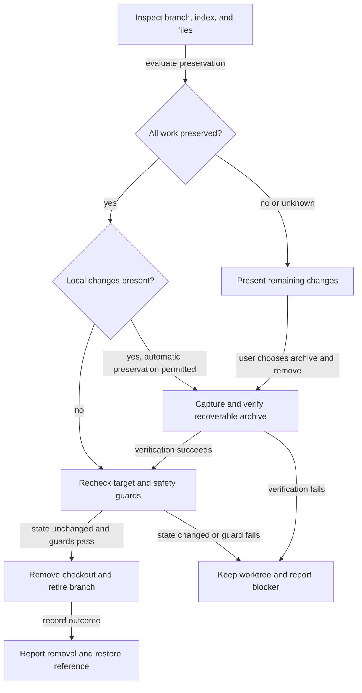

# Retire worktrees safely after merges and recover remaining work

## Summary

Automate retirement of merged worktrees even when review records, cherry-picked fixes, or other
local edits remain. Use one shared workflow for the CLI, repository page, and plan closure:
prove that all work is preserved on the base branch, or offer a verified recoverable archive
before automatic or archive removal. Keep the existing warned Delete action alongside it, including
its explicit discard consent. Describe archived changes separately from changes confirmed merged.

## Context

Closing provider cleanup ([[hr78g4sj]]) moved its plan to completed, but its linked worktree
remained dirty. Its only local edit was review and approval evidence whose exact document bytes
were already committed on main. Automatic cleanup refused it with
`uncommitted or untracked changes`. The repository page's
Delete action can proceed with explicit discard consent, but its backup preserves only committed
work. The user chose to retain that warned deletion behavior during promotion.

This is one example of a broader problem. A squash merge or cherry-pick preserves changes without
preserving feature-branch ancestry, and neither operation clears uncommitted worktree edits.
Additional local edits may already be preserved, may be unique, or may be impossible to classify.
Users should not have to reopen the old squashed branch's PR to retire its checkout.

| Existing owner | Current behavior |
| --- | --- |
| `modules/repositories/worktree-landed.mjs` | Verifies a historical base commit absorbs the committed branch tip; reuses verified absorbing-commit evidence |
| `modules/repositories/worktree-guards.mjs` | Rejects dirty automatic removal; confirmed `discardChanges: true` bypasses only the tracked/untracked guard. Valuable ignored files, submodules, locked/current/main checkouts, and servers remain guarded |
| `modules/repositories/worktree-removal.mjs` | Confirmed deletion archives the committed branch tip and logs removal; it does not capture local edits |
| `scripts/cli/worktree-cleanup.mjs` | Coordinates CLI cleanup and repository-page deletion through shared guards and removal code |
| `modules/plan-suite/copy-integration.mjs` | Recognizes plan bytes already present in base history, including lifecycle moves; this proof applies only to the plan document |
| `globals/packages/plan-suite/skills/plan-review/references/resume-review.md` | Post-merge recovery currently commits matching plan evidence in worktree and primary copies |

Promotion checked repository state at the frontmatter commit on local `main`; no remote freshness
is inferred. The current portal route accepts only boolean discard consent and tests pin that
behavior. The user-facing reference still describes clean-only removal and needs correction.
The earlier worktree example is historical evidence, not a requirement that the checkout still
exist during implementation.

## Goals

- Automatically remove a merged worktree only after proving all committed and local work is preserved.
- Offer Archive and remove for unique or uncertain work, with a verified restore path.
- Apply identical assessment and archive safety decisions to CLI, repository-page actions, and plan-close cleanup.
- Keep the repository page's warned Delete action, including explicit discard consent, alongside the new archive action.
- Preserve approval and landing requirements independently of archive success.
- Keep post-merge recovery evidence durable without requiring a new PR on the squashed branch.

## Scope boundaries

The existing cleanup-setting plan ([[b2sgiejd]]) owns switches, hook installation, and repository
exceptions. It explicitly excludes removal guards; this plan owns those guards and preservation.
The completed provider cleanup is a motivating case, not an implementation dependency.

This work does not merge branches, grant approval, publish archives, or automatically submit
remaining code. Follow-up implementation starts from current base with only selected remaining
changes. Archive retention and restore are local repository operations.

### Related-plan reconciliation

| Plan | Classification | Reconciliation |
| --- | --- | --- |
| [[hr78g4sj]] | Landed motivating story; completed | Its approved tip `9a21ab28` was absorbed at `b79bf35d`, an ancestor of this checkout. Its recovery notes describe manually aligning a dirty old copy; this plan removes that need through the bounded recovery rule below. No lifecycle cleanup remains |
| [[b2sgiejd]] | Unlanded adjacent story; backlog | Owns cleanup settings and hooks, explicitly excludes guards. Its dependency/package-name prose predates the landed `plan-suite` consolidation. That separate plan needs prose refresh when promoted; this plan neither waits for nor implements its setting |
| [[a7bslb00]] | Landed dependency; completed | Squash `7627bfc` is an ancestor and shared landing, guards, removal, and CLI code exist. This plan extends its clean-only automatic policy; committed-tip refs and the warned explicit Delete path remain |
| [[gqzjlzgx]] | Landed dependency with an explicitly superseded authority rule; completed | Squash `c29a7f18` and recovery commit `dcafa239` are ancestors. Active/review worktree authority and exact-implementation approval remain, except for verified landed evidence-only recovery on primary as specified below |

Git branch-containment checks include `main` for all four landed commits above. Squash landing
is verified through those base commits and current code, not by requiring feature-tip ancestry.
The original feature tips need not be ancestors. No materially overlapping active or ready plan
was found by searching worktree cleanup/removal, plan authority, and post-merge recovery references.
Neither completed predecessor requires a lifecycle change. Leave related plans untouched.

## Proposed design

### One assessment and execution workflow

Keep preservation, snapshot, and removal behavior under `modules/repositories/`, where both CLI
and portal consumers can reuse it. Extend the existing cleanup orchestration rather than adding
shell recipes or separate skill-specific deletion logic. Presentation stays with each consumer.

| Assessment | Automatic cleanup | Explicit user action |
| --- | --- | --- |
| Committed and local work proven preserved on base | Remove through existing guards | Show evidence and result |
| Unique changes or preservation uncertain | Keep; summarize remaining work | Offer Archive and remove |
| Unsafe or incomplete capture; invalid target | Keep with specific reason | Resolve the named blocker |
| Archive verified but removal failed | Keep archive and report partial result | Retry without losing recovery reference |



### Normal retirement path

1. Close the approved, landed plan durably on base.
2. Assess its checkout's committed work and every local layer against base history.
3. If all layers are preserved, verify a snapshot whenever local content is present, then recheck
   identity, files, base evidence, and removal guards before removing the checkout and branch.
4. Otherwise keep the checkout and report remaining paths. The user can choose Archive and remove,
   or use the existing warned Delete action, or commit the work before deleting.
5. Return the removal outcome and any recovery reference; keep durable closure independent of cleanup.

### Preservation proof

Assess committed branch content separately from staged edits, unstaged edits, untracked files,
and valuable ignored files. Preserve the existing content-level landing proof for committed work,
including squash and cherry-pick cases, historical absorbing commits, and later base changes.

A dirty worktree may be removed automatically only with a coherent proof that its remaining work
is already represented in committed base history. Support ordinary code and documentation, file
additions/deletions, executable modes, and renames; do not specialize the rule to plan filenames.
A matching blob somewhere in history alone cannot establish preservation of an arbitrary change:
path, deletion, mode, and change context matter. Untracked copies require proof as well.

Use the existing branch landing proof first. For local content, construct separate temporary
Git trees for the stage-zero index and the filesystem version of tracked plus untracked paths.
Include valuable ignored paths as additions; the disposable exclusions remain fixed. Build synthetic
commits parented by the assessed branch tip, without changing its refs or the user's index. After
separately proving committed landing, compare both local versions at one base candidate at or
after that landing evidence. Use `merge-tree --write-tree --merge-base=<assessed-tip>` with that
candidate and each synthetic version. Both comparisons must be conflict-free and return exactly
the candidate tree. The explicit merge base tests the remaining local change against its real
starting state; it does not reapply the entire squash-merged feature. Unsupported Git versions
return unknown. Checking only the final filesystem tree is insufficient:
a staged version can contain unique work even when the unstaged version cancels it.

Scan at most 500 first-parent base commits after the fork, reusing
`FIRST_PARENT_SCAN_LIMIT`; reverify recorded candidates before reuse. Cap the entire assessment at
30 seconds. Missing history, unsupported Git features, failed commands, conflicts, or exhausted
bounds produce `unknown`, never permission to delete. A successful coherent comparison proves
`preserved`; a completed comparison that cannot absorb a local layer reports `remaining`, without
claiming that history outside the bounds was searched. Record the evidence commit and assessed
base/tip/content fingerprints.

For plan lifecycle moves only, map the baseline, staged, and filesystem plan paths to the
candidate path using the unique plan id before comparing temporary trees. Require each locally
changed plan version's bytes and executable mode to equal that candidate's committed plan;
unchanged index versions rely on the separate committed landing proof. Use the mapped baseline
in the explicit merge-base comparison. This accepts a newer redundant working copy beside an
unchanged older index without treating the older plan as unique work. Duplicate ids, changed plan content, or ambiguous mapping return
unknown. Reuse the existing integration reader for locating plan identity and history, but its
historical blob-membership result alone does not authorize arbitrary-file removal. Unsupported
shapes, conflicts, missing history, or exceeded bounds offer the archive path. Never infer
preservation from a merged badge, a clean primary checkout, ancestry alone, or individual
familiar-looking files.

### Recoverable archive and restore

Extend the existing branch archive/removal ledger with a durable snapshot and manifest. Capture
branch tip and identity, staged state, unstaged state, file modes, deletions, and untracked regular
files; preserve recoverable symlink entries without following them outside the checkout. Preserve
valuable ignored content or refuse with the exact paths and reason. Reuse the current explicit
disposable-directory policy instead of silently broadening ignored-file exclusions.

Automatic removal with local content and every Archive and remove action create this verified
snapshot. Proven-preserved automatic cleanup needs no additional archive consent; unique or
uncertain work requires the explicit Archive and remove choice. The existing warned Delete action
remains separate: boolean discard consent may permanently lose tracked/untracked local changes,
and its committed-tip ref must never be described as a full snapshot. It retains its current
valuable-ignored-file and other safety refusals. Snapshot failure never falls back to Delete.

Use a version-1 Git-object snapshot rooted at `refs/roborepo/worktree-archives/<uuid>` in the
common repository, independent of the state directory. The root commit parents the captured tip;
its tree contains a JSON manifest and separate index, tracked-filesystem, untracked, and valuable
ignored payload trees. Store raw binary bytes and symlink target text as blobs, paths and types,
Git executable modes, deletions, empty directories, and checksums in the manifest. Index restoration
preserves staged content semantically, rather than copying a machine-specific binary index.
Reject unmerged stages, sparse/split indexes, intent-to-add, assume-unchanged/skip-worktree flags,
and unsupported filters before capture; name the reason. Ordinary binary files are supported.

Never run clean/smudge filters, external merge drivers, archived hooks, or project scripts during
assessment, capture, or restore. Inspect applicable attributes/config before tree merges and
materialization; external drivers or unsupported transformations produce unknown/refusal before
execution. Only vetted built-in merge behavior is eligible. Reuse the hardened Git seam, adding narrowly scoped binary
input/output and trusted temporary-index/object-store options where necessary; inherited repository
location variables remain stripped. Temporary assessment objects live outside the repository's
persistent object store, so preview creates no durable snapshot or recovery record.

Publish a snapshot ref with create-only semantics after reading back all required objects and
verifying the manifest. Its contents are sufficient for archive listing and restore even if the
state-root ledger is lost. Existing `refs/roborepo/abandoned/*` remain discoverable as committed-tip
backups and keep their current restore semantics; never relabel them as local-state snapshots.

The archive must be reachable independently of the branch slated for deletion. Verify captured
content and recovery metadata before any destructive step. Restore must recreate the captured
state, including distinct staged and unstaged versions, in a fresh destination without overwriting
an existing checkout. Return a stable local recovery reference and an executable restore command.
Use a detached, fresh worktree at the archived tip, created without checkout. Materialize blobs
with filesystem operations and reconstruct the index from the captured entries; avoid filter or
hook execution. Refuse an existing destination, path traversal, administrative `.git` entries,
case/normalization collisions, unsupported modes, and symlink ancestors. Create symlinks as leaf
entries after regular directories/files, without traversing their targets. Compare the restored
inventory and index with the manifest; report success only after equality. A failed restore leaves
the archive intact and clearly marks any incomplete destination; retry uses a fresh destination.
Treat retained content as data; restoration must not execute archived hooks or scripts.

Keep snapshots until explicit deletion; no automatic expiry in this scope. Do not claim recovery
from an archive that omitted required files. Unsupported special files, nested repositories,
submodules, unreadable data, or capture failures leave the checkout intact with an actionable
reason. Snapshot failure cannot fall through to forced removal or the existing discard action.

### Mutation safety and retries

Use the repository-scoped cleanup lock and recheck worktree identity, branch tip, index, captured
files, ignored-file coverage, relevant Git configuration/attributes, and base evidence immediately
before removal. Detect changes made
during assessment or capture and keep the checkout. Preserve current main/current-checkout,
locked-worktree, submodule, and server guards. Stop only target worktree servers after the action
is otherwise eligible, following current explicit deletion behavior.

Do not edit the user's index to create the archive. If removing a captured dirty checkout needs a
force option, permit it only inside the verified snapshot transaction after final checks; never
use archive consent as a general bypass for failed guards. The separate existing discard action
keeps only its current explicitly warned tracked/untracked bypass.

The repository cleanup lock serializes RoboRepo operations, not editors or arbitrary Git clients.
No portable filesystem transaction prevents an external write in the interval between the final
inventory and Git removal. Automatic dirty cleanup uses the preservation proof, a verified
recoverable snapshot, and final change checks; it does not require a caller to prove every writer
has stopped. Stop target writers before cleanup as an operating requirement, retain the existing
running-server guard, and refuse when any checked state changes. Explicit archive confirmation
also instructs the user to stop writing. Document that a write arriving after the final check can
still be lost and may be absent from the snapshot. A stable survey or absent server does not prove
that every editor or agent is idle. The user accepted this remaining race during promotion.

Record snapshot-created, checkout-removed, and branch-retired outcomes separately. A crash or
branch-deletion failure must leave a discoverable recovery reference. Retries recognize completed
steps and never overwrite a previous archive with newer state under the same identity. Before
retiring the branch, verify it is still at the captured tip and unoccupied by any checkout;
delete with expected-old-value protection so a concurrent new commit survives. If the ref moved
or became occupied, keep the branch and report partial completion with the existing snapshot.

### CLI, repository page, and plan lifecycle

Expose shared assessment, explicit archive-and-remove, archive listing, and restore through the
existing `roborepo git worktrees` family. The following proposed additions are not implemented yet:

```text
roborepo git worktrees cleanup [--plan <id> [--base <branch>]] [--apply] [--json]
roborepo git worktrees cleanup --remove <branch-or-name> --confirm --apply [--json]
roborepo git worktrees archive-remove <branch-or-name> [--confirm --apply] [--json]
roborepo git worktrees archives [--json]
roborepo git worktrees restore <archive-id> --destination <new-path> [--apply] [--json]
roborepo plans merge-readiness <plan> [--base <branch>] [--json]
```

Retain existing cleanup command behavior and output fields, including the clean confirmed-removal
form. `archive-remove` and `restore` preview by default; the former requires both mutation flags.
Archive listing is read-only. Do not add a CLI discard flag: the existing portal Delete contract
stays as it is. Register additions under the existing Git worktrees and internal plans command
catalogs; definitions call thin CLI adapters over the shared modules.

Cleanup rows retain `action`, `eligible`, `reason`, and committed `state`, and add `preservation`
(`preserved`, `remaining`, or `unknown`), `remainingPaths`, `blockingPaths`, `assessedTip`,
`assessedBase`, `evidenceCommit`, `snapshotRef`, `restoreCommand`, and `outcomes`. Each outcome
identifies snapshot creation, checkout removal, or branch retirement and success/failure separately.
Unavailable references are null; paths never imply merged status. Listing returns both snapshot
and legacy-tip records with an explicit `kind`; restore reports its destination and verification.
`merge-readiness` returns `ok`, assessed branch/base tips, and named checks with repair instructions;
exit 0 means ready, 1 means refusal, and 2 means usage error. Mutation commands exit nonzero on a
failed requested step, even if an earlier step succeeded.

Dry-run/preview performs no persistent capture, index/ref write, server stop, or deletion.

The repository page shows concrete remaining paths and separates committed landing status from
local preservation status. Keep the warned Delete action unchanged and add Archive and remove
when capture is supported.
The existing `/api/repositories/:id/worktrees/remove` boolean `discardChanges` contract remains.
Add a token-guarded archive-removal route and read-only assessment/list routes using the same
repository identity resolver; the browser never sends arbitrary filesystem deletion targets.
Use the portal's existing templates and slot filling. Restore instructions may use the CLI;
a browser folder picker or embedded restore editor is outside scope. Confirmation states what
will be preserved, excluded, and removed. Successful results expose restore instructions; failures retain the row and report the precise failed step.

Plan-close calls the shared automatic path only after durable closure and existing approval and
landing checks pass. Unique work produces a cleanup handoff, not silent archiving or a false
merged claim. A closed plan remains closed when cleanup is kept or fails. An archive never satisfies
an implementation-completion, human-approval, or landing gate.

Expose a read-only pre-merge readiness assessment that combines fresh review/approval evidence
with clean-worktree checks. Plan-review calls it after committing approval and reports actionable
failures; a passing result identifies the assessed tip and does not authorize merging. External
PR merge protection is separate from this local workflow.

Pre-merge readiness requires fresh complete Result and explicit Approval, both committed in the
authoritative plan, no open findings/required checks, and no staged, unstaged, or untracked changes
including plan-only edits. Reuse completion/review checks without changing their existing meanings.
If base implementation moved since review, require renewed review; plan-only base movement is
allowed. Capture branch, base, and document ids together and refuse if they change during checks.
This local assessment neither observes remote PR protection nor authorizes a merge.

Before merge, plan-review commits review and approval records and reports pending worktree edits.
For post-merge recovery, add an explicit verified-landed authority rule allowing evidence-only
Result/Approval updates on primary, without dirtying or committing the old worktree. Update the
canonical approval reader and authority consumers together: recovery must still identify the exact
reviewed branch implementation, reject conflicting records, and preserve explicit human approval.
Use a parsed `### Post-merge recovery` record under `## Review`, not new frontmatter. Record
repository identity, assigned worktree name and branch, full assessed branch tip and base commit,
absorbing commit, and the pre-recovery primary/worktree plan blob ids. Only Result/Approval and
this evidence subsection may differ from an integrated precursor; requirements, tasks, findings,
identity, and assignment cannot change through this exception. Verify the precursor copies are
integrated, the branch still matches the recorded implementation outside `docs/plans/`, and the
absorbing commit still belongs to base first-parent history and absorbs that branch.

Commit the evidence on primary only, then revalidate the committed record. Until that commit
succeeds, report pending evidence, never durable approval. A retry reuses identical evidence;
conflicting records, independently changed copies, incomplete review, or missing explicit human
approval refuse. A subsequent feature implementation change invalidates the exception. The
recovery note is provenance, not authority by assertion: derive eligibility anew from Git.
Existing manually aligned recovery copies are accepted when byte-identical and verified landed;
they need no synthetic commit to the old branch.

Use one shared recovery predicate for authority selection, outside-edit findings, authoritative
Markdown, approval/review freshness, integration, and closure. The portal and CLI must choose the
same committed primary evidence, retaining `authority.source: primary` and exposing the
verified recovery reason without inventing another lifecycle or general write authority. Include base-ref changes in snapshot
invalidation: the current cheap fingerprint observes checkout HEADs but not every relevant base
ref. Portal priority writes continue using normal worktree authority; primary recovery is evidence
only and must not redirect general field updates there. Missing/detached worktrees remain
unavailable; this plan does not infer a branch from an approval SHA or recovery metadata.
No automatic synchronization into the old squashed branch is needed for retirement.

## Implementation plan

- [x] Add disposable Git regression fixtures for redundant and unique staged/unstaged states,
      squash/cherry-pick merges, modes, binaries, deletion/rename context, untracked additions, and
      uniquely mapped plan lifecycle moves. Assert existing discard behavior remains unchanged.
- [x] Extend shared assessment under `modules/repositories/` with the coherent tree proof,
      explicit bounds, raw inventories, stable fingerprints, and conservative unknown reasons.
      Keep landing and local preservation fields separate; cover preview nonmutation.
- [x] Add versioned snapshot capture, immutable repository refs, manifest verification, archive
      discovery, and a filesystem/index restore round trip. Extend the hardened Git seam only for
      required binary plumbing and controlled temporary stores; test hooks/filters do not execute.
- [x] Integrate snapshot/guard/removal transactions into `worktree-removal.mjs` and
      `scripts/cli/worktree-cleanup.mjs`; re-inventory inside the lock, preserve writer guards,
      outcome records, branch identity checks, partial failure, and retry recovery.
- [x] Register the new command definitions and CLI adapters. Extend repository projections,
      `portal-routes-repositories.mjs`, and `portal/home/` API, templates, and dialogs with separate
      Archive and remove and warned Delete choices. Assert equivalent CLI/portal archive results.
- [x] Implement the shared landed-recovery predicate and parser in `modules/plan-suite/`;
      integrate `plan-authority.mjs`, `plan-copies.mjs`, `worktree-copy.mjs`, `copy-integration.mjs`,
      `review-record.mjs`, `review-gates.mjs`, `review-freshness.mjs`, `transition-rules.mjs`, and
      `snapshot-fingerprint.mjs`. Update the priority-write paths in `modules/plan-suite/index.mjs`
      and `scripts/cli/plans.mjs` so evidence selection cannot redirect ordinary portal mutations.
- [x] Add `plans merge-readiness` through `scripts/cli/plans-command.mjs` and command metadata;
      wire canonical plan-review approval commits and primary-only recovery to the shared checks.
- [x] Update plan-close's automatic cleanup and already-closed retry handoff. Preserve durable
      closure when work remains; snapshots never satisfy approval, review, integration, or landing.
- [x] Update all documentation and canonical skill references listed below; regenerate command
      wrappers with the existing renderer. Register any new suites in existing test orchestration.
- [x] Run affected behavior suites, browser checks, command/skill checks, health checks, and the
      full local parity gate. Record evidence and any unavailable platform checks before review.

## Validation

| Scenario | Required outcome |
| --- | --- |
| Squash/cherry-pick, redundant edits to supported tracked files, stable final checks | Safe cleanup without another PR or committing in the old branch |
| Plan moved from review to completed; old local evidence already on main | Preservation recognized across the lifecycle rename |
| Unique or unknown committed/local work | Automatic cleanup keeps it; archive action remains explicit |
| Distinct staged/unstaged versions plus untracked files | Archive restores bytes, modes, paths, and index separation |
| Deleted/renamed files or later base changes | Proof accounts for change context; uncertainty never becomes automatic removal |
| Valuable ignored content or unsupported file | Capture and restore fully, or keep with an exact blocker |
| Concurrent file/index/tip/configuration change | Keep checkout; no stale snapshot authorizes deletion |
| Branch moves or is checked out after checkout removal | Preserve the branch/new commit; report partial completion and recovery reference |
| Archive failure, removal failure, crash, retry | No data loss; recovery references remain discoverable; completed steps are not repeated |
| Main/current/locked/submodule checkout or surviving server | Existing guard remains effective |
| Archive without approved and landed implementation | No plan closure or merged claim |
| Pre-merge readiness | Dirty worktree or stale/missing approval produces actionable failure at the assessed tip |
| Post-merge approval recovery | Exact implementation and human answer recorded durably; no synthetic dirty copy in old worktree |
| CLI and repository-page equivalent archive requests | Same assessment and safety result; visible restore instructions after archival |
| Existing portal Delete with explicit discard consent | Original warning and loss behavior preserved; no full-snapshot recovery claim |
| Dirty automatic cleanup without writer-shutdown proof | Eligible only with preservation proof, verified snapshot, stable final checks, and existing guards |
| Recovery record changes requirements or conflicts with another copy | Refuse primary authority exception; preserve both copies |
| Lost state ledger, Git garbage collection, legacy archive ref | Snapshot still discoverable/restorable; legacy refs labeled committed-tip only |
| Restore with hostile paths, symlink parents, existing target, filters/hooks | Refuse unsafe materialization; execute no project code |

Extend `scripts/test/worktree-lifecycle-check.mjs`,
`scripts/test/plan-close-integration-check.mjs`, `scripts/test/plan-suite-commands-check.mjs`,
`scripts/test/repository-overview-check.mjs`, `scripts/test/plan-authority-check.mjs`,
`scripts/test/plan-suite-authority-scan-check.mjs`,
`scripts/test/plan-suite-authority-edge-check.mjs`,
`scripts/test/plan-lifecycle-transitions-check.mjs`, `scripts/test/plan-suite-skills-check.mjs`,
`scripts/test/cli-command-catalog-check.mjs`, `scripts/test/cli-surface-integration-check.mjs`,
and `scripts/test/portal-ui/portal-ui.spec.mjs` plus `plans-status.spec.mjs` under that directory.
Test real disposable repositories and filesystem round trips rather than only mocked Git calls.
Verify refusal paths leave branch, index, and files intact. Add narrow suites beside existing
owners only when coverage needs a distinct responsibility.

During implementation, run the affected suites first, then `bash scripts/doctor.sh --quiet`,
`git diff --check`, generated command/skill checks, and `npm run check` before handoff.
Promotion is prose-only: run the selected plan validator,
`node scripts/test/docs-reference-check.mjs`, and `git diff --check`; do not run the full suite.
Implementation also runs `roborepo skill render-commands --check` and
`roborepo skill triggers --check`; these do not replace the behavior suites or `npm run check`.

## Documentation impact

- `docs/user/reference/repositories.md`: preservation states, archive confirmation, cleanup outcomes, and restore actions.
- `docs/user/reference/roborepo-cli.md`: assessment, archive, listing, and restore commands with failure/retry semantics.
- `docs/user/reference/plans-portal.md`: closed-plan cleanup handoff and post-merge authority behavior.
- `docs/user/guides/plan/lifecycle/plan-suite.md`: normal approve/commit/merge/close sequence and recovery route.
- `docs/internal/cli-internals.md`: shared assessment, snapshot transaction, recovery records, and callers.
- `docs/internal/plans-portal-internals.md`: evidence authority, exact-commit approval, cache invalidation, and cleanup integration.
- `globals/packages/plan-suite/skills/plan-write/references/plan-schema.md`: narrowly scoped landed recovery authority and parsed Review evidence fields.
- `globals/packages/plan-suite/skills/plan-close/` and `globals/packages/plan-suite/skills/plan-review/`: canonical workflow instructions and references; regenerate command outputs normally.

## Risks and safeguards

| Risk | Required safeguard |
| --- | --- |
| General preservation proof is costly or ambiguous | One coherent candidate, 500 commits/30 seconds, unknown keeps the checkout |
| Index features or filters exceed snapshot support | Refuse with exact paths/features; support raw ordinary and binary files |
| Writers race final verification | Stop writers operationally, verify snapshot and final state, document accepted external-write window |
| Primary recovery weakens worktree authority | Evidence-only committed exception, integrated precursor, fresh landing, shared predicate, conflict refusal |
| Local archive shares repository storage | Retain refs until explicit deletion; describe disk/repository loss and secret retention, never claim off-machine backup |
| Warned Delete intentionally loses local changes | Retain its explicit warning and consent; distinguish committed-tip backup from verified snapshots |

## Open questions

None. The user retained the warned Delete action and chose verified snapshots plus final change
checks for automatic dirty cleanup, with the remaining external-writer race documented.
Archive and remove is additive; uncertain preservation or failed snapshot verification keeps the
checkout intact.

## Decision Log

- High priority requested after a closed, merged worktree could not be deleted because redundant
  local review evidence remained. The solution covers arbitrary supported changes, rather than
  a plan-document-only exception.
- Automatic cleanup requires preservation proof. Archiving unique or uncertain changes requires
  explicit archive-and-remove consent, and never implies that those changes landed. The separate
  warned Delete action retains its discard semantics.
- Implementation belongs in shared code; plan skills and the repository page call that workflow.
  Promotion prepares implementation only and does not authorize retirement of any particular
  worktree in this chat.

- October 26 promotion: retain the existing warned Delete/discard behavior at the user's explicit
  direction: users may commit local work before choosing Delete. Add Archive and remove separately.
  This supersedes the earlier blanket requirement that every dirty removal create a snapshot;
  automatic dirty cleanup and the new archive action still require verified snapshots.
- October 26 promotion: selected coherent synthetic-tree absorption, the existing 500-commit cap
  plus a 30-second budget, immutable version-1 Git-object snapshots, fresh detached restore, the
  command/output contracts above, and the bounded evidence-only primary recovery exception.
- October 26 reconciliation: the related cleanup-setting plan remains separate and unlanded;
  completed cleanup/lifecycle contracts are extended only as stated in the reconciliation table.
  No implementation, worktree retirement, external merge, or related-plan lifecycle change occurs
  during promotion.

- October 26 user decision: automatic dirty cleanup uses verified snapshots and final change checks;
  document the remaining external-writer race. Do not require caller-provided proof that every
  writer has stopped. Stopping writers remains an operating requirement, and existing server
  guards and refusal on observed changes remain effective.

### Execution decisions

- Keep raw inventory, snapshot capture/discovery/restore, and preservation proof under the shared
  repository owner. Reuse the plan parser for identity mapping rather than recognizing body text
  as frontmatter. Thin CLI and portal adapters share the transaction.
- Refuse configured external drivers and unsupported transformations conservatively; raw blobs
  preserve binary data without invoking filters. Assessment and recovery merge objects use
  temporary external stores, so read-only checks publish no recovery refs.
- Keep primary recovery evidence separate from normal mutations. The shared verifier selects
  committed primary evidence, while priority writes resolve the assigned worktree again.

## Execution record

- Start transition: `a68a9cc30aa00869403db47aa907fed50f8bf63a`, approved without correction.
- Implementation branch: `codex/git-worktree-preservation-and-recovery`; base: `main`.
- Starting implementation commit: `a68a9cc30aa00869403db47aa907fed50f8bf63a`.
- Disposable real-Git regressions cover staged/unstaged separation, binaries, modes, symlinks,
  valuable ignored files, deletion/rename absorption, lifecycle mapping, nonmutating previews,
  automatic snapshots, shared CLI/portal archive requests, lost ledgers, and garbage collection.
- Primary-only recovery tests cover committed evidence authority, approval and integration,
  priority writes staying in the worktree, readiness, conflicting copies, and later code changes.
- Portal test environment: hermetic local portal started by the browser runner; all 146 browser
  checks passed, including archive recovery instructions and unchanged Delete/discard behavior.
- CI behavior group: 61/62 suites passed; the documentation reference suite fails on the base input
  recorded below. Catalog, command renderer, triggers, CLI surface, focused repository/plan suites,
  and whitespace checks passed. Package installation and installer collision suites passed.
- All four available Docker clean-machine suites passed. Native Windows verification is unavailable.
- Initial `npm run check` stopped at the then-existing skill body limit. While validation was
  running, current main was merged into this worktree in `a375a484`; the incoming
  `c1d92150` extracts the report reference and resolves that limit. Rerun the gate on the new tree.
  Remaining gate stages had already been run separately.

## Not tested

- [ ] Native Windows snapshot restore and symlink/executable-mode behavior. This macOS host has no
  Windows runtime or PowerShell; verify on a Windows machine before closing.

## Review

### Findings

- [x] Conflict comparisons returned remaining — track conflicts and require unknown when no
  coherent candidate proves preservation; add a real-Git regression.
- [x] Recorded doctor failure became stale after incoming main synchronization — refresh the
  execution record and rerun the gate against the current tree.
- [x] Readiness accepted committed open tasks and blockers — reuse the shared open-task parser and
  assert both refusal cases.
- [x] Retry after checkout removal lacked a branch-retirement resume path — discover the immutable
  snapshot and retain expected-tip/occupancy guards.
- [x] Unlanded work omitted remaining paths — inventory local and committed paths before returning.
- [x] Review parser contract omitted recovery metadata — update the assertion and cover parsed fields.
- [x] Safety scenarios lacked direct assertions — add hostile paths, symlink parents, removal
  failure, moved/occupied branches, and idempotent partial retries.

### Verification

- Validation pass 2 (fresh-context subagent): two fix findings above; no additional code or prose violations.
- Validation pass 1 (fresh-context subagent): five fix findings above, corrected in `3b5f7100`; no documentation violations.
  Corrective checks pass for snapshot/preservation, landed recovery/readiness, and parser contracts.
- `main` CLI smoke comparison: 461 passed, three failed; all three are the pre-existing doctor
  body-limit failure. Feature CLI smoke is rerun from committed changes to avoid its clean-diff
  fixture assertion rejecting this session's pending skill edits.
- Historical base failure resolved by incoming main: the execution skill body limit no longer
  fails at `c1d92150`; initial logs describe the earlier tree only.
- Base failure: `docs-reference-check.mjs` rejects the unchanged link at
  `docs/internal/backlog-review.md:86` to the ready credential-protection plan; that target is
  already absent from `main`.
