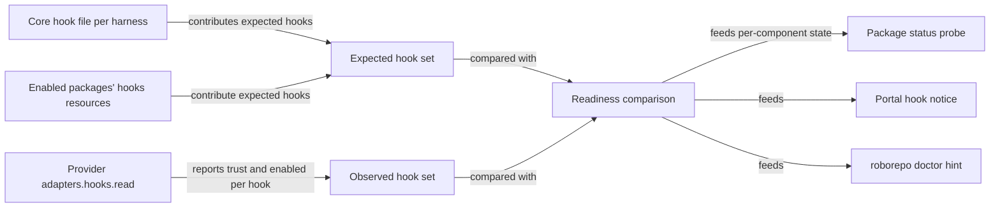
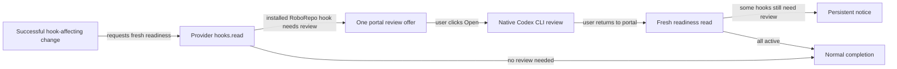

# Report hook readiness and guide Codex approval during setup and package changes

## Summary

When a RoboRepo package installs Codex hooks, those hooks don't run yet. Codex runs a non-managed
hook only after the user reviews and trusts its exact definition. The desktop app offers an in-app
review flow, but RoboRepo must show which hooks need it. Codex also keys that trust by the hook's
position in `~/.codex/hooks.json`. RoboRepo previously prepended each new package hook, so enabling
one package could revoke trust from hooks the user had already reviewed. That happened on the
reference Mac: after Skill Visibility was enabled, Codex stopped running the telemetry
`PostToolUse` hook. Package hooks now append after existing Codex hooks.

Plan `3jp3yhtq` added a read-only check for this, but only for the five telemetry hooks. That check
lives outside the Codex provider and copies the hook list instead of reading it from the package.
Some other parts of `3jp3yhtq` also put provider-specific behavior in shared code.

This plan covers the complete path from installing a hook to making it usable:

- makes Codex append package hooks, so enabling a package leaves existing trust in place;
- moves hook readiness behind the provider `hooks.read` adapter, so every package and harness is
  covered;
- shows one notice per harness, with the Codex app review path and a terminal alternative;
- installs the core Codex hooks, including when packages already populated the hook file;
- moves the remaining provider-specific code and copy out of shared modules;
- offers a timely, nonmodal Codex review action after setup or a hook-changing operation, opens
  Codex's native review in a terminal on a user click, and refreshes status afterward. RoboRepo
  never approves hooks on the user's behalf.

## Context

### Terms

| Term | Meaning |
| --- | --- |
| Core hooks | Hooks RoboRepo installs for a harness whatever packages are enabled, declared in a per-harness file such as `generated/codex/hooks.json` |
| Installed | The hook entry exists in the harness's hook file (`~/.codex/hooks.json`, or `hooks` in `~/.claude/settings.json`) |
| Trust key | Codex's record for one hook in `~/.codex/config.toml`: `[hooks.state."<hook file>:<event>:<group index>:<handler index>"]` with a `trusted_hash` |
| Trusted | Codex has a trust key whose hash matches the hook at that position, or reports the hook as managed |
| Active | Installed, enabled, and trusted where the provider can observe trust; Claude's interactive workspace trust remains outside this file-level status |

Claude has no Codex-style per-hook trust decision. In an interactive Claude Code session, hooks
from settings files, including user settings, are held until the user accepts workspace trust for
that folder. A `-p` or SDK session treats the folder as trusted. Consequently, file-level Claude
readiness means configured and enabled, not proof a hook will run in every interactive workspace.
Codex adds a separate per-hook trust step.

### Behavior before this work

How hooks reach a harness and how their state gets reported:

| Step | Where | Behavior |
| --- | --- | --- |
| Install | `scripts/cli/packages.mjs` `hooks` case → `mergeHooksInto` in `scripts/cli/hook-composition.mjs` → provider `adapters.hooks.merge` | Every provider reaches `mergeHooksMap` in `scripts/harnesses/hooks-merge.mjs` (Claude and Gemini through `root-config-hooks.mjs`), which **prepends** a fragment's entries. The comment there explains why: a Claude deny hook must run before an allow hook |
| Package status | `probeHooks` in `scripts/cli/package-probes.mjs` | Counts installed commands only. Hardcodes `~/.codex/hooks.json` and `~/.<harness>/hooks/` instead of asking `hookFilePath` and the provider |
| Codex readiness | `scripts/cli/codex-hook-status.mjs` | Spawns `codex app-server` and calls `hooks/list`. Hardcodes the five telemetry events and commands. Returns `active`, `review_required`, `inactive`, `missing`, `unknown`, or `unavailable` (no executable). Its executable picker prefers the desktop runtime, the reverse of `selectedHarnessExecutable` in `scripts/harnesses/discovery.mjs` |
| Route | `/api/config/hooks/codex/status` in `scripts/cli/portal-routes-config.mjs`, handled by `loadCodexHookStatus` in `scripts/cli/telemetry.mjs` | Reports any thrown error as `unknown` |
| Portal notice | `portal/shared/codex-hook-status.js`, template `tpl-codex-hook-status` in `portal/shared/widget-templates-partial.html` | Rendered on Settings, Tokens, and Home when Token Telemetry is enabled and Codex is active. Shows nothing for `unknown` or `unavailable` |
| User docs | `docs/user/reference/codex-hooks.md` | Says the warning appears on Agents, which is no longer true |
| Provider slot | `hooks.read` in `scripts/harnesses/codex/index.mjs`, `scripts/harnesses/claude/index.mjs`, and `scripts/harnesses/gemini/index.mjs` | A `notYetMigrated` stub that throws |
| Doctor | `scripts/doctor.sh` | Has only `ok` and `fail` output helpers; no non-failing hint |

Other provider-specific behavior in shared modules:

| Location | Leak |
| --- | --- |
| `scripts/harnesses/desktop-runtime.mjs` | The no-runtime warning hardcodes "Code tab", a Claude Desktop detail |
| `scripts/harnesses/mcp-claude-cli.mjs` | Claude MCP command construction sits beside, not inside, `scripts/harnesses/claude/` |
| `generated/codex/hooks.json` | Holds the `jcodemunch` SessionStart notice, although that hook belongs to the archived package's `globals/packages-archived/jcodemunch/hooks-codex.json`. `system-package-ownership-characterization-check.mjs` already guards the same leak for Caveman and JDocMunch |

`scripts/harnesses/transcript-parse.mjs` also holds Codex parsing, but its header explains why: the
capture hook runs on every tool call and must not load a full provider module. It stays where it is.

### Observed on the reference Mac

October 12-13, 2026, during `3jp3yhtq` QA:

- Discovery found one Codex executable, the desktop runtime `codex-cli 0.155.0-alpha.16.4`. No
  Codex CLI is on `PATH`.
- `hooks/list` reported five telemetry hooks, all `trusted` and enabled, trusted by hand through
  Codex's review screen.
- The newest spool records then reported zero tokens, but predated the parser fix.

October 15, 2026, during promotion of this plan:

- `hooks/list` reports six hooks. The Skill Visibility observer
  (`node "$HOME/.codex/hooks/skill-reference-observer.mjs"`) was added at `PostToolUse` position
  0 on October 13. Codex reports it as `modified`, because it inherited the trust key the telemetry
  hook held there. The telemetry `PostToolUse` hook moved to position 1 and is `untrusted`. The
  other four telemetry hooks remain `trusted`.
- The Codex spool's last `PostToolUse` record is from October 13 at 20:39 UTC, before the
  observer was installed. Since then it holds 877 `PreToolUse` records and no `PostToolUse` ones.
- Five Codex sessions captured since October 13 report nonzero counts: 1.7M to 30.5M total tokens
  and 18 to 228 tool calls. Tool counts come from the transcript parse, so the missing
  `PostToolUse` hook does not zero them.
- The live `~/.codex/hooks.json` holds none of the four core hooks from
  `generated/codex/hooks.json`. `manifests/platform/manifest.tsv` maps that file to
  `~/.codex/hooks.json` as a `managed_copy`. `~/.codex/hooks/` holds only
  `skill-reference-observer.mjs`, not `permission-check.mjs` or `minimize-bash-output.mjs`. The
  cause is unknown. Without `permission-check.mjs`, the permission `ask` bucket on Codex falls
  through to `approval_policy`.
- `hooks/list` records carry `key`, `eventName` (camelCase, such as `postToolUse`), `command`,
  `sourcePath`, `source`, `isManaged`, `enabled`, `currentHash`, and `trustStatus`.

### Related plans

| Plan | Relationship | Effect on this plan |
| --- | --- | --- |
| `3jp3yhtq` (`completed/harness-desktop-runtime-discovery.md`) | Landed dependency. `cc4d97b` is an ancestor of the reviewed commit | Supplies `selectedHarnessExecutable` and the desktop-runtime discovery this plan reads. This plan supersedes its Codex hook check and portal notice |
| `codex-cmux-hook-trust-review` | Unlanded, independent | Owns `--dangerously-bypass-hook-trust`. No shared code |
| `harness-capability-derived-resource-targeting` | Unlanded, overlapping | Changes how a `hooks` resource names its harnesses, and its per-command `ask` work may add a Codex `PreToolUse` hook. The expected hook set must use the same harness resolution `packages.mjs` uses, so it follows that change |
| `usage-statusline-codex-hook-parity` | Unlanded, blocked upstream | Concerns a Codex footer hook, not lifecycle hooks. No shared code |
| `v6lvuu2` and `rtkmc8kf` | Unlanded, related portal onboarding and Home work | Reuse the review handoff after their configuration commit rather than adding another approval flow |

### Current review handoff gap

The implemented `scripts/harnesses/hook-readiness.mjs` compares core and enabled-package hooks
with provider `hooks.read` results. The portal shows a notice on Home, Settings, and Tokens, and
`scripts/cli/hook-readiness-status.mjs` caches each harness result for 30 seconds. A user can find a
command under the notice's details, but a completed setup or package change has no direct review
handoff, terminal launcher, or explicit return-to-portal refresh. The single, bulk, onboarding,
and telemetry mutation paths all need the same post-change policy.

The default installer applies the `base` bundle; core hooks are in the optional `hooks` bundle.
Installing RoboRepo alone does not prove that Codex review is needed. A package's Codex `hooks`
resource identifies a possible change, while fresh provider readiness decides whether an
installed hook actually awaits approval.

| Capability | Evidence today | Additional work |
| --- | --- | --- |
| Distinguish Codex Desktop from a CLI on `PATH` | `detectHarnessProvider` records a validated app bundle and bundled binary as `source: "desktop"`, and a `PATH` executable as `source: "cli"`. Both may exist; the `PATH` executable may itself point into the bundle | Pass both candidates to the review launcher without guessing which surface the user normally uses |
| Recognize package-owned Codex hooks | A normalized component has `type: "hooks"` and `harness: "codex"`; `expectedHooks` reads its fragment | Check live readiness after apply instead of treating the manifest as proof that trust is needed |
| Start native review from the portal | No local terminal-launch route exists | Add a user-click-only launch action with a copyable command fallback |

On the reference Mac, starting the desktop-bundled CLI with pending hooks automatically displays
**Hooks need review**; the user does not enter `/hooks` first. [Codex's hooks reference](https://learn.chatgpt.com/docs/hooks)
documents selective review and a CLI startup warning. The [desktop deep-link reference](https://learn.chatgpt.com/docs/reference/commands#settings)
documents general Settings but no direct Hooks-review route; unsupported Settings links open the
main Settings page.

## Goals

- Enabling or disabling a RoboRepo package does not revoke Codex trust from hooks the user already
  trusted, except for hooks that sit after a removed one.
- Package status and the portal say "installed, awaiting review" for any package's Codex hook,
  with the exact command that opens Codex's review screen. A user with Token Telemetry enabled
  never sees silent partial capture.
- Hook readiness comes from the provider's `hooks.read` adapter. The expected hook set comes from
  the core hook file and enabled packages' `hooks` resources, never from a copied list.
- Desktop discovery (`desktop-runtime.mjs`, `discovery.mjs`, `contract.mjs`) takes all product
  copy from provider manifests, and Claude MCP command code lives in the Claude provider.
- When the `hooks` bundle is applied to a present Codex home, its core hooks install alongside
  package hooks and retain their own ownership, regardless of which packages are enabled.
- After a successful operation leaves installed RoboRepo Codex hooks awaiting review, show one
  clear next step that opens Codex's own selective review, or can be deferred. Refresh the notice
  after the user returns without repeatedly interrupting them.
- Give distinct remedies for missing, inactive, unknown, and no-review states; an absent hook is
  not something a user can approve.

## Non-goals

- Writing Codex trust state (`[hooks.state]` hashes), recommending **Trust all** for unrelated
  hooks, or building a RoboRepo approval editor. Trust stays a user decision made in Codex; an
  in-portal editor would change RoboRepo's ownership boundary and needs its own design decision.
- Using `--dangerously-bypass-hook-trust`. Plan `codex-cmux-hook-trust-review` owns that flag.
- Changing Claude's or Gemini's hook order.
- Moving Codex transcript parsing out of `scripts/harnesses/transcript-parse.mjs`.
- Gemini hook readiness. Gemini keeps its `hooks.read` stub, and readiness skips it.
- Designing a per-hook Claude approval UI. Interactive Claude sessions gate settings hooks on
  workspace trust rather than Codex-style per-hook approval.

## Proposed design

### Stable Codex trust keys

The Codex `hooks.merge` adapter appends a fragment's entries after the existing ones, in fragment
order, instead of calling the prepending `mergeHooksMap`. Enabling a package then adds new
positions without moving trusted ones. Claude and Gemini keep prepending.

Prepending exists for Claude's rule that the first decisive hook result wins. The only Codex hook
RoboRepo installs that makes a permission decision is core `permission-check.mjs`, and it stays
ahead of package hooks once core hooks are installed.

Two moves still shift positions, and the readiness notice names every affected hook for both:

- disabling a package moves every later hook at the same event;
- installing core hooks into a file that already holds package hooks moves those package hooks
  once.

### Readiness flow

### `hooks.read` contract

Each provider implements `adapters.hooks.read({ cwd })` and returns one record per installed hook:
`{ event, command, sourcePath, trust, enabled }`.

- `event` uses the fragment spelling (`PostToolUse`), so records compare directly with
  `hooks` resources.
- `sourcePath` lets the comparison ignore hooks from project or plugin sources that happen to share
  a command.
- `trust` is one of `trusted`, `managed`, `untrusted`, `modified`, `not-required`, or `unknown`.

| Provider | Source of `trust` |
| --- | --- |
| Claude | `not-required` for per-hook approval. Reads the `hooks` key of the file `hookFilePath("claude", …)` returns; its file-level read cannot see interactive workspace trust |
| Codex | `hooks/list` from `app-server`, run with the executable Phase 1's rule picks. `trustStatus` maps directly, and `isManaged` maps to `managed`. The app-server client moves from `scripts/cli/codex-hook-status.mjs` into `scripts/harnesses/codex/` |

When the runtime is missing, too old, or slow, `read` returns entries with `trust: "unknown"`
rather than throwing. Callers keep working, and the notice says the state is unknown. The current
`unavailable` state folds into `unknown`.

### Readiness states

The shared comparison reports one state per harness for each package's `hooks` component, and one
for the harness's core hooks:

| State | Meaning | User-facing next step |
| --- | --- | --- |
| `active` | Every expected hook is installed, enabled, and trusted or exempt | none |
| `review_required` | At least one expected hook is `untrusted` or `modified` | In the Codex app, open Settings → Hooks, review and trust the listed RoboRepo hooks, then start a new session. The CLI's `/hooks` is an alternative |
| `inactive` | Installed and trusted but disabled in the harness | Re-enable the hooks in Codex's Settings → Hooks, or `/hooks` in the CLI |
| `missing` | An expected hook is absent from the hook file | Repair or reapply the owning bundle or package |
| `unknown` | The harness runtime could not report | Check that the harness runtime is installed and has been launched |

The current portal notice leads with the Codex app's Settings → Hooks review screen. Its terminal alternative
uses executable discovery: the `codex` CLI on `PATH`, or the desktop bundle's own `codex` binary.
Trust lives in `~/.codex/config.toml`, which the desktop runtime reads, so trust recorded from
either binary applies to desktop sessions. Phase 1 confirmed the terminal path as a fallback.

`probeHooks` reports this state in its `detail`. The portal replaces the Codex-only notice with one
notice per harness that names the affected packages and hooks. `/api/config/hooks/codex/status`
becomes `/api/config/hooks/<harness>/status`, served by a handler outside `scripts/cli/telemetry.mjs`.

### Guided review after a hook change

The shared handoff consumes provider readiness and group records. A `hooks` package resource is a
reason to refresh, not a static `requiresApproval` flag: Codex trust depends on the installed
definition, its position, and current runtime state. Extend the optional provider
`hooks.guidance()` contract with review-route metadata if needed, so shared mutation code does not
hardcode Codex. Do not offer approval for a core hook that is still merely `missing` while the
installation Open Question remains unresolved.

1. Finish the entire setup or configuration operation, then read fresh readiness for each selected
   provider. Offer review only for installed RoboRepo hooks reported as `review_required`.
2. Show one contextual, nonmodal card naming affected owners and events. Offer **Open Codex hook
   review** on a platform with a tested launcher, **Copy command**, **Later**, and **Check again**.
   **Later** dismisses the immediate card but leaves a persistent notice. Neither a page load nor
   a successful mutation automatically opens a terminal or modal.
3. On **Open**, the local server rechecks readiness. If review is still needed, a terminal starts
   a validated Codex CLI. The user chooses which individual hooks to trust; the portal sends no
   trust decision and must not recommend **Trust all** when unrelated hooks are visible. If review
   was resolved elsewhere, update the portal instead of launching an empty Codex session.
4. When the portal regains focus, or on **Check again**, bypass its readiness cache. Keep any
   remaining review items, clear resolved ones, and explain that newly trusted hooks need a new
   Codex session to run.

| Successful operation | Review policy |
| --- | --- |
| Terminal or browser onboarding | Check once after final apply, including optional `hooks` bundle and telemetry selections. Base-only install gets no offer unless it actually installed reviewable hooks. A TTY gets a concise next step; headless runs print guidance only when review need is known and never launch a terminal |
| Package enable or re-enable | Refresh after apply; offer review for newly installed or changed Codex hooks only when provider readiness confirms it |
| Package disable | Refresh after removal because later hooks at an event may shift position and need renewed trust. Do not offer review for the removed package |
| Bulk enable or disable | Reconcile first, then read once and show one combined offer, not one per package |
| Telemetry enable from Tokens, Agents, or CLI | Use the same package handoff once; do not add a second telemetry-specific prompt |
| Update, repair, bundle apply, harness refresh, or another hook rewrite | Invalidate readiness and offer review only if the finished change leaves RoboRepo hooks in `review_required` |

Show the immediate card at most once per completed change and review-set revision, even if several
portal views refresh. A changed definition or shifted trust key is a new revision; routine reads of
the same pending hooks are not. Use the read-only Codex `hooks/list` key/hash identity for matching
RoboRepo hooks without exposing or persisting hashes as approval material. Avoid another app-server
read for every member of a bulk operation.

### Native route, platform fallback, and status freshness

| Route | Role and limit |
| --- | --- |
| Portal click opens a terminal with Codex CLI | Preferred on macOS after a real launch prototype passes. A bare invocation of the reference Mac's bundled CLI opens interactive Codex and automatically presents **Hooks need review** when pending hooks exist |
| **Copy command** | Always available. A CLI-only user can also wait for the next interactive startup warning, but the portal still explains what is pending now |
| `codex://settings` then Settings → Hooks | Opens general desktop Settings only; no supported direct Hooks deep link is documented. Keep as manual guidance, not a button labeled as direct review |
| RoboRepo trust editor | Out of scope because it would write Codex trust state and assume responsibility for races and hash-format compatibility |

At click time on macOS, use provider discovery to prefer a validated desktop-bundled CLI, then a
validated `PATH` CLI. Desktop presence does not reveal which surface the user normally uses; a
CLI-only installation must still receive review guidance. Test systems where both binaries exist
against the same user home and trust state. Launch from a server-chosen neutral working directory
to avoid unnecessarily including project hooks from the portal checkout. The local authenticated
route accepts no browser-provided executable, command, arguments, or working directory. Prototype
Terminal launch and macOS Automation-denial behavior; failure keeps **Copy command** and the portal
usable. On Linux and Windows, enable one-click launch only after a terminal and CLI launch path is
tested; otherwise show the copy and manual routes.

Invalidate or bypass the current 30-second per-harness cache after a mutation and on return to the
portal. A read started before the mutation must not overwrite a newer result; coalesce safe
concurrent reads and discard stale responses. A successful terminal launch is not evidence of
approval: only a later Codex `hooks/list` result clears `review_required`.

| Fresh readiness | Portal behavior |
| --- | --- |
| Any matched RoboRepo hook is `review_required` | Show its owner and event with the review action, even if another group is `missing` and the aggregate state is `missing` |
| All active, or no expected Codex hooks | No review offer; clear a resolved notice |
| `inactive` | Explain how to turn hooks on in Codex rather than describing trust approval |
| `missing` | Explain repair or reapply; an absent hook cannot be reviewed |
| `unknown` or no validated executable | Explain that readiness could not be checked; provide manual guidance without claiming approval is required |

### Remaining boundary moves

- Add an optional `setupHint` to `parentApp` in `scripts/harnesses/provider-manifest.schema.json`
  and `scripts/harnesses/contract.mjs`. The Claude manifest supplies the "Code tab" sentence, and
  `desktop-runtime.mjs` falls back to a generic sentence.
- Move `scripts/harnesses/mcp-claude-cli.mjs` into `scripts/harnesses/claude/`, keeping its
  import graph free of the registry for the reason its header gives.
- Move the `jcodemunch` notice out of `generated/codex/hooks.json`. The archived package already
  owns it.

## Implementation plan

### Phase 1: Facts and trust-key stability

- [x] Check whether enabling a package shifts the positions Codex trust keys depend on. It does:
      see "Observed on the reference Mac".
- [x] Add a `scripts/test/hook-composition-check.mjs` case proving that merging a second Codex
      fragment leaves the first fragment's entries at their original indexes, and run it to see it
      fail. Then make the Codex `hooks.merge` adapter in `scripts/harnesses/codex/index.mjs` append
      entries in fragment order.
- [ ] **Blocked by Open Question "How should core Codex hooks reach a hook file packages already
      use?"** Find why `~/.codex/hooks.json` on the reference Mac lacks the core hooks, reproducing
      on a clean `HOME` before changing the installer. Fix the install path if it is a defect,
      keeping core entries ahead of package entries. The cause is found and reproduced (see the
      Open Question); the fix is not made.
- [x] Remove the `jcodemunch` notice from `generated/codex/hooks.json`, and add the matching
      `doesNotMatch` assertion beside the Caveman and JDocMunch ones in
      `scripts/test/system-package-ownership-characterization-check.mjs`.
- [x] Confirm that the desktop bundle's `codex` binary opens a terminal UI offering `/hooks`, and
      that trust recorded there makes a desktop session run the hook. Record the exact command in
      the Decision Log. If it fails, stop and bring the trust path back to the user.
- [ ] Check whether `hooks/list` exists on a `PATH` Codex CLI of the oldest version `hooks.read`
      must support. Pick the executable rule from the result and record it in the Decision Log.
      No `PATH` Codex CLI exists on the reference Mac, so the check could not run; see the Decision
      Log and `## Not tested`.

### Phase 2: Provider `hooks.read`

- [x] Implement `hooks.read` for Codex in `scripts/harnesses/codex/`, using the Phase 1 executable
      rule.
- [x] Implement `hooks.read` for Claude.
- [ ] Qualify Claude's file-level `active` wording in status and docs so it does not claim an
      interactive untrusted workspace will run the hook. Claude's trust dialog is workspace-wide,
      not an individual hook approval; keep it outside Codex review handoff.
- [x] Add the readiness comparison in `scripts/harnesses/hook-readiness.mjs`. It builds the
      expected set from core hook files and enabled packages' `hooks` resources, resolving each
      resource's harness the way `packages.mjs` does. It skips a harness whose `hooks.read` is
      still a stub. Package status, the portal route, and `doctor` all consume it, so it lives
      with the shared harness code rather than with any one of them.
- [x] Route `probeHooks` through `hookFilePath` and the comparison, and remove its hardcoded Codex
      hook file and `~/.<harness>/hooks/` paths.
- [x] Delete `scripts/cli/codex-hook-status.mjs` and move its `telemetry-correctness-check.mjs`
      assertions to the new comparison's tests.

### Phase 3: Surfaces

- [x] Replace the route and its `scripts/cli/telemetry.mjs` handler with the harness-parameterized
      route, and update `scripts/test/harness-portal-api-check.mjs`.
- [x] Replace `portal/shared/codex-hook-status.js` and `tpl-codex-hook-status` with a generic
      notice. Update its three mounts in `portal/{settings,tokens,home}/` with their styles, and
      the specs at `scripts/test/portal-ui/portal-ui.spec.mjs` that route the old URL.
- [x] Add a non-failing hint helper to `scripts/doctor.sh` and report readiness through it.
- [x] Update `docs/user/reference/codex-hooks.md` (readiness states, review steps, the pages that
      show the notice) and `docs/internal/harness-provider-interface.md` (the `hooks.read`
      contract and Codex append order).

### Phase 4: Boundary moves

- [x] Add `parentApp.setupHint` and move the "Code tab" copy into
      `globals/harnesses/claude/provider.json`. Keep the `, then run roborepo harness refresh.`
      ending, or update `finishesOnItsOwn` in `portal/shared/harness-warning.js`, which rewrites
      that ending into the portal's "RoboRepo will finish setting it up." copy.
- [x] Move `mcp-claude-cli.mjs` into `scripts/harnesses/claude/`. Update its importers
      (`scripts/cli/mcp-claude.mjs`, `scripts/cli/packages.mjs`, `scripts/harnesses/claude/mcp.mjs`),
      its relative `provider.json` URL, and the comment in `scripts/test/test-cli.sh`.

### Phase 5: Guided review and launch

- [ ] Add a post-mutation review handoff shared by onboarding, package operations, bulk
      reconciliation, telemetry, and hook-rewriting maintenance paths. Consume provider readiness
      groups, not a telemetry-specific list or a package-level approval flag. Add optional
      provider-owned review-route metadata through `hooks.guidance()` if needed.
- [ ] Add explicit cache invalidation or forced refresh with in-flight generation safety. Single
      and bulk mutation responses may carry the post-change result, or the portal may request one
      fresh result after successful completion.
- [ ] Add a local, authenticated, user-click-only launch route. It rechecks readiness, selects a
      validated executable server-side, reports launch capability and errors, and accepts no
      arbitrary command input. Keep terminal launch outside shared readiness comparison code.
- [ ] Add the contextual card and action to the shared hook notice/template. Wire package,
      Tokens, and onboarding completion paths to one offer per change; refresh on visibility/focus
      and **Check again** while preserving the existing multi-page persistent notice.
- [ ] Add concise TTY onboarding and CLI completion guidance. Headless runs emit noninteractive
      guidance only and never launch a terminal.
- [ ] Update user and internal docs with selective review, **Trust all** avoidance, the need for
      a new session after trusting, return-to-portal refresh, and launch/manual fallbacks.

## Validation

- [x] Unit tests feed `hooks/list` fixtures to the Codex `hooks.read` and the comparison. Cover
      every readiness state, a package other than telemetry, the core hooks, a hook from another
      `sourcePath`, and a runtime that times out. `scripts/test/hook-readiness-check.mjs`, against
      a fake `app-server` in `scripts/test/fixtures/hook-readiness/`.
- [x] `scripts/test/hook-composition-check.mjs` proves Codex appends and Claude still prepends.
- [x] `scripts/test/harness-registry-check.mjs` proves the Claude and Codex `hooks.read` return
      records for a fixture home instead of throwing the `notYetMigrated` error.
- [x] `scripts/test/harness-desktop-runtime-check.mjs` proves the no-runtime warning uses the
      manifest's `parentApp.setupHint`, and the generic sentence when the hint is absent.
- [x] `npm run test:portal-ui` covers the generic notice for `review_required`, `missing`, and
      `unknown`.
- [x] `npm run check` passes. Hook installation and package status are cross-cutting, so the full
      gate is required before handoff. Passed October 15, 2026, including the Docker clean-machine
      legs; Windows installer parity skipped (no `pwsh`).
- [ ] Manual check against this branch's portal on the reference Mac's live state: Settings,
      Tokens, and Home each show one Codex notice naming any currently pending RoboRepo hooks,
      including Skill Visibility and Token Telemetry if still pending. No console
      errors. Automated portal tests passed; live visual and browser-console checks were blocked
      by the administrator's browser policy during QA.
- [ ] Unit tests select only matched RoboRepo hooks and suppress repeat offers for the same
      review revision. Cover unrelated project/plugin hooks, mixed `missing` and `review_required`,
      disable-induced shifts, re-enable, changed definitions, inactive/unknown/no-hooks cases.
- [ ] API tests cover a click-triggered launch, unsupported platform, missing binary, denied
      terminal permission, rejected browser-supplied command or working directory, desktop plus
      `PATH` candidate selection, and cache invalidation after single and bulk mutations.
- [ ] Browser tests cover single/bulk/telemetry offers only for fresh `review_required`, no modal
      or automatic launch, one card across refreshes, **Later**, return-focus/**Check again**
      freshness, remaining untrusted hooks, resolved notice, and copy-command fallback. Assert by
      role and name in `scripts/test/portal-ui/portal-ui.spec.mjs`.
- [ ] CLI tests with a temporary home and fake Codex `app-server` cover base-only install,
      optional hooks bundle, package enable, CLI-only and desktop discovery, headless guidance,
      and no duplicate offer from telemetry enablement.
- [ ] Run focused hook readiness, portal API, and portal UI checks while implementing Phase 5;
      rerun `npm run check` before handoff because onboarding, package state, install/update, and
      portal routes interact. The earlier passing gate predates the expanded scope.
- [ ] Manual macOS QA with an unrelated pending hook: launch the bundled CLI, approve only one
      RoboRepo hook, defer others, and confirm the portal shows only what remains after return.
      Repeat with no pending review, a shift after disable, a changed hook after update, denied
      terminal Automation permission, and a re-enabled package. Confirm no **Trust all** step or
      repeat immediate offer for the same revision.

## Documentation impact

- `docs/user/reference/codex-hooks.md`: add the portal action, selective review, refreshed
  status, and launch/manual fallbacks.
- `docs/user/reference/config-control-panel.md` and `docs/user/reference/telemetry.md`: explain
  the offer after package or telemetry changes.
- `docs/user/guides/setup-and-daily-use.md` and `docs/user/guides/install-workflows.md`: add the
  conditional review step after interactive onboarding.
- `docs/internal/portal-architecture.md` and `docs/internal/harness-provider-interface.md`:
  document the local launch route, readiness refresh ownership, and any guidance adapter change.

## Not tested

- [ ] Visually confirm the live worktree portal shows one Codex review notice on Home, Settings,
      and Tokens, none on Agents, and no browser-console errors. Automated UI checks passed, but
      administrator browser policy blocked the live browser inspection during QA.
- [ ] Confirm nonzero token and tool counts in live Codex capture after the parser fix is installed.
      Carried from `3jp3yhtq`. Five sessions captured since October 13, 2026 report 1.7M to 30.5M
      tokens and 18 to 228 tool calls. This needs the user to confirm by hand that those sessions
      came from the Codex desktop app.
- [ ] After Phase 1, enable or disable a package on the reference Mac and confirm `hooks/list`
      still reports the earlier hooks as `trusted`. Requires a live Codex runtime and a hand
      review in `/hooks`.
- [ ] After core installation, use Codex's native review to trust only selected RoboRepo
      `PostToolUse` hooks, then confirm a new Codex desktop task writes `PostToolUse` spool records
      again. The trust decision is the user's; keep unrelated hooks untrusted.
- [ ] Confirm `hooks/list` exists on the oldest Codex CLI on `PATH` that RoboRepo supports. The
      reference Mac has no `PATH` CLI, and installing one is a download the user has not approved.
      An older CLI that lacks the method makes readiness report `unknown`, which the fake
      `app-server`'s method-not-found mode covers in `hook-readiness-check.mjs`.
- [ ] Check Claude hook behavior in a fresh interactive workspace and a `-p` session. The provider
      reads configuration rather than session trust, and the documented distinction has not been
      manually exercised on this branch.

## Risks

| Risk | Treatment |
| --- | --- |
| Codex changes `app-server` or `hooks/list` | `read` degrades to `unknown`; fixtures pin the observed shape |
| Spawning `app-server` on each portal load adds latency | Keep the existing timeout; cache the result for the portal refresh interval |
| Installing the missing core hooks on the reference Mac moves its package hooks once | The notice names each hook that needs review again |
| Claude's file-level readiness is mistaken for permission to run hooks in every workspace | Qualify the status wording; [Claude's hooks reference](https://code.claude.com/docs/en/hooks#workspace-trust) says interactive settings hooks wait for workspace trust, while `-p`/SDK sessions treat the folder as trusted |
| A terminal launch fails or macOS denies Automation permission | Keep a copyable command and manual Settings → Hooks guidance; do not lose the portal's current state |
| Codex changes its startup review screen or moves the bundled CLI | Resolve candidates at click time and retain `/hooks` guidance; never encode a machine-specific bundle path in product code |
| A hook rewrite leaves old cache data or an older read resolves last | Invalidate by generation and force a return-focus read; verify with delayed fake responses |

## Open Questions

- **How should core Codex hooks reach a hook file packages already use?** Blocks the Phase 1
  core-hook task and the goal of installing core hooks alongside package hooks when the `hooks`
  bundle is applied.

  Reproduced on a clean `HOME` with `bundle apply --default`, headless `onboard-intro`,
  `package enable telemetry`, then `bundle apply hooks`. Two things combine:

  1. Install applies only the `base` preset bundle. The core hooks ride in the `hooks` bundle
     (`codex:hooks.json` and `codex:hooks` rows in `manifests/platform/presets.json`), which applies
     only when chosen in onboarding or with `roborepo bundle apply hooks`.
  2. Once any package merges into `~/.codex/hooks.json`, the `hooks` bundle's `managed_copy` of
     `generated/codex/hooks.json` collides with it. The installer stages
     `hooks_update_<timestamp>.json`, prints a merge-review prompt, and installs nothing. The
     `~/.codex/hooks/` directory row collides the same way once a package copies a script there.
     `~/.claude/hooks/` on the reference Mac shows the same gap for Claude's script directory.

  | Option | What changes | Pros | Cons |
  | --- | --- | --- | --- |
  | A. New manifest kind for hook fragments (recommended) | `codex:hooks.json` becomes a `hook_fragment` row: install merges it through the provider's `hooks.merge` with core entries first, and uninstall unmerges it. The scripts row copies per file | Core hooks install beside package hooks; ownership stays per entry; one mechanism for install, uninstall, and doctor | Touches `install-harness.sh`, `presets.mjs`, `manifests-data.sh`, `doctor.sh`, `verify-install.sh`, uninstall, and the Windows installer. Prepending core entries moves existing package hooks once, so Codex asks for review again |
  | B. Core hooks become a required system package | `generated/codex/hooks.json` content moves to a `hooks` resource of an always-enabled package | Reuses the package path that already merges and copies per file | Core hooks append after existing package hooks, so `permission-check.mjs` would not run first. Changes what "core" means in the package catalog |
  | C. Keep `managed_copy`, merge only when the file exists | `copyItem` special-cases hook files | Smallest diff | A hidden exception in the copy primitive; uninstall still reclaims by whole-file match |

  It was blocked rather than decided because it changes install, uninstall, and migration behavior
  on existing machines, and the options trade core-hook order against trust churn.

- **Should RoboRepo open the terminal automatically?** Recommend an explicit nonmodal review
  offer and a user-clicked **Open Codex hook review** action. Automatic launch would interrupt
  onboarding and bulk operations. Prototype the macOS launcher first; if it is unreliable, keep
  **Copy command** as the initial route. An in-portal trust editor is a separate ownership decision
  and is excluded from this plan.

## Decision Log

- **Review handoff joined this active plan (October 16, 2026, user decision).** The separate
  untracked backlog draft was absorbed so installation, readiness, and native approval guidance
  remain one implementation effort in this same worktree and branch. It never had a committed
  lifecycle transition. The active plan keeps ID `wjlt1zvf` and its worktree association.
- **Created from plan `3jp3yhtq`'s open items.** That plan's discovery work landed in `cc4d97b`.
  Its unconfirmed live Codex token counts and the Codex hook-trust design moved here at the user's
  request, with the provider-boundary findings from reviewing `3jp3yhtq` at close.
- **Guided review reaches `active` (October 15, 2026, user decision).** The notice gives the
  command that opens Codex's terminal UI, where `/hooks` trusts RoboRepo's hooks. Managed hooks
  were not pursued. Writing trust hashes stays excluded.
- **Codex appends package hooks (October 15, 2026, user decision).** Codex trust keys are
  positional, and prepending revoked trust on the reference Mac. Claude and Gemini keep prepending.
- **Live capture evidence recorded at promotion.** The spool shows nonzero token and tool counts
  since the parser fix, so Phase 1 no longer runs a separate capture task. The `## Not tested`
  entry stays until the user confirms it.
- **The review command is the selected executable, here
  `/Applications/ChatGPT.app/Contents/Resources/codex`.** Its `--help` says a bare invocation
  opens the interactive CLI. `3jp3yhtq` QA trusted the five telemetry hooks through this embedded
  runtime's review screen, and the next desktop task produced seven spool records, so trust
  recorded there applies to desktop sessions. Alternatives: a hardcoded `codex` (fails when no CLI
  is on `PATH`, as on the reference Mac) or no command (leaves the user without a route to
  `/hooks`). The live `/hooks` walk is a `## Not tested` entry.
- **`hooks.read` uses `selectedHarnessExecutable` (CLI on `PATH` first, then the desktop
  binary).** The old status check preferred the desktop binary. No `PATH` CLI exists here to test
  an older version, so the rule follows discovery, and a runtime without `hooks/list` (an RPC
  error), with no output (timeout), or absent returns the file's entries with `trust: "unknown"`.
  Alternative: keep the desktop-first picker, which disagrees with every other caller of
  discovery for no stated reason.
- **`hooks.read` is async for every provider.** Codex must wait on a child process; Claude
  resolves immediately. A synchronous Codex read would block the portal server for up to the
  8-second timeout. Package status stays synchronous: `buildPackageLiveState` takes optional
  `hookRecords`, and without them `probeHooks` reads the hook file with `trust: "unknown"` and
  reports installed counts only. No current surface renders a component's `detail`, so the
  user-facing readiness is the portal notice and `doctor`.
- **Core hook fragments and review copy come from optional provider methods, `hooks.core()` and
  `hooks.guidance()`.** Alternatives: a manifest field (the schema says core code must not read
  `extensions`, and a new top-level key would be a schema change for two strings), or a shared
  map keyed by harness id (the leak this plan removes). Optional methods keep
  `CAPABILITY_REQUIRED_METHODS` unchanged.
- **The portal notice is not gated on Token Telemetry.** Any package's Codex hooks can need
  review (Skill visibility did on the reference Mac), and the goal names any package. Every active
  harness is asked; the server caches each harness's result for 30 seconds because the Codex read
  starts a process. Gemini reports `supported: false` and shows nothing.
- **The portal notice leaves out core hooks that are only `missing`.** Its remedy, reapplying a
  package, does not install them while the Open Question stands, so the warning would be
  permanent and unactionable. `doctor --installed` still reports them. Core hooks that need review
  or are turned off still show.
- **`shellQuote` moved to `scripts/harnesses/shell-quote.mjs`.** The Codex review command needed
  the same quoting the Claude MCP module had; after the move into `claude/`, Codex would otherwise
  import from another provider's directory. `scripts/maintenance/git-remote-sync.mjs` keeps its
  own copy, outside this plan's scope.
- **`test-cli.sh`'s update fixture now links `~/.codex/hooks.json` to a temp copy.** It linked
  the tracked `generated/codex/hooks.json`, so its `package enable jcodemunch` rewrote the
  baseline; that is how the `jcodemunch` notice got committed there, and with append order the
  first gate run re-added it at the end. A new assertion compares the baseline's hash before and
  after.
- **Hook and root-config writes replace a symlink into the checkout with a real file (user
  request, October 15, 2026).** A legacy install could link `~/.codex/hooks.json` or a root config
  such as `~/.claude/settings.json` into the repo, and `writeHooksFile` and `writeRootConfig`
  wrote through it. Both now call `detachRepoLink` (`scripts/cli/repo-links.mjs`) first. The
  alternative was refusing the write, as hook-script directories do; that would leave package hooks
  uninstallable on such a machine, since nothing else converts the link. `bundle apply`
  (`copyItem` in `presets.mjs`) already detaches these links, so this matches it.
  `hook-composition-check.mjs` covers both files.
- **Doctor reports readiness only under `--installed`.** Readiness reads live harness homes and
  starts the Codex runtime, like the other `--installed` checks. The existing harness-warning
  hints now print through the same `hint()` helper.
- **QA restored intra-fragment command deduplication.** The first append implementation filtered
  each fragment entry against only the pre-existing map, so two entries with the same command in
  one fragment both landed. The prior reverse prepend loop kept the last such entry. Both merge
  orders now retain that behavior, with a regression in `hook-composition-check.mjs`.
- **QA extended the checkout-link guard.** A dangling file link or a new file below a directory
  linked into the checkout could evade `realpathSync` and write into the checkout. File links are
  detached, while a directory link is refused before creating a file. The same test covers both.
- **QA made hook file routing manifest-backed.** The shared `hookFilePath` used to return Claude's
  settings path for every non-Codex harness, including Gemini. It now uses a provider's declared
  `hooks` path when present, or that provider's root config path, and the writer uses the same
  distinction. This removes the hardcoded Codex path and prevents Gemini hook resources from
  targeting Claude's settings file.
- **QA corrected end-user review guidance.** [OpenAI's app changelog](https://learn.chatgpt.com/docs/changelog)
  documents an in-app hook trust review flow and Hooks settings. The portal and user guide now
  lead with Settings → Hooks; the terminal `/hooks` screen remains an alternative. RoboRepo still
  only reports readiness and never records trust for the user.
