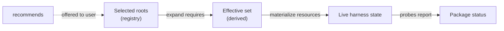
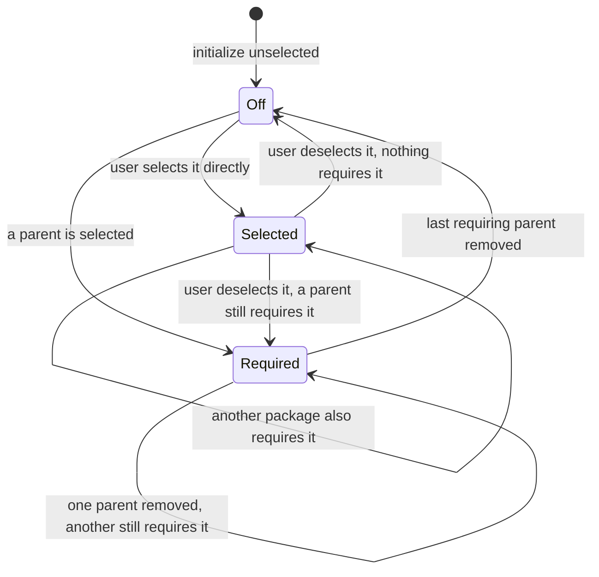

# Package Management: Part 02 - Track What You Turned On, What It Pulls In, and What Is Installed

## Summary

RoboRepo records which packages a user turned on in `~/.roborepo/enabled-packages.json`, but that
file mixes two things: packages the user chose, and packages switched on only because a chosen
package `requires` them. Once written, the two look the same, so a dependency stays on after the
package that needed it is turned off. Package enable also reports success without checking that
every resource actually landed. Install bundles have the same flaw in their own record: selecting
`telemetry` writes `hooks` as if the user had chosen it.

This plan gives package state one model with three layers, each with one owner:

| Layer | Answers | Owner |
| --- | --- | --- |
| Selected roots | What did the user (or a default) choose? | The registry file |
| Effective set | What must be active because of those choices? | Derived: roots plus their required-dependency closure |
| Live state | What is actually installed in each harness? | The existing resource probes |

On top of that model it adds `recommends` (offered, never automatic), non-selectable
dependency-only packages, a verified result from every enable and disable, required packages listed
in each package's source popup and a Recommended dependencies list on the Config page, and the same roots-plus-derived-dependencies rule for
install bundles.

This plan merges two earlier backlog plans: the derived-dependency plan this file grew from, and
`package-registry-live-state-reconciliation`, whose remaining work is folded in below.

## Context

### Current state

Verified on `main` at `69dea56`.

| Area | Today | Gap |
| --- | --- | --- |
| Registry ownership | `scripts/cli/rules-render.mjs` owns `readEnabledPackagesRegistry`, `setPackageEnabled`, `forgetPackageIds`, and `effectiveEnabledIds`, although the registry covers every package type. Importers: `packages.mjs`, `package-commands.mjs`, `package-projection-cleanup.mjs`, `package-probes.mjs`, `hook-readiness-status.mjs`, `config-bulk.mjs`, `browser/gate.mjs` (all under `scripts/cli/`), and `scripts/test/package-default-enabled-check.mjs` | Package state lives in the rules renderer |
| Registry shape | `{ packages: [...], disabled: [...], updatedAt }`, no version field; `effectiveEnabledIds` = `packages` minus `disabled`, plus `defaultEnabled` packages not in `disabled` | No record of why an id is in `packages` |
| Enable | `enablePackage` in `scripts/cli/packages.mjs` recursively enables each `requires` entry and writes it to `packages` | Dependencies become sticky roots |
| Disable | `disablePackage` refuses while enabled dependents exist; `--cascade` disables them first | Turning off the last parent leaves its dependency on |
| Mutation result | Enable applies each component and prints progress; nothing probes afterward. Errors leave through `process.exit` (14 call sites in `packages.mjs`), which is why `config-bulk.mjs` runs a preflight before calling it from the portal | A half-applied package reports as enabled, and a failure cannot be returned as a result |
| Portal mutation path | `mutatePackage` in `scripts/cli/config-mutate.mjs` wraps `enablePackage`/`disablePackage` and returns `{ ok, message, changedPackageIds }`; `config-bulk.mjs` applies a set (a `bulkToggle` section's Select All, or the Plans onboarding banner's `plan-suite` + `session-close`) | No per-package outcome |
| Live probes | `scripts/cli/package-probes.mjs` `buildPackageLiveState` reports `enabled`, `configured`, `partial`, `disabled`, or `external` per package and per component, including a `requires` component | Already shipped |
| Status API | `scripts/cli/package-status.mjs` and `/api/config` `componentStatus` expose probe results | Already shipped |
| Repair and adopt | `roborepo package reconcile` re-applies effective packages and drops ids missing from the catalog; `roborepo package adopt-live` marks external live packages as enabled | Already shipped |
| Portal badges | `portal/config/elements/config-item.js` styles `partial` as a warning and `external` as informational | Already shipped |
| Source popup | `openSource` in `portal/config/panels.js`, reached through `openSourceModal` in `portal/config/app.js` | Reused to list and open a package's required packages |
| Relationships | Catalog (`scripts/cli/package-catalog.mjs`) supports `requires` with cycle and missing-id checks. No built-in package uses it ([[o93hile]] removed the marker packages' dependency). `scripts/test/test-cli.sh` covers it with a workspace-only `test-composite` fixture that requires `jcodemunch` and `jdocmunch`, which now live in `globals/packages-archived/` but still load into the catalog | No `recommends`, selectability, or dependency visibility |
| Install bundles | `manifests/platform/presets.json` defines `base`, `rules`, `hooks`, `commands` (no rows), and `telemetry` (no rows). `scripts/cli/presets.mjs` keeps the selection in `~/.roborepo/presets/state.json` (`selected[]`). `withDependencies` hard-codes telemetry → hooks and the result is written back to `selected`. `bundle check` (run by `scripts/doctor.sh` and `scripts/verify-install.sh`) prints `<id> selected but not fully applied` without naming the missing rows | The same sticky-dependency flaw, a dependency rule hidden in code, and a failure that does not say what is missing |

A concrete case of the sticky dependency: enabling `test-composite` writes `test-composite`,
`jcodemunch`, and `jdocmunch` to `packages`. Disabling `test-composite` later leaves both
dependencies on, and nothing records that the user never chose them.

### Why now

[[ejsc769o]] adds a dependency-only `implementation-review` package (it does not exist yet) that
users cannot switch off on its own. Since [[bysyzl1e]] merged the plan skills into one `plan-suite`
package, its first edges are `plan-suite → implementation-review` and
`session-close → implementation-review`: one dependency shared by two selectable packages. That
needs selectability and derived activation. Every other package-state consumer (rules rendering,
command ownership, probes, the Config page) also reads the effective set, so the model has to
change in one place rather than per consumer.

## Goals

- Record only selected roots in the registry; derive dependencies on every read.
- Keep a shared dependency active until the last selected root that requires it is turned off.
- Add `recommends`: shown and offered, never enabled without a user choice, never a cause of
  `partial`.
- Add `selectable: false` so a dependency-only package cannot be toggled directly.
- Add `presentation.visibility` so dependency-only packages leave the normal rows but stay
  inspectable where they are referenced.
- Make enable and disable return the probed outcome (`enabled`, `partial`, or `blocked`) instead of
  assuming success.
- Give package state its own module, so the rules renderer only renders.
- List each package's required packages in its source popup, and show a Recommended dependencies
  list on the Config page, through the shared behavior
  view.
- Store install bundle selections as roots too, declare the telemetry → hooks dependency in
  `presets.json`, and derive it through the same graph helper.

## Non-goals

- Turning install bundles into packages or showing them on the Config page. Bundles keep their own
  record and install-time apply; only their dependency rule and reporting change.
- `forget` and `remove` actions, and an expandable per-resource detail row in the portal. The
  shipped `reconcile`, `adopt-live`, and status badges cover current needs; add these when a
  concrete case needs them.
- Ownership markers inside harness config files.
- Plan-suite-specific behavior such as the `implementation-review` package and the actual
  `requires`/`recommends` edges on built-in packages; [[ejsc769o]] owns them.
- Turning conditional, task-dependent skill pairing into static package relationships.

## Proposed design

### 1. Three layers, computed in one direction



```text
selectedRoots = registry.packages + defaultEnabled packages, minus registry.disabled
effective     = selectedRoots + transitive requires of selectedRoots
```

Every consumer that today calls `effectiveEnabledIds` reads `effective` from the new module.
Nothing reads the raw registry except that module.

### 2. Registry ownership and shape

Move registry read, write, `forgetPackageIds`, and the effective-set computation from
`scripts/cli/rules-render.mjs` to a new `scripts/cli/package-state.mjs`. Graph traversal (closure,
`requiredBy`, `recommendedBy`) goes in a separate pure module, `scripts/cli/package-graph.mjs`,
that takes plain `{ id, requires, recommends }` nodes, so it can be tested without a home directory
and reused for install bundles.

The file keeps its current path and `{ packages, disabled }` shape, with one change of meaning:
`packages` holds selected roots only. A `schemaVersion: 2` field marks files written under that
meaning.

A file without `schemaVersion` (version 1) is read by dropping every listed id that another listed,
non-disabled id requires, directly or transitively. Those ids stay effective through their parent,
so nothing turns off on upgrade; they turn off with their last parent. The next write stores
`schemaVersion: 2`. The cost: a dependency the user also chose on purpose before the upgrade is
read as derived. No built-in package declares `requires` today and `implementation-review` will
only ever be written under version 2, so in practice this affects workspace packages only.

### 3. Manifest fields

```json
{
  "requires": ["implementation-review"],
  "recommends": ["test-harness"],
  "selectable": false,
  "presentation": { "visibility": "dependency" }
}
```

| Field | Default | Meaning |
| --- | --- | --- |
| `requires` | `[]` | The package is invalid without these; they join the effective set automatically |
| `recommends` | `[]` | Useful companions; offered, never added automatically |
| `selectable` | `true` | `false` rejects direct `package enable` and `package disable` |
| `presentation.visibility` | `catalog` | `catalog`: normal row. `dependency`: no row; listed under Requires in the popup of each package that requires it. `hidden`: no UI row |

`roborepo package validate` rejects unknown ids in either relationship, self-references, invalid
values, and cycles in `requires`. `recommends` does not take part in cycle detection. A
`selectable: false` package with `defaultEnabled: true` is rejected, since nothing could ever turn
it off.

### 4. Enable and disable

A user action changes roots only; reconciliation then compares the effective set before and after
and applies or removes resources for the difference.



- `enable` and `disable` on a `selectable: false` package fail without changing state, and name
  the packages that control it.
- `disable` on a selectable package that is a selected root removes the root. If a selected parent
  still requires it, it stays effective and the result says which parents keep it on.
- `disable` on a selectable package that is effective only because a parent requires it has no
  root to remove: it is refused and names the parents. `--cascade` disables those parents first,
  so the dependency turns off with them.
- After applying, the mutation probes every package whose effective state changed and returns one
  outcome per package, with the per-component detail the probes already produce. The CLI prints it;
  `mutatePackage` and the bulk path return it to the portal.

  | Outcome | When |
  | --- | --- |
  | `enabled` | Every component probes as present |
  | `partial` | Some components probe as present and others as missing |
  | `blocked` | Applying stopped on an error, such as a collision with a user-owned file or a missing harness home |

  Returning `blocked` means the apply path throws a typed error that the CLI entry point turns into
  the exit code, instead of calling `process.exit` mid-apply.

### 5. Recommendations

When a selectable package is enabled and some of its recommendations are off:

| Caller | Behavior |
| --- | --- |
| Portal enable | Lists the disabled recommendations; the user enables them or continues |
| Interactive CLI | Prompts to enable or skip |
| Non-interactive CLI and API | Never enables them; returns them in the result |

The package engine returns recommendation data; only the portal and the interactive CLI prompt.
Graph and reconciliation functions never prompt.

### 6. Config page dependencies

Required packages are a reference, not a package option: a dependency-only one has no switch, and a
selectable one already has its own row. So they are not rows on the page. `buildBehaviorView` in
`scripts/cli/config.mjs` gives each package row a `requires[]` list (its transitive required
packages, each with the inspect target and cost its own row would have), and the source popup
lists them under **Requires**. Each name opens that package's source, with **Back** to the package
that requires it. `roborepo config status` prints a `requires:` line under the row.

Recommended packages are offers the user acts on, so each section exposes
`recommendedDependencies[]`: switchable rows below the section's own rows, each naming the packages
that recommend it. A package the section already shows, or one a row requires, is left out.

Illustration, using the edges [[ejsc769o]] is expected to add:

```text
Development Workflows
  Development Planning Lifecycle     [toggle]
  Session Close                      [toggle]

  Recommended dependencies
    Test Harness                     recommended by Session Close           [toggle]

Session Close popup
  Requires: Implementation Review    (opens its source; Back returns)
```

Terminal onboarding and the portal read the same behavior view. Bulk enable (a `bulkToggle`
section's Select All and the Plans onboarding banner) acts on selectable roots only.

### 7. Install bundles

Bundles keep `~/.roborepo/presets/state.json` and their install-time apply, and adopt the same
rule:

- `presets.json` declares `"requires": ["hooks"]` on the `telemetry` bundle; `withDependencies` in
  `scripts/cli/presets.mjs` is replaced by the `package-graph.mjs` closure.
- `selected[]` stores roots only. Apply, check, and status act on the effective set. Every listed
  bundle is read as a root, whatever the file's `schemaVersion` (user decision 2026-10-28: no
  compatibility reading for older bundle records).
- `bundle remove hooks` while `telemetry` is selected removes the root but leaves hooks applied,
  and says telemetry still requires it.
- `bundle status` marks each effective bundle as selected or `required by <bundle>`.
- `bundle check` names the missing rows when a bundle is not fully applied, so a `roborepo doctor
  --installed` failure says what to repair.

## Implementation plan

### Phase 1: State module and graph helpers

- [x] Add `scripts/cli/package-graph.mjs` with pure functions over `{ id, requires, recommends }`
      nodes: selected roots, required closure, `requiredBy`, and `recommendedBy`.
- [x] Add `scripts/cli/package-state.mjs`; move `readEnabledPackagesRegistry`,
      `setPackageEnabled`, `forgetPackageIds`, and `effectiveEnabledIds` out of
      `scripts/cli/rules-render.mjs`, and update every importer listed under Current state.
- [x] Extend `scripts/cli/package-catalog.mjs` to normalize and validate `recommends`,
      `selectable`, and `presentation.visibility`, including the non-selectable default-enabled
      rejection.
- [x] Fixtures: shared, transitive, and directly selected dependencies; non-selectable packages;
      missing recommendation ids; a `requires` cycle.

### Phase 2: Derived activation and verified results

- [x] Remove the recursive `enablePackage` call for `requires`; enable and disable change roots,
      then reconcile the before/after effective difference.
- [x] Apply the disable rules in Proposed design §4 (root removal, derived-only refusal,
      `--cascade`).
- [x] Reject direct mutation of `selectable: false` packages.
- [x] Replace mid-apply `process.exit` calls in `packages.mjs` with typed errors the CLI entry
      point maps to exit codes.
- [x] Probe changed packages after each mutation and return `enabled`, `partial`, or `blocked`
      from `enablePackage`/`disablePackage`, `mutatePackage`, and the `config-bulk.mjs` batch.
- [x] Read version-1 registries with the drop-required rule, and write `schemaVersion: 2`.
- [x] Confirm rules rendering, command ownership, probes, `reconcile`, `adopt-live`, hook
      readiness, and the browser gate read the effective set from `package-state.mjs`, and that
      no other module reads `enabled-packages.json`.

### Phase 3: Recommendations

- [x] Return disabled recommendations from the enable result.
- [x] Add the portal prompt and the interactive CLI prompt; keep the non-interactive path silent.

### Phase 4: Config presentation

- [x] Add selectability, visibility, derived-vs-selected state, and inverse relationships to the
      package snapshot in `scripts/cli/config.mjs`.
- [x] Derive each row's required references and each section's recommended list in
      `buildBehaviorView`; omit `visibility: dependency` packages from normal rows.
- [x] List required packages under **Requires** in the source popup (`portal/config/panels.js`),
      each opening its source with Back, and render the Recommended dependencies list through
      `portal/config/elements/config-item.js` and its templates, following the portal's template
      and light-DOM conventions.
- [x] Make bulk enable skip non-selectable and derived-only rows.

### Phase 5: Install bundles

- [x] Add `requires` to the bundle schema in `manifests/platform/presets.json` and declare
      `telemetry → hooks`.
- [x] Replace `withDependencies` in `scripts/cli/presets.mjs` with the graph closure; store roots
      only and read every listed bundle as a root.
- [x] Show derived bundles in `bundle status` and name missing rows in `bundle check`.

### Phase 6: Catalog and docs

- [x] Update the docs listed under Documentation impact.

## Validation

| Behavior | Check |
| --- | --- |
| Graph helpers compute closure, `requiredBy`, and `recommendedBy`, and ignore `recommends` for cycles | New `scripts/test/package-graph-check.mjs` |
| Catalog accepts valid graphs and rejects bad ids, values, `requires` cycles, and non-selectable defaults | `scripts/test/package-catalog-check.mjs` |
| Enabling a package that requires another makes the dependency effective without recording it as a root (fixture package) | `scripts/test/package-lifecycle-check.mjs` |
| Two parents share a dependency; disabling one keeps it, disabling both removes it | `scripts/test/package-lifecycle-check.mjs` |
| A directly selected dependency survives its parents being disabled; deselecting it while a parent remains keeps it effective | `scripts/test/package-lifecycle-check.mjs` |
| Disabling a derived-only dependency is refused; `--cascade` turns it off with its parents | `scripts/test/package-lifecycle-check.mjs` and the existing `test-composite` assertions in `scripts/test/test-cli.sh` |
| Direct enable/disable of a non-selectable package fails and changes nothing | `scripts/test/package-lifecycle-check.mjs` |
| A forced component failure returns `partial`, and an apply error returns `blocked`, not `enabled` | `scripts/test/package-lifecycle-check.mjs` |
| Reading a version-1 registry leaves the effective set unchanged and drops required ids from roots | `scripts/test/package-lifecycle-check.mjs` |
| Defaults still apply and explicit disables still win | `scripts/test/package-default-enabled-check.mjs` |
| Bulk enable skips dependency rows and returns per-package outcomes | `scripts/test/config-bulk-toggle-check.mjs` |
| Required packages appear only in the source popup and open their source; recommended rows render with a toggle | `npm run test:portal-ui` |
| Row references are transitive; the recommended list skips shown and required packages; `config status` prints both | `scripts/test/config-dependency-sections-check.mjs` |
| Telemetry bundle derives hooks; removing telemetry drops hooks unless selected; `bundle check` names missing rows | Bundle assertions in `scripts/test/test-cli.sh` |
| Full gate, since package state reaches install, rules, and generated harness output | `npm run check` |

## Risks

| Risk | Treatment |
| --- | --- |
| A consumer keeps reading the raw registry and brings back sticky or missing dependencies | Only `package-state.mjs` reads the file; search for direct reads during Phase 2 |
| Prompts leak into graph code and break non-interactive callers | Prompts live only in the portal and the interactive CLI |
| A dependency row makes a category look partly selected | Bulk enable and category state count selectable roots only |
| Changing the meaning of `packages` turns off something a user relies on | The version-1 read rule keeps every currently effective package effective; a fixture asserts the effective set is unchanged across the upgrade |
| Replacing `process.exit` changes CLI exit codes | The CLI entry point maps each typed error to the code the old exit used; existing `test-cli.sh` exit-code assertions stay unchanged |
| Bundle state change breaks install or doctor | Every listed bundle is read as a choice; `test-cli.sh` and `test-install-collisions.sh` bundle assertions stay green. A telemetry-only record from `main` fails `bundle check` until `bundle remove telemetry` (accepted, see Decision Log 2026-10-28) |

## Documentation impact

| Doc | Update |
| --- | --- |
| `.claude/skills/roborepo-development/references/package-development.md` | `requires`, `recommends`, `selectable`, `presentation.visibility`; selected/effective/live model |
| `docs/user/reference/config-control-panel.md` | Requires line in the source popup; Recommended dependencies list; recommendation prompt |
| `docs/internal/config-panel-internals.md` | Dependency sections in `buildBehaviorView`; per-package mutation outcomes |
| `docs/user/reference/roborepo-cli.md` | `package enable`/`disable` outcomes, disable rules for dependencies, recommendation prompt |
| `docs/internal/cli-internals.md` | `package-state.mjs`/`package-graph.mjs` ownership; bundle roots and derived dependencies |

## Not tested

No entries. The portal recommendations dialog has a stubbed Playwright test for both buttons, and
both it and the interactive terminal prompt were also run for real against a workspace fixture;
see `## Review` → `### Verification`.

## Open Questions

None open. Every question was answered by the user (2026-10-27 and 2026-10-28); see Decision Log.

## Decision Log

- **2026-10-12: Merged `package-registry-live-state-reconciliation` into this plan.** Both plans
  redesigned the same registry in the same files. Most of that plan's work had shipped (probes,
  status API, `reconcile`, `adopt-live`, portal badges); its remaining items were a versioned
  registry and verified mutation results, which this plan now owns. Its `forget`/`remove` actions
  and per-resource detail rows are deferred (see Non-goals). The superseded plan is archived at
  `docs/plans/archived/package-registry-live-state-reconciliation.md`.
- **2026-10-26: Version-1 registries drop required ids.** Chosen by the user over keeping every
  listed id as a root. It fixes stickiness without changing what is active today; the lost
  "also chose it directly" signal only matters for workspace packages.
- **2026-10-26: Install bundles share the graph but keep their record.** Chosen by the user over
  turning bundles into packages (which would reach install, update, uninstall, and root-config
  collision handling) and over documenting the gap only.
- **2026-10-26: Disable rules for dependencies.** The earlier text both kept the "enabled packages
  depend on it" refusal and let a user deselect a still-required root. Resolved: deselecting a root
  always succeeds and the package stays effective if required; refusal and `--cascade` apply only to
  a package that is effective solely through a parent.

- **2026-10-26: Disable reports its own outcomes.** The plan's outcome table names `enabled`,
  `partial`, and `blocked` for enables. Disable needed a success state too, so each removed package
  probes as `disabled` (nothing it owns is present), `partial` (something it owns is still there,
  named), or `blocked`. Alternatives: reuse `enabled` for "change applied" (misleading), or return
  no outcomes from disable (the plan asks for one per changed package).
- **2026-10-26: `partial` exits 0, `blocked` exits 1.** A partial apply already happened before
  this change (with exit 0) and is common in fake homes (an MCP preset skipped with `SKIP_MCP`); a
  non-zero exit would break every scripted enable while adding nothing the printed warning does
  not. `blocked` replaces the uncaught error that already exited 1. Refusals keep exit 2.
- **2026-10-26: Enable re-applies the whole required closure.** Enable applies every package in
  the selected root's closure, not only the newly effective ones, matching the old recursive
  enable that re-applied each dependency. Re-applying is idempotent and repairs a dependency with
  a missing resource; applying only the difference would leave such a dependency broken.
- **2026-10-26: `--cascade` on a selected root also deselects the parents that require it.** The
  design text covers `--cascade` for a derived-only package. For a root a parent also requires,
  `--cascade` deselects those parents too, so the package actually turns off — the same meaning
  `--cascade` has always had ("disable dependents first"). Without it, the root is deselected and
  stays on, as §4 specifies.
- **2026-10-26: Reconcile applies effective packages directly.** `reconcile` used to call
  `enablePackage --reconcile`, an internal flag. It now applies each effective package's components
  in dependency order through the same component-apply function enable uses, and the internal flag
  is gone.
- **2026-10-26: The non-interactive enable lists recommendations in one line.** "Silent" in Phase 3
  is read as "never prompts and never enables": scripts get one `recommended (not enabled): ...`
  line, and API callers get `recommendations[]` in the result. Alternative: print nothing, which
  hides the offer from scripted users entirely.
- **2026-10-26 (user decision): Required packages live in the source popup, not on the page.**
  The first build gave each section a Required dependencies list of rows. The user judged that a
  required package that cannot be switched is a reference by another name, not a package option,
  and asked for it to be called out in the package popup instead. Each row now carries its
  transitive required packages; the popup lists them under **Requires**, each opening its source
  with Back. The Recommended dependencies list stays on the page, since those rows have a switch.
- **2026-10-26: Requires lists the transitive closure; Recommended skips what a row requires.** A
  two-level requirement is still visible from the package that pulls it in. A package both required
  and recommended is left out of the recommended list, since it turns on anyway.
- **2026-10-26: Reconcile does not re-run the command-ownership check.** The old reconcile went
  through `enablePackage --reconcile`, which ran `validatePackageCommandOwnership` per package.
  That check compares `command` components, which come only from `cli-command` resources, and
  `validatePackageCatalog` rejects any second package claiming one on every `loadPackageCatalog`
  call. So two effective packages can never conflict by the time reconcile runs, and the check was
  unreachable there before this change too. Alternatives: restore it as a typed error (dead code), or
  skip-and-warn (same). Validation pass 3 raised this as an escalation; the evidence settles it.
- **2026-10-26: Bulk disable skips derived-only members.** A bulk Deselect All member that is on
  only because another selection requires it is reported `skipped` instead of being refused, so a
  batch never fails on a package it cannot switch directly. Selection is re-read before each member.
- **2026-10-26: Turning telemetry off leaves the hooks bundle's files in place.** Turning telemetry
  off (`deselectTelemetryBundle`) only drops a recorded `telemetry` root; it never applies or
  removes bundle rows. `bundle remove telemetry` is the path that removes the hooks it required.
  Removing core hooks as a side effect of a telemetry toggle would be a wider behavior change than
  this plan asks for.
- **2026-10-26: Bundle selection lives in its own small module.** `bundle-selection.mjs` holds bundle
  roots and the effective set so hook readiness (`core-hook-bundle.mjs`), the Config snapshot, and
  `presets.mjs` share one rule without hook readiness importing the bundle-apply module.
- **2026-10-26: Updated one fixture for the planned bundle behavior.** `shared-target-rows-check`
  enables the telemetry package and then runs `bundle remove hooks`. After the 2026-10-27 telemetry
  decision the package records no bundle, so the fixture asserts the removal is not kept, as on the
  base branch.
- **2026-10-27 (user decision): Package-side telemetry records no bundle.** Chosen over installing
  the hooks bundle from `telemetry install` and over dropping the telemetry → hooks edge.
  `telemetry install` and the Settings toggle no longer write a `telemetry` bundle root, so a
  telemetry-only setup leaves `hooks` off and `bundle check` and hook readiness expect no core
  hooks. Turning telemetry off still drops a root that `bundle apply telemetry` recorded.
- **2026-10-28 (user decision): Older bundle records are read as written.** Validation pass 4
  found that the drop-required rule turned a user's own `hooks` choice into a dependency of a
  `telemetry` root recorded by `main`'s package path, so turning telemetry off left `hooks`
  unselected. Offered: drop a legacy `telemetry` root, keep every listed bundle as a root, or accept
  the cost. The user, not needing backwards compatibility, chose to remove compatibility reading for
  bundles: every listed bundle is a root and `schemaVersion` is written but not branched on. This
  replaces the 2026-10-27 rule that dropped a legacy root listed without its requirements. Accepted
  cost: a telemetry-only record written by `main` (`["base","telemetry"]`) makes `hooks` required,
  so `bundle check`, `doctor --installed`, and `verify-install` fail until `bundle remove telemetry`
  or `bundle apply hooks`; `roborepo update` keeps the telemetry selection and does not clear it.
  Validation pass 5 found the first statement of this cost wrong (it named `roborepo update` as a
  remedy); the corrected cost stays within the user's "no backwards compatibility" choice, so the
  decision stands. The package registry keeps its version-1 rule.
- **2026-10-27 (user decision): The Claude MCP adapter returns `ok: false`.** Chosen over a typed
  error and over deferring to a harness-adapter plan. `runClaudeMcpAdd` returns its status, the
  adapter's `addServer` returns `ok: false` with the message in `warnings` and the CLI status in
  `exitStatus`, package enable reports the package `blocked` with that message, and `roborepo mcp
  add` / `mcp apply` exit with the Claude CLI's status as before.

## Review

### Findings

- [x] `## Not tested` pointed to verification evidence the plan did not hold; the Enable selected
      path had no assertion — recorded below and added a portal test for **Enable selected** (bb2a435e)
- [x] `adopt-live` could record a dependency-only package as a root that no disable can remove —
      skips non-selectable packages, with a lifecycle assertion (fails without the fix) (bb2a435e)
- [x] A bulk group switch counted rows on only through another selection, so an all-derived
      section was stuck on Deselect All — counts only switchable rows and hides when none remain,
      with a portal test (bb2a435e)
- [x] `bundle check` said "selected" for a bundle that is only required — names `required by
      <bundle>`; test-cli assertion updated (bb2a435e)
- [x] `recommendationOption` split the packages-intro comment from its function — moved below (bb2a435e)
- [x] The terminal dependency lists and the view's closure, no-repeat, and required-over-recommended
      rules had no direct test — added `scripts/test/config-dependency-sections-check.mjs` (bb2a435e)
- [x] A failing `claude mcp add` still exits mid-enable — user chose `ok: false` from the adapter;
      covered by `mcp-claude-add-failure-check.mjs` (adapter result, `mcp add` exit status, package
      enable `blocked`)
- [x] Comments in `config.mjs` and `package-catalog.mjs` still described per-section dependency
      lists that the user decision removed — reworded to the popup's Requires line
- [x] A required package with no inspectable source rendered as a button that did nothing —
      listed as plain text instead, with a portal assertion
- [x] A telemetry-only selection now requires the hooks bundle it never applies — user chose to
      stop recording the bundle; test-cli asserts `telemetry enable` records none
- [x] Reconcile no longer ran the command-ownership check that `enablePackage --reconcile` ran —
      no change needed: the check could never fire (see Decision Log)
- [x] `coreHookBundle` reporting a required-only bundle as selected has no test — test-cli asserts
      `selected: true` for a `telemetry` root
- [x] The config panel doc tied "no row" to `selectable: false` instead of
      `presentation.visibility` — reworded
- [x] The `PackageMutationError` comment left out the dependency-only refusal — added
- [x] The `AdapterActionResult` typedef did not document the new `exitStatus` field — added
- [x] The 2026-10-28 accepted cost named `roborepo update` as a remedy it is not — corrected in
      the Decision Log and Risks; the cost is within the user's no-compatibility choice
- [x] `## Risks` and `### Verification` still described the removed bundle rule and an undated gate
      run — reworded
- [x] An older bundle record with telemetry on loses the user's own hooks selection — user chose
      to read bundle records as written; test-cli asserts `hooks` stays selected and applied after
      `bundle remove telemetry` on such a record

### Verification

- Validation pass 1 (fresh-context subagent): 6 fix, 1 escalate, 1 base.
- Validation pass 2 (fresh-context subagent): 3 fix, 1 escalate, 1 base (the same docs link).
- Validation pass 3 (fresh-context subagent): 3 fix, 1 escalate (resolved from evidence, see
  Decision Log), 1 base (the same docs link).
- After the 2026-10-27 decisions: `test-cli.sh` 476 passed, 0 failed.
- Merged `main` at 8cb1cf20, resolving this plan's file (`main`'s copy matched the start
  transition, so the worktree copy was kept) and the Codex sandbox plan's ready/review rename (kept
  `main`'s `review/` file). `test-cli.sh` 476 passed on the merged tree. `npm run check` 61/62 on
  the merged tree; the failure is `docs-reference-check` on `backlog-review.md:86`, which now names
  the Codex sandbox plan's old `ready/` path. It fails the same way at the merge base, so it is a
  base failure.
- Validation pass 4 (fresh-context subagent): 1 fix, 1 escalate, 1 base (that docs link).
- After the 2026-10-28 bundle-record decision: `test-cli.sh` 474 passed, 0 failed (two older-record
  assertions removed, one replaced by the hooks-survives-telemetry assertion).
- Full gate on 2026-10-26, after the Requires-popup user decision: `npm run check` 61/62 suites; the
  failure was `docs-reference-check.mjs` on `docs/internal/backlog-review.md:86` (then a `backlog/`
  path), which also failed at the base commit `b0b5288b`.
- Validation pass 5 (fresh-context subagent): 2 fix (plan text), 1 escalate (the accepted cost was
  misstated; corrected below), 1 base (the same docs link, `ready/` path at merge base `c1d92150`,
  fixed on `main`).
- Manual, portal (2026-10-26): a hermetic portal on a workspace fixture (Demo Planner and Demo
  Closer require a dependency-only Demo Review; Demo Closer recommends Demo Tester). The Integrations
  section showed Demo Review only under a Required dependencies list (since replaced by the popup's
  Requires line, re-verified below), with no switch. Turning on Demo Closer opened the recommendations dialog listing Demo
  Tester; **Enable selected** left Demo Tester `selected` and Demo Review `required` in
  `/api/config`.
- Manual, portal after the user decision (2026-10-26): the Integrations section had no Required
  list; Demo Planner's popup showed `Requires: Demo Review (dependency-only)`, the name opened Demo
  Review with Back shown and no Requires line, and Back returned to Demo Planner. (The popup body
  reads "path escapes repo" for workspace packages outside the app folder; `readSourceFile` is
  unchanged by this branch, so that limit predates it.)
- Manual, terminal (2026-10-26): `package enable demo-closer` under a pseudo-terminal asked
  `Also enable recommended package Demo Tester (demo-tester)? [y/N]`; answering `y` enabled it and
  the registry read `["demo-planner", "demo-closer", "demo-tester"]`.

## Coordination and completed baseline

The superseded reconciliation proposal is archived as
`docs/plans/archived/package-registry-live-state-reconciliation.md`; this plan owns its remaining
versioned state, verified mutation, and repair/adoption requirements. Existing live probes and
`package inspect/status/reconcile/adopt-live` remain the baseline.

| Plan | Relationship | Effect |
| --- | --- | --- |
| [[bysyzl1e]] | Landed dependency (`ba3a6851`, closed in `efbf12bf`) | Plan skills are one `plan-suite` package under Development Workflows; fixtures and the mockup use `plan-suite` |
| [[ejsc769o]] | Unlanded downstream consumer | Adds `implementation-review` and the built-in `requires`/`recommends` edges on this contract; its per-skill plan edges collapse onto `plan-suite`, which that plan settles when promoted |
| [[jdsobwn]] | Unlanded, related | Agree state/provenance references before persisting source-qualified selections |
| [[user-managed-packages-and-add-workflows]] | Unlanded, related | Reuses this registry and live probes |
| [[74h2tlim]] | Unlanded, related | Consumes feature-owned schemas; no second package-state model |
