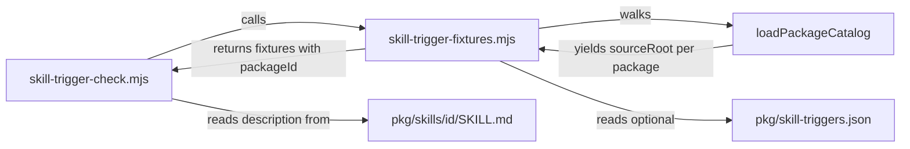

# Package-Owned Trigger Fixtures

## Summary

Move skill trigger fixtures out of the platform-owned `manifests/inventory/skill-trigger-tests.json`
and into a `skill-triggers.json` file at the root of each package that has them. A package then
owns its skills' trigger policy, and adding, removing, or swapping a package never requires an
edit to the platform's trigger data.

## Context

`roborepo skill triggers --check` is a static guard on skill invocation policy. For each fixture it
checks three things:

| Check | Fails when |
| --- | --- |
| Description coverage | A `triggerPhrases` or `skipPhrases` entry is absent from the skill's `SKILL.md` description |
| Match prompts | A `match` prompt contains no trigger phrase |
| Near-miss prompts | A `nearMiss` prompt contains a trigger phrase |

The checker in `scripts/cli/skill-trigger-check.mjs` is already package-agnostic: it resolves each
fixture's `skill` id to a source directory through `loadPackageCatalog()` and names no package in
code. The fixture *data* is not. It sits in `manifests/inventory/`, and every entry names one
package's skill. Delete the `tighten` package today and the central file keeps a dangling entry that
fails the check until someone edits a platform file to remove it. Every other per-skill fact —
`package.config.json`, `SKILL.md`, `agents/openai.yaml` — already lives under
`globals/packages/<package-id>/`.

## Goals

- Every trigger fixture lives in the package that declares the skill it tests.
- `manifests/inventory/skill-trigger-tests.json` is deleted, and nothing in the repository reads it.
- `roborepo skill triggers --check` applies the same three checks to the same fixtures, discovered
  through the package catalog.
- Adding a fixture for a new package touches only that package's directory.

## Non-goals

- Changing what the check validates. Only the data's location changes.
- Making fixtures mandatory. They stay optional per package, as today.
- Removing other package names from `manifests/`. `reserved-commands.json` names `caveman`, and
  `presets.json` and `agent-permissions.json` name `telemetry`; those are separate boundary
  questions.
- Prompting for trigger phrases in `roborepo skill new`.

## Current state

| Concern | Location | Today |
| --- | --- | --- |
| Fixture data | `manifests/inventory/skill-trigger-tests.json` | One `tests[]` array, 6 entries, 14 `match` and 17 `nearMiss` prompts |
| Checker | `scripts/cli/skill-trigger-check.mjs` | Reads the path in `TRIGGER_TESTS_REL`; prints `ok: N skill trigger fixture(s)` or one `fail:` line per problem and exits 1 |
| Skill lookup | `packageSkillSources()` in the checker | `loadPackageCatalog({ includeUnavailable: true })`, so disabled packages are still checked |
| Packaging checklist | `manifests/platform/source-files.tsv` | Lists the central file; `scripts/doctor.sh` fails when a listed file is missing |
| Scaffold | `scripts/cli/skill-new.mjs` | Writes `package.config.json`, `SKILL.md`, and `agents/openai.yaml`; never mentions fixtures |
| Test coverage | `scripts/test/test-cli.sh` | One assertion that the live repository's fixtures pass; no test exercises a failing fixture |

The six fixture entries map to these package directories. `case-study` shows why the path must
come from the catalog: its package id is not its skill id.

| Skill | Package directory |
| --- | --- |
| `case-study` | `globals/packages/case-study-pack/` |
| `plan-write` | `globals/packages/plan-write/` |
| `plan-promote` | `globals/packages/plan-promote/` |
| `plan-start` | `globals/packages/plan-start/` |
| `plan-close` | `globals/packages/plan-close/` |
| `tighten` | `globals/packages/tighten/` |

These files name the central fixture path and must change with it:

| File | Reference |
| --- | --- |
| `scripts/cli/skill-trigger-check.mjs` | `TRIGGER_TESTS_REL` |
| `manifests/platform/source-files.tsv` | Required-file row |
| `manifests/inventory/README.md` | Files table row and the closing "after editing" paragraph |
| `docs/user/reference/roborepo-cli.md` | `skill triggers` command row |
| `docs/user/reference/roborepo-skills.md` | "Trigger Fixtures" section |
| `globals/system/skills/builtin-support/SKILL.md` | "add/update trigger fixtures" instruction under "Adding a shared skill" |

## Proposed design

Each package that has fixtures gets one optional file at its root, beside `package.config.json`:

```text
globals/packages/plan-write/
  package.config.json
  skill-triggers.json        <- new; never copied to harness homes
  skills/plan-write/
    SKILL.md
    agents/openai.yaml
```

The file keeps today's entry shape unchanged, including the `skill` key, because one package may
declare several skill resources:

```json
{
  "tests": [
    {
      "skill": "plan-write",
      "match": ["..."],
      "nearMiss": ["..."],
      "triggerPhrases": ["..."],
      "skipPhrases": ["..."]
    }
  ]
}
```

The file sits at the package root, not inside `skills/<skill>/`, because skill directories are
copied whole: `copyDir` in `scripts/cli/skill-files.mjs` and the `cpSync` calls in
`scripts/cli/config-mutate.mjs` and `scripts/cli/workspace-resources.mjs` copy them into
`~/.roborepo/skills/` and from there into every harness, and `roborepo skill export-to-project`
copies them into client repositories. Package roots are never copied.



Responsibilities split across two files:

| File | Role |
| --- | --- |
| `scripts/cli/skill-trigger-fixtures.mjs` (new) | Loader. Walks `loadPackageCatalog({ includeUnavailable: true })`, reads each package's `skill-triggers.json` when present, and returns `{ packageId, skill, ...fixture }` entries in catalog order. Fails with the file path on malformed JSON, and fails when an entry names a skill its own package does not declare. |
| `scripts/cli/skill-trigger-check.mjs` | Command. Calls the loader, runs the three checks unchanged, and keeps the existing `ok:` and `fail:` output. |

A separate loader gives the planned live eval suite in [[0jped168]] one function to import instead
of a second reader. The loader passes unknown keys through, so that plan's optional `liveMatch`
arrays keep passing the static check.

Workspace packages come from the same catalog, so a user's custom packages can ship fixtures with
no extra wiring.

## Implementation plan

- [x] Add `scripts/cli/skill-trigger-fixtures.mjs` with the loader described above.
- [x] Add `scripts/test/skill-trigger-fixtures-check.mjs` and register it in the `ci` group of
      `scripts/test/check-groups.json`. Build synthetic packages in a temp directory and point
      `ROBOREPO_APP_ROOT` at it, as the manual-only package assertion in `scripts/test/test-cli.sh`
      does. Assert observable CLI results:
      - a package with no `skill-triggers.json` contributes zero fixtures and passes;
      - a valid fixture passes and is counted in the `ok:` line;
      - a description missing a trigger phrase exits 1 with a `fail:` line naming the skill;
      - an entry naming a skill its package does not declare exits 1;
      - malformed JSON exits 1 with a message naming the file;
      - an entry carrying an unknown key such as `liveMatch` still passes.
- [x] Switch `scripts/cli/skill-trigger-check.mjs` to the loader and remove `TRIGGER_TESTS_REL`
      and `readJson`.
- [x] Move each of the six entries into its package's `skill-triggers.json`, using the mapping in
      Current state. Before deleting the central file, confirm the loader returns the central
      file's six entries with identical field values.
- [x] Delete `manifests/inventory/skill-trigger-tests.json` and its row in
      `manifests/platform/source-files.tsv`.
- [x] Point the four documentation files listed under Current state (`manifests/inventory/README.md`,
      both `docs/user/reference/` files, and `builtin-support/SKILL.md`) at
      `globals/packages/<package-id>/skill-triggers.json`.
- [x] In `scripts/cli/skill-new.mjs`, when the new skill's risk is `medium` or `high`, add a line to
      the printed next steps naming the package's `skill-triggers.json` path and
      `roborepo skill triggers --check`. Do not write a stub file.

## Validation

| Check | Command | Expected |
| --- | --- | --- |
| Fixtures still pass | `roborepo skill triggers --check` | `ok: 6 skill trigger fixture(s)` |
| Loader behavior | `node scripts/test/skill-trigger-fixtures-check.mjs` | Every case listed in the loader-check task passes |
| Central file gone | `git grep -n skill-trigger-tests` | Matches only under `docs/plans/` |
| Doctor accepts the deletion | `bash scripts/doctor.sh --quiet` | Exits 0 |
| Packages still validate | `roborepo package validate` | No new findings |
| Completion gate | `npm run check` | Exits 0 |

Acceptance:

- Each of the six fixtures appears exactly once, in its own package, with field values identical to
  the central file's entry.
- Adding a fixture to a package that has none touches only that package's directory.
- Disabled packages (`case-study-pack`, `tighten`) are still checked.

## Risks

| Risk | Mitigation |
| --- | --- |
| A phrase or prompt is dropped while moving entries | The migration task compares loader output to the central file before deletion |
| Output order changes when packages are reordered in presentation | Order follows `loadPackageCatalog`, which is deterministic; tests assert on content, not line order |
| Concurrent edits to shared files | Work for [[3jp3yhtq]] modifies `scripts/test/check-groups.json` and `scripts/test/test-cli.sh`. The loader check appends one line to the first and leaves the second untouched; resolve any conflict by keeping both entries |

## Related plans

| Plan | Classification | Effect on this plan |
| --- | --- | --- |
| [[0jped168]] live behavior evals (backlog) | Plan-vs-plan touchpoint overlap | It plans `liveMatch` arrays in the central file and a fixture reader. Whichever lands second moves its `liveMatch` additions into the per-package files and imports `skill-trigger-fixtures.mjs`. That plan already anticipates the move; its prose is not edited here. |
| [[age4cm7r]] plan-suite atomic commands (active) | Landed dependency; lifecycle drift | Squash-merged as `b91f03f` (PR 25). It added the `plan-close` fixture and removed `integration-check`, both visible on `main`. It remains in `active/`; its tables still name the central file as history. Closing it is its own `/plan-close` run. |
| [[skills-vs-commands-invocation-policy]] (backlog) | Related, no conflict | Introduced the trigger check and plans more fixtures; new fixtures would land in package files instead. |
| [[3jp3yhtq]] desktop harness discovery (active) | No dependency | Shares only the test files named under Risks. |
| [[a7bslb00]] worktree lifecycle cleanup (active) | No dependency | Its branch edits the `plan-close` `SKILL.md` body, not the `description` the `plan-close` fixture checks. |

## Decision Log

- Fixtures live in a package-root `skill-triggers.json`, chosen by the user over a sibling of
  `SKILL.md` and a `package.config.json` field. Skill directories are copied into harness homes and
  exported projects, so test data there would ship to agents. A config field would expand the
  package schema to hold test-only data.
- The file keeps the `skill` key and `tests[]` shape, so a package with several skills needs no
  second format and each entry moves without edits.
- An entry that names a skill outside its own package fails the check, so one package cannot hold
  fixtures for another.
- `roborepo skill new` prints a next step instead of writing a stub. An empty stub has no phrases,
  passes the check trivially, and would read as coverage that does not exist.
- The loader check calls `skillTriggerCheck` in a child process instead of running `main.mjs`. The
  CLI command catalog also resolves from `ROBOREPO_APP_ROOT`, so a real `main.mjs` run would need
  the whole app root copied in. The child process still produces real exit codes and output. It also
  isolates the app, state, and workspace roots, so the user's own workspace packages cannot leak
  in. Rejected alternative: `makeAppRoot()` from `app-root-fixture.mjs`, which copies `globals/` and
  would bring every real package's fixtures along with the synthetic ones.
- Loader errors (malformed JSON, a fixture naming another package's skill) print as one `fail:`
  line and exit 1. That matches the checker's existing failure format; the alternative was an
  uncaught stack trace.
- The loader check also covers a workspace package and a package that declares two skills. The
  docs claim both, and each case is a few lines.
- `roborepo skill new` coverage went into the existing scaffold block of `test-cli.sh`, near line
  440. A medium-risk skill names its `skill-triggers.json` and writes no stub; a low-risk skill
  prints no fixture step. The [[3jp3yhtq]] branch edits `test-cli.sh` only near line 1576, so the
  two branches do not conflict.
- Outside this plan's scope, but needed for the completion gate: on `main`,
  `plan-citation-comments-check.mjs` flagged its own header comment ("a plan decision"), so the
  `ci` group failed before this work started. The header now says "a decision recorded in a plan".
  What the check enforces is unchanged.

## Verification

| Check | Result |
| --- | --- |
| `roborepo skill triggers --check` | `ok: 6 skill trigger fixture(s)` |
| Loader output vs. central file, before deletion | All six entries identical field-for-field, each loaded from its own package |
| `node scripts/test/skill-trigger-fixtures-check.mjs` | Passes; fails as expected when the ownership guard is disabled |
| `git grep -n skill-trigger-tests` | Matches only under `docs/plans/` |
| `bash scripts/doctor.sh --quiet` | `doctor passed (100 checks)` |
| `roborepo package validate` | `ok: 25 package(s) valid` |
| `npm run check` | `CI checks passed` (test-cli: 430 passed, 0 failed) |

## Open Questions

None.

## Not tested

None. Each acceptance criterion is covered by the loader check, the `test-cli.sh` assertions, or
the live `roborepo skill triggers --check` run. The live run checks the disabled `case-study-pack`
and `tighten` packages.
