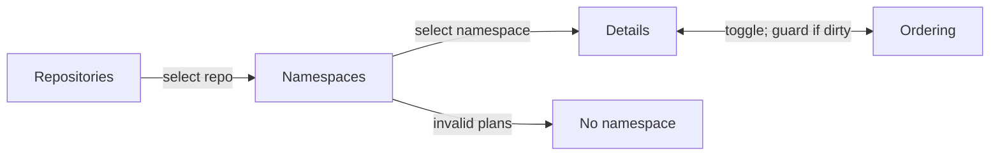

# Organize and prioritize backlog plans by namespace

## Summary

Make Backlog useful for deciding what to build next. Navigate from repositories to namespaces to one list of plans. **Details** and **Ordering** are two presentations of that list. Order is explicit within a repository/namespace, unprioritized plans appear first, and dependency-connected Backlog plans automatically form contiguous movable groups **in Ordering mode only** (Option A). Details shows individual flat cards in the same plan order. Manual Ordering edits stay local until the user saves them.

## Context

The issues to solve:

- Long titles do not consistently show their namespace at the beginning of the displayed label.
- A global Backlog card feed is difficult to scan when many repositories and namespaces are involved.
- H/M/L does not specify a concrete next-to-build order.
- Part 1/2/3 work often has hard dependencies; remaining backlog phases should move together, but unrelated work may go ahead of them.
- New plans can disappear into an implicit backlog tail unless they remain visibly unprioritized.
- A prioritization session may involve many edits, so immediate persistence is too easy to trigger accidentally.
- Invalid namespace metadata must be rejected when authored but remain discoverable if it exists on disk.

Automatic dependency regrouping (Option A) is the chosen behavior. Do not implement or design a separate approval workflow for automatic regrouping.

## Current state

Checked against commit `9a2ebc74`.

| Area | Current behavior | Touchpoints |
| --- | --- | --- |
| Namespaces | Longest-prefix matching exists but is private, and records carry no `namespace` field. Universal namespaces are a constant. | `modules/plan-suite/naming.mjs` (`matchNamespace`, `UNIVERSAL_NAMESPACES`), `readPlanRecord` and `publicPlan` in `modules/plan-suite/index.mjs` |
| Naming enforcement | Naming findings are advisory, so `roborepo plans validate` exits 0. Transition gates leave them out, so no transition refuses them. A repo without `plans-config.json` gets no findings. Malformed config is silently treated as not configured. | `modules/plan-suite/findings.mjs`, `lifecycleFindings` in `index.mjs`, `assertDestinationReady` in `transition.mjs`, `naming.mjs` |
| Naming in CI | `npm run check` tests a hard-coded filename list, not the real plan tree. Other repos have no enforcement. | `scripts/test/plan-suite-findings-check.mjs` |
| Plan creation | No command or portal route creates or renames a plan. `plan-write` is a skill whose agent writes the file and then runs the validator. | `globals/packages/plan-suite/skills/plan-write/` |
| Dependencies | `plan.dependencies` is parsed. Self-references and missing IDs are findings; cycles are not detected. | `modules/plan-suite/index.mjs`, `findings.mjs` |
| Priority | Backlog and Ready show a priority dropdown and filter, and every lifecycle uses it as a sort key. Home shows it as a read-only chip. Start and reopen write `priority: none`, as does landed recovery. | `planSort` in `portal/plans/state.js`, `portal/plans/elements/plan-status.js`, `manifests/platform/plan-lifecycle.json` (`showsPriority`), `POST /api/plans/priority`, `transition-rules.mjs`, `landed-recovery.mjs`, `repair.mjs` |
| Unknown frontmatter | No allowlist rejects extra keys, so a leftover `priority:` line is inert once the field's rules are gone. | `modules/plan-suite/lifecycle-policy.mjs` |
| Repo scope | The shared `?repo=` selector pushes the URL and then notifies the page. It has no way to refuse a change. | `portal/shared/repository-scope.js`, `repository-scope-selector.js` |
| Refresh | Home polls a cached snapshot that rebuilds when a fingerprint of every entry under `docs/plans` changes. The open Plans page refetches only on Refresh, after mutations, and while a sync runs; nothing pushes file changes to it. | `modules/plan-suite/snapshot-fingerprint.mjs`, `scripts/cli/plans.mjs` |
| Lifecycle moves | Transitions commit only the plan's old and new paths. No transition returns a plan to Backlog. | `manifests/platform/plan-lifecycle.json`, `modules/plan-suite/transition.mjs` |

Real data for fixtures: this repo has 49 Backlog plans across 14 namespaces, all with valid prefixes. Six dependency edges join two same-namespace Backlog plans, including the fork `forge-github-01` → `02`, `03`. Eight more point at another namespace or out of Backlog, and all resolve. Twenty-one live plans keep legacy slug IDs, so the registry must accept any valid plan ID, not only base36. Fifty non-terminal plan files carry a `priority` line.

## Goals

- Change **Backlog only**, apart from removing priority. Other lifecycle views lose their priority control, filter, chip, and sort key, and otherwise keep their behavior, sorting, filtering, navigation, and presentation.
- Use one approved namespace per plan, taken from that repository's configured vocabulary plus permitted universal namespaces.
- Display a short namespace prefix at the *start* of plan titles in Backlog; leave authored H1 titles intact.
- Scope priority to one repository and namespace, never across repositories or namespaces.
- Show unprioritized plans first and support simple placement without numeric fields.
- Share one flattened plan sequence between Details and Ordering; derive group containers **only in Ordering** and use the same backing order state.
- Group unfinished dependency sequences, including multiple prerequisites and dependents, into contiguous movable blocks without adding an initiative/epic/series field.
- Save all ordering edits explicitly, with Cancel and guarded navigation.
- Automatically place new or newly dependent plans when they attach to an already prioritized same-namespace chain.
- Remove H/M/L/none priority entirely from **non-completed, non-archived plans** and all live skill, UI, CLI, validation, and documentation consumers.

## Non-goals

- No global ordering across repositories or namespaces.
- No separate Roadmap page, hierarchy map, or extra grouping metadata.
- No automatic rewriting of H1s, filename ordinals, or forced `Namespace Part ###` titles.
- No footer namespace badge or special badge-click filter interaction.
- No changes to **any** non-Backlog lifecycle state or its UI presentation, including Ready, Active, Review, Completed, Archived, and Unclassified, except that priority disappears: Ready loses its dropdown and filter, Home loses its chip, and every view drops the priority sort key so it falls through to recency and then title.
- No general live refresh; that remains [[plans-portal-live-refresh-and-static-preflight]]'s decision.
- No wiring of validation into other repositories' CI. `roborepo plans validate` is the check they can adopt.
- No backward-compatibility layer for the old priority field in current lifecycle plans; breaking changes are acceptable. Historical Completed/Archived files may retain the unused field.

## Data contracts and ownership

| Concept | Source of truth | Rule |
| --- | --- | --- |
| Namespace vocabulary | Repository `docs/plans/plans-config.json` plus plan-suite universal namespaces | Validate before create/rename; do not invent a prefix |
| Plan identity | Existing opaque `id` | Never rewrite IDs to match names |
| Plan namespace | Derived from validated filename prefix (approved vocabulary) | Expose a read-only `namespace` property on parsed plan objects; unknown/malformed prefixes enter **No namespace** for recovery |
| Hard prerequisites | Existing `depends_on` IDs | Preserve true edges even when multiple prerequisites or dependents exist; never manufacture dependencies to match display order |
| Priority order | One repository-local ordered-ID registry, scoped by namespace | Explicit, stable order; no H/M/L and no independent Details sort |
| Effective order | Pure calculation from the registry, current plans, and config | Computed on every read; the portal never writes on read |
| Unprioritized | Backlog plan absent from the **effective** ranked order | Derived; no new frontmatter flag |
| Dependency group | Direct dependency edges between same-namespace Backlog plans only | Option A: linearize each connected in-Backlog component into one contiguous movable block; never bridge through plans outside Backlog |
| Draft ordering | Client-side edit session | Not persisted until explicit Save |

**Namespace decision:** do **not** add `namespace` to plan frontmatter. Derive it from the longest approved `<namespace>-` filename prefix and expose it as a computed field on the parsed plan model. Cache that resolution per indexed plan and reuse the loaded namespace vocabulary per repository snapshot: the in-memory match is inexpensive and requires no additional I/O. Validate malformed/unknown prefixes at creation, rename, and build; retain invalid files in **No namespace** when reading. Add a correctness and performance regression test. Render title prefixes from the derived namespace, not from manually typed H1 text. The namespace prefix is a display label, not a required H1 prefix.

**Schema bootstrap:** This plan retains `priority: none` in its own frontmatter solely because the *currently published* `plan-write` schema requires it. Remove that line from this plan, and from every other non-Completed/non-Archived managed plan, when the breaking schema change lands. This is not a requested compatibility mode.

## Proposed design

### Backlog navigation



| Scope | Visible content |
| --- | --- |
| No repo selected | Only repositories with Backlog plans; plan count and unprioritized count |
| Repo selected, no namespace | Approved namespaces with Backlog plans, each with counts; **No namespace** last if invalid plans exist |
| Repo and namespace selected | **Needs prioritization** at top when nonempty, then ordered list; Details/Ordering toggle |
| Repo and **No namespace** selected | Files with missing, malformed, or unapproved filename prefixes, with errors and a repair path; no priority editing until repaired |

Counts measure **plans**, not collapsed groups. No empty-state congratulation such as “All backlog plans have been prioritized.” Use terse UI labels such as `Needs prioritization`, `Ordered`, `Details`, `Ordering`, and `Save`.

The repo level uses the existing shared scope: **All repos** shows the repository directory, and choosing a row calls `setRepositoryScope`. The namespace level adds one Backlog-only URL parameter, so reload and back/forward keep the position. A repo with no `plans-config.json` shows one **No namespace** row with a config-level notice pointing to `/plan-suite-init`, and no per-file findings, because such a repo never adopted the naming convention.

The existing Filters popup keeps working in Backlog: it narrows directory counts and Details cards. Ordering always shows the whole namespace and hides Filters, because moving a row among hidden rows has no defined result.

Do not change other lifecycle tabs/views, even if they currently show plans across all repos or use existing filters. Backlog-only directory navigation must not leak into those views.

### Common list and displayed titles

**Visual contract:** See `docs/internal/plan-backlog-ordering-architecture-addendum.md` → “UI reference: Backlog navigation and paired list projections” for the exact example screens, per-mode component boundaries, control layouts, and fork/join/split cases. This contract governs the UI implementation; no dependency group nesting appears in Details. Where the addendum and this plan disagree, this plan wins; see “Addendum corrections” below.

- Display `PORTAL · Improve plan review` (namespace prefix first, matching the addendum's wireframes); do not rewrite the Markdown H1 or filename.
- Display the **same flattened plan order** in Details and Ordering, but **show dependency grouping only in Ordering**.
- In Details, render every plan as an independent, flat, un-nested rich card (even when its dependency-connected neighbors would form one Ordering block). Retain existing Backlog summaries, progress, and actions; no group headers, group outlines, rank controls, or drag handles.
- In Ordering, show compact rows and derived contiguous dependency blocks with title, short purpose, dependency/blocking clue, and position. Group controls act on the whole block; do not add an independent ranking property.
- The addendum contains the **normative paired wireframes and dependency-pattern matrix**. Use these visuals to implement the UI without re-deciding grouping behavior.
- Do **not** create a clickable footer namespace badge.
- Build rows from `<template>` markup and fill helpers, the portal's convention. Ordering rows and blocks may be light-DOM custom elements under `portal/plans/elements/`, since each owns listeners and focus. The shipped package has no runtime dependencies, so drag uses native browser events and the move buttons are the keyboard path.

### Needs prioritization

- Show **Needs prioritization** **before** the ranked list, only when nonempty, with a count.
- New independent plans default to unprioritized; do not append them to the end of the registry.
- In Ordering mode, each unprioritized row or eligible dependency group has exactly three right-side controls, in this order:
  1. **Move down** — insert at the *top* of Ordered.
  2. **Move to bottom** — insert at the bottom of Ordered.
  3. **Drag handle** — drag to any valid position in Ordered.
- Do not use a position dropdown, numeric field, or additional placement controls.
- Placement updates the **draft** immediately (the item leaves Needs prioritization and appears in Ordered), but does not persist until **Save**.
- Invalid drops are disabled or rejected with a concise reason. Moving a group moves all its remaining Backlog plans together.

### Ordered rows

Every Ordered row or derived dependency group places controls **on the right**, in exactly this sequence:

1. **Move to top**
2. **Move up**
3. **Move down**
4. **Move to bottom**
5. **Drag handle** (furthest right)

Icon buttons need accessible names, tooltips, keyboard support, correct disabled states, and focus behavior. Move operations cannot invert actual prerequisites. For long lists, consider virtual rendering only if the existing portal already needs it; do not introduce it preemptively.

### Explicit save and navigation guard

1. Opening Ordering copies the committed order into a draft; changes are not written on each move.
2. The first change marks the draft **dirty**. Show a compact, always-visible **Save** and **Cancel** action bar (sticky while the list scrolls), plus an unsaved indicator.
3. **Save** validates all moves against the latest namespace snapshot and writes the entire namespace order as one atomic operation. Only on success clear dirty state and update committed Details order.
4. **Cancel** on the action bar discards the draft and restores the last committed order. Ask for confirmation before discarding edits.
5. Before leaving Ordering via Details toggle, repo/namespace selection, lifecycle tab, page navigation, in-app back, or route change, display:

   > Your prioritization changes have not been saved.

   Actions: **Save and continue** (save, then finish the attempted navigation) or **Cancel** (stay in Ordering with the draft untouched). Do not navigate after failed Save. The same guard applies to leaving the Plans page.
6. For tab close/reload or browser-level navigation, use the browser's supported unsaved-change mechanism; browsers may show their own wording rather than the custom sentence. The custom prompt needs three seams that do not exist yet: a way for the page to refuse a change in `portal/shared/repository-scope.js`, interception of header links to other portal pages (full page loads), and a `popstate` handler that restores the URL, since back/forward cannot be cancelled.
7. Detect stale drafts (another tab, filesystem change, dependency edit, or concurrent writer) by a revision/ETag check. Do not silently overwrite; show a conflict and require a refresh/reconciliation before saving.

The draft encompasses **both** ranked order and moves from Needs prioritization. Only a successful Save commits them together.

### Dependency chains and automated placement

- Hard dependencies determine which plan must precede which. Ranking determines what to work on next, *within* that constraint.
- For a simple same-namespace chain `A → B → C`, group remaining Backlog phases as a movable unit; never require the entire chain to be worked without interruption.
- When `A` moves out of Backlog, `[B → C]` remains grouped **if C directly depends on B**. An unrelated `X` can move ahead of `[B → C]`. When `B` leaves Backlog, `C` remains as one row.
- **Confirmed group boundary:** only direct dependency edges between two same-namespace plans currently in Backlog connect rows into movable groups. Do not use shared out-of-Backlog ancestors to join plans. For a fork `A → B` and `A → C`, `[A, B, C]` forms a group while A is in Backlog. Once A leaves Backlog (including Active or Completed), B and C become separate ranked rows if there is no direct B↔C dependency. Preserve their relative rank and their real dependencies on A. They may still be blocked until A completes.
- Splitting a group because a prerequisite leaves Backlog does **not** make its previously ranked survivors unprioritized.
- Show dependency indicators for prerequisites outside Backlog; they still block work as appropriate. A ranked plan may be blocked by a phase in another lifecycle state.
- A **new plan** with an explicit same-namespace dependency on an **already-ranked** plan or simple ranked chain automatically joins the ranked group at a valid position. Do not prompt for separate prioritization or put it in Needs prioritization.
- A new plan dependent **only** on unprioritized plans joins their unprioritized group; it cannot inherit a rank that does not exist.
- Adding a dependency to an existing prioritized Backlog plan moves that plan into the dependency's ranked group automatically. Keep the plan's stable ID.
- **One ranking rule for connected plans:** a connected group with at least one ranked member is ranked, anchored at its earliest ranked member, and any unranked members join it. A group with no ranked member stays in Needs prioritization. So a ranked plan that gains an unranked prerequisite keeps its rank and pulls the prerequisite in.
- **Removing a dependency keeps the rank.** Plans separated by a removed edge stay at their current positions as separate rows or smaller groups, and nothing moves to Needs prioritization. The current data cannot tell a detached plan from one ranked on its own, and hand edits to `depends_on` have no write path that could record the difference.
- Recompute group membership and the effective order on every read, so any dependency edit, plan creation, lifecycle change, or repo snapshot refresh is reflected deterministically and visibly, even if it reorders independent plans. Avoid silently overwriting an unsaved draft; use the stale-draft guard.
- Keep dependency cycles, missing references, and invalid cross-namespace placements visible as findings; never auto-rank invalid relationships. Cross-namespace prerequisites may block execution but do not impose a rank across namespace boundaries.

**Chosen branching policy — Option A:** `depends_on` may express joins and forks. **Only Ordering mode wraps connected plans into movable blocks; Details remains flat.** Linearize each dependency-connected set of remaining **same-namespace Backlog plans, connected by direct edges among those Backlog plans**, into one contiguous, movable display block, with a valid topological order within it. A display sequence such as `A → B → C` does **not** add a hard dependency from A to B when C independently depends on A and B. When new edges connect separately ranked groups, automatically regroup them, even when unrelated plans move down in priority. Show a concise explanation of automatic moves; automatic dependency regrouping does not ask for approval. This is separate from Save/Cancel for manual Ordering edits. Never rewrite actual dependency edges to force a chain.

### Ordering registry

Use a repository-local `docs/plans/plans-order.json` keyed by namespace, storing stable plan IDs rather than filenames, titles, or a persisted group hierarchy. A missing file means every plan is unprioritized. `modules/plan-suite/` owns reading, calculating, and writing it; the portal route and CLI command are thin adapters. Writes use the temp-file-and-rename pattern already in `modules/repositories/registry.mjs`, in the primary checkout, and are left uncommitted like today's priority edits.

| Who writes | When | What |
| --- | --- | --- |
| Portal **Save** | Explicit user action | That namespace's full effective order with the draft applied |
| `roborepo plans order place <plan>` | `plan-write` creating a plan, or a user | The plan's position, plus that namespace's effective order |
| Nothing else | Portal reads and lifecycle transitions never write it | Transitions keep committing only the plan's own paths |

```json
{
  "schemaVersion": 1,
  "namespaces": {
    "plan": ["rxv53v6z", "a1b2c3d4"],
    "portal": ["h3j4k5m6"]
  }
}
```

Example IDs are illustrative. Keep a single ordered array per namespace; derive dependency blocks from edges. Automatic attachment must not create a second shadow priority system. A plan's absence from the **effective** ordered list (after dependency reconciliation) indicates unprioritized state.

| Registry entry | Effective order | Next write |
| --- | --- | --- |
| Plan now outside Backlog | Ignored, which keeps survivors' relative rank | Pruned without a finding; this is normal |
| Unknown ID | Excluded, with a finding | Preserved until someone removes it |
| Namespace no longer approved | Excluded, with a finding | Preserved; a write touches only its own namespace |
| Plan with no `id`, or a duplicate | Cannot be ranked; shown with its finding | Not written |

An unparseable registry is a finding: every plan shows as unprioritized and Save is refused rather than overwriting the file. Store changes in the repository that owns the plans, not a global portal order file. Do not rely on any backward-compatible migration of priority labels. Worktree-only Backlog plans rank like any other, and their position is still stored in the primary checkout.

### Namespace enforcement and recovery

**Prevent creation of invalid names:**

- Agents write plan files directly, so rejection happens at validation. Make `INVALID_PLAN_FILENAME`, `FORBIDDEN_PLAN_FILENAME_SUFFIX`, and `UNKNOWN_PLAN_NAMESPACE` blocking so `roborepo plans validate` exits 1, add them to the promote and start gates, and keep `plan-write`'s existing validator step as the creation check. Severity alone does not gate transitions, so the gates need their own check. All of this applies only where a repository has declared namespaces.
- Reject filename prefixes outside the approved vocabulary; present the allowed choices and a path to update `plans-config.json` rather than silently using an invented prefix. Do not add, require, or cross-check a `namespace` frontmatter field; consumers use the derived parsed value.
- Author reader-facing H1s normally, but render the approved namespace prefix in the Backlog UI. Prevent **display-title** labels from claiming an unapproved namespace; do not require authors to type a namespace twice in H1s.
- Add a check that validates this repository's real plan tree, since the current one reads a hard-coded list. It runs through `npm run check`. Other repositories get the same rule by running `roborepo plans validate`.

**Recover invalid files without hiding them:**

- Parsing/indexing must not crash or omit a plan because its filename prefix cannot be matched to an approved namespace.
- Under the selected repository, show **No namespace** **after** approved namespace rows, only if such Backlog plans exist. Count them, show their exact filenames and validation findings, and link to the repair workflow. These plans cannot enter an Ordered namespace until repaired.
- Report unknown names consistently in the CLI/validator and portal. Strict create/build validation and tolerant read/display behavior are complementary, not contradictory.
- Keep **Unclassified** (a lifecycle/folder condition) distinct from **No namespace** (metadata classification); do not change the Unclassified lifecycle UI.

### Namespace-config changes and reconciliation

Treat `docs/plans/plans-config.json` as an input to each repository's Backlog index, not a namespace vocabulary loaded once for the lifetime of the process. The existing mtime-keyed config cache and snapshot fingerprint already cover config edits and branch switches on the server. An open page picks up the change on load, on **Refresh**, after mutations, and at **Save**, which rechecks the revision so a stale draft cannot persist; this plan adds no push channel. `readProjectNamespaces` must start reporting malformed config as an error rather than as "not configured". The revision is a content hash of the config, the registry, and each namespace plan's ID, filename, and `depends_on`. Changes are scoped to the affected repository.

- **Namespace added:** reparse filenames with the new approved vocabulary, including longest-prefix collisions. Matching previously **No namespace** plans move into their approved namespace at the next load or Refresh. Show the namespace row only if it contains Backlog plans. Newly recognized plans are **Needs prioritization** unless they already have a valid saved rank or qualify for automatic dependency attachment.
- **Namespace removed:** affected Backlog plans move to **No namespace** with actionable validation findings. Do not delete/rename plan files or silently discard their old registry entries; flag entries belonging to now-invalid namespaces for repair, exclude them from the effective ordered view, and preserve them until an intentional cleanup/migration.
- **Namespace renamed:** treat as removal plus addition, not a silent filename migration. Existing files remain in **No namespace** until renamed to an approved prefix; preserve plan IDs and reconcile ordering after repair.
- **Unreadable/malformed config:** report a configuration error; do not silently keep using a stale vocabulary as if it were current. Continue tolerant recovery/indexing where possible without inventing namespace matches.
- **Unsaved ordering:** if a config change affects the selected namespace, plan membership, or effective order, mark any open Ordering draft stale. Prevent Save until the user refreshes/reconciles; reuse the existing unsaved-navigation safeguards.

Use shared namespace parsing and validation in the portal, CLI, plan writers, and build enforcement. Test config changes followed by Refresh with the Backlog screen open, reload/branch-switch behavior, removed namespaces with saved order entries, and concurrent config edits while an Ordering draft is dirty. Do not modify presentation of non-Backlog lifecycle views.

### Remove the legacy priority field

This is a **breaking cleanup**, not a deprecation:

- Delete H/M/L/none priority from the current plan schema and allowed frontmatter for Backlog, Ready, Active, and Review plans, and any other non-Completed/non-Archived managed plans.
- Remove the frontmatter line from existing files in those states (including this plan once the new validator is active). Do not rewrite Completed or Archived documents merely to delete historical values; ignore those values when reading them.
- Remove all current priority computation, sorting, badges, form fields, APIs/types, default values, validator rules, error messages, UI interactions, CLI flags/output, plan-suite skill instructions, references, templates, generated prompts, fixtures, tests, and documentation that assume the field still exists. That includes `PRIORITIES`, `updatePlanPriority`, `POST /api/plans/priority`, the `MISSING_PRIORITY`, `INVALID_PRIORITY`, and `INVALID_PRIORITY_VALUE` findings, `showsPriority` in the manifest and its readers, the `Priority:` prompt line, `SCAFFOLD_PRIORITY`, and `scripts/cli/mock-home.mjs`.
- Remove the `priority: none` writes in `transition-rules.mjs` and `landed-recovery.mjs`, because `writeFrontmatterField` would otherwise put the line back.
- Delete `updatePlanField`: `updatePlanPriority` is its only caller.
- Retain only the namespace-scoped ordered-ID priority system for Backlog. Do not create a secondary priority notion in other lifecycle views, and do not change their presentation.
- Existing H/M/L values do **not** migrate into ranked positions. All independent Backlog plans without an explicit saved position begin in Needs prioritization; dependent plans may inherit placement **only** by the automatic dependency rules above.

### `plan-write` integration

**Dependency placement rule:** `depends_on` governs eligibility and automatic initial placement, not a separate H/M/L or numeric priority. Each ranked plan, including each member of a dependency group, still has its own stable ID in the saved order. For a fork `A → B` and `A → C`, save `[A, B, C]` (or another dependency-valid order); when A leaves Backlog, B and C split into independent rows **without losing their existing relative rank**. No extra `plan-write` placement prompt is needed for B or C once they attach to an already-ranked group.

1. Resolve an approved namespace from the repository config before writing; validate the `<namespace>-<slug>.md` name and derive the parsed namespace from it. Do not store `namespace` in frontmatter.
2. Create the plan with stable ID and valid metadata, **without** the legacy `priority` field after the schema change.
3. If it has qualifying dependencies on a ranked same-namespace group, **auto-place** it into that group and persist its individual plan ID by running `roborepo plans order place <plan>`; no separate ranking prompt. Preserve the existing relative priority of independent siblings and use a deterministic tie-break for new siblings.
4. Otherwise, offer insertion at the top or bottom of the namespace order (`--top`, `--bottom`) or **Prioritize later**. A deferred independent plan remains at the top in Needs prioritization.
5. For non-interactive creation, default an independent plan to unprioritized; a dependent plan still follows deterministic auto-attachment rules.
6. Surface a registry write/validation failure explicitly; never claim automatic placement succeeded if it did not.
7. If a new plan connects multiple ranked prerequisite groups, calculate the merged group and persist the deterministic order atomically; surface the automatic changes. Each member has an individual saved position; the new plan does not enter Needs prioritization merely because it has multiple prerequisites.

## Chosen policy: Option A dependency regrouping

Treat dependencies as a directed graph (the actual `depends_on` edges), but present the remaining same-namespace Backlog plans as a **flat list of contiguous movable groups in Ordering mode only**. Details renders independent cards in the same flattened order. A connected component built from **direct edges among current same-namespace Backlog nodes** is one group, including joins (C depends on A and B) and forks (B and C both depend on A). Do not traverse through Active, Completed, or other out-of-Backlog ancestors to group sibling plans. Cross-namespace edges remain execution constraints, not cross-namespace ranking groups.

Example: existing ranked order `[A, X, Y, B]`, followed by a new plan C depending on both A and B. The new order is `[A, B, C, X, Y]`: regroup A, B, and C at the earliest existing member's position. A and B retain their actual independence; B is merely listed before C. X and Y retain their relative order. If existing positions allow `[B, A, C]` instead, preserve existing ranked order between independent prerequisites. Use a stable topological sort for the group's internal sequence, with existing saved priority and then stable plan ID as tie-breakers.

**Dependency ordering implementation:**

1. `deriveGroups(plans, lifecycle)` — pure calculation of dependency-connected remaining Backlog groups; validate missing edges and cycles.
2. `proposeOrder(currentOrder, groups, change)` — pure calculation returning `{order, moves, findings}` with a deterministic, valid rank. For an automatic merge, anchor at the earliest ranked member and preserve unaffected items' relative order. Never write inside this function.
3. `applyOrder(proposal, expectedRevision)` — persist the proposed IDs atomically after validation. Portal **Save** and `roborepo plans order place` are its only callers; manual Ordering-mode changes remain draft-only until explicit **Save**.

Automatic regrouping needs no approval and takes effect on the next read, because the effective order is calculated from current inputs. It reaches the file at the next write: a hand edit to `depends_on` has no command to hook, and a portal read must not dirty a tracked file. If such a plan was never written to the registry and its only ranked prerequisite leaves Backlog first, it falls to Needs prioritization: visible, never lost. If an Ordering draft is dirty, do not overwrite it; flag a stale revision and require refresh/reconciliation. Show automatic moves by comparing the stored order with the effective order, as a concise notice in Ordering and in the command's output. Dependency blocks are derived from individual plan IDs persisted in the existing registry; do not persist a second group hierarchy.

Do not introduce graph editors, separate roadmap pages, nested views, manual splitting, or artificial dependency edges. Keep cycles and broken references as validation errors rather than attempting to generate a misleading order. Put cycle detection in `deriveGroups` as an exported calculation so [[plan-lifecycle-suite-blockers-dependencies]] can reuse it.

### Addendum corrections

`docs/internal/plan-backlog-ordering-architecture-addendum.md` remains the UI contract, except:

| Addendum text | Current rule |
| --- | --- |
| Header names `plan-backlog-roadmap-ordering-v7.md` | The plan is this file |
| M2 wireframe, matrix row, and state table send a detached plan to Needs prioritization | The plan keeps its rank |
| “Plan leaves Backlog: remove its ID from Backlog order” | Ignored on read, pruned at the next write |
| “Plan returns to Backlog” row | Unreachable; no such transition exists |
| “Automatic placement persists as part of that write operation” for dependency edits | Applies to `roborepo plans order place`; hand edits persist at the next write |

## Implementation checklist

Priority removal comes last, so Backlog has its replacement before the old control disappears.

- [x] Export the namespace resolver from `naming.mjs` and add a computed `namespace` to plan records and `publicPlan`; report malformed config as an error; test overlapping prefixes and scan cost.
- [x] Make naming findings blocking, add them to the promote and start gates, and add a check over the real plan tree.
- [x] Add a plan-suite module with pure `deriveGroups` and `proposeOrder`, plus registry read and `applyOrder`; cover every addendum gallery case, using the real fork and chain shapes as fixtures.
- [x] Add the registry and revision to the plans snapshot, the Save route in `scripts/cli/portal-routes-plans.mjs`, and `roborepo plans order place` with its command definition under `manifests/platform/cli/command-definitions/internal/`.
- [x] Add the repo and namespace directory levels to Backlog only, with **No namespace** recovery, the no-config notice, and namespace-prefixed titles.
- [x] Add the shared draft/committed view model and flat Details cards in registry order, with Needs prioritization first.
- [x] Add Ordering: derived block containers, the exact right-side controls, native drag, keyboard paths, disabled states, the automatic-move notice, and Filters hidden.
- [x] Add sticky Save/Cancel, dirty state, the guard prompt with its three navigation seams, native exit protection, atomic Save, and stale-revision conflicts.
- [x] Integrate automatic placement and explicit deferral into `plan-write` with failure reporting.
- [x] Remove priority from all code, skills, tests, and fixtures, and sweep the line from every non-Completed/non-Archived plan including this one.
- [x] Update the documents listed under Documentation impact, correct the addendum per “Addendum corrections”, and retake `docs/images/plans.png`.

## Validation

Run the checks for the tier as each task lands, then let CI run the full gate. Existing suites that change: `plan-suite-check`, `plan-suite-findings-check`, `plan-suite-skills-check`, `plan-suite-repair-check`, `plan-suite-canonical-check`, `plan-suite-authority-scan-check`, `plan-authority-check`, `plan-landed-recovery-check`, `plan-lifecycle-manifest-check`, `plan-lifecycle-transitions-check`, `plans-portal-state-check`, and `cli-command-catalog-check`, each run as `node scripts/test/<name>.mjs`. Browser behavior runs through `npm run test:portal-ui`, using `plans-status.spec.mjs`, `repository-scope.spec.mjs`, and a new Backlog spec with role-based selectors. List any new `*-check.mjs` in `scripts/test/check-groups.json`, which `orphan-test-check` enforces. Skill changes also need `roborepo update` and `roborepo doctor`, since they change installed output.

| Scenario | Acceptance criterion |
| --- | --- |
| Other lifecycle states | Every view other than Backlog behaves and looks unchanged, apart from the removed priority control, filter, chip, and sort key |
| No config | A repo without `plans-config.json` shows one **No namespace** row with a `/plan-suite-init` notice and no per-file findings |
| Filters | Filters narrow directory counts and Details; Ordering shows the whole namespace |
| Read purity | Loading Backlog with a regrouping pending leaves `plans-order.json` unchanged and shows the move notice |
| Lifecycle commits | A transition out of Backlog changes only the plan's paths; the next write prunes its registry entry |
| Repo scope | Only repos with Backlog plans show, with correct counts |
| Namespace scope | Approved nonempty namespaces show; **No namespace** is last when needed |
| Namespace derivation | Longest approved filename prefix resolves once per index; derived property powers filters/titles, no frontmatter duplication, and performance is verified |
| Namespace config edits | After Refresh, an added/removed/renamed namespace updates open Backlog and cache; orphaned plans appear in No namespace; invalid registry references are flagged, not silently dropped |
| Namespace config conflicts | Dirty Ordering drafts cannot save across a conflicting config revision; invalid/unreadable configs surface errors |
| Invalid namespace | `roborepo plans validate` exits 1 and promote/start refuse bad filename prefixes in a configured repo, but Backlog displays affected plans with repair findings |
| Titles | Display begins with an approved namespace prefix; authored H1 unchanged; no footer badge |
| Unprioritized | Section appears first only when needed; moves into a draft Ordered list |
| Ranked controls | Right side: top, up, down, bottom, handle; invalid actions disabled |
| Unranked controls | Right side: down-to-top, bottom, handle; no numeric/select placement |
| Two modes | Same flattened plan order; Details is always flat/un-nested; Ordering alone displays derived dependency group containers and movement controls |
| Explicit Save | Multiple moves persist in one atomic write only after Save succeeds |
| Cancel | Discards uncommitted moves and restores persisted order |
| Guarded exit | Mode/tab/route/repo/page navigation prompts Save and continue or Cancel when dirty |
| Browser exit | Native supported unsaved-change protection is active |
| Concurrent change | Stale draft cannot silently overwrite external dependency/order edits |
| Linear chain | Remaining phases move together; independent work may move ahead |
| Fork/join group | Direct edges among same-namespace Backlog plans form movable blocks with topological order; dragging cannot violate actual dependency edges |
| Completed/shared prerequisite | With A→B and A→C, moving A out of Backlog separates B and C (unless directly dependent), preserves ranked positions and their actual dependency on A |
| Linear remainder | With A→B→C, moving A out of Backlog retains the direct B→C block |
| New dependent | Auto-ranks when attached to ranked same-namespace group; no manual placement required |
| New independent | Unprioritized until explicitly placed |
| Added dependency | Existing ranked plan automatically reattaches/reorders into dependency group |
| Ranked plan gains unranked prerequisite | The plan keeps its rank and the prerequisite joins its group |
| Removed dependency | Separated plans keep their positions as separate rows or smaller groups; nothing moves to Needs prioritization |
| Multiple dependencies | Option A creates one contiguous block for connected remaining Backlog plans; true dependency edges remain unchanged; topological order is valid |
| Auto regrouping | With `[A, X, Y, B]` and new `C` depending on `A` and `B`, propose and apply `[A, B, C, X, Y]`; affected movement is visible |
| Separate concerns | Grouping and ordering calculation is pure; external changes apply automatically while user-initiated Ordering edits require Save |
| Priority cleanup | No legacy priority UI/behavior/schema/skill/docs/field in current lifecycle files; historical files unchanged |

## Documentation impact

- `globals/packages/plan-suite/skills/plan-write/SKILL.md` and `references/plan-schema.md`, `references/workflow-create.md`, `references/workflow-update.md`, `references/workflow-validate.md`: namespace enforcement, new dependency placement, removal of legacy priority, and updated schema.
- `docs/user/reference/plans-portal.md` (doc of record for the Plans portal): navigation hierarchy, Needs prioritization, dependency groups, Save/Cancel, No namespace recovery, the registry contract, and removal of the priority control, filter, and tables.
- `docs/user/guides/plan/lifecycle/plan-suite.md`: the frontmatter example, the priority filter, and the priority-clearing note.
- `docs/internal/plans-portal-internals.md` and `docs/internal/portal-architecture.md`: the Save route and order module replace `/api/plans/priority`.
- `README.md` and `docs/images/plans.png`: the metadata table, caption, and screenshot.
- `docs/internal/plan-backlog-ordering-architecture-addendum.md`: the corrections listed above.

## Risks and implementation checks

- **Repo coverage:** CI enforcement covers this repository only. Other repositories are held to the rule when they run `roborepo plans validate` or a lifecycle transition.
- **Blocking naming findings:** Configured repositories with non-conforming active names will start failing validation and promote/start. This repo has none today; other repositories' plans are unchecked and get the existing finding text as their repair path.
- **Tracked registry on the primary checkout:** Uncommitted `plans-order.json` edits can collect on the base branch and conflict across branches, as priority edits already can. The next write recalculates from whatever the file holds.
- **Parallel `portal/plans/` work:** [[plans-portal-live-refresh-and-static-preflight]] and the session-launching plans change the same files, so rebase rather than duplicate their seams.
- **Automated regrouping:** Automatic merges may change existing ranks and move unrelated plans. Use deterministic tie-breaks, surface resulting moves, and preserve revision safety. Do not add an approval workflow for automatic merges.
- **Edit races:** File watchers, another tab, or a separate skill may rewrite dependencies while Ordering is dirty. Detect and reconcile; never last-write-wins without feedback.
- **Missing/malformed filename namespace:** Strict creation must reject it, but tolerant reads must not make the existing plan invisible or crash indexing.
- **Schema rollout:** Remove legacy priority and update all live producers/consumers in one breaking change; otherwise current validators would report newly written plans as missing the field. Active plans' worktree copies keep an inert `priority:` line until their next base synchronization, because no allowlist rejects it. Until then the sweep's edit to an active plan's main copy, such as `git-worktree-permanent-cleanup`, shows the advisory **Edited outside worktree** finding, which that synchronization clears.

## Decision Log

Autonomous decisions made during implementation, each clear, with its effects inside this feature.

- **A plan's namespace resolves against the primary checkout's vocabulary.** `buildPlanRecord` resolves it against the checkout it reads, and `repositoryPlanRecords` re-resolves it against the first checkout's. Alternative: trust each record. Chosen because the order the plan ranks in lives with the primary checkout, so an older or newer config in a worktree must not decide it.
- **The promote and start gates also refuse an unreadable config.** Alternative: treat it as no vocabulary and let the plan through. Chosen because the plan says not to continue as if a broken vocabulary were current, and a gate that cannot judge a filename should not approve it.
- **`DEPENDENCY_CYCLE` is blocking; the other relationship findings stay advisory.** Alternative: advisory like `DEPENDENCY_NOT_FOUND`. Chosen because the plan calls cycles validation errors and no order can be produced from one. Transition gates read document findings, so this affects `plans validate` only.
- **A cycle or missing prerequisite locks the whole namespace's Ordering.** Alternative: lock only the affected block. Chosen because the addendum's E1 and E2 wireframes show unrelated rows blocked too.
- **A repo with no config lists its Backlog plans as ordinary cards under No namespace.** Alternative: repair rows, as for a declared vocabulary. Chosen because that repo has nothing to repair, and rows would remove Promote and the other card actions.
- **A registry entry for a Backlog plan with no namespace is preserved on write.** The plan's table prunes plans outside Backlog and preserves unknown ids, and does not name this case. It is kept after the ranked plans, so a rename brings it back ranked rather than losing the rank, which the plan says to reconcile after repair.
- **Save refuses an order that drops a ranked plan.** Alternative: treat omission as un-ranking. Chosen because the design has no un-rank path, and a bug or a stale client must not silently demote plans.
- **`--top` and `--bottom` are ignored, and reported, for a plan connected to a ranked plan but not yet stored.** A stored plan moves with its group, since that is an explicit move. Alternative: refuse. Chosen because `plan-write` may not know the plan is connected, and the plan makes attachment automatic.
- **A plan that cannot be ranked stays in Needs prioritization with no controls and a reason.** The plan requires it be shown with its finding but does not say where.
- **`roborepo plans validate` sets `process.exitCode` instead of calling `process.exit`.** Validation now exits 1 more often, and `exit()` truncated `--json` output past a pipe buffer, which reproduced while checking this repo's tree.
- **`plans validate` gains a `repositoryFindings` array.** A broken config or registry belongs to no one plan. It is added to the existing summary counts, so the exit code covers it.
- **`Move down` is the accessible name of both the Ordered and Needs prioritization controls,** as the plan specifies. The Needs one is internally `place-top`, so the two behaviors stay distinct in code.

## Not tested

- [ ] The Backlog on your own portal with real plans. The automated runs and the screenshot used a hermetic portal over a copy of this repo's plans, so your running portal has not been restarted on this code.

## Review

### Findings

- [x] A double click on Save sends two saves, the second 409s, and the page throws on a draft with no blocks. — fixed (84bab74e)
- [x] A dirty draft is silently discarded when its namespace disappears. — fixed (84bab74e)
- [x] Save and continue is re-enabled after a failed save that marked the draft stale. — fixed (84bab74e)
- [x] A cancelled drag leaves its block armed for the next drop. — fixed (84bab74e)
- [x] Missing tests: `start` naming and config gates; Filters narrowing Details and not Ordering; removed, renamed, and invalid config at Refresh. — fixed (84bab74e)
- [x] Docs: the transition table omits the naming gate; `order place` flag behavior and `plans repair` wording are wrong; `plan-schema.md` and the addendum contradict the implementation; the Schema rollout risk omits the outside-edit finding; two backlog plans still describe priority. — fixed (84bab74e)
- [x] Comments and leftovers: the registry comment misstates where preserved ids go; dead `reconcile` export, toast actions, drawer returns, `findPlanById`, and `STALE_PLAN`; stale comments and selector; fixtures still write `priority`. — fixed (84bab74e)
- [ ] Breadcrumbs took the full-page link guard: Save and continue reloaded the page and dropped Filters.
- [ ] Guard routing is misstated in `backlog.js` and `plans-portal-internals.md`.
- [ ] Cancel in the action bar stays live during an in-flight Save, so a discard can be confirmed for an order that still lands.
- [ ] The guard's Cancel stays live during an in-flight Save, and the page moves anyway when it resolves.
- [ ] `option-dropdown`'s `.loading` and `tpl-dropdown-spinner` are dead since priority's removal.
- [ ] No browser test for a failed Save through the guard, or Save and continue from the repo selector.
- [ ] A `## Not tested` entry could be checked hermetically; recorded as evidence instead.

### Verification

- Validation pass 1 (fresh-context subagent): the 7 groups of `fix` findings above and no `escalate`. Its full portal UI run on that commit passed, 183 of 183. An earlier run's 3 failures took 4 to 17 minutes against a 30-second limit and passed when rerun.
- Validation pass 2 (fresh-context subagent): the findings below it, no `escalate`; `node scripts/test/portal-ui/run.mjs` passed 189 of 189.
- Installed output, on a temporary HOME and state root: `roborepo update`, enabling plan-suite, `roborepo update`, and `roborepo doctor --installed` all exited 0 (110 doctor checks), and the installed plan-write references carry `plans-order.json` and `order place` with no `priority:` line. `doctor` on this machine warns that installed skills are out of date until `roborepo update` runs after merge.
- Base failure: `roborepo plans validate` exits 1 from blocking findings that are all in `docs/plans/completed/`, none from this change.
