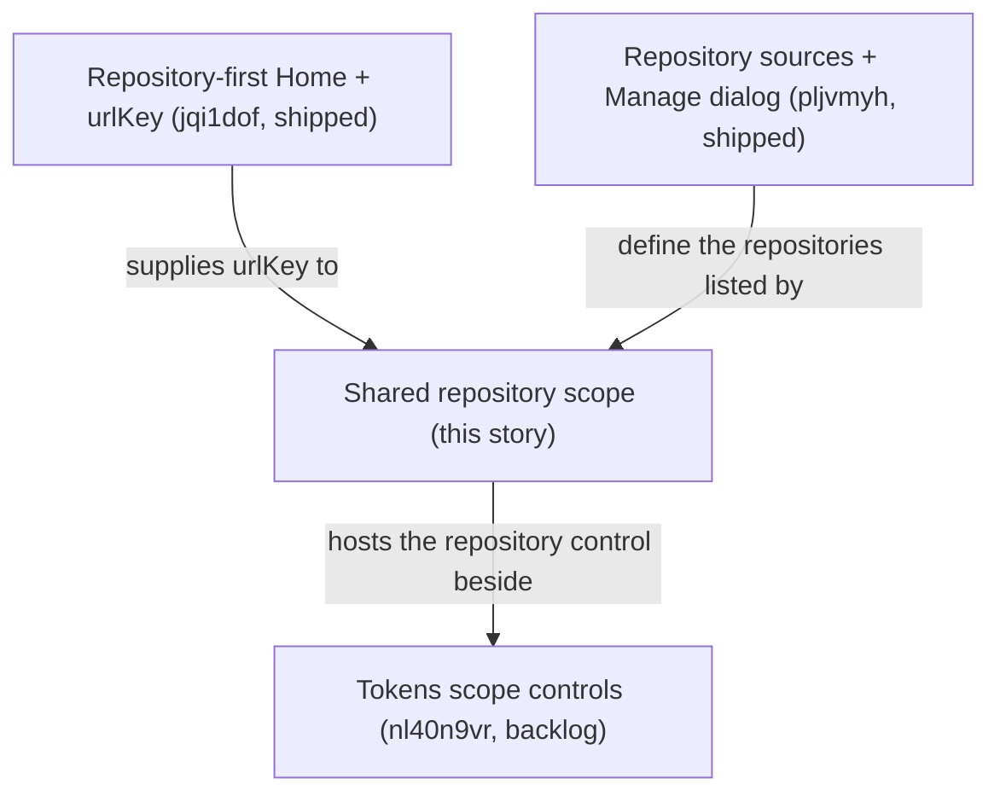

# Shared Repository Filter Across Portal Pages

## Summary

Let the user pick one repository once and see Plans, Tokens, and Agents for that repository, through a shared `?repository=<urlKey>` scope and one header selector. Tokens also offers **Activity outside listed repos**, because telemetry, unlike plans and agent configuration, can happen outside any repository.

Today each page decides on its own: Plans has an in-memory repository filter that the URL does not record, Tokens has no repository control, and navigation forgets any selection. After this story, the scope lives in the URL, every scope-aware page reads it the same way, and moving between those pages keeps it. Runtime, Settings, and Home stay unscoped.

This story only selects among repositories RoboRepo already knows. How repositories become known — auto-discovery and folders — shipped in [[pljvmyh]].

## Relationship to other stories



| Plan | Relationship | State in this checkout |
| --- | --- | --- |
| [[jqi1dof]] | Landed dependency: `urlKey`, its allocator, and `repositoryIdForUrlKey` | `completed/`; code present |
| [[canonical-repository-identity-plan-v2]] | Landed dependency: canonical `repositoryId`, the `repository_ids` cohort filter, legacy-hash matching | `completed/`; code present |
| [[pljvmyh]] | Landed dependency: the registry is the only repository universe, Plans scans registry records, and the shared **Manage repositories** dialog exists | `completed/`; squash merge `8aef67f` is an ancestor of `HEAD` |
| [[nl40n9vr]] | Related, unlanded: adds Tokens time, harness, and model controls beside this story's repository control | `backlog/`; not started |

### Reconciliation notes

- [[canonical-repository-identity-plan-v2]]'s URL contract put the canonical ID in `?repository=`. [[jqi1dof]] already replaced that with `urlKey`; this story follows [[jqi1dof]] and creates no second key concept.
- [[pljvmyh]] said whichever of the two stories landed second would wire **Manage repositories…** into the selector. It landed first, so this story wires it.
- [[nl40n9vr]] was revised alongside this promotion: its Current state now records that this story changes `/api/data`'s `repository` parameter to a `urlKey` and deletes the `repo` label, and its Phase 5 labeling item no longer allows filesystem paths.
- [[nl40n9vr]] will serialize its own controls into the URL. Clearing or changing the repository scope must preserve those parameters (§5), so both stories build URLs through the shared helpers.

## Goals

- Add one Portal-wide repository scope, `?repository=<urlKey>`, read by Plans, Tokens, and Agents.
- Give scope-aware pages one shared selector in the portal header.
- Let Tokens show the activity that belongs to no listed repository, so every token is reachable from some scope.
- Preserve scope when navigating between scope-aware pages; drop it for Runtime, Settings, and Home.
- Never silently broaden an invalid scope into all repositories.
- Keep scope URLs and selector data path-free.
- Remove the legacy behavior this area still carries, and add no compatibility paths: an old URL or parameter stops working instead of being redirected, aliased, or accepted alongside the new one.

## Non-goals

- Adding, removing, or discovering repositories ([[pljvmyh]], shipped).
- Filtering Runtime or Settings to a single repository.
- Implementing repository-level agent configuration.
- Un-parking the repository detail route ([[jqi1dof]]).
- Tokens time, harness, and model controls ([[nl40n9vr]]).
- Following a repository across a Git remote rename. Sessions recorded under the old remote name land in **Activity outside listed repos**.

## Core concept model

| Concept | Meaning | Source of truth |
| --- | --- | --- |
| Canonical repository | One logical repository known to RoboRepo | Registry `repositoryId` |
| `urlKey` | Stable, URL-safe browser key for one canonical repository (`roborepo`, or `roborepo-a31f` on a name collision) | Registry record `urlKey` |
| Repository scope | The canonical repository a scope-aware page is showing | Browser `repository=<urlKey>` |
| Scope-aware page | A page that shows the selector and reads and preserves the scope: Plans, Tokens, Agents | `repositoryScope: true` on its `PAGES` entry (this story) |
| Unavailable scope | A `repository` value that is malformed, unknown, or hidden | Resolved per request; never treated as **All repositories** |
| Outside-activity scope | Telemetry not attributed to any repository the selector lists: sessions with no repository, repositories RoboRepo does not know, and ignored repositories. **All repositories** equals every listed repository plus this scope | Browser `repository=_other`, Tokens only |

## Current State

Verified against `026aeb5`.

| Area | Today | Where |
| --- | --- | --- |
| `urlKey` | Allocated at record creation. `repositoryIdForUrlKey(registry, urlKey, { includeHidden })` follows aliases and returns `null` for unknown or hidden keys, but **throws** on a malformed key (`validateRepositoryUrlKey`). `loadRepositoryPayloadByUrlKey` and the overview service already resolve keys at the server boundary | `modules/repositories/url-key.mjs`, `registry.mjs`; `scripts/cli/repositories.mjs`, `repository-overview.mjs` |
| Repository list | `GET /api/repositories` returns visible, path-free summaries with `urlKey`, `displayName`, and `providerUrl` (`null` for `local:` repositories) | `scripts/cli/portal-routes-repositories.mjs`, `modules/repositories/summary.mjs` |
| Repository universe | The registry is the only universe. Plans scans every visible registry record with a recorded checkout, so every repository Plans shows has a `urlKey`. Ignored (hidden) repositories are excluded | `modules/plan-suite/canonical-scan.mjs` |
| Manage repositories | `createRepositorySourcesDialog` already opens from Home's action slot and from the Plans header's repository count | `portal/shared/repository-sources-dialog.js` |
| Plans filter | `repository` is one of the page-local `FILTER_IDS`, matched on `repositoryId` via `repositoryFilterKey`. Filters live in memory only; the URL carries just `?lifecycle=`, written with `history.pushState` by `urlForLifecycle` (which keeps other parameters) and re-read on `popstate` | `portal/plans/state.js`, `portal/plans/app.js` |
| Plans snapshot | One cached all-repositories snapshot, also read by Home through `loadCachedPlansSnapshot` | `scripts/cli/plans.mjs` |
| Tokens page | Requests `/api/data` with no parameters; `app.js` is 1,365 lines | `portal/tokens/app.js` |
| `/api/data` | Accepts a canonical `repository` ID and a legacy `repo` folder-name label; `analysisKey` includes both. No browser or test caller sends either. The cohort filter's `repository_ids` resolves each event with `repositoryRefForEvent`: the event's own `repository_id`, else a legacy normalized-remote-hash match; unresolved events never match a scope | `scripts/cli/portal-routes-telemetry.mjs`, `telemetry.mjs`, `telemetry-cohort.mjs`, `telemetry-repository.mjs` |
| Analysis cache | FIFO, at most 32 entries (`ANALYSIS_CACHE_MAX`) | `scripts/cli/telemetry.mjs` |
| Legacy fingerprints | Capture writes `normalized_remote_hash`, `git_root_hash`, and `remote_hash` on every event. Only `normalized_remote_hash` is read: `repositoryRefForEvent` falls back to it, through `buildRepositoryHashIndex` and `associateLegacyHashes`, for events without a `repository_id`. Capture has written `repository_id` since `ac24af9`. `validateCaptureV3` lists the fields but runs only in tests, so older spool events stay readable whatever the schema lists | `scripts/cli/telemetry-capture.mjs`, `telemetry-repository.mjs`, `telemetry-schemas/capture-schema-v3.mjs`, `modules/repositories/associations.mjs` |
| Legacy `repo` label | Besides `/api/data`, the label survives as the cohort filter's `repos` dimension, a `repo` parameter on `/api/session` that the page never sends (it only feeds prompt text), and a `--repo` flag that `roborepo telemetry report` accepts but never reads. The Tokens conditions "repo" dimension is not legacy: it already uses `repository_id` | `scripts/cli/telemetry-cohort.mjs`, `portal-routes-telemetry.mjs`, `telemetry.mjs` |
| Agents | Page `/agents`, served from directory `portal/config`. `PAGE_ROUTES` still holds a legacy redirect from the old Agents URL (`agents-legacy`), asserted by `portal-pages-check`, `test-cli.sh`, and `docs/internal/portal-architecture.md`. No repository awareness | `scripts/cli/portal-server.mjs` (`PAGE_ROUTES`) |
| Settings | `/settings`, a secondary page of global settings | `portal/settings/` |
| Navigation | `theme.js` renders nav from `window.PORTAL_MANIFEST` through `mountOverflowNav`; each link's `href` is the bare page path. Runtime and Settings sit in the ⋮ menu. The logo links to `/` | `portal/shared/theme.js`, `chrome-partial.html` |
| Page manifest | `PAGES`: Home `/`, Agents `/agents`, Plans, Tokens, Runtime, Settings. `portal-pages-check` pins the manifest shape, the six-page count, and the redirects; the parked detail route redirects Home | `scripts/cli/portal-server.mjs`, `scripts/test/portal-pages-check.mjs` |
| Shared dropdown | `<option-dropdown>` is a `[value, label]` listbox (`role="listbox"`); the caller owns `.value`. It has no action items or groups | `portal/shared/option-dropdown.js`, `widget-templates-partial.html` |
| Home → Tokens | Each repository's **Token Warnings** row links to bare `/tokens` ("all activity") | `portal/home/domains.js` |

## Proposed Design

### 1. Scope in the URL

Canonical scoped URLs:

```text
/plans?repository=roborepo
/tokens?repository=roborepo
/agents?repository=roborepo
```


Data routes resolve the key once, at the route, with `repositoryIdForUrlKey` (default `includeHidden: false`), and pass the canonical `repositoryId` to domain code. Do not persist `urlKey` as a foreign key in domain data.

A malformed, unknown, or hidden key is an **unavailable** scope. The route answers with an explicit unavailable status, never unscoped data and never a 400 or 500 from the resolver's throw. The page shows the unavailable state with a way to clear the scope.

Caching:

- **Tokens.** `analysisKey` already includes `repository`. Pass it the resolved `repositoryId`, not the `urlKey`, so the cache key is canonical.
- **Plans.** Filter the one cached snapshot per request. Add no per-repository snapshot cache, so Home's `loadCachedPlansSnapshot` is unaffected.

### 2. Shared selector

The selector mounts in the global portal header (`chrome-partial.html`) and renders only on pages whose `PAGES` entry sets `repositoryScope: true`; Tokens also sets `outsideActivityScope: true`. The manifest exposes both flags, so the selector and nav composition (§5) read one source of truth.

It offers:

1. **All repositories** — removes only the `repository` parameter.
2. Each visible repository from `GET /api/repositories`, by display name.
3. **Activity outside listed repos** — Tokens only (§3a).
4. **Manage repositories…** — an action row below a divider that opens the existing `createRepositorySourcesDialog`.

```text
┌──────────────────────┐
│ All repositories     │
│ ✓ roborepo           │
│   client-app         │
│   Activity outside   │
│   listed repos       │  ← Tokens only
├──────────────────────┤
│ Manage repositories… │
└──────────────────────┘
```

When two repositories share a display name, the selector disambiguates them by the provider owner from `providerUrl`, or by `urlKey` when there is no provider URL. Never by filesystem path. The selector also uses this list to decide whether the current key is unavailable, so Agents, which loads no repository data, shows the same state.

Build it on `<option-dropdown>` with surrounding markup in real HTML `<template>` elements. Today every row in `<option-dropdown>` is a choice: clicking one makes it the selected value. **Manage repositories…** is not a repository, so add optional action rows to the element: rendered below a divider, outside the listbox's choices, each calling its own handler. Clicking the action opens the dialog and leaves the selected repository unchanged. Existing callers, which pass no actions, render as before.

Changing the scope pushes the composed URL with `history.pushState` and notifies the page, which refetches its scoped data without a reload. In-memory page filters, such as Plans priority and readiness, survive the change. This matches how Plans already handles `?lifecycle=`.

### 3. Page semantics

| Page | All repositories | Selected repository | Behavior |
| --- | --- | --- | --- |
| Plans | Plans across all scanned repositories | Plans whose `repositoryId` matches | Replaces the page-local repository filter. Header count and onboarding steps 3–4 reflect the scoped repository's scan state |
| Tokens | All telemetry, including activity outside any repository | Telemetry whose `repository_id` is the selected repository; or, for **Activity outside listed repos**, everything not attributed to a listed repository | Adds the shared control; `/api/data` resolves `repository=<urlKey>` or `_other` |
| Agents (`/agents`) | Global agent configuration | Repository-filtered view: a "coming soon" splash | **Remove filter** returns to global Agents |
| Runtime | Operational list across the environment | Not supported | No selector |
| Settings | Global settings | Not supported | No selector |
| Home (`/`) | Repository directory | Not applicable | Scope-clearing destination |

Agents gets a repository-filtered state now so the scope has somewhere to land. A later story fills it with that repository's rules, hooks, skills, and other agent configuration. Until then it is a splash page, and it must not present mixed/global configuration as repository-specific:

```text
Repository-level agent config is coming soon:
rules, hooks, and skills for <repository>.

Remove filter
```

**Remove filter** clears only `repository` and shows global Agents unchanged.

### 3a. Activity outside listed repos (Tokens)

Plans and agent configuration always come from a repository's own folder, so they never have activity outside one. Telemetry does: a session can run outside any Git folder, in a repository RoboRepo has not found, or in one the user ignored. Without this scope, that activity would show only inside **All repositories**, with nothing to say what part of the total it is.

| Session ran in | Listed repository scope | **Activity outside listed repos** |
| --- | --- | --- |
| A listed repository | Shown for that repository | Not shown |
| A repository RoboRepo does not know | Not shown | Shown |
| An ignored repository | Not shown | Shown |
| No Git repository | Not shown | Shown |

- **URL.** `/tokens?repository=_other`. `_` cannot appear in a `urlKey` (`URL_KEY_PATTERN`), so the value never collides with a repository.
- **Server.** `/api/data` recognizes `_other` before `urlKey` resolution and filters to events whose `repository_id` is missing or is not a visible registry record.
- **Cache.** Membership changes when a repository is found or ignored, with no spool change, so `analysisKey` includes the registry signature.
- **Other pages.** The option appears only where the page declares `outsideActivityScope`. On Plans and Agents, `?repository=_other` is an unavailable scope.

### 4. Runtime and Settings stay unscoped

`/runtime` answers *what is running right now across my environment?* `/settings` holds machine-wide settings. Selecting a repository elsewhere filters neither.

### 5. Navigation scope rules

| Navigation | Result |
| --- | --- |
| Plans → Tokens while scoped | Preserve `repository` |
| Plans → Agents while scoped | Preserve `repository`, using `/agents` |
| Tokens → Plans while scoped | Preserve `repository` |
| Leave Tokens while showing **Activity outside listed repos** | Drop `repository`; the destination opens unscoped |
| Any scoped page → Runtime or Settings | Drop `repository` |
| Any scoped page → Home (`/`), by nav or logo | Drop `repository` |
| Home **Token Warnings** row → Tokens | Add `repository=<that repository's urlKey>` |
| Clear scope | Remove only `repository`; keep the page's own URL parameters |
| Back/forward | Restore the shared scope and the page's URL state |

Nav links preserve only `repository`. Page-local parameters such as `lifecycle` belong to their page and are not carried to another page.

### 6. Page migrations

**Plans.** The shared scope replaces the page-local repository filter; lifecycle, priority, search, and the other filters stay page-owned. Remove `repository` from `FILTER_IDS`, `FILTER_DEFAULTS`, `FILTER_LABELS`, `FILTER_OPTION_DEFS`, and `FIELD_MATCHERS`, and remove its `<select>` from `portal/plans/index.html`. There is no URL parameter to retire: the filter was never serialized. Do not leave a Plans-local filter and the shared scope as competing systems. Page fetches and polls send the current scope; `popstate` re-reads scope as well as lifecycle.

**Tokens.** `/api/data`'s `repository` parameter changes from a canonical ID to a `urlKey` resolved at the route; it accepts only a `urlKey`, never also a canonical ID. Canonical filtering already exists (Current State), so this migration wires scope through. Put the scope wiring in a focused module rather than growing `app.js`. Two details:

- The page skips a repaint when `data.version` is unchanged, and two empty scopes can share a version. Reset the remembered version on scope change.
- The mock-data path (`/api/tokens/mock`) ignores scope. When it is shown while scoped, say so.

**Agents.** Global view unchanged with no scope. When the scope resolves, replace the whole global presentation with the splash. Do not partially filter resources or imply repository-specific config exists before its dedicated story.

**Home.** Only the **Token Warnings** link changes: it targets `/tokens?repository=<urlKey>` and is relabeled from "all activity" to name that repository's activity.

### 7. Legacy removals

This story deletes the legacy behavior in its area rather than carrying it forward:

| Legacy behavior | Removal |
| --- | --- |
| Redirect from the old Agents URL (`agents-legacy` in `PAGE_ROUTES`) | Delete the route and its assertions in `portal-pages-check` and `test-cli.sh`; the old URL returns 404. Update `docs/internal/portal-architecture.md` |
| `repo` folder-name label on `/api/data` | Delete the parameter and its `analysisKey` segment |
| Cohort filter `repos` dimension | Delete it from `normalizeCohortFilter`, the matcher, `describeCohortFilter`, the filter count, and `telemetry-cohort-check`; drop it from the cohort list in `docs/user/reference/telemetry.md` |
| `repo` parameter on `/api/session` | Delete it and the `repo` argument it feeds to `buildAnalysisPrompt`; the page never sends it, so no portal prompt changes |
| `roborepo telemetry report --repo`, accepted but never read | Delete the flag from the allowed set |
| `repositoryFilterKey`'s fallback to a legacy content-hash ID | Deleted with the Plans repository filter (§6) |
| Fingerprint fallback for events without a `repository_id` | Delete `buildRepositoryHashIndex`, `associateLegacyHashes` and its export, the legacy branch of `repositoryRefForEvent`, and the `repositoryHashIndex` option threaded through `analyzeTelemetry`, `applyCohortFilter`, `normalizeObservations`, and `buildTelemetryRepositoryProjection`. An event without a `repository_id` belongs to no repository |
| Fingerprint capture fields (`normalized_remote_hash`, `git_root_hash`, `remote_hash`) | Stop writing them in `telemetry-capture.mjs` and `telemetry-seed-demo.mjs`; drop them from `REPO_FIELDS`; strip them from `portal/tokens/mock-spool.jsonl` and `local/dev-fixtures/token-warnings-spool.jsonl` |

Events already in a spool keep the old keys; nothing reads them. On the development machine the fallback matched none of the 7,129 spool events, so no visible attribution changes.

## Code Touchpoints

- `scripts/cli/portal-server.mjs` — `repositoryScope: true` on Plans, Tokens, and Agents in `PAGES`; expose it in the manifest; delete the legacy Agents redirect.
- `scripts/test/portal-pages-check.mjs` — pin which pages are scope-aware; drop the legacy-redirect assertions and update the route count.
- `scripts/test/test-cli.sh` — drop the legacy Agents redirect assertion.
- `portal/shared/theme.js` — compose nav `href`s with the scope only for scope-aware destinations.
- `portal/shared/chrome-partial.html`, `portal/shared/base.css` — host the selector.
- New shared ESM modules: repository scope URL state (parse, compose, clear, change notification) and the selector.
- `portal/shared/option-dropdown.js`, `portal/shared/widget-templates-partial.html` — optional action rows below a divider.
- `portal/plans/state.js`, `portal/plans/app.js`, `portal/plans/api.js`, `portal/plans/index.html` — drop the local repository filter; send and re-read the shared scope.
- `scripts/cli/plans.mjs`, `scripts/cli/portal-routes-plans.mjs` — resolve `repository=<urlKey>` and filter the cached snapshot.
- `scripts/cli/portal-routes-telemetry.mjs` — resolve `repository=<urlKey>` before `loadAnalysisJson`; delete the `repo` parameters on `/api/data` and `/api/session`.
- `scripts/cli/telemetry.mjs`, `scripts/cli/telemetry-cohort.mjs`, `scripts/test/telemetry-cohort-check.mjs` — delete the `repos` cohort dimension, the `repo` analysis-key segment, and the unread `--repo` report flag.
- `scripts/harnesses/transcript-locate.mjs` — drop the `repo` argument from `buildAnalysisPrompt`.
- `scripts/cli/telemetry-cohort.mjs`, `scripts/cli/telemetry.mjs` — outside-activity filtering for `_other`; registry signature in `analysisKey`.
- `scripts/cli/telemetry-repository.mjs`, `telemetry-capture.mjs`, `telemetry-seed-demo.mjs`, `telemetry-analyze.mjs`, `telemetry-observations.mjs`, `telemetry-repository-overview.mjs`, `telemetry-schemas/capture-schema-v3.mjs`, `modules/repositories/associations.mjs`, `modules/repositories/index.mjs` — delete the fingerprint fallback and fields.
- `portal/tokens/mock-spool.jsonl`, `local/dev-fixtures/token-warnings-spool.jsonl`, `scripts/test/telemetry-cohort-check.mjs`, `scripts/test/telemetry-schemas-check.mjs` — drop fingerprint fields and legacy-match cases.
- `portal/tokens/app.js`, `portal/tokens/index.html`, plus a new focused Tokens scope module — shared control and scoped fetches.
- `portal/config/app.js`, `portal/config/index.html` — read the shared scope; render the coming-soon splash when scoped.
- `portal/home/domains.js` — scoped **Token Warnings** link.
- `docs/internal/portal-architecture.md` — the scope contract and the `repositoryScope` manifest flag; remove the legacy Agents redirect.
- `docs/user/reference/plans-portal.md` — the shared filter replaces the repository filter.
- `docs/user/reference/telemetry.md` — the cohort filter list replaces `repos` with canonical repository scope.

## Implementation Plan

### Phase 1 — Scope infrastructure

- [ ] Add `repositoryScope` to `PAGES` and the manifest; pin it in `portal-pages-check`.
- [ ] Add shared URL helpers for `repository`: parse, compose, clear, and change notification.
- [ ] Add optional action rows to `<option-dropdown>`.
- [ ] Add the header selector to scope-aware pages: **All repositories**, visible repositories with collision disambiguation, and the **Manage repositories…** action row opening the existing dialog.
- [ ] Render the unavailable state for malformed, unknown, and hidden keys, with a clear-scope action.

### Phase 2 — Navigation

- [ ] Compose nav links so scope survives between Plans, Tokens, and Agents and drops for Runtime, Settings, and Home.
- [ ] Restore scope on back/forward and deep link.

### Phase 3 — Plans

- [ ] Resolve `/api/plans?repository=<urlKey>` in the route and filter the cached snapshot; return the unavailable status for an unresolvable key.
- [ ] Remove the page-local repository filter; send and re-read the shared scope, keeping in-memory filters across scope changes.

### Phase 4 — Tokens

- [ ] Resolve `/api/data?repository=<urlKey>` in the route and pass the resolved `repositoryId`.
- [ ] Delete the legacy `repo` label: the `/api/data` and `/api/session` parameters, the cohort `repos` dimension, and the unread `--repo` report flag (§7).
- [ ] Add **Activity outside listed repos** (§3a): the `outsideActivityScope` flag, the `_other` route handling, and the registry signature in `analysisKey`.
- [ ] Delete the fingerprint fallback and the three fingerprint capture fields (§7).
- [ ] Add the shared repository control in a focused module; reset the remembered report version on scope change; label the mock path as unscoped.

### Phase 5 — Agents and Home

- [ ] Render global Agents with no scope; when scoped, show the coming-soon splash with **Remove filter**.
- [ ] Point Home's **Token Warnings** link at the repository's scoped Tokens view.

### Phase 6 — Docs and cleanup

- [ ] Delete the legacy Agents redirect and its assertions (§7).
- [ ] Remove duplicate selectors and helpers; update the three docs in Code Touchpoints.

## Validation

Use focused checks while iterating, then the exhaustive unit run and the CI gate. `npm run check` runs only the `ci` check group, which includes `portal-pages-check` but not the repository, Plans, or Tokens checks, so `npm run test:unit` must run separately. `npm run check` runs the Playwright suite only when a browser is installed.

```text
npm run test:unit -- --filter repositories-api
npm run test:unit -- --filter plans-portal-state
npm run test:unit -- --filter telemetry-cohort
npm run test:unit -- --filter tokens-page-state
npm run test:unit -- --filter portal-pages
npm run test:portal-ui
npm run test:unit
npm run check
```

Add focused coverage for observable behavior:

- `/api/plans` and `/api/data` with a valid `urlKey` return only that repository's data; malformed, unknown, and hidden keys return the unavailable status, not all repositories and not a server error;
- requesting `/api/data` for repository A, then B, then A again returns each repository's own report every time, so no cached report leaks across scopes;
- `/api/data` ignores a `repo` parameter, and `/api/data?repository=` with a canonical ID returns the unavailable status, because only `urlKey`s are accepted;
- the old Agents URL returns 404;
- `/api/data?repository=_other` returns sessions with no repository, an unknown repository, or an ignored repository, and none from listed repositories; its totals plus every listed repository's equal **All repositories**;
- after a repository is found, its activity leaves `_other` without any spool change;
- an event with no `repository_id` matches no repository scope, and capture writes no fingerprint fields;
- the manifest marks exactly Plans, Tokens, and Agents as scope-aware, and only Tokens with `outsideActivityScope`;
- no absolute paths in selector data or scope URLs.

Put browser behavior in a new `scripts/test/portal-ui/repository-scope.spec.mjs`, beside `repository-sources.spec.mjs`, because unit checks cannot exercise browser history:

- scope preserved between Plans, Tokens, and Agents, and dropped for Runtime, Settings, and Home;
- back/forward and deep-link restoration;
- a Plans priority filter surviving a scope change;
- the unavailable state and its clear action;
- **Activity outside listed repos** shown only on Tokens, and dropped when navigating from Tokens to Plans;
- the scoped Agents splash, and **Remove filter** returning to unchanged global Agents;
- the **Manage repositories…** action row opening the dialog without changing the selected repository, and existing `<option-dropdown>` users unchanged;
- Home's **Token Warnings** link opening Tokens scoped to that repository.

## Risks

| Risk | Mitigation |
| --- | --- |
| `urlKey`s are re-allocated after a registry reset (`POST /api/repositories/sources/wipe`), so a bookmarked scope may stop resolving | Accepted: allocation is deterministic from the display name, so most keys recur; any that do not show the unavailable state rather than wrong data |
| A nav link carries scope to Runtime, Settings, or Home | One manifest flag drives composition; the Playwright suite asserts every destination |
| A bookmark or external link to the old Agents URL now 404s | Accepted: no compatibility paths. The nav and every in-repo link use `/agents` |
| Sessions recorded before a Git remote rename stop counting toward the renamed repository | Accepted: no aliasing. They appear in **Activity outside listed repos** |
| Per-repository Tokens views multiply cached reports | The cache is FIFO-bounded at 32 entries; a scope miss costs one analysis, not unbounded memory |

## Decision Log

Decisions made while promoting this plan against `026aeb5`.

| Decision | Alternatives | Why |
| --- | --- | --- |
| **User decision:** Home's **Token Warnings** link opens Tokens scoped to that repository | Leave Home fully scope-free | The warning is already per-repository; an unscoped "all activity" link is the mismatch |
| **User decision:** scoped Agents is its own repository-filtered state, a coming-soon splash with **Remove filter**, reserved for a later per-repository rules/hooks/skills view | Hide the selector on Agents; filter global resources by repository | Gives the scope a stable home on Agents now without implying repository-specific config exists |
| **User decision:** no backward compatibility. Legacy routes, parameters, and fallbacks in this area are deleted, and no new ones are added | Keep them alongside the new scope | Two ways to express one thing is how the Plans filter and the shared scope would drift |
| **User decision:** **Manage repositories…** is an action row below a divider in the selector menu, added to `<option-dropdown>` as optional action rows | A gear button beside the dropdown | Keeps every repository action in one menu, as [[pljvmyh]] designed |
| **User decision:** Tokens offers **Activity outside listed repos**, at `?repository=_other`, covering sessions with no repository, unknown repositories, and ignored repositories | A note on scoped Tokens with a link to All; documentation only | Telemetry is the one page whose data exists outside repositories; with this scope every token is reachable, and All equals the listed repositories plus this scope |
| **User decision:** the fingerprint fallback and its three capture fields are removed in this story | A separate telemetry plan | No backward compatibility; the fallback matched no events on the development machine |
| Settings is unscoped, like Runtime | Make it scope-aware | It holds machine-wide settings and has no repository-specific view |
| Plans filters the one cached snapshot per request | A per-repository snapshot cache | Home reads the same cache; one cache keeps Home and Plans consistent and adds no memory |
| Scope changes use `history.pushState` plus a page refetch | A full navigation to the new URL | Matches the Plans lifecycle pattern, and keeps in-memory filters that a reload would reset |
| Scope-aware pages are declared with a `repositoryScope` flag on `PAGES` | A hard-coded list in `theme.js` | `PAGES` is already the single source of truth for nav, and `portal-pages-check` can pin it |

## Acceptance Criteria

- Plans, Tokens, and Agents read one shared `?repository=<urlKey>` scope through one header selector.
- `urlKey` is used for browser repository identity; canonical IDs remain the internal join key.
- A malformed, unknown, or hidden key never silently shows all repositories and never produces a server error.
- Navigation between scope-aware pages preserves scope; navigating to Runtime, Settings, and Home drops it; back/forward restores it.
- Plans has no page-local repository filter, and its other filters survive a scope change.
- Tokens filters events by `repositoryId`, and **Activity outside listed repos** shows exactly the activity no listed repository claims.
- The fingerprint fallback and the three fingerprint capture fields are gone.
- Scoped Agents shows a coming-soon splash whose **Remove filter** returns to global Agents.
- **Manage repositories…** in the selector opens the existing dialog without changing the selected repository.
- The legacy Agents redirect, the `repo` label parameters, the cohort `repos` dimension, and the unread `--repo` report flag are gone; nothing accepts an old form alongside the new one.
- Home's **Token Warnings** link opens Tokens scoped to that repository.
- Runtime and Settings remain global.
- Selector data and scope URLs carry no absolute paths.
- `npm run test:unit`, `npm run test:portal-ui`, and `npm run check` pass.
