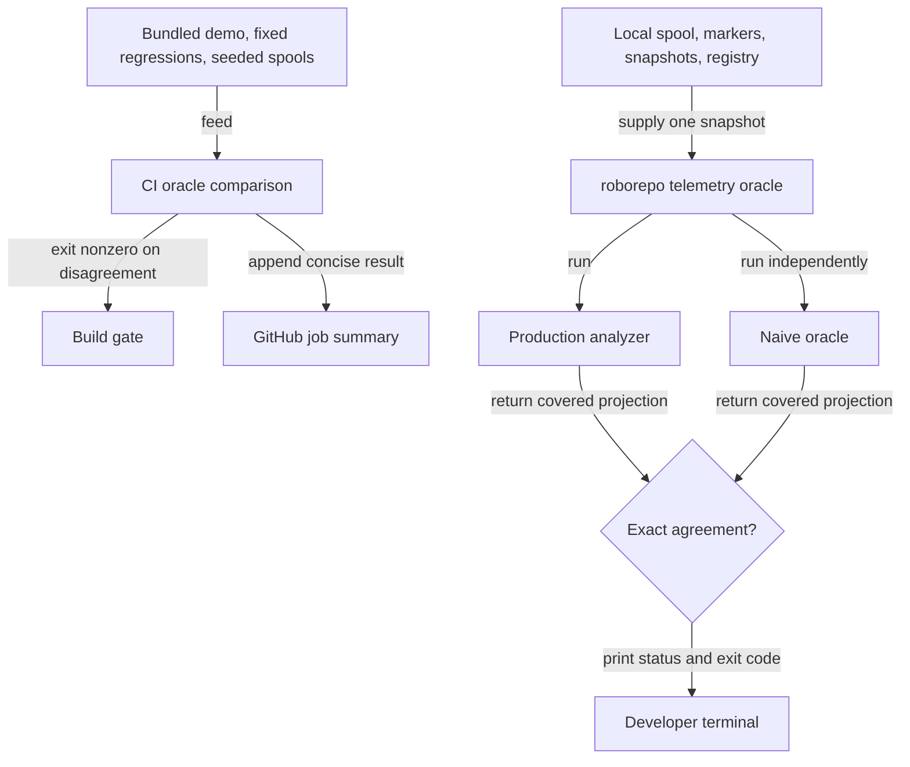

# Independent verification for telemetry analytics

## Summary

Verify the telemetry analytics with an independent implementation, through two signals:

1. a deterministic CI gate that recomputes the covered analytics from bundled and seeded evidence
   and breaks the build on any disagreement; and
2. an on-demand diagnostic, `roborepo telemetry oracle`, that runs the same comparison once over
   the developer's real local evidence and prints a privacy-safe result.

The CI gate is implemented and stays. The second signal was first built as an always-on live
observer: a background worker, a cached health endpoint, and a polling `Oracle health` badge on
the Tokens page. A code review of
[kirinmurphy/roborepo-alpha#21](https://github.com/kirinmurphy/roborepo-alpha/pull/21) found that
this machinery cost more than it returned. Phase 8 replaces it with the command and removes the
observer, endpoint, and badge. See the Decision Log.

## Context

The Tokens report previously relied on focused fixtures that exercised production analysis helpers
directly. Those checks could not catch an error repeated in both the fixture's expectation and the
implementation. The oracle closes that gap: it starts again from raw events, uses deliberately
direct calculations, and compares its covered results with `scripts/cli/telemetry-analyze.mjs`.

Fixtures and seeded spools only contain event shapes their author anticipated. Running the same
comparison over real local evidence is the one thing CI cannot do: it surfaces unmodeled shapes as
`partial` and real disagreements as `failed`.

### Terms

| Term | Meaning |
| --- | --- |
| Production analyzer | The implementation that supplies the CLI report and Tokens dashboard. |
| Oracle | An independent, intentionally obvious recomputation from raw event fields. It does not import production normalization, condition, boundary, finding, or metric helpers. |
| Comparison | One run of production and oracle over the same raw evidence snapshot, projected onto the oracle's covered fields and compared exactly. Implemented by `scripts/cli/telemetry-oracle-compare.mjs`. |
| Oracle result | The small, privacy-safe record a comparison returns: status, aggregate counts, coverage, differing field names, and an optional error category. |
| Evidence snapshot | The spool files, markers, snapshots, and repository registry read once from local state. |

## Goals

- Preserve an independent implementation for harness-scoped sessions, token coverage, mirrored
  operation deduplication, affected-session condition cohorts, marker boundaries and exclusions,
  evidence gating, per-call regression, and harness-local loop detection.
- Keep the deterministic oracle in the normal CI gate, with its result visible in the GitHub
  Actions job summary.
- Let a developer run the comparison over their real local evidence with one command, and get a
  clear status and exit code.
- Keep the command's output privacy-safe: aggregate counts, coverage categories, and field names
  only.
- Remove all background scheduling, portal routes, and Tokens UI that existed only for the live
  observer.

## Non-goals

- Running the comparison in the background, on a schedule, or from the portal.
- Any portal endpoint or Tokens page UI for oracle results.
- Replacing the focused telemetry, presentation, route, and browser checks. The oracle is one
  confidence layer, not a substitute for the rest of the suite.
- Independently verifying unrelated dashboard totals, generated insight prose, marker persistence,
  approximate waste attribution, transcript lookup, or browser rendering.
- Making the naive oracle incremental. Full recomputation is slower but easier to audit.
- Sending telemetry, oracle results, or failure evidence off the machine.
- Printing raw events, prompts, file paths, command output, or minimized live-spool JSONL.
- Running the fixture shrinker on live evidence. It can be quadratic in event count and is designed
  for small synthetic cases.

## Current state

### Kept: independent oracle and CI gate

The oracle recomputes these values without importing production analysis helpers:

| Covered invariant | Independent calculation |
| --- | --- |
| Session identity | One session per `[harness, session_id]`, plus the subset with usable token data. |
| Operation identity | Mirrored schema-v3 captures collapse by harness, session, and call; fallbacks remain deterministic. |
| Condition comparisons | Spike, loop, and read-warning affected-session rates for model, repository, harness, packages, and skills, with present, absent, and unknown cohorts. |
| Change boundaries | Before and after cohorts use `effective_at ?? ts`; touching, spanning, and ambiguous sessions are excluded and counted. |
| Evidence policy | Minimum cohort `10`, minimum affected events `3`, and display band `20%` are encoded locally rather than imported. |
| Regression | Per-call before/after averages split only at a distinct timestamp within one comparable stream. |
| Loop isolation | Repetition is detected within a harness-scoped session and never across harnesses. |

| Area | Files | State |
| --- | --- | --- |
| Independent core | `scripts/cli/telemetry-oracle-{observations,findings,cohorts,regression,run}.mjs` | Kept unchanged. An import-boundary assertion in `scripts/test/telemetry-oracle-core-check.mjs` rejects production helper imports. |
| Comparison boundary | `scripts/cli/telemetry-oracle-compare.mjs` | Kept. Returns `passed`, `partial`, `failed`, or `unavailable` with sanitized differences. |
| CI comparator | `scripts/test/telemetry-oracle-check.mjs`, `scripts/test/fixtures/telemetry-oracle-cases.mjs` | Kept. Nine cases (one bundled demo, two fixed regressions, six seeded spools), 879 events. Exits nonzero on disagreement and appends a summary to `GITHUB_STEP_SUMMARY`. |
| Live coverage accounting | `scripts/test/telemetry-oracle-live-check.mjs` | Kept. Covers legacy repository resolution, unsupported shapes, skipped evidence, and privacy of injected disagreements. |

### To remove: live observer

| Area | Files |
| --- | --- |
| Observer scheduler | `scripts/cli/telemetry-oracle-observer.mjs`; `scripts/test/telemetry-oracle-observer-check.mjs`; `scripts/test/fixtures/telemetry-oracle-observer.mjs` |
| Worker thread | `scripts/cli/telemetry-oracle-worker.mjs` (its evidence reader moves; see Proposed design); `scripts/test/telemetry-oracle-worker-check.mjs` |
| Portal wiring | Observer start, stop, and `loadOracleHealth` in `scripts/cli/telemetry.mjs`; the `Worker` import; `telemetryOracleEvidenceSignature` |
| Health endpoint | `GET /api/telemetry/oracle-health` in `scripts/cli/portal-routes-telemetry.mjs`; `scripts/test/telemetry-oracle-route-check.mjs` |
| Runtime check | `scripts/test/telemetry-oracle-runtime-check.mjs`, which measured portal responsiveness while the worker ran |
| Tokens badge | `portal/tokens/oracle-health.js`; its import and `start()` calls in `portal/tokens/app.js`; badge and dialog markup in `portal/tokens/index.html`; badge and dialog styles in `portal/tokens/styles.css`; `scripts/test/portal-ui/telemetry-oracle-health.spec.mjs` |
| Screenshots | `docs/images/tokens/oracle-health{,-detail}-{light,dark}.png`; the Oracle captures and the "Oracle guide screenshots are served" test in `scripts/test/portal-ui/telemetry-documentation.spec.mjs` |

Two shared portal changes made while building the badge stay, because other code uses them: the
`[data-doc-anchor]` delegate in `portal/shared/doc-guide-modal.js` also serves the Tokens section
info icons, and the `aria-controls` attribute in `portal/shared/info-icon.js` is a general
accessibility fix.

The branch also extended the report cache signature to cover markers, snapshots, and the repository
registry (`telemetryReportEvidenceSignature` in `scripts/cli/telemetry.mjs`). That fixes a stale
report cache independently of the oracle and stays. It shares stamp helpers with the strict oracle
signature, which is removed.

### Disagreements found

| Comparison | Resolution |
| --- | --- |
| Production midpoint regression split calls with equal timestamps across before and after cohorts. | Confirmed as a production bug. `regression()` in `scripts/cli/telemetry-analysis/regression.mjs` now chooses the closest distinct timestamp boundary and reports unavailable when no temporal ordering exists. Two fixed oracle regressions pin both cases. |
| Bundled demo and six seeded random spools | No remaining disagreement after the timestamp fix. |

### Performance evidence

These measurements were taken with the worker this phase removes. They still estimate how long the
command will take, because the command does the same read and both calculations.

| Input | Read plus both calculations |
| --- | ---: |
| Deterministic CI suite, 879 events | about 0.20 seconds for the full check |
| Synthetic 4 MiB spool, 1,905 events | 189 ms |
| Synthetic 24 MiB spool, 11,405 events | 1,016 ms |
| Synthetic 24 MB spool, 11,070 events (oracle only) | about 2.2 seconds and about 28 MB temporary heap growth |

Cost grows roughly `N log N` in event volume, plus sessions × condition cardinality and sessions ×
watched markers.

## Proposed design

### Confidence layers



CI protects committed behavior against a repeatable corpus. The command checks the installed
analyzer against the developer's real evidence when they choose to run it.

### Command behavior

```bash
roborepo telemetry oracle [--json]
```

1. Read one evidence snapshot from local state: spool `.jsonl` files, markers, snapshots, and the
   repository registry. Count unparseable records per store instead of failing.
2. Call `compareTelemetryOracle(events, options)` in-process. A short-lived CLI process has no
   event loop to protect, so no worker thread is needed.
3. Add `checked_at` and `duration_ms`, then project the result through the result schema.
4. Print the result and exit with the status's code.

Default output is a few readable lines. The shape below is illustrative; real counts come from the
snapshot:

```text
Oracle check: Passed
Evidence: 1,845 events · 7 sessions · 912 operations
Coverage: 1,845 supported · 0 unsupported
Checked: sessions, operations, conditions, boundaries, gating, regression, loops
Duration: 292 ms
```

`failed` adds a `Differences:` line listing differing field names. `unavailable` adds the error
category. `--json` prints the projected result object instead, for scripts.

| Status | Exit code | Meaning |
| --- | ---: | --- |
| `passed` | 0 | Exact agreement, and every required row was independently interpretable. |
| `failed` | 1 | Production and oracle disagree on at least one covered field. |
| `partial` | 2 | Covered values agree for supported rows, but some rows or condition inputs could not be interpreted independently. |
| `unavailable` | 2 | No events, no comparable input, or an operational error such as an unreadable store. |

Exit code 2 means inconclusive: the check neither passed nor found a disagreement.

### Result contract

The result schema drops the fields that only served the observer: `evidence_signature` and the
`checking` and `stale` statuses.

```json
{
  "schema": 1,
  "status": "passed",
  "checked_at": "2026-10-01T18:22:31.000Z",
  "duration_ms": 292,
  "event_count": 1845,
  "session_count": 7,
  "operation_count": 912,
  "coverage": {
    "supported_events": 1845,
    "unsupported_events": 0,
    "checks": ["sessions", "operations", "conditions", "boundaries", "gating", "regression", "loops"]
  },
  "differences": [],
  "summary": "Production and oracle calculations agree for the checked supported evidence."
}
```

`error_category` appears only on `unavailable`. Schema version 1 never shipped outside this branch,
so it is not bumped.

### Module ownership

| File | Responsibility |
| --- | --- |
| `scripts/cli/telemetry-oracle-evidence.mjs` (new) | Read one raw evidence snapshot from explicit paths and count skipped records. Moved from `readEvidenceSnapshot` in the worker, behavior unchanged. |
| `scripts/cli/telemetry-oracle-command.mjs` (new) | Parse `--json`, resolve evidence paths from `scripts/cli/state-paths.mjs`, run the read and comparison, time it, format output, and map status to exit code. Only orchestration and formatting live here. |
| `scripts/cli/telemetry-oracle-compare.mjs` | Unchanged. The only runtime module that knows both implementations. |
| `scripts/cli/telemetry-schemas/oracle-result-schema.mjs` | Renamed from `oracle-health-schema.mjs`. The four statuses, the projection, error categories, and status summaries. |
| `scripts/cli/telemetry.mjs` | Add `case "oracle"` to `telemetryCommand`, delegating to the command module. No oracle logic. |
| `manifests/platform/cli/command-definitions/telemetry/oracle.command.json` (new) | Command definition beside `report.command.json`, in the `Monitoring` menu section. |

In `scripts/cli/telemetry.mjs`, rename `ORACLE_EVIDENCE_PATHS` and `oracleEvidence` to
report-neutral names, because only the report signature uses them now. Keep the `strict` stamp
mode: the registry stamp in the same file relies on its strict default.

## Implementation plan

### Phases 1–4: Independent oracle, CI gate, reusable core — completed

- [x] Define the oracle boundary and implement every covered invariant listed in Current state.
- [x] Compare the bundled demo, two fixed regressions, and six deterministic seeded spools with
      production analysis; print the seed and shrink failures to replayable JSONL.
- [x] Investigate and fix the equal-midpoint-timestamp regression bug in production; pin both
      timestamp cases.
- [x] Add `npm run test:telemetry-oracle` and register the comparator in the `ci` check group.
- [x] Extract the independent modules and the comparison boundary from the test runner; enforce
      the import boundary in `telemetry-oracle-core-check.mjs`.
- [x] Inventory raw schema and repository identity forms; add coverage accounting so unsupported,
      skipped, or malformed evidence yields `partial` or `unavailable`, never `passed`.

### Phases 5–7: Live observer, endpoint, and badge — completed, then superseded

These phases built the isolated worker, observer scheduler, complete evidence signature, cached
`/api/telemetry/oracle-health` route, Tokens badge and details dialog, browser tests,
documentation screenshots, and the GitHub job summary. Phase 8 keeps the job summary
(`telemetry-oracle-summary-check.mjs`) and the report-signature extension, and removes the rest.
The last commit containing the full observer is `3483f83d`.

### Phase 8: On-demand command replaces the live observer

Command:

- [ ] Move `readEvidenceSnapshot` and its helpers from `scripts/cli/telemetry-oracle-worker.mjs`
      into `scripts/cli/telemetry-oracle-evidence.mjs` without changing behavior.
- [ ] Rename `scripts/cli/telemetry-schemas/oracle-health-schema.mjs` to
      `oracle-result-schema.mjs`. Remove `evidence_signature`, `checking`, `stale`,
      `staleOracleHealth`, and the observer-only error categories (`signature_error`,
      `worker_start_error`, `worker_crash`, `worker_timeout`, `invalid_worker_result`,
      `invalid_cached_health`). An unrecognized error category projects to `comparison_error`
      instead of the removed `invalid_worker_result`. Rename its exports to match, for example
      `createOracleHealthResult` to `createOracleResult`, `emptyOracleHealth` to
      `emptyOracleResult`, and `ORACLE_HEALTH_SCHEMA_VERSION` to `ORACLE_RESULT_SCHEMA_VERSION`.
      Update every importer.
- [ ] Add `scripts/cli/telemetry-oracle-command.mjs` with the behavior, output, and exit codes in
      Command behavior.
- [ ] Add `case "oracle"` to `telemetryCommand` in `scripts/cli/telemetry.mjs` and the command
      definition `manifests/platform/cli/command-definitions/telemetry/oracle.command.json`.

Removal:

- [ ] Delete the observer, worker, route, runtime-check, and Tokens badge files listed in "To
      remove: live observer", and their entries in `scripts/test/check-groups.json`.
- [ ] Remove observer wiring, `loadOracleHealth`, the `Worker` import, and
      `telemetryOracleEvidenceSignature` from `scripts/cli/telemetry.mjs`; rename the shared
      evidence helpers as described in Module ownership.
- [ ] Remove the route entry and schema import from `scripts/cli/portal-routes-telemetry.mjs`.
- [ ] Reword the comments in `scripts/cli/telemetry-oracle-compare.mjs` that name the observer or
      a live caller so they describe the command.
- [ ] Remove the badge import and `start()` calls from `portal/tokens/app.js`, and drop "the
      Oracle health guide button" from the doc-guide comment there.
- [ ] Remove the badge and dialog markup from `portal/tokens/index.html` and their styles from
      `portal/tokens/styles.css`.
- [ ] Remove the Oracle captures, `oracleHealthSample`, and the "Oracle guide screenshots are
      served" test from `scripts/test/portal-ui/telemetry-documentation.spec.mjs`; delete the four
      `oracle-health*` PNGs.

Tests:

- [ ] Retarget `scripts/test/telemetry-oracle-health-check.mjs` to the result schema, renamed
      `telemetry-oracle-result-check.mjs`: the four statuses, privacy-safe projection, removal of
      unexpected fields, and `error_category` only on `unavailable`.
- [ ] Retarget `scripts/test/telemetry-oracle-signature-check.mjs` to
      `telemetryReportEvidenceSignature` only, keeping its marker, snapshot, registry, rename, and
      same-size-edit cases.
- [ ] Add `scripts/test/telemetry-oracle-evidence-check.mjs` carrying the evidence-reader cases
      from the deleted worker check: legacy repository resolution, per-store skipped counts,
      unsafe parsed rows, and I/O failure.
- [ ] Add `scripts/test/telemetry-oracle-command-check.mjs`. Run the real command against a
      disposable `ROBOREPO_STATE_DIR` and assert, for a supported spool: `Passed`, exit 0, and
      readable counts; with `--json`: a schema-valid object with no raw event fields, prompt text,
      or paths; for an empty spool: `unavailable` and exit 2. Unit-test the status-to-exit-code
      mapping for all four statuses. Disagreement detection stays covered by
      `telemetry-oracle-live-check.mjs`.
- [ ] Register the new and renamed checks in `scripts/test/check-groups.json`.

Documentation:

- [ ] Apply every update in Documentation impact.

## Validation

### Focused checks

```bash
node scripts/test/run-checks.mjs --filter telemetry-oracle
node scripts/test/run-checks.mjs --filter telemetry
node scripts/test/portal-ui/run.mjs
```

Expected results:

- the deterministic suite still reports nine cases, 879 events, 204 condition rows, 21 marker
  comparisons, and 32 regression groups, and the job-summary check still passes;
- the import-boundary assertion still rejects production helper imports from oracle modules;
- the command check proves exit codes 0 and 2 end to end, the full exit-code mapping, and
  privacy-safe `--json` output;
- the portal browser suite passes with the Oracle health spec and captures removed.

### Manual check

```bash
roborepo telemetry oracle
roborepo telemetry oracle --json
```

Run against real local telemetry. Record the status, duration, and event count under
Verification. A `partial` or `failed` result on real data is a finding to record, not a reason to
change the command.

### Removal check

```bash
git grep -n -i "oracle-health\|oracleHealth\|telemetry-oracle-observer\|telemetry-oracle-worker\|telemetryOracleEvidenceSignature" -- ':!docs/plans'
```

Expected: no matches.

### Repository completion gate

```bash
bash scripts/doctor.sh --quiet
npm run check
git diff --check
```

This phase changes CI check groups, the CLI command surface, shared server wiring, and browser UI,
so the full local parity gate is required before handoff. Report any command that cannot run
rather than substituting a narrower check.

## Documentation impact

| Document | Update |
| --- | --- |
| `docs/user/guides/telemetry.md` | Replace the "Oracle health" section and its two screenshots with a short section on `roborepo telemetry oracle`: what it checks, the status and exit-code table, what it does not verify, and that output contains only aggregate counts and field names. |
| `docs/user/reference/roborepo-cli.md` | Add a `roborepo telemetry oracle [--json]` row to the telemetry command table. |
| `docs/internal/telemetry-internals.md` | Replace the runtime observer, cached endpoint, and stale-signature diagram with the command flow; keep the CI confidence diagram and the independent oracle section. |
| `docs/images/tokens/README.md` | Remove the two Oracle health rows. |
| `scratch/telemetry-analytics-oracle/README.md` | Remove the Oracle health section and the sentence describing the live observer and badge. |

## Verification

Evidence from completed phases that still applies after Phase 8:

- `npm run test:telemetry-oracle` passes all nine cases: 879 raw events, 204 condition rows, 21
  marker comparisons, and 32 regression groups. The job-summary check verifies those totals are
  appended through `GITHUB_STEP_SUMMARY`.
- `node scripts/test/telemetry-oracle-core-check.mjs` passes import-boundary rejection fixtures,
  harness identity, mirror deduplication, token coverage, input preservation, order independence,
  and evidence-policy checks.
- `node scripts/test/telemetry-oracle-live-check.mjs` passes legacy repository resolution, raw
  schema coverage, unsupported evidence, skipped-evidence accounting, and privacy checks. Injected
  disagreements in every projected field group yield sanitized `failed` results.
- Complete production reports matched the pre-refactor analyzer across 213 fixture and option
  cases after the analysis modules were split.
- After Phase 7, before the latest merge from main, `npm run check` passed repository health (101 checks), 420 CLI checks, installer
  collisions, 19 CI suites, packed-package installation, all four Linux clean-machine scenario
  families, and 34 browser tests. Windows parity was skipped because PowerShell was unavailable.

Observer, endpoint, and badge evidence from Phases 5–7 no longer applies; those components are
removed in Phase 8. Phase 8 evidence is recorded here when that phase completes.

## Risks

| Risk | Mitigation |
| --- | --- |
| Nobody runs the command, so real-data shape drift goes unnoticed. | CI remains the guardrail for committed behavior. The user guide and CLI reference document the command for developers changing analytics. |
| The command is slow on a near-cap spool. | Measured at about 1–2 seconds at 24 MiB. Acceptable for an explicit diagnostic; it never runs on a request path. |
| Removing the badge strands shared portal code. | The removal check greps for every observer symbol. The doc-guide delegate and `aria-controls` change stay, because other triggers use them. |
| Output exposes sensitive telemetry. | Output passes through the result-schema projection; the command check asserts no raw fields, prompt text, or paths in `--json` output. |
| The oracle becomes production logic in disguise. | The import-boundary assertion is unchanged. |

## Decision Log

- 2026-10-20 — Replace the always-on live observer with an on-demand command. A code review of
  [kirinmurphy/roborepo-alpha#21](https://github.com/kirinmurphy/roborepo-alpha/pull/21) found that
  the observer re-ran full comparisons on unchanged evidence whenever the result was `unavailable`,
  including permanent causes such as no comparable input. It also found that the badge sat beside
  the window- and harness-filtered report while checking all local evidence, and that the scheduler,
  signature, endpoint, and polling UI were a large share of the PR's oracle code and tests. A disagreement on the
  badge is also not something a portal user can act on. The CI oracle and the comparison boundary
  are kept; the command keeps the one capability CI lacks, checking real local evidence. Decided by
  the user.

## Open questions

None block Phase 8. Any live event shape that cannot be interpreted independently stays `partial`
or `unavailable`. Treating such rows as `passed` would be a product decision that needs review.
