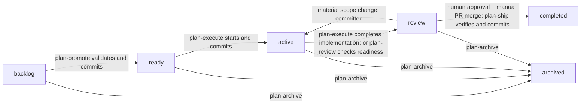

# A Repeatable Plan Lifecycle from Preparation Through Verified Delivery

## Summary

Make RoboRepo's Plan Suite a consistent, resumable lifecycle with explicit preparation, implementation, independent QA, human approval, and post-merge closeout. Introduce `ready/` and `review/`, rename the repeatable implementation command to `/plan-execute`, add `/plan-review`, `/plan-ship`, and `/plan-archive`, and move Git/file/validation mechanics into deterministic shared operations.

Every successful lifecycle move must commit the plan's rename and related plan-only changes. The workflow stays manually initiated for now; there is **no automated session launching, queue watcher, GitHub PR integration, or automated merge into the base branch**.

## Goals

- Model `backlog → ready → active → review → completed`, plus `archived` as an exceptional exit.
- Allow lifecycle commands to be invoked on the state immediately preceding their usual entry state, or again within their own state, without duplicating work.
- Let `/plan-execute` resume the same plan in a later session, and advance only when **implementation** is complete—not when independent QA has passed.
- Use `/plan-review` for independent findings and repeatable review rounds; require explicit human approval before `/plan-ship` can finalize.
- Keep small review fixes in `review/`; return to `active/` for substantial changes in scope, preserving implementation and history.
- Merge the current base branch **into the feature branch** before review, and recheck/synchronize it during pre-merge shipping preparation, with safe conflict handling.
- Leave the actual feature-branch-to-base merge to the human using a GitHub PR. `/plan-ship` must verify landed code on the base branch and finalize only afterward.
- Give transitions, Git safeguards, approval freshness, and completion checks deterministic CLI/domain implementations shared by skills and portal consumers.
- Preserve authoritative worktree plan content through `active` and `review`, and commit every state transition in its owning checkout.

## Non-goals

- Backward compatibility, aliases, migration shims, preservation of obsolete commands or old schema behavior. Breaking changes are acceptable.
- CodeRabbit, third-party reviewers, GitHub APIs, PR creation, PR comments, or automated PR merges.
- Automatic lifecycle advancement, queue watchers, persistent orchestrators, fresh-session launchers, or configurable automation.
- A task database or separately persisted lifecycle status; the **plan folder remains the lifecycle source of truth**.
- Replacing the current `plan-close` landing-verification strategy merely because squash/rebase merges exist. Retain known-working behavior and add targeted regression coverage.

## Current state

- Plans are file-backed under `docs/plans/{backlog,active,completed,archived}/`; the portal derives their lifecycle from directories. Structural `readiness` and `reviewed_commit` freshness are separate derived concepts.
- `/plan-write` creates backlog documents; `/plan-promote` validates and improves them without moving lifecycle; `/plan-start` enters `active/` and works in an associated Git worktree; `/plan-close` verifies landed work and closes or archives. `/session-close` supplies cross-session handoffs.
- The start transition is committed on the primary/base checkout. The assigned worktree's plan copy is authoritative while active; the current authority resolver only recognizes `active/`.
- Existing deterministic primitives include `modules/plan-suite/lifecycle-policy.mjs` and the Plan Suite parser/findings/authority/move/CLI surfaces. `plan-close` already has worktree-integrity, landed-code, cleanup, and completion behavior to reuse.
- `docs/plans/plans-config.json` declares the `plan-lifecycle` namespace and worktree policy.

Reference points: `globals/packages/plan-write/skills/plan-write/`, `globals/packages/plan-promote/skills/plan-promote/`, `globals/packages/plan-start/skills/plan-start/`, `globals/packages/plan-close/skills/plan-close/`, `modules/plan-suite/`, `docs/user/guides/plan/lifecycle/plan-suite.md`, and `docs/user/reference/plans-portal.md`.

## Proposed design

### Lifecycle and command contract



| Command | Accepts | Main responsibility | State/result |
| --- | --- | --- | --- |
| `/plan-write` | New plan or existing plan | Write/revise/sync requirements | Creates `backlog/`; no implicit move |
| `/plan-promote` | `backlog`, `ready` | Validate, reconcile, resolve decisions | `backlog → ready`, or update ready plan |
| `/plan-execute` | `ready`, `active`, `review` | Start/resume implementation; in `review`, remediate findings | `ready → active`; `active → review` **only on implementation completion**; fixes in `review` stay there |
| `/plan-review` | `active`, `review` | Verify implementation-ready gate, synchronize base, independent QA, record findings, iterate | `active → review` if eligible; remain in `review` until HIL approval or significant scope return |
| `/plan-ship` | `review` (and resumable after integration) | Pre-merge readiness/base synchronization; after human PR merge, verify landed work and close | `review → completed` only after integration and post-merge checks |
| `/plan-archive` | `backlog`, `ready`, `active`, `review` | Record archive reason and protect unfinished work | Move to `archived` and commit |
| `/session-close` | Any active agent session | Commit/handoff work without changing plan lifecycle | No lifecycle transition |

**Commands do not invoke subsequent skills.** They finish their stage and return a clear result. A later user invocation or future runner may execute the next stage in an independent session. Reinvocation must use durable Git/plan evidence to resume, not rely on conversation history.

### Implementation completion versus QA

A deterministic implementation-completion preflight should verify the plan's declared required tasks, recorded blockers and unresolved decisions, applicable automated checks, code/document evidence supplied by the implementation run, and committed worktree changes. **Checklist status alone is insufficient**, and this is not an independent QA review.

- Remaining work or blockers: keep `active`, write a precise `next_action`, and report the incomplete/blocked result.
- All required implementation work satisfied: record evidence, commit pending implementation/plan updates as appropriate, move and commit `active → review`.
- `/plan-review` invoked on an `active` plan: run the *same* implementation-completion preflight. If it passes, transition to `review` first; otherwise refuse to advance and list gaps.
- Unconfirmed manual-only `## Not tested` entries are tracked, not automatically claimed as passed. Define which prevent QA entry versus which are explicitly left for the human review gate; **all required entries must be resolved before shipping**.
- Ensure implementation-complete logic never confuses “the session ended,” “no unblocked work remains,” or “tests were attempted” with a fully satisfied plan.

### Review rounds, remediation, and approval

`## Review` in the authoritative plan document contains ordered rounds, reviewed implementation revision, findings (with stable within-plan identifiers and disposition), verification evidence, unresolved manual checks, and human approval. Do not create a parallel review database. Keep the `reviewed_commit` frontmatter concept for plan/code freshness distinct from the new lifecycle state and the **review approval** revision.

Define a strict, parseable review subsection contract, for example:

```md
## Review

### Round 1
- Implementation commit: <full SHA>
- QA outcome: changes-requested
- [ ] R1-1: Missing regression coverage for the retry path

### Approval
- Decision: approved
- Implementation commit: <full SHA>
- Source: explicit-human-confirmation
```

The implementation should standardize those field names/outcomes, parse them deterministically, and reject ambiguous or multiple current approval records. The approval-record mutation occurs only after explicit human confirmation; the agent cannot infer approval from a passing QA result.

1. `plan-review` synchronizes the base branch into the implementation branch (see below), verifies the completion preflight, reviews requirements/code/tests independently, and records findings in a committed plan update.
2. `plan-execute` may be invoked in `review/` solely to address review findings; the implementation agent and reviewer remain conceptually separate, and each run may use a fresh chat.
3. Re-run `plan-review` as needed. Small changes remain in `review/`.
4. If findings materially change requirements, update scope, tasks, decisions, and acceptance criteria, invalidate approval, commit `review → active` in the implementation worktree, and resume `/plan-execute` there. Keep existing branch/worktree/task history; do **not** return to `ready`.
5. Only after the QA findings and required manual checks are resolved does `/plan-review` request explicit **human** approval. Capture that approval against the reviewed branch revision. No automatic approval from the agent, green tests, or session completion.
6. Any subsequent implementation-code change, review remediation, or base merge that changes the reviewed implementation invalidates the prior approval. A plan-only review/approval-record commit may be ignored for freshness *only when Git evidence proves it changed no implementation content*.

### Base-branch synchronization in both review and shipping

Add one reusable deterministic operation (proposed CLI surface: `roborepo plans sync-base <plan>`) that merges the configured base branch **into the plan's feature/worktree branch**. It must never merge the feature branch into base.

- Run before the first QA round and on later review rounds when the base has moved.
- Re-run as a pre-merge check from `/plan-ship`. If already synchronized, do nothing. If base moved, synchronize and invalidate approval whenever the resulting implementation changes, requiring another `/plan-review` and human approval before the PR merge.
- Identify the base from repository policy. Verify it is up to date with its remote-tracking ref when available; do not silently reset or rewrite the primary checkout. Report a stale or unavailable base clearly rather than pretending the merge is current.
- Preflight must identify the exact assigned worktree/branch, refuse unexpected dirty or uncommitted changes, conflicting in-progress Git operations, detached/ambiguous branches, missing worktrees, and an unsafe target.
- On a clean merge, record the resulting commit when created. On conflicts, list conflicting files and leave the branch in an explicit conflict-resolution workflow; do not discard local changes, use `-X ours/theirs` blindly, force-reset, or auto-resolve semantic conflicts.
- A reviewer/implementation agent may resolve conflicts on the feature branch, but a deterministic continuation gate must verify every conflict is resolved, checks pass, and the resolution is committed before proceeding. Conflicts that require a design decision wait for the human.
- Keep merge safety and conflict status checks in shared operations, with skills responsible for semantic resolution and reporting.

### Shipping is manually merged, but deterministically verified

`/plan-ship` must be safely repeatable and infer its next action from Git/plan evidence:

1. **Before the manual PR merge:** check current review approval and revision; run or confirm base-branch sync. If changes invalidate approval, stop and request another review round. Otherwise report “ready for human PR merge” and stop. Never merge into the base branch or call GitHub APIs.
2. **After the human merges through GitHub:** run `/plan-ship` again. Detect and verify that the branch's implementation is present on the base checkout, including the plan's authoritative `review/` content; use the existing `plan-close` landed/integrated verification as the baseline rather than replacing it with ancestry-only logic.
3. Run required checks against the landed base revision, verify approved review evidence and `## Not tested`, record `## Verification`, clear `next_action`, move `review → completed` on the base checkout, and commit the plan-only transition automatically.
4. Only after successful completion, run existing guarded worktree-server and branch/worktree cleanup; a refused close never deletes unmerged work. On post-merge verification failure, retain `review` as the lifecycle, record what already landed, and permit a safe retry without another merge attempt.

The final verification must not edit unmerged feature code or silently amend the user's merge. If additional fixes are needed after integration, report a separate corrective action and the evidence needed to close.

### Deterministic mutation and commit guarantees

Extract/reuse shared Plan Suite operations for plan resolution, lifecycle permission checks, authority, validation, rename, scoped staging, committing, base sync, approval freshness, integration verification, and cleanup. Skills call these capabilities instead of reconstructing Git steps in prose.

- A transition commits **only** the moved plan file and explicitly owned metadata/rename paths in the owning checkout; never use indiscriminate `git add -A`.
- `backlog → ready` and first `ready → active` transitions are committed on the base checkout, following the safe worktree-initialization order. Subsequent `active ↔ review` moves are committed on the authoritative implementation branch. `review → completed` is committed on the base after the human PR merge.
- Define an explicit handoff from the initial base-branch start commit to the worktree, ensuring the worktree's plan path, stable `id`, and authoritative copy agree before implementation starts. Never silently copy divergent plan edits between checkouts.
- `plan-archive` makes a plan-only archive commit on the appropriate safe checkout; for an unmerged active/review worktree, reuse the existing guarded plan-content handoff for archiving without merging or destroying its implementation.
- Reject invalid transitions without mutation. A transition is successful **only after** its Git commit succeeds and fresh disk/Git validation confirms the destination and plan identity. On failure, return a recoverable diagnostic; never report success for an uncommitted move.
- Re-running a transition already recorded must be an idempotent no-op; return the existing state/commit, not a duplicate commit. Never automatically push.
- Do not introduce a new lifecycle field in frontmatter. Permit targeted schema changes for machine-readable approval evidence as part of this breaking-change implementation, while keeping lifecycle determined exclusively by folder.

### Portal and vocabulary

- Add `ready` and `review` to scanners, lifecycle policy, API validation, grouping/filtering, counts, status badges, and plan actions. Extend plan authority to assigned worktree copies in **both** `active` and `review`, including the case where the base checkout still has the older `active/` path and the implementation worktree has moved to `review/`.
- Show implementation progress and review outcome independently. Rename the existing `reviewed_commit` freshness presentation to **plan freshness** (or equivalent) so it cannot be confused with lifecycle `review` or review approval.
- Expose copy-prompt actions for `plan-promote`, `plan-execute`, `plan-review`, `plan-ship`, and `plan-archive` as appropriate, including “continue execution,” “address findings,” “rerun review,” “awaiting manual merge,” and “verify merge/ship.” The portal remains read-only for lifecycle mutations.
- Remove obsolete `/plan-start` and `/plan-close` packages/labels/commands; update suite enablement, manifests, package registries and cross-harness projections, CLI help, examples, and prompts. No compatibility aliases.

## Implementation plan

### Phase 1 — Shared lifecycle contract and deterministic transitions

- [ ] Inventory related plan-lifecycle work and current scanner, parser, authority, `movePlanLifecycle`, CLI, Git, and worktree contracts; settle the one-owner-per-operation module layout before editing.
- [ ] Add `ready`/`review` to lifecycle policy, schema, validation/findings, namespace/location handling, allowed transition graph, and authoritative worktree resolution; keep lifecycle folder-based and stable plan IDs.
- [ ] Centralize lifecycle move + scoped stage/commit + post-commit verification into idempotent deterministic operations with safe recovery on failure; ensure initial base-to-worktree handoff and archive handoff handle divergent paths safely.
- [ ] Implement the shared implementation-completion preflight and review-approval freshness/readiness gates; test against real plan content and Git revisions, not just checkboxes or process exit.

### Phase 2 — Skill and CLI workflow replacement

- [ ] Change `/plan-promote` to validate and commit `backlog → ready`; make repeat invocation on `ready` safe and preserve nontrivial HIL decisions.
- [ ] Replace `/plan-start` with repeatable `/plan-execute` for `ready`, `active`, and review remediation; preserve worktree reuse, progress synchronization, handoffs, committed implementation, and evidence-based `active → review`.
- [ ] Add `/plan-review` with independent QA rounds, plan-owned findings, human approval, significant-scope `review → active`, and no automatic next-skill invocation.
- [ ] Add shared `sync-base` mechanics, conflict detection/resolution continuation, and mandatory review/ship sync preflights without any automatic merge into base.
- [ ] Replace `/plan-close` with two-pass `/plan-ship` (pre-merge readiness; post-manual-merge verification/closeout), reusing known-working integration and cleanup checks; add `/plan-archive` with safe unmerged-worktree handling.

### Phase 3 — Portal, packaging, and documentation

- [ ] Update Plans portal discovery, filtering, primary/worktree authority, review/freshness terminology, lifecycle actions, and status displays for the new contract.
- [ ] Update Plan Suite package manifests/registries, harness-rendered skills, CLI routing/help, and onboarding to expose only the new command names.
- [ ] Update user and maintainer docs of record, including lifecycle guidance, CLI and portal references, and the repository README; remove obsolete lifecycle claims and examples.

### Phase 4 — Verification

- [ ] Add unit/integration coverage for every transition, repeated calls, plan-only commits, destination validation, worktree ownership, partial failures, unmerged content, archive safety, and review approval tied to branch revision.
- [ ] Add isolated Git-repository fixtures for normal base merges, merge conflicts, base movement after approval, manual merge before `plan-ship`, squash/rebase/normal landing verification, dirty worktrees, and denied/unconfirmed landing. Preserve the existing working landing behavior.
- [ ] Exercise complete manual flows using fresh sessions: backlog → ready → active (multiple execute runs) → review (findings/remediation/approval) → manual merge → ship → completed; and review → active, plus archive from every supported state.
- [ ] Run repository-native scoped checks and the full cross-cutting gate: `node scripts/test/plan-suite-findings-check.mjs`, `npm run test:unit`, `npm run test:portal-ui`, and `npm run check` as applicable; record exact outcomes and blockers.

## Validation

1. Files in `ready/` and `review/` are recognized as first-class lifecycle plans across CLI, validator, and portal, without adding a frontmatter lifecycle field.
2. Every successful lifecycle state change has a corresponding **plan-scoped Git commit** in the correct checkout. A failed commit cannot leave a reported successful transition; retries do not duplicate commits.
3. `/plan-execute` resumes incomplete work without creating a second worktree or prematurely invoking independent QA. Its completion gate checks actual requirements and evidence, and moves to review only when implementation is complete.
4. `/plan-review` can accept a completed `active/` plan, produce independently verifiable findings, support subsequent review rounds, and record explicit human approval against a current code revision. Minor fixes remain in review; substantial requirements changes return to active.
5. Both review and shipping can safely merge the base branch **into** the implementation branch; a conflict blocks continuation until resolved and tested. Any resulting substantive code change invalidates approval.
6. `/plan-ship` never merges feature code into base. It refuses finalization before the user's manual PR merge, verifies landed work afterward, runs relevant checks, commits `review → completed`, and performs guarded cleanup.
7. `/plan-archive` records its reason and commits without silently discarding unmerged implementation or worktrees.
8. Plan authority and correct lifecycle are maintained when the primary checkout still shows an older path than the assigned worktree, and after integration transfers authority to base.
9. All newly generated package artifacts, references, CLI help, portal copy actions, and tests use the new commands. No backward-compatibility aliases remain.

## Documentation impact

- `docs/user/guides/plan/lifecycle/plan-suite.md`: rewrite lifecycle walkthrough, state/command table, resumption, review and HIL merge stages.
- `docs/user/reference/plans-portal.md`: new folders, authority rules, badges, filters, actions, and terminology.
- `docs/user/reference/roborepo-cli.md`: deterministic transition/sync/review/ship/archive commands and refusal semantics.
- `README.md`: update lifecycle tree and high-level workflow.
- `globals/packages/plan-write/skills/plan-write/references/{plan-schema,lifecycle,workflow-create,workflow-validate}.md`: new destination contracts, review section, authority, transition ownership, and schema rules.
- New/replaced Plan Suite skill instructions and any maintainer doc of record located during implementation: command boundaries, HIL approval, verification, and safe Git behavior.

## Risks and safeguards

| Risk | Safeguard |
| --- | --- |
| Worktree and primary checkout disagree on plan path/state | Stable-ID authority resolution across `active`/`review`; prevent automatic cross-copy overwrites |
| Git merge changes implementation after QA | Invalidate approval from content-bearing commits and require fresh review |
| Auto-commits accidentally capture unrelated work | Explicit path staging, staged-diff verification, clean-checkout preflight, post-commit assertion |
| Incomplete work is mistaken for implementation-complete | Shared completion gate checks tasks **and** evidence, blockers, docs, tests, commit state |
| Human merges after approval but base changed | Pre-merge sync/freshness gate; post-merge landed verification in `plan-ship` |
| Squash/rebase merge is incorrectly reported unlanded | Preserve existing content-aware landed-check algorithm, add fixtures rather than simplifying to ancestry-only checks |
| Archiving destroys unmerged work | Record/archive plan safely and retain unmerged branch/worktree unless separately authorized |

## Decisions recorded

- `plan-execute` replaces `plan-start`, `plan-ship` replaces `plan-close`, and both repeat safely across sessions.
- `review` is a lifecycle state; human approval is a **gate**, not another lifecycle state.
- `/plan-review` is independent QA. `/plan-execute` may fix its findings without changing `review` to `active`, unless scope materially expands.
- The user, not RoboRepo, merges the PR. No GitHub API integration in this plan.
- Both review and pre-merge shipping prepare the feature branch against the base branch through one shared sync primitive.
- Every lifecycle transition is automatically committed, with no backward-compatibility support.

## Open questions

None blocking design. During promotion, confirm existing related plan owners and the exact current CLI/portal module touchpoints before assigning code files. Do not introduce new product decisions unless repository inspection finds a material conflict.
