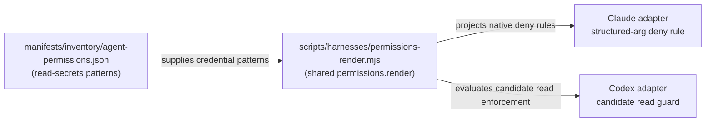

# Block Codex Sandbox Reads of Credential Paths

## Summary

Add credential-path read enforcement where the supported Codex runtime and current RoboRepo
profile leave a verified gap. The existing permission hook classifies command prefixes and does
not implement the proposed credential-path argument scanner. Establish the actual native read
boundary and scanner coverage before promising parity with Claude's read-secrets policy.

A command-argument scanner is not by itself complete read confinement: indirect paths, symlinks,
shell expansion, scripts, and non-command tools may evade it. This plan must define its supported
threat boundary and fail/ask behavior using observed native capabilities and provider contracts.

## Context

[[ia1q1z9]] (repo-scoped write permissions) closed with Codex's write-scope verified and its
read-family question resolved as "no hook needed" — Codex's sandbox already reads wide and writes
narrow by construction, the same shape Claude achieves with `read-secrets` plus a PreToolUse hook.
That resolution was correct for the *write-scope parity* goal that plan was scoped to, but it
surfaced this gap as an explicit known follow-up rather than closing it.

Claude blocks credential paths through `manifests/inventory/agent-permissions.json`'s
`read-secrets` behavior, denied via structured tool arguments (`Read`, `Grep`, `Glob` all take a
path parameter the permission system parses directly). Codex has no structured file-read tool —
everything is a shell command string (`cat`, `sed`, `less`, arbitrary one-liners), and its existing
PreToolUse hook, `globals/system/hooks/codex/permission-check.mjs`, matches only on **command-token
prefixes** (`git push`, etc. — see `matchesPrefix()`), never on file-path arguments inside a
command. Blocking `.ssh` reads means catching an open-ended set of commands by their *arguments*,
not their leading tokens, which the current matcher was not built to do.

Historical observation: the original investigation tested Codex 0.140.0 within the `roborepo-workspace`
sandbox profile:

| Path | Read | Write |
| --- | --- | --- |
| Active worktree | allowed | allowed |
| Sibling worktree of this repo (`~/.worktrees/roborepo/...`) | allowed | allowed |
| Primary checkout (outside `~/.worktrees`) | allowed | blocked (`Operation not permitted`) |
| `$HOME` (arbitrary file) | allowed | blocked (`Operation not permitted`) |
| `/etc/hosts` | allowed | — |
| `~/.ssh/config` | allowed | — |

The generated profile also has `network.enabled = false` today, so a credential read inside the
sandbox currently has no in-sandbox network path to exfiltrate it. `network.enabled` is a
per-profile setting (`scripts/harnesses/permissions-render.mjs`), not a permanent guarantee.

### Existing provider-capability contract

`scripts/harnesses/contract.mjs` already defines the mechanism this plan uses: every provider
manifest declares `capabilities` (`root-config`, `rules`, `permissions`, `hooks`, etc.), and
`validateCapabilityAdapters` fails a provider at validation time if it declares a capability without
implementing the required methods — not a silent no-op. `permissions` is already a required
capability (`adapters.permissions.render`), and both Claude's and Codex's providers already route
through the same shared module, `scripts/harnesses/permissions-render.mjs`, for it.

The intended outcome is shared credential protection through provider-specific mechanisms. The
diagram sketches a candidate contract; it does not establish that a shell-argument scanner covers
every read. The mechanism and its structural/behavioral checks must follow the evaluated boundary.

## Goals

- Establish the actual credential-read boundary for supported native versions and all relevant
      tool families, recording gaps and unsupported states explicitly.
- Evaluate direct reads, indirect commands, shell expansion/globs, symlinks, scripts, and non-command
      tools before selecting an enforcement mechanism.
- Preserve a single credential-pattern source while expressing provider-specific coverage through
      a documented capability contract and behavioral tests.
- Require observed evidence for any full-parity claim; if no candidate satisfies it, retain the
      unresolved guarantee rather than silently declaring a narrower scanner complete.

## Non-goals

- General-purpose shell-argument parsing for every Codex hook behavior — this plan scopes to
  credential-path denial only, not a rewrite of `permission-check.mjs`'s command-matching model for
  every rule it enforces.
- Matching Claude's read-family (repo-wide read) boundary on Codex — that question was already
  resolved in [[ia1q1z9]]; this plan does not reopen it.
- Building network-layer sandboxing beyond what `network.enabled` already provides — this plan
  assumes that setting may change and builds the read guard independently of it, but does not
  redesign network sandboxing itself.

## Current state

`globals/system/hooks/codex/permission-check.mjs` handles `exec_command`/`shell`/`local_shell`/
`bash` tool calls, tokenizes the command by whitespace, and checks whether the leading tokens match
a rule from `manifests/inventory/agent-permissions.json`. It has no concept of a file-path argument
appearing anywhere other than the command's leading position, and no allowlist/denylist keyed on
path patterns.

`manifests/inventory/agent-permissions.json`'s `read-secrets` behavior lists credential path
patterns (`.ssh`, `.aws`, `.env` variants, etc.) but only Claude's renderer consumes it — Codex's
hook does not read this behavior at all today.

Gemini has no path-scoping surface at all (established in [[ia1q1z9]]'s Implementation plan: "the
Policy Engine has neither a path predicate nor a hook surface, so there is nothing to render") and
does not implement the `permissions` capability's path-aware behaviors the way Claude and Codex do.
This plan does not change that; Gemini is out of scope for the same reason it was out of scope for
write-scope.

## Proposed design

Start by evaluating enforceable native read boundaries and all tool families. A path-argument
scanner is one candidate supplement for command tools, not a proven full-coverage mechanism.
It may recognize direct literal paths yet miss file-list indirection, script-generated paths,
expansion performed later by the shell, symlink traversal, or reads through other tools.

| Candidate | Evidence needed before choosing |
| --- | --- |
| Native filesystem/sandbox read boundary | Current supported configuration, precedence, runtime enforcement, and interaction with workspace reads |
| Command-path scanner | Parsing/expansion limits, indirect forms, false positives, and a defined fail-closed/ask contract |
| Provider-specific combination | Coverage across command and non-command tools without claiming one provider's mechanism is universal |

Reuse `read-secrets` patterns from `manifests/inventory/agent-permissions.json`; do not add a
second credential list. Represent enforcement/coverage through the provider capability contract
or a dedicated behavioral parity test, with explicit unsupported states. Structural method
presence cannot establish runtime security. Choose the contract before implementing a scanner;
if the candidate cannot satisfy the desired guarantee, record that limitation and revisit the
mechanism rather than declaring full parity after direct-path tests.

## Implementation plan

- [ ] Design the exact contract shape: whether `read-secrets` enforcement becomes a new required
      method under the existing `permissions` capability, or a documented sub-requirement checked by
      a dedicated test rather than `validateCapabilityAdapters` itself. Resolve this before writing
      the Codex matcher, since it determines what "done" means for the contract half of this plan.
- [ ] Add a focused test file establishing the credential paths the guard must block — direct reads,
      `xargs`, variable expansion, and glob forms — and the ordinary commands it must not falsely
      block, before implementing the matcher.
- [ ] Implement the selected native/adapter mechanism; extend the command hook only where its
      demonstrated coverage contributes to the selected guarantee.
- [ ] Wire the contract-level check chosen above so a provider declaring `permissions` without
      credential-read enforcement fails validation or a dedicated parity test.
- [ ] Verify live against the shipped Codex binary the same way [[ia1q1z9]] verified write-scope —
      not just unit-level matcher tests, since shell quoting/expansion behavior only shows up when a
      real shell runs the command.
- [ ] Update `docs/user/reference/config-control-panel.md`'s permission scope section to document
      the Codex-side credential guard alongside Claude's `read-secrets` section, and to record that
      Gemini remains out of scope for the same reason as write-scope.

## Validation

- [ ] A Codex session under `roborepo-workspace` is denied (or asked) when a command's arguments
      reach a `read-secrets`-listed path, across direct reads, `xargs`, shell variable expansion,
      and glob forms.
- [ ] Ordinary repository commands touching non-credential paths are unaffected — run the existing
      Codex hook test coverage and confirm no new false positives.
- [ ] A provider that declares the `permissions` capability without credential-read enforcement is
      caught by the contract-level check added in the Implementation plan, not just by manual review.
- [ ] The guard's behavior is documented in `docs/user/reference/config-control-panel.md`.

## Risks

- A path-argument scanner is inherently heuristic against shell syntax. The fail-closed design
  (Proposed design) mitigates the worst case — an unparsed command is denied/asked rather than
  silently let through — but a determined bypass through a form the matcher does not recognize is
  still possible; this plan cannot claim mathematically complete coverage, only best-effort coverage
  with a safe default on the unknown case.
- Extending the required-methods contract in `scripts/harnesses/contract.mjs` affects every current
  and future provider that declares `permissions`, not just Codex — a mis-scoped requirement here
  could force unrelated work on Claude's or a future provider's adapter. Resolve the exact contract
  shape (first Implementation plan item) carefully before wiring enforcement.
- Scope creep toward general shell-argument parsing for `permission-check.mjs` beyond credential
  paths, which this plan explicitly excludes (see Non-goals).

## Enforcement acceptance boundary

Before implementing the scanner, enumerate command and non-command read paths, indirect execution,
symlinks, shell expansion, and native sandbox alternatives. Record what can be enforced and what
remains outside the mechanism. Rewrite any full-parity guarantee against that evidence; do not
interpret a successful direct `cat` block as complete credential-read confinement. The live test
and provider contract must reflect the chosen guarantee, including unsupported operations.
