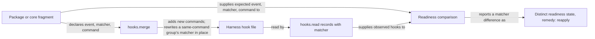

# Keep installed hook matchers in step with their packages

## Summary

A hook entry in a harness's hook file pairs a command with a matcher, the pattern that decides which
tool calls or session events run it. RoboRepo identifies each installed hook by its command alone.
So when a package changes a hook's matcher, reapplying the package leaves the old matcher in place,
and hook readiness still reports the hook `active` even though it now runs under the wrong
conditions.

This plan keeps an installed hook's matcher in step with its fragment in the two places that act
on it: the merge that installs package and core hooks updates a stale matcher in place, and the
readiness comparison that reports whether hooks will run compares matchers. It was split out of Report hook readiness and guide Codex approval during setup and package
changes (`wjlt1zvf`), whose PR review raised it, because it changes the hook-merge contract for
every provider.

## Context

### Terms

| Term | Meaning |
| --- | --- |
| Group | One entry in a hook event's array: `{ matcher, hooks: [ { type, command } ] }` |
| Matcher | The group's pattern, such as `"Bash"`, `"Read\|Write\|Edit"`, or `"startup\|resume"`. Empty or absent matches everything |
| Identity | What merge, unmerge, and readiness use to decide that an installed hook is the same hook a fragment declares |

### Current behavior

| Step | Where | Identity used |
| --- | --- | --- |
| Install | `mergeHooksMap` in `scripts/harnesses/hooks-merge.mjs`, called by every provider's `hooks.merge` and by Claude's root-config render | Each handler's command. A fragment handler is skipped when that command already exists anywhere at the event, so its group's matcher is never compared or updated. Later copies of the fragment's own commands are collapsed to the first |
| Removal | `unmergeHooksMap` in the same file | Each handler's command, whatever the matcher; a group is dropped once it has no handlers left |
| Readiness | `fragmentHooks` and `compareHookReadiness` in `scripts/harnesses/hook-readiness.mjs` | Event and command per handler |
| Observed records | `codexHookRecord` in `scripts/harnesses/codex/hooks-read.mjs`; `hookRecordsFromFile` in `scripts/harnesses/root-config-hooks.mjs` for Claude | Neither keeps the matcher, although Codex's `hooks/list` returns it and Claude's file holds it on the group |

Shipped fragments that set a non-empty matcher today:

| Fragment | Event | Matcher |
| --- | --- | --- |
| `globals/harnesses/claude/hooks-claude.json` (core) | PreToolUse | `Bash`; `Read\|Write\|Edit`; `Write\|Edit` |
| `globals/packages/capture-dense-bash/hooks-claude.json` | PreToolUse | `Bash` |
| `globals/packages/skill-visibility/hooks-claude.json` | PostToolUse | `Read` |
| `globals/packages/caveman/hooks-codex.json`, `globals/packages/telemetry/hooks-codex.json`, `generated/codex/hooks.json` (core) | SessionStart | `startup\|resume` |

### Example of the gap

`skill-visibility` installs its Claude hook with matcher `Read`. Suppose a later version widens it
to `Read|Bash` so shell reads are counted too:

1. The user updates RoboRepo, and the package's Claude fragment now says `Read|Bash`.
2. Reapply merges the fragment. The command already exists at `PostToolUse`, so the group is
   skipped, and `~/.claude/settings.json` keeps `Read`.
3. Readiness matches the hook by event and command and reports it `active`.
4. Shell reads are never observed, and nothing tells the user why.

On Codex the same skip leaves the old definition, so Codex keeps trusting it and never asks for
review.

## Goals

- Reapplying a package or core hook bundle brings an installed RoboRepo hook's matcher in line with
  its fragment, for every provider that merges hooks (Claude, Codex, and Gemini).
- On Codex, the update keeps the hook at its position, so only the changed hook needs review, not
  every hook after it.
- Readiness reports an installed RoboRepo hook whose matcher differs from its fragment as a
  distinct state with a remedy that works, never as `active`.
- Removal still removes a RoboRepo hook whatever its matcher, so a stale matcher cannot strand an
  entry.

## Non-goals

- Ownership metadata stamped on hook entries, and detecting a hook whose command changed between
  versions. Package Registry vs Live State Reconciliation
  (`package-registry-live-state-reconciliation`) owns resource-level ownership and drift.
- Comparing hook fields other than the matcher (`timeout`, `statusMessage`). Each would be the same
  change again; add them when a shipped fragment needs one.
- Writing Codex trust state. A changed matcher changes the definition, and Codex asks the user to
  review it, which the hook readiness plan already handles.

## Proposed design

| Concern | Change |
| --- | --- |
| Merge | When a fragment handler's command already exists at the event, compare its group's matcher with the fragment group's. If they differ, set the existing group's matcher to the fragment's in place and count it as a change. The group keeps its index, so Codex's positional trust key is unchanged and only that hook's definition hash changes. New commands still prepend (Claude, Gemini) or append (Codex) as today |
| Unmerge | Unchanged: identity stays the handler command, so a hook is removed whatever its matcher |
| `hooks.read` | Records gain `matcher`: Codex from `hooks/list`, Claude from the group in `settings.json`. Gemini keeps its `hooks.read` stub, which readiness skips. The `hooks.read` contract in `docs/internal/harness-provider-interface.md` records the field |
| Readiness | `fragmentHooks` carries the matcher. A record with the same event and command but a different matcher yields a distinct state (see Open questions), which the portal notice, CLI hint, and doctor report with "reapply the package", or `roborepo bundle apply hooks` for core hooks |

## Implementation plan

- [ ] Add failing cases to `scripts/test/hook-composition-check.mjs`: for Claude, Codex, and Gemini,
      reapplying a fragment whose matcher changed updates the installed group in place, adds no
      duplicate, and on Codex leaves every group's index unchanged.
- [ ] Update `mergeHooksMap` in `scripts/harnesses/hooks-merge.mjs` to rewrite a same-command
      group's matcher in place, and report the change through each adapter's `changed` result.
- [ ] Add `matcher` to `codexHookRecord` and `hookRecordsFromFile`, with fixture records in
      `scripts/test/fixtures/hook-readiness/` that carry it.
- [ ] Carry the matcher through `fragmentHooks` and `compareHookReadiness`, and report a matcher
      mismatch as the state chosen in Open questions. A mismatch stays out of `reviewRevision`:
      before reapply, Codex still trusts the old definition, and after reapply Codex's own
      `modified` status puts the hook up for review.
- [ ] Render the new state in `portal/shared/hook-readiness.js`, `scripts/cli/hook-review-guidance.mjs`,
      and package status (`scripts/cli/package-probes.mjs`).
- [ ] Update the docs listed under Documentation impact.

## Validation

- [ ] `scripts/test/hook-composition-check.mjs` covers the in-place matcher update for each
      provider, Codex index stability, and unmerge removing a hook whose matcher differs.
- [ ] `scripts/test/hook-readiness-check.mjs` reports a matcher mismatch as the new state for a
      package hook and a core hook, and still reports matching hooks `active`.
- [ ] `npm run test:portal-ui` shows the new state's notice with its remedy and no review action.
- [ ] `npm run check` passes, since hook merging is shared by install, package changes, and
      uninstall.

## Documentation impact

- `docs/internal/harness-provider-interface.md`: `hooks.read` records include `matcher`; merge
  identity and the in-place matcher update.
- `docs/user/reference/codex-hooks.md` and `docs/user/reference/claude-hooks.md`: the new readiness
  state in the state table, and that reapplying updates a changed matcher.
- `docs/internal/hooks-internals.md`: hook identity during merge and unmerge.

## Risks

| Risk | Treatment |
| --- | --- |
| A user narrowed a RoboRepo hook's matcher by hand, and reapply widens it again | Decided in Open questions before implementation |
| Updating a Codex hook's matcher makes Codex ask for review of that hook | Expected: the definition changed. Readiness already offers the review once per pending set |
| Two fragment groups share a first command at one event with different matchers | No shipped fragment does; the merge test pins that the first such group's matcher wins |
| A user's handler shares a group with a RoboRepo handler, so rewriting the group's matcher changes the user's handler too | Decided in Open questions before implementation, with a mixed-group case added to Validation |

## Open questions

- **Should reapply overwrite a matcher the user edited by hand?** RoboRepo cannot tell a hand edit
  from a stale install, since it keeps no record of the matcher it wrote. Options: (A) always set
  the fragment's matcher, treating RoboRepo's own entries as RoboRepo-owned, the way
  `managed_files` treats an unedited copy; (B) record the matcher RoboRepo last wrote per hook and
  update only when the installed one still matches that record, leaving a hand edit in place and
  reporting it. A is smaller; B respects a deliberate edit.
- **Which readiness state does a stale matcher get?** Options: (A) a new state such as `outdated`,
  ranked with `missing`, with its own notice copy; (B) reuse `missing`, since the remedy is the
  same. A tells the user something different is wrong; B adds no state to `READINESS_STATES` and
  the surfaces that rank it.
- **What happens to a group that also holds a user's handler?** Merge matches by handler command, so
  a RoboRepo handler can sit in a group with a user's, and a group's matcher applies to every
  handler in it. Options: (A) leave a mixed group's matcher alone and report the mismatch; (B) move
  the RoboRepo handler into its own group with the fragment's matcher, which on Codex shifts the
  user's handlers after it and asks for review again; (C) rewrite the shared matcher anyway. A
  keeps the user's hook as written and Codex trust intact; B fixes RoboRepo's hook at the cost of a
  review.
