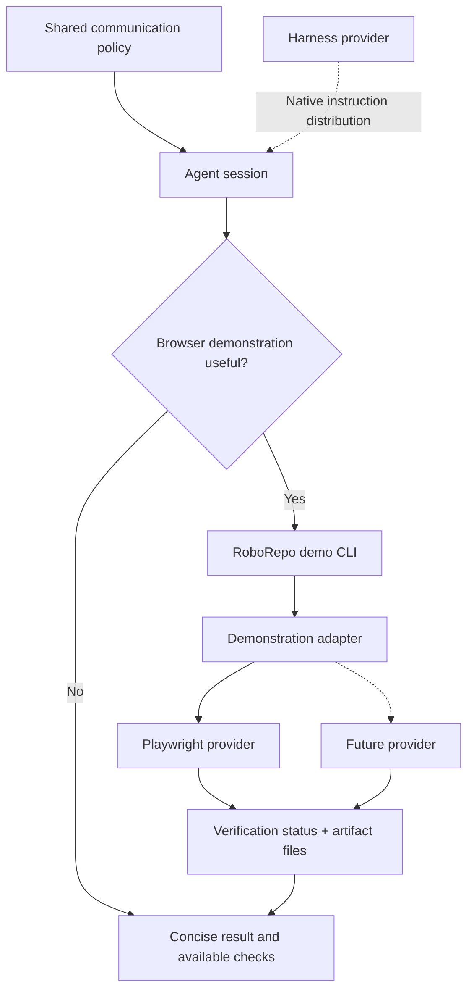

# Make Agent Conversations Easier to Understand and Results Easier to Verify

## Summary

Improve **interactive conversations in every RoboRepo-managed agent session**, not just sessions developing RoboRepo. Agents should communicate outcomes before implementation mechanics, adapt depth to the task, surface consequential architectural decisions, and demonstrate completed behavior when doing so helps the human understand or trust the result. Agents should perform safe verification themselves instead of routinely assigning it to the user.

Implement **one small, always-on, harness-neutral communication policy** and a **separate browser demonstration adapter** exposed through a portable RoboRepo CLI. Start with Playwright. Normalize provider capabilities, execution, and evidence results; do not build a generic browser automation language. Reuse existing tests, tooling, and runtime storage. Optimize **total time to understanding**: agent execution time plus human comprehension time.

The behavioral and architectural decisions are made. `plan-promote` should reconcile live source touchpoints and implementation readiness, not reopen a broad research phase.

## Goals

- Make agent responses easier to understand without merely minimizing word count or hiding technical depth.
- Lead with the user-relevant result, significance, or decision; explain mechanisms when they help.
- Adapt explanations to investigation, architecture, debugging, implementation, and completion without explicit personas or modes.
- Keep meaningful alternatives, risks, uncertainty, and decisions visible to the human who owns architecture.
- Prefer concrete examples and visual representations when they communicate faster than dense prose.
- Verify behavior autonomously when safe and feasible; present **actual, accessible evidence**, not just verification instructions.
- Support Claude Code, Codex, and future harnesses through the same global rules and portable demonstration interface.
- Keep tooling optional, startup lazy, agent responses fast, and implementation maintainable.

## Non-goals

- Changing the primary format of plan documents, skill documentation, or formal closeout artifacts.
- Building a new browser engine, general visualization framework, browser-action DSL, video editor, evidence portal, or session analytics platform.
- Requiring screenshots or videos for every code change, or prescribing mandatory response templates or word limits.
- Treating screenshots, videos, or conceptual diagrams as substitutes for executed assertions/tests.
- Requiring individual projects to install Playwright or alter their dependency/test configuration to obtain ad hoc demonstrations.
- Forking conversational policy by harness, adopting one harness's native output style as the common standard, or adding a second harness adapter hierarchy.
- Storing full transcripts or sensitive user data for evaluation, or automating production/destructive actions to capture evidence.

## Current state

RoboRepo distributes shared agent configuration into harness-native formats through its existing package and provider infrastructure. `plan-write`, `technical-writing`, and `test-harness` serve their existing specialized purposes; they do not, by themselves, establish the intended conversational behavior across unrelated projects. Existing runtime and package facilities should be reused where suitable.

Reported friction includes walls of prose, unexplained jargon, buried conclusions, implementation details presented without meaning, incomplete context, and verification delegated to the human. These are observed user problems, not a measured baseline. During implementation, inspect the **live** global-rule and harness-projection sources instead of assuming historical paths are still authoritative.

## Proposed design

### 1. One shared communication policy

Author one concise always-on behavioral rule set and distribute it through existing Claude Code/Codex configuration mechanisms. It should tell agents to:

- **Answer first:** state the result, meaning, or decision before the implementation detail.
- **Provide sufficient context:** explain unfamiliar terms and reconnect to the user's goal without repeating the whole conversation.
- **Adapt detail:** default to outcomes; explain architecture/tradeoffs when material and code-level mechanics when necessary or requested.
- **Preserve human ownership:** proactively surface consequential design choices, alternatives, assumptions, risks, and requests for decisions.
- **Use meaningful updates:** report changed understanding, actual progress, or blockers rather than narrating each tool call.
- **Choose the clearest medium:** prefer an example, comparison, diagram, screenshot, recorded interaction, or actual output when it reduces explanation effort.
- **Report evidence honestly:** distinguish passed checks, observed but unasserted behavior, conceptual illustrations, and unavailable verification.

No mandated response headings, fixed verbosity levels, persona selection, or universal visualization requirement. Explicit user requests for more/less detail take precedence. Operational Playwright instructions belong in a short, lazily consulted tool reference, **not** the always-on rule set.

| Conversation | Default information | More depth when |
| --- | --- | --- |
| Investigation | Finding, significance, uncertainty | Evidence changes the conclusion |
| Architecture | Decision, options, tradeoffs | Interfaces, maintainability, or future changes are affected |
| Debugging | Symptom, supported cause/hypothesis, next check | Logs or reproduction are relevant |
| Progress | Meaningful change and blocker, if any | Assumptions or decisions change |
| Completion | Outcome, real verification/evidence, attention needed | Failures, untested conditions, or significant risks remain |

These are selection cues, not separate modes or required sections. Clear responses must remain possible without any demonstration tooling.

### 2. Progressive evidence, not automatic media production

Choose the **fastest sufficient** form of evidence. Reuse artifacts already produced during relevant testing before running additional browser work. Plan capture ahead of verification when a recording is needed; don't rerun work just to improve presentation unless the new evidence is materially useful.

| Change or question | Default evidence | Use more when |
| --- | --- | --- |
| Static UI | One screenshot or before/after frames | Additional states are necessary |
| Interactive UI | Key frames; short recording if sequence or motion matters | Still frames cannot show the behavior clearly |
| Browser failure | Failure and selective screenshot | A trace is required to diagnose it |
| CLI / backend | Executed input/output and test/assertion result | An unexpected result needs diagnosis |
| Architecture / workflow | Mermaid when relationships are difficult to explain | Alternatives or tradeoffs need additional context |
| Performance | Measured before/after values | A chart conveys trends/distributions better |
| Simple or nonvisual work | Brief result and proportionate checks | A material question remains |

A diagram is **explanatory**, not proof that code ran. A screenshot or recording shows observed behavior, not necessarily correctness. Only executed verification checks support a claim that behavior **passed**. Trace capture is primarily for diagnostics and should not be enabled indiscriminately.

### 3. Browser demonstration adapter and portable entry point

Create a browser-demonstration capability **independent of the existing harness-provider abstraction**. Every harness invokes the same installed RoboRepo command. The demonstration provider handles browser execution/capture; the harness provider continues to handle only configuration delivery and optional native presentation differences.



Expose **two commands**, using existing CLI routing/conventions:

```sh
roborepo demo probe
roborepo demo run --provider playwright --scenario ./tests/search.spec.js --capture screenshot
```

The exact parser flags may follow the live CLI's conventions, but the externally callable `demo probe` and `demo run` actions, their purposes, and machine-readable results must exist. The agent should be able to use them without invoking harness-specific APIs. Avoid introducing a server, plugin protocol, or dedicated session command when a CLI is sufficient.

Minimal provider contract:

```js
probe() -> { available, capabilities }
run({ scenario, capture }) -> { status, checks, artifacts, limitations }
```

- `scenario` is an **existing provider-supported test/script path** or an ephemeral provider-specific script created for the demonstration, not a new RoboRepo natural-language/browser-action DSL. Validate inputs and run only within existing execution/permission boundaries.
- `capture` requests supported evidence types, such as screenshot, video, or trace; unsupported capture produces a clear limitation or blocked result rather than fabricated output.
- `status` distinguishes `passed` (executed assertions passed), `failed` (execution/assertion failed), `unverified` (interaction ran without a meaningful assertion), and `blocked` (could not execute, including missing tool or approval). Report check outcomes independently from artifact capture success.
- `artifacts` contain actual file paths and types; `limitations` explain missing capabilities, incomplete checks, or delivery constraints. Keep the result format small and stable.
- Provider-specific scripts remain provider-specific. Replacing Playwright must not require rewriting the global policy or CLI contract, **but script portability is not promised**.

Implement one concrete provider plus a minimal stub/fake for contract testing. Do not build registration/configuration machinery beyond what a second provider actually requires. Mermaid, normal tests, and terminal output remain direct tools; they do not need the demonstration adapter.

### 4. Playwright provider and optional dependencies

Playwright is the **initial browser provider** because it can exercise web interactions and capture screenshots, recordings, and traces. Prefer existing Playwright tests when present; otherwise run a narrowly scoped temporary script against an already running local app or one launched safely.

- Probe availability and individual capture capabilities independently. Do not assume all Playwright execution paths expose identical video/trace behavior.
- Install or provision optional dependencies **only when a demonstration requires them**, using RoboRepo's existing package/tool conventions and obtaining permission whenever an install or download requires it. Do not silently alter the target project's package manifest or lockfile.
- Never initialize Playwright, start a browser, or download browser binaries for unrelated conversations. Missing or refused provisioning must degrade gracefully.
- If recording is warranted, choose recording before execution where the provider requires it; videos may only be finalized after the browser context closes. Do not automatically rerun passing tests just to acquire a video.
- A captured interaction alone is not an assertion. Preserve existing test/check outcomes and mark ad hoc, unasserted demonstrations accordingly.

### 5. Safe autonomous execution and application lifecycle

For changed behavior in a locally runnable web app, agents should proactively exercise relevant behavior where safe and permitted. The demonstration system must not force browser work onto backend-only tasks or unrelated conversations.

1. **Reuse:** first look for already running services, existing tests, and their usable evidence. If sufficient, do not launch or repeat anything.
2. **Start when justified:** use only an established development command and known local URL. Track processes/resources **started by this demonstration**; do not terminate services that were already running or belong to the user.
3. **Verify and capture together:** perform relevant checks and requested capture in the same workflow where practical. Prefer the smallest useful evidence artifact.
4. **Clean up safely:** stop only owned temporary processes/browser contexts, preserve still-needed evidence, and report cleanup errors. Respect existing permissions, approval gates, and timeouts.
5. **Fallback truthfully:** missing tools, blocked access, unavailable apps, or unasserted behavior must be stated as such, with actual alternative test/CLI evidence if available.

Do not guess production endpoints or deployments. Avoid autonomous purchases, emails, external mutations, or irreversible actions to stage a demonstration. Prefer mock data/test fixtures, limit capture scope, and avoid credentials, tokens, private tabs, and unnecessary network payloads. Traces deserve stronger privacy care because they can include page and network state.

### 6. Artifact handling and accessible delivery

Use **temporary machine-local evidence** outside tracked source files. Prefer RoboRepo's existing runtime directory and cleanup mechanism; do not create a new evidence database or storage subsystem merely for this feature.

- Group files by demonstration; retain format, type, and truthful provenance (actual screenshot/video/trace versus a conceptual illustration).
- Return exact paths in normalized results and check that referenced files exist. Before claiming evidence is *inspectable*, confirm an appropriate path, link, or inline preview is accessible from the active session; a provider success does not guarantee the human can open it.
- Show or link **one primary evidence item** when supported; reference secondary artifacts only if needed. A representative frame may be quicker to understand than a full recording.
- When the harness cannot deliver a viewable artifact, provide a concise real verification summary and disclose the limitation. Do not invent a public URL, pretend a local path works remotely, or hold the answer for a media upload service.
- Apply bounded cleanup according to existing runtime-storage conventions. Retain current-result artifacts long enough for inspection and never silently delete the evidence referenced in the current completion response.

### 7. Completion responses

The default is a short, outcome-oriented response containing the **result**, the **best available evidence**, and **what needs attention**, if anything. These are content priorities, not mandatory headings. Include architecture details when a consequential decision, uncertainty, or risk requires the human's judgment. Do not block a useful response for decorative or higher-polish captures.

Example (illustrative; not an actual verification claim):

> Search results now update while typing. Browser assertions passed; one screenshot shows the filtered state. No decisions or follow-up required.

## Implementation checklist

- [ ] Inspect the live global instruction sources and installed Claude Code/Codex projections; consolidate conflicting guidance into one small, globally delivered communication policy.
- [ ] Implement task-aware explanations, meaningful progress updates, visible architectural decisions, proportional visuals, and truthful completion reporting; keep operational browser details out of always-on instructions.
- [ ] Add the portable `roborepo demo probe` and `roborepo demo run` entry points through existing CLI routing, independent of harness adapters.
- [ ] Implement the minimal `probe`/`run` demonstration contract, normalized verification states and artifact paths, and a stub second provider for substitution tests. Do not create a browser DSL or large provider registry.
- [ ] Implement the optional Playwright provider using existing tests or temporary provider-specific scenarios; handle screenshot/video/trace capabilities and recording lifecycle accurately.
- [ ] Reuse existing optional-tool provisioning, runtime paths, process ownership, and cleanup facilities; require appropriate permission before installation/downloads; avoid modifying target project dependencies for ad hoc capture.
- [ ] Provide accessible primary evidence or a truthful fallback; separate capture success from assertion success and handle unverified/blocked outcomes explicitly.
- [ ] Add concise before/after communication examples for architecture, investigation, debugging, progress, and completion; distinguish explanatory diagrams from executed verification.
- [ ] Run contract, CLI, provider, and harness-projection tests plus representative real workflows; compare comprehension and overhead without introducing a telemetry platform.
- [ ] Update the relevant existing user/developer guidance for invocation, optional prerequisites, evidence locations, retention, access limitations, and privacy safeguards.

## Validation

| Criterion | Acceptance evidence |
| --- | --- |
| Shared policy | Installed Claude Code and Codex configurations receive the same authored behavioral rules, without conflicting duplicates |
| Clarity and architectural ownership | In a small before/after sample of real responses, a reviewer can locate the outcome, next action, uncertainty, and consequential choices without reconstructing implementation details; technical depth remains available |
| Portable invocation | Both harnesses can invoke the **same** `roborepo demo probe` and `demo run` commands; no harness-specific demonstration implementation |
| Provider replaceability | A stub alternative provider passes probe/run contract tests without changes to the CLI-facing result shape or global policy |
| Proof integrity | Passed requires executed assertions; a capture-only run is `unverified`; assertion failures and blocked runs cannot be reported as passed |
| Proportional latency | An unrelated text/backend task does not initialize browser tooling; existing usable evidence does not trigger redundant reruns or media polishing |
| Correct capture | Static UI produces a relevant screenshot when feasible; interaction uses frames or focused video only when helpful; a requested unsupported capture reports its limitation |
| Lazy availability | Missing Playwright, denied installation, missing video support, and unavailable local service return actionable results without silently mutating application dependencies |
| Safe lifecycle | Agent-started temporary services/contexts are cleaned up; pre-existing user services are not terminated; production/destructive workflows are not run merely for evidence |
| Accessible evidence | A generated artifact exists and is actually openable/reachable in the test harness, or the response clearly falls back to verification text without a false link |
| Privacy and retention | No sensitive content in representative captured evidence; temporary evidence stays outside tracked files, follows existing bounded cleanup, and remains available long enough to inspect |
| Regression | Existing RoboRepo CLI, package composition, global configuration distribution, and tests still pass |

Compare a small representative set of responses for **human time to comprehension** and record any **additional agent execution time** separately. Do not optimize only for shortest response or build a new evaluation service. Use representative UI, interactive, CLI/backend, decision, and failure scenarios; evaluate observed behavior rather than only asserting that a rule string exists.

## Risks and safeguards

| Risk | Safeguard |
| --- | --- |
| Shared rules become bulky or ignored | Short always-on policy; lazily loaded operational guidance |
| Concision obscures decisions | Require consequential alternatives, uncertainty, and risks to be visible |
| Provider abstraction grows into a browser platform | Two operations, provider-native scenarios, one initial provider and stub tests |
| Extra demonstration work slows answers | Prefer available evidence, combined verify/capture, and no decorative reruns |
| Capture is mistaken for passed verification | Explicit `unverified`, `failed`, and `blocked` states |
| Browser capture exposes secrets | Safe local fixtures, narrow capture, minimal traces, permission boundaries |
| Artifacts are inaccessible or unexpectedly removed | Check actual deliverability and reuse guarded, bounded retention |
| Harness differences alter policy | Keep native delivery/presentation in harness providers; browser behavior behind portable CLI |

## Documentation impact

Update existing RoboRepo global-configuration, CLI, and optional-tool documentation of record. Explain what agents should demonstrate, how optional browser prerequisites work, where evidence lives, how to access it, and what capture does **not** prove. Do not substitute `technical-writing` document conventions for interactive communication guidance.

## Decisions recorded

- This applies to **every RoboRepo-managed agent session** across projects and harnesses.
- Optimize **total time to understanding**, not short responses or visually polished reports in isolation.
- Preserve significant architectural tradeoffs and human decision ownership while reducing cognitive effort.
- Use progressive evidence and autonomously verify safe, observable behavior when useful; visual artifacts are optional, not mandatory.
- Keep a separate, **browser-scoped** demonstration adapter with portable CLI entry points and Playwright as its initial provider.
- Normalize probe/run capabilities, execution results, and artifact locations; **do not** promise portable Playwright scripts or design a generic browser DSL.
- Distinguish passed assertions from capture-only observations, failures, and blocked verification.
- Prefer external, optional tooling; do not require target repositories to add Playwright dependencies for ad hoc evidence.
- Reuse existing runtime and cleanup machinery; make evidence accessible, truthful, temporary, and privacy-conscious.
- Leave diagrams, CLI verification, and existing tests usable directly without routing them through the browser adapter.
- `plan-promote` reconciles current implementation touchpoints; the execution plan does not contain a broad discovery phase.

## Implementation-time choices (not research milestones)

- Select exact module paths and CLI parser details to match the current repository layout while preserving the `demo probe` / `demo run` contract.
- Use the existing RoboRepo optional-tool approval/installation approach and runtime artifact convention where available; if a required facility is absent, implement the smallest safe equivalent rather than a new general subsystem.
- Choose the first few existing local browser tests/scenarios and representative user-facing response samples for acceptance checks.
