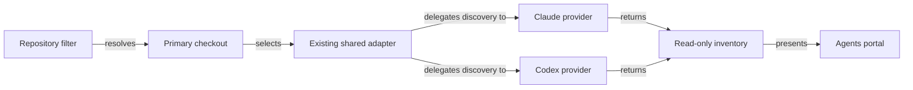

# Inspect Repository Agent Configuration in the Portal

## Summary

Replace the repository-filtered `/agents` placeholder with a **read-only inspector** of native agent configuration in a repository's primary checkout. Reuse the global Agents page's harness detection and UI patterns, while showing repository instructions, skills, and other configuration without requiring RoboRepo-specific packages.

**V1 supports Claude Code and Codex repository discovery.** It inventories files and explains basic scope and loading hints; it does **not** reproduce either harness's full configuration resolution engine. Other harnesses keep their existing machine-wide representation and may show “Repository inspection not yet supported.”

The initial snapshot is the **primary checkout**, not necessarily the `main` branch: use the main worktree associated with the canonical repository, its current checked-out branch, and its local filesystem. Do not inspect linked worktrees or `origin/main`. No configuration is edited, applied, or executed.

## Context

- `/agents` already has a repository filter; the repository view is presently a placeholder. The global page includes installed harnesses, rules, hooks, skills/packages, permissions, and context estimates.
- Harness installations and RoboRepo-managed machine packages are **machine-wide**, independent of the selected repository.
- Repositories can commit agent instructions and skills for developers who do not use RoboRepo. Native files remain authoritative; repository resources must not implicitly become packages.
- Nested instructions may apply conditionally. Discovery is useful even without predicting their exact runtime loading sequence.
- RoboRepo has a rudimentary global permissions editor whose accuracy against modern native permission profiles is uncertain. Its review belongs in a **separate backlog plan** (`permva27`); this feature must not depend on that audit.
- Native discovery belongs in harness providers. Shared adapters and the portal should not hard-code Claude/Codex configuration paths or semantics.

References: `docs/user/reference/config-control-panel.md`, `docs/internal/harness-anatomy.md`, `docs/internal/harnesses-explained.md`, `docs/user/reference/architecture.md`.

## Goals

1. Make repository-filtered `/agents` immediately useful as a **configuration inspector, not an interpreter**.
2. Keep installed harness presentation and controls consistent with global `/agents`, clearly labeled machine-wide.
3. Discover root and nested Claude/Codex instruction files in an organized, navigable hierarchy with safe previews.
4. Give repository skills a useful native inventory and preview, separate from RoboRepo package ownership.
5. Expose settings, hooks, MCP, commands, custom agents, and permission configuration through lightweight source-oriented summaries and previews.
6. Display estimated individual instruction/skill costs using existing helpers, without implying that all discovered files always load.
7. Distinguish **Git-tracked**, **untracked**, and **ignored** local files so users can understand what is shared by the repository versus present only in the checkout.
8. Keep provider-specific discovery logic inside existing provider boundaries and keep the UI agnostic.

## Non-goals

- Editing, creating, enabling/disabling, synchronizing, or installing repository configuration.
- Turning repository skills into RoboRepo packages or introducing repository-level package management.
- Auditing, fixing, replacing, or expanding RoboRepo's global permissions editor. See related plan `permva27`.
- Repo-scoped permission controls, cross-harness policies, or claims about **effective** runtime permissions.
- Computing an authoritative merged/effective instruction context, full import graph, exact precedence, or subdirectory-by-subdirectory loading simulation.
- Full semantic interpretation of settings, hooks, MCP registrations, profiles, or permission rules.
- Exact token accounting, automatic expansion of all imports, or aggregate totals for all conditional resources.
- Initial repository discovery for Gemini or other harnesses beyond Claude Code and Codex.
- Scanning linked worktrees, alternate branches, remote Git hosts, or arbitrary files outside the checkout.
- Executing hooks or commands, launching harnesses, or changing Git state.

## Proposed design

### 1. Page scope and UI conventions

| Surface | Global `/agents` | Repository-filtered `/agents` |
| --- | --- | --- |
| Installed harnesses | Existing machine-wide list and controls | **Same list and controls**, labeled machine-wide |
| Instructions / Active Harnesses | Global rules/config entry per harness | Root and nested instruction-file explorer |
| Skills | Machine-native and RoboRepo-managed resources | Repository-native skills with previews; no package toggles |
| Settings, hooks, MCP, agents, commands | Existing global/config views | Source-file summaries and safe read-only previews |
| Permissions | Existing global editor | Native configuration sources only; no editor or effective-policy claim |
| Usage | Existing machine context estimates | Per-file estimates and optional trustworthy root-only estimate |

Keep the familiar Agents header, repository filter, cards, and dialogs. Replace the splash with **Instructions**, **Skills**, and a compact **Other configuration** area grouping **Settings & Hooks**, **MCP & Agents/Commands**, and **Permissions**. Do not require elaborate specialized screens for every resource type in v1.

Show canonical repo, primary checkout path, checked-out branch (or detached HEAD), and read-only status. If the primary checkout is unavailable, report the issue rather than silently falling back to another checkout. Switching filters must not show stale results from another repo.

Installed harnesses represent the machine, **not** whether the selected repository contains configuration. Show repository resources for Claude/Codex even when their corresponding harness is not installed, with a clear installation-status label. For other harnesses, distinguish **not inspected** from **nothing found**.

### 2. Instructions explorer

One summary entry per harness can open a folder-grouped explorer: an indexed file list/tree and a read-only preview pane. Reuse the global rules-preview UI where practical. Root files appear first; nested directories follow in path order. A shared file may be shown once with multiple harness badges if the provider results support this without confusing ownership.

Keep metadata deliberately small:

| Field | V1 expectation |
| --- | --- |
| Source | Repository-relative path and native file type |
| Harness | Claude Code, Codex, or both when supported |
| Location | Root, nested, or native rules directory |
| Loading hint | **Root-level**, **potentially conditional**, or **unknown**; add a known override/precedence hint only when cheap and reliable |
| Git status | Tracked, untracked, ignored, or unavailable; flag local modifications where practical |
| Estimated tokens | Individual file estimate, explicitly not a guaranteed loaded amount |
| Preview/diagnostic | Safe content preview, or explanation of unreadable/unsupported files |

Discovery targets provider-supported native patterns, including Claude instruction/rules locations and Codex `AGENTS.md`/override locations. Providers may surface recognizable frontmatter or native override relationships, but **must not build a general import resolver, expanded effective-context graph, or version-by-version precedence engine** for v1. If a file's loading behavior depends on settings, path or runtime state, mark it conditional/unknown rather than asserting it loads.

File presence, loading applicability, and Git status are separate concepts. For example, an ignored `.claude` file may be loaded locally but absent from another developer's checkout.

### 3. Skills and other configuration

**Skills:** show a repository-owned inventory with name, description (where available), source directory, associated harness, Git status, and safe metadata/body preview. Skills are **not** packages and get no RoboRepo install, enable, or sync controls. Nested native skill locations are in scope only where supported by provider discovery.

**Other configuration:** offer a compact grouped file/source list with a safe preview. The file path and scope are the primary facts; minimal optional metadata may improve scanning when inexpensive and reliable:

| Type | Minimal v1 summary |
| --- | --- |
| Settings | File path and native scope (shared project vs local/personal where known) |
| Hooks | Definition source; event name if readily parseable; never execute commands |
| MCP | Configuration source and server names if safe to extract; never expose secrets |
| Custom agents / commands | Native definition paths and names where supported |
| Permissions | Source file and native section/mode labels when clearly available; no “effective permission” conclusion |

Do not implement generalized settings merging, hook activation analysis, MCP registry reconciliation, native permission-profile translation, or comprehensive config validation just to populate this page. A source-file viewer is sufficient when richer structured inspection is costly.

Machine-wide and project-local sources must be clearly separated. For inherited/global context, prefer a small link or compact reference to existing global `/agents` rather than duplicating its configuration UI.

### 4. Usage / token estimates

- Reuse existing per-file token-estimation utilities for instruction and skill previews.
- Show the existing machine baseline as **inherited** if it is already displayed by the global page; do not silently add it to project estimates.
- Label root instruction files separately from nested or otherwise conditional files. **Do not** sum every discovered file into “startup usage.”
- Show a root startup estimate **only if the current estimator can justify it reliably without building an effective-context resolver**; otherwise omit the aggregate or label it unavailable.
- Skills can show an individual estimated body size, explicitly **on demand**, not as mandatory startup cost.
- Do not estimate the token cost of raw hook scripts, MCP credentials, or other config files merely because they exist.

No additional import expansion, duplicate-content graph, directory-specific context simulation, or exact runtime token accounting is required for v1.

### 5. Permissions boundary

The repository Permissions area is an **inspector only**: show native permission-related configuration sources, optionally the mode or setting names when trivially identifiable, and explain that active behavior depends on the harness, session and machine policy. Avoid generic Allow/Ask/Deny toggles and avoid claiming a static file preview is the effective security policy.

Management remains with Claude Code and Codex native tooling. The existing global RoboRepo controls are unchanged by this plan; their correctness, continued value, and possible replacement/removal are explicitly investigated under **`permva27`**, a separate, non-blocking plan. This project must neither expand those controls into repository scope nor undertake their audit.

### 6. Provider architecture

First inspect existing provider and portal interfaces and **reuse them where possible**. If needed, add one small read-only discovery capability; do not create a generalized configuration framework or a write/update/apply API.

Providers own native directory/file patterns and lightweight metadata extraction. Shared infrastructure owns checkout selection, safe file access, Git status classification, aggregation and common estimate helpers. The portal renders the resulting file records and must not infer native semantics by switching on harness IDs.

A minimal record needs only a harness identifier, resource type, source path, scope/location, optional name/description/loading hint/token estimate/Git status, and any preview error or diagnostic. Let provider-specific extras remain optional; avoid designing for speculative future editors or policy resolution. A failure in one resource or provider must not suppress all the others.

### 7. Safe inspection boundaries

- Restrict scanning to declared Claude/Codex project locations under the selected primary checkout. Avoid `.git`, vendored trees, dependencies, output directories, and arbitrary recursive scans; use bounded enumeration.
- Handle symlinks and native imports as references. Never automatically preview content outside the checkout or follow external file paths without a separately established safe policy.
- Redact known secret-bearing fields before sending preview data to the UI; never echo MCP credentials, tokens, environment values, authorization headers, or secret-bearing URLs in logs or responses.
- Bound file sizes, file counts, and preview sizes. Treat malformed/unreadable files as individual diagnostics.
- Determine Git status separately from harness applicability: tracked, untracked, and ignored files may all matter to the local checkout. Do not assume **tracked = committed**; a tracked file can contain uncommitted modifications.
- Inspection must not mutate files, execute hooks, install packages, launch harnesses, or change Git metadata.

## Happy path

1. User selects a repository in `/agents`.
2. Portal resolves the **primary checkout**, shows its current branch and the unchanged machine-wide harness list.
3. Claude/Codex providers return inventories of supported native files and basic metadata.
4. User browses nested instructions, inspects skills, and opens read-only previews.
5. User sees tracked vs local-only files and individual estimated token counts, without misleading effective-context totals.
6. User sees concise source-oriented summaries for settings, hooks, MCP, agents/commands, and permissions.
7. User switches back to global scope; neither native files nor global settings have changed.

## Implementation plan

### A. Establish existing integration points

- [ ] Inspect the `/agents` repository placeholder, existing global cards/previews/harness detection, and token-estimate utilities.
- [ ] Inspect Claude/Codex providers and reuse existing discovery APIs; confirm primary-checkout resolution and any overlapping backlog plans.
- [ ] Specify the **smallest** read-only file-inventory shape and unsupported/empty/error semantics; do not add future-management fields.

### B. Implement Claude/Codex discovery

- [ ] Enumerate supported root/nested instructions, skills, and native configuration file locations for Claude Code.
- [ ] Enumerate supported root/nested instructions, skills, and native configuration file locations for Codex.
- [ ] Return basic source/type/scope metadata and only readily detectable loading or override hints; mark runtime-dependent applicability unknown.
- [ ] Implement safe bounded previews, redaction, partial failures, and tracked/untracked/ignored Git status indicators.
- [ ] Reuse per-file token estimates where available; no effective-context engine or complex token aggregation.

### C. Render the repository page

- [ ] Replace the splash with primary-checkout identity and reused global machine-wide harness controls.
- [ ] Add the folder-indexed Instructions explorer and a useful Skills inventory with previews.
- [ ] Add lightweight file/source summaries for Settings, Hooks, MCP, Agents/Commands, and read-only Permissions.
- [ ] Distinguish tracked and local-only resources, empty versus unsupported provider states, and root versus conditional estimates.
- [ ] Ensure filtering between global and repositories clears stale data; do not show repo-level package/permission toggles.

### D. Verify and document

- [ ] Add provider fixtures for root/nested files, overrides where easily detectable, tracked/untracked/ignored files, malformed/unreadable files, and absent harness installations.
- [ ] Test primary checkout versus linked worktrees, symlink escape, redaction, scan bounds, and partial provider failures.
- [ ] Add portal tests for selection, preview navigation, read-only states, and switching back to global.
- [ ] Confirm no inspection path mutates repo/global configuration or runs hooks.
- [ ] Run relevant repo-native unit and portal tests, and update the existing documentation of record with the new read-only scope.

## Validation

- [ ] Repository-filtered `/agents` shows a useful read-only inventory from the **primary checkout** (not linked worktrees), including checkout branch/path.
- [ ] The Installed Harnesses section remains identical to global scope and clearly machine-wide.
- [ ] Claude and Codex root/nested instruction files are discoverable and navigable with safe previews and honest basic applicability labels.
- [ ] Repository-native skills are visible independently of RoboRepo packages, with no install/sync/toggle side effects.
- [ ] Settings, hooks, MCP, agents/commands, and native permissions have lightweight source-based summaries and safe previews; no universal effective-state interpretation is implied.
- [ ] Every displayed repository resource shows Git tracked/untracked/ignored status when Git can determine it; tracked local changes are not represented as necessarily committed.
- [ ] Per-file token estimates are identifiable as estimates; nested/conditional instructions and on-demand skills are not summed as mandatory startup costs.
- [ ] Global permissions are not audited or modified, and repository permissions are not editable.
- [ ] Providers own native discovery; the portal does not hard-code Claude/Codex file interpretation.
- [ ] Unsupported providers and unreadable resources are distinguished from genuinely empty results; safety checks and relevant tests pass.

## Risks and tradeoffs

| Risk | Mitigation |
| --- | --- |
| Native configuration evolves | Provider-owned discovery with tests and `unknown` labels rather than pretending to reproduce the harness |
| Nested rules imply uncertain loading | Display file location and basic hints; do not claim exact effective instructions |
| Permission sources imply guaranteed security | Source-only view; management and audit stay outside this plan |
| Too many resource types create excess UI work | Rich instructions/skills; file-oriented summaries for all other types |
| Git status is mistaken for sharing/commit state | Label tracked, untracked, ignored, and local modifications distinctly |
| Monorepo inventories become large | Folder grouping, bounded scans, and on-demand previews |
| Sensitive values or external symlinks escape | Safe path handling, redaction, bounded reads, isolated errors |

## Deferred follow-ups

- **Separate plan `permva27`:** audit the existing global permissions editor against current Claude/Codex native controls; decide whether to keep, simplify, replace, or retire it. **Not a dependency** for this plan.
- Optional directory-specific effective-instructions explorer and import/precedence interpretation, only if users later need them.
- Repository configuration editing, skills enable/sync behavior, and any connection to RoboRepo package ownership.
- Additional provider coverage (Gemini and others), guided by actual native behavior and demand.
- Rich semantic inspection of settings, hooks, MCP, and permission configurations if source previews prove insufficient.

## Documentation impact

- `docs/user/reference/config-control-panel.md`: explain global-managed versus repo-inspected resources, read-only permissions, and token-estimate limitations.
- `docs/internal/harness-anatomy.md` and `docs/internal/harnesses-explained.md`: document provider-owned repository discovery if a capability is introduced.
- `docs/user/reference/architecture.md`: update only if the shared adapter interface materially changes.
- `docs/internal/docs-map.md`: update only if adding a new documentation-of-record file.

## Research references

Native semantics should be checked against the supported harness versions when implementing; v1 does not attempt complete native precedence simulation.

- [Claude Code — instructions](https://code.claude.com/docs/en/memory)
- [Claude Code — settings](https://code.claude.com/docs/en/settings)
- [Claude Code — skills](https://code.claude.com/docs/en/skills)
- [Codex — AGENTS.md](https://developers.openai.com/codex/guides/agents-md)
- [Codex — configuration](https://developers.openai.com/codex/config-basic)
- [RoboRepo — global config control panel](https://github.com/kirinmurphy/roborepo-alpha/blob/main/docs/user/reference/config-control-panel.md)
