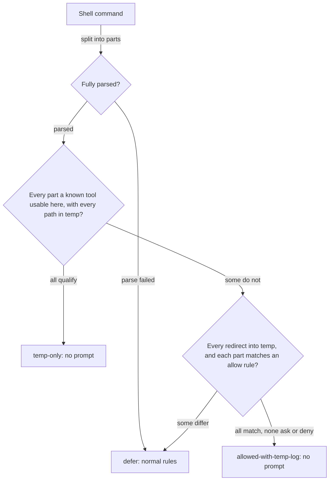

# Let agents work freely in temp folders

## Summary

Agents ask for permission many times a day to do throwaway work in temp folders: creating a scratch
repo, deleting a test directory, running a script they just wrote there. The user does not want to
review this work, and the prompts cost attention without protecting the code they care about.

This plan adds one setting, on by default, that lets a shell command run without a prompt when it uses
known local tools and everything it names is inside a temp folder. A shared check decides what
qualifies, and the Claude and Codex hooks apply the answer. A command that already has an allow rule
also stays free when it only logs to temp. Anything else, including any command the check cannot fully
understand, keeps today's behavior.

## Context

### Terms

| Term | Meaning |
| --- | --- |
| Temp folder | Anything strictly below `/tmp`, `/private/tmp`, or the OS temp directory (`os.tmpdir()`). On macOS `/tmp` and `/var` are symlinks into `/private`, so paths are compared after resolving them |
| Known tool | A program, and for `git` a subcommand, on the check's allow list |
| Temp-only command | A shell command made only of known tools and named paths that resolve into a temp folder, which either runs from a temp working directory or uses only the tools that are safe from anywhere |
| Scratch clone | A repository under a temp folder whose git data is also under a temp folder |
| Bucket | A behavior's `allow`, `ask`, or `deny` setting in `manifests/inventory/agent-permissions.json`, which the user can override |

### Current behavior

| Harness | Read, write, and edit tools in temp | Shell commands in temp |
| --- | --- | --- |
| Claude | Allowed by `read-scope` and `write-scope`, except that a repository under temp prompts when the session is in a different one | Matched only by how the command starts. No rule can say "in this folder" |
| Codex | Governed by the `managed-workspace` sandbox profile; temp access not yet confirmed | Sandboxed, with native prefix rules. `rm` is a prompt rule |

Two Claude details explain why temp work prompts:

- **Prefix matching.** `globals/system/hooks/claude/minimize-bash-output.mjs` approves a short list of
  known-safe commands and pipelines of them, and refuses anything chained with `&&` or redirected.
  Agents do both constantly, so `cd <temp> && git init && ...` falls through to a prompt.
- **Clones under temp prompt on purpose.** `globals/harnesses/claude/hooks/repo-write-scope.mjs`
  treats any repository under temp as a separate checkout. This plan narrows that rule.

### Evidence

Measured on November 6, 2026, across every Claude project transcript changed in the previous 14 days:

| Measure | Bash calls |
| --- | --- |
| All | 22,308 |
| Mentioning a temp folder | 3,249 |
| ...matching no permission rule by first-line prefix | 3,087 |
| ...matching an allow rule | 135 |
| ...matching an ask rule | 27 |

These numbers bound the problem but do not count prompts. Transcripts do not record prompts, and the
safe-command hook and Claude's own read-only approval clear some of the 3,087. Many of these commands
also act on the repository and only log to temp, for example `npm run check > /private/tmp/<log>`.

## Goals

- A temp-only shell command runs without a prompt in Claude and Codex.
- A repository command that already has an allow rule stays free when its only temp involvement is an
  output redirect.
- Agents can work inside a scratch clone from any session without a prompt.
- The behavior is one user-visible setting that works the same way as every other permission.
- Any other command behaves exactly as it does today.

## Non-goals

- OS-level enforcement. A script in temp can still reach the repository; see Risks.
- Gemini. Its Policy Engine has no path predicate, roborepo installs no Gemini hooks, and
  `scripts/harnesses/gemini/policy-toml.mjs` records Gemini as deprecated here with no parity work
  planned. Its rendered policy does not change.
- Network actions from temp, including `git clone`, `git fetch`, and `git pull`.
- Linux-specific and Windows temp locations beyond what `os.tmpdir()` returns.

## Proposed design

### The check

`scripts/harnesses/scratch-command.mjs` exports a function that takes a command string, a working
directory, and the effective allow, ask, and deny prefixes: the manifest's, with the user's
`command-overrides.json` applied, as the hook has already read them. It returns
`temp-only`, `allowed-with-temp-log`, or `defer`. Its only filesystem reads resolve symlinks and git
pointers. Hooks turn the answer into a harness response.

| Command, from a session in a repository | Result | Why |
| --- | --- | --- |
| `rm -rf /tmp/x` | `temp-only` | Known tool, and its operand is below a temp root |
| `cd /tmp/x && git init && git commit -m t` | `temp-only` | `&&` carries the move into temp |
| `D=$(mktemp -d) && cd "$D" && touch a` | `temp-only` | Plain `mktemp -d` is the one allowed substitution |
| `node /tmp/x/probe.mjs` | `temp-only` | Scripts in temp run freely; see Risks |
| `cd /tmp/x && python3 - <<'E'` | `temp-only` | Inline code from a temp directory carries the same risk as a temp script |
| `npm run check > /tmp/log 2>&1` | `allowed-with-temp-log` | `npm run check` has an allow rule |
| `python3 - <<'E'` | `defer` | Inline code with the repository as its working directory |
| `cd /tmp/missing; rm -rf src` | `defer` | If `cd` fails, `;` still runs `rm` in the repository |
| `cd /tmp/missing && touch a; rm -rf src` | `defer` | `;` after a `cd` escapes the `&&` chain |
| `cd /tmp/x && cd - && rm -rf src` | `defer` | Only one leading `cd`, to a temp path, is understood |
| `(cd /tmp/x); rm -rf src` | `defer` | Subshells are not parsed |
| `tar -xf /tmp/a.tar`, or `git stash` | `defer` | These act on the working directory, here the repository |
| `rm -rf /tmp/{a,../../Users/me/y}` | `defer` | Brace expansion is not parsed |
| `unzip -d/Users/me /tmp/a.zip` | `defer` | A flag with an attached path outside temp |
| `rm -rf /tmp/x src` | `defer` | `src` resolves into the repository |
| `cd /tmp/x && rm -rf ~/y` | `defer` | `~` resolves outside temp |
| `rm -rf /tmp` or `rm -rf /tmp/*` | `defer` | A temp root itself, or an unexpanded glob in a delete |
| `rm -rf /tmp/link`, where `link` points outside temp | `defer` | Paths are compared after resolving symlinks |
| `mktemp -d <repo>/XXX` | `defer` | The template is outside temp |
| `D=$(mktemp -d /missing/XXX); cd "$D" && rm -rf src` | `defer` | A failed `mktemp` leaves `cd ""`, which stays in the repository, so `&&` must join them |
| `D=$(mktemp -d); rm -rf "$D/x"` | `defer` | A failed `mktemp` would make this `rm -rf /x` |
| `npm run check > /tmp/log 2> src/app.js` | `defer` | One redirect writes into the repository |
| `npm run check > /tmp/log`, with a personal `ask` on `npm run check` | `defer` | A matching ask rule outranks the allow rule |
| `cd /tmp/x && rm -rf "$HOME/y"` | `defer` | Only `$TMPDIR` and a `mktemp` variable resolve |
| `grep -e. ~/.ssh/id_rsa /tmp/x` | `defer` | With `-e` or `-f`, every remaining operand is a path |
| `GIT_DIR=<repo>/.git git reset --hard` | `defer` | Environment prefixes are not parsed |
| `cd /tmp/x && git push` | `defer` | `push` is not a known `git` subcommand |
| `cd /tmp/x && npm i -g foo` | `defer` | `npm` is not a known tool |

Rules the function follows:

- **Fail closed.** Anything it cannot parse returns `defer`: unbalanced quotes, subshells, loops,
  brace expansion, environment prefixes, unknown substitutions, variables other than `$TMPDIR` and a
  `mktemp` assignment, and heredocs with an unquoted delimiter whose body contains `$(` or a backtick.
- **A `mktemp` assignment must be followed by `&&`**, so a failed `mktemp` never leaves an empty
  variable in a later part.
- **One leading `cd` moves the working directory.** It must come first, or directly after a `mktemp`
  assignment, target a temp path, and be followed by `&&`. In a command with a `cd`, every later part
  must be joined by `&&` or `|`. Any other `cd` returns `defer`, unless its target already equals the
  working directory.
- **Every operand must resolve into temp**, including `--flag=value` values and paths from `~` or `..`.
  A short flag with an attached value counts as a path if it contains `/`, `~`, or `..`. The exception
  is the first operand of `grep` and `rg`, which is a pattern unless `-e` or `-f` is present.
- **Every redirect must target temp** in both approving results. `2>&1` is the one form with no path.
- **Dangling symlinks are outside.** Resolution checks each existing path component, and a link whose
  target does not exist returns `defer`.
- **Linked checkouts are not scratch.** A temp path inside a checkout whose git data lies outside temp
  returns `defer`, because its commits change the real repository. The check reads `.git` and
  `commondir`, as `repo-write-scope.mjs` does.

### The allow list

The list lives in the check, is seeded from the commands in the Evidence measurement, and grows as
real prompts show gaps.

| Group | Tools | Usable from |
| --- | --- | --- |
| Paths | `rm`, `cp`, `mv`, `mkdir`, `touch`, `cat`, `head`, `tail`, `wc`, `ls`, `grep`, `rg`. From outside temp, each needs a path operand, except `head`, `tail`, `wc`, `grep`, and `rg` reading from a pipe | Any working directory |
| Scripts | `node`, `python3`, `bash`, `sh`, each given a script in temp | Any working directory |
| Setup | Plain `mktemp`, with no template or a template in temp | Any working directory |
| Archives | `tar`, `unzip` | A temp working directory |
| Git | `init`, `add`, `commit`, `status`, `log`, `diff`, `show`, `branch`, `checkout`, `switch`, `mv`, `rm`, `restore`, `reset`, `merge`, `rebase`, `stash`, `tag` | A temp working directory |
| Inline code | `node -e`, `python3 -c`, or a heredoc into an interpreter | A temp working directory |

These are left out on purpose: `sed` and `awk`, whose scripts can write to any file; `find`, whose
`-exec` runs anything; and `ln`, the direct way to create a link that later parts write through.

### The setting

A new behavior in `manifests/inventory/agent-permissions.json`, shown on the permissions page:

| Field | Value |
| --- | --- |
| `id` | `temp-folder-work` |
| `label` | Work in temp folders |
| `description` | Common local commands that stay inside temp folders run without asking, including inside scratch repos. Anything else follows your other settings. |
| `kind` | `temp-scope`, a new kind that adds no Claude or Gemini rule |
| `bucket` | `allow` |
| `category` | `files` |

Any other bucket turns the feature off: hooks say nothing, and clones under temp prompt as they do
now. The Claude and Gemini rule loops already skip kinds they do not know. `codexApprovalPolicy` in
`scripts/harnesses/permissions-render.mjs` checks every behavior's bucket whatever its kind, so it
must exclude `temp-scope`; otherwise this setting could change Codex's `approval_policy`.

### Harness adapters

Each hook runs as a copy under the harness home, so it resolves the app root the way
`repo-write-scope.mjs` does, imports the check from there, and says nothing if that fails.

| Harness | Working directory | How the answer is applied |
| --- | --- | --- |
| Claude | `tool_input.workdir`, then `cwd`, as `protected-branch-push.mjs` reads them | New `globals/harnesses/claude/hooks/temp-folder-work.mjs` on `PreToolUse` with matcher `Bash`, emitting `allow`. `repo-write-scope.mjs` treats a scratch clone as scratch |
| Codex | The same order, with `permission-check.mjs`'s existing `exec_command` payload handling | `globals/harnesses/codex/hooks/permission-check.mjs` emits `allow` on `PreToolUse`. At `PermissionRequest` it approves only a `temp-only` command that requests no filesystem or network escalation |

## Implementation plan

### Phase 1: confirm the mechanisms

- [ ] Claude: in a fresh session, add a temporary hook through the gitignored
      `.claude/settings.local.json` that emits `allow` for `rm /tmp/<probe>`. Record whether the
      `Bash(rm:*)` ask rule still prompts. Restore the settings file.
- [ ] If the ask rule wins, the same conflict applies to `git rm`, `git checkout`, and `git switch`. In
      the same session, confirm that such a command with no rule at all still prompts, and that a hook
      `allow` clears it. If so, have `permissions-render.mjs` omit the Claude ask rules for
      `delete-files` and `switch-branches` while `temp-folder-work` is `allow`: a command the hook does
      not approve then prompts by default, including when the hook fails. Record the choice in the
      Decision Log, since it changes how user-facing buckets are enforced.
- [ ] Codex: outside any other sandbox, run writes to `/tmp`, `$TMPDIR`, and a home-folder control under
      the `managed-workspace` profile. If temp is not writable, render writable temp entries from the
      new behavior in `scripts/harnesses/permissions-render.mjs`. A November 6 probe from inside a
      Claude session exited 71 for every path, temp and home alike, so it could not tell them apart.
- [ ] Codex: confirm the `PermissionRequest` payload shows whether a request is a filesystem or network
      escalation. If it does not, leave prompt-rule commands such as `rm` prompting on Codex and record
      that.

### Phase 2: the check

- [ ] Add `scripts/test/scratch-command-check.mjs` with every row of the command table, plus malformed
      input, a worktree under temp whose git data is outside it, and a scratch clone. Register it in
      `scripts/test/check-groups.json`.
- [ ] Write `scripts/harnesses/scratch-command.mjs` until the check passes.

### Phase 3: the setting

- [ ] Add the `temp-folder-work` behavior and the `temp-scope` kind, and exclude the kind from
      `codexApprovalPolicy`, with a test that setting it to `ask` leaves `approval_policy` unchanged.
- [ ] Confirm the permissions page in the portal shows and saves it, and update any kind-specific
      expectations in `scripts/test/permissions-render-live-characterization-check.mjs` and
      `scripts/test/clean-machine-permissions-sandbox.mjs`.

### Phase 4: adapters

- [ ] Claude: write `temp-folder-work.mjs`, and add the entry to both
      `globals/harnesses/claude/hooks-claude.json` and `generated/claude/settings.json` and to the
      expectations in `scripts/test/core-hook-wiring-check.mjs`.
- [ ] Claude: change the scratch exemption in `repo-write-scope.mjs` so a scratch clone counts as scratch
      while the setting is on. A repository whose git data is outside temp still prompts. Update
      `scripts/test/repo-write-scope-check.mjs`: its sibling clone under a scratch path now passes with
      the setting on and still expects `ask` with it off, and a linked checkout still expects `ask`.
- [ ] Codex: extend `permission-check.mjs` and `scripts/test/codex-command-permission-check.mjs`,
      including cases proving filesystem and network escalations are not approved.

## Validation

- `node scripts/test/scratch-command-check.mjs`, `node scripts/test/core-hook-wiring-check.mjs`,
  `node scripts/test/repo-write-scope-check.mjs`, and
  `node scripts/test/codex-command-permission-check.mjs` pass.
- In a live Claude session started in a repository, these all run without a prompt: `mktemp -d`,
  `git init` and a commit in that folder, running a script there, and `rm -rf` of it.
- In the same session, `rm -rf /tmp/x <repo-file>` and `cd /tmp/x && git push` still prompt.
- The same checks pass in a live Codex session.
- With `temp-folder-work` set to `ask`, the same temp commands prompt as they do today.
- Replay the shell commands in recent Claude transcripts through `scratch-command.mjs` with a throwaway
  script, and record how many of the temp-mentioning commands no longer return `defer`.
- `bash scripts/doctor.sh --quiet` and `git diff --check` pass. `npm run check` passes before push,
  because this changes hook wiring and generated output.

## Documentation impact

| Doc | Update |
| --- | --- |
| `docs/user/reference/claude-hooks.md` | Add a `PreToolUse` row for the new hook and its setting |
| `docs/user/reference/codex-hooks.md` | Describe the temp-only approval in the permission hook |
| `docs/user/reference/config-control-panel.md` | Add the setting, and note that scratch clones are an exception to its "Anywhere else" write row |
| `docs/internal/hooks-internals.md` | Describe the check, its results, the allow list, and the adapters |
| `docs/internal/harnesses-explained.md` | Add the `temp-scope` kind and that Gemini has no equivalent |

## Risks

| Risk | Mitigation |
| --- | --- |
| A script in temp edits the repository or sends data out, since a text check cannot see inside it | Accepted: the user chose this on November 6, 2026. An OS-level sandbox is the fix if this ever matters |
| A parsing gap approves a command that reaches outside temp | The check approves only listed tools with every path resolved, and its refused forms are tests |
| An archive or checkout creates a link, and a later part of the same command writes through it | Accepted: it needs hostile content already in temp, the same exposure as running a script there |
| Credential files are read through the shell, where `read-secrets` does not apply | Unchanged: a path outside temp returns `defer`, so such a command gets today's handling |
| A session deletes another session's temp folder | Accepted: only a named path below a temp root qualifies, and temp roots and globs in deletes do not |
| A useful tool is missing from the allow list | It prompts as it does today, and the list grows from what prompts |
| Hook startup adds time to every shell command | The check returns early when the working directory is outside temp and the command has no temp reference |
| `git checkout main`, `git switch main`, and `git checkout -B main` stay denied by `occupy-main` in a scratch clone | Accepted: native deny rules win, and these are its only forms |

## Decision Log

- November 6: kept separate from `Keep local agent work within useful boundaries: Claude`
  (`46qth5z8`). That plan is Claude-only and concerns session filing and provider cleanup; this one
  spans harnesses. They share one touchpoint: that plan moves `minimize-bash-output.mjs`, so whichever
  lands second has a small rebase.
- November 6: the user chose a command check over OS-level sandboxing. Claude's native sandbox would
  enforce the boundary, but it would also change prompting for all in-repository shell work and for
  network use, which is a far larger change than this problem needs.
- November 6: the user chose an allow list of known tools over a block list of outward actions. A block
  list misses tools that change the machine from inside temp, such as `npm i -g` and
  `git config --global`. The cost is that unlisted tools keep prompting until they are added.
- November 6: scripts in temp run without a prompt, on the user's instruction that temp folders carry
  no specific security concern. They are the known exception to the allow list's guarantee.
- November 6: the redirect-to-temp case stays in scope, as the user accepted in the proposed design,
  because logging to temp is common in the Evidence measurement.

## Open questions

- **Prompt rules on Claude.** Phase 1 decides whether a hook can clear native ask rules, or whether those
  prompts move into the hook.
- **Prompt rules on Codex.** Phase 1 decides whether `PermissionRequest` can tell a command approval from
  an escalation. If it cannot, `rm` and other prompt-rule commands in temp keep prompting on Codex, which
  narrows the first Goal, and the live Codex validation checks only the commands that do not prompt.
