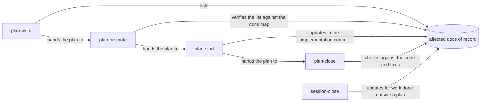

# Keep User and Maintainer Docs Current With Every Change

## Summary

The user guides and maintainer reference docs drift because no part of the plan workflow asks
anyone to update them. This plan does two things:

1. **Prevents new drift.** The plan skills tell agents which docs a change affects, update them with
   the code, and check them before a plan closes. A CI check catches broken references.
2. **Repairs existing drift.** It fixes the broken references found so far, then reviews each feature
   area's docs against the code, starting with the areas that changed most.

## Context

### Who owns doc upkeep today

[`docs/internal/docs-map.md`](../../internal/docs-map.md) names a **doc of record** for each feature
area: the one doc that owns the current behavior, which supporting docs link to instead of restating
it. No skill tells an agent to consult that map or update the doc it names.

| Skill | What it says about `docs/user/` and `docs/internal/` |
| --- | --- |
| `plan-write` | Nothing. A plan has no place to list the docs a change affects. |
| `plan-promote` | Reads documentation to verify the plan's claims; never says to update it. |
| `plan-start` | Nothing. "Keep the plan synchronized" covers only the plan document. |
| `plan-close` | Nothing. Step 3 checks the plan against the code, never the docs. |
| `session-close` | Step 2 updates "project-specific tracking docs" (ADR, changelog) but does not name guides or reference docs, and it defers to a "doc-refresh skill" that does not exist. |
| `builtin-support` | Step 5 updates README/docs tables, only while authoring skills. |

The newest commit at review time, `2d0ae02` ("removed telemetry toggle in agents page"), changed
`portal/config/app.js` and a portal UI test but no doc. Whether a doc needed to change is unknown,
because nothing in the workflow asked.

### Drift found so far

The **reader-facing docs** are the 54 Markdown files written for people rather than harnesses:
`README.md`, `docs/**/*.md` outside `docs/plans/`, and `manifests/inventory/README.md`. A throwaway
scan checked them for broken links, broken anchors, cited repo paths that no longer exist, and
removed CLI commands. These findings are confirmed by hand:

| Doc | Broken reference | Current reality |
| --- | --- | --- |
| `docs/user/reference/roborepo-cli.md:111` | Links `developer-runtime.md` | The file is `runtime.md` |
| `docs/internal/skills-and-commands.md`, `docs/internal/harness-anatomy.md` | `globals/claude/skills/` | Directory no longer exists |
| `docs/internal/root-domains.md` | `globals/agents/skills`, `globals/commands` | Directories no longer exist |
| `docs/internal/rules-parity-and-layering.md`, `docs/user/guides/setup-and-daily-use.md` | `generated/gemini/GEMINI.md` is a generated rules file | `manifests/platform/rule-targets.tsv` renders rules for Claude and Codex only; `generated/gemini/` holds only `policies/` |
| `docs/internal/rename-readiness.md` | `generated/gemini/policies/roborepo-permissions.toml` | File is `generated-permissions.toml` |
| `docs/internal/cli-internals.md` | `scripts/cli/telemetry-transcript.mjs` | File no longer exists |
| `docs/internal/skill-reference-observation.md` | `globals/packages/skill-visibility/hooks/skill-reference-observer.mjs` | Path no longer exists |
| `docs/architecture/config-code-separation.md` | `manifests/platform/prompts/non-root-conflict.md` | File no longer exists |
| `docs/architecture/developer-runtime-container-support.md` | `docs/plans/active/developer-runtime-workspace-model.md` | Plan has left `active/` |
| `docs/architecture/documentation-map-and-audit.md` | `docs/user/reference/roborepo.md`, `docs/internal/permissions.md`; claims 25 reviewed files | `roborepo.md` was deleted in PR #16, leaving `roborepo-cli.md` and `cli-internals.md` to own the CLI; `permissions.md` was never written; there are now 54 docs |

**That scan can't see semantic drift.** Most user docs, such as `plans-portal.md`, `runtime.md`,
`plan-suite.md` and `repositories.md`, passed only because they rarely cite code paths. Their
features changed most recently, so they are the likeliest to be stale.

### Where the churn is

The scan also counted commits to each doc's cited code after the doc last changed. Combined with
the recent PR history, that gives this priority order:

| Area | Docs | Evidence of churn |
| --- | --- | --- |
| Plans portal and plan suite | `docs/user/reference/plans-portal.md`, `docs/user/guides/plan/lifecycle/plan-suite.md`, `docs/internal/plans-portal-internals.md` | 12 commits to cited code since the internals doc changed; PRs #23, #25, #31, #33 |
| Home and repositories | `docs/user/reference/repositories.md`, `docs/internal/portal-architecture.md` | PRs #22, #24, #26 |
| Runtime | `docs/user/reference/runtime.md`, `docs/internal/developer-runtime-internals.md`, `docs/architecture/developer-runtime-container-support.md` | PRs #19, #20 |
| Onboarding and config panel | `docs/user/reference/config-control-panel.md`, `docs/internal/config-panel-internals.md`, `docs/user/guides/first-time-setup.md` | PR #28, `c2d1c13`, `2d0ae02` |
| Permissions and hooks | `docs/user/reference/claude-hooks.md`, `docs/user/reference/codex-hooks.md`, `docs/internal/hooks-internals.md` | `be7e441` |
| Telemetry and tokens | `docs/user/reference/telemetry.md`, `docs/user/guides/telemetry.md`, `docs/internal/telemetry-internals.md`, `docs/internal/tokens-portal-review.md` | 6 commits to cited code since 2026-10-01 |
| Harness and architecture | `docs/architecture/config-code-separation.md`, `docs/architecture/manifest-and-symlinks.md`, `docs/internal/harness-anatomy.md`, `docs/internal/harnesses-explained.md`, `docs/internal/skills-and-commands.md`, `docs/internal/rules-parity-and-layering.md`, `docs/internal/root-domains.md`, `docs/internal/roborepo-command-path.md` | `config-code-separation.md` unchanged since 2026-08-10, with 76 commits to its cited code since; PR #32 |

## Goals

- Every plan names the docs of record its change affects, and implementation updates them in the
  same commit as the behavior change.
- `plan-close` refuses to close a plan whose affected docs disagree with the code, unless the agent
  first fixes them.
- `npm run check` fails on a broken link, broken anchor, missing cited path or removed CLI command
  in any reader-facing doc.
- Every doc in the churn table has been read against current code and corrected.
- `docs/internal/docs-map.md` is the single doc-ownership map.

## Non-goals

- Restructuring or merging docs beyond what correcting drift requires.
- Checking paths cited inside plan documents. That belongs to `p3vbk03v`.
- A machine-readable code-to-doc ownership map, or a check that flags a diff touching owned code
  without its doc. See Open Questions.
- Making the docs section of a plan a validator-required section.

## Proposed Design

### Doc freshness through the plan lifecycle

The skills are global and run in other repositories, so their wording must not assume roborepo's
layout. They refer to "the repository's doc-of-record map, when one exists". In roborepo, that is
`docs/internal/docs-map.md`.

| Skill | Change |
| --- | --- |
| `plan-write` | `writing-guidelines.md` and `workflow-create.md` add an optional `## Documentation impact` section listing each affected doc of record and what changes in it. If nothing is affected, it says so in one line with the reason. |
| `plan-promote` | Workflow step 3 also checks that the documentation-impact list matches the docs map and the plan's scope. |
| `plan-start` | The Implementation Workflow updates each listed doc in the same commit as the behavior it describes. Add a Completion Condition, and a final-report line `Docs updated: <list> \| none needed (<reason>)`. |
| `plan-close` | Step 3 checks each affected doc against the code. Drift is a gap the agent fixes itself. `## Verification` records which docs were checked. |
| `session-close` | Step 2 names user guides and reference docs explicitly, points at the doc-of-record map, and drops the nonexistent "doc-refresh skill". |

The skill sources live under `globals/packages/<package>/skills/<skill>/`. The `agents/openai.yaml`
files hold only display metadata, so Codex needs no parallel edit.

### Deterministic reference check

`scripts/test/docs-reference-check.mjs` scans the reader-facing docs. For each it checks:

| Check | Source of truth |
| --- | --- |
| Relative link targets exist | Filesystem |
| `#anchor` fragments match a heading | `slugify` from `scripts/cli/markdown-render.mjs`, exported for reuse so the check and the portal's renderer can't disagree on GitHub-style slugs |
| Backticked repo paths exist (`modules/`, `portal/`, `scripts/`, `globals/`, `manifests/`, `generated/`, `docs/`, ...) | Filesystem; placeholder and glob paths are skipped, and gitignored outputs such as `docs/.jdm-indexed` are allowed |
| No mention of a removed command | `manifests/platform/cli/removed.json` |

It joins the `ci` group in `scripts/test/check-groups.json`, which `scripts/test/ci.sh` runs. Before
writing the path extractor, reuse or align with `p3vbk03v`'s extraction rules for fenced blocks and
forward references, so the two checks don't disagree on what counts as a cited path.

## Implementation Plan

### Phase 1: Mechanical repair and the reference check

- [ ] Export `slugify` from `scripts/cli/markdown-render.mjs`; `scripts/test/markdown-render-check.mjs` stays green.
- [ ] Write `scripts/test/docs-reference-check.mjs` with a fixture case for each check that proves it fails on a seeded break.
- [ ] Fix every confirmed finding in the Context table, verifying each replacement against the code.
- [ ] Fix any further findings the new check reports.
- [ ] Add the check to the `ci` group in `scripts/test/check-groups.json`.

### Phase 2: Doc freshness in the plan skills

- [ ] `plan-write`: add the `## Documentation impact` guidance to `references/writing-guidelines.md` and `references/workflow-create.md`.
- [ ] `plan-promote`: extend workflow step 3 to verify the documentation-impact list.
- [ ] `plan-start`: add the doc-update step, Completion Condition and final-report line.
- [ ] `plan-close`: extend step 3 and the `## Verification` contents.
- [ ] `session-close`: rewrite step 2 as described in Proposed Design.

### Phase 3: Semantic audit, one area per commit

For each area, read the user doc and its internals companion against the code, correct them, and
commit that area on its own.

- [ ] Plans portal and plan suite
- [ ] Home and repositories
- [ ] Runtime
- [ ] Onboarding and config panel, including whether the "telemetry switch" in `docs/user/reference/config-control-panel.md:86` still exists after `2d0ae02`
- [ ] Permissions and hooks
- [ ] Telemetry and tokens
- [ ] Harness and architecture

### Phase 4: Ownership record

- [ ] Resolve the `documentation-map-and-audit.md` open question and apply the decision.
- [ ] Update `docs/internal/docs-map.md` for any doc added, renamed or retired during the audit.

## Validation

- `npm run check` passes with `docs-reference-check.mjs` in the `ci` group.
- Each seeded fixture break makes `docs-reference-check.mjs` exit non-zero.
- `roborepo plans validate irpw877r --json` reports no blocking findings.
- Each edited skill keeps its trigger fixtures (`skill-triggers.json`) passing in the unit checks.
- Each Phase 2 skill edit can be found by reading the skill: the instruction is in the step named in
  Proposed Design.
- No automated test can show an agent following the new instructions. The first plan that runs
  through `plan-start` and `plan-close` after Phase 2 confirms it: its final report carries the
  `Docs updated:` line, and its `## Verification` names the docs it checked. Record that run as a
  `## Not tested` entry until it happens.
- Every Phase 3 area commit names the docs it corrected and the code it checked them against.

## Risks

| Risk | Mitigation |
| --- | --- |
| The path check flags legitimate non-paths and gets ignored | Phase 1 tunes it to zero findings on the live tree before it joins CI; fixtures pin each skip rule |
| The plan-close doc check becomes a box-ticking step | It names the specific docs from the plan's list rather than "the docs", and `## Verification` records what was compared |
| The global skill wording assumes roborepo's layout | Wording refers to "the repository's doc-of-record map, when one exists" and never to roborepo paths |
| Phase 3 grows into a rewrite | Each area corrects drift only; structural ideas go to a follow-up plan |

## Open Questions

1. **What happens to `docs/architecture/documentation-map-and-audit.md`?** It duplicates the
   ownership map in `docs-map.md`, and its audit content is stale.
   - *Keep it as a dated audit record:* this pass's findings stay findable. It needs a refresh, and
     its map section must go.
   - *Fold it into `docs-map.md` and delete it:* one fewer doc, but the history moves to Git only.

   Recommendation: keep it as the dated record of this pass and remove its duplicate map.
2. **Should doc ownership become machine-readable?** A code-glob-to-doc map would let a check flag a
   diff that changes owned code without touching the doc it owns, such as `2d0ae02`.
   The cost is one more manifest to maintain. Recommendation: decide after Phase 2 has run on a few
   plans, using how often doc updates were still missed.
