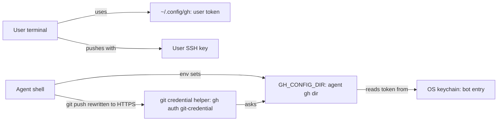

# GitHub Integration Part 01: Agents Act on GitHub Under Their Own Identity

## Summary

Agent shells (Claude, Codex, and Gemini once it can take env) should talk to GitHub as a separate
bot account, not as the user. The bot is a plain collaborator, so it is not on the ruleset bypass
list and has no admin rights. That means GitHub rejects an agent push to `main` no matter what
the local hooks miss. With GitHub enforcing that, `gh api` can come off the agent deny list, and
agents can read review threads and their resolved state, reply to them, and resolve them.

The user's own terminal stays on the user's identity, and the user's admin bypass keeps working
for plan-lifecycle commits pushed straight to `main`.

**Recommendation:** a bot user with a classic personal access token, stored by `gh` in the OS
keychain. Agent shells reach it through a non-secret `GH_CONFIG_DIR` setting. A fine-grained token
is not an option for this repo (see Context).

## Goals

- An agent push to `main` is rejected by GitHub, not only by local hooks.
- An agent cannot change rulesets, branch protection, or repo settings, whatever token it holds.
- An agent cannot merge its own pull request into `main` without the user's approval.
- `gh api` is allowed for agents running as the bot, so they can read review threads and their
  `isResolved` state, reply to threads, and resolve them.
- The user's terminal, `gh`, and SSH pushes keep the user's identity and admin bypass.
- No token value appears in a tracked file, a generated file, or a rendered config.
- GitHub-specific pieces sit in one place that is tagged as belonging to the GitHub host.

## Non-goals

- A full forge adapter (`roborepo pr …` commands, GitLab or Bitbucket providers). See
  [Future work](#future-work).
- Moving the repo into a GitHub organization.
- Stopping an agent that deliberately goes around the setup, for example by using the user's SSH
  key directly. See Risks.
- Creating the bot account or token for the user. Roborepo documents those steps and checks the
  result. A person creates the account.

## Context

### Why the local guards are the only guard today

The repo is `kirinmurphy/roborepo-alpha`, a public repo owned by a personal account. It has two
rulesets on the default branch. Checked with `gh ruleset view` on 2026-10-30:

| Ruleset | Rules | Bypass |
| --- | --- | --- |
| `protect-main` | `deletion`, `non_fast_forward` | None. "This ruleset cannot be bypassed" |
| `no-push-to-main` | `pull_request` with `required_approving_review_count: 0`, `require_last_push_approval: false` | Repository admin role, mode `always` |

The user is the admin and needs the bypass to push plan-lifecycle commits directly. Agents run
with the user's credentials: `gh auth status` shows the user's OAuth token, with `repo` and
`workflow` scopes, in the keyring. The `origin` remote uses SSH with the user's key. To GitHub,
an agent is the admin. So these local guards are all that stops an agent push to `main`:

| Guard | Where | Source |
| --- | --- | --- |
| Push hook (PreToolUse) | Claude and Codex | `globals/system/hooks/claude/protected-branch-push.mjs`, `globals/harnesses/codex/hooks/protected-branch-push.mjs` |
| `pre-push` backstop | Agent shells, through `core.hooksPath` | `globals/system/git-hooks/` |
| `gh` deny list | Manifest rules plus the hook's `GH_DENIED` | `manifests/inventory/agent-permissions.json` (`change-github-directly`) |

`gh api` is denied because it can do anything the token can, including moving `main`, and the
hook cannot tell a read from a write. The cost: agents cannot read inline review threads or their
resolution state. `gh pr view --comments` shows comment text but not thread state.

### How agent-only settings reach agent shells today

`core.hooksPath` reaches only agent shells through `GIT_CONFIG_*` variables in config that only
the harness reads:

| Harness | Where | Rendered source (tracked) |
| --- | --- | --- |
| Claude | `env` in `~/.claude/settings.json` | `generated/claude/settings.json` |
| Codex | `[shell_environment_policy.set]` in `~/.codex/config.toml` | `generated/codex/config.toml` |
| Gemini | None today | — |

Both rendered files are tracked in the repo and copied into place by the install step. Anything
placed in them is effectively public. The token itself can never go there.

### GitHub facts this design rests on

| Fact | Status | Source |
| --- | --- | --- |
| Ruleset bypass lists name roles, teams, and GitHub Apps; actors not on the list are bound by the rules | Verified | [Creating rulesets for a repository](https://docs.github.com/en/repositories/configuring-branches-and-merges-in-your-repository/managing-rulesets/creating-rulesets-for-a-repository) |
| A collaborator on a personal-account repo can push and merge PRs, but cannot change settings; only the owner can | Verified. The page does not mention rulesets by name | [Permission levels for a personal account repository](https://docs.github.com/en/account-and-profile/reference/permission-levels-for-a-personal-account-repository) |
| Personal-account repos have one collaborator role (write). There is no read-only or triage role | Verified | Same page |
| Creating or updating rulesets and branch protection needs the **Administration** permission | Verified | [Permissions for fine-grained tokens](https://docs.github.com/en/rest/authentication/permissions-required-for-fine-grained-personal-access-tokens) |
| Listing review comments needs **Pull requests** read; replying needs **Pull requests** write | Verified | Same page |
| **Fine-grained tokens cannot contribute to repos where the user is an outside or repository collaborator** | Verified as a listed limitation | [Managing your personal access tokens](https://docs.github.com/en/authentication/keeping-your-account-and-data-secure/managing-your-personal-access-tokens) |
| Classic tokens work for a collaborator on a personal-account repo | **Unverified.** The page says so only for organization repos. Phase 1 checks it | Same page |
| GitHub App installation tokens last one hour, are minted from a JWT signed by the App's private key, and can be narrowed to repos and permissions | Verified | [Generating an installation access token](https://docs.github.com/en/apps/creating-github-apps/authenticating-with-a-github-app/generating-an-installation-access-token-for-a-github-app) |
| "Require approval of the most recent reviewable push" requires approval from someone other than the last pusher | Verified | [Available rules for rulesets](https://docs.github.com/en/repositories/configuring-branches-and-merges-in-your-repository/managing-rulesets/available-rules-for-rulesets) |
| GraphQL `PullRequestReviewThread.isResolved`, `viewerCanResolve`, and `addPullRequestReviewThreadReply` exist | Verified | [GraphQL pulls reference](https://docs.github.com/en/graphql/reference/pulls) |
| Which permission `resolveReviewThread` needs | **Not stated.** The mutation reference lists its inputs (`threadId`) but no permission. Phase 2 tests it with the bot | [GraphQL pulls reference](https://docs.github.com/en/graphql/reference/pulls) |

The fine-grained limitation changes the original idea. A bot user added as a collaborator to a
personal-account repo cannot use a fine-grained token there. What limits the bot is its
**collaborator role**, not its token scopes. The role cannot change settings or rulesets, and the
role is not on the bypass list.

## Proposed design

### Identity: bot user vs. GitHub App

| Dimension | Bot user + classic token (recommended) | GitHub App |
| --- | --- | --- |
| Setup | Second account, invite as collaborator, create a token | Create an App, install it on the repo, store its private key |
| What limits it | Collaborator role: no settings, no rulesets, not on bypass | App permissions: grant Contents, Pull requests, Issues write; omit Administration |
| Token scope | Classic `repo`, covering every repo the bot is invited to. Omit `workflow` so pushes cannot change `.github/workflows/` | Narrowed per repo and per permission |
| Token lifetime | Long-lived. Set an expiry and rotate | One hour |
| Getting a token into `gh` and `git` | `gh auth login --with-token` once; `gh` keeps it in the keychain | Needs a helper that signs a JWT and mints a token at least hourly. `gh` has no built-in App login |
| Attribution | Commits and comments show the bot login | Commits and comments show `<app>[bot]` |
| Moving parts in roborepo | Env entries only | Env entries plus a minting helper and refresh |

**Recommend the bot user.** It needs no code to mint or refresh tokens, and its power is limited
by GitHub's role model, not by scopes roborepo has to get right. The classic token is broader than
ideal, but it reaches only repos the bot is invited to, and on each of them the bot is a
collaborator. Revisit the App if the repo moves to an organization, which also makes fine-grained
tokens possible, or if a long-lived token becomes unacceptable.

### Ruleset change: agents cannot merge their own PRs

With `gh api` allowed, the bot could merge its own PR through the API, because `no-push-to-main`
needs zero approvals. Change that ruleset, keeping the admin bypass:

| Setting | Today | Proposed |
| --- | --- | --- |
| `required_approving_review_count` | 0 | 1 |
| `require_last_push_approval` | false | true |
| Bypass | Repository admin, `always` | Unchanged |

The bot can then merge only after someone other than the last pusher approves. The user still
pushes and merges directly through the bypass. `gh pr merge` stays on the local deny list as well.

### Delivering the identity to agent shells only



The secret never leaves the keychain. Rendered config carries only non-secret values:

| Setting | Delivered as | Value | Purpose |
| --- | --- | --- | --- |
| `GH_CONFIG_DIR` | Environment variable | `<home>/.roborepo/github-agent/gh` | `gh` reads the bot's `hosts.yml` from here, and the token from the keychain |
| `core.hooksPath` | `GIT_CONFIG_*` pair | Unchanged | The existing `pre-push` backstop |
| `credential.helper` | `GIT_CONFIG_*` pair | `""` | Clears inherited helpers, such as `osxkeychain`, which may hold the user's credential |
| `credential.https://github.com.helper` | `GIT_CONFIG_*` pair | `!gh auth git-credential` | Git asks `gh`, which answers as the bot |
| `url.https://github.com/.pushInsteadOf` | Two `GIT_CONFIG_*` pairs | `git@github.com:` and `ssh://git@github.com/` | Pushes to an SSH remote go over HTTPS as the bot. Fetches stay on SSH |

`GIT_CONFIG_COUNT` grows from 1 to 5. Claude gets the variables in `env`, Codex in
`[shell_environment_policy.set]`. Both come from the same rendering step that writes the
`core.hooksPath` entry today.

One-time setup by the user:

```bash
GH_CONFIG_DIR="$HOME/.roborepo/github-agent/gh" gh auth login --hostname github.com --with-token < token.txt
```

Local checks of the assumptions this rests on, run on 2026-10-30 with `gh` 2.103.1:

| Assumption | Result | How it was checked |
| --- | --- | --- |
| An empty `credential.helper` at environment scope stops `osxkeychain` from answering | **Holds.** Only the `github.com` helper ran | `git credential fill` under `GIT_TRACE=1` with the `GIT_CONFIG_*` pairs above; `osxkeychain` comes from Xcode's system `gitconfig` and did not run |
| `gh` expands `~` in `GH_CONFIG_DIR` | **It does not.** `GH_CONFIG_DIR='~/x'` created a literal `./~/x` | `gh config set` in a scratch directory. The install step must write an absolute path into the copied-in config, never `~` and never into the tracked `generated/` file |
| Logging the bot in under a second config dir leaves the user's identity alone | **Holds for current `gh`, with one side effect** | `gh` source (`internal/config/config.go`): tokens are stored per login under service `gh:github.com`, and `ActiveToken` reads the active login's own entry first. Login also rewrites a shared blank-login "active" entry, which `gh` reads only as a fallback. The user's per-login entry exists, so the user's `gh` keeps the user's token. A tool that reads only the blank entry would get the bot's token |
| Gemini CLI can take environment variables | **Not reliable enough.** Gemini loads only the first `.env` it finds, searching from the working directory upward before `~/.gemini/.env`, so any repo with its own `.env` hides roborepo's file. Whether those values reach the shell tool is undocumented | Gemini CLI configuration docs. Gemini is not installed on this machine, so nothing was run |

Gemini therefore keeps the user's identity, and `gh api` stays denied for it, until Gemini offers
a settings-level env mechanism that roborepo can render.

The identity entries are rendered only when the user turns the identity on (see Open questions).
Without it, nothing changes and `gh api` stays denied.

### Moving `gh api` off the deny list

| Piece | Change |
| --- | --- |
| `manifests/inventory/agent-permissions.json` | Move `gh api` from `change-github-directly` into a new behavior, `read-and-reply-on-github`, in the `allow` bucket. It is rendered only when the agent identity is on. Update the `change-github-directly` description. `gh pr merge`, `gh auth token`, and the repo, secret, variable, release, and workflow commands stay denied |
| `GH_DENIED` in both push hooks | Drop `['api']` only when `GH_CONFIG_DIR` equals the agent identity dir. An install without the identity, or a shell that has unset it, still gets the deny |
| `scripts/test/protected-branch-push-check.mjs` | The `gh --repo=owner/repo api -X PATCH …` case stays `deny` without the identity, and becomes `allow` with it |
| Codex rules | Re-rendered from the manifest; no hand edits |

`gh auth token` stays denied: it would print the bot's token into the transcript.

### GitHub-specific pieces in one place

Roborepo's own code does not call `gh` or the GitHub API today, and `modules/repositories/config.mjs`
already treats hosts generically. Keep a seam, not an adapter:

- **Tag GitHub pieces by host.** Each `gh` behavior in `agent-permissions.json` gets
  `"host": "github"`. In both hooks, the deny list becomes one `github` entry in a host table
  (`{ github: { cli: "gh", denied: [...] } }`), so a second host is a new entry, not a rewrite.
- **One module for host calls.** Roborepo code that talks to GitHub goes in `modules/forge/`, with an
  entry point that takes a host name and a `github.mjs` beside it. Nothing outside that module runs
  `gh`. The doctor check below is its first caller; Runtime's PR and CI lookup (Part 03) is the
  second.
- **Pattern for a future adapter.** The harness provider registry in `scripts/harnesses/`
  (`registry.mjs` and `contract.mjs`, with one folder per provider) is the model to copy when a
  real second host arrives.

### Doctor check

`roborepo doctor` reports, with the agent `GH_CONFIG_DIR`:

- the bot is logged in, and its login differs from the user's;
- the bot's permission on the current repo is write, not admin;
- `no-push-to-main` requires an approval of the last push;
- the token's scopes do not include `workflow`, `admin:org`, or `delete_repo`.

## Implementation plan

### Phase 1: Check the open facts locally

- [x] Whether `gh` expands `~` in `GH_CONFIG_DIR`. It does not (see the results table).
- [x] An empty `credential.helper` through `GIT_CONFIG_*` stops `osxkeychain` from answering.
- [x] How `gh` keys keychain entries per login (read from source).
- [x] Whether Gemini CLI reads environment variables from a file roborepo can render. Not reliably.

### Phase 2: Account and GitHub settings (by the user, documented by roborepo)

The remaining checks need the bot account, which only a person can create.

- [ ] Create the bot account and invite it as a collaborator on `kirinmurphy/roborepo-alpha`.
- [ ] Create a classic token with `repo` only and an expiry, then log it in under the agent
      `GH_CONFIG_DIR`.
- [ ] `gh auth status` in the user's terminal still shows the user after the bot login.
- [ ] A classic token for a collaborator on a personal-account repo can push a branch and call
      `gh api` for that repo.
- [ ] The bot can reply to and resolve a review thread. GitHub's docs do not state which
      permission `resolveReviewThread` needs.
- [ ] Update `no-push-to-main` to require one approval of the most recent push. Keep the admin
      bypass.

### Phase 3: Agent-only delivery

- [ ] Add the identity entries to the rendering step that writes `GIT_CONFIG_*` for Claude and
      Codex, behind the on/off setting.
- [ ] Write an absolute `GH_CONFIG_DIR` into the copied-in config at install, since `gh` does not
      expand `~`.
- [ ] Record Gemini as not covered in the docs, with the `.env` lookup order as the reason.

### Phase 4: Permissions

- [ ] Add `"host": "github"` to every `gh` behavior in `agent-permissions.json`.
- [ ] Add the `read-and-reply-on-github` behavior with `gh api`, rendered only with the identity on.
- [ ] Turn `GH_DENIED` into a `github` host entry in both hooks, and lift `api` only under the agent
      `GH_CONFIG_DIR`.
- [ ] Extend `scripts/test/protected-branch-push-check.mjs` with the with-identity and
      without-identity cases.

### Phase 5: Host module and doctor

- [ ] Add `modules/forge/` with a host-name entry point and `github.mjs`.
- [ ] Add the doctor check, tested with a fake `gh` executable for: bot is admin, bot is the
      user, ruleset without last-push approval, and a healthy setup.

## Validation

Automated:

- `node scripts/test/protected-branch-push-check.mjs` passes, covering `gh api` both with and
  without the identity.
- The doctor check's fake-`gh` test passes for each failure case and the healthy case.
- `npm run check` passes before the PR.

Manual, on the real repo, after Phase 3:

| Check | Expected |
| --- | --- |
| The user, in a terminal with the agent environment exported (`GH_CONFIG_DIR` and the `GIT_CONFIG_*` pairs), runs `git push --no-verify origin HEAD:main`, so that only GitHub decides | GitHub rejects it with a ruleset error naming `no-push-to-main` |
| From an agent shell: push a feature branch and open a PR | Push succeeds; the PR and commits show the bot login |
| From an agent shell: `gh api graphql` query for the PR's `reviewThreads { isResolved }`, a reply, and a resolve | All three succeed as the bot |
| From an agent shell: merge the bot's PR through `gh api`, with no approval | GitHub refuses |
| From the user's terminal: `gh auth status` | Shows the user, not the bot |
| From the user's terminal: push a plan-lifecycle commit to `main` | Succeeds through the admin bypass |

## Documentation impact

| Doc | Update |
| --- | --- |
| `docs/user/reference/claude-hooks.md`, "Opening Pull Requests With gh" | `gh api` moves to allow under the agent identity. Replace "to GitHub an agent is you" with the bot setup, and say what stays denied |
| `docs/user/reference/codex-hooks.md` | Same identity and `gh api` change for Codex |
| `docs/user/guides/setup-and-daily-use.md` | One-time bot setup: account, collaborator invite, token, `gh auth login` under the agent config dir, ruleset change |
| `docs/user/reference/roborepo-cli.md` | The new doctor check |
| `docs/internal/docs-map.md` | Add `modules/forge/` |

## Risks

- **The user's credentials stay reachable from agent shells.** The SSH key, the default `gh`
  config, and the keychain are all still there. An agent that unsets `GH_CONFIG_DIR` or runs
  `ssh` directly acts as the admin again. The local hooks still deny those paths they can see.
  GitHub enforcement covers the default path, not a deliberate workaround.
- **Classic token breadth.** `repo` reaches every repo the bot is invited to. Invite it only where
  agents work, and set an expiry.
- **Resolving threads can satisfy merge rules.** If "Require conversation resolution" is turned on
  later, an agent resolving threads could unblock a merge. The required approval still holds.
- **Bot attribution changes PR history.** Agent commits and comments show the bot login, which is
  the point, but reviewers need to know who the bot is.

## Open questions

1. **How is the identity turned on?** Recommended: an optional package, so installs without a bot
   keep today's deny list. This depends on packages being able to add `env` entries and
   permission rules. If they cannot, a root-config setting instead.
2. **Should `post-to-github` move from ask to allow under the identity?** Its stated reason, "it
   speaks for you", stops being true once posts show the bot. Allowed `gh api` can already post,
   so keeping `gh pr comment` at ask is inconsistent. Recommended: move it to allow with the
   identity on, in this plan.
3. **Hide the user's SSH agent from agent shells?** Codex's `shell_environment_policy` can exclude
   `SSH_AUTH_SOCK`; Claude's `env` can only set it to empty. That breaks fetches over SSH unless
   fetches also go over HTTPS. Recommended: not now; record it as a hardening option.

## Future work

- A full forge adapter: `roborepo pr …` commands, with GitHub as one provider and GitLab or
  Bitbucket as others, modeled on `scripts/harnesses/`. Build it only when a second host is
  actually used.
- A GitHub App identity, if the repo moves to an organization or long-lived tokens are ruled out.
