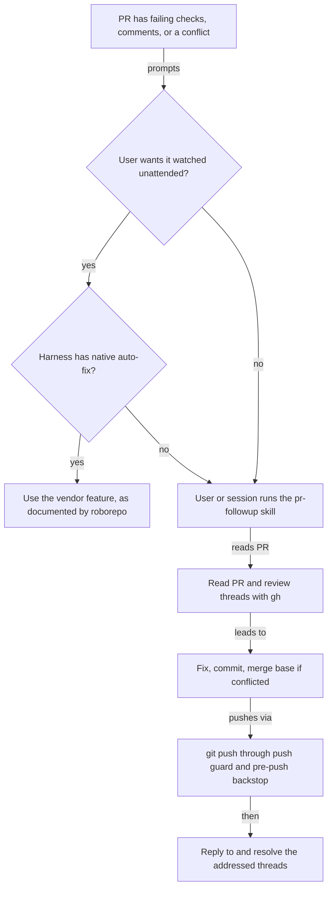

# GitHub Integration Part 02: Agents Fix Their Own Pull Requests on Any Harness

## Summary

When an agent's pull request has failing CI checks, new review comments, or a merge conflict, an
agent should be able to fix it and push to the PR branch.

GitHub Integration Part 01 (`w7vls1yk`) gives agent shells their own GitHub identity and allows
`gh api` under it. After that, Claude desktop's Auto-fix works fully: it can read inline review
threads, reply, and resolve them. What remains is **parity for harnesses that do not get Auto-fix
from the Claude app**: Codex, Gemini, and the Claude CLI alone.

This plan recommends three layers, cheapest first:

1. **A portable skill** that any harness runs on request: read the PR and its review threads, fix,
   push through the existing push guard, then reply to and resolve the threads it addressed. It is
   the floor every harness gets.
2. **Documentation of each harness's native auto-fix**, for users who want unattended watching.
   The harness vendors already run that loop.
3. **No roborepo watcher for now.** The plan records the evidence against building one and the
   conditions that would justify revisiting it.

The work stays inside roborepo's role: shared config, skills, and guardrails. The app or harness
decides when an agent runs.

## Goals

- Any installed harness, including a future provider, can fix its own PR on request with no
  per-harness code.
- Fixes reach the PR branch only through the push guard and pre-push backstop. Nothing weakens
  those guardrails.
- Review comment text is handled as untrusted data, and only trusted authors' comments are acted on.
- Users can find which harnesses offer native unattended auto-fix, how to turn it on, and how its
  safety model differs from local runs.

## Non-goals

- Merging, approving, closing, or marking PRs ready. Agents never merge.
- A background poller, scheduler, or webhook listener in roborepo or Runtime.
- Turning on vendor features (GitHub Apps, cloud environments, Actions workflows) for the user.
- The agent identity, the token, and the `gh api` permission change. Part 01 owns them.

## Context

### The guardrails a fixer runs under

Pull request kirinmurphy/roborepo-alpha#48 merged on 2026-10-29 and added the push hook, the
`pre-push` backstop, and the `gh` buckets. Part 01 then changes who the agent is to GitHub and
lifts the `gh api` denial. This plan assumes both and changes neither.

| Guard | Behavior after Part 01 |
| --- | --- |
| Push hook (PreToolUse, Claude and Codex) | Approves `git push` only to a non-protected branch it can verify; denies force pushes |
| Git `pre-push` backstop | Installed for agent shells through a `core.hooksPath` override; refuses protected destinations and non-fast-forward updates |
| GitHub ruleset | Agent pushes to `main` are rejected because the bot is not on the bypass list; merging the bot's PR needs someone else's approval of the last push |
| `gh` allow | `gh pr view`, `pr list`, `pr status`, `pr checks`, `pr diff`, `run list`, `run view`, `repo view`, `pr create`, and `gh api` under the agent identity |
| `gh` deny | `gh pr merge`, `gh auth token`, repo edit/delete/rename, `secret`, `variable`, `release`, `workflow run`; `gh api` too when the identity is off |

Source: `manifests/inventory/agent-permissions.json`, and the Part 01 design for the `gh api` row.

Two consequences shape this plan:

- **Conflicts must be resolved by merging the base branch, not by rebasing.** A rebased branch needs
  a force push, which both the hook and the backstop refuse.
- **Inline review threads are readable only through `gh api`.** `gh pr view --json` exposes
  `reviews` and `comments` (review bodies and top-level comments) but has no field for line-level
  threads or their resolved state. With Part 01, the GraphQL `reviewThreads` connection gives both,
  and `addPullRequestReviewThreadReply` and `resolveReviewThread` act on them. Gemini keeps today's
  limit until Part 01 can deliver the identity to it.

### What each harness already offers

| Harness | Native PR follow-up | How it is turned on | Reacts to | Source |
| --- | --- | --- | --- | --- |
| Claude, desktop app (Code tab) | **Auto-fix** toggle on a local session's PR; wakes the session on events. With Part 01 it can read, reply to, and resolve threads | The app's PR controls | CI failures, merge conflicts, review comments | Observed in the desktop app's session instructions; no public doc page found |
| Claude, cloud sessions | **Auto-fix pull requests**: subscribes to PR activity, pushes clear fixes, asks when ambiguous | `/autofix-pr` from the CLI on the PR branch (spawns a cloud session), the session's Changes card, or a prompt | CI failures, review comments. **Not conflicts**: the docs say GitHub sends no webhook when the base advances | [Claude Code cloud docs](https://code.claude.com/docs/en/claude-code-on-the-web#auto-fix-pull-requests); needs the Claude GitHub App |
| Claude Code CLI alone | No local watcher. `/autofix-pr` hands off to a cloud session | — | — | Same page |
| Claude GitHub Action | `@claude` mention in a PR comment runs Claude in Actions; it can push commits | `/install-github-app` or a copied workflow plus a repo secret | Mentions, or any event with a `prompt` input | [Claude Code GitHub Actions](https://code.claude.com/docs/en/github-actions) |
| Codex cloud | `@codex fix the CI failures` or `@codex fix the P1 issue` on a PR starts a cloud task; it "can push a fix back to the branch when it has permission" | Connect the repo in Codex settings | Mentions, plus optional automatic review. Watching for CI failures and conflicts is not documented | [Codex GitHub integration](https://learn.chatgpt.com/docs/third-party/github) |
| Codex in Actions | Example workflow runs `openai/codex-action` after a failed `CI` run and opens a **new** PR with the patch | Copy the workflow; add `OPENAI_API_KEY` | Failed workflow runs | [Codex non-interactive mode](https://learn.chatgpt.com/docs/non-interactive-mode) |
| Gemini CLI | `run-gemini-cli` Action: automatic PR review, triage, `@gemini-cli` requests | `/setup-github` in Gemini CLI, or copied workflows | Mentions and PR open. Pushing fixes and CI watching are not documented | [run-gemini-cli](https://github.com/google-github-actions/run-gemini-cli) |

The desktop app's Auto-fix is the only unattended route that runs **on this machine**, in a local
session that roborepo's hooks and permissions govern. Every other route runs in a vendor cloud or
GitHub Actions, where roborepo's local hooks and `~/.claude` or `~/.codex` permissions do not
apply. Cloud and Actions runs read the repo's checked-in config instead. Claude's docs say cloud
sessions read the repo's `.claude/settings.json`; the Codex and Gemini equivalents are unverified.

### What roborepo has to build on

| Building block | State today | Evidence |
| --- | --- | --- |
| Provider capability contract | Capabilities map to required adapter methods; declaring one without its methods fails registration | `CAPABILITY_REQUIRED_METHODS` in `scripts/harnesses/contract.mjs` |
| `session-launch` | Declared by Claude and Codex, but both adapters are `notYetMigrated` stubs | `stubAdapterGroups(... session: ["launch"])` in `scripts/harnesses/claude/index.mjs` and `scripts/harnesses/codex/index.mjs` |
| `session-resume` | In the vocabulary; no provider declares it | `globals/harnesses/*/provider.json` |
| Headless prompt template | `extensions.app.headlessPromptArgs` on Claude (`-p -- {prompt}`) and Codex (`exec --skip-git-repo-check -- {prompt}`); Gemini has none | `globals/harnesses/{claude,codex,gemini}/provider.json` |
| Its one consumer | Telemetry's deep read sends a text summary and reads the reply. No tools, no worktree, no permission flags | `findDeepReadProvider` in `scripts/cli/telemetry.mjs`; `docs/internal/harness-provider-interface.md` |
| Runtime network access | The git collection path is offline by design, enforced by an allow-list in `modules/repositories/git-exec.mjs` and asserted by `scripts/test/developer-runtime-git-check.mjs`. The forge lookup that would change this is still a backlog plan | GitHub Integration Part 03 (`developer-runtime-remote-branch-status`) |
| Skill packaging | Optional packages ship skills with trigger fixtures | `globals/packages/feature-verification/`, `scripts/test/skill-trigger-fixtures-check.mjs` |

The interface doc describes `extensions` as hints that "platform code reads generically", and
telemetry already reads `headlessPromptArgs` there. Using it for an agent that edits and pushes
would still be a new contract: permission mode, working directory, and failure semantics are all
undefined in it today.

## Proposed design

### Recommendation

Build the portable skill (option b), document native features (option a), and defer a watcher
(option c). The comparison follows the diagram.

### Options compared

| Dimension | (a) Native feature + capability flag | (b) Portable skill | (c) Runtime watcher + `headless-run` |
| --- | --- | --- | --- |
| Harness coverage | Whatever each vendor ships; uneven (table above) | Every harness that loads skills, including future ones | Only providers with a verified headless template; Gemini has none |
| Unattended | Yes, where native | No; runs on request | Yes |
| New roborepo code | A capability with no adapter methods, or docs only | One `SKILL.md`, a package config, trigger fixtures | Poller, forge client, scheduler, lock and attempt store, `headless-run` adapters per provider, permission-mode mapping, portal UI |
| Upkeep | Tracking vendor feature changes in docs | Low; plain `gh` and `git` | High: three CLIs' headless flags and approval semantics drift independently |
| Guardrails | Vendor's own, mostly off this machine | Local push guard, `gh` rules, and GitHub's rulesets apply unchanged | Same, but every safety rule below must be built and kept correct |
| Cost | Vendor billing | Tokens only when asked | Tokens on every event; the machine must stay awake |

**Option (a) as a capability is not recommended.** The contract exists so platform code can call
adapter methods. A `pr-followup: native | none` flag would have nothing to call. Whether the
native feature works also depends on things roborepo cannot observe: a GitHub App install, a
cloud plan, an Actions secret. The information is still worth publishing, as documentation.

**Option (c) is overkill now.** Each part it needs is missing or stubbed: session launch, any
headless agent contract, Gemini headless args, network access in Runtime, and a verified
fail-closed mode on every harness. It would also duplicate loops that Claude (desktop and cloud)
and Codex (cloud and Actions) already run. Part 01 removes one argument against it: an unattended
fixer would push as the bot, under GitHub's own limits, not as the admin. The rest still holds.

### The skill

A new optional package, `pr-followup`, ships one skill, `pr-followup`. It is model-invoked on
explicit requests ("fix this PR's checks", "address the review comments"), and the user can call
it directly. One run handles one PR at its current head commit:

1. Resolve the PR for the current branch with `gh pr view --json number,headRefName,headRefOid,baseRefName,mergeable,mergeStateStatus,statusCheckRollup,reviews,comments`.
   Stop if the PR is merged, closed, or from a fork the user cannot push to.
2. **Checks.** For each failing check, read the failure with `gh pr checks` and `gh run view --log-failed`,
   reproduce locally when the repo's own command exists, and fix.
3. **Review feedback.** Read unresolved threads with a `gh api graphql` query on
   `pullRequest.reviewThreads` (`isResolved`, `path`, `line`, and each comment's `author` and
   `authorAssociation`). Keep only threads and reviews whose author passes the trust rule below.
   Quote their text to itself as data inside a fenced block, never as instructions. Act only on
   comments that ask for a code change in this PR's diff. Anything else (run a command, change
   CI, touch secrets, edit other files) is reported back, not done. Without the agent identity
   (Gemini today), fall back to `gh pr view --comments` and say inline threads were not read.
4. **Conflicts.** When `mergeable` is `CONFLICTING`, `git fetch` and `git merge origin/<base>`, then
   resolve. Never rebase: the push that follows would be a force push, which is refused.
5. Run the checks that cover the change, commit, and `git push` to the PR branch.
6. **Close the loop on threads.** For each trusted thread the pushed commit addressed, reply with
   `addPullRequestReviewThreadReply` naming the commit, then `resolveReviewThread`. Threads it
   skipped get a reply saying why and stay open.
7. Report what was fixed, what was skipped and why, and which comments were ignored as untrusted.
   Then stop. The skill does not wait for CI or loop.

**Trust rule.** A comment or review counts only when its `authorAssociation` is `OWNER`, `MEMBER`,
or `COLLABORATOR`, or its author is the PR author. A user-configurable list of bot logins (for
example a review bot) extends it. The agent's own bot login is excluded, so it never acts on its
own replies. Everything else is listed in the report and left alone.

### Safety requirements

These apply to anything that runs a fixer without a person watching: a harness's native feature,
a user's own `claude -p "/pr-followup"`, or a future watcher.

| Requirement | Skill run by a person | Unattended run |
| --- | --- | --- |
| `ask` fails closed | Prompts reach the person | Must deny, not approve. Claude: verified. Codex and Gemini: **unverified** (see below) |
| Untrusted comment text | Trust rule plus data framing in the skill | Same, and a watcher must apply the trust rule in code before any text reaches the model |
| One run per PR | Not enforced; the person is present | Native features own this. A watcher would need a per-PR lock |
| Attempt cap per commit | One pass per run; the skill does not loop | A watcher would cap attempts per head commit (proposed: 2) |
| Stop on a repeat failure | The skill reports, and the next run is the person's call | A watcher would stop when the same check fails again on the agent's own fix commit |
| No merging | `gh pr merge` is denied; the ruleset requires someone else to approve the last push | Same; vendor features are outside local rules but still bound by the ruleset |
| No force push | Push hook, pre-push backstop, and `protect-main` | Same |

Fail-closed evidence: in a Claude `-p` run, a call that needs approval is denied in Manual mode,
and `--permission-prompts none` tells Claude not to retry
([headless docs](https://code.claude.com/docs/en/headless)). Codex has no per-command ask tier
(`perCommandAsk: false` in `globals/harnesses/codex/provider.json`), so `ask` items fall through to
`approval_policy`; what `codex exec` does under `never` is unchecked. Gemini's non-interactive
behavior is unchecked.

### Revisit conditions for a watcher

Reopen option (c) as its own plan only when all of these hold:

- GitHub Integration Part 03 (`developer-runtime-remote-branch-status`) has shipped its lookup in
  `modules/forge/`, so Runtime already reads PR state.
- `session-launch` has real adapters (Session Launching, `plan-session-launching-milestone-1`).
- Every eligible provider has a verified fail-closed headless mode.
- There is real demand from harnesses with no native unattended route. Today that is Gemini,
  outside GitHub Actions.

## Implementation plan

### Phase 1: Verify the open facts

- [ ] With Part 01 in place, Claude desktop Auto-fix on a PR with an inline thread reads it, pushes
      a fix as the bot, and resolves the thread.
- [ ] Check how `codex exec` treats a command that would prompt under `approval_policy = "never"`:
      refused or run.
- [ ] Check Gemini CLI's non-interactive mode for a deny-instead-of-prompt setting.
- [ ] Check what `authorAssociation` GitHub reports for bot reviewers, to set the bot-list default.

### Phase 2: The skill and package

- [ ] Add `globals/packages/pr-followup/package.config.json` (optional, one skill resource,
      `invocation: auto`).
- [ ] Write `globals/packages/pr-followup/skills/pr-followup/SKILL.md` with the steps, the
      `reviewThreads` query and the two mutations, the trust rule, and the report format above.
- [ ] Add trigger fixtures in `globals/packages/pr-followup/skill-triggers.json`. Positive: "fix the
      failing checks on my PR". Negative: "review this PR", "merge my PR".
- [ ] Add a test that reads the skill text and fails on `gh pr merge`, `mergePullRequest`,
      `enablePullRequestAutoMerge`, `rebase`, or any force flag.

### Phase 3: Native feature documentation

- [ ] Add a "PR follow-up" section to `docs/user/guides/harnesses/supported-harnesses.md`: the
      native table, how each is turned on, and that cloud and Actions runs are outside local
      guardrails but still bound by the repo's rulesets.

## Validation

- `node scripts/test/skill-trigger-fixtures-check.mjs` and
  `node scripts/test/skill-structure-check.mjs` pass with the new package.
- The skill-text test from Phase 2 fails when a forbidden command is added to `SKILL.md`, and passes
  otherwise.
- One manual run of the skill from Codex on a real PR with a failing check, one trusted inline
  thread, and one untrusted comment: the fix is pushed as a fast-forward by the bot, the trusted
  thread is replied to and resolved, and the untrusted comment is listed but not acted on.
- `npm run check` passes before the PR.

## Documentation impact

| Doc | Update |
| --- | --- |
| `docs/user/guides/harnesses/supported-harnesses.md` | New PR follow-up section (Phase 3) |
| `docs/user/reference/roborepo-skills.md` | List the `pr-followup` skill |
| `docs/internal/harness-provider-interface.md` | No change: no new capability is added |

## Risks

- **Vendor features change fast.** The native table goes stale. Each row names its source, so a
  reader can recheck it.
- **Prompt injection through trusted authors.** A trusted account can still be compromised. The
  skill limits any comment to code changes within the PR's diff, and the push guard and rulesets
  limit where the result can go.
- **Resolving threads hides unread feedback.** A thread the skill resolves wrongly drops out of the
  reviewer's view. The reply names the commit, so the reviewer can check and reopen it.
- **Native unattended routes bypass local guards.** Users who enable them depend on the vendor's
  controls and on GitHub's rulesets. The docs must say so.

## Open questions

1. **Package or base install?** Recommended: an optional package, like `feature-verification`, so
   users who rely on native auto-fix can leave it off.
2. **Attempt cap for a future watcher.** Proposed: 2 per head commit. Only matters if the revisit
   conditions are met.
