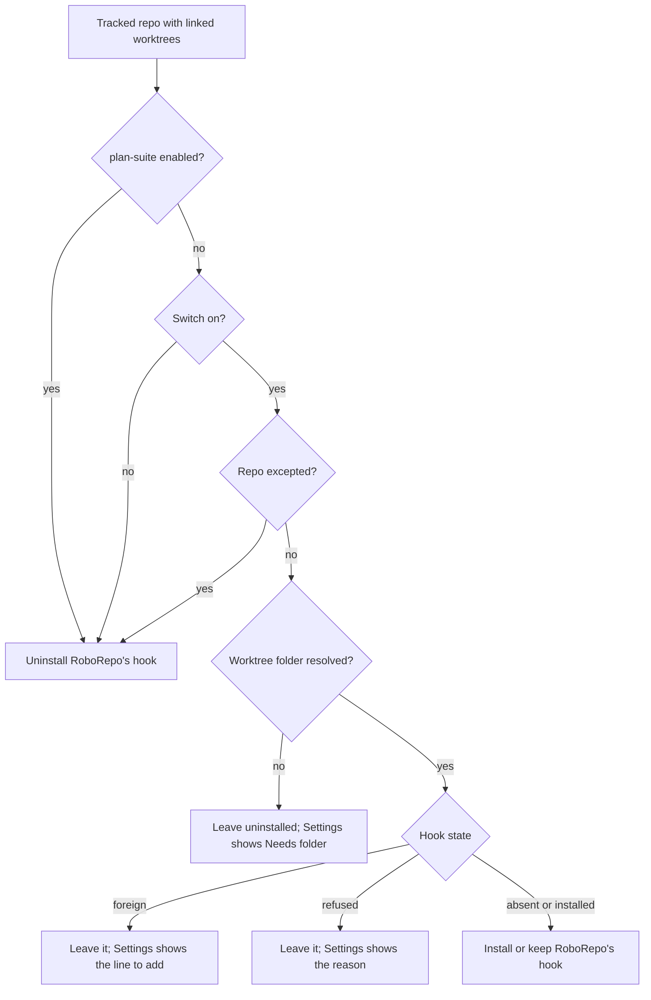

# Automatic Worktree Cleanup as a Reversible Setting

## Summary

Make automatic worktree cleanup one global switch on the Settings page that you can turn on and
off. When the switch is on, RoboRepo keeps its `post-merge` hook installed in every tracked repo
that has linked worktrees, except repos you list as exceptions. Adding a repo installs the hook and
removing one uninstalls it. The Repos-page banner becomes a temporary notice that you can bring
back from Settings. Enabling the plan lifecycle package removes every hook RoboRepo installed and
hides the setting, because `/plan-close` owns worktree removal there.

The plan lifecycle package is `plan-suite` once Bundle Skills That Only Work Together (bysyzl1e)
merges, and `plan-close` on `main` until then. This plan says `plan-suite` throughout.

## Context

### Terms

| Term | Meaning |
| --- | --- |
| Cleanup hook | The `post-merge` hook RoboRepo writes, marked `# roborepo-worktree-cleanup`. It runs `roborepo git worktrees cleanup --apply --current <checkout>` in the background after a merge or pull. |
| Foreign hook | A `post-merge` hook another tool wrote. RoboRepo never edits or removes it. |
| Worktree folder | The only folder automatic removal may act in: `worktreeRoot` from the repo's `docs/plans/plans-config.json`, or else the folder recorded for the repo. |
| Tracked repo | A repo registry record with `visibility: "visible"` and a known main checkout. Hiding, forgetting, or wiping a repo untracks it. |

### Current behavior

- Home shows **Automatic worktree cleanup is off for this repo** on a repo card when four things
  hold: `plan-close` is disabled, the repo has linked worktrees, the hook is absent or foreign, and
  the notice was never dismissed (`withCleanupOffer` in
  `scripts/cli/repository-overview-projections.mjs`).
- **Turn on automatic cleanup** opens a dialog that confirms the worktree folder, then
  `enableWorktreeCleanup` (`scripts/cli/worktree-cleanup-optin.mjs`) records `worktreeCleanup.root`
  in the registry and installs the hook for that repo alone.
- **Dismiss** writes `worktreeCleanup.noticeDismissedAt` for that repo. Nothing in the portal
  clears it.
- The Settings page (`portal/settings/`) has no cleanup control. Only
  `roborepo git worktrees hook uninstall` removes the hook.
- Enabling `plan-close` hides the banner but leaves installed hooks running. The hook then runs
  alongside `/plan-close`, waits for plans that name their worktree, and can remove a landed
  worktree whose plan does not name it (`docs/user/reference/repositories.md`, "A hook installed
  before the plan-close package is enabled keeps working").

## Goals

- One Settings switch turns automatic cleanup on or off for every tracked repo. Turning it off
  uninstalls every hook RoboRepo installed.
- Exceptions: a per-repo list of repos the switch skips.
- Hooks follow tracking. A repo that becomes tracked while the switch is on gets the hook, and a
  repo that is hidden, forgotten, or wiped loses it.
- The Repos-page banner is a temporary notice. Dismissing it hides it on every repo, and a Settings
  toggle shows it again.
- Enabling `plan-suite` uninstalls RoboRepo's hooks and hides the setting, from both the portal and
  `roborepo update`.

## Non-goals

- Editing or removing foreign hooks.
- Supporting a global `core.hooksPath` or a shared hooks folder.
- Changing what cleanup removes or the guards it applies (`roborepo git worktrees cleanup`).

## Proposed design

### State

| Fact | Where it lives | Scope |
| --- | --- | --- |
| Switch on or off | `<state root>/worktree-cleanup/settings.json`: `enabled` | Global |
| Notice dismissed | Same file: `noticeDismissedAt` | Global |
| Hooks RoboRepo installed (the ledger) | Same file: `installed`, `[{ repositoryId, hook }]` | Global |
| Repo is an exception | Registry record: `worktreeCleanup.excluded: true` | Per repo |
| Worktree folder | Registry record: `worktreeCleanup.root` (unchanged) | Per repo |

The settings file sits beside the existing `hook.log`. The ledger exists because a forgotten or
wiped repo has no registry record left to find its hook from.

The registry schema keeps accepting `noticeDismissedAt` so existing registries still load. On first
read, a legacy per-repo dismissal counts as the global dismissal, so a notice the user dismissed
does not come back.

### Desired hook state

A single reconciler, `reconcileWorktreeCleanup({ stateRoot })` in
`scripts/cli/worktree-cleanup-optin.mjs`, computes the desired state for each repo and applies the
difference. It never touches a foreign hook.

Every ledger entry whose repo is no longer in the desired set is uninstalled with
`manageWorktreeHook({ install: false })`, which removes only a hook carrying the marker.

The folder rule: `worktreeRoot` from plans config wins. Otherwise the recorded `root`. Otherwise
the reconciler records `proposedWorktreeFolder` (the deepest folder holding the repo's worktrees,
outside `.claude/worktrees/`), passed through the existing `confirmedFolder` checks. A repo with no
proposal is left uninstalled and shown as **Needs folder**.

### When the reconciler runs

| Trigger | Entry point |
| --- | --- |
| Switch, exception, or folder change in Settings | New portal routes call the reconciler before responding |
| **Turn on automatic cleanup** on the Repos page | Sets the switch, then reconciles |
| A repo added, hidden, restored, forgotten, or wiped; new worktrees | The Runtime refresh path, which already inspects each repo's hook in `scripts/cli/worktree-observations.mjs` |
| `plan-suite` enabled or disabled | End of `enablePackage` / `disablePackage` in `scripts/cli/packages.mjs`, when not a dry run |
| `roborepo update` | End of `reconcileEnabledPackages`. `scripts/install/main.sh` runs `package adopt-live` before `package reconcile`, so a package adopted live is reconciled in the same run. |

Disabling `plan-suite` with the switch still on reinstalls the hooks: the switch keeps its value
while hidden.

As a backstop, the hook's cleanup command exits without removing anything when the switch is off,
`plan-suite` is enabled, or the repo is excepted. That covers the window between a change and the
next reconcile.

### Settings page

A new **Worktree Cleanup** section, hidden while `plan-suite` is enabled.

| Row | Shows |
| --- | --- |
| Switch | **Automatic worktree cleanup** with Turn on / Turn off, following the Token Activity Tracking row's pattern |
| Notice toggle | **Show the cleanup notice on the Repos page**. Turning it on clears `noticeDismissedAt`. |
| Repo list (switch on) | One row per tracked repo with linked worktrees: name, state, folder with **Edit**, and an **Exception** toggle |

Repo row states:

| State | Meaning | Action |
| --- | --- | --- |
| Cleanup on | RoboRepo's hook is installed | Exception toggle, Edit folder |
| Exception | Switch skips this repo | Exception toggle |
| Needs folder | No folder could be resolved | Edit folder |
| Another tool's hook | Foreign `post-merge` hook, read-only | Shows the line to add to that hook; becomes **Cleanup on** once the line is present |
| Can't install | Installer refused (global `core.hooksPath`, CLI inside a worktree) | Shows the reason |

The folder is read-only, labelled **From plans config**, when plans config names it.

### Repos-page banner

`withCleanupOffer` offers the notice when `plan-suite` is disabled, the switch is off, the repo has
linked worktrees, and the global notice is not dismissed. **Turn on automatic cleanup** opens a
dialog listing the repos and folders the switch will cover, then turns the switch on. **Dismiss**
sets the global `noticeDismissedAt`, which hides the notice on every repo. A foreign hook no
longer changes the banner text; Settings carries that detail.

## Implementation checklist

- [ ] Add the `worktree-cleanup/settings.json` store (load, update, legacy-dismissal read) and the
      `excluded` key in `modules/repositories/schema.mjs` and `setWorktreeCleanup`.
- [ ] Write `reconcileWorktreeCleanup` with the ledger, folder rule, and foreign/refused handling.
      Replace `enableWorktreeCleanup` and `dismissWorktreeCleanupNotice` with switch, notice,
      exception, and folder setters.
- [ ] Call the reconciler from the Runtime refresh path, `enablePackage`, `disablePackage`, and
      `reconcileEnabledPackages`.
- [ ] Add the backstop check to the cleanup command's `--current` hook path.
- [ ] Add portal routes for the switch, notice, exception, and folder, and extend
      `worktreeCleanup` in `scripts/cli/worktree-observations.mjs` with the row state.
- [ ] Update `withCleanupOffer`, the banner, and the Turn-on dialog in `portal/home/`.
- [ ] Build the Settings section in `portal/settings/` (markup, templates, rendering).
- [ ] Update `roborepo git worktrees hook install|uninstall` help to say the Settings switch manages
      hooks for tracked repos.
- [ ] Update the docs listed under Documentation impact.

## Validation

- Reconciler tests in `scripts/test/worktree-lifecycle-check.mjs` against temporary repos:
  - switch on installs the hook in each tracked repo;
  - switch off and an exception each uninstall it;
  - a hidden or forgotten repo loses it through the ledger;
  - a foreign hook is left byte-for-byte unchanged;
  - `plan-suite` enabled uninstalls every RoboRepo hook.
- Package path tests: `enablePackage` of `plan-suite` and `reconcileEnabledPackages` (after
  `adoptLivePackages`) leave no hook carrying the marker.
- Projection tests in `scripts/test/repository-overview-check.mjs`: the banner is offered only when
  the switch is off, `plan-suite` is disabled, and the notice is not dismissed. A legacy per-repo
  dismissal suppresses it.
- Portal UI tests in `scripts/test/portal-ui/portal-ui.spec.mjs`:
  - banner shown, dismissed, and restored from Settings;
  - Settings switch on and off;
  - each repo row state;
  - the section hidden with `plan-suite` enabled.
- `npm run check` passes.

## Risks

- **No per-repo folder confirmation.** Today the Turn-on dialog confirms each repo's folder. With
  the switch, a repo without plans config gets the proposed folder automatically. The proposal
  excludes the home directory and its parents and `.claude/worktrees/`, and Settings shows each
  folder with **Edit**. Removal still requires a clean, unlocked, landed worktree.
- **Refresh cost.** The reconciler runs on each Runtime refresh. It must reuse the hook inspection
  `worktree-observations.mjs` already does and write only on change.
- **A hook fires between a change and the next reconcile.** The backstop check in the cleanup
  command covers this.

## Decision Log

- A repo that becomes tracked while the switch is on gets the hook automatically, with no prompt.
  Settings does not flag it as new first; add it to the exceptions afterward to remove the hook.
  Confirmed by the user.

## Alternatives considered

### A global Git hook

A truly global hook would mean setting `core.hooksPath` in global Git config. That disables every
repo's own `.git/hooks`, never fires in repos that set their own `core.hooksPath` (Husky and
similar tools), and runs in every repo on the machine. The installer refuses that setup today
(`hooksTarget` in `scripts/cli/worktree-hook.mjs`). Git 2.50 has no config-based hooks. So one
global switch drives a per-repo hook.

## Documentation impact

- `docs/user/reference/repositories.md`, "Worktree states and cleanup":
  - replace the Home opt-in paragraph with the Settings switch, exceptions, and the temporary notice;
  - replace "A hook installed before the plan-close package is enabled keeps working" with "enabling
    `plan-suite` removes RoboRepo's hook";
  - state that `hook install|uninstall` is for repos RoboRepo does not track; in a tracked repo the
    next reconcile restores the state the switch asks for.
- `docs/user/reference/plans-portal.md`, near the worktree cleanup paragraph: say that with
  `plan-suite` enabled, `/plan-close` is the only automatic removal.
- No user doc describes the Settings page today, so the Settings section is documented in
  `repositories.md` alone.
