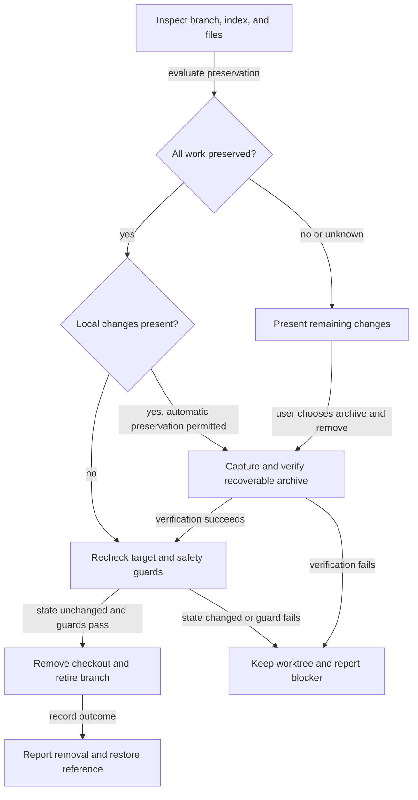

# Retire worktrees safely after merges and recover remaining work

## Summary

Automate retirement of merged worktrees even when review records, cherry-picked fixes, or other
local edits remain. Use one shared workflow for the CLI, repository page, and plan closure:
prove that all work is preserved on the base branch, or offer a verified recoverable archive
before removal. Describe archived changes separately from changes confirmed merged.

## Context

Closing provider cleanup ([[hr78g4sj]]) moved its plan to completed, but its linked worktree
remained dirty. Its only local edit was review and approval evidence whose exact document bytes
were already committed on main. Both automatic cleanup and the repository page's Delete action
refused it with `uncommitted or untracked changes`.

This is one example of a broader problem. A squash merge or cherry-pick preserves changes without
preserving feature-branch ancestry, and neither operation clears uncommitted worktree edits.
Additional local edits may already be preserved, may be unique, or may be impossible to classify.
Users should not have to reopen the old squashed branch's PR to retire its checkout.

| Existing owner | Current behavior |
| --- | --- |
| `modules/repositories/worktree-landed.mjs` | Verifies a historical base commit absorbs the committed branch tip; reuses verified absorbing-commit evidence |
| `modules/repositories/worktree-guards.mjs` | Rejects every tracked edit and untracked file; also guards valuable ignored files, submodules, locked/current/main checkouts, and running servers |
| `modules/repositories/worktree-removal.mjs` | Confirmed deletion archives the committed branch tip and logs removal; it does not capture local edits |
| `scripts/cli/worktree-cleanup.mjs` | Coordinates CLI cleanup and repository-page deletion through shared guards and removal code |
| `modules/plan-suite/copy-integration.mjs` | Recognizes plan bytes already present in base history, including lifecycle moves; this proof applies only to the plan document |
| `globals/packages/plan-suite/skills/plan-review/references/resume-review.md` | Post-merge recovery currently commits matching plan evidence in worktree and primary copies |

Repository state was inspected at the frontmatter commit. The earlier worktree example is
historical evidence, not a requirement that the checkout still exist during implementation.

## Goals

- Automatically remove a merged worktree only after proving all committed and local work is preserved.
- Offer Archive and remove for unique or uncertain work, with a verified restore path.
- Apply identical safety decisions to CLI, repository-page actions, and plan-close cleanup.
- Preserve approval and landing requirements independently of archive success.
- Keep post-merge recovery evidence durable without requiring a new PR on the squashed branch.

## Scope boundaries

The existing cleanup-setting plan ([[b2sgiejd]]) owns switches, hook installation, and repository
exceptions. It explicitly excludes removal guards; this plan owns those guards and preservation.
The completed provider cleanup is a motivating case, not an implementation dependency.

This work does not merge branches, grant approval, publish archives, or automatically submit
remaining code. Follow-up implementation starts from current base with only selected remaining
changes. Archive retention and restore are local repository operations.

## Proposed design

### One assessment and execution workflow

Keep preservation, snapshot, and removal behavior under `modules/repositories/`, where both CLI
and portal consumers can reuse it. Extend the existing cleanup orchestration rather than adding
shell recipes or separate skill-specific deletion logic. Presentation stays with each consumer.

| Assessment | Automatic cleanup | Explicit user action |
| --- | --- | --- |
| Committed and local work proven preserved on base | Remove through existing guards | Show evidence and result |
| Unique changes or preservation uncertain | Keep; summarize remaining work | Offer Archive and remove |
| Unsafe or incomplete capture; invalid target | Keep with specific reason | Resolve the named blocker |
| Archive verified but removal failed | Keep archive and report partial result | Retry without losing recovery reference |

### Preservation proof

Assess committed branch content separately from staged edits, unstaged edits, untracked files,
and valuable ignored files. Preserve the existing content-level landing proof for committed work,
including squash and cherry-pick cases, historical absorbing commits, and later base changes.

A dirty worktree may be removed automatically only with a coherent proof that its remaining work
is already represented in committed base history. Support ordinary code and documentation, file
additions/deletions, executable modes, and renames; do not specialize the rule to plan filenames.
A matching blob somewhere in history alone cannot establish preservation of an arbitrary change:
path, deletion, mode, and change context matter. Untracked copies require proof as well.

During promotion, select the exact conservative proof algorithm and its bounded-history limits.
Unsupported shapes, conflicts, missing history, or exceeded bounds return unknown and offer the
archive path. Never infer preservation from a merged badge, a clean primary checkout, ancestry
alone, or individual familiar-looking files. The plan-document lifecycle mapping may reuse the
existing integration proof, without extending its assumptions to arbitrary code changes.

### Recoverable archive and restore

Extend the existing branch archive/removal ledger with a durable snapshot and manifest. Capture
branch tip and identity, staged state, unstaged state, file modes, deletions, and untracked regular
files; preserve recoverable symlink entries without following them outside the checkout. Preserve
valuable ignored content or refuse with the exact paths and reason. Reuse the current explicit
disposable-directory policy instead of silently broadening ignored-file exclusions.

Every dirty removal creates this verified snapshot, including automatic cleanup whose preservation
proof succeeded. Proven-preserved work needs no additional archive consent; unique or uncertain
work still requires the explicit Archive and remove choice.

The archive must be reachable independently of the branch slated for deletion. Verify captured
content and recovery metadata before any destructive step. Restore must recreate the captured
state, including distinct staged and unstaged versions, in a fresh destination without overwriting
an existing checkout. Return a stable local recovery reference and an executable restore command.
Treat retained content as data; restoration must not execute archived hooks or scripts.

Keep snapshots until explicit deletion; no automatic expiry in this scope. Do not claim recovery
from an archive that omitted required files. Unsupported special files, nested repositories,
submodules, unreadable data, or capture failures leave the checkout intact with an actionable
reason. Snapshot failure cannot fall through to forced removal.

### Mutation safety and retries

Use the repository-scoped cleanup lock and recheck worktree identity, branch tip, index, captured
files, ignored-file coverage, and base evidence immediately before removal. Detect changes made
during assessment or capture and keep the checkout. Preserve current main/current-checkout,
locked-worktree, submodule, and server guards. Stop only target worktree servers after the action
is otherwise eligible, following current explicit deletion behavior.

Do not edit the user's index to create the archive. If removing a captured dirty checkout needs a
force option, permit it only inside the verified snapshot transaction after final checks; never
expose a general bypass for failed preservation guards. Document the remaining concurrency window
and require quiescent target writers before destructive removal.

Record snapshot-created, checkout-removed, and branch-retired outcomes separately. A crash or
branch-deletion failure must leave a discoverable recovery reference. Retries recognize completed
steps and never overwrite a previous archive with newer state under the same identity.

### CLI, repository page, and plan lifecycle

Expose shared assessment, explicit archive-and-remove, archive listing, and restore through the
existing `roborepo git worktrees` family. Final command names and JSON shape are chosen during
promotion and recorded in the command definitions. Dry-run/preview performs no capture or deletion.

The repository page shows concrete remaining paths and separates committed landing status from
local preservation status. Replace a dead-end dirty-worktree error with Archive and remove when
capture is supported. Confirmation states what will be preserved, excluded, and removed. Successful
results expose restore instructions; failures retain the row and report the precise failed step.

Plan-close calls the shared automatic path only after durable closure and existing approval and
landing checks pass. Unique work produces a cleanup handoff, not silent archiving or a false
merged claim. A closed plan remains closed when cleanup is kept or fails. An archive never satisfies
an implementation-completion, human-approval, or landing gate.

Expose a read-only pre-merge readiness assessment that combines fresh review/approval evidence
with clean-worktree checks. Plan-review calls it after recording approval and reports actionable
failures; a passing result identifies the assessed tip and does not authorize merging. External
PR merge protection is separate from this local workflow.

Before merge, plan-review commits review and approval records and reports pending worktree edits.
For post-merge recovery, add an explicit verified-landed authority rule allowing evidence-only
Result/Approval updates on primary, without dirtying or committing the old worktree. Update the
canonical approval reader and authority consumers together: recovery must still identify the exact
reviewed branch implementation, reject conflicting records, and preserve explicit human approval.
Missing/detached worktree behavior remains conservative unless this plan explicitly proves a safe
replacement. No automatic synchronization into the old squashed branch is needed for retirement.

## Implementation plan

- [ ] Reconcile existing cleanup, plan authority, review recovery, archive refs, UI actions, and tests; settle proof and command contracts during promotion.
- [ ] Add regression fixtures for squash/cherry-pick landing with redundant or unique tracked, staged, unstaged, renamed, deleted, and untracked changes.
- [ ] Implement the shared preservation assessment with conservative unknown results and bounded historical evidence.
- [ ] Implement verified local snapshots, durable outcome records, archive discovery, and restore into a fresh destination.
- [ ] Add mutation, capture failure, interrupted removal, retry, ignored-content, symlink, and unsupported-file guards.
- [ ] Integrate assessment and explicit archive-and-remove into CLI and repository-page actions; preserve all existing removal guards.
- [ ] Integrate automatic safe cleanup and unique-work handoff into plan-close, including already-closed retries.
- [ ] Add shared pre-merge readiness assessment; implement evidence-only post-merge authority and update approval readers plus review/close guidance together.
- [ ] Update docs of record, package-owned skill sources, and generated commands through their normal generators.
- [ ] Run focused behavior checks, health checks, and the full local parity gate required by package workflow/generated-output changes.

## Validation

| Scenario | Required outcome |
| --- | --- |
| Squash/cherry-pick, redundant edits to any supported tracked file | Safe cleanup without another PR or committing in the old branch |
| Plan moved from review to completed; old local evidence already on main | Preservation recognized across the lifecycle rename |
| Unique or unknown committed/local work | Automatic cleanup keeps it; archive action remains explicit |
| Distinct staged/unstaged versions plus untracked files | Archive restores bytes, modes, paths, and index separation |
| Deleted/renamed files or later base changes | Proof accounts for change context; uncertainty never becomes automatic removal |
| Valuable ignored content or unsupported file | Capture and restore fully, or keep with an exact blocker |
| Concurrent file/index/tip change | Keep checkout; no stale snapshot authorizes deletion |
| Archive failure, removal failure, crash, retry | No data loss; recovery references remain discoverable; completed steps are not repeated |
| Main/current/locked/submodule checkout or surviving server | Existing guard remains effective |
| Archive without approved and landed implementation | No plan closure or merged claim |
| Pre-merge readiness | Dirty worktree or stale/missing approval produces actionable failure at the assessed tip |
| Post-merge approval recovery | Exact implementation and human answer recorded durably; no synthetic dirty copy in old worktree |
| CLI and repository-page equivalent requests | Same assessment and safety result; visible restore action after archival |

Extend `scripts/test/worktree-lifecycle-check.mjs`,
`scripts/test/plan-close-integration-check.mjs`, `scripts/test/plan-suite-commands-check.mjs`,
`scripts/test/repository-overview-check.mjs`, and the existing repository-page browser coverage.
Test real disposable repositories and filesystem round trips rather than only mocked Git calls.
Verify refusal paths leave branch, index, and files intact. Add narrow suites beside existing
owners only when coverage needs a distinct responsibility.

During implementation, run the affected suites first, then `bash scripts/doctor.sh --quiet`,
`git diff --check`, generated command/skill checks, and `npm run check` before handoff. This plan's
creation is prose-only: use the plan validator and documentation reference checks, not the full suite.

## Documentation impact

- `docs/user/reference/repositories.md`: preservation states, archive confirmation, cleanup outcomes, and restore actions.
- `docs/user/reference/roborepo-cli.md`: assessment, archive, listing, and restore commands with failure/retry semantics.
- `docs/user/reference/plans-portal.md`: closed-plan cleanup handoff and post-merge authority behavior.
- `docs/user/guides/plan/lifecycle/plan-suite.md`: normal approve/commit/merge/close sequence and recovery route.
- `docs/internal/cli-internals.md`: shared assessment, snapshot transaction, recovery records, and callers.
- `docs/internal/plans-portal-internals.md`: evidence authority, exact-commit approval, and cleanup integration.
- `globals/packages/plan-suite/skills/plan-close/` and `globals/packages/plan-suite/skills/plan-review/`: canonical workflow instructions and references; regenerate command outputs normally.

## Risks and open decisions

| Issue | Promotion must resolve |
| --- | --- |
| General preservation proof can be costly or ambiguous | Choose conservative coherent comparison and bounded scan; retain unknown as a first-class result |
| Snapshot format must preserve index separation and ignored data | Select format and restore verification strategy before implementing removal |
| Writers can race final verification | Define quiescence and race detection; refuse when stability cannot be established |
| Primary-only recovery changes current authority rules | Define the landed evidence exception and update every affected reader consistently |
| Local archive availability depends on repository storage | State retention/recovery boundaries clearly; archive is not an off-machine backup |

## Decision Log

- High priority requested after a closed, merged worktree could not be deleted because redundant
  local review evidence remained. The solution covers arbitrary supported changes, rather than
  a plan-document-only exception.
- Automatic cleanup requires preservation proof. Unique or uncertain changes require explicit
  archive-and-remove consent, and archiving never implies that those changes landed.
- Implementation belongs in shared code; plan skills and the repository page call that workflow.
  This document creates backlog work only and does not authorize implementation or retirement
  of any particular worktree.
