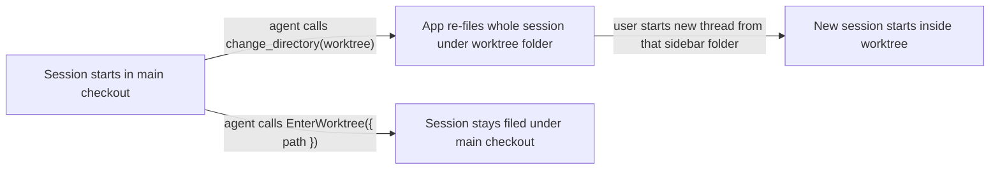

# Keep local agent work within useful boundaries: Claude

## Summary

Claude desktop files each session in its sidebar under the session's project folder. When an agent
enters a linked worktree with the app's `change_directory` tool, the app moves the whole session
under the worktree folder, including the turns that ran in the main checkout. A new thread started
from that sidebar folder then begins inside the worktree. Entering the same worktree with Claude's
`EnterWorktree` tool keeps the session filed under the repository.

This plan adds a core `PreToolUse` hook that refuses `change_directory` into a linked worktree of the
session's own repository and tells the agent to call `EnterWorktree` instead. The hook is the whole
mechanism: its refusal reason reaches the agent as the tool result, so no rule fragment is added.

It also moves three harness-specific details out of platform code and behind provider data, as
`docs/internal/harness-provider-interface.md` requires: Claude's hook sources in the system tree,
the hardcoded `.claude/worktrees` folder, and Runtime's hardcoded agent process names.

The companion plan, Keep local agent work within useful boundaries: Codex (`4zyo2woj`), owns the
Codex sandbox, approval, and credential-read work and the Codex-side leaks.

## Context

### Terms

| Term | Meaning |
| --- | --- |
| Main checkout | The first entry of `git worktree list`; its `.git` is a directory |
| Linked worktree | Any other checkout of the same repository; its `.git` is a file pointing at `<main>/.git/worktrees/<name>` |
| Common git dir | The `.git` directory of the main checkout. A main checkout and all its linked worktrees share one |
| Project folder | The folder Claude desktop files a session under in its sidebar |
| Platform / provider | The layers defined in `docs/internal/harness-provider-interface.md`: platform code owns behavior; provider code (`scripts/harnesses/<id>/`, `globals/harnesses/<id>/`) is the only place a harness's native names may appear |

### How a session ends up filed under a worktree

`globals/packages/plan-execute/skills/plan-execute/SKILL.md` ("Enter the Worktree") tells the agent to
make the worktree the session's working directory by "the environment's standard mechanism". In the
desktop app an agent may pick either tool.

### Evidence

Observed between October 7 and October 15, 2026, in Claude transcripts and the telemetry spool:

| Session | Started in | Entered worktree with | Filed under |
| --- | --- | --- | --- |
| Portal UI tweaks and styling | main checkout | `change_directory` | worktree `portal-repository-scope` |
| Harness hook readiness provider adapters | worktree `portal-repository-scope`, started from its sidebar folder | `EnterWorktree` | worktree `portal-repository-scope` |
| Harness hook readiness provider adapters (fork) | main checkout | `EnterWorktree` with `path` | main checkout |
| Localhost runtime layout | main checkout | `change_directory` | transcript stored under worktree `.claude/worktrees/localhost-runtime-layout-*`; sidebar placement not checked |

- The telemetry capture hook (`globals/packages/telemetry/hooks-claude.json`, matcher `""`) recorded
  `PreToolUse` and `PostToolUse` events for `mcp__ccd_directory__change_directory`. So `PreToolUse`
  hooks run for the desktop app's own MCP tools. Whether the app honors a `deny` decision for them
  is not yet observed.
- `EnterWorktree` with a `path` into a `~/.worktrees/<repo>/...` worktree succeeded, including from
  a session that had started inside another linked worktree of the same repository.
- Hook configuration loads at session start. A hook added to settings mid-session does not run in
  that session, so the live check needs a fresh session.

### Provider leaks in platform code

Each row is a place where platform code names a harness directly instead of reading it from the
provider's manifest (`globals/harnesses/<id>/provider.json`):

| Leak | Location | What is hardcoded | Provider data that already exists |
| --- | --- | --- | --- |
| Claude hook sources | `globals/system/hooks/claude/` (`write-guard.mjs`, `minimize-bash-output.mjs`) | Claude-only hook scripts live in the system tree, while Claude's `repo-write-scope.mjs` lives in `globals/harnesses/claude/hooks/`, so core Claude hooks have two source homes | `manifests/platform/manifest.tsv` rows map each source folder to its install destination (`hooks` and `hooks/provider`) |
| Agent worktree folders | `scripts/cli/worktree-policy.mjs` `isToolOwned` | The path segment `/.claude/worktrees/`, where Claude's `EnterWorktree` creates worktrees. Cleanup uses it to keep app-owned worktrees from widening the proposed cleanup folder | None yet |
| Agent process names | `modules/developer-runtime/provenance.mjs` `AGENT_PATTERNS` | The `claude` and `codex` process names. Runtime walks a dev server's parent processes to label which agent launched it; Gemini is absent, so a server Gemini launched gets no label | Every manifest declares `detection.executables` and `displayName` |

`docs/internal/harness-provider-interface.md` shows the manifest extension key as `roborepo`. The
manifests and their readers use `app`.

### Related plans

| Plan | Relationship |
| --- | --- |
| `4zyo2woj` (`backlog/harness-codex-sandbox-boundaries-and-provider-leaks.md`) | The Codex series owns its companion work. Part 1 (`hr78g4sj`) moves Codex sources to `globals/harnesses/codex/hooks/`; Part 2 owns credential protection. Part 1 may declare a Codex worktree folder once this plan adds `agentWorktreeDirs` |
| `wjlt1zvf` (`review/harness-hook-readiness-provider-adapters.md`) | Changes Codex hook merge order and `hook-composition-check.mjs`. No shared files with this plan; its own leak table is not repeated here |
| `7k3m9qd` (`backlog/package-resource-provider-delivery.md`) | Owns the per-harness branches in `scripts/cli/packages.mjs` |
| `harness-capability-derived-resource-targeting` | Changes how `hooks` resources name their harnesses; no shared files |
| `backlog/telemetry-repository-attribution-and-reset.md` | Owns telemetry repository aliases and canonical labels, the telemetry half of the sidebar report |

## Goals

- An agent in a Claude desktop session cannot enter a linked worktree of its own repository with
  `change_directory`, and is told to use `EnterWorktree({ path })`.
- The hook needs no companion rule, skill text, or user setting.
- The three leaks above are resolved by reading provider data, so a new provider gets correct
  behavior by declaring it.

## Non-goals

- A rule fragment or plan-execute wording for the hook. The deny reason teaches the agent on the
  first refused call, while a rule would cost context in every Claude session.
  `globals/system/rules/claude/90-claude-specific.md` already tells agents to treat a hook block as
  a redirect.
- Re-filing existing sidebar sessions. No tool changes a session's project folder after it starts.
- Codex or Gemini equivalents of the hook. Neither has a tool that re-files a session.
- A user-configurable worktree-entry behavior. Re-filing a session under a worktree is never wanted,
  so this is core wiring rather than a package or an `agent-permissions.json` bucket.
- Moving `globals/system/rules/<id>/`. The provider interface doc names it as the per-provider rules
  location, and changing that is a separate decision.
- Codex hook sources, the Codex hooks-file branch, and the headless deep-read CLI list. The Codex
  plan owns them.

## Proposed design

### Worktree-entry hook

`globals/harnesses/claude/hooks/worktree-entry.mjs`, wired in
`globals/harnesses/claude/hooks-claude.json` with matcher `mcp__ccd_directory__change_directory`.
It installs to `~/.claude/hooks/provider/` through the existing `manifest.tsv` row.

| Condition | Result |
| --- | --- |
| `tool_input.path` is a linked worktree, and its common git dir equals the common git dir of the checkout containing `cwd` | `deny`, with a reason naming `EnterWorktree({ path: "<target>" })` and saying why |
| Target is a main checkout, a non-git folder, or another repository's worktree | No output; the call proceeds |
| Input fails to parse, a path does not resolve, or a `.git` file is unreadable | No output; the call proceeds |

Rules it follows, matching `globals/harnesses/claude/hooks/repo-write-scope.mjs`:

- Resolve the common git dir by reading `.git` (directory, or a file whose `gitdir:` leads to a
  `commondir` entry) in-process. Do not spawn `git`.
- Defer on any uncertainty. A hook that cannot decide must not refuse a legitimate move.
- Keep the refusal reason self-contained. Claude returns it to the agent as the tool result, and it
  is the only instruction the agent receives.

### Leak fixes

| Leak | Change |
| --- | --- |
| Claude hook sources | Move `globals/system/hooks/claude/*` under `globals/harnesses/claude/hooks/` and repoint its `manifest.tsv` row. Keep every install destination and command string unchanged (see Open questions). The moved files still install to `~/.claude/hooks/`, so they need a source folder that the `hooks/provider` row does not also copy |
| Agent worktree folders | Add `extensions.app.agentWorktreeDirs` to the manifest schema: path segments under which a provider's app creates worktrees, matched anywhere in a worktree path as `isToolOwned` does today. Claude declares `.claude/worktrees`. `isToolOwned` matches any registered provider's entries. Matching anywhere, rather than relative to the repository, also covers a worktree observed at `~/.codex/worktrees/<name>/roborepo`, likely created by the Codex app (the Codex plan confirms it) |
| Agent process names | Build agent patterns from each provider's `detection.executables` and `displayName`. Keep Cursor as a separate non-provider entry, since it is not a registered harness |

## Implementation plan

### Phase 1: confirm the deny path

- [ ] In a fresh Claude desktop session, install a temporary hook in a gitignored
      `.claude/settings.local.json` that logs input and denies
      `mcp__ccd_directory__change_directory`. Call `change_directory` with the session's own folder
      as the target, so a missed deny moves nothing. Record whether the call was refused and whether
      the agent saw the reason. Restore the settings file.
- [ ] If Claude ignores the deny, stop Phase 2 and revise the mechanism. Phase 3 does not depend on
      this result.

### Phase 2: worktree-entry hook

- [ ] Add `scripts/test/worktree-entry-hook-check.mjs` running the hook as a subprocess against temp
      repositories. Cases: linked worktree of the same repository is denied with the
      `EnterWorktree` reason; main checkout, non-git folder, and another repository's worktree pass;
      malformed stdin and an unreadable `.git` file pass. Register it in
      `scripts/test/check-groups.json`.
- [ ] Write `globals/harnesses/claude/hooks/worktree-entry.mjs`.
- [ ] Add the `PreToolUse` entry to both `globals/harnesses/claude/hooks-claude.json` and
      `generated/claude/settings.json`; the renderer preserves core entries but does not produce
      them. Add the entry to `scripts/test/core-hook-wiring-check.mjs`'s expectations.
- [ ] Confirm the clean-machine permissions sandbox installs the script under
      `~/.claude/hooks/provider/`.

### Phase 3: provider leaks

- [ ] Claude hook sources: move the files and repoint `manifest.tsv`, plus the source paths in
      `scripts/test/core-hook-wiring-check.mjs` and `scripts/test/test-install-collisions.sh`. Run
      `bash scripts/doctor.sh --quiet` and the clean-machine sandbox to prove install destinations
      and command strings are unchanged.
- [ ] Agent worktree folders: add `agentWorktreeDirs` to the manifest schema and the Claude
      manifest. Extend `scripts/test/worktree-lifecycle-check.mjs` with a synthetic provider's
      folder.
- [ ] Agent process names: no provenance test exists today. Add one that fails while a process named
      `gemini` resolves to no label and passes once it resolves to Gemini's `displayName`, then
      derive the patterns from manifests.
- [ ] Extend `scripts/test/delivery-synthetic-provider-check.mjs` or
      `scripts/test/telemetry-synthetic-provider-check.mjs` where the worktree-folder and
      process-name changes touch their paths, so the `acme` provider proves the new fields
      generalize.

## Validation

- `node scripts/test/worktree-entry-hook-check.mjs` passes every case in Phase 2.
- In a live Claude desktop session started in the main checkout, `change_directory` into a linked
  worktree is refused with the `EnterWorktree` reason. The agent then calls `EnterWorktree`, and
  `list_sessions` still reports the main checkout as the session's `cwd`.
- `node scripts/test/core-hook-wiring-check.mjs` and `node scripts/test/worktree-lifecycle-check.mjs`
  pass, and the new provenance test passes.
- `scripts/cli/worktree-policy.mjs` no longer contains `/.claude/worktrees/`, and
  `modules/developer-runtime/provenance.mjs` no longer lists `claude` or `codex` patterns. Claude
  hook sources are covered by `doctor.sh` and the sandbox.
- `bash scripts/doctor.sh --quiet` and `git diff --check` pass. `npm run check` passes before push,
  because this work changes install mapping and core hook wiring.

## Documentation impact

| Doc | Update |
| --- | --- |
| `docs/user/reference/claude-hooks.md` | Add a `PreToolUse` row for the worktree-entry hook, installed always |
| `docs/internal/hooks-internals.md` | Point the Claude system hook location at `globals/harnesses/claude/hooks/`; describe the worktree-entry protocol |
| `docs/internal/harness-anatomy.md`, `docs/internal/skill-reference-observation.md` | Update the Claude system hook source paths |
| `docs/internal/harness-provider-interface.md` | Correct the extension key to `app`; document `agentWorktreeDirs` and the use of `detection.executables` for process labels |
| `globals/packages/plan-execute/skills/plan-execute/SKILL.md` | None. Its tool-neutral "Enter the Worktree" wording stays; the hook steers Claude |

## Risks

| Risk | Mitigation |
| --- | --- |
| The app ignores `deny` for its own tools | Phase 1 tests this before any hook code is written |
| A legitimate move into a worktree is refused | The hook refuses only same-repository linked worktrees, where `EnterWorktree` is accepted. Its reason names that call with the exact path |
| Moving Claude hook sources orphans old install copies | Keep destinations unchanged, so no installed path moves |

## Decision Log

- October 21: expanded the plan to own both Claude worktree-entry behavior and Codex
  localhost/approval friction.
- October 22: split by provider at the user's request. This plan keeps its ID and the Claude work:
  the worktree-entry hook, Claude hook sources, agent worktree folders, and agent process names. The
  Codex work, including the hooks-file branch, Codex hook sources, and the headless deep-read CLI
  list, moved to `4zyo2woj`, which also absorbed the Codex credential-read guard. The process-name
  leak is provider-neutral and stays here because this plan has no research gate.

## Open questions

- **Claude hook source layout.** Recommended: move sources only, keeping `~/.claude/hooks/` and
  `~/.claude/hooks/provider/` as they are. The alternative installs every Claude hook under one
  folder, which changes command strings in `generated/claude/settings.json` and leaves stale files in
  existing homes.
