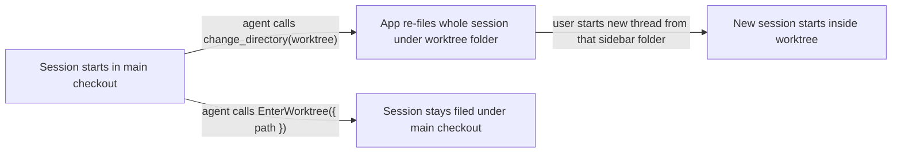

# Keep local agent work within useful permission boundaries

## Summary

Make routine local development work without repeated approvals while preserving repository write
boundaries and restrictions on external access. This combines two provider-specific problems:
Claude desktop worktree entry changes where a session is filed, and localhost test servers failed
under the current Codex session policy. The enforcing layer still needs to be identified. The mechanisms differ; shared policy intent
belongs in the permissions model and native implementation belongs in provider adapters.

Claude desktop files each session in its sidebar under the session's project folder. When an agent
enters a linked worktree with the app's `change_directory` tool, the app moves the whole session
under the worktree folder, including the turns that ran in the main checkout. A new thread started
from that sidebar folder then begins inside the worktree. Entering the same worktree with
Claude's `EnterWorktree` tool keeps the session filed under the repository.

For Claude, this plan proposes a core `PreToolUse` hook that refuses `change_directory` into a linked
worktree of the session's own repository and tells the agent to call `EnterWorktree` instead. The hook is the
whole mechanism: its refusal reason reaches the agent as the tool result, so no rule fragment is
added.

For Codex, first verify whether the supported runtime can allow loopback servers and browser-test
connections independently of external networking. Implement that narrow policy when supported;
otherwise evaluate an isolated test environment and bring back the remaining tradeoff. Do not
silently enable unrestricted networking or suppress all approvals.

The same investigation found harness-specific code in platform modules. This plan moves five of
those leaks behind provider manifests or adapters, as `docs/internal/harness-provider-interface.md`
requires.

## Context

### Terms

| Term | Meaning |
| --- | --- |
| Main checkout | The first entry of `git worktree list`; its `.git` is a directory |
| Linked worktree | Any other checkout of the same repository; its `.git` is a file pointing at `<main>/.git/worktrees/<name>` |
| Common git dir | The `.git` directory of the main checkout. A main checkout and all its linked worktrees share one |
| Project folder | The folder Claude desktop files a session under in its sidebar |
| Platform / provider | The layers defined in `docs/internal/harness-provider-interface.md`: platform code owns behavior; provider code (`scripts/harnesses/<id>/`, `globals/harnesses/<id>/`) is the only place a harness's native names may appear |

### How a session ends up filed under a worktree

`globals/packages/plan-execute/skills/plan-execute/SKILL.md` ("Enter the Worktree") tells the agent to
make the worktree the session's working directory by "the environment's standard mechanism". In the
desktop app an agent may pick either tool.

### Evidence

Observed between October 7 and October 15, 2026, in Claude transcripts and the telemetry spool:

| Session | Started in | Entered worktree with | Filed under |
| --- | --- | --- | --- |
| Portal UI tweaks and styling | main checkout | `change_directory` | worktree `portal-repository-scope` |
| Harness hook readiness provider adapters | worktree `portal-repository-scope`, started from its sidebar folder | `EnterWorktree` | worktree `portal-repository-scope` |
| Harness hook readiness provider adapters (fork) | main checkout | `EnterWorktree` with `path` | main checkout |
| Localhost runtime layout | main checkout | `change_directory` | transcript stored under worktree `.claude/worktrees/localhost-runtime-layout-*`; sidebar placement not checked |

- The telemetry capture hook (`globals/packages/telemetry/hooks-claude.json`, matcher `""`) recorded
  `PreToolUse` and `PostToolUse` events for `mcp__ccd_directory__change_directory`. So `PreToolUse`
  hooks run for the desktop app's own MCP tools. Whether the app honors a `deny` decision for them
  is not yet observed.
- `EnterWorktree` with a `path` into a `~/.worktrees/<repo>/...` worktree succeeded, including from
  a session that had started inside another linked worktree of the same repository.
- Hook configuration loads at session start. A hook added to settings mid-session does not run in
  that session, so the live check needs a fresh session.

### Codex localhost and repeated approvals

Repository evidence checked against the recorded commit:

| Source | Current behavior |
| --- | --- |
| `manifests/inventory/agent-permissions.json` | `go-online` defaults to `deny`; named test/build commands, including `npm run check`, are allowed |
| `scripts/harnesses/permissions-render.mjs` | `renderCodexWorkspaceProfile` extends `:workspace` and renders a single `network.enabled` boolean from `go-online`; no separate loopback setting is rendered |
| `generated/codex/config.toml` | The tracked `managed-workspace` profile has `network.enabled = false` and `approval_policy = "on-request"` |
| `scripts/test/portal-ui/run.mjs` | Starts a hermetic portal server on `127.0.0.1` and a browser that connects to it |

During the October 21 hook-banner work, the browser-suite server failed inside the Codex desktop
session sandbox with `listen EPERM: operation not permitted 127.0.0.1`. Running the suite with
sandbox escalation succeeded, but repeated requests for local tests, portal inspection, and
restarts interrupted the user. This establishes a failure under that session’s policy; it does not
establish every supported Codex runtime’s network capabilities or which finer native setting exists.

Command approvals, native sandbox enforcement, desktop tool policy, and conversational permission
requests are separate layers. An allowed command can still fail to bind a local port. A trusted
PreToolUse hook cannot be assumed to grant a permission withheld by the native sandbox. Identify
which layer emitted each request before changing policy.

Desired development policy:

| Operation | Intended boundary |
| --- | --- |
| Ordinary source reads and reversible edits | Current repository and its authorized associated worktree |
| Test scratch files | Explicit temporary fixture roots; no expansion to arbitrary home directories |
| Named local tests/builds and restarting this worktree’s portal | Proceed within the authorized task without repeated human prompts |
| Loopback servers and browser connections | Allow narrowly enough to run the local app and tests; define listening addresses and connection destinations separately |
| External networking and web searches | Remain restricted; loopback access must not enable either implicitly |
| Pushes, destructive operations, and branch/worktree moves | Preserve explicit authorization requirements |
| Credential/environment-file reads and unrelated file writes | Preserve restrictions; do not claim the current Codex profile already enforces every secret-read boundary |

Native support for a loopback-only policy, inherited desktop/organization policy, and persistent
narrow approvals remains unverified. Use synthetic fixtures and controlled endpoints for evaluation;
never inspect real credential or environment files to test a restriction.

### Provider leaks in platform code

Scoped to hooks, worktrees, and session or process identity:

| # | Location | Leak | Provider data that already exists |
| --- | --- | --- | --- |
| 1 | `scripts/cli/hook-composition.mjs` `writeHooksFile`, `hookFilePath` | Branch on `harness === "codex"` to choose a sidecar hooks file over the root config | Every manifest declares `extensions.app.hooksStorage` (`embedded-in-root-config` or `dedicated-json-sidecar`). `hooksStorageOf()` in `scripts/cli/config.mjs` already reads it |
| 2 | `globals/system/hooks/claude/`, `globals/system/hooks/codex/` | Provider-specific hook scripts live in the system tree. Claude's `repo-write-scope.mjs` already lives in `globals/harnesses/claude/hooks/`, so core Claude hooks have two source homes | `manifests/platform/manifest.tsv` rows map each source dir to its install destination |
| 3 | `scripts/cli/worktree-policy.mjs` `isToolOwned` | Hardcodes `/.claude/worktrees/`, the folder where Claude's `EnterWorktree` creates worktrees | None yet |
| 4 | `modules/developer-runtime/provenance.mjs` `AGENT_PATTERNS` | Hardcodes `claude` and `codex` process names. Gemini is absent, so Runtime cannot label a listener Gemini launched | Every manifest declares `detection.executables` and `displayName` |
| 5 | `scripts/cli/telemetry.mjs` `findDeepReadCli`, `runDeepRead` | Loops over `["claude", "codex", "gemini"]` and runs each as `<cli> -p <prompt>`. The Codex CLI's `-p` is believed to select a config profile rather than print, so a Codex-only machine would get no deep read. Unverified | Manifests declare `commandName` |

`docs/internal/harness-provider-interface.md` shows the manifest extension key as `roborepo`. The
manifests and their readers use `app`.

### Related plans

| Plan | Relationship |
| --- | --- |
| `wjlt1zvf` (`review/harness-hook-readiness-provider-adapters.md`) | Changes `hook-composition-check.mjs` and Codex hook merge order. Leak 1 edits the same module, so it lands after that plan merges. That plan's own leak table (`desktop-runtime.mjs`, `mcp-claude-cli.mjs`, `generated/codex/hooks.json`) is not repeated here |
| `7k3m9qd` (`backlog/package-resource-provider-delivery.md`) | Owns the per-harness branches in `scripts/cli/packages.mjs` |
| `harness-capability-derived-resource-targeting` | Changes how `hooks` resources name their harnesses; no shared files with this plan |
| `permva27` (global permissions audit) | Owns the broad inventory and retain/simplify/defer-to-native decision. This plan owns the concrete localhost/approval remediation and supplies its evidence; coordinate any shared-model change with the audit |
| `permissions-ui-revamp` | Owns broader permission-editor redesign; expose only the selected, verified local-development capability here and leave editor redesign there |
| `4zyo2woj` (Codex credential read guard) | Owns secret-read enforcement. Network isolation is not a substitute; this plan must not weaken its intended boundary or claim it already exists |
| `backlog/telemetry-repository-attribution-and-reset.md` | Owns telemetry repository aliases and canonical labels, the telemetry half of the sidebar report |

## Goals

- Routine authorized local tests and app restarts no longer require repeated permission requests
  under the selected supported Codex environment, with proof of the remaining boundaries.
- Distinguish command permission, sandbox networking, filesystem scope, and tool approval so
  unsupported controls are reported honestly rather than widened silently.
- An agent in a Claude desktop session cannot enter a linked worktree of its own repository with
  `change_directory`, and is told to use `EnterWorktree({ path })`.
- The hook needs no companion rule, skill text, or user setting.
- The five leaks above are resolved by reading provider data, so a new provider gets correct
  behavior by declaring it.

## Non-goals

- Unrestricted network/full-disk access, blanket interpreter allowlists, or disabling all approvals.
- Implementing the separate global permissions-editor redesign or credential-read guard.
- A rule fragment or plan-execute wording for the hook. The deny reason teaches the agent on the first
  refused call, while a rule would cost context in every Claude session.
  `globals/system/rules/claude/90-claude-specific.md` already tells agents to treat a hook block as
  a redirect.
- Re-filing existing sidebar sessions. No tool changes a session's project folder after it starts.
- Codex or Gemini equivalents of the hook. Neither has a tool that re-files a session.
- A user-configurable Claude worktree-entry behavior. Re-filing a session under a worktree is never wanted, so
  this is core wiring rather than a package or an `agent-permissions.json` bucket.
- Moving `globals/system/rules/<id>/`. The provider interface doc names it as the per-provider rules
  location, and changing that is a separate decision.

## Proposed design

### Worktree-entry hook

`globals/harnesses/claude/hooks/worktree-entry.mjs`, wired in
`globals/harnesses/claude/hooks-claude.json` with matcher `mcp__ccd_directory__change_directory`.
It installs to `~/.claude/hooks/provider/` through the existing `manifest.tsv` row.

| Condition | Result |
| --- | --- |
| `tool_input.path` is a linked worktree, and its common git dir equals the common git dir of the checkout containing `cwd` | `deny`, with a reason naming `EnterWorktree({ path: "<target>" })` and saying why |
| Target is a main checkout, a non-git folder, or another repository's worktree | No output; the call proceeds |
| Input fails to parse, a path does not resolve, or a `.git` file is unreadable | No output; the call proceeds |

Rules it follows, matching `globals/harnesses/claude/hooks/repo-write-scope.mjs`:

- Resolve the common git dir by reading `.git` (directory, or a file whose `gitdir:` leads to a
  `commondir` entry) in-process. Do not spawn `git`.
- Defer on any uncertainty. A hook that cannot decide must not refuse a legitimate move.
- Keep the refusal reason self-contained. Claude returns it to the agent as the tool result, and it is
  the only instruction the agent receives.

### Codex local-development permission profile

Keep portable policy intent in `manifests/inventory/agent-permissions.json`. Choose its precise
shape only after native support is demonstrated and the global permissions audit’s ownership is
reconciled. Native configuration fields, version checks, and unsupported outcomes belong in the
Codex provider; callers use a provider capability rather than testing a harness name. Reuse the
existing permissions render/apply path and preserve unrelated user configuration. If extracting
Codex-specific rendering from `scripts/harnesses/permissions-render.mjs` is necessary, put it under
`scripts/harnesses/codex/` and keep shared orchestration generic.

| Capability result | Next action |
| --- | --- |
| Native loopback-only binding and connections work with external access denied | Render and verify the narrow native profile; scope routine approvals to the authorized workflow |
| Native network policy cannot express the required boundary | Evaluate a disposable environment with app and browser inside it, explicit repo/temp mounts, and enforced external egress restrictions; Docker alone is not proof of isolation |
| Desktop or organization policy prevents either approach | Report the controlling policy and supported limitation; obtain a concrete environment decision before implementation can be considered complete |

A loopback exception also reaches other local services and proxies. Evaluate that exposure and
possible external forwarding; do not describe “localhost only” as equivalent to “no data can leave.”
Separate successful server binding from client connections, and verify IPv4/IPv6 loopback,
wildcard listening, non-loopback destinations, and DNS behavior for the chosen mechanism.

For recurring local work, identify whether a scoped persistent approval is actually needed after
fixing the sandbox boundary. Do not allow arbitrary `node`, Python, or all npm scripts. Record
whether a permission is native-enforced, command-scoped, or merely an agent instruction. The agent
should execute already-authorized routine work directly and explain a genuine platform-imposed
approval boundary once rather than repeatedly requesting the same declined escalation.

### Leak fixes

| # | Change |
| --- | --- |
| 1 | `writeHooksFile` and `hookFilePath` branch on `hooksStorage`, and a sidecar provider's file comes from `resolveHarnessPath(manifest, "hooks")` instead of the `codexHooksPath` import. Move `hooksStorageOf` from `config.mjs` to `scripts/harnesses/paths.mjs`, next to `resolveHarnessPath`, and import it in both modules |
| 2 | Move `globals/system/hooks/claude/*` and `globals/system/hooks/codex/*` under `globals/harnesses/<id>/hooks/`, and repoint their `manifest.tsv` rows. Recommended: keep every install destination and command string unchanged (see Open questions) |
| 3 | Add `extensions.app.agentWorktreeDirs` (repository-relative folders) to manifests; Claude declares `.claude/worktrees`. `isToolOwned` matches any registered provider's entries |
| 4 | Build agent patterns from each provider's `detection.executables` and `displayName`. Keep Cursor as a separate non-provider entry, since it is not a registered harness |
| 5 | Add `extensions.app.headlessPromptArgs` to manifests, holding the argv that runs one prompt non-interactively. `findDeepReadCli` iterates providers that declare it, in registry order |

## Implementation plan

### Phase 1: characterize native boundaries

- [ ] In a fresh Claude desktop session, install a temporary hook in a gitignored
      `.claude/settings.local.json` that logs input and denies
      `mcp__ccd_directory__change_directory`. Call `change_directory` with the session's own folder
      as the target, so a missed deny moves nothing. Record whether the call was refused and whether
      the agent saw the reason. Restore the settings file.
- [ ] If Claude ignores the deny, stop the Claude hook implementation and revise its mechanism;
      the Codex investigation can proceed independently.
- [ ] Record supported Codex desktop/CLI versions and the effective permission sources, including
      inherited policy. Identify which layer controls localhost binding, local HTTP/browser access,
      process restarts, command approvals, and external network access. Use installed help/schema
      and local probes; external research requires explicit user authorization.
- [ ] Reproduce the localhost bind failure in a minimal temporary fixture before changing policy;
      then probe native loopback-only support and persistent narrow approval behavior. Record exact
      settings, commands, results, and supported/unsupported outcomes rather than inferring support
      from accepted TOML or allowlisted command prefixes.
- [ ] Select the smallest enforceable environment that meets the policy matrix. If a container or
      broader access is the only candidate, present its mounts, networking, residual exposure, and
      approval requirements for the user’s decision; leave unmet guarantees unresolved.

### Phase 2: worktree-entry hook

- [ ] Add `scripts/test/worktree-entry-hook-check.mjs` running the hook as a subprocess against temp
      repositories. Cases: linked worktree of the same repository is denied with the
      `EnterWorktree` reason; main checkout, non-git folder, and another repository's worktree pass;
      malformed stdin and an unreadable `.git` file pass. Register it in
      `scripts/test/check-groups.json`.
- [ ] Write `globals/harnesses/claude/hooks/worktree-entry.mjs`.
- [ ] Add the `PreToolUse` entry to both `globals/harnesses/claude/hooks-claude.json` and
      `generated/claude/settings.json`; the renderer preserves core entries but does not produce
      them. Add the entry to `scripts/test/core-hook-wiring-check.mjs`'s expectations.
- [ ] Confirm the clean-machine permissions sandbox installs the script under
      `~/.claude/hooks/provider/`.

### Phase 3: provider leaks

- [ ] Leak 1, after `wjlt1zvf` merges: extend `scripts/test/hook-composition-check.mjs` with a
      synthetic sidecar provider, then switch the branches to `hooksStorage`.
- [ ] Leak 2: move the hook sources and repoint `manifest.tsv`. Run `bash scripts/doctor.sh --quiet`
      and the clean-machine sandbox to prove install destinations are unchanged.
- [ ] Leak 3: add `agentWorktreeDirs` to the manifest schema and the Claude manifest. Extend
      `scripts/test/worktree-lifecycle-check.mjs` with a synthetic provider's folder.
- [ ] Leak 4: add a failing test that a process named `gemini` resolves to Gemini's `displayName`,
      then derive the patterns from manifests.
- [ ] Leak 5: check the Codex CLI's non-interactive syntax against its own help output. Add a
      failing test that a provider without `headlessPromptArgs` is skipped and a synthetic provider
      with it is used, then add the field to each manifest and switch `findDeepReadCli`.
- [ ] Extend `scripts/test/telemetry-synthetic-provider-check.mjs` or
      `delivery-synthetic-provider-check.mjs` where leaks 3 to 5 touch their paths, so the `acme`
      provider proves the new fields generalize.

### Phase 4: Codex local-development workflow

- [ ] Add regression coverage for the selected mechanism before implementing it. Extend
      `scripts/test/permissions-render-live-characterization-check.mjs` for projection/preservation
      and `scripts/test/clean-machine-permissions-sandbox.mjs` for installed machine shape; use a
      separate provider-native fixture for actual runtime network enforcement.
- [ ] Implement the verified provider policy through the existing render/apply path, or the
      explicitly selected isolated test environment. Report unsupported versions/policies without
      enabling external networking as a fallback.
- [ ] Prove routine tests, localhost inspection, and restart of this worktree’s own portal work in
      fresh desktop and CLI sessions without repeated prompts. Verify process ownership before
      stopping anything and leave unrelated local services untouched.
- [ ] Exercise policy persistence across fresh sessions and RoboRepo update/reapply, and confirm
      read-only mode and unrelated user config still behave as intended. Test the native boundary
      with controlled fixtures, not real secrets or unapproved external destinations.
- [ ] Add a synthetic-provider check if the shared capability contract changes: providers without
      loopback support report it explicitly and never inherit a Codex-specific config field.

## Validation

- In fresh supported Codex desktop and CLI sessions, run `npm run test:portal-ui -- --grep 'hook readiness warning'` within the selected boundary; localhost binding and browser connections
  succeed without per-run escalation. Inspect and restart only the owned worktree portal twice to
  prove that an already-authorized workflow does not prompt repeatedly.
- Controlled probes show external egress remains blocked and unauthorized filesystem writes remain
  blocked, while approved repo/worktree/temp operations succeed. Verify wildcard/non-loopback
  listening and localhost-to-external forwarding against the documented boundary. Use synthetic
  credential fixtures where needed; comprehensive secret-read enforcement remains with `4zyo2woj`.
- Capture prompt source, version, effective policy, and evidence for every environment. A container
  pass does not establish host-native parity, and rendered config or fake binaries do not establish
  runtime enforcement. Unsupported environments remain explicitly unresolved until a selected
  solution satisfies the required workflow and boundaries.
- `node scripts/test/permissions-render-live-characterization-check.mjs` passes. Run the existing
  clean-machine permissions sandbox through its registered package script and retain the native
  runtime probe evidence separately.
- `node scripts/test/worktree-entry-hook-check.mjs` passes every case in Phase 2.
- In a live Claude desktop session started in the main checkout, `change_directory` into a linked
  worktree is refused with the `EnterWorktree` reason. The agent then calls `EnterWorktree`, and
  `list_sessions` still reports the main checkout as the session's `cwd`.
- `node scripts/test/core-hook-wiring-check.mjs` and `node scripts/test/hook-composition-check.mjs`
  pass.
- Check the named leak sites for remaining native branches: `harness === "codex"` and
  `codexHooksPath` in `scripts/cli/hook-composition.mjs`; `/.claude/worktrees/` in
  `scripts/cli/worktree-policy.mjs`; the fixed CLI list in `findDeepReadCli` in
  `scripts/cli/telemetry.mjs`. These sites use provider data after implementation. Unrelated
  fallback code elsewhere is outside this check. Leak 2 is covered by `doctor.sh` and the sandbox;
  leak 4 by its provenance test.
- `bash scripts/doctor.sh --quiet` and `git diff --check` pass. `npm run check` passes before push,
  because this work changes install mapping and permission profiles.

## Documentation impact

| Doc | Update |
| --- | --- |
| `docs/user/reference/claude-hooks.md` | Add a `PreToolUse` row for the worktree-entry hook, installed always |
| `docs/internal/hooks-internals.md` | Point Claude and Codex system hook locations at `globals/harnesses/<id>/hooks/`; describe the worktree-entry protocol |
| `docs/user/reference/config-control-panel.md` | Explain local-server versus external-network access, supported provider coverage, and which approvals remain necessary |
| `docs/internal/docker-test-sandboxes.md` | Document the chosen isolated environment and verified egress/mount boundary if that alternative is selected |
| `docs/internal/harness-provider-interface.md` | Document the selected native permission capability and unsupported states; correct the extension key to `app`; document `agentWorktreeDirs` and `headlessPromptArgs` |
| `globals/packages/plan-execute/skills/plan-execute/SKILL.md` | None. Its tool-neutral "Enter the Worktree" wording stays; the hook steers Claude |

## Risks

| Risk | Mitigation |
| --- | --- |
| Loopback allowance exposes unrelated services or forwarding proxies | Probe exposure and constrain the selected environment; report residual risk before enabling it |
| Native or managed policy cannot express the desired boundary | Keep a capability gate and an explicit user decision; never silently broaden access |
| Permission changes conflict with the global audit or secret-read guard | Keep ownership boundaries in Related plans and verify security claims independently |
| The app ignores `deny` for its own tools | Phase 1 tests this before any hook code is written |
| A legitimate move into a worktree is refused | The hook refuses only same-repository linked worktrees, where `EnterWorktree` is accepted. Its reason names that call with the exact path |
| Leak 2 orphans old install copies | Keep destinations unchanged, so no installed path moves |
| Leak 1 conflicts with `wjlt1zvf` | Sequenced after that plan merges |

## Decision Log

- October 21: expanded this existing backlog plan at the user’s request to own both Claude
  worktree-entry behavior and Codex localhost/approval friction. Preserve the existing plan ID,
  filename, provider-leak tasks, and backlog lifecycle. Native loopback support remains a research
  gate; no live permission settings were changed by this revision.

## Open questions

- **Codex mechanism:** does the supported desktop/CLI runtime enforce loopback-only access
  independently of external networking, and can inherited policy override it? Determine this in
  Phase 1 before selecting native configuration or an isolated environment.
- **Approval persistence:** after fixing network isolation, which routine local operations still
  require native approval, and can that approval be scoped without granting broad interpreter or
  unrelated-process access?
- **Leak 2 install destinations.** Recommended: move sources only, keeping `~/.claude/hooks/` and
  `~/.claude/hooks/provider/` as they are. The alternative installs every Claude hook under one
  folder, which changes command strings in `generated/claude/settings.json` and leaves stale files in
  existing homes.
- **Codex desktop worktree folder.** If the Codex app creates worktrees in a fixed folder, Codex
  should declare `agentWorktreeDirs` too. Not yet observed.
