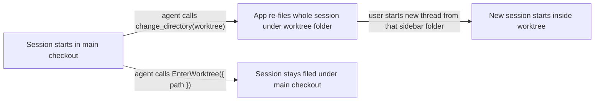

# Keep Claude sessions filed under their repository and move harness specifics into providers

## Summary

Claude desktop files each session in its sidebar under the session's project folder. When an agent
enters a linked worktree with the app's `change_directory` tool, the app moves the whole session
under the worktree folder, including the turns that ran in the main checkout. A new thread started
from that sidebar folder then begins inside the worktree. Entering the same worktree with
Claude's `EnterWorktree` tool keeps the session filed under the repository.

This plan adds a core Claude `PreToolUse` hook that refuses `change_directory` into a linked worktree
of the session's own repository and tells the agent to call `EnterWorktree` instead. The hook is the
whole mechanism: its refusal reason reaches the agent as the tool result, so no rule fragment is
added.

The same investigation found harness-specific code in platform modules. This plan moves five of
those leaks behind provider manifests or adapters, as `docs/internal/harness-provider-interface.md`
requires.

## Context

### Terms

| Term | Meaning |
| --- | --- |
| Main checkout | The first entry of `git worktree list`; its `.git` is a directory |
| Linked worktree | Any other checkout of the same repository; its `.git` is a file pointing at `<main>/.git/worktrees/<name>` |
| Common git dir | The `.git` directory of the main checkout. A main checkout and all its linked worktrees share one |
| Project folder | The folder Claude desktop files a session under in its sidebar |
| Platform / provider | The layers defined in `docs/internal/harness-provider-interface.md`: platform code owns behavior; provider code (`scripts/harnesses/<id>/`, `globals/harnesses/<id>/`) is the only place a harness's native names may appear |

### How a session ends up filed under a worktree

`globals/packages/plan-start/skills/plan-start/SKILL.md` ("Enter the Worktree") tells the agent to
make the worktree the session's working directory by "the environment's standard mechanism". In the
desktop app an agent may pick either tool.

### Evidence

Observed between October 7 and October 15, 2026, in Claude transcripts and the telemetry spool:

| Session | Started in | Entered worktree with | Filed under |
| --- | --- | --- | --- |
| Portal UI tweaks and styling | main checkout | `change_directory` | worktree `portal-repository-scope` |
| Harness hook readiness provider adapters | worktree `portal-repository-scope`, started from its sidebar folder | `EnterWorktree` | worktree `portal-repository-scope` |
| Harness hook readiness provider adapters (fork) | main checkout | `EnterWorktree` with `path` | main checkout |
| Localhost runtime layout | main checkout | `change_directory` | transcript stored under worktree `.claude/worktrees/localhost-runtime-layout-*`; sidebar placement not checked |

- The telemetry capture hook (`globals/packages/telemetry/hooks-claude.json`, matcher `""`) recorded
  `PreToolUse` and `PostToolUse` events for `mcp__ccd_directory__change_directory`. So `PreToolUse`
  hooks run for the desktop app's own MCP tools. Whether the app honors a `deny` decision for them
  is not yet observed.
- `EnterWorktree` with a `path` into a `~/.worktrees/<repo>/...` worktree succeeded, including from
  a session that had started inside another linked worktree of the same repository.
- Hook configuration loads at session start. A hook added to settings mid-session does not run in
  that session, so the live check needs a fresh session.

### Provider leaks in platform code

Scoped to hooks, worktrees, and session or process identity:

| # | Location | Leak | Provider data that already exists |
| --- | --- | --- | --- |
| 1 | `scripts/cli/hook-composition.mjs` `writeHooksFile`, `hookFilePath` | Branch on `harness === "codex"` to choose a sidecar hooks file over the root config | Every manifest declares `extensions.app.hooksStorage` (`embedded-in-root-config` or `dedicated-json-sidecar`). `hooksStorageOf()` in `scripts/cli/config.mjs` already reads it |
| 2 | `globals/system/hooks/claude/`, `globals/system/hooks/codex/` | Provider-specific hook scripts live in the system tree. Claude's `repo-write-scope.mjs` already lives in `globals/harnesses/claude/hooks/`, so core Claude hooks have two source homes | `manifests/platform/manifest.tsv` rows map each source dir to its install destination |
| 3 | `scripts/cli/worktree-policy.mjs` `isToolOwned` | Hardcodes `/.claude/worktrees/`, the folder where Claude's `EnterWorktree` creates worktrees | None yet |
| 4 | `modules/developer-runtime/provenance.mjs` `AGENT_PATTERNS` | Hardcodes `claude` and `codex` process names. Gemini is absent, so Runtime cannot label a listener Gemini launched | Every manifest declares `detection.executables` and `displayName` |
| 5 | `scripts/cli/telemetry.mjs` `findDeepReadCli`, `runDeepRead` | Loops over `["claude", "codex", "gemini"]` and runs each as `<cli> -p <prompt>`. The Codex CLI's `-p` is believed to select a config profile rather than print, so a Codex-only machine would get no deep read. Unverified | Manifests declare `commandName` |

`docs/internal/harness-provider-interface.md` shows the manifest extension key as `roborepo`. The
manifests and their readers use `app`.

### Related plans

| Plan | Relationship |
| --- | --- |
| `wjlt1zvf` (`active/harness-hook-readiness-provider-adapters.md`) | Changes `hook-composition-check.mjs` and Codex hook merge order. Leak 1 edits the same module, so it lands after that plan merges. That plan's own leak table (`desktop-runtime.mjs`, `mcp-claude-cli.mjs`, `generated/codex/hooks.json`) is not repeated here |
| `7k3m9qd` (`backlog/package-resource-provider-delivery.md`) | Owns the per-harness branches in `scripts/cli/packages.mjs` |
| `harness-capability-derived-resource-targeting` | Changes how `hooks` resources name their harnesses; no shared files with this plan |
| `backlog/telemetry-repository-attribution-and-reset.md` | Owns telemetry repository aliases and canonical labels, the telemetry half of the sidebar report |

## Goals

- An agent in a Claude desktop session cannot enter a linked worktree of its own repository with
  `change_directory`, and is told to use `EnterWorktree({ path })`.
- The hook needs no companion rule, skill text, or user setting.
- The five leaks above are resolved by reading provider data, so a new provider gets correct
  behavior by declaring it.

## Non-goals

- A rule fragment or plan-start wording for the hook. The deny reason teaches the agent on the first
  refused call, while a rule would cost context in every Claude session.
  `globals/system/rules/claude/90-claude-specific.md` already tells agents to treat a hook block as
  a redirect.
- Re-filing existing sidebar sessions. No tool changes a session's project folder after it starts.
- Codex or Gemini equivalents of the hook. Neither has a tool that re-files a session.
- A user-configurable permission behavior. Re-filing a session under a worktree is never wanted, so
  this is core wiring rather than a package or an `agent-permissions.json` bucket.
- Moving `globals/system/rules/<id>/`. The provider interface doc names it as the per-provider rules
  location, and changing that is a separate decision.

## Proposed design

### Worktree-entry hook

`globals/harnesses/claude/hooks/worktree-entry.mjs`, wired in
`globals/harnesses/claude/hooks-claude.json` with matcher `mcp__ccd_directory__change_directory`.
It installs to `~/.claude/hooks/provider/` through the existing `manifest.tsv` row.

| Condition | Result |
| --- | --- |
| `tool_input.path` is a linked worktree, and its common git dir equals the common git dir of the checkout containing `cwd` | `deny`, with a reason naming `EnterWorktree({ path: "<target>" })` and saying why |
| Target is a main checkout, a non-git folder, or another repository's worktree | No output; the call proceeds |
| Input fails to parse, a path does not resolve, or a `.git` file is unreadable | No output; the call proceeds |

Rules it follows, matching `globals/harnesses/claude/hooks/repo-write-scope.mjs`:

- Resolve the common git dir by reading `.git` (directory, or a file whose `gitdir:` leads to a
  `commondir` entry) in-process. Do not spawn `git`.
- Defer on any uncertainty. A hook that cannot decide must not refuse a legitimate move.
- Keep the refusal reason self-contained. Claude returns it to the agent as the tool result, and it is
  the only instruction the agent receives.

### Leak fixes

| # | Change |
| --- | --- |
| 1 | `writeHooksFile` and `hookFilePath` branch on `hooksStorage`, and a sidecar provider's file comes from `resolveHarnessPath(manifest, "hooks")` instead of the `codexHooksPath` import. Move `hooksStorageOf` from `config.mjs` to `scripts/harnesses/paths.mjs`, next to `resolveHarnessPath`, and import it in both modules |
| 2 | Move `globals/system/hooks/claude/*` and `globals/system/hooks/codex/*` under `globals/harnesses/<id>/hooks/`, and repoint their `manifest.tsv` rows. Recommended: keep every install destination and command string unchanged (see Open questions) |
| 3 | Add `extensions.app.agentWorktreeDirs` (repository-relative folders) to manifests; Claude declares `.claude/worktrees`. `isToolOwned` matches any registered provider's entries |
| 4 | Build agent patterns from each provider's `detection.executables` and `displayName`. Keep Cursor as a separate non-provider entry, since it is not a registered harness |
| 5 | Add `extensions.app.headlessPromptArgs` to manifests, holding the argv that runs one prompt non-interactively. `findDeepReadCli` iterates providers that declare it, in registry order |

## Implementation plan

### Phase 1: confirm the deny path

- [ ] In a fresh Claude desktop session, install a temporary hook in a gitignored
      `.claude/settings.local.json` that logs input and denies
      `mcp__ccd_directory__change_directory`. Call `change_directory` with the session's own folder
      as the target, so a missed deny moves nothing. Record whether the call was refused and whether
      the agent saw the reason. Restore the settings file.
- [ ] If the app ignores the deny, stop and revise this plan. A rule fragment becomes the only lever.

### Phase 2: worktree-entry hook

- [ ] Add `scripts/test/worktree-entry-hook-check.mjs` running the hook as a subprocess against temp
      repositories. Cases: linked worktree of the same repository is denied with the
      `EnterWorktree` reason; main checkout, non-git folder, and another repository's worktree pass;
      malformed stdin and an unreadable `.git` file pass. Register it in
      `scripts/test/check-groups.json`.
- [ ] Write `globals/harnesses/claude/hooks/worktree-entry.mjs`.
- [ ] Add the `PreToolUse` entry to both `globals/harnesses/claude/hooks-claude.json` and
      `generated/claude/settings.json`; the renderer preserves core entries but does not produce
      them. Add the entry to `scripts/test/core-hook-wiring-check.mjs`'s expectations.
- [ ] Confirm the clean-machine permissions sandbox installs the script under
      `~/.claude/hooks/provider/`.

### Phase 3: provider leaks

- [ ] Leak 1, after `wjlt1zvf` merges: extend `scripts/test/hook-composition-check.mjs` with a
      synthetic sidecar provider, then switch the branches to `hooksStorage`.
- [ ] Leak 2: move the hook sources and repoint `manifest.tsv`. Run `bash scripts/doctor.sh --quiet`
      and the clean-machine sandbox to prove install destinations are unchanged.
- [ ] Leak 3: add `agentWorktreeDirs` to the manifest schema and the Claude manifest. Extend
      `scripts/test/worktree-lifecycle-check.mjs` with a synthetic provider's folder.
- [ ] Leak 4: add a failing test that a process named `gemini` resolves to Gemini's `displayName`,
      then derive the patterns from manifests.
- [ ] Leak 5: check the Codex CLI's non-interactive syntax against its own help output. Add a
      failing test that a provider without `headlessPromptArgs` is skipped and a synthetic provider
      with it is used, then add the field to each manifest and switch `findDeepReadCli`.
- [ ] Extend `scripts/test/telemetry-synthetic-provider-check.mjs` or
      `delivery-synthetic-provider-check.mjs` where leaks 3 to 5 touch their paths, so the `acme`
      provider proves the new fields generalize.

## Validation

- `node scripts/test/worktree-entry-hook-check.mjs` passes every case in Phase 2.
- In a live Claude desktop session started in the main checkout, `change_directory` into a linked
  worktree is refused with the `EnterWorktree` reason. The agent then calls `EnterWorktree`, and
  `list_sessions` still reports the main checkout as the session's `cwd`.
- `node scripts/test/core-hook-wiring-check.mjs` and `node scripts/test/hook-composition-check.mjs`
  pass.
- Searching platform modules (`scripts/cli/`, `scripts/build/`, `scripts/install/`, `modules/`) for
  `=== "codex"` and `codexHooksPath` in `hook-composition.mjs`, `/.claude/worktrees/`, and
  `["claude", "codex"` returns no matches, covering leaks 1, 3, and 5. Leak 2 is covered by
  `doctor.sh` and the sandbox, and leak 4 by its provenance test.
- `bash scripts/doctor.sh --quiet` and `git diff --check` pass. `npm run check` passes before push,
  because leak 2 changes install mapping.

## Documentation impact

| Doc | Update |
| --- | --- |
| `docs/user/reference/claude-hooks.md` | Add a `PreToolUse` row for the worktree-entry hook, installed always |
| `docs/internal/hooks-internals.md` | Point Claude and Codex system hook locations at `globals/harnesses/<id>/hooks/`; describe the worktree-entry protocol |
| `docs/internal/harness-provider-interface.md` | Correct the extension key to `app`; document `agentWorktreeDirs` and `headlessPromptArgs` |
| `globals/packages/plan-start/skills/plan-start/SKILL.md` | None. Its tool-neutral "Enter the Worktree" wording stays; the hook steers Claude |

## Risks

| Risk | Mitigation |
| --- | --- |
| The app ignores `deny` for its own tools | Phase 1 tests this before any hook code is written |
| A legitimate move into a worktree is refused | The hook refuses only same-repository linked worktrees, where `EnterWorktree` is accepted. Its reason names that call with the exact path |
| Leak 2 orphans old install copies | Keep destinations unchanged, so no installed path moves |
| Leak 1 conflicts with `wjlt1zvf` | Sequenced after that plan merges |

## Open questions

- **Leak 2 install destinations.** Recommended: move sources only, keeping `~/.claude/hooks/` and
  `~/.claude/hooks/provider/` as they are. The alternative installs every Claude hook under one
  folder, which changes command strings in `generated/claude/settings.json` and leaves stale files in
  existing homes.
- **Codex desktop worktree folder.** If the Codex app creates worktrees in a fixed folder, Codex
  should declare `agentWorktreeDirs` too. Not yet observed.
