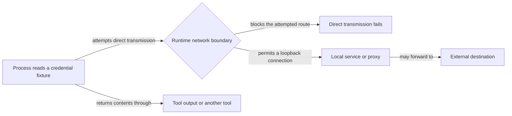

# Keep local agent work within useful boundaries: Codex

## Summary

Routine local development under Codex should run without repeated approvals, while credentials stay
unreadable and external networking stays off. Three reported problems motivate a joint investigation of native policy, hook behavior, and
approvals:

| Problem | Evidence and remaining limit |
| --- | --- |
| Localhost | The portal browser-test server failed with `listen EPERM` on `127.0.0.1` inside a Codex desktop session |
| Repeated approvals | Local tests, portal inspection, and restarts each asked for escalation again |
| Credential reads | Historical Codex 0.140.0 evidence records `~/.ssh/config` readable. Current source has no path guard in the command hook or generated profile; current native enforcement is unverified |

One characterization pass covers all three because the boundaries interact. The tracked profile
sets `network.enabled = false`, but that setting alone does not establish that credential contents
cannot leave through tool output, another tool, or a local service. Localhost work changes one of
these boundaries. Network widening waits for credential protection or explicit acceptance of the
remaining exposure.

This plan also reconciles three Codex-side harness details with provider ownership,
as `docs/internal/harness-provider-interface.md` requires. The companion plan, Keep local agent work
within useful boundaries: Claude (`46qth5z8`), owns the Claude worktree-entry hook and the Claude-side
leaks.

Do not silently enable unrestricted networking, suppress all approvals, or describe a partial
credential guard as complete.

## Context

### Permission layers

A Codex prompt or failure can come from any of these layers, and each one needs a different fix.
Identify which layer produced a request before changing policy.

| Layer | What it controls | Where RoboRepo configures it |
| --- | --- | --- |
| Native sandbox | Filesystem reads and writes, network, local port binding | Generated `[permissions.<profile>]` block in `~/.codex/config.toml` |
| Approval policy | When Codex asks before running a command | `approval_policy` in the same file |
| PreToolUse hook | Allow, ask, or deny per command, by matching rules from `manifests/inventory/agent-permissions.json` | `globals/system/hooks/codex/permission-check.mjs` |
| Desktop and organization policy | Settings inherited from the Codex app or a managed install | Not configured by RoboRepo; must be observed |

An allowed command can still fail to bind a local port, and a trusted hook cannot be assumed to
grant a permission the native sandbox withholds.

### Current state

Checked on `main` at the recorded commit on October 22, 2026. Historical runtime observations below
are separate from these source checks; none establishes current runtime enforcement.

| Source | Current behavior |
| --- | --- |
| `manifests/inventory/agent-permissions.json` | `go-online` defaults to `deny`; named test and build commands, including `npm run check`, are allowed. The `read-secrets` behavior lists credential path patterns (`.ssh`, `.aws`, `.env` variants), but only Claude's renderer consumes it |
| `scripts/harnesses/permissions-render.mjs` | `renderCodexWorkspaceProfile` extends `:workspace` and renders a single `network.enabled` boolean from `go-online`; no loopback or read-deny setting is rendered |
| `generated/codex/config.toml` | Profile `managed-workspace` with `network.enabled = false` and `approval_policy = "on-request"` |
| `globals/system/hooks/codex/permission-check.mjs` | Handles `exec_command`, `shell`, `local_shell`, and `bash` calls; tokenizes the command by whitespace and matches leading tokens with `matchesPrefix()`. It never inspects path arguments |
| `scripts/harnesses/contract.mjs` | `validateCapabilityAdapters` fails a provider that declares a capability without its required methods. `permissions` requires `adapters.permissions.render`, and Claude and Codex route through `permissions-render.mjs` |
| `scripts/test/portal-ui/run.mjs` | Starts a hermetic portal server on `127.0.0.1` and a browser that connects to it |

The shared renderer emits Claude credential rules for the `Read` tool because `read-secrets.tools`
contains only `Read`. That output does not prove protection for shell, `Grep`, `Glob`, or other
read-capable tools. The Codex hook recognizes four command-tool names and reads only
`tool_input.command`; nested execution tools and non-command tools need separate characterization.
Do not assume every Codex read reaches this hook.

The current native binary reports `codex-cli 0.162.0-alpha.17.2`. Local `codex --help` identifies
`-p` as a config profile, and `codex exec --help` documents positional or stdin prompts for
non-interactive execution. `roborepo harness inspect codex` still reports a cached
`0.155.0-alpha.16.4` executable at the former bundle layout; that path does not exist. The current
binary is in the bundle's `codex-cli` layout. Re-resolve and validate executables before probing;
do not use cached discovery as proof of the installed version. Help output establishes syntax,
not successful synthesis or sandbox enforcement.

### Observed behavior

**Localhost, October 21, 2026.** During the hook-banner work, the browser-suite server failed inside
the Codex desktop session sandbox with `listen EPERM: operation not permitted 127.0.0.1`. Running the
suite with sandbox escalation succeeded, but repeated requests for local tests, portal inspection,
and restarts interrupted the user. This establishes a failure under that session's policy, not every
supported runtime's network capabilities.

**Reads and writes, Codex 0.140.0.** Recorded by `ia1q1z9` (repo-scoped write permissions) under the
profile then named `roborepo-workspace`:

| Path | Read | Write |
| --- | --- | --- |
| Active worktree | allowed | allowed |
| Sibling worktree of this repo (`~/.worktrees/roborepo/...`) | allowed | allowed |
| Primary checkout (outside `~/.worktrees`) | allowed | blocked (`Operation not permitted`) |
| `$HOME` (arbitrary file) | allowed | blocked (`Operation not permitted`) |
| `/etc/hosts` | allowed | — |
| `~/.ssh/config` | allowed | — |

`ia1q1z9` resolved the read question as "no hook needed" for its write-scope goal, and recorded
credential reads as this follow-up.

### How the problems interact

Loopback can reach forwarding services. Probe the permitted destinations rather than equating
localhost access with no egress. A process network restriction also does not establish the policy
for browser tools, web search, MCP, or tool-result transport. Record these surfaces separately;
never emit real credentials in a probe.

### Desired development policy

| Operation | Intended boundary |
| --- | --- |
| Ordinary source reads | Preserve existing readable source paths; this plan adds credential protection, not a repository-wide read boundary |
| Reversible edits | Preserve the active workspace, configured associated-worktree roots, and explicit temp roots |
| Test scratch files | Explicit temporary fixture roots; no expansion to arbitrary home directories |
| Named local tests and builds, and restarting this worktree's portal | Proceed within the authorized task without repeated human prompts |
| Loopback servers and browser connections | Allow narrowly enough to run the local app and tests; define listening addresses and connection destinations separately |
| External networking | Keep sandboxed process egress restricted; record separately which layer controls browser, search, and MCP networking |
| Credential and environment-file reads | Known `read-secrets` matches retain the deny intent; unknown forms and approval behavior require an explicit coverage decision |
| Pushes, destructive operations, and branch or worktree moves | Preserve explicit authorization requirements |

### Provider leaks in platform code

Each row is a place where platform code names Codex directly instead of reading it from the
provider's manifest (`globals/harnesses/<id>/provider.json`):

| Leak | Location | What is hardcoded | Provider data that already exists |
| --- | --- | --- | --- |
| Hooks file branch | `scripts/cli/hook-composition.mjs` `writeHooksFile`, `hookFilePath` | `main` still branches on Codex; the unlanded dependency already routes through manifest paths | Preserve its `hasHarnessPath` / `resolveHarnessPath` routing after landing; no parallel storage selector is needed |
| Codex hook sources | `globals/system/hooks/codex/` (`permission-check.mjs`, `minimize-bash-output.mjs`) | Codex-only hook scripts live in the system tree | `manifests/platform/manifest.tsv` maps the folder to `~/.codex/hooks` |
| Headless prompt CLI | `scripts/cli/telemetry.mjs` `findDeepReadCli`, `runDeepRead` | Loops over `["claude", "codex", "gemini"]` and runs each as `<cli> -p <prompt>`. Local 0.162.0-alpha.17.2 help confirms `-p` selects a profile and `exec` runs non-interactively; successful synthesis has not been tested | Manifests declare `commandName` |

### Related plans and landing evidence

| Plan | Classification at the reviewed checkout | Reconciliation |
| --- | --- | --- |
| `wjlt1zvf` (`review/harness-hook-readiness-provider-adapters.md`) | Unlanded dependency | Its assigned worktree is authoritative and has a newer title, completed implementation tasks, pending review, and ten open manual checks. Implementation `b3df1d76aff6f085d9b003e12123a66c767d74cd` and worktree tip `b804d89d49f9b37089b9494cefc06f093c20c57f` are not ancestors of `main`; the tip is on `claude/harness-hook-readiness-provider-adapters` only. Recheck landing before integration |
| `ia1q1z9` (`completed/agent-config-repo-scoped-write-permissions.md`) | Landed dependency with prose drift | Merge `e58a81927fb99bf460eb6a5ea9185224c2a585fd` and evidence commit `bea08c6d42e11a0477a4111ce053eef9950740d4` are ancestors of `main`. Current renderer and hook preserve the write profile and Claude credential rules. Its older “Not verified” paragraphs contradict later live Codex evidence; retain those observations as historical and leave separate document cleanup to its owner |
| `46qth5z8` (`backlog/harness-claude-worktree-entry-and-provider-leaks.md`) | Unlanded conditional dependency | No `agentWorktreeDirs` field exists in the current schema or manifests. Codex worktree-folder declaration waits for that contract and provenance evidence; all Claude entry-hook and process-label work stays there |
| `permva27` (`backlog/agent-config-permissions-global-audit.md`) | Plan-vs-plan decision dependency | It reserves the retain/simplify/defer-to-native decision. Characterization can proceed independently, but a new portable permission model or mandatory enforcement contract must wait for that decision or explicit user reconciliation |
| `permissions-ui-revamp` (`backlog/agent-config-permissions-ui-revamp.md`) | Unlanded downstream consumer | It consumes the audit; no editor redesign or gate/scope simplification belongs here |
| `codex-cmux-hook-trust-review` (`backlog/agent-config-codex-cmux-hook-trust.md`) | Unlanded research overlap | Its bypass/source-loading claims are explicitly hypotheses to refresh. A bypass of trust review does not by itself prove a permission hook is skipped. Verify loading, enabled state, and decision handling separately |
| `7k3m9qd` (`backlog/package-resource-provider-delivery.md`) | Unlanded contract overlap | It changes capability/delivery validation in `contract.mjs`. Keep package-delivery redesign there; reconcile any new permissions requirement before editing that shared contract |
| `harness-capability-derived-resource-targeting` (`backlog/harness-capability-derived-resource-targeting.md`) | Unlanded adjacent work | It owns resource targets and fidelity reconciliation. It already calls for reuse of the existing Codex hook; do not add a second command-permission mechanism |

The hook-readiness worktree already removes the Codex branch with manifest-path routing, preserves
checkout-symlink protection, and changes Codex hook installation from `managed_copy` to
`hook_fragment` plus per-file-owned `managed_files`. Its core fragments append after package
hooks, preserving existing positions. This plan consumes that contract; it must not restore
whole-directory copying, prepend hooks, change native labels, or replace manifest routing with a
second `hooksStorage` decision. The primary plan copy is stale relative to its authoritative
worktree, but its `review` lifecycle is consistent with pending manual review. No other lifecycle
transition or document cleanup is performed here.

## Goals

- Routine authorized local tests and app restarts no longer require repeated permission requests
  under the selected supported Codex environment, with proof of the remaining boundaries.
- Credential paths from `read-secrets` are protected under Codex across every form the selected
  mechanism covers, with uncovered forms documented rather than claimed.
- Network widening never ships ahead of credential-read protection or an explicit, recorded
  acceptance of the remaining exposure.
- Command permission, sandbox networking, filesystem scope, and tool approval are distinguished, so
  unsupported controls are reported honestly rather than widened silently.
- `read-secrets` stays the single credential-pattern source, and provider coverage is expressed
  through a documented capability contract.
- The remaining leaks are resolved through provider data, and the dependency’s hook routing stays intact.

## Non-goals

- Unrestricted network or full-disk access, blanket interpreter allowlists, or disabling all
  approvals.
- General shell-argument parsing for every rule `permission-check.mjs` enforces. Argument scanning,
  if selected, covers credential paths only.
- Matching Claude's repo-wide read boundary on Codex; `ia1q1z9` resolved that.
- The permission-editor redesign (`permissions-ui-revamp`).
- Gemini. Its Policy Engine has neither a path predicate nor a hook surface, as `ia1q1z9`
  established.
- The Claude worktree-entry hook and Claude-side leaks (`46qth5z8`).

## Proposed design

### One characterization pass

Before selecting any mechanism, probe the supported Codex desktop and CLI versions once and record,
for each concern, which layer controls it and what the native settings can express:

| Concern | Question the probe answers |
| --- | --- |
| Policy sources | Which settings are in effect, and can inherited desktop or organization policy override them? |
| Loopback | Can a server bind `127.0.0.1` and `::1`, can a client connect to it, and does either work with external access denied? Does wildcard listening or DNS behave differently? |
| Credential reads | Can a native read-deny setting block `read-secrets` paths, and how does it interact with workspace reads? |
| Approvals | Which layer prompts for tests, portal inspection, and restarts, and can a narrow approval persist across sessions? |

Use installed help, schema output, and local probes with synthetic fixtures. Never read real
credential or environment files to test a restriction, and do external research only with the
user's authorization. Record exact settings, commands, and results; accepted TOML or an allowlisted
command prefix does not prove runtime enforcement.

### Credential-read enforcement

| Candidate | Evidence needed before choosing |
| --- | --- |
| Native filesystem read boundary | Supported configuration, precedence, runtime enforcement, and interaction with workspace reads |
| Command-path scanner in the PreToolUse hook | Parsing and expansion limits, indirect forms, false positives, and what happens when a command cannot be parsed |
| Combination | Coverage across command and non-command tools without claiming one mechanism is universal |

A command-argument scanner recognizes literal paths but can miss file-list indirection
(`xargs`), paths built by scripts, expansion the shell performs later, symlink traversal, and reads
through non-command tools. Enumerate those forms and decide, per form, whether the selected
mechanism blocks it or the documented boundary lists it as uncovered. A blocked direct `cat` is not
evidence of complete confinement.

Reuse the `read-secrets` patterns; do not add a second credential list. Express enforcement either
as a new required method under the `permissions` capability in `scripts/harnesses/contract.mjs` or
as a sub-requirement checked by a dedicated parity test, with explicit unsupported states. Generic
`permissions` support does not imply credential confinement: Gemini declares `permissions` but its
renderer skips scoped rules. Missing or overstated coverage must fail a check; an explicit
unsupported state must remain valid. Resolve the contract with the audit and delivery owners before
writing a scanner or changing required provider methods.

### Local-development network profile

Keep portable policy intent in `manifests/inventory/agent-permissions.json`, and choose its shape
only after native support is demonstrated and `permva27`'s ownership is reconciled. Native fields,
version checks, and unsupported outcomes belong in the Codex provider; callers use a provider
capability rather than testing a harness name. Reuse the existing render and apply path and preserve
unrelated user configuration. If Codex-specific rendering must leave
`scripts/harnesses/permissions-render.mjs`, put it under `scripts/harnesses/codex/` and keep shared
orchestration generic.

| Characterization result | Next action |
| --- | --- |
| Native loopback-only binding and connections work with external access denied | Render and verify the narrow native profile; scope routine approvals to the authorized workflow |
| Native policy cannot express the boundary | Evaluate a disposable environment with app and browser inside it, explicit repo and temp mounts, and enforced external egress restrictions; Docker alone is not proof of isolation |
| Desktop or organization policy prevents either approach | Report the controlling policy and the limitation; get an environment decision from the user before calling the work complete |

The network change ships only when credential-read enforcement has landed, or when the user has
accepted the exposure recorded by the forwarding probe.

### Approvals

After the sandbox boundary is fixed, identify whether a scoped persistent approval is still needed.
Keep native hook-trust review distinct from command approval and runtime sandbox escalation.
Preserve `read-secrets: deny` for recognized protected paths; an ask fallback for unclassifiable
commands would be a separate policy decision, not permission to approve known credential reads.
Do not allow arbitrary `node`, Python, or all npm scripts. Record whether each permission is
native-enforced, command-scoped, or only an agent instruction. The agent should run already-authorized
routine work directly and explain a genuine platform-imposed approval boundary once, rather than
repeatedly requesting the same declined escalation.

### Leak fixes

| Leak | Change |
| --- | --- |
| Hooks file branch | Consume the dependency’s manifest-path routing and its synthetic/provider regression coverage. Recheck after landing; add only missing behavior tests. Leave `hooksStorageOf` in `config.mjs` unless another demonstrated consumer needs it |
| Codex hook sources | Move `globals/system/hooks/codex/*` to `globals/harnesses/codex/hooks/` and repoint the dependency’s `managed_files` row in `manifest.tsv`, keeping the `~/.codex/hooks` destination and command strings unchanged. Done before any scanner work, so `permission-check.mjs` is edited in its final location |
| Headless prompt CLI | Add `extensions.app.headlessPromptArgs` to manifests, holding an argv template with one whole-argument prompt placeholder, validated by the manifest schema and runtime contract. `findDeepReadCli` iterates enabled eligible providers in registry order and uses the existing executable selection path, including desktop-only runtimes. Keep public `deepread_cli` report values stable; spawn argv directly, never a shell string |

## Implementation plan

### Phase 1: characterize native boundaries

- [ ] Record supported Codex desktop and CLI versions and the effective permission sources,
      including inherited policy.
- [ ] Reproduce the localhost bind failure in a minimal temporary fixture, then probe loopback
      binding and connections, IPv4 and IPv6, wildcard listening, non-loopback destinations, DNS,
      and localhost-to-external forwarding.
- [ ] Probe native read-deny support against synthetic credential fixtures, and enumerate the
      command and non-command read forms listed under Credential-read enforcement.
- [ ] Identify which layer issues each prompt for tests, portal inspection, and restarts, and
      whether a narrow approval persists across sessions.
- [ ] Check whether the Codex app creates worktrees under `~/.codex/worktrees/` (one was observed at
      `~/.codex/worktrees/<name>/roborepo`; its creator was not confirmed).
- [ ] After the probes, record a decision packet covering the supported runtime, native controls,
      tool coverage, audit ownership, and contract shape. Resolve the promotion questions before
      starting remediation.
- [ ] Select the smallest enforceable environment for both network and reads. If a container or
      broader access is the only candidate, present its mounts, networking, residual exposure, and
      approval requirements for the user's decision.

### Phase 2: Codex-side leaks

- [ ] After `wjlt1zvf` lands, re-read its source ownership and tests. Move Codex script sources
      and repoint the `managed_files` source without changing per-file ownership or removal semantics,
      and update source references in `scripts/test/test-cli.sh`. Preserve standalone manifest
      discovery from installed copies and state-root overrides. Run
      `bash scripts/doctor.sh --quiet` and
      `env CLEAN_MACHINE_STRICT=1 npm run test:clean-machine-permissions-sandbox` to prove the install
      destination and command strings are unchanged.
- [ ] Hooks file routing: after `wjlt1zvf` merges, confirm it has removed the Codex branches.
      Preserve `rootConfigPath` fixture overrides, manifest routing, and symlink protections. Extend
      `scripts/test/hook-composition-check.mjs` only for missing synthetic-provider behavior.
- [ ] Headless prompt CLI: check the Codex CLI's non-interactive syntax against its own help output.
      Add failing tests for an omitted field, malformed template, disabled provider, desktop-only
      executable, prompt text containing shell metacharacters, and successful synthetic-provider
      selection. Add verified argv templates to eligible manifests and switch both selection and
      `runDeepRead` invocation; leave unsupported providers explicitly ineligible.
- [ ] Extend `scripts/test/telemetry-synthetic-provider-check.mjs` so the `acme` provider proves
      `headlessPromptArgs` generalizes.
- [ ] If Phase 1 confirms the Codex app's worktree folder and `46qth5z8` has added
      `agentWorktreeDirs`, declare `.codex/worktrees` in the Codex manifest.

### Phase 3: credential-read enforcement

- [ ] Implement the coverage contract selected in the decision packet; test missing, overstated,
      and explicitly unsupported coverage without forcing Gemini credential enforcement.
- [ ] Implement the selected unclassifiable-command behavior, separately from known protected
      paths, which retain the `read-secrets` deny intent.
- [ ] Add a focused test listing the credential-path forms the mechanism must block and the ordinary
      commands it must not block, including readable `.env.example` and `.env.sample` templates,
      before implementing it.
- [ ] Implement the selected native or hook mechanism; extend `permission-check.mjs` only where its
      demonstrated coverage contributes to the selected guarantee.
- [ ] Wire the coverage check so missing or overstated enforcement fails validation; explicitly
      unsupported providers remain loadable and cannot advertise a guard they do not implement.
- [ ] Verify live against the shipped Codex binary, since shell quoting and expansion only show up
      when a real shell runs the command.

### Phase 4: local-development network and approvals

- [ ] Confirm the gate: Phase 3 has landed, or the user has accepted the recorded forwarding
      exposure.
- [ ] Add regression coverage before implementing: extend
      `scripts/test/permissions-render-live-characterization-check.mjs` for projection and
      preservation and `scripts/test/clean-machine-permissions-sandbox.mjs` for installed machine
      shape; use a separate provider-native fixture for runtime network enforcement.
- [ ] Implement the verified provider policy through the existing render and apply path, or the
      selected isolated environment. Report unsupported versions and policies without enabling
      external networking as a fallback.
- [ ] Prove routine tests, localhost inspection, and restart of this worktree's own portal work in
      fresh desktop and CLI sessions without repeated prompts. Verify process ownership before
      stopping anything and leave unrelated local services untouched.
- [ ] Exercise policy persistence across fresh sessions and RoboRepo update and reapply; confirm
      read-only mode and unrelated user config still behave as intended.
- [ ] If the shared capability contract changes, add a synthetic-provider check: providers without
      loopback support report it explicitly and never inherit a Codex-specific config field.

## Validation

- Phase 1 records version, effective policy, and evidence for every probed environment. A container
  pass does not establish host-native parity, and rendered config or fake binaries do not establish
  runtime enforcement.
- Under the `managed-workspace` profile, a command reaching a known `read-secrets` path is denied
  for every form the selected mechanism claims to cover, and each enumerated form it does not cover
  appears in the documented boundary.
- Ordinary repository commands touching non-credential paths are unaffected; the existing Codex hook
  coverage in `scripts/test/clean-machine-permissions-sandbox.mjs` and `scripts/test/test-cli.sh`
  still passes.
- Missing or falsely claimed credential coverage is caught by the selected contract/parity check.
  Gemini and a synthetic unsupported provider remain explicit unsupported cases, not forced
  implementations of the Codex guard.
- In fresh supported Codex desktop and CLI sessions, `npm run test:portal-ui -- --grep 'hook readiness warning'`
  binds and connects on localhost without per-run escalation. Inspecting and restarting the owned
  worktree portal twice does not prompt repeatedly.
- Controlled probes show external egress and unauthorized filesystem writes remain blocked, while
  approved repo, worktree, and temp operations succeed.
- `scripts/cli/hook-composition.mjs` no longer contains `harness === "codex"` or `codexHooksPath`,
  and `findDeepReadCli` no longer holds a fixed CLI list. A synthetic headless provider receives
  exactly one literal prompt argument; invalid or omitted templates and unavailable runtimes degrade
  gracefully, preserving `deepread_cli` consumers. Codex hook sources are covered by
  `doctor.sh` and the sandbox.
- `node scripts/test/permissions-render-live-characterization-check.mjs`,
  `node scripts/test/hook-composition-check.mjs`, `bash scripts/doctor.sh --quiet`, and
  `git diff --check` pass. `npm run check` passes before push, because this work changes install
  mapping and permission profiles.

## Documentation impact

| Doc | Update |
| --- | --- |
| `docs/user/reference/config-control-panel.md` | Document the Codex credential guard and its covered and uncovered forms alongside Claude's `read-secrets`; explain local-server versus external-network access and which approvals remain; record that Gemini stays out of scope |
| `docs/user/reference/codex-hooks.md` | Explain the installed guard, native hook-review prerequisite, limits, and the difference between trust review, command approval, and sandbox escalation |
| `docs/user/reference/architecture.md` | Update the Codex hook source-to-install map while preserving its destination and per-file ownership |
| `docs/internal/hooks-internals.md` | Point the Codex system hook location at `globals/harnesses/codex/hooks/`; describe any credential-path matching added to `permission-check.mjs` |
| `docs/internal/harness-anatomy.md`, `docs/internal/harnesses-explained.md`, `docs/internal/backlog-review.md` | Update the Codex system hook source paths |
| `docs/internal/harness-provider-interface.md` | Document the credential-read and network capability contract and unsupported states; document `headlessPromptArgs` |
| `docs/internal/docker-test-sandboxes.md` | Document the chosen isolated environment and its verified egress and mount boundary, if that alternative is selected |

## Risks

| Risk | Mitigation |
| --- | --- |
| A loopback allowance exposes unrelated services or forwarding proxies | The forwarding probe runs in Phase 1, and Phase 4 is gated on read protection or explicit acceptance |
| A path-argument scanner is heuristic against shell syntax | Enumerate forms first, decide the unclassifiable-command behavior explicitly, and document uncovered forms instead of claiming complete coverage |
| A hook-based guard is bypassed when Codex skips hooks | Coordinate with `codex-cmux-hook-trust-review`; prefer a native boundary where one exists |
| A new required `permissions` method forces work on every provider | Resolve the contract before remediation; validate explicit unsupported coverage without forcing a Gemini implementation |
| Native or managed policy cannot express the boundary | Keep a capability gate and an explicit user decision; never silently broaden access |
| Scope creep into general shell parsing in `permission-check.mjs` | Non-goal; argument scanning covers credential paths only |
| Hook relocation regresses `wjlt1zvf` installation or trust | Wait for landing, consume its existing routing, and preserve `managed_files`, labels, positions, and symlink guards |
| Moving Codex hook sources orphans old install copies | Keep the destination unchanged |

## Decision Log

- October 21: the localhost and approval work was added to `46qth5z8`, alongside the Claude
  worktree-entry hook.
- October 22: split by provider at the user's request. This plan keeps the credential-read guard's
  ID, because `ia1q1z9` references it for the same gap, and absorbs the Codex half of `46qth5z8`:
  localhost, approvals, the hooks-file branch, Codex hook sources, and the headless prompt CLI.
  Merged because one characterization pass serves both, and because loosening network policy
  changes one potential route for transmitting a credential read; complete confinement remains unverified.

- October 22 promotion review: verified `main` at `e201ba8b`, the unlanded hook-readiness
  implementation and authoritative review copy, and the landed write-scope commits. Removed the
  duplicate hook-routing refactor and preserved the dependency’s per-file ownership contract.
  Corrected overbroad read/network claims, confirmed Codex headless CLI syntax from installed help,
  and distinguished stale cached discovery from the installed runtime. No runtime enforcement,
  approval persistence, or forwarding claim was certified, and no implementation task was checked.

## Promotion readiness

Preparation found no structural validator findings. Promotion is held because the combined
implementation still has material security and ownership decisions: native confinement versus a
partial hook guard, behavior for unclassifiable commands, and whether the audit permits extending
shared permission management. The hook-readiness dependency is also unlanded. Its source relocation
must wait, while read-only characterization can proceed without changing live policy.

This preparation does not authorize a container, accept residual credential exposure, or broaden
networking. Capture the native evidence and resolve the questions below before rerunning promotion.

## Open questions

- **Codex mechanism:** does the supported runtime enforce loopback-only access and credential-path
  read denial natively, and can inherited policy override either? Phase 1 answers this.
- **Approval persistence:** after the boundary is fixed, which routine operations still require
  native approval, and can that approval be scoped without granting broad interpreter or
  unrelated-process access?
- **Unclassifiable commands:** should the credential guard deny or ask when it cannot parse a
  command? Deny is safer; ask avoids blocking legitimate one-liners.
- **Coverage and audit ownership:** if native confinement is unavailable, is a documented partial
  hook guard acceptable, or must the work stop at evidence and limitations? Resolve this together
  with `permva27` before choosing a new shared contract; do not infer approval to retain or expand
  the editor from this remediation plan.
