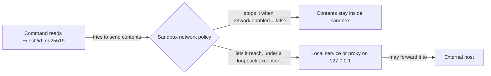

# Keep local agent work within useful boundaries: Codex

## Summary

Routine local development under Codex should run without repeated approvals, while credentials stay
unreadable and external networking stays off. Three problems stand in the way, all inside the same
Codex sandbox and the same generated permission profile:

| Problem | What happens today |
| --- | --- |
| Localhost | The portal browser-test server failed with `listen EPERM` on `127.0.0.1` inside a Codex desktop session |
| Repeated approvals | Local tests, portal inspection, and restarts each asked for escalation again |
| Credential reads | The sandbox reads wide (`~/.ssh/config` was readable), and the Codex hook matches command prefixes only, so nothing stops a command from reading a credential path |

They are planned together because they are coupled. Today `network.enabled = false` is the only
thing that keeps a credential read inside the sandbox from leaving the machine, and the localhost
work changes network policy. So one characterization pass covers all three, and no network widening
ships until credential reads are protected or the remaining exposure is explicitly accepted.

This plan also moves three Codex-side harness details out of platform code and behind provider data,
as `docs/internal/harness-provider-interface.md` requires. The companion plan, Keep local agent work
within useful boundaries: Claude (`46qth5z8`), owns the Claude worktree-entry hook and the Claude-side
leaks.

Do not silently enable unrestricted networking, suppress all approvals, or describe a partial
credential guard as complete.

## Context

### Permission layers

A Codex prompt or failure can come from any of these layers, and each one needs a different fix.
Identify which layer produced a request before changing policy.

| Layer | What it controls | Where RoboRepo configures it |
| --- | --- | --- |
| Native sandbox | Filesystem reads and writes, network, local port binding | Generated `[permissions.<profile>]` block in `~/.codex/config.toml` |
| Approval policy | When Codex asks before running a command | `approval_policy` in the same file |
| PreToolUse hook | Allow, ask, or deny per command, by matching rules from `manifests/inventory/agent-permissions.json` | `globals/system/hooks/codex/permission-check.mjs` |
| Desktop and organization policy | Settings inherited from the Codex app or a managed install | Not configured by RoboRepo; must be observed |

An allowed command can still fail to bind a local port, and a trusted hook cannot be assumed to
grant a permission the native sandbox withholds.

### Current state

Checked against the recorded commit:

| Source | Current behavior |
| --- | --- |
| `manifests/inventory/agent-permissions.json` | `go-online` defaults to `deny`; named test and build commands, including `npm run check`, are allowed. The `read-secrets` behavior lists credential path patterns (`.ssh`, `.aws`, `.env` variants), but only Claude's renderer consumes it |
| `scripts/harnesses/permissions-render.mjs` | `renderCodexWorkspaceProfile` extends `:workspace` and renders a single `network.enabled` boolean from `go-online`; no loopback or read-deny setting is rendered |
| `generated/codex/config.toml` | Profile `managed-workspace` with `network.enabled = false` and `approval_policy = "on-request"` |
| `globals/system/hooks/codex/permission-check.mjs` | Handles `exec_command`, `shell`, `local_shell`, and `bash` calls; tokenizes the command by whitespace and matches leading tokens with `matchesPrefix()`. It never inspects path arguments |
| `scripts/harnesses/contract.mjs` | `validateCapabilityAdapters` fails a provider that declares a capability without its required methods. `permissions` requires `adapters.permissions.render`, and both providers route through `permissions-render.mjs` |
| `scripts/test/portal-ui/run.mjs` | Starts a hermetic portal server on `127.0.0.1` and a browser that connects to it |

Claude blocks credential paths with deny rules on its structured `Read`, `Grep`, and `Glob` tools,
whose path parameter the permission system parses directly. Codex has no structured file-read tool:
every read is a shell command string (`cat`, `sed`, `less`, one-liners), so blocking `.ssh` reads
means catching an open-ended set of commands by their arguments rather than their leading tokens.

### Observed behavior

**Localhost, October 21, 2026.** During the hook-banner work, the browser-suite server failed inside
the Codex desktop session sandbox with `listen EPERM: operation not permitted 127.0.0.1`. Running the
suite with sandbox escalation succeeded, but repeated requests for local tests, portal inspection,
and restarts interrupted the user. This establishes a failure under that session's policy, not every
supported runtime's network capabilities.

**Reads and writes, Codex 0.140.0.** Recorded by `ia1q1z9` (repo-scoped write permissions) under the
profile then named `roborepo-workspace`:

| Path | Read | Write |
| --- | --- | --- |
| Active worktree | allowed | allowed |
| Sibling worktree of this repo (`~/.worktrees/roborepo/...`) | allowed | allowed |
| Primary checkout (outside `~/.worktrees`) | allowed | blocked (`Operation not permitted`) |
| `$HOME` (arbitrary file) | allowed | blocked (`Operation not permitted`) |
| `/etc/hosts` | allowed | — |
| `~/.ssh/config` | allowed | — |

`ia1q1z9` resolved the read question as "no hook needed" for its write-scope goal, and recorded
credential reads as this follow-up.

### How the problems interact

A loopback exception reaches every local service, including forwarding proxies, so "localhost only"
is not the same as "no data can leave". Credential-read protection and the loopback exception have
to be designed against each other.

### Desired development policy

| Operation | Intended boundary |
| --- | --- |
| Ordinary source reads and reversible edits | Current repository and its authorized associated worktree |
| Test scratch files | Explicit temporary fixture roots; no expansion to arbitrary home directories |
| Named local tests and builds, and restarting this worktree's portal | Proceed within the authorized task without repeated human prompts |
| Loopback servers and browser connections | Allow narrowly enough to run the local app and tests; define listening addresses and connection destinations separately |
| External networking and web searches | Remain restricted; loopback access must not enable either implicitly |
| Credential and environment-file reads | Denied or asked across every form the selected mechanism covers; uncovered forms recorded, never claimed |
| Pushes, destructive operations, and branch or worktree moves | Preserve explicit authorization requirements |

### Provider leaks in platform code

Each row is a place where platform code names Codex directly instead of reading it from the
provider's manifest (`globals/harnesses/<id>/provider.json`):

| Leak | Location | What is hardcoded | Provider data that already exists |
| --- | --- | --- | --- |
| Hooks file branch | `scripts/cli/hook-composition.mjs` `writeHooksFile`, `hookFilePath` | Branches on `harness === "codex"` to choose a sidecar hooks file over the root config | Every manifest declares `extensions.app.hooksStorage` (`embedded-in-root-config` or `dedicated-json-sidecar`); `hooksStorageOf()` in `scripts/cli/config.mjs` already reads it |
| Codex hook sources | `globals/system/hooks/codex/` (`permission-check.mjs`, `minimize-bash-output.mjs`) | Codex-only hook scripts live in the system tree | `manifests/platform/manifest.tsv` maps the folder to `~/.codex/hooks` |
| Headless prompt CLI | `scripts/cli/telemetry.mjs` `findDeepReadCli`, `runDeepRead` | Loops over `["claude", "codex", "gemini"]` and runs each as `<cli> -p <prompt>`. The Codex CLI's `-p` is believed to select a config profile rather than print, so a Codex-only machine would get no deep read. Unverified | Manifests declare `commandName` |

### Related plans

| Plan | Relationship |
| --- | --- |
| `46qth5z8` (`backlog/harness-claude-worktree-entry-and-provider-leaks.md`) | The Claude half of this work. It adds `extensions.app.agentWorktreeDirs`, which Codex may then declare |
| `wjlt1zvf` (`review/harness-hook-readiness-provider-adapters.md`) | Changes `hook-composition-check.mjs` and Codex hook merge order. The hooks-file-branch fix edits the same module, so it lands after that plan merges |
| `ia1q1z9` (`completed/agent-config-repo-scoped-write-permissions.md`) | Verified Codex write scope and recorded the credential-read gap this plan closes. Its repo-wide read boundary is not reopened |
| `permva27` (`backlog/agent-config-permissions-global-audit.md`) | Owns the broad permissions inventory and the retain, simplify, or defer-to-native decision. This plan owns the concrete Codex remediation and supplies its evidence; coordinate any shared-model change |
| `permissions-ui-revamp` | Owns the permission-editor redesign. Expose only the selected, verified Codex capability here |
| `codex-cmux-hook-trust-review` | Audits Codex hook trust bypass in cmux-launched sessions. A hook-based credential guard inherits whatever bypass that plan finds |
| `7k3m9qd` (`backlog/package-resource-provider-delivery.md`) | Owns the per-harness branches in `scripts/cli/packages.mjs` |
| `harness-capability-derived-resource-targeting` | Changes how `hooks` resources name their harnesses; no shared files |

## Goals

- Routine authorized local tests and app restarts no longer require repeated permission requests
  under the selected supported Codex environment, with proof of the remaining boundaries.
- Credential paths from `read-secrets` are protected under Codex across every form the selected
  mechanism covers, with uncovered forms documented rather than claimed.
- Network widening never ships ahead of credential-read protection or an explicit, recorded
  acceptance of the remaining exposure.
- Command permission, sandbox networking, filesystem scope, and tool approval are distinguished, so
  unsupported controls are reported honestly rather than widened silently.
- `read-secrets` stays the single credential-pattern source, and provider coverage is expressed
  through a documented capability contract.
- The three leaks above are resolved by reading provider data.

## Non-goals

- Unrestricted network or full-disk access, blanket interpreter allowlists, or disabling all
  approvals.
- General shell-argument parsing for every rule `permission-check.mjs` enforces. Argument scanning,
  if selected, covers credential paths only.
- Matching Claude's repo-wide read boundary on Codex; `ia1q1z9` resolved that.
- The permission-editor redesign (`permissions-ui-revamp`).
- Gemini. Its Policy Engine has neither a path predicate nor a hook surface, as `ia1q1z9`
  established.
- The Claude worktree-entry hook and Claude-side leaks (`46qth5z8`).

## Proposed design

### One characterization pass

Before selecting any mechanism, probe the supported Codex desktop and CLI versions once and record,
for each concern, which layer controls it and what the native settings can express:

| Concern | Question the probe answers |
| --- | --- |
| Policy sources | Which settings are in effect, and can inherited desktop or organization policy override them? |
| Loopback | Can a server bind `127.0.0.1` and `::1`, can a client connect to it, and does either work with external access denied? Does wildcard listening or DNS behave differently? |
| Credential reads | Can a native read-deny setting block `read-secrets` paths, and how does it interact with workspace reads? |
| Approvals | Which layer prompts for tests, portal inspection, and restarts, and can a narrow approval persist across sessions? |

Use installed help, schema output, and local probes with synthetic fixtures. Never read real
credential or environment files to test a restriction, and do external research only with the
user's authorization. Record exact settings, commands, and results; accepted TOML or an allowlisted
command prefix does not prove runtime enforcement.

### Credential-read enforcement

| Candidate | Evidence needed before choosing |
| --- | --- |
| Native filesystem read boundary | Supported configuration, precedence, runtime enforcement, and interaction with workspace reads |
| Command-path scanner in the PreToolUse hook | Parsing and expansion limits, indirect forms, false positives, and what happens when a command cannot be parsed |
| Combination | Coverage across command and non-command tools without claiming one mechanism is universal |

A command-argument scanner recognizes literal paths but can miss file-list indirection
(`xargs`), paths built by scripts, expansion the shell performs later, symlink traversal, and reads
through non-command tools. Enumerate those forms and decide, per form, whether the selected
mechanism blocks it or the documented boundary lists it as uncovered. A blocked direct `cat` is not
evidence of complete confinement.

Reuse the `read-secrets` patterns; do not add a second credential list. Express enforcement either
as a new required method under the `permissions` capability in `scripts/harnesses/contract.mjs` or
as a sub-requirement checked by a dedicated parity test, with explicit unsupported states. Decide
this before writing a scanner, because it defines what done means and a required method affects
every provider that declares `permissions`.

### Local-development network profile

Keep portable policy intent in `manifests/inventory/agent-permissions.json`, and choose its shape
only after native support is demonstrated and `permva27`'s ownership is reconciled. Native fields,
version checks, and unsupported outcomes belong in the Codex provider; callers use a provider
capability rather than testing a harness name. Reuse the existing render and apply path and preserve
unrelated user configuration. If Codex-specific rendering must leave
`scripts/harnesses/permissions-render.mjs`, put it under `scripts/harnesses/codex/` and keep shared
orchestration generic.

| Characterization result | Next action |
| --- | --- |
| Native loopback-only binding and connections work with external access denied | Render and verify the narrow native profile; scope routine approvals to the authorized workflow |
| Native policy cannot express the boundary | Evaluate a disposable environment with app and browser inside it, explicit repo and temp mounts, and enforced external egress restrictions; Docker alone is not proof of isolation |
| Desktop or organization policy prevents either approach | Report the controlling policy and the limitation; get an environment decision from the user before calling the work complete |

The network change ships only when credential-read enforcement has landed, or when the user has
accepted the exposure recorded by the forwarding probe.

### Approvals

After the sandbox boundary is fixed, identify whether a scoped persistent approval is still needed.
Do not allow arbitrary `node`, Python, or all npm scripts. Record whether each permission is
native-enforced, command-scoped, or only an agent instruction. The agent should run already-authorized
routine work directly and explain a genuine platform-imposed approval boundary once, rather than
repeatedly requesting the same declined escalation.

### Leak fixes

| Leak | Change |
| --- | --- |
| Hooks file branch | `writeHooksFile` and `hookFilePath` branch on `hooksStorage`, and a sidecar provider's file comes from `resolveHarnessPath(manifest, "hooks")` instead of the `codexHooksPath` import. Move `hooksStorageOf` from `scripts/cli/config.mjs` to `scripts/harnesses/paths.mjs`, next to `resolveHarnessPath`, and import it in both modules |
| Codex hook sources | Move `globals/system/hooks/codex/*` to `globals/harnesses/codex/hooks/` and repoint the `manifest.tsv` row, keeping the `~/.codex/hooks` destination and command strings unchanged. Done before any scanner work, so `permission-check.mjs` is edited in its final location |
| Headless prompt CLI | Add `extensions.app.headlessPromptArgs` to manifests, holding the argv that runs one prompt non-interactively. `findDeepReadCli` iterates providers that declare it, in registry order |

## Implementation plan

### Phase 1: characterize native boundaries

- [ ] Record supported Codex desktop and CLI versions and the effective permission sources,
      including inherited policy.
- [ ] Reproduce the localhost bind failure in a minimal temporary fixture, then probe loopback
      binding and connections, IPv4 and IPv6, wildcard listening, non-loopback destinations, DNS,
      and localhost-to-external forwarding.
- [ ] Probe native read-deny support against synthetic credential fixtures, and enumerate the
      command and non-command read forms listed under Credential-read enforcement.
- [ ] Identify which layer issues each prompt for tests, portal inspection, and restarts, and
      whether a narrow approval persists across sessions.
- [ ] Check whether the Codex app creates worktrees under `~/.codex/worktrees/` (one was observed at
      `~/.codex/worktrees/<name>/roborepo`; its creator was not confirmed).
- [ ] Select the smallest enforceable environment for both network and reads. If a container or
      broader access is the only candidate, present its mounts, networking, residual exposure, and
      approval requirements for the user's decision.

### Phase 2: Codex-side leaks

- [ ] Codex hook sources: move the files and repoint `manifest.tsv`, plus the source paths in
      `scripts/test/test-cli.sh`. Run
      `bash scripts/doctor.sh --quiet` and the clean-machine sandbox to prove the install
      destination and command strings are unchanged.
- [ ] Hooks file branch, after `wjlt1zvf` merges: extend `scripts/test/hook-composition-check.mjs`
      with a synthetic sidecar provider, then switch the branches to `hooksStorage`.
- [ ] Headless prompt CLI: check the Codex CLI's non-interactive syntax against its own help output.
      Add a failing test that a provider without `headlessPromptArgs` is skipped and a synthetic
      provider with it is used, then add the field to each manifest and switch `findDeepReadCli`.
- [ ] Extend `scripts/test/telemetry-synthetic-provider-check.mjs` so the `acme` provider proves
      `headlessPromptArgs` generalizes.
- [ ] If Phase 1 confirms the Codex app's worktree folder and `46qth5z8` has added
      `agentWorktreeDirs`, declare `.codex/worktrees` in the Codex manifest.

### Phase 3: credential-read enforcement

- [ ] Decide the contract shape: a required method under `permissions`, or a dedicated parity test.
- [ ] Decide what the mechanism does with a command it cannot classify: deny or ask.
- [ ] Add a focused test listing the credential-path forms the mechanism must block and the ordinary
      commands it must not block, before implementing it.
- [ ] Implement the selected native or hook mechanism; extend `permission-check.mjs` only where its
      demonstrated coverage contributes to the selected guarantee.
- [ ] Wire the contract check so a provider declaring `permissions` without credential-read
      enforcement fails validation or the parity test.
- [ ] Verify live against the shipped Codex binary, since shell quoting and expansion only show up
      when a real shell runs the command.

### Phase 4: local-development network and approvals

- [ ] Confirm the gate: Phase 3 has landed, or the user has accepted the recorded forwarding
      exposure.
- [ ] Add regression coverage before implementing: extend
      `scripts/test/permissions-render-live-characterization-check.mjs` for projection and
      preservation and `scripts/test/clean-machine-permissions-sandbox.mjs` for installed machine
      shape; use a separate provider-native fixture for runtime network enforcement.
- [ ] Implement the verified provider policy through the existing render and apply path, or the
      selected isolated environment. Report unsupported versions and policies without enabling
      external networking as a fallback.
- [ ] Prove routine tests, localhost inspection, and restart of this worktree's own portal work in
      fresh desktop and CLI sessions without repeated prompts. Verify process ownership before
      stopping anything and leave unrelated local services untouched.
- [ ] Exercise policy persistence across fresh sessions and RoboRepo update and reapply; confirm
      read-only mode and unrelated user config still behave as intended.
- [ ] If the shared capability contract changes, add a synthetic-provider check: providers without
      loopback support report it explicitly and never inherit a Codex-specific config field.

## Validation

- Phase 1 records version, effective policy, and evidence for every probed environment. A container
  pass does not establish host-native parity, and rendered config or fake binaries do not establish
  runtime enforcement.
- Under the `managed-workspace` profile, a command reaching a `read-secrets` path is denied or asked
  for every form the selected mechanism claims to cover, and each enumerated form it does not cover
  appears in the documented boundary.
- Ordinary repository commands touching non-credential paths are unaffected; the existing Codex hook
  coverage in `scripts/test/clean-machine-permissions-sandbox.mjs` and `scripts/test/test-cli.sh`
  still passes.
- A provider that declares `permissions` without credential-read enforcement is caught by the
  contract check, not by manual review.
- In fresh supported Codex desktop and CLI sessions, `npm run test:portal-ui -- --grep 'hook readiness warning'`
  binds and connects on localhost without per-run escalation. Inspecting and restarting the owned
  worktree portal twice does not prompt repeatedly.
- Controlled probes show external egress and unauthorized filesystem writes remain blocked, while
  approved repo, worktree, and temp operations succeed.
- `scripts/cli/hook-composition.mjs` no longer contains `harness === "codex"` or `codexHooksPath`,
  and `findDeepReadCli` no longer holds a fixed CLI list. Codex hook sources are covered by
  `doctor.sh` and the sandbox.
- `node scripts/test/permissions-render-live-characterization-check.mjs`,
  `node scripts/test/hook-composition-check.mjs`, `bash scripts/doctor.sh --quiet`, and
  `git diff --check` pass. `npm run check` passes before push, because this work changes install
  mapping and permission profiles.

## Documentation impact

| Doc | Update |
| --- | --- |
| `docs/user/reference/config-control-panel.md` | Document the Codex credential guard and its covered and uncovered forms alongside Claude's `read-secrets`; explain local-server versus external-network access and which approvals remain; record that Gemini stays out of scope |
| `docs/internal/hooks-internals.md` | Point the Codex system hook location at `globals/harnesses/codex/hooks/`; describe any credential-path matching added to `permission-check.mjs` |
| `docs/internal/harness-anatomy.md`, `docs/internal/harnesses-explained.md`, `docs/internal/backlog-review.md` | Update the Codex system hook source paths |
| `docs/internal/harness-provider-interface.md` | Document the credential-read and network capability contract and unsupported states; document `headlessPromptArgs` |
| `docs/internal/docker-test-sandboxes.md` | Document the chosen isolated environment and its verified egress and mount boundary, if that alternative is selected |

## Risks

| Risk | Mitigation |
| --- | --- |
| A loopback allowance exposes unrelated services or forwarding proxies | The forwarding probe runs in Phase 1, and Phase 4 is gated on read protection or explicit acceptance |
| A path-argument scanner is heuristic against shell syntax | Enumerate forms first, decide the unclassifiable-command behavior explicitly, and document uncovered forms instead of claiming complete coverage |
| A hook-based guard is bypassed when Codex skips hooks | Coordinate with `codex-cmux-hook-trust-review`; prefer a native boundary where one exists |
| A new required `permissions` method forces work on every provider | Decide the contract shape first, in Phase 3, before implementing |
| Native or managed policy cannot express the boundary | Keep a capability gate and an explicit user decision; never silently broaden access |
| Scope creep into general shell parsing in `permission-check.mjs` | Non-goal; argument scanning covers credential paths only |
| The hooks-file-branch fix conflicts with `wjlt1zvf` | Sequenced after that plan merges |
| Moving Codex hook sources orphans old install copies | Keep the destination unchanged |

## Decision Log

- October 21: the localhost and approval work was added to `46qth5z8`, alongside the Claude
  worktree-entry hook.
- October 22: split by provider at the user's request. This plan keeps the credential-read guard's
  ID, because `ia1q1z9` references it for the same gap, and absorbs the Codex half of `46qth5z8`:
  localhost, approvals, the hooks-file branch, Codex hook sources, and the headless prompt CLI.
  Merged because one characterization pass serves both, and because loosening network policy
  removes the only current barrier to exfiltrating a credential read.

## Open questions

- **Codex mechanism:** does the supported runtime enforce loopback-only access and credential-path
  read denial natively, and can inherited policy override either? Phase 1 answers this.
- **Approval persistence:** after the boundary is fixed, which routine operations still require
  native approval, and can that approval be scoped without granting broad interpreter or
  unrelated-process access?
- **Unclassifiable commands:** should the credential guard deny or ask when it cannot parse a
  command? Deny is safer; ask avoids blocking legitimate one-liners.
