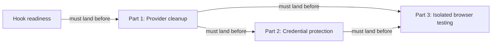

# Keep local agent work within useful boundaries: Codex — Part 1: Provider cleanup

## Summary

Put the remaining Codex-specific hook and headless-command details behind the provider boundary
before adding credential protection or isolated browser execution. This is the prerequisite for
the other two parts of the series; it changes ownership and dispatch without widening permissions.

## Context

A provider is RoboRepo's adapter for one agent harness. Shared orchestration reads its manifest
and calls its adapters; provider code owns native paths, formats, and command syntax.

| Current touchpoint | Remaining work |
| --- | --- |
| `scripts/cli/hook-composition.mjs` | Local main still branches on Codex for the hook file. Hook-readiness already replaces this in its unlanded branch; consume that implementation after landing |
| `globals/system/hooks/codex/` | Codex scripts still live in the shared system tree. Move their sources provider-side while retaining installed paths and command strings |
| `scripts/cli/telemetry.mjs` | `findDeepReadCli` uses a fixed CLI list and `runDeepRead` passes `-p` to every CLI. Recorded Codex help identifies `-p` as profile selection, not its non-interactive prompt syntax |
| `scripts/cli/worktree-policy.mjs` and provider manifests | The optional Codex worktree-folder declaration depends on the Claude companion's `agentWorktreeDirs` contract and verified app provenance |

Checked against local main `31268f2c`. Refreshed `origin/main` is `0cd270ea`; local commits are
not assumed pushed. Hook-readiness (`wjlt1zvf`) remains in review, with authoritative worktree tip
`6f9db26949921dcaaf48ca92e773ac4df49a7974` unlanded in main. Recheck its latest implementation,
review findings, and native/platform checks before integration; the primary plan copy is stale.

## Series and prerequisites

| Part | Plan | Ownership |
| --- | --- | --- |
| 1 | This plan | Provider cleanup |
| 2 | [[4zyo2woj]] | Native credential denial; retains the original plan id and probe evidence |
| 3 | [[8bjltk2n]] | One constrained offline app/browser workflow |

`46qth5z8` owns Claude source relocation and the worktree-folder contract. `7k3m9qd` owns package
delivery redesign; capability-derived targeting owns resource selection. These adjacent backlog
plans do not authorize a delivery or permissions-model redesign here.

## Goals

- Shared hook routing consumes provider manifest paths, preserving hook-readiness's contract.
- Codex hook sources have one provider-owned home, with unchanged install destinations.
- Eligible headless providers declare validated argv templates; selection works for a synthetic
  provider without editing a fixed harness list.
- Parts 2 and 3 start only after this prerequisite has landed and been rechecked.

## Proposed design

| Concern | Required implementation |
| --- | --- |
| Hook routing | Consume `hasHarnessPath` / `resolveHarnessPath` routing from hook-readiness. Preserve root-config fixture overrides, checkout-link protection, and `recordConfigWrite`; add only missing regression coverage |
| Hook source ownership | Move `globals/system/hooks/codex/*` to `globals/harnesses/codex/hooks/`. Repoint the dependency's per-file-owned `managed_files` row, preserving `~/.codex/hooks`, native labels, command strings, removal semantics, and standalone manifest discovery/state-root overrides |
| Hook order and trust | Retain appended fragments and existing positions. Preserve foreign-file/symlink conflict handling; never write trust records or restore directory-wide copying |
| Headless invocation | Add `extensions.app.headlessPromptArgs` with one whole-argument prompt placeholder, validated by schema and runtime contract. Discover enabled eligible providers in registry order with existing executable selection, including desktop-only runtimes. Spawn argv directly; preserve public `deepread_cli` report values |
| Worktree folders | Add the Codex declaration only after the companion's field lands and app provenance is verified. Otherwise record the conditional item as deferred; do not invent a second field or block the mandatory cleanup on Claude research |

Missing or malformed templates, disabled providers, and unavailable runtimes remain explicitly
ineligible. Verify each real argv template with the selected executable's own help; a synthetic
process test proves argument transport, not successful native model synthesis.

## Implementation plan

- [ ] Confirm `wjlt1zvf` has landed and inspect current routing, source ownership, trust safeguards,
      config-write logging, and tests. Do not merge its branch or recreate its work in this plan.
- [ ] Add missing source-relocation and install/remove/idempotence coverage before moving scripts.
- [ ] Move Codex sources provider-side and update `manifests/platform/manifest.tsv`, source-path
      references in `scripts/test/test-cli.sh`, and affected docs; preserve installed commands.
- [ ] Add failing headless selection/argv cases for omitted/malformed templates, disabled and
      unavailable providers, desktop-only discovery, shell metacharacters, and a synthetic provider.
- [ ] Add verified eligible-provider templates and migrate both headless selection and invocation.
      Extend `scripts/test/telemetry-synthetic-provider-check.mjs` for a literal prompt argument.
- [ ] Recheck the conditional worktree-folder contract; implement only if its prerequisites hold,
      otherwise record why it remains with the companion and does not block Parts 2 and 3.
- [ ] Run focused checks and the full local parity gate; document any native synthesis checks
      that need separate authorization rather than making an unapproved model call.

## Validation

- Shared hook routing contains neither `harness === "codex"` nor `codexHooksPath` and retains
  manifest-backed synthetic-provider behavior.
- Clean installation and removal preserve user-owned files, native labels, positions, trust
  safeguards, config-write logging, and the existing installed script destinations/commands.
- A synthetic headless provider receives exactly one literal prompt argument. Invalid or missing
  templates degrade gracefully, and no fixed CLI list or shell-string interpolation remains.
- Run `node scripts/test/hook-composition-check.mjs`,
  `node scripts/test/telemetry-synthetic-provider-check.mjs`,
  `env CLEAN_MACHINE_STRICT=1 npm run test:clean-machine-permissions-sandbox`,
  `bash scripts/doctor.sh --quiet`, `git diff --check`, and `npm run check` before handoff.

## Documentation impact

- `docs/user/reference/architecture.md`: update Codex source ownership and retain install paths.
- `docs/internal/hooks-internals.md`, `docs/internal/harness-anatomy.md`,
  `docs/internal/harnesses-explained.md`, `docs/internal/backlog-review.md`: update moved source paths.
- `docs/internal/harness-provider-interface.md`: document headless argv eligibility and templates.

## Risks

| Risk | Mitigation |
| --- | --- |
| Hook-readiness advances before cleanup starts | Reinspect landed code; preserve its routing, ownership, ordering, logging, and trust contracts |
| Relocation loses installed standalone manifest discovery | Test installed command strings and state-root overrides, not just source imports |
| Headless argv is mistaken for permission to call a model | Verify transport synthetically; obtain separate authorization for real synthesis when needed |

## Decision Log

- October 24: split provider cleanup out of the combined Codex boundary plan. The user made it
  a prerequisite for all credential and runner implementation. Parts share the same base title,
  with numbered descriptions. The optional Claude-owned folder contract remains conditional.

## Open questions

None requiring a design decision before preparation. Hook-readiness landing remains a prerequisite.
