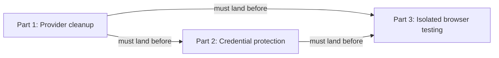
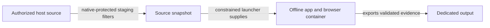

# Keep local agent work within useful boundaries: Codex — Part 3: Isolated browser testing

## Summary

Run RoboRepo's app and headless browser together in a disposable offline container, so local
browser tests can work without exposing host listeners, relays, or credentials. Begin with the
existing portal browser suite, one prepared image, and results/screenshots; prove that workflow
before expanding options or optimizing repeated approvals.

## Context

The original evidence is retained in [[4zyo2woj]]. Tested native host profiles either blocked
required localhost operations or allowed wildcard listeners, which the user rejected. A disposable
Node container passed IPv4/IPv6 loopback roundtrips and external-route denial, but the complete
app/browser workflow remains unverified. The historical forwarding control timed out and proves
neither forwarding success nor denial.

`scripts/test/portal-ui/run.mjs` already starts a real hermetic portal and invokes Playwright.
`scripts/cli/browser.mjs` and `scripts/cli/browser/` own browser results, evidence, and cleanup;
reuse those contracts. `scripts/test/lib/docker-sandbox.mjs` supplies clean-machine test mechanics,
but its configurable image/script invocation is not the constrained launcher required here.

## Series and prerequisites

| Part | Plan | Gate |
| --- | --- | --- |
| 1 | [[hr78g4sj]] | Provider cleanup must land before runner implementation |
| 2 | [[4zyo2woj]] | Native credential protection must land before source staging is used |
| 3 | This plan | Full browser integration, containment, measurements, and scoped approval verification |

## Goals

- Run the real portal browser suite with app and browser sharing container-local localhost.
- Preserve strict host networking and separate approval for host-portal restarts.
- Use credential-filtered source, disposable working files, and a bounded evidence output.
- Measure overhead and verify narrowly scoped repeat authorization without general Docker access.

## Proposed design

| Surface | Required boundary |
| --- | --- |
| Source | Stage only the files needed by the named workflow, including authorized uncommitted edits. Exclude `.git`, host `node_modules`, caches, sockets, unrelated files, and credential-pattern matches; preserve `.env.example` and `.env.sample`. Inspect names before contents; reject links/special files and escaping paths. Staging runs under native credential denial, not an escalated raw-checkout copy |
| Working files | Mount the validated snapshot read-only and copy it into disposable container-local writable storage. Tests may modify the copy; no automatic source copyback |
| Output | One empty per-run output root, no arbitrary host destination. Export bounded regular results/screenshots, rejecting links, special files, traversal, and path-swap races. Treat evidence as untrusted data; never execute it on the host |
| Home and environment | Fresh home/state/cache/temp storage and an explicit nonsecret environment allowlist. No host HOME, harness state, real `.env`, SSH agent, cloud/npm credentials, browser profiles, inherited descriptors, or Docker sockets; use synthetic test secrets |
| Network and process | `--network=none`, no published ports, host network, host proxy/relay, extra hosts, shared host IPC/PID namespace, or host-service browser endpoint. Nonroot user, dropped capabilities, no-new-privileges, read-only image filesystem, bounded writable scratch/resources, and owned cleanup on every exit |
| Launcher | Trusted installed staging/launch code outside agent-writable roots; fixed image identity, entrypoint, workflow, mounts, and isolation options. Validate per-run root ownership/containment and reject repo/environment overrides, arbitrary Docker argv, images, commands, endpoints, or mounts. Repo test code executes only inside the container |

Prepare one Linux browser image separately with explicit provisioning authorization. Use a minimal
credential-free context, pinned base/image identity, lockfile-matched dependencies, Chromium and
its OS libraries. Record recipe/lockfile/browser identity. Routine runs use the existing image
with `--pull=never`; missing or mismatched images block instead of downloading. Chromium must
work without privileged mode or a host sandbox bypass. Do not run Codex or supply its credentials
inside the container.

Use minimal CLI wiring and reuse browser result/evidence/owned-resource contracts. Container
startup must not call the host `ensureLocalService` path. Start with the fixed portal workflow;
additional workflows, filters, captures, persistent containers, and incremental synchronization
are outside this initial scope. Snapshot filtering is path-based, not content-based secret detection.

## Implementation plan

- [ ] Confirm Parts 1 and 2 have landed and recheck browser/runtime changes before integration.
- [ ] Add the single prepared-image recipe and offline compatibility checks; keep provisioning
      separately approved and credential-free.
- [ ] Add failing containment/invocation cases before implementing native-protected staging,
      constrained launch, evidence export, and success/failure/timeout/interruption cleanup.
- [ ] Run the real `npm run test:portal-ui` with its app and browser inside the disconnected
      container. A missing-browser skip is not a pass. Export screenshots/results and verify an
      isolated test-app restart without touching host services.
- [ ] Exercise IPv4/IPv6 loopback and synthetic negative cases for DNS, direct/proxy external
      access, host services/gateway, published listeners, and forwarding. Use passing positive
      controls; replace the inconclusive historical forwarding control. Inspect effective mounts
      and network settings, not just socket failures.
- [ ] Measure image preparation separately from source staging, container/app startup, suite
      execution, evidence collection, and cleanup. Compare the same suite with a permitted host
      control; optimize only demonstrated bottlenecks, retaining all isolation boundaries.
- [ ] After the workflow works with explicit per-run approval, test narrowly scoped repeat
      authorization twice in fresh supported desktop and CLI sessions. Prove launcher code cannot
      be replaced or overridden. Never approve generic Docker/interpreter/npm prefixes. If safe
      persistence is unavailable, report that limitation for a scope decision before claiming the
      no-repeat goal complete; retain approval rather than widen access.
- [ ] Run the full local parity gate and document observed versus asserted limits.

## Validation

- The real portal suite executes browser assertions and exports evidence; app/browser traffic
  stays within the disconnected container, with no host ports or unrelated services exposed.
- Credential fixtures stay excluded, templates remain usable, and host source/config are unchanged.
  Invocation injection, links/traversal, image mismatch, missing browser, and failed cleanup do not
  receive passing results. No daemon/socket access reaches repo code.
- Cleanup succeeds after normal execution, failed assertions, timeout, and interruption.
- Report measured host/runner timings without treating initial provisioning as per-run overhead.
  No performance benefit or approval persistence is claimed from the Node feasibility probe.
- Run `npm run test:portal-ui` inside the runner, the new runner containment/integration checks,
  `bash scripts/doctor.sh --quiet`, `git diff --check`, and `npm run check` before handoff.
- Host-portal restart and image provisioning remain separately approved actions. Preserve native
  guard and unrelated-config behavior after update/reapply.

## Documentation impact

- `docs/internal/docker-test-sandboxes.md`: distinguish the constrained app/browser runner from
  install-only test sandboxes; document preparation, mounts, cleanup, and negative probes.
- `docs/user/reference/roborepo-cli.md`, `docs/user/reference/runtime.md`: document the fixed
  workflow, image prerequisite, evidence, timing, and separate host-portal approval.
- `docs/user/reference/config-control-panel.md`, `docs/user/reference/codex-hooks.md`: explain
  which native, command-approval, and runner boundaries cover this workflow.

## Risks

| Risk | Mitigation |
| --- | --- |
| Safe persistent approval is unavailable | Prove invocation/code integrity; retain per-run approval and bring back the specific limitation |
| Snapshot omits a required file | Report the missing input and add only a reviewed nonsecret requirement; never mount the raw checkout |
| Rebuilding or copying dominates test time | Measure one real workflow before adding cache/sync infrastructure |
| Existing browser integration starts a host server | Keep app lifecycle inside the container and assert host processes remain unchanged |

## Decision Log

- October 24: extracted from the combined plan after the user approved splitting and made provider
  cleanup the prerequisite for everything. Preserve native denial, strict host networking, the
  disconnected runner, and separate host-portal restart approval. Scope the first delivery to
  one real workflow and measure before optimizing.

## Open questions

No open design choice before preparation. Full browser integration and safe persistent approval
remain unverified implementation gates; failure requires a specific scope decision, not broader access.
