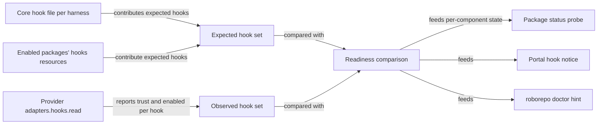

# Report hook readiness through harness providers and keep Codex hooks trusted

## Summary

When a RoboRepo package installs Codex hooks, those hooks don't run yet. Codex runs a non-managed
hook only after the user reviews and trusts its exact definition, and the macOS desktop app never
asks. Codex also keys that trust by the hook's position in `~/.codex/hooks.json`. RoboRepo
prepends each new package hook, so enabling one package can revoke trust from hooks the user
already reviewed. That happened on the reference Mac: after Skill Visibility was enabled, Codex
stopped running the telemetry `PostToolUse` hook.

Plan `3jp3yhtq` added a read-only check for this, but only for the five telemetry hooks. That check
lives outside the Codex provider and copies the hook list instead of reading it from the package.
Some other parts of `3jp3yhtq` also put provider-specific behavior in shared code.

This plan does five things:

- makes Codex append package hooks, so enabling a package leaves existing trust in place;
- moves hook readiness behind the provider `hooks.read` adapter, so every package and harness is
  covered;
- shows one notice per harness, with the exact command that opens Codex's `/hooks` review screen;
- installs the core Codex hooks, or documents why they are missing;
- moves the remaining provider-specific code and copy out of shared modules.

## Context

### Terms

| Term | Meaning |
| --- | --- |
| Core hooks | Hooks RoboRepo installs for a harness whatever packages are enabled, declared in a per-harness file such as `generated/codex/hooks.json` |
| Installed | The hook entry exists in the harness's hook file (`~/.codex/hooks.json`, or `hooks` in `~/.claude/settings.json`) |
| Trust key | Codex's record for one hook in `~/.codex/config.toml`: `[hooks.state."<hook file>:<event>:<group index>:<handler index>"]` with a `trusted_hash` |
| Trusted | Codex has a trust key whose hash matches the hook at that position, or reports the hook as managed |
| Active | Installed, trusted (or exempt from trust), and enabled, so the harness runs it |

Claude Code runs every installed hook, so for Claude, installed means active. Codex adds the trust
step.

### Current behavior

How hooks reach a harness and how their state gets reported:

| Step | Where | Behavior |
| --- | --- | --- |
| Install | `scripts/cli/packages.mjs` `hooks` case → `mergeHooksInto` in `scripts/cli/hook-composition.mjs` → provider `adapters.hooks.merge` | Every provider reaches `mergeHooksMap` in `scripts/harnesses/hooks-merge.mjs` (Claude and Gemini through `root-config-hooks.mjs`), which **prepends** a fragment's entries. The comment there explains why: a Claude deny hook must run before an allow hook |
| Package status | `probeHooks` in `scripts/cli/package-probes.mjs` | Counts installed commands only. Hardcodes `~/.codex/hooks.json` and `~/.<harness>/hooks/` instead of asking `hookFilePath` and the provider |
| Codex readiness | `scripts/cli/codex-hook-status.mjs` | Spawns `codex app-server` and calls `hooks/list`. Hardcodes the five telemetry events and commands. Returns `active`, `review_required`, `inactive`, `missing`, `unknown`, or `unavailable` (no executable). Its executable picker prefers the desktop runtime, the reverse of `selectedHarnessExecutable` in `scripts/harnesses/discovery.mjs` |
| Route | `/api/config/hooks/codex/status` in `scripts/cli/portal-routes-config.mjs`, handled by `loadCodexHookStatus` in `scripts/cli/telemetry.mjs` | Reports any thrown error as `unknown` |
| Portal notice | `portal/shared/codex-hook-status.js`, template `tpl-codex-hook-status` in `portal/shared/widget-templates-partial.html` | Rendered on Settings, Tokens, and Home when Token Telemetry is enabled and Codex is active. Shows nothing for `unknown` or `unavailable` |
| User docs | `docs/user/reference/codex-hooks.md` | Says the warning appears on Agents, which is no longer true |
| Provider slot | `hooks.read` in `scripts/harnesses/codex/index.mjs`, `scripts/harnesses/claude/index.mjs`, and `scripts/harnesses/gemini/index.mjs` | A `notYetMigrated` stub that throws |
| Doctor | `scripts/doctor.sh` | Has only `ok` and `fail` output helpers; no non-failing hint |

Other provider-specific behavior in shared modules:

| Location | Leak |
| --- | --- |
| `scripts/harnesses/desktop-runtime.mjs` | The no-runtime warning hardcodes "Code tab", a Claude Desktop detail |
| `scripts/harnesses/mcp-claude-cli.mjs` | Claude MCP command construction sits beside, not inside, `scripts/harnesses/claude/` |
| `generated/codex/hooks.json` | Holds the `jcodemunch` SessionStart notice, although that hook belongs to the archived package's `globals/packages-archived/jcodemunch/hooks-codex.json`. `system-package-ownership-characterization-check.mjs` already guards the same leak for Caveman and JDocMunch |

`scripts/harnesses/transcript-parse.mjs` also holds Codex parsing, but its header explains why: the
capture hook runs on every tool call and must not load a full provider module. It stays where it is.

### Observed on the reference Mac

October 12-13, 2026, during `3jp3yhtq` QA:

- Discovery found one Codex executable, the desktop runtime `codex-cli 0.155.0-alpha.16.4`. No
  Codex CLI is on `PATH`.
- `hooks/list` reported five telemetry hooks, all `trusted` and enabled, trusted by hand through
  Codex's review screen.
- The newest spool records then reported zero tokens, but predated the parser fix.

October 15, 2026, during promotion of this plan:

- `hooks/list` reports six hooks. The Skill Visibility observer
  (`node "$HOME/.codex/hooks/skill-reference-observer.mjs"`) was added at `PostToolUse` position
  0 on October 13. Codex reports it as `modified`, because it inherited the trust key the telemetry
  hook held there. The telemetry `PostToolUse` hook moved to position 1 and is `untrusted`. The
  other four telemetry hooks remain `trusted`.
- The Codex spool's last `PostToolUse` record is from October 13 at 20:39 UTC, before the
  observer was installed. Since then it holds 877 `PreToolUse` records and no `PostToolUse` ones.
- Five Codex sessions captured since October 13 report nonzero counts: 1.7M to 30.5M total tokens
  and 18 to 228 tool calls. Tool counts come from the transcript parse, so the missing
  `PostToolUse` hook does not zero them.
- The live `~/.codex/hooks.json` holds none of the four core hooks from
  `generated/codex/hooks.json`. `manifests/platform/manifest.tsv` maps that file to
  `~/.codex/hooks.json` as a `managed_copy`. `~/.codex/hooks/` holds only
  `skill-reference-observer.mjs`, not `permission-check.mjs` or `minimize-bash-output.mjs`. The
  cause is unknown. Without `permission-check.mjs`, the permission `ask` bucket on Codex falls
  through to `approval_policy`.
- `hooks/list` records carry `key`, `eventName` (camelCase, such as `postToolUse`), `command`,
  `sourcePath`, `source`, `isManaged`, `enabled`, `currentHash`, and `trustStatus`.

### Related plans

| Plan | Relationship | Effect on this plan |
| --- | --- | --- |
| `3jp3yhtq` (`completed/harness-desktop-runtime-discovery.md`) | Landed dependency. `cc4d97b` is an ancestor of the reviewed commit | Supplies `selectedHarnessExecutable` and the desktop-runtime discovery this plan reads. This plan supersedes its Codex hook check and portal notice |
| `codex-cmux-hook-trust-review` | Unlanded, independent | Owns `--dangerously-bypass-hook-trust`. No shared code |
| `harness-capability-derived-resource-targeting` | Unlanded, overlapping | Changes how a `hooks` resource names its harnesses, and its per-command `ask` work may add a Codex `PreToolUse` hook. The expected hook set must use the same harness resolution `packages.mjs` uses, so it follows that change |
| `usage-statusline-codex-hook-parity` | Unlanded, blocked upstream | Concerns a Codex footer hook, not lifecycle hooks. No shared code |

## Goals

- Enabling or disabling a RoboRepo package does not revoke Codex trust from hooks the user already
  trusted, except for hooks that sit after a removed one.
- Package status and the portal say "installed, awaiting review" for any package's Codex hook,
  with the exact command that opens Codex's review screen. A user with Token Telemetry enabled
  never sees silent partial capture.
- Hook readiness comes from the provider's `hooks.read` adapter. The expected hook set comes from
  the core hook file and enabled packages' `hooks` resources, never from a copied list.
- Desktop discovery (`desktop-runtime.mjs`, `discovery.mjs`, `contract.mjs`) takes all product
  copy from provider manifests, and Claude MCP command code lives in the Claude provider.
- Core Codex hooks are installed wherever the Codex home exists, and hold only hooks RoboRepo owns
  regardless of packages.

## Non-goals

- Writing Codex trust state (`[hooks.state]` hashes) on the user's behalf. Trust stays a user
  decision made in Codex.
- Using `--dangerously-bypass-hook-trust`. Plan `codex-cmux-hook-trust-review` owns that flag.
- Changing Claude's or Gemini's hook order.
- Moving Codex transcript parsing out of `scripts/harnesses/transcript-parse.mjs`.
- Gemini hook readiness. Gemini keeps its `hooks.read` stub, and readiness skips it.

## Proposed design

### Stable Codex trust keys

The Codex `hooks.merge` adapter appends a fragment's entries after the existing ones, in fragment
order, instead of calling the prepending `mergeHooksMap`. Enabling a package then adds new
positions without moving trusted ones. Claude and Gemini keep prepending.

Prepending exists for Claude's rule that the first decisive hook result wins. The only Codex hook
RoboRepo installs that makes a permission decision is core `permission-check.mjs`, and it stays
ahead of package hooks once core hooks are installed.

Two moves still shift positions, and the readiness notice names every affected hook for both:

- disabling a package moves every later hook at the same event;
- installing core hooks into a file that already holds package hooks moves those package hooks
  once.

### Readiness flow

### `hooks.read` contract

Each provider implements `adapters.hooks.read({ cwd })` and returns one record per installed hook:
`{ event, command, sourcePath, trust, enabled }`.

- `event` uses the fragment spelling (`PostToolUse`), so records compare directly with
  `hooks` resources.
- `sourcePath` lets the comparison ignore hooks from project or plugin sources that happen to share
  a command.
- `trust` is one of `trusted`, `managed`, `untrusted`, `modified`, `not-required`, or `unknown`.

| Provider | Source of `trust` |
| --- | --- |
| Claude | Always `not-required`. Reads the `hooks` key of the file `hookFilePath("claude", …)` returns |
| Codex | `hooks/list` from `app-server`, run with the executable Phase 1's rule picks. `trustStatus` maps directly, and `isManaged` maps to `managed`. The app-server client moves from `scripts/cli/codex-hook-status.mjs` into `scripts/harnesses/codex/` |

When the runtime is missing, too old, or slow, `read` returns entries with `trust: "unknown"`
rather than throwing. Callers keep working, and the notice says the state is unknown. The current
`unavailable` state folds into `unknown`.

### Readiness states

The shared comparison reports one state per harness for each package's `hooks` component, and one
for the harness's core hooks:

| State | Meaning | User-facing next step |
| --- | --- | --- |
| `active` | Every expected hook is installed, enabled, and trusted or exempt | none |
| `review_required` | At least one expected hook is `untrusted` or `modified` | Run the command the notice shows, which opens Codex's terminal UI. Enter `/hooks`, trust the listed RoboRepo commands, then start a new Codex session |
| `inactive` | Installed and trusted but disabled in the harness | Re-enable the hooks in Codex's `/hooks` screen |
| `missing` | An expected hook is absent from the hook file | Reapply the package |
| `unknown` | The harness runtime could not report | Check that the harness runtime is installed and has been launched |

The `review_required` command uses the executable discovery selected: the `codex` CLI on `PATH`,
or the desktop bundle's own `codex` binary. Trust lives in `~/.codex/config.toml`, which the
desktop runtime reads, so trust recorded from either binary is expected to apply to desktop
sessions. Phase 1 confirms this before the copy is written.

`probeHooks` reports this state in its `detail`. The portal replaces the Codex-only notice with one
notice per harness that names the affected packages and hooks. `/api/config/hooks/codex/status`
becomes `/api/config/hooks/<harness>/status`, served by a handler outside `scripts/cli/telemetry.mjs`.

### Remaining boundary moves

- Add an optional `setupHint` to `parentApp` in `scripts/harnesses/provider-manifest.schema.json`
  and `scripts/harnesses/contract.mjs`. The Claude manifest supplies the "Code tab" sentence, and
  `desktop-runtime.mjs` falls back to a generic sentence.
- Move `scripts/harnesses/mcp-claude-cli.mjs` into `scripts/harnesses/claude/`, keeping its
  import graph free of the registry for the reason its header gives.
- Move the `jcodemunch` notice out of `generated/codex/hooks.json`. The archived package already
  owns it.

## Implementation plan

### Phase 1: Facts and trust-key stability

- [x] Check whether enabling a package shifts the positions Codex trust keys depend on. It does:
      see "Observed on the reference Mac".
- [ ] Add a `scripts/test/hook-composition-check.mjs` case proving that merging a second Codex
      fragment leaves the first fragment's entries at their original indexes, and run it to see it
      fail. Then make the Codex `hooks.merge` adapter in `scripts/harnesses/codex/index.mjs` append
      entries in fragment order.
- [ ] Find why `~/.codex/hooks.json` on the reference Mac lacks the core hooks, reproducing on a
      clean `HOME` before changing the installer. Fix the install path if it is a defect, keeping
      core entries ahead of package entries.
- [ ] Remove the `jcodemunch` notice from `generated/codex/hooks.json`, and add the matching
      `doesNotMatch` assertion beside the Caveman and JDocMunch ones in
      `scripts/test/system-package-ownership-characterization-check.mjs`.
- [ ] Confirm that the desktop bundle's `codex` binary opens a terminal UI offering `/hooks`, and
      that trust recorded there makes a desktop session run the hook. Record the exact command in
      the Decision Log. If it fails, stop and bring the trust path back to the user.
- [ ] Check whether `hooks/list` exists on a `PATH` Codex CLI of the oldest version `hooks.read`
      must support. Pick the executable rule from the result and record it in the Decision Log.

### Phase 2: Provider `hooks.read`

- [ ] Implement `hooks.read` for Codex in `scripts/harnesses/codex/`, using the Phase 1 executable
      rule.
- [ ] Implement `hooks.read` for Claude.
- [ ] Add the readiness comparison in `scripts/harnesses/hook-readiness.mjs`. It builds the
      expected set from core hook files and enabled packages' `hooks` resources, resolving each
      resource's harness the way `packages.mjs` does. It skips a harness whose `hooks.read` is
      still a stub. Package status, the portal route, and `doctor` all consume it, so it lives
      with the shared harness code rather than with any one of them.
- [ ] Route `probeHooks` through `hookFilePath` and the comparison, and remove its hardcoded Codex
      hook file and `~/.<harness>/hooks/` paths.
- [ ] Delete `scripts/cli/codex-hook-status.mjs` and move its `telemetry-correctness-check.mjs`
      assertions to the new comparison's tests.

### Phase 3: Surfaces

- [ ] Replace the route and its `scripts/cli/telemetry.mjs` handler with the harness-parameterized
      route, and update `scripts/test/harness-portal-api-check.mjs`.
- [ ] Replace `portal/shared/codex-hook-status.js` and `tpl-codex-hook-status` with a generic
      notice. Update its three mounts in `portal/{settings,tokens,home}/` with their styles, and
      the specs at `scripts/test/portal-ui/portal-ui.spec.mjs` that route the old URL.
- [ ] Add a non-failing hint helper to `scripts/doctor.sh` and report readiness through it.
- [ ] Update `docs/user/reference/codex-hooks.md` (readiness states, review steps, the pages that
      show the notice) and `docs/internal/harness-provider-interface.md` (the `hooks.read`
      contract and Codex append order).

### Phase 4: Boundary moves

- [ ] Add `parentApp.setupHint` and move the "Code tab" copy into
      `globals/harnesses/claude/provider.json`. Keep the `, then run roborepo harness refresh.`
      ending, or update `finishesOnItsOwn` in `portal/shared/harness-warning.js`, which rewrites
      that ending into the portal's "RoboRepo will finish setting it up." copy.
- [ ] Move `mcp-claude-cli.mjs` into `scripts/harnesses/claude/`. Update its importers
      (`scripts/cli/mcp-claude.mjs`, `scripts/cli/packages.mjs`, `scripts/harnesses/claude/mcp.mjs`),
      its relative `provider.json` URL, and the comment in `scripts/test/test-cli.sh`.

## Validation

- [ ] Unit tests feed `hooks/list` fixtures to the Codex `hooks.read` and the comparison. Cover
      every readiness state, a package other than telemetry, the core hooks, a hook from another
      `sourcePath`, and a runtime that times out.
- [ ] `scripts/test/hook-composition-check.mjs` proves Codex appends and Claude still prepends.
- [ ] `scripts/test/harness-registry-check.mjs` proves the Claude and Codex `hooks.read` return
      records for a fixture home instead of throwing the `notYetMigrated` error.
- [ ] `scripts/test/harness-desktop-runtime-check.mjs` proves the no-runtime warning uses the
      manifest's `parentApp.setupHint`, and the generic sentence when the hint is absent.
- [ ] `npm run test:portal-ui` covers the generic notice for `review_required`, `missing`, and
      `unknown`.
- [ ] `npm run check` passes. Hook installation and package status are cross-cutting, so the full
      gate is required before handoff.

## Not tested

- [ ] Confirm nonzero token and tool counts in live Codex capture after the parser fix is installed.
      Carried from `3jp3yhtq`. Five sessions captured since October 13, 2026 report 1.7M to 30.5M
      tokens and 18 to 228 tool calls. This needs the user to confirm by hand that those sessions
      came from the Codex desktop app.
- [ ] After Phase 1, enable or disable a package on the reference Mac and confirm `hooks/list`
      still reports the earlier hooks as `trusted`. Requires a live Codex runtime and a hand
      review in `/hooks`.

## Risks

| Risk | Treatment |
| --- | --- |
| Codex changes `app-server` or `hooks/list` | `read` degrades to `unknown`; fixtures pin the observed shape |
| Spawning `app-server` on each portal load adds latency | Keep the existing timeout; cache the result for the portal refresh interval |
| Installing the missing core hooks on the reference Mac moves its package hooks once | The notice names each hook that needs review again |
| The desktop bundle's binary has no usable `/hooks` | Phase 1 checks it before any copy is written, and stops for a decision if it fails |
| The core-hook gap is machine-specific, not a defect | Phase 1 reproduces it on a clean home before changing the installer |

## Open Questions

None.

## Decision Log

- **Created from plan `3jp3yhtq`'s open items.** That plan's discovery work landed in `cc4d97b`.
  Its unconfirmed live Codex token counts and the Codex hook-trust design moved here at the user's
  request, with the provider-boundary findings from reviewing `3jp3yhtq` at close.
- **Guided review reaches `active` (October 15, 2026, user decision).** The notice gives the
  command that opens Codex's terminal UI, where `/hooks` trusts RoboRepo's hooks. Managed hooks
  were not pursued. Writing trust hashes stays excluded.
- **Codex appends package hooks (October 15, 2026, user decision).** Codex trust keys are
  positional, and prepending revoked trust on the reference Mac. Claude and Gemini keep prepending.
- **Live capture evidence recorded at promotion.** The spool shows nonzero token and tool counts
  since the parser fix, so Phase 1 no longer runs a separate capture task. The `## Not tested`
  entry stays until the user confirms it.
