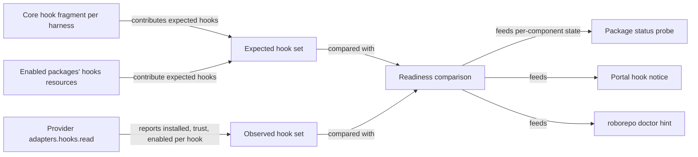

# Report hook readiness through harness providers and confirm live Codex capture

## Summary

When a RoboRepo package installs Codex hooks, those hooks still don't run. Codex runs a
non-managed hook only after the user reviews and trusts its exact definition, and the macOS desktop
app never asks. As a result, enabling Token Telemetry on a desktop-only Mac captures nothing from
Codex until someone finds Codex's `/hooks` review screen.

Plan `3jp3yhtq` added a read-only check for this, but only for the five telemetry hooks. That check
lives outside the Codex provider and copies the hook list instead of reading it from the package.
Some other parts of `3jp3yhtq` also place provider-specific behavior in shared code.

This plan does four things:

- confirms live Codex token capture now that the parser fix is installed;
- decides how a user brings RoboRepo's Codex hooks to an active state;
- moves hook readiness behind the provider `hooks.read` adapter, so every package and harness is
  covered;
- moves the remaining provider-specific code and copy out of shared modules.

## Context

### Terms

| Term | Meaning |
| --- | --- |
| Core hooks | Hooks RoboRepo installs for a harness regardless of packages, declared in a per-harness fragment such as `generated/codex/hooks.json` |
| Installed | The hook entry exists in the harness's hook file (`~/.codex/hooks.json`, or `hooks` in `~/.claude/settings.json`) |
| Trusted | Codex has recorded a `trusted_hash` for that entry under `[hooks.state]` in `~/.codex/config.toml`, or reports it as `managed` |
| Active | Installed, trusted (or exempt from trust), and enabled, so the harness runs it |

Claude Code runs every installed hook, so for Claude, installed means active. Codex adds the trust
step.

### Current behavior

How hooks reach a harness and how their state gets reported:

| Step | Where | Behavior |
| --- | --- | --- |
| Install | `scripts/cli/packages.mjs` `hooks` case → `mergeHooksInto` in `scripts/cli/hook-composition.mjs` → provider `adapters.hooks.merge` | Conforms to the provider contract |
| Package status | `probeHooks` in `scripts/cli/package-probes.mjs` | Counts installed commands only. Hardcodes the Codex hook-file path instead of asking the provider |
| Codex readiness | `scripts/cli/codex-hook-status.mjs`, served at `/api/config/hooks/codex/status` | Spawns `codex app-server` and calls `hooks/list`. Hardcodes the five telemetry events and command strings. Its own executable picker prefers the desktop runtime over the CLI, the reverse of `selectedHarnessExecutable` in `scripts/harnesses/discovery.mjs` |
| Portal notice | `codexHookStatusNotice` in `portal/config/templates.js`, gated by `shouldCheckCodexHooks` in `portal/config/app.js` | Shown only for Codex, and only when Token Telemetry is enabled |
| Provider slot | `hooks.read` in `scripts/harnesses/codex/index.mjs` and `scripts/harnesses/claude/index.mjs` | A `notYetMigrated` stub that throws, in both providers |

Other provider-specific behavior in shared modules:

| Location | Leak |
| --- | --- |
| `scripts/harnesses/desktop-runtime.mjs` | The no-runtime warning hardcodes "Code tab", a Claude Desktop detail |
| `scripts/harnesses/mcp-claude-cli.mjs` | Claude MCP command construction sits beside, not inside, `scripts/harnesses/claude/` |

`scripts/harnesses/transcript-parse.mjs` also holds Codex parsing, but its header explains why: the
capture hook runs on every tool call and must not load a full provider module. It stays where it is.

### Observed on the reference Mac (October 12-13, 2026)

- Discovery found one Codex executable, the desktop runtime `codex-cli 0.155.0-alpha.16.4`. No
  Codex CLI is on `PATH`.
- `hooks/list` reports five hooks, all telemetry, all `trusted` and enabled. They were trusted by
  hand through Codex's review screen during `3jp3yhtq` QA.
- `~/.codex/config.toml` keys trust by file position and content hash, for example
  `[hooks.state."<home>/.codex/hooks.json:pre_tool_use:0:0"]` with a `trusted_hash`.
- `generated/codex/hooks.json` declares four core hooks: two SessionStart notices,
  `permission-check.mjs`, and `minimize-bash-output.mjs`. `manifests/platform/manifest.tsv` maps it
  to `~/.codex/hooks.json`. The live file holds none of them, and `~/.codex/hooks/` does not exist.
  The cause is unknown. Without `permission-check.mjs`, the permission `ask` bucket on Codex falls
  through to `approval_policy`.
- The newest Codex spool records report zero tokens, but they predate the parser fix on main. With
  main's parser, a one-shot parse of the same transcript returns 12,425,278 total tokens and 109
  tool calls.

## Goals

- A fresh Codex desktop task records nonzero token and tool counts through the installed hooks.
- Package status and the portal say "installed, awaiting review" for any package's Codex hook,
  with the exact next step. A user with telemetry enabled never sees silent zero capture.
- Hook readiness comes from the provider's `hooks.read` adapter, and the expected hook set comes
  from the core fragment and enabled packages' `hooks` resources, never from a copied list.
- Desktop discovery (`desktop-runtime.mjs`, `discovery.mjs`, `contract.mjs`) takes all product
  copy from provider manifests, and Claude MCP command code lives in the Claude provider.
- Core Codex hooks are installed wherever the Codex home exists, or the reason they are not is
  documented.

## Non-goals

- Writing Codex trust state (`[hooks.state]` hashes) on the user's behalf. Trust stays a user
  decision made in Codex.
- Using `--dangerously-bypass-hook-trust`. Plan `codex-cmux-hook-trust-review` owns that flag.
- Moving Codex transcript parsing out of `scripts/harnesses/transcript-parse.mjs`.
- Gemini hook readiness beyond what the shared contract gives it for free.

## Proposed design

### Readiness flow

### `hooks.read` contract

Each provider implements `adapters.hooks.read({ cwd })` and returns one record per installed hook:
`{ event, command, trust, enabled }`. `trust` is one of `trusted`, `managed`, `untrusted`,
`modified`, `not-required`, or `unknown`.

| Provider | Source of `trust` |
| --- | --- |
| Claude | Always `not-required`; reads the `hooks` key of `~/.claude/settings.json` through the existing hook-file path |
| Codex | `hooks/list` from `app-server`, run with the executable `selectedHarnessExecutable` picks. The Codex-specific code from `scripts/cli/codex-hook-status.mjs` moves into `scripts/harnesses/codex/` |

When the runtime is missing, too old, or slow, `read` returns entries with `trust: "unknown"`
rather than throwing. Callers keep working, and the notice says the state is unknown.

### Readiness states

The shared comparison reports one state per package component and harness:

| State | Meaning | User-facing next step |
| --- | --- | --- |
| `active` | Every expected hook is installed, enabled, and trusted or exempt | none |
| `review_required` | At least one expected hook is `untrusted` or `modified` | Open Codex, run `/hooks`, and trust the listed RoboRepo commands; then start a new session |
| `inactive` | Installed and trusted but disabled in the harness | Re-enable the hooks in Codex's `/hooks` screen |
| `missing` | An expected hook is absent from the hook file | Reapply the package |
| `unknown` | The harness runtime could not report | Check that the harness runtime is installed and has been launched |

`probeHooks` reports this state in its `detail`. The portal replaces the Codex-only notice with one
generic notice that names the harness and the affected packages. `/api/config/hooks/codex/status`
becomes a harness-parameterized route.

### Remaining boundary moves

- Add an optional `setupHint` to `parentApp` in `provider-manifest.schema.json` and `contract.mjs`.
  The Claude manifest supplies the "Code tab" sentence, and `desktop-runtime.mjs` falls back to a
  generic sentence.
- Move `scripts/harnesses/mcp-claude-cli.mjs` into `scripts/harnesses/claude/`, keeping its
  import graph free of the registry for the reason its header gives.

## Implementation plan

### Phase 1: Live confirmation and facts

- [ ] Run one fresh Codex desktop task and confirm its spool records in
      `~/.roborepo/telemetry/spool/codex.jsonl` carry nonzero tokens and tool counts. Correct
      package and portal wording if the observed fields differ from the docs.
- [ ] Find why `~/.codex/hooks.json` on the reference Mac lacks the core hooks from
      `generated/codex/hooks.json`, and fix the install path if it is a defect.
- [ ] Check whether enabling or disabling a package shifts the hook positions Codex trust keys
      depend on, and whether that marks existing hooks `modified`.
- [ ] Check whether `hooks/list` exists on a `PATH` Codex CLI of the version `hooks.read` must
      support. Pick the executable rule from the result and record it in the Decision Log.

### Phase 2: Provider `hooks.read`

- [ ] Implement `hooks.read` for Codex in `scripts/harnesses/codex/`, using
      `selectedHarnessExecutable` or the rule from Phase 1.
- [ ] Implement `hooks.read` for Claude.
- [ ] Add the readiness comparison in `scripts/harnesses/hook-readiness.mjs`. It builds the
      expected set from core fragments and enabled packages' `hooks` resources. Package status,
      the portal route, and `doctor` all consume it, so it lives with the shared harness code
      rather than with any one of them.
- [ ] Route `probeHooks` through `hookFilePath` and the comparison, and remove its hardcoded Codex
      path.
- [ ] Delete `scripts/cli/codex-hook-status.mjs` once nothing imports it.

### Phase 3: Surfaces

- [ ] Replace the Codex route and notice with the generic route and notice, and update their
      Playwright specs.
- [ ] Add the matching `roborepo doctor` hint as a hint, not a failure.
- [ ] Update `docs/user/reference/codex-hooks.md` and `docs/internal/harness-provider-interface.md`
      with the readiness states and the review steps.

### Phase 4: Boundary moves

- [ ] Add `parentApp.setupHint` and move the "Code tab" copy into the Claude manifest. Keep the
      `, then run roborepo harness refresh.` ending, or update `finishesOnItsOwn` in
      `portal/shared/harness-warning.js`, which rewrites that ending into the portal's
      "RoboRepo will finish setting it up." copy.
- [ ] Move `mcp-claude-cli.mjs` into `scripts/harnesses/claude/` and update its importers.

## Validation

- [ ] Unit tests feed `hooks/list` fixtures to the Codex `hooks.read` and the comparison. Cover
      every readiness state, a package other than telemetry, the core hooks, and a runtime that
      times out.
- [ ] A registry check proves the Claude and Codex providers implement `hooks.read` without a stub.
- [ ] A desktop-runtime test with a fixture manifest proves the no-runtime warning uses the
      manifest's `parentApp.setupHint`, and uses the generic sentence when the hint is absent.
- [ ] Playwright specs cover the generic notice for `review_required`, `missing`, and `unknown`.
- [ ] `npm run check` passes. Hook installation and package status are cross-cutting, so the full
      gate is required before handoff.

## Not tested

- [ ] Confirm nonzero token and tool counts in live Codex capture after the parser fix is installed.
      Carried from `3jp3yhtq`. A one-shot parse with the installed parser returns nonzero counts
      for the real transcript, but no hook-driven capture has run since the fix landed. Requires a
      live Codex desktop task.

## Risks

| Risk | Treatment |
| --- | --- |
| Codex changes `app-server` or `hooks/list` | `read` degrades to `unknown`; fixtures pin the observed shape |
| Spawning `app-server` on each portal load adds latency | Keep the existing timeout; cache the result for the portal refresh interval |
| Position-keyed trust invalidates hooks after any package change | Phase 1 measures it; the notice then names every affected hook, not only the newest |
| The core-hook gap is machine-specific, not a defect | Phase 1 reproduces it on a clean home before changing the installer |

## Open Questions

- **How should a user reach `active`?** The desktop app shows no review prompt, and `app-server`
  exposes no trust mutation.

  | Option | What the user does | Concern |
  | --- | --- | --- |
  | Guided review (recommended) | Follows the notice to Codex's `/hooks` screen and trusts the listed commands | Needs a Codex surface that offers `/hooks`; unclear whether the desktop app has one |
  | Managed hooks | Nothing; Codex reports the hooks as `managed` | Unknown whether a user-level install can deliver managed hooks |
  | RoboRepo writes trust hashes | Nothing | Overrides Codex's review on the user's behalf; excluded by Non-goals |

## Decision Log

- **Created from plan `3jp3yhtq`'s open items.** That plan's discovery work landed in `cc4d97b`.
  Its unconfirmed live Codex capture, the Codex hook-trust question, the Codex half of its Phase 4
  surface check, and the remaining manual macOS telemetry check moved here at the user's request.
  The provider-boundary findings came from reviewing `3jp3yhtq` at close.
