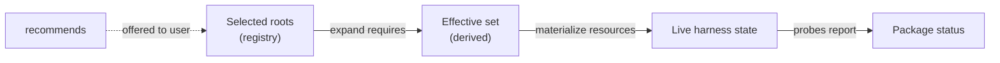
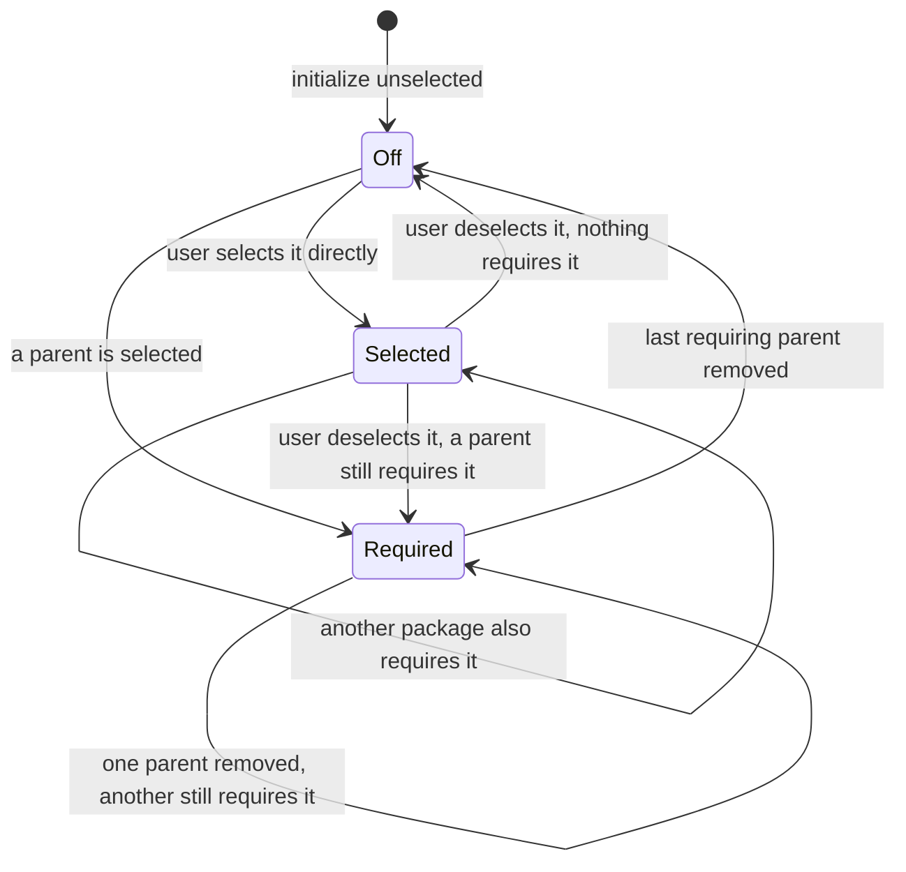

# One Package State Model: What the User Chose, What Follows From It, What Is Live

## Summary

RoboRepo records which packages a user turned on in `~/.roborepo/enabled-packages.json`, but that
file mixes two things: packages the user chose, and packages switched on only because a chosen
package `requires` them. Once written, the two look the same, so a dependency stays on after the
package that needed it is turned off. Package enable also reports success without checking that
every resource actually landed.

This plan gives package state one model with three layers, each with one owner:

| Layer | Answers | Owner |
| --- | --- | --- |
| Selected roots | What did the user (or a default) choose? | The registry file |
| Effective set | What must be active because of those choices? | Derived: roots plus their required-dependency closure |
| Live state | What is actually installed in each harness? | The existing resource probes |

On top of that model it adds `recommends` (offered, never automatic), non-selectable
dependency-only packages, a verified result from every enable and disable, and Required/Recommended
dependency sections on the Config page.

This plan merges two earlier backlog plans: the derived-dependency plan this file grew from, and
`package-registry-live-state-reconciliation`, whose remaining work is folded in below.

## Context

### Current state

Verified on `main` at `be7e441`.

| Area | Today | Gap |
| --- | --- | --- |
| Registry ownership | `scripts/cli/rules-render.mjs` owns `readEnabledPackagesRegistry`, `setPackageEnabled`, and `effectiveEnabledIds`, although the registry covers every package type | Package state lives in the rules renderer |
| Registry shape | `{ packages: [...], disabled: [...], updatedAt }`; `effectiveEnabledIds` = `packages` minus `disabled`, plus `defaultEnabled` packages not in `disabled` | No record of why an id is in `packages` |
| Enable | `enablePackage` in `scripts/cli/packages.mjs` recursively enables each `requires` entry and writes it to `packages` | Dependencies become sticky roots |
| Disable | `disablePackage` refuses while enabled dependents exist; `--cascade` disables them first | Turning off the last parent leaves its dependency on |
| Mutation result | Enable applies each component and prints progress; nothing probes afterward | A half-applied package reports as enabled |
| Live probes | `scripts/cli/package-probes.mjs` `buildPackageLiveState` reports `enabled`, `configured`, `partial`, `disabled`, or `external` per package and per component | Already shipped |
| Status API | `scripts/cli/package-status.mjs` and `/api/config` `componentStatus` expose probe results | Already shipped |
| Repair and adopt | `roborepo package reconcile` re-applies effective packages and drops ids missing from the catalog; `roborepo package adopt-live` marks external live packages as enabled | Already shipped |
| Portal badges | `portal/config/elements/config-item.js` styles `partial` as a warning and `external` as informational | Already shipped |
| Relationships | Catalog supports `requires` with cycle and missing-id checks. No built-in package uses it today ([[o93hile]] removed the marker packages' dependency); `scripts/test/test-cli.sh` covers it with a workspace-only `test-composite` fixture that requires `jcodemunch` and `jdocmunch` | No `recommends`, selectability, or dependency visibility |

A concrete case of the sticky dependency: enabling `test-composite` writes `test-composite`,
`jcodemunch`, and `jdocmunch` to `packages`. Disabling `test-composite` later leaves both
dependencies on, and nothing records that the user never chose them. The first built-in case will
be `implementation-review` ([[ejsc769o]]).

### Why now

[[ejsc769o]] needs a dependency-only `implementation-review` skill that `/plan-close` and
`/session-close` both require and that users cannot switch off on its own. That needs selectability
and derived activation. Every other package-state consumer (rules rendering, command ownership,
probes, the Config page) also reads the effective set, so the model has to change in one place
rather than per consumer.

## Goals

- Record only selected roots in the registry; derive dependencies on every read.
- Keep a shared dependency active until the last selected root that requires it is turned off.
- Add `recommends`: shown and offered, never enabled without a user choice, never a cause of
  `partial`.
- Add `selectable: false` so a dependency-only package cannot be toggled directly.
- Add `presentation.visibility` so dependency-only packages leave the normal rows but stay
  inspectable where they are referenced.
- Make enable and disable return the probed outcome (`enabled`, `partial`, or `blocked`) instead of
  assuming success.
- Give package state its own module, so the rules renderer only renders.
- Show Required and Recommended dependency sections on the Config page through the shared behavior
  view.

## Non-goals

- Changing install bundles in `manifests/platform/presets.json` or their selection record. Bundles
  are a separate desired-state record checked by `roborepo bundle check`; see Open decisions.
- `forget` and `remove` actions, and an expandable per-resource detail row in the portal. The
  shipped `reconcile`, `adopt-live`, and status badges cover current needs; add these when a
  concrete case needs them.
- Ownership markers inside harness config files.
- Plan-suite-specific behavior such as the `implementation-review` skill; [[ejsc769o]] owns it.
- Turning conditional, task-dependent skill pairing into static package relationships.

## Proposed design

### 1. Three layers, computed in one direction



```text
selectedRoots = registry.packages + defaultEnabled packages, minus registry.disabled
effective     = selectedRoots + transitive requires of selectedRoots
```

Every consumer that today calls `effectiveEnabledIds` reads `effective` from the new module.
Nothing reads the raw registry except that module.

### 2. Registry ownership and shape

Move registry read, write, and the effective-set computation from `scripts/cli/rules-render.mjs`
to a new `scripts/cli/package-state.mjs`. Graph traversal (closure, `requiredBy`,
`recommendedBy`) goes in a separate pure module, `scripts/cli/package-graph.mjs`, so it can be
tested without a home directory.

The file keeps its current path and `{ packages, disabled }` shape, with one change of meaning:
`packages` holds selected roots only. A `schemaVersion: 2` field marks files written under that
meaning. How a version-1 file is read is an open decision.

### 3. Manifest fields

```json
{
  "requires": ["implementation-review"],
  "recommends": ["test-harness"],
  "selectable": false,
  "presentation": { "visibility": "dependency" }
}
```

| Field | Default | Meaning |
| --- | --- | --- |
| `requires` | `[]` | The package is invalid without these; they join the effective set automatically |
| `recommends` | `[]` | Useful companions; offered, never added automatically |
| `selectable` | `true` | `false` rejects direct `package enable` and `package disable` |
| `presentation.visibility` | `catalog` | `catalog`: normal row. `dependency`: shown only in dependency sections. `hidden`: no UI row |

`roborepo package validate` rejects unknown ids in either relationship, self-references, invalid
values, and cycles in `requires`. `recommends` does not take part in cycle detection.

### 4. Enable and disable

A user action changes roots only; reconciliation then compares the effective set before and after
and applies or removes resources for the difference.



- `enable` and `disable` on a `selectable: false` package fail without changing state, and name
  the packages that control it.
- The `--cascade` flag and the "enabled packages depend on it" refusal stay for selectable
  packages that are required by another selected root.
- After applying, the mutation probes every package whose effective state changed and returns one
  outcome per package, with the per-component detail the probes already produce. The CLI prints it
  and the portal endpoint returns it.

  | Outcome | When |
  | --- | --- |
  | `enabled` | Every component probes as present |
  | `partial` | Some components probe as present and others as missing |
  | `blocked` | Applying stopped on an error, such as a collision with a user-owned file or a missing harness home |

### 5. Recommendations

When a selectable package is enabled and some of its recommendations are off:

| Caller | Behavior |
| --- | --- |
| Portal enable | Lists the disabled recommendations; the user enables them or continues |
| Interactive CLI | Prompts to enable or skip |
| Non-interactive CLI and API | Never enables them; returns them in the result |

The package engine returns recommendation data; only the portal and the interactive CLI prompt.
Graph and reconciliation functions never prompt.

### 6. Config page dependency sections

`buildBehaviorView` in `scripts/cli/config.mjs` derives, for each section, the dependencies its
visible packages reference, and exposes `requiredDependencies[]` and `recommendedDependencies[]`.
Each item carries the ordinary row data plus its relationship, the referencing packages, whether it
is selectable, and whether it is directly selected or derived.

```text
Plan Suite
  /plan-close                  [toggle]
  /session-close               [toggle]

  Required dependencies
    Implementation Review      required by /plan-close, /session-close

  Recommended dependencies
    Test Harness               recommended by /session-close       [toggle]
```

Dependency rows open the existing source popup (`loadConfigSource()`). A non-selectable dependency
has no toggle. Terminal onboarding and the portal read the same behavior view. Bulk toggles act on
selectable roots only.

## Implementation plan

### Phase 1: State module and graph helpers

- [ ] Add `scripts/cli/package-graph.mjs` with pure functions for selected roots, required closure,
      `requiredBy`, and `recommendedBy`.
- [ ] Add `scripts/cli/package-state.mjs`; move `readEnabledPackagesRegistry`,
      `setPackageEnabled`, and `effectiveEnabledIds` out of `scripts/cli/rules-render.mjs`, and
      update every importer.
- [ ] Extend `scripts/cli/package-catalog.mjs` to normalize and validate `recommends`,
      `selectable`, and `presentation.visibility`.
- [ ] Fixtures: shared, transitive, and directly selected dependencies; non-selectable packages;
      missing recommendation ids; a `requires` cycle.

### Phase 2: Derived activation and verified results

- [ ] Remove the recursive `enablePackage` call for `requires`; enable and disable change roots,
      then reconcile the before/after effective difference.
- [ ] Reject direct mutation of `selectable: false` packages.
- [ ] Probe changed packages after each mutation and return `enabled`, `partial`, or `blocked`.
- [ ] Apply the version-1 read rule chosen under Open decisions, and write `schemaVersion: 2`.
- [ ] Confirm rules rendering, command ownership, probes, `reconcile`, and `adopt-live` read the
      effective set from `package-state.mjs`.

### Phase 3: Recommendations

- [ ] Return disabled recommendations from the enable result.
- [ ] Add the portal prompt and the interactive CLI prompt; keep the non-interactive path silent.

### Phase 4: Config presentation

- [ ] Add selectability, visibility, derived-vs-selected state, and inverse relationships to the
      package snapshot in `scripts/cli/config.mjs`.
- [ ] Derive dependency sections in `buildBehaviorView`; omit `visibility: dependency` packages
      from normal rows.
- [ ] Render the sections in `portal/config/elements/config-item.js` and its templates, following
      the portal's template and light-DOM conventions, with no toggle for non-selectable rows.

### Phase 5: Catalog and docs

- [ ] Declare the new fields where they add clarity in built-in `package.config.json` files.
- [ ] Update package-development guidance and `docs/user/reference/config-control-panel.md` with
      the selected/effective/live model.

## Validation

| Behavior | Check |
| --- | --- |
| Catalog accepts valid graphs and rejects bad ids, values, and `requires` cycles | `scripts/test/package-catalog-check.mjs` |
| Enabling a package that requires another makes the dependency effective without recording it as a root (fixture package) | `scripts/test/package-lifecycle-check.mjs` |
| Two parents share a dependency; disabling one keeps it, disabling both removes it | `scripts/test/package-lifecycle-check.mjs` |
| A directly selected dependency survives its parents being disabled | `scripts/test/package-lifecycle-check.mjs` |
| Direct enable/disable of a non-selectable package fails and changes nothing | `scripts/test/package-lifecycle-check.mjs` |
| A forced component failure returns `partial`, not `enabled` | `scripts/test/package-lifecycle-check.mjs` |
| Defaults still apply and explicit disables still win | `scripts/test/package-default-enabled-check.mjs` |
| Reading a version-1 registry leaves the effective set unchanged | `scripts/test/package-lifecycle-check.mjs` |
| Bulk toggles skip dependency rows | `scripts/test/config-bulk-toggle-check.mjs` |
| Dependency sections render, open the source popup, and show toggles only for selectable rows | `npm run test:portal-ui` |
| Full gate, since package state reaches install, rules, and generated harness output | `npm run check` |

## Risks

| Risk | Treatment |
| --- | --- |
| A consumer keeps reading the raw registry and brings back sticky or missing dependencies | Only `package-state.mjs` reads the file; search for direct reads during Phase 2 |
| Prompts leak into graph code and break non-interactive callers | Prompts live only in the portal and the interactive CLI |
| A dependency row makes a category look partly selected | Bulk toggles and category state count selectable roots only |
| Changing the meaning of `packages` turns off something a user relies on | Whichever version-1 read rule is chosen must keep every currently effective package effective; a fixture asserts the effective set is unchanged across the upgrade |

## Open decisions

- **How a version-1 registry is read.** Today's files may list dependencies as if the user chose
  them.

  | Option | Effect on an existing install |
  | --- | --- |
  | Keep every listed id as a root | Nothing changes now; existing sticky dependencies stay sticky |
  | Drop listed ids that another listed root requires | Nothing changes now, because the parent keeps them effective; they turn off with their last parent |
  | Wipe and rebuild from defaults | Users lose their choices |

  Recommendation: drop required ids. It fixes stickiness for existing installs without changing
  what is active today.
- **Install bundles.** `presets.json` bundles keep their own selection record, and
  `roborepo doctor --installed` can fail with "selected but not fully applied" for a bundle while
  package status reports nothing wrong. Decide whether bundles stay a separate install-time
  mechanism or become packages in a later plan.

## Decision Log

- **2026-10-12: Merged `package-registry-live-state-reconciliation` into this plan.** Both plans
  redesigned the same registry in the same files. Most of that plan's work had shipped (probes,
  status API, `reconcile`, `adopt-live`, portal badges); its remaining items were a versioned
  registry and verified mutation results, which this plan now owns. Its `forget`/`remove` actions
  and per-resource detail rows are deferred (see Non-goals). The superseded plan is archived at `docs/plans/archived/package-registry-live-state-reconciliation.md`.

## Coordination and completed baseline

The superseded reconciliation proposal is archived as
`docs/plans/archived/package-registry-live-state-reconciliation.md`; this plan owns its remaining
versioned state, verified mutation, and repair/adoption requirements. Existing live probes and
`package inspect/status/reconcile/adopt-live` remain the baseline.

| Plan | Owns | Sequence |
| --- | --- | --- |
| This plan | Selected roots, effective closure, relationships, verified activation | Establish before dependency-only skill rollout |
| [[ejsc769o]] | Required/recommended built-in skill relationships and shared review skill | Consume this state contract and the current review rubric |
| [[jdsobwn]] | Source identity and installed provenance | Agree state/provenance references before persisting source-qualified selections |
| [[user-managed-packages-and-add-workflows]] | Typed creation, receipts, export/removal UX | Reuse this registry and live probes |
| [[74h2tlim]] | Portable record containment and backup | Consume feature-owned schemas; no second package-state model |
