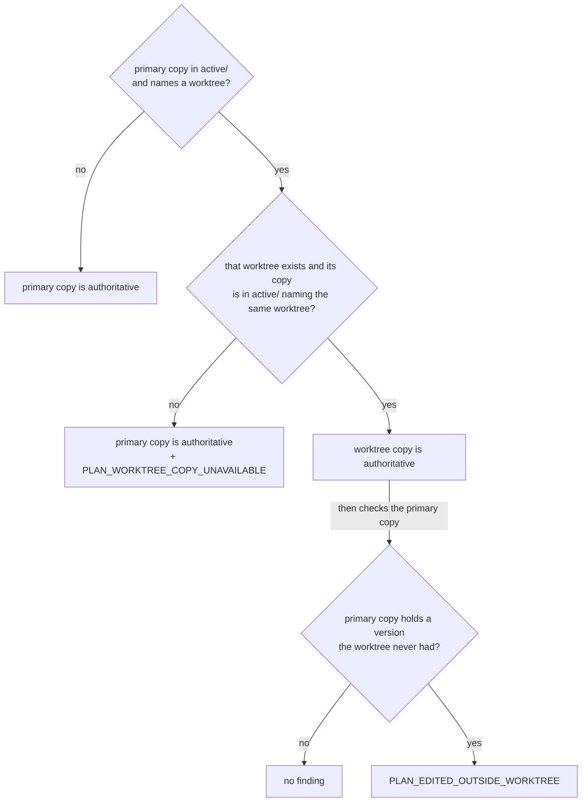
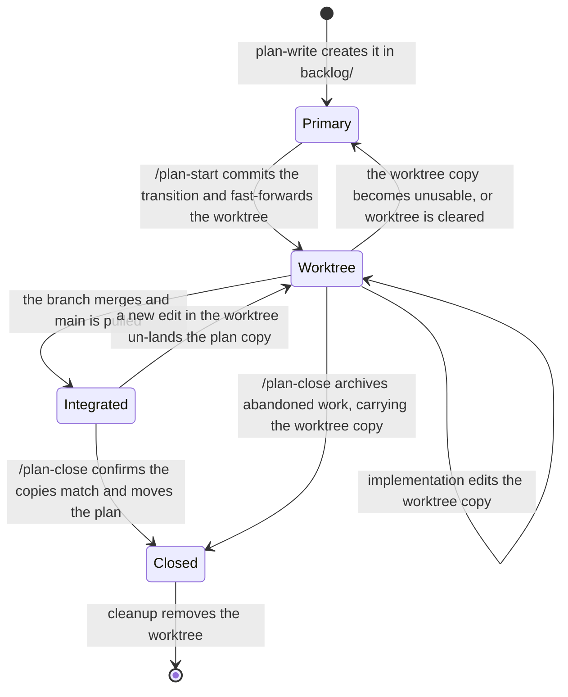

# Make Active Plan State Follow Its Assigned Worktree

## Summary

A normal RoboRepo user runs one RoboRepo instance from the primary checkout (`main`). That instance
reads plan documents from every checkout of each known repository, including linked worktrees whose
branches have diverged from `main`. During implementation, the plan's progress is written in the
worktree, but today the portal shows the primary checkout's copy, so `/plan-start` copies the plan
back to `main` at the end of each run to keep the portal current.

This plan gives each plan exactly one authoritative copy, decided by its lifecycle stage:

| Stage | Authoritative copy |
| --- | --- |
| Backlog | Primary checkout |
| Active, with an assigned worktree that holds the plan | That worktree |
| Active, with no usable assigned worktree | Primary checkout |
| Completed or archived | Primary checkout, after integration |

The primary portal aggregates: it reads an active plan's content directly from its worktree and
never asks for it to be copied to `main`. Nothing synchronizes copies in either direction. Git
carries the worktree's plan to `main` when the branch merges, like any other file on the branch; the
one exception is abandoned work, which never merges, so `/plan-close` carries its plan to `main`
once, in the archive commit. The
one check RoboRepo adds is whether the *other* copy was edited out of turn; when it was, the plan
shows a finding, and nothing is chosen, overwritten, or merged automatically.

## Context

### Terms

| Term | Meaning |
| --- | --- |
| Primary checkout | The repository's main working tree, resolved from Git administrative state by `modules/plan-suite/checkouts.mjs`, not from the registry's first root |
| Assigned worktree | The linked worktree whose administrative name equals the primary copy's `worktree` frontmatter |
| Authoritative copy | The one copy of a plan that the portal shows and RoboRepo writes |
| Outside edit | A change to the non-authoritative copy of an active plan that the authoritative copy never had |
| Primary portal | The RoboRepo instance started from the primary checkout; the normal deployment |

### What exists today

Verified on `main` at `4ba1cbf`.

- `modules/plan-suite/canonical-scan.mjs#scanRepository` reads every checkout, main first, and
  merges copies by plan `id`. The main copy always wins when it exists. When the copy in the plan's
  own worktree has a different content hash, the main record gets `divergentCheckouts` and an
  advisory `PLAN_DIFFERS_IN_WORKTREE` finding whose resolution says the main copy is the one the
  portal shows and edits. Copies in unrelated worktrees are ignored. A plan found only in a
  worktree is shown from there with `checkout` set to the worktree's label.
- `modules/plan-suite/index.mjs#updatePlanField` and `#movePlanLifecycle` write to the selected
  record's `absolutePath`, with optimistic `mtimeMs` checks. Whichever copy the scan selects is the
  copy the portal writes, so changing the selection changes where portal writes land.
- `planSnapshotFingerprint` decides when to rebuild the snapshot from directory stats under each
  checkout's `docs/plans`. It reads no Git refs.
- `globals/packages/plan-start/skills/plan-start/SKILL.md` Preflight item 14 and Implementation
  Workflow item 8 tell an implementation run to mirror plan updates into the primary checkout's copy
  once at the end, and `references/start-validation.md` calls the primary copy "the canonical
  plan". That mirroring was a user request recorded in [[age4cm7r]]'s Decision Log, made so the
  portal could show active progress.
- `globals/packages/plan-close/skills/plan-close/SKILL.md` step 6 confirms landing and ignores
  "documented post-merge plan synchronization" when comparing files.
- `docs/user/reference/plans-portal.md` documents the copy table above, including "The main
  checkout's copy is canonical".
- `scripts/test/plan-suite-canonical-check.mjs` asserts the current behavior: identical copies
  collapse, an unrelated behind worktree marks nothing, and the main copy wins when the assigned
  worktree differs.
- `modules/repositories/git-exec.mjs` allows `merge-base`, `rev-parse`, and `log` on its read-only
  path, which is all the outside-edit check needs.

### The mirror already drifts

On 2026-10-11 the primary copy of `docs/plans/active/git-worktree-lifecycle-cleanup.md` differed
from the copy in its assigned worktree: the worktree had a newer `next_action`, a newer
`reviewed_commit`, and rewritten §7 and §8. The portal showed the older primary copy, with a
**Differs in worktree** finding. This is the normal outcome of mirroring: the worktree keeps moving
and the mirror lags.

## Goals

- [ ] Every plan has exactly one authoritative copy, decided by its lifecycle stage and its assigned
      worktree, never by which branch is ahead or behind.
- [ ] The primary portal shows an active plan's content from its assigned worktree, with no copy to
      `main`.
- [ ] RoboRepo writes only to the authoritative copy: portal mutations, skills, and commands.
- [ ] An outside edit to the non-authoritative copy is reported as a finding; nothing merges,
      overwrites, or picks between copies automatically.
- [ ] Authority moves only at defined lifecycle transitions: `/plan-start`, integration by merge,
      and `/plan-close`.
- [ ] A worktree is never removed while it holds the only copy of its plan's current state.
- [ ] Any RoboRepo instance, of any version, running from any checkout, derives authority from the
      same repository state, with nothing persisted or shared between instances.
- [ ] `plan-start` stops mirroring plan updates into the primary checkout.

## Non-goals

- Synchronizing plan copies in either direction, or reconciling them on a schedule.
- A dedicated `roborepo/plans` branch, `canonicalPlanRef`, or any Git-ref-backed document store.
- A database, lockfile, lease, shared registry entry, or service that records which copy owns a plan.
- Preventing direct edits to plan Markdown. RoboRepo detects outside edits; it does not block them.
- CI that moves plan files, fails builds over plan copies, or commits plan changes.
- A Markdown editor in the portal.
- Automatically merging two edited copies.
- Changing the meaning of the `worktree` frontmatter field, or adding lifecycle states.
- Cross-machine collaboration. Git remains the transport between machines.

## Authority Model

### One rule

The primary copy decides **which stage** a plan is in, because every lifecycle transition is
committed there (`/plan-start` commits the start transition on the base branch; `/plan-close` moves
the plan on the base branch). During the active stage, the assigned worktree decides **what the plan
says**.

The worktree copy is authoritative only when all of these hold:

1. the primary copy is in `docs/plans/active/` and names a worktree;
2. Git has a linked worktree with that administrative name;
3. that worktree holds a readable copy with the same `id`, still in `docs/plans/active/`, naming the
   same worktree.

Otherwise the primary copy is authoritative. Condition 3 makes the handoff at start atomic: the
worktree copy becomes usable only once the worktree contains the start-transition commit, which
`roborepo plans start` fast-forwards into a fresh worktree.



### Every case

| Plan condition | Authoritative copy | Finding |
| --- | --- | --- |
| Backlog, completed, or archived in the primary checkout | Primary | none |
| Active in the primary, no `worktree` | Primary | none |
| Active in the primary, assigned worktree holds a usable copy | Worktree | `PLAN_EDITED_OUTSIDE_WORKTREE` only when the primary copy has an outside edit |
| Active in the primary, assigned worktree missing, its copy missing or unreadable, or its copy no longer in `active/` or naming a different worktree | Primary | `PLAN_WORKTREE_COPY_UNAVAILABLE`, with the reason |
| Present only in a worktree | That worktree, labeled with its name, as today | none |
| A copy in any unassigned worktree | Never | none |

A worktree being behind or ahead of `main` changes nothing in this table.

### Outside edits

The worktree copy is free to change; that is normal progress, and RoboRepo never reports it. The
check runs only on the non-authoritative primary copy of an active plan.

The primary copy is consistent when its bytes equal a version of the plan that the worktree's own
history already contains:

- the plan at the merge base of the primary checkout's `HEAD` and the worktree branch, read at the
  primary copy's path; or
- any plan blob the worktree branch's own commits produced (`git log --raw <base>..<branch> --
  docs/plans`); or
- the worktree's current working bytes.

Anything else is an outside edit. Matching by content needs no path tracking: a blob that equals
the primary copy byte for byte carries the same `id`.

| What happened to the primary copy | Consistent? | Why |
| --- | --- | --- |
| Nothing since `/plan-start` | yes | equals the merge-base version |
| The branch was squash- or rebase-merged and `main` pulled | yes | equals a blob the branch produced |
| `main` was merged into the worktree after an edit on `main` | yes | the merge base moved past the edit |
| Edited on `main`, committed or not, and not yet merged into the worktree | no | the worktree never had that version |
| An older RoboRepo portal wrote a priority change to the primary copy | no | same as any outside edit |

The check is a pure function of current Git and filesystem state. It persists nothing, and it is
recomputed on every snapshot rebuild, so rebases and moving merge bases need no special handling.
It runs only when the two copies differ, and costs one `merge-base`, one `rev-parse`, and one `log`
per such plan. When Git cannot answer (detached `HEAD`, missing branch, timeout), the plan gets
`PLAN_AUTHORITY_UNCHECKED` instead of a guess.

### Resolving an outside edit

RoboRepo reports and stops there. The finding names both copies and offers the two Git-native
resolutions:

- merge the base branch into the worktree, which brings `main`'s edit into the authoritative copy
  through an ordinary Git merge and its conflict handling; or
- move the edit into the worktree copy by hand, then revert it in the primary checkout.

The portal keeps showing the worktree copy while the finding stands.

## Lifecycle Transitions

The normal story:

1. `/plan-start` commits the start transition in the primary checkout and fast-forwards the fresh
   worktree to it. The worktree copy becomes authoritative.
2. Implementation runs edit the plan in the worktree. The primary portal shows those edits as they
   happen, and the primary copy stays as `/plan-start` left it.
3. The branch merges into `main` through a PR, and the primary checkout pulls. The primary copy now
   equals the worktree copy.
4. `/plan-close` confirms the two copies match, records verification in the primary copy, and moves
   it to `completed/`. The primary copy is authoritative again.
5. [[a7bslb00]]'s cleanup removes the worktree, since its plan is no longer active.



`Integrated` is still the worktree-authoritative stage; it names the moment both copies are equal.

Authority changes hands only at these points:

| Transition | Who | Authority before → after | Safeguard |
| --- | --- | --- | --- |
| Start | `/plan-start` → `roborepo plans start`, from the primary checkout | primary → worktree | unchanged transition: plan-only commit on the base branch, fast-forward of a fresh worktree; the worktree copy becomes usable only once it contains that commit |
| Implementation | `plan-start`, `plan-write`, `session-close`, the portal | worktree | every write goes to the worktree copy; nothing is copied to `main` |
| Merge main into the worktree | the user | worktree | Git merges `main`'s plan edits into the worktree copy and reports conflicts itself |
| Merge the branch into `main` | the user, through a PR | worktree; the primary copy now equals it | the primary copy matches a blob the branch produced, so no finding |
| Close as completed | `/plan-close`, from the primary checkout | worktree → primary | new integration check, below; then the existing landed check and move |
| Close as archived | `/plan-close`, from the primary checkout | worktree → primary | archive handoff, below: the worktree copy is carried into the primary checkout once, refused on an outside edit |
| Release without closing | the user clears `worktree` in the primary copy | worktree → primary | explicit; the worktree copy is ignored from then on |
| Automatic worktree cleanup | [[a7bslb00]] | none | its plan-active guard reads the primary copy's `active/` folder, so it waits for `/plan-close` |
| Confirmed worktree removal | the user, from Home or the cleanup command | worktree → primary, with `PLAN_WORKTREE_COPY_UNAVAILABLE` | [[a7bslb00]]'s clean-tree guard keeps uncommitted edits; the archive ref keeps committed ones |

### Integration check in `/plan-close`

Before closing a plan as completed, `/plan-close` confirms that the worktree's current plan copy is
already in the base branch: the worktree's working bytes for the plan equal the primary copy's
bytes. If they differ, the worktree holds plan progress that has not landed, and `/plan-close`
refuses with `plan: not integrated`, naming the worktree and the plan path. It does not copy the
worktree's version into `main`.

After this check, `/plan-close` edits the primary copy (verification evidence, the move to
`completed/`), and authority is back in the primary checkout.

This check is what keeps cleanup safe. [[a7bslb00]]'s automatic removal waits until the plan leaves
`active/`, and the plan leaves `active/` only through `/plan-close`, which now refuses while the
worktree holds unlanded plan state. Between merging the PR and running `/plan-close`, the plan
should not be edited in the worktree. An edit made there is either uncommitted, which fails the
clean-tree guard, or a new commit, which makes the branch no longer landed; either way the worktree
is kept.

### Archive handoff in `/plan-close`

Abandoned or superseded work never merges, so Git never brings the worktree's plan copy, including
the reason the work stopped, to `main`. Closing as archived therefore carries it there once:

| Copies | `/plan-close` archiving does |
| --- | --- |
| Equal | records the reason in the primary copy and moves it to `archived/`, as today |
| Worktree copy authoritative, primary copy consistent | writes the worktree copy's content into the primary copy, records the reason, and moves it to `archived/`, all in one archive commit on the base branch |
| Primary copy has an outside edit | refuses with `plan: conflicting copies`, naming both; the user resolves it as in "Resolving an outside edit" |
| Worktree copy unavailable | archives the primary copy and states in the report that the worktree's plan state was not available |

This is the only place RoboRepo copies plan content between checkouts. It runs once, in one
direction, at a lifecycle transition, and never merges two edited copies.

## Multiple Portal Instances

Developing RoboRepo itself can mean several portals at once, each started from a different
worktree and possibly running a different RoboRepo version. They need no coordination, because:

- authority is derived from Git and filesystem state on every scan, and never stored;
- `repositoryCheckouts` resolves the primary checkout from Git's administrative files, so a portal
  started from a worktree still treats the primary checkout as primary;
- the scan writes nothing; the only writes are user-initiated mutations, each guarded by an
  `mtimeMs` check on the file it writes.

A portal that predates this plan still shows and writes the primary copy. Its writes are outside
edits, and every instance that has this plan reports them as `PLAN_EDITED_OUTSIDE_WORKTREE`.

## Proposed Design

### 1. A pure authority resolver

Add `modules/plan-suite/plan-authority.mjs`, separate from checkout discovery and from the scan
loop:

- `resolvePlanAuthority({ primary, assigned })` takes the primary copy and the assigned worktree's
  copy (either may be absent) and returns `{ source, reason }` per the rule above. It is pure.
- `checkOutsideEdits({ primary, assigned, git })` runs only when `source` is `worktree` and the bytes
  differ. It asks Git, through `defaultRunGitSync` in `modules/repositories/git-exec.mjs`, for the
  merge base, the base blob, and the branch's plan blobs, computes the Git blob id of the primary
  copy's bytes in process (`hash-object` is not on the read-only allow-list), and returns
  `consistent`, `outside-edit` (with whether it is committed), or `unchecked`.

`canonical-scan.mjs` stays orchestration: enumerate checkouts, collect copies per `id`, call the
resolver, and build the snapshot.

### 2. The scan returns the authoritative record

Change `scanRepository` so it collects the primary copy and the assigned worktree's copy for each
plan before choosing a record, then returns the authoritative one. Only the selected copy needs a
full `readPlanRecord`; other copies still need only their `id` and hash, as today.

Each public plan carries a compact, path-free authority object:

```json
{ "authority": { "source": "worktree", "worktree": "plan-active-worktree-authority" } }
```

`source` is `primary` or `worktree`; `worktree` is set only for `worktree`. Remove
`divergentCheckouts` and `PLAN_DIFFERS_IN_WORKTREE`; the authority object and the findings below
replace them.

Repository grouping, `id` and key resolution, relationships, lifecycle counts, and Home's
plan-to-worktree join (`repository-overview-projections.mjs#associatePlans`, which joins on the
`worktree` field) are unchanged. The lifecycle a plan is counted under is the primary copy's, which
an authoritative worktree copy shares by condition 3.

Add to `planSnapshotFingerprint` the `HEAD` file of the primary checkout and of each linked
worktree, and the loose ref or `packed-refs` stat it points to. A merge of `main` into a worktree
can change the outside-edit result without touching any plan file, and the fingerprint must notice.
Move the fingerprint and its `statPlanTree` helper into `modules/plan-suite/snapshot-fingerprint.mjs`
so `canonical-scan.mjs` stays a short orchestrator within the file-size cap.

### 3. Findings

Add to `modules/plan-suite/findings.mjs`, all advisory:

| Code | When | Message names | Resolution |
| --- | --- | --- | --- |
| `PLAN_EDITED_OUTSIDE_WORKTREE` | The primary copy of an active plan holds a version its worktree never had | the worktree, and whether the edit is committed | Merge the base branch into the worktree, or move the edit into the worktree copy and revert it in the primary checkout. RoboRepo shows the worktree copy and merges nothing |
| `PLAN_WORKTREE_COPY_UNAVAILABLE` | The primary copy names a worktree whose copy is not usable | the worktree and the reason: worktree missing, copy missing or unreadable, copy left `active/`, or copy names another worktree | Restore the worktree, land its plan changes, or clear `worktree` to release the plan to the primary checkout. Progress recorded only in the worktree is not shown |
| `PLAN_AUTHORITY_UNCHECKED` | Git could not establish the merge base or branch history | the worktree and the Git failure, without paths | Showing the worktree copy; an outside edit to the primary copy cannot be ruled out |

None of them marks a plan invalid for lifecycle moves, and none blocks editing.

### 4. Writes follow authority

Because portal mutations already write the selected record's file, selecting the worktree copy
routes them there. Make that explicit and close the one gap:

- Plan document reads and `updatePlanField` (priority) write the authoritative copy, with the
  existing `mtimeMs` check on that file.
- `movePlanLifecycle` refuses when `authority.source` is `worktree`, with a new domain error
  `LIFECYCLE_OWNED_BY_PRIMARY`: lifecycle moves are committed in the primary checkout, so moving
  the worktree copy would create a second lifecycle. Its resolution points to `/plan-close`, or to
  clearing `worktree` first. The dropdown stays a manual override wherever the primary copy is
  authoritative.
- `roborepo plans start` is unchanged; it already runs in the primary checkout.
- Audit `scripts/cli/plans.mjs` and `scripts/cli/portal-routes-plans.mjs` for any other path that
  resolves a plan from the global snapshot and assumes the primary checkout.

### 5. Skills follow the same rule

Write the rule once, in `globals/packages/plan-write/skills/plan-write/references/plan-schema.md`,
as a "Plan authority" section beside "Worktree association", in tool-neutral prose. Each suite
skill applies it rather than restating it:

| Skill | Change |
| --- | --- |
| `plan-start` | Delete Preflight item 14's synchronization sentence and Implementation Workflow item 8. State that after `APPROVED` the worktree copy is the plan, and every plan update, including `## Not tested` entries, goes there. In `references/start-validation.md`, stop calling the primary copy "the canonical plan" and drop "Plan status updates still go to the primary checkout's canonical copy" |
| `plan-write` | Before editing an active plan, resolve the authoritative copy by the rule and edit only that copy. When the rule falls back to the primary copy because the worktree copy is unavailable, or the primary copy has an outside edit, report it and edit nothing else |
| `session-close` | No change expected: it delegates plan syncing to `plan-write`. Confirm no text tells it to copy to the primary checkout |
| `plan-close` | Add the integration check before closing as completed, and the archive handoff when closing as archived. Remove "documented post-merge plan synchronization" from step 6's ignore list, since there is no such synchronization |

### 6. Portal presentation

- The Plans drawer shows where the plan was read from ("From worktree `<name>`") when
  `authority.source` is `worktree`, and renders the three findings in the existing warning section.
- Normal worktree progress is quiet: no badge, no warning.
- Home adds nothing. Its worktree row already represents the plan, and a separate badge would
  restate the drawer.
- When `movePlanLifecycle` refuses, the existing domain-error surface shows the message and
  resolution.

## Affected Repository Files

| Area | Path | Change |
| --- | --- | --- |
| Authority | `modules/plan-suite/plan-authority.mjs` | New: `resolvePlanAuthority` and `checkOutsideEdits` |
| Scan | `modules/plan-suite/canonical-scan.mjs` | Collect copies, return the authoritative record, add `authority`, remove `divergentCheckouts` and `markDiverged` |
| Fingerprint | `modules/plan-suite/snapshot-fingerprint.mjs` | New: `planSnapshotFingerprint` moved out of `canonical-scan.mjs`, extended with `HEAD` refs; `modules/plan-suite/index.mjs` re-exports it from the new file |
| Checkout listing | `modules/plan-suite/checkouts.mjs`, or `modules/repositories/worktree-inventory.mjs` once [[a7bslb00]] lands | Expose each worktree's branch, which the inventory already reads |
| Findings | `modules/plan-suite/findings.mjs` | Add the three codes; remove `PLAN_DIFFERS_IN_WORKTREE` |
| Mutations | `modules/plan-suite/index.mjs` | `movePlanLifecycle` refusal; `publicPlan` carries `authority` |
| Routes and CLI | `scripts/cli/portal-routes-plans.mjs`, `scripts/cli/plans.mjs` | Audit; change only where a path assumes the primary copy |
| Plans UI | `portal/plans/plan-drawer.js`, `portal/plans/plan-drawer-partial.html` | "From worktree" line |
| Plan schema | `globals/packages/plan-write/skills/plan-write/references/plan-schema.md` | "Plan authority" section |
| Skills | `globals/packages/plan-start/skills/plan-start/SKILL.md`, its `references/start-validation.md`, `globals/packages/plan-write/skills/plan-write/SKILL.md`, `globals/packages/plan-close/skills/plan-close/SKILL.md`, then the rendered `generated/packages/` commands | As in §5 |
| Checks | `scripts/test/plan-suite-canonical-check.mjs`, `scripts/test/plan-suite-check.mjs`, `scripts/test/plans-portal-state-check.mjs`, `scripts/test/plan-promote-plan-start-check.mjs` | Replace the main-copy-wins assertions; add the fixture cases and skill-text assertions in Validation |
| Docs | `docs/user/reference/plans-portal.md`, `docs/user/guides/plan/lifecycle/plan-suite.md` | Replace the copy table and "main checkout's copy is canonical"; describe the integration check |

## Implementation Plan

### Phase 1 — Authority resolver and outside-edit check

- [ ] Add `modules/plan-suite/plan-authority.mjs` with `resolvePlanAuthority`, covering every row of
      the "Every case" table.
- [ ] Add `checkOutsideEdits` through the read-only Git path, covering every row of the "Outside
      edits" table, uncommitted primary edits, and the `unchecked` case.
- [ ] Unit-test the resolver as a pure function, and the check against temporary fixture
      repositories with a primary checkout and a linked worktree.

### Phase 2 — Scan and findings

- [ ] Refactor `scanRepository` to collect copies and return the authoritative record, keeping one
      full record per plan.
- [ ] Add the `authority` object; remove `divergentCheckouts`, `markDiverged`, and
      `PLAN_DIFFERS_IN_WORKTREE`.
- [ ] Add the three findings and their messages.
- [ ] Move `planSnapshotFingerprint` into `snapshot-fingerprint.mjs` and extend it with `HEAD` and
      ref state.
- [ ] Rewrite the main-copy-wins assertions in `plan-suite-canonical-check.mjs`.

### Phase 3 — Writes

- [ ] Add the `LIFECYCLE_OWNED_BY_PRIMARY` refusal to `movePlanLifecycle`.
- [ ] Confirm `updatePlanField` and document reads use the authoritative copy, with fixture tests.
- [ ] Audit `scripts/cli/plans.mjs` and `scripts/cli/portal-routes-plans.mjs`.

### Phase 4 — Skills and schema

Start after [[a7bslb00]] lands, because it rewrites `/plan-close` steps 6 and 9 in the same file.

- [ ] Add "Plan authority" to `plan-schema.md`.
- [ ] Remove mirroring from `plan-start` and `start-validation.md`.
- [ ] Add authority resolution to `plan-write`; confirm `session-close` needs nothing.
- [ ] Add the integration check and the archive handoff to `plan-close`, and remove the post-merge
      synchronization exception.
- [ ] Regenerate the rendered commands with `scripts/build/render-slash-commands.mjs`.
- [ ] Add the skill-text assertions from Validation to `scripts/test/plan-promote-plan-start-check.mjs`.

### Phase 5 — Portal and docs

- [ ] Add the "From worktree" line to the Plans drawer and render the new findings.
- [ ] Update `docs/user/reference/plans-portal.md` and the plan-suite guide.

## Validation

Focused checks while iterating:

```text
node scripts/test/plan-suite-canonical-check.mjs
node scripts/test/plan-suite-check.mjs
node scripts/test/plan-suite-commands-check.mjs
node scripts/test/plan-promote-plan-start-check.mjs
node scripts/test/plans-portal-state-check.mjs
node scripts/test/repository-overview-check.mjs
```

Fixture coverage, each a temporary repository with a primary checkout and at least one linked
worktree:

- [ ] An active plan edited only in its assigned worktree is returned from the worktree, with
      `authority.source: "worktree"` and no finding.
- [ ] A worktree that is behind `main` and never touched the plan changes nothing: the plan is read
      from the worktree, and there is no finding.
- [ ] An uncommitted edit to the primary copy produces `PLAN_EDITED_OUTSIDE_WORKTREE`; so does a
      committed one; merging `main` into the worktree clears it.
- [ ] After a squash merge of the branch and a pull in the primary checkout, there is no finding.
- [ ] A missing worktree, a missing worktree copy, a worktree copy moved out of `active/`, and a
      worktree copy naming another worktree each fall back to the primary copy with
      `PLAN_WORKTREE_COPY_UNAVAILABLE` and the matching reason.
- [ ] A worktree that does not yet contain the start-transition commit is not authoritative.
- [ ] A copy in an unassigned worktree is never authoritative and produces no finding.
- [ ] An unresolvable merge base produces `PLAN_AUTHORITY_UNCHECKED`.
- [ ] A worktree-only plan is still shown, labeled with its worktree.
- [ ] Changing an active plan's priority from the portal writes the worktree copy and leaves the
      primary copy byte-identical.
- [ ] Changing a backlog plan's priority writes the primary copy.
- [ ] Moving a worktree-authoritative plan out of `active/` from the portal is refused with
      `LIFECYCLE_OWNED_BY_PRIMARY`, and neither copy changes.
- [ ] Merging `main` into a worktree without touching any plan file changes the snapshot
      fingerprint.
- [ ] `/api/plans` output contains no absolute path.
- [ ] Skill checks: `plan-start` contains no instruction to copy plan updates to the primary
      checkout, and `plan-close` describes the integration check and the archive handoff.

Because this changes shared Plans behavior, portal-visible state, and rendered skill output, finish
with the repository gate:

```text
npm run check
```

## Success Criteria

- An active plan progresses in its worktree, and the primary portal shows that progress with no copy
  to `main`.
- Each plan has one authoritative copy, and every RoboRepo write goes to it.
- A worktree that is behind or ahead of `main` never changes which copy is authoritative and never
  produces a finding by itself.
- An outside edit to the primary copy is reported, and neither copy is changed by RoboRepo.
- `/plan-close` refuses to complete a plan whose worktree holds unlanded plan state, so cleanup never
  removes the only copy of it.
- An archived plan on `main` carries its worktree's final plan content, including why the work
  stopped.
- Two portals of different versions, started from different checkouts, show the same authoritative
  copy for every plan, with no shared state between them.
- No synchronization machinery, database, plan branch, lockfile, CI mover, or editor is introduced.

## Risks

| Risk | Mitigation |
| --- | --- |
| A rebase or a merge of `main` changes the merge base mid-story | The check is recomputed from current Git state on every rebuild and persists nothing; the fingerprint includes `HEAD` refs |
| The plan's important state is uncommitted | The worktree's working bytes are the authoritative content and an accepted version in the check; the primary copy's working bytes are what is checked |
| A Git clean filter or line-ending conversion makes identical text hash differently | The blob id is computed in process from working bytes, with no filters applied, so a repository whose filters rewrite Markdown can see a false outside edit. The finding is advisory, and the fixture covers plain Markdown only |
| The assigned worktree is removed while the plan is active | Fallback to the primary copy with `PLAN_WORKTREE_COPY_UNAVAILABLE`; [[a7bslb00]]'s archive ref holds committed progress, and its clean-tree guard refuses removal over uncommitted progress |
| A plan is edited in the worktree after its PR merged | `/plan-close`'s integration check refuses; the edit lands through another merge, or is discarded |
| An older RoboRepo version writes the primary copy | Reported as an outside edit by every current instance |
| Two copies are edited and the user wants them combined | Git merges them when `main` is merged into the worktree; RoboRepo never does |
| Cross-machine unpushed edits | Out of scope; Git is the transport between machines |

## Decision Log

### Use the assigned worktree as the authoritative active copy

**Decision:** During active implementation, the worktree named by the plan's `worktree` field is the
one authoritative copy.

**Alternatives considered:** continuously mirror to `main`; add a dedicated plan branch; store plan
state in a database.

**Reason:** The worktree already provides isolated history, conflict handling, and eventual merge
into `main`. Reusing it removes synchronization writes without adding a persistence layer.

### Detect competing edits instead of blocking them

**Decision:** Direct file editing stays valid. RoboRepo reports outside edits rather than installing
CI failures or locks.

**Reason:** RoboRepo does not own every editor or agent that changes Markdown. Advisory detection
keeps the filesystem-first model.

### Defer a dedicated plan branch

**Decision:** No `roborepo/plans` branch or configurable canonical plan ref in this story.

**Reason:** A dedicated branch adds remote synchronization, branch lifecycle, permissions, and
conflict handling before the simpler worktree model has been tried. Revisit only if cross-machine
collaboration becomes a demonstrated problem.

### 2026-10-11 — One authority per stage; no reconciliation machinery

**Decision:** Replaced the earlier design, which compared both copies against a common base,
classified seven variant states, and had a generic portal move out of `active/` copy worktree
content into the primary checkout. Now the primary copy decides the stage, the worktree decides
active content, and the only check is whether the non-authoritative copy holds a version the
authority never had.

**Reason:** The seven-state classifier treated both copies as peers whose changes had to be
weighed, and the portal handoff was a synchronization path. Under a single authority, a change in
the worktree is never a conflict, so only edits to the other copy need detection, and those are
resolved by Git merges the user already performs.

### 2026-10-11 — Lifecycle moves of a worktree-authoritative plan are refused in the portal

**Decision:** The portal's lifecycle dropdown refuses to move a plan whose authoritative copy is in
its worktree, pointing to `/plan-close` or to clearing `worktree`.

**Reason:** Lifecycle transitions are committed in the primary checkout. Moving the worktree copy
would give the plan two lifecycles, and moving the primary copy would release authority without
integrating the worktree's state. This narrows the manual override recorded in [[age4cm7r]] to
plans whose primary copy is authoritative. The user confirmed the reversal on 2026-10-11.

### 2026-10-11 — `/plan-start` stops mirroring to the primary checkout

**Decision:** Remove the end-of-run mirror that [[age4cm7r]] added at the user's request.

**Reason:** The mirror existed so the portal could show active progress. The portal now reads the
worktree copy directly, and the mirror is itself an outside edit under this model; on 2026-10-11 it
had already drifted from the worktree copy of [[a7bslb00]]. The user confirmed the reversal on
2026-10-11.

### 2026-10-11 — `/plan-close` refuses unlanded plan state instead of copying it

**Decision:** Closing as completed requires the worktree's plan copy to equal the primary copy.

**Reason:** Completed work has already merged, so Git is available to carry any remaining plan edits
to `main`. Refusing keeps the merge as the only path for landed work, and keeps [[a7bslb00]]'s
cleanup from removing the only copy of the plan's final state.

### 2026-10-11 — `/plan-close` carries an abandoned plan's worktree copy to `main` once

**Decision:** Closing as archived writes the worktree copy into the primary checkout in the archive
commit, refusing when the primary copy has an outside edit. Confirmed by the user.

**Alternatives considered:**

| | Refuse until landed | Archive the primary copy | Carry the worktree copy once (chosen) |
| --- | --- | --- | --- |
| Archived record on `main` | complete | missing the worktree's progress and the reason work stopped | complete |
| Cost to the user | a merge for work being abandoned | none | none |
| Copies between checkouts | none | none | one, one-way, at a lifecycle transition |

**Reason:** Abandoned work never merges, so Git cannot carry its plan. A single one-way transfer at
the archive transition keeps the record complete without ongoing synchronization.

### 2026-10-11 — No `worktree-only` or `primary-changed` distinction

**Decision:** A worktree-only plan keeps today's labeled display with no finding, and an outside
edit is one finding whether or not the worktree also changed.

**Reason:** Neither distinction changes what the user does next. Fewer states keep the findings
readable.

## Cross-Plan Notes

Recorded here rather than edited into the other plans.

- [[a7bslb00]] (worktree lifecycle cleanup) is compatible. Its plan-active guard reads the primary
  copy's `active/` folder, which matches "the primary copy decides the stage", and its landed test
  plus clean-tree guard keep any worktree that holds unlanded plan edits. Its Delete Worktree
  confirmation already names the active plan; it would help to also say that the plan's worktree
  progress will no longer be shown. Its §9 note that confirmed removal "can" remove an
  authoritative copy stays true, and this plan's fallback finding covers it. Its §2 moves the
  worktree enumerator out of `checkouts.mjs`, which this plan consumes; this plan depends on it for
  that and for the `/plan-close` file it also edits.
- [[age4cm7r]] (atomic plan-suite commands) is compatible. `roborepo plans start` keeps its
  primary-checkout transition and fast-forward unchanged. Two of its Decision Log rows are
  superseded: the end-of-run mirror, and the lifecycle dropdown as an unconditional manual override.
