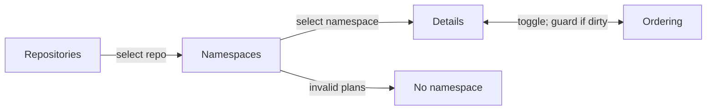

# Organize and prioritize backlog plans by namespace

## Summary

Make Backlog useful for deciding what to build next. Navigate from repositories to namespaces to one list of plans. **Details** and **Ordering** are two presentations of that list. Order is explicit within a repository/namespace, unprioritized plans appear first, and dependency-connected Backlog plans automatically form contiguous movable groups **in Ordering mode only** (Option A). Details shows individual flat cards in the same plan order. Manual Ordering edits stay local until the user saves them.

## Context

`docs/plans/plans-config.json` declares project namespaces; the plan-suite also defines universal namespaces. The current plan schema includes stable opaque IDs, `depends_on`, and an H/M/L/none `priority` field. Lifecycle is derived from folders, not frontmatter. Plan filename validation currently depends on the presence of a repository namespace config; determine where existing enforcement runs before extending it to other repositories.

The issues to solve:

- Long titles do not consistently show their namespace at the beginning of the displayed label.
- A global Backlog card feed is difficult to scan when many repositories and namespaces are involved.
- H/M/L does not specify a concrete next-to-build order.
- Part 1/2/3 work often has hard dependencies; remaining backlog phases should move together, but unrelated work may go ahead of them.
- New or detached plans can disappear into an implicit backlog tail unless they remain visibly unprioritized.
- A prioritization session may involve many edits, so immediate persistence is too easy to trigger accidentally.
- Invalid namespace metadata must be rejected when authored but remain discoverable if it exists on disk.

This is a **design and implementation plan**, not a claim that the local checkout, current code paths, or CI have been inspected. Option A automatic dependency regrouping is the selected first iteration; later confirmation is explicitly out of scope.

## Goals

- Change **Backlog only**. Preserve every other lifecycle state's behavior, sorting, filtering, navigation, and UI presentation.
- Use one approved namespace per plan, taken from that repository's configured vocabulary plus permitted universal namespaces.
- Display a short namespace prefix at the *start* of plan titles in Backlog; leave authored H1 titles intact.
- Scope priority to one repository and namespace, never across repositories or namespaces.
- Show unprioritized plans first and support simple placement without numeric fields.
- Share one flattened plan sequence between Details and Ordering; derive group containers **only in Ordering** and use the same backing order state.
- Group unfinished dependency sequences, including multiple prerequisites and dependents, into contiguous movable blocks without adding an initiative/epic/series field.
- Save all ordering edits explicitly, with Cancel and guarded navigation.
- Automatically place new or newly dependent plans when they attach to an already prioritized same-namespace chain.
- Remove H/M/L/none priority entirely from **non-completed, non-archived plans** and all live skill, UI, CLI, validation, and documentation consumers.

## Non-goals

- No global ordering across repositories or namespaces.
- No separate Roadmap page, hierarchy map, or extra grouping metadata.
- No automatic rewriting of H1s, filename ordinals, or forced `Namespace Part ###` titles.
- No footer namespace badge or special badge-click filter interaction.
- No changes to **any** non-Backlog lifecycle state or its UI presentation, including Ready, Active, Review, Completed, Archived, and Unclassified. Shared schema/validator changes may affect stored metadata without changing those views.
- No backward-compatibility layer for the old priority field in current lifecycle plans; breaking changes are acceptable. Historical Completed/Archived files may retain the unused field.

## Data contracts and ownership

| Concept | Source of truth | Rule |
| --- | --- | --- |
| Namespace vocabulary | Repository `docs/plans/plans-config.json` plus plan-suite universal namespaces | Validate before create/rename; do not invent a prefix |
| Plan identity | Existing opaque `id` | Never rewrite IDs to match names |
| Plan namespace | Derived from validated filename prefix (approved vocabulary) | Expose a read-only `namespace` property on parsed plan objects; unknown/malformed prefixes enter **No namespace** for recovery |
| Hard prerequisites | Existing `depends_on` IDs | Preserve true edges even when multiple prerequisites or dependents exist; never manufacture dependencies to match display order |
| Priority order | One repository-local ordered-ID registry, scoped by namespace | Explicit, stable order; no H/M/L and no independent Details sort |
| Unprioritized | Backlog plan absent from the **effective** ranked order | Derived; no new frontmatter flag |
| Dependency group | Direct dependency edges between same-namespace Backlog plans only | Option A: linearize each connected in-Backlog component into one contiguous movable block; never bridge through plans outside Backlog |
| Draft ordering | Client-side edit session | Not persisted until explicit Save |

**Namespace decision:** do **not** add `namespace` to plan frontmatter. Derive it from the longest approved `<namespace>-` filename prefix and expose it as a computed field on the parsed plan model. Cache that resolution per indexed plan and reuse the loaded namespace vocabulary per repository snapshot: the in-memory match is inexpensive and requires no additional I/O. Validate malformed/unknown prefixes at creation, rename, and build; retain invalid files in **No namespace** when reading. Add a correctness and performance regression test. Render title prefixes from the derived namespace, not from manually typed H1 text. The namespace prefix is a display label, not a required H1 prefix.

**Schema bootstrap:** This plan retains `priority: none` in its own frontmatter solely because the *currently published* `plan-write` schema requires it. Remove that line from this plan, and from every other non-Completed/non-Archived managed plan, when the breaking schema change lands. This is not a requested compatibility mode.

## Proposed design

### Backlog navigation



| Scope | Visible content |
| --- | --- |
| No repo selected | Only repositories with Backlog plans; plan count and unprioritized count |
| Repo selected, no namespace | Approved namespaces with Backlog plans, each with counts; **No namespace** last if invalid plans exist |
| Repo and namespace selected | **Needs prioritization** at top when nonempty, then ordered list; Details/Ordering toggle |
| Repo and **No namespace** selected | Files with missing, malformed, or unapproved filename prefixes, with errors and a repair path; no priority editing until repaired |

Counts measure **plans**, not collapsed groups. No empty-state congratulation such as “All backlog plans have been prioritized.” Use terse UI labels such as `Needs prioritization`, `Ordered`, `Details`, `Ordering`, and `Save`.

Do not change other lifecycle tabs/views, even if they currently show plans across all repos or use existing filters. Backlog-only directory navigation must not leak into those views.

### Common list and displayed titles

**Visual contract:** See `plan-backlog-ordering-architecture-addendum.md` → “UI reference: Backlog navigation and paired list projections” for the exact example screens, per-mode component boundaries, control layouts, and fork/join/split cases. This contract governs the UI implementation; no dependency group nesting appears in Details.

- Display `[PORTAL] Improve plan review` (namespace prefix first), optionally with a display-only rank number; do not rewrite the Markdown H1 or filename.
- Display the **same flattened plan order** in Details and Ordering, but **show dependency grouping only in Ordering**.
- In Details, render every plan as an independent, flat, un-nested rich card (even when its dependency-connected neighbors would form one Ordering block). Retain existing Backlog summaries, progress, and actions; no group headers, group outlines, rank controls, or drag handles.
- In Ordering, show compact rows and derived contiguous dependency blocks with title, short purpose, dependency/blocking clue, and position. Group controls act on the whole block; do not add an independent ranking property.
- The companion `plan-backlog-ordering-architecture-addendum.md` contains the **normative paired wireframes and dependency-pattern matrix**. Use these visuals to implement the UI without re-deciding grouping behavior.
- Do **not** create a clickable footer namespace badge. Remove all corresponding references, tests, and tasks from this plan.

### Needs prioritization

- Show **Needs prioritization** **before** the ranked list, only when nonempty, with a count.
- New independent plans default to unprioritized; do not append them to the end of the registry.
- In Ordering mode, each unprioritized row or eligible dependency group has exactly three right-side controls, in this order:
  1. **Move down** — insert at the *top* of Ordered.
  2. **Move to bottom** — insert at the bottom of Ordered.
  3. **Drag handle** — drag to any valid position in Ordered.
- Do not use a position dropdown, numeric field, or additional placement controls.
- Placement updates the **draft** immediately (the item leaves Needs prioritization and appears in Ordered), but does not persist until **Save**.
- Invalid drops are disabled or rejected with a concise reason. Moving a group moves all its remaining Backlog plans together.

### Ordered rows

Every Ordered row or derived dependency group places controls **on the right**, in exactly this sequence:

1. **Move to top**
2. **Move up**
3. **Move down**
4. **Move to bottom**
5. **Drag handle** (furthest right)

Icon buttons need accessible names, tooltips, keyboard support, correct disabled states, and focus behavior. Move operations cannot invert actual prerequisites. For long lists, consider virtual rendering only if the existing portal already needs it; do not introduce it preemptively.

### Explicit save and navigation guard

1. Opening Ordering copies the committed order into a draft; changes are not written on each move.
2. The first change marks the draft **dirty**. Show a compact, always-visible **Save** and **Cancel** action bar (sticky while the list scrolls), plus an unsaved indicator.
3. **Save** validates all moves against the latest namespace snapshot and writes the entire namespace order as one atomic operation. Only on success clear dirty state and update committed Details order.
4. **Cancel** on the action bar discards the draft and restores the last committed order. Ask for confirmation before discarding edits.
5. Before leaving Ordering via Details toggle, repo/namespace selection, lifecycle tab, page navigation, in-app back, or route change, display:

   > Your prioritization changes have not been saved.

   Actions: **Save and continue** (save, then finish the attempted navigation) or **Cancel** (stay in Ordering with the draft untouched). Do not navigate after failed Save. The same guard applies to leaving the Plans page.
6. For tab close/reload or browser-level navigation, use the browser's supported unsaved-change mechanism; browsers may show their own wording rather than the custom sentence.
7. Detect stale drafts (another tab, filesystem change, dependency edit, or concurrent writer) by a revision/ETag check. Do not silently overwrite; show a conflict and require a refresh/reconciliation before saving.

The draft encompasses **both** ranked order and moves from Needs prioritization. Only a successful Save commits them together.

### Dependency chains and automated placement

- Hard dependencies determine which plan must precede which. Ranking determines what to work on next, *within* that constraint.
- For a simple same-namespace chain `A → B → C`, group remaining Backlog phases as a movable unit; never require the entire chain to be worked without interruption.
- When `A` moves out of Backlog, `[B → C]` remains grouped **if C directly depends on B**. An unrelated `X` can move ahead of `[B → C]`. When `B` leaves Backlog, `C` remains as one row.
- **Confirmed group boundary:** only direct dependency edges between two same-namespace plans currently in Backlog connect rows into movable groups. Do not use shared out-of-Backlog ancestors to join plans. For a fork `A → B` and `A → C`, `[A, B, C]` forms a group while A is in Backlog. Once A leaves Backlog (including Active or Completed), B and C become separate ranked rows if there is no direct B↔C dependency. Preserve their relative rank and their real dependencies on A. They may still be blocked until A completes.
- Splitting a group because a prerequisite leaves Backlog does **not** automatically make its previously ranked survivors unprioritized. Explicit dependency-edge removal follows the separate detachment rule below.
- Show dependency indicators for prerequisites outside Backlog; they still block work as appropriate. A ranked plan may be blocked by a phase in another lifecycle state.
- A **new plan** with an explicit same-namespace dependency on an **already-ranked** plan or simple ranked chain automatically joins the ranked group at a valid position. Do not prompt for separate prioritization or put it in Needs prioritization.
- A new plan dependent **only** on unprioritized plans joins their unprioritized group; it cannot inherit a rank that does not exist.
- Adding a dependency to an existing prioritized Backlog plan moves that plan into the dependency's ranked group automatically (or into the unprioritized group if the prerequisite is unranked). Keep the plan's stable ID.
- Removing the dependency that attached a plan to its ranked group makes it **unprioritized**; move a now-detached unranked descendant sequence with it, unless it is still connected to another ranked prerequisite. With multiple prerequisites, removing one edge does **not** detach a plan that still has another qualifying ranked dependency.
- Recompute group membership on any dependency edit, plan creation, lifecycle change, or repo snapshot refresh. Reconcile the registry deterministically and visibly, even if it reorders independent plans. Avoid silently overwriting an unsaved draft; use the stale-draft guard.
- Keep dependency cycles, missing references, and invalid cross-namespace placements visible as findings; never auto-rank invalid relationships. Cross-namespace prerequisites may block execution but do not impose a rank across namespace boundaries.

**Chosen branching policy — Option A:** `depends_on` may express joins and forks. **Only Ordering mode wraps connected plans into movable blocks; Details remains flat.** Linearize each dependency-connected set of remaining **same-namespace Backlog plans, connected by direct edges among those Backlog plans**, into one contiguous, movable display block, with a valid topological order within it. A display sequence such as `A → B → C` does **not** add a hard dependency from A to B when C independently depends on A and B. When new edges connect separately ranked groups, automatically regroup them, even when unrelated plans move down in priority. Show a concise explanation of automatic moves; do not add confirmation UI in this iteration. Never rewrite actual dependency edges to force a chain.

### Ordering registry

Prefer a repository-local `docs/plans/plans-order.json` keyed by namespace, storing stable plan IDs rather than filenames, titles, or a persisted group hierarchy. Confirm read/write ownership against the actual implementation.

```json
{
  "schemaVersion": 1,
  "namespaces": {
    "plan": ["rxv53v6z", "a1b2c3d4"],
    "portal": ["h3j4k5m6"]
  }
}
```

Example IDs are illustrative. Keep a single ordered array per namespace; derive dependency blocks from edges. Automatic attachment/detachment must update the effective registry consistently and atomically, not create a second shadow priority system. A plan's absence from the **effective** ordered list (after dependency reconciliation) indicates unprioritized state.

Reconcile references to deleted plans, moved lifecycle states, invalid namespace plans, renames, and changed dependencies. Report conflicts or orphaned IDs instead of silently dropping them. Store changes in the repository that owns the plans, not a global portal order file. Do not rely on any backward-compatible migration of priority labels.

### Namespace enforcement and recovery

**Prevent creation of invalid names:**

- Inspect all actual plan creation, rename, import, repair, and generation entry points (including `plan-write`, other plan-suite skills, CLI, portal, and CI). Route them through shared namespace validation derived from the repository's `plans-config.json` plus the documented universal namespaces.
- Reject filename prefixes outside the approved vocabulary; present the allowed choices and a path to update `plans-config.json` rather than silently using an invented prefix. Do not add, require, or cross-check a `namespace` frontmatter field; consumers use the derived parsed value.
- Author reader-facing H1s normally, but render the approved namespace prefix in the Backlog UI. Prevent **display-title** labels from claiming an unapproved namespace; do not require authors to type a namespace twice in H1s.
- Keep build checks that enforce naming. Audit whether they currently run only in RoboRepo or in every repository with plan-suite; make enforcement reusable across participating repos. Do not assert CI coverage until verified.

**Recover invalid files without hiding them:**

- Parsing/indexing must not crash or omit a plan because its filename prefix cannot be matched to an approved namespace.
- Under the selected repository, show **No namespace** **after** approved namespace rows, only if such Backlog plans exist. Count them, show their exact filenames and validation findings, and link to the repair workflow. These plans cannot enter an Ordered namespace until repaired.
- Report unknown names consistently in the CLI/validator and portal. Strict create/build validation and tolerant read/display behavior are complementary, not contradictory.
- Keep **Unclassified** (a lifecycle/folder condition) distinct from **No namespace** (metadata classification); do not change the Unclassified lifecycle UI.

### Remove the legacy priority field

This is a **breaking cleanup**, not a deprecation:

- Delete H/M/L/none priority from the current plan schema and allowed frontmatter for Backlog, Ready, Active, and Review plans, and any other non-Completed/non-Archived managed plans.
- Remove the frontmatter line from existing files in those states (including this plan once the new validator is active). Do not rewrite Completed or Archived documents merely to delete historical values; ignore those values when reading them.
- Remove all current priority computation, sorting, badges, form fields, APIs/types, default values, validator rules, error messages, UI interactions, CLI flags/output, plan-suite skill instructions, references, templates, generated prompts, fixtures, tests, and documentation that assume the field still exists.
- Retain only the namespace-scoped ordered-ID priority system for Backlog. Do not create a secondary priority notion in other lifecycle views, and do not change their presentation.
- Existing H/M/L values do **not** migrate into ranked positions. All independent Backlog plans without an explicit saved position begin in Needs prioritization; dependent plans may inherit placement **only** by the automatic dependency rules above.

### `plan-write` integration

1. Resolve an approved namespace from the repository config before writing; validate the `<namespace>-<slug>.md` name and derive the parsed namespace from it. Do not store `namespace` in frontmatter.
2. Create the plan with stable ID and valid metadata, **without** the legacy `priority` field after the schema change.
3. If it has qualifying dependencies on a ranked same-namespace group, **auto-place** it into that group; no separate ranking prompt.
4. Otherwise, offer insertion into the namespace order or **Prioritize later**. A deferred independent plan remains at the top in Needs prioritization.
5. For non-interactive creation, default an independent plan to unprioritized; a dependent plan still follows deterministic auto-attachment rules.
6. Surface a registry write/validation failure explicitly; never claim automatic placement succeeded if it did not.
7. If a new plan connects multiple ranked prerequisite groups, compute the Option A merged group and apply the deterministic proposed order atomically; surface the automatic changes. The plan inherits the group rank rather than entering Needs prioritization.

## Chosen policy: Option A dependency regrouping

Treat dependencies as a directed graph (the actual `depends_on` edges), but present the remaining same-namespace Backlog plans as a **flat list of contiguous movable groups in Ordering mode only**. Details renders independent cards in the same flattened order. A connected component built from **direct edges among current same-namespace Backlog nodes** is one group, including joins (C depends on A and B) and forks (B and C both depend on A). Do not traverse through Active, Completed, or other out-of-Backlog ancestors to group sibling plans. Cross-namespace edges remain execution constraints, not cross-namespace ranking groups.

Example: existing ranked order `[A, X, Y, B]`, followed by a new plan C depending on both A and B. The new order is `[A, B, C, X, Y]`: regroup A, B, and C at the earliest existing member's position. A and B retain their actual independence; B is merely listed before C. X and Y retain their relative order. If existing positions allow `[B, A, C]` instead, preserve existing ranked order between independent prerequisites. Use a stable topological sort for the group's internal sequence, with existing saved priority and then stable plan ID as tie-breakers.

**Design for future confirmation without building it now:**

1. `deriveGroups(plans, lifecycle)` — pure calculation of dependency-connected remaining Backlog groups; validate missing edges and cycles.
2. `proposeOrder(currentOrder, groups, change)` — pure calculation returning `{order, moves, findings}` with a deterministic, valid rank. For an automatic merge, anchor at the earliest ranked member and preserve unaffected items' relative order. Never write inside this function.
3. `applyOrder(proposal, expectedRevision)` — persist the proposed IDs atomically after validation. Automatic dependency changes use this step immediately (Option A); manual Ordering-mode changes remain draft-only until explicit **Save**.

On external plan creation/dependency edits, recompute and apply Option A as part of the authoritative update flow. If an Ordering draft is dirty, do not overwrite it; flag a stale revision and require refresh/reconciliation. Any automatic reordering must be visible in the refreshed UI or operation result, not silently hidden. Dependency blocks are derived from individual plan IDs persisted in the existing registry; do not persist a second group hierarchy.

**Possible later Option C:** insert a review/confirmation step between `proposeOrder` and `applyOrder` when existing priorities would change. Reuse the graph logic, registry, and UI block model. A future "keep existing order" choice would need additional exception state and is **not** part of this plan.

Do not introduce graph editors, separate roadmap pages, nested views, manual splitting, or artificial dependency edges. Keep cycles and broken references as validation errors rather than attempting to generate a misleading order.

## Implementation checklist

- [ ] Inspect the actual portal Backlog entry point, repo discovery, ordering/filtering, namespace config use, plan-suite writer, validator, and CI enforcement locations; check for overlapping plans.
- [ ] Implement the selected Option A branching policy with pure group derivation, pure order proposal, and an atomic apply operation.
- [ ] Introduce shared filename-based namespace resolution and validation; expose a computed `namespace` property on parsed plans, cache it in repository indexes, and test overlapping prefixes and performance.
- [ ] Add tolerant indexing and a trailing **No namespace** recovery section in Backlog's repository namespace directory, while keeping strict build/create failures.
- [ ] Add repository → namespace → plans navigation **only** to Backlog and namespace-prefixed display titles; remove all footer-badge proposals.
- [ ] Add a repository-local ordered-ID registry plus shared draft/committed view model for Details and Ordering; implement the addendum's paired UI wireframes (flat Details cards, Ordering-only containers).
- [ ] Show Needs prioritization first; implement the exact right-side ordered and unprioritized movement controls, accessible drag/drop, and group boundaries.
- [ ] Add sticky Save/Cancel, dirty-state tracking, guarded in-app navigation, native browser exit protection, atomic save, and stale-edit detection.
- [ ] Implement automatic dependency attachment, detachment, and lifecycle-sensitive group derivation; group by direct in-Backlog edges only, split siblings when their shared prerequisite exits Backlog, preserve their rank, and retain real dependency constraints.
- [ ] Integrate automatic placement and explicit deferral into `plan-write` with failure reporting.
- [ ] Remove legacy priority frontmatter from all non-Completed/non-Archived plans and delete all live logic and plan-suite skill/docs/tests/validator references to the old field.
- [ ] Update reader-facing Backlog documentation and relevant schema/config guides; add visual regression/interaction checks against the architecture addendum wireframes and focused integration tests.

## Validation

Use repository-native checks and canonical plan validation discovered from the checkout; do not claim an unavailable validator ran. Validate changes with shared plan-suite tests and actual browser behavior as appropriate.

| Scenario | Acceptance criterion |
| --- | --- |
| Other lifecycle states | Every view other than Backlog behaves and looks unchanged |
| Repo scope | Only repos with Backlog plans show, with correct counts |
| Namespace scope | Approved nonempty namespaces show; **No namespace** is last when needed |
| Namespace derivation | Longest approved filename prefix resolves once per index; derived property powers filters/titles, no frontmatter duplication, and performance is verified |
| Invalid namespace | Creation/rename/build rejects bad filename prefixes, but Backlog displays affected plans with repair findings |
| Titles | Display begins with an approved namespace prefix; authored H1 unchanged; no footer badge |
| Unprioritized | Section appears first only when needed; moves into a draft Ordered list |
| Ranked controls | Right side: top, up, down, bottom, handle; invalid actions disabled |
| Unranked controls | Right side: down-to-top, bottom, handle; no numeric/select placement |
| Two modes | Same flattened plan order; Details is always flat/un-nested; Ordering alone displays derived dependency group containers and movement controls |
| Explicit Save | Multiple moves persist in one atomic write only after Save succeeds |
| Cancel | Discards uncommitted moves and restores persisted order |
| Guarded exit | Mode/tab/route/repo/page navigation prompts Save and continue or Cancel when dirty |
| Browser exit | Native supported unsaved-change protection is active |
| Concurrent change | Stale draft cannot silently overwrite external dependency/order edits |
| Linear chain | Remaining phases move together; independent work may move ahead |
| Fork/join group | Direct edges among same-namespace Backlog plans form movable blocks with topological order; dragging cannot violate actual dependency edges |
| Completed/shared prerequisite | With A→B and A→C, moving A out of Backlog separates B and C (unless directly dependent), preserves ranked positions and their actual dependency on A |
| Linear remainder | With A→B→C, moving A out of Backlog retains the direct B→C block |
| New dependent | Auto-ranks when attached to ranked same-namespace group; no manual placement required |
| New independent | Unprioritized until explicitly placed |
| Added dependency | Existing ranked plan automatically reattaches/reorders into dependency group |
| Removed dependency | Detached plan/subchain becomes unprioritized unless another ranked dependency still anchors it |
| Multiple dependencies | Option A creates one contiguous block for connected remaining Backlog plans; true dependency edges remain unchanged; topological order is valid |
| Auto regrouping | With `[A, X, Y, B]` and new `C` depending on `A` and `B`, propose and apply `[A, B, C, X, Y]`; affected movement is visible |
| Separate concerns | Grouping and ordering calculation is pure; external changes apply automatically while user-initiated Ordering edits require Save |
| Priority cleanup | No legacy priority UI/behavior/schema/skill/docs/field in current lifecycle files; historical files unchanged |

## Documentation impact

- `globals/packages/plan-suite/skills/plan-write/SKILL.md` and `references/plan-schema.md`, `references/workflow-create.md`, `references/workflow-update.md`, `references/workflow-validate.md`, and any applicable prompt and validation rules: namespace enforcement, new dependency placement, removal of legacy priority, and updated schema.
- Other plan-suite skills and templates that create/edit/move plans: remove priority references and ensure namespace consistency; do not change lifecycle semantics.
- The portal's actual Backlog reader guide/document of record (locate in repository): navigation hierarchy, Needs prioritization, dependency groups, Save/Cancel, and No namespace recovery.
- The plan-suite schema/config reference and CI guidance: name validation, the registry contract, and how strict writers coexist with tolerant readers.

## Risks and implementation checks

- **Repo coverage:** Existing build validation may be RoboRepo-only. Audit each supported repository's initialization/CI before promising universal enforcement.
- **Automated regrouping:** Option A intentionally may pull previously separated priorities together and move unrelated plans. Use deterministic tie-breaks, explain resulting moves, and preserve revision safety. Confirmation (Option C) is a future enhancement, not an initial requirement.
- **Edit races:** File watchers, another tab, or a separate skill may rewrite dependencies while Ordering is dirty. Detect and reconcile; never last-write-wins without feedback.
- **Missing/malformed filename namespace:** Strict creation must reject it, but tolerant reads must not make the existing plan invisible or crash indexing.
- **Schema rollout:** Remove legacy priority and update all live producers/consumers in one breaking change; otherwise current validators may reject newly written plans.
- **Evidence limits:** This document uses the published skill/schema/config and the agreed requirements; repository implementation paths, tests, and build reach must still be verified locally.
