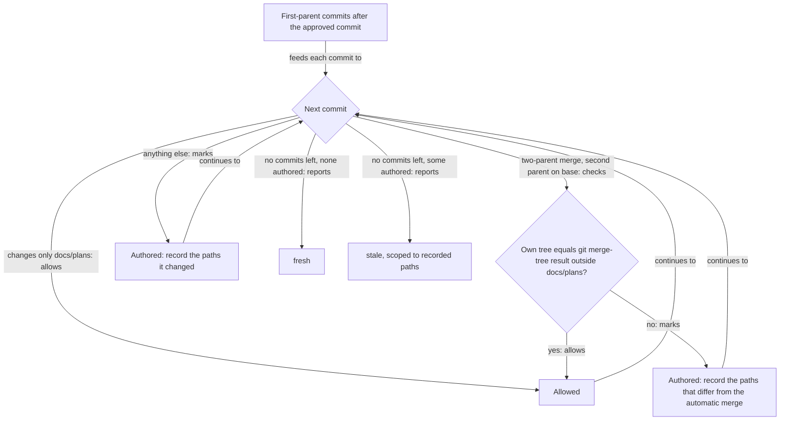

# Approval Survives Clean Merges of the Base Branch

## Summary

A human approves a plan's implementation at one commit. Today, any later change outside
`docs/plans/` makes that approval stale, including the changes a merge of the base branch brings
in. So every merge of `main` into a reviewed branch forces another `/plan-review` and another human
approval, even when nobody wrote a line of the branch's code.

This plan changes what "stale" means. After the approved commit, approval stays fresh as long as
every commit on the branch's first-parent path is one of two things:

- a commit that changes only `docs/plans/`, or
- a merge of the base branch whose tree, outside `docs/plans/`, equals the tree Git produces on its
  own for the same two parents.

Any other commit is an **authored commit**: someone or something wrote its content, so a human has
not seen it. Authored commits make approval stale, and the stale report lists only the paths they
changed, so a re-review can cover just them. Whether the merged result still works is handled by
the repository's full gate (`npm run check`) and the pull request's CI, which the agent can run or
read without asking the human again.

## Context

Plans run in their own worktree and branch. `/plan-review` synchronizes base into the branch with
`roborepo plans sync-base` (referred to below as sync-base, which only merges), runs the gate and a
Validator, records a `### Result`, and asks the human to approve that exact commit. `/plan-close`
refuses a stale approval.

Concrete case, from plan "Package Management: Part 02" (`o9zwxuav`):

| Step | Commit | Effect |
| --- | --- | --- |
| Human approves | `28822b47` | approval fresh |
| Merge `main` (worktree preservation work) | `24a80344` | 48 implementation paths differ from the approved commit, so approval goes stale |
| Merge `main` again | `e7d64f25`, `0fd97311` | 51 paths differ; still stale |
| Full re-review | `07279aac` | gate and Validator repeated for the branch's unchanged code |
| Human approves again | `10b3627f` | approval fresh at `0fd97311` |

The branch touches 45 implementation paths. Only 5 are also touched by `main`, and all of them
merged without a conflict. On the branch's first-parent path since `28822b47` there are 4
plan-only commits and those 3 merges. Each merge's tree outside `docs/plans/` is byte-identical to
`git merge-tree --write-tree <first parent> <second parent>`. Under the rule in this plan, the
approval would have stayed fresh.

## Goals

- A merge of base that needed no hand resolution leaves approval and review results fresh.
- A merge with hand-resolved conflicts, or any authored commit, makes approval stale. The report
  names only the paths those commits changed.
- "The merged result still passes" stays required before closing, and is satisfied by the gate on
  the current tip or green PR CI, with no human prompt.
- The rule is deterministic and computed from Git on every call. Nothing new is stored in the plan.

## Non-goals

- Changing who approves. Only a human approves an implementation.
- Catching semantic interactions that the tests miss: a base change that alters the branch's
  behavior while every check passes. Today's re-review does not reliably catch these either. See
  Risks.
- Fixing plan-document conflicts during sync. They have a different cause, rewritten lifecycle
  commits on local `main`. Where to fix them is open question 4.
- Rebase-based synchronization. The protected-branch push guard (kirinmurphy/roborepo-alpha#48)
  refuses non-fast-forward pushes, and sync-base only merges.

## Current state

The approval freshness check in `modules/plan-suite/review-gates.mjs` (`approvalFreshness`) reads
the approved commit from `### Approval`. The tip is the assigned worktree's branch, or the base
branch for a plan that names no worktree. It then runs this:

```bash
git diff --name-only <approved commit> <tip> -- . ':(exclude)docs/plans'
```

Any output means `stale`, with up to 20 `changedPaths`.

The review Result check in `modules/plan-suite/review-freshness.mjs` (`reviewFreshness`) uses the
same tree comparison from the Result's reviewed commit to the tip. It also reports
`baseChangedPaths`, which are implementation changes on base since the recorded base commit.

Callers that depend on these two checks:

| Caller | Uses | Today's effect of a clean base merge |
| --- | --- | --- |
| `roborepo plans approval` (`scripts/cli/plans-command.mjs`) | both | exit 1, `state: stale` |
| `mergeReadiness` (`review-gates.mjs`) | both, plus "reviewed base implementation is current" | fails three checks: approval fresh, review fresh, reviewed base current |
| Close transition (`modules/plan-suite/transition-rules.mjs`) | `approvalFreshness` | refuses the move to `completed/` |
| `/plan-review` skill | the approval command | full re-review route |
| `/plan-close` skill | the approval command | refuses and sends the user back to `/plan-review` |

The skills state the current rule outright. `globals/packages/plan-suite/skills/plan-review/SKILL.md`
step 2 says a synchronization that changes implementation content makes any recorded approval
stale, and calls that expected. `references/resume-review.md` routes "Base implementation changed
before landing" to a new synchronization and review.

## Proposed design

### The rule



The commits come from `git rev-list --first-parent --reverse <approved>..<tip>`. Walking only
first parents keeps base's own commits out of the list, because they arrive through a merge.

These are the checks for one merge commit `M` with parents `P1` and `P2`:

```bash
git merge-base --is-ancestor <P2> <base>          # P2 came from base
auto=$(git merge-tree --write-tree --no-messages <P1> <P2> | head -1)   # first line is the tree id, even on conflicts
git diff --name-only "$auto" <M> -- . ':(exclude)docs/plans'
```

- No output from the last command means the merge is clean. Plan documents are excluded because
  sync-base resolves plan rename conflicts itself (`resolvePlanRenameConflicts` in
  `modules/plan-suite/sync-base.mjs`).
- On a conflict, the files in the tree `$auto` names still hold conflict markers, so every
  hand-resolved path shows up in the diff. Those paths are the review scope.
- An octopus merge, or a merge whose second parent is not on base, counts as an authored commit.

### Where it lives

Add one helper to `modules/plan-suite/review-freshness.mjs`. It takes `{ primary, from, tip, base }`
and returns `{ authored: [{ commit, paths }], paths }`, where `paths` is the union. Both callers use it:

- `approvalFreshness` replaces its single `git diff` with the helper. It returns `stale` when
  `paths` is non-empty, and adds `authoredCommits` next to `changedPaths`.
- `reviewFreshness` does the same, starting from the Result's reviewed commit.

`changedPaths` keeps its meaning, "implementation paths a reviewer must look at again". The callers
in the table above therefore keep working without changes to how they read the result.

### Merged result still passes

The rule removes the human from mechanical merges. It does not remove the check that the merged
code works. After a clean merge, the tip has not been through the gate. Two pieces of evidence can
cover it, and the agent needs no human for either:

1. a gate run on the current tip, recorded under `### Verification`, or
2. green CI on the pull request at the current head. `.github/workflows/ci.yml` runs `npm run check`
   on `pull_request`, and agents may read `gh pr checks` under the protected-branch push guard (kirinmurphy/roborepo-alpha#48).

How `mergeReadiness` and `/plan-close` require this is an open question below.

### Skill changes

| Skill file | Change |
| --- | --- |
| `plan-review/SKILL.md` step 2 | A merge that needed no hand resolution keeps approval fresh; a conflicted merge makes the resolved paths stale. |
| `plan-review/references/resume-review.md` | Add a route: fresh approval after a clean base merge. Rerun the gate, or read PR CI, and record it. Ask no approval question. Scope "Changed implementation" to the reported paths. |
| `plan-close/SKILL.md` step 6 | `stale` now names authored commits and paths. A clean merge of base before the PR merge no longer refuses. |
| `docs/user/guides/plan/lifecycle/plan-suite.md` | Same wording change for the approval and "If base moves again" paragraphs. |
| Plan schema reference (`plan-write/references/plan-schema.md`, Review section) | Update the "An approval is fresh while…" bullet. |

## Implementation plan

- [ ] Add a fixture to the plan-suite checks: approve at commit A, merge a base commit that touches a
      file outside the branch, and assert approval is `fresh`. It fails today.
- [ ] Add fixtures: a conflicted merge resolved by hand gives `stale` with only the resolved path; an
      authored commit after approval gives `stale` with its paths; a plan-only commit stays `fresh`;
      a merge from a non-base branch gives `stale`.
- [ ] Implement the first-parent walk helper in `modules/plan-suite/review-freshness.mjs`.
- [ ] Switch `approvalFreshness` and `reviewFreshness` to the helper, and add `authoredCommits` to their output.
- [ ] Update the `roborepo plans approval` text output to name authored commits when stale.
- [ ] Apply the merge-readiness decision from Open questions to `mergeReadiness` and its check text.
- [ ] Update the skill and doc files in the table above.
- [ ] Run `npm run check`, because plan-suite skills are package outputs.

## Validation

- `roborepo plans approval o9zwxuav --json` against the branch history in Context reports `fresh`
  when computed from `28822b47`. Reproduce it in a fixture, because the real plan's approval has
  since been re-recorded.
- The fixtures in the Implementation plan pass. The existing approval and landed-recovery checks
  (`scripts/test/plan-landed-recovery-check.mjs`) still pass.
- A conflicted merge's stale report lists exactly the hand-resolved paths.
- `scripts/test/plan-suite-skills-check.mjs` passes with the updated skill text.

## Risks

| Risk | Mitigation |
| --- | --- |
| Base renames or removes something the branch uses, without touching branch files. The merge is clean but broken. | The merged-result evidence (gate or PR CI) is still required before closing. |
| Base changes behavior the branch depends on, and every test still passes. | Not caught by this rule. Today's re-review also relies on the gate and Validator for this. Optionally run a Validator pass over the paths both sides touched; see Open questions. |
| Git versions differ in `merge-tree` results, so a clean merge looks authored. | The error is conservative: a false `stale`, never a false `fresh`. `merge-tree --write-tree` needs Git 2.38 or later; report `unavailable` on older Git. |
| Merge commits made with a non-default strategy (`-X ours`) look authored. | Also conservative. sync-base uses the default strategy. |

## Open questions

1. **Merge readiness and base drift.** `mergeReadiness` fails "reviewed base implementation is
   current" whenever base moved after review. Options: (a) keep it, so a sync and a gate rerun are
   still needed before merge; (b) accept green PR CI at the current head instead. Recommendation:
   (b), because CI tests GitHub's merge of head and base.
2. **Conflicted-merge prompt.** After a hand-resolved conflict, should `/plan-review` ask the human
   only about the resolved hunks, shown with `git range-diff` or the diff against the automatic
   merge? Recommendation: yes. Run a Validator pass scoped to those paths first.
3. **Overlap Validator.** When base and the branch touched the same files but merged cleanly, should
   an automated scoped Validator pass run? Recommendation: yes. It costs no human time.
4. **Plan-document conflicts during sync.** These are a separate cause, verified in the reflog of
   `main`: `pull.rebase=true` replayed unpushed lifecycle commits (start, promote) with new hashes
   after worktrees had branched from them. The next sync then saw add/add and rename/rename
   conflicts, as in merges `8cb1cf20` and `155b6fd6`. Should a separate plan address it, either by
   keeping worktree-bound plan copies only on their branch or by guarding against rebasing over
   lifecycle commits? Recommendation: yes, a separate plan. That plan also has to decide how
   lifecycle commits reach the remote `main` once GitHub requires a pull request for it. The
   completed plan "Make Active Plan State Follow Its Assigned Worktree" (`6q16tocb`) listed a dedicated plans
   branch as a non-goal, so choosing one reverses that decision.

## Documentation impact

| Doc of record | Expected update |
| --- | --- |
| `docs/user/guides/plan/lifecycle/plan-suite.md` | Approval freshness wording; what happens when base moves before merge |
| `docs/user/reference/plans-portal.md` | `plans approval` command row: `authoredCommits` and scoped stale paths |
| `globals/packages/plan-suite/skills/plan-review/SKILL.md`, `references/resume-review.md` | Sync and resume routes |
| `globals/packages/plan-suite/skills/plan-close/SKILL.md` | Stale refusal wording |
| `globals/packages/plan-suite/skills/plan-write/references/plan-schema.md` | Review section freshness bullet |
