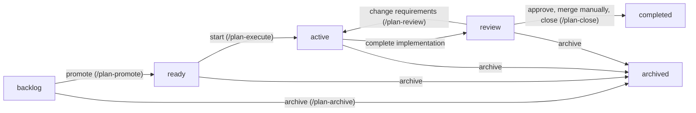

# A Repeatable Plan Lifecycle from Preparation Through Verified Delivery

## Summary

Today a plan goes from `backlog` to `active` to `completed`, and nothing in between separates
"implementation finished" from "someone independently checked it and a human accepted it". This
plan adds two lifecycle folders, `ready/` and `review/`, and the commands that move plans through
them:

- `/plan-promote` validates a plan and commits it to `ready`;
- `/plan-execute` replaces `/plan-start`, and can be rerun across sessions;
- `/plan-review` performs independent QA and records explicit human approval;
- `/plan-archive` retires a plan without losing unmerged work;
- the existing **`/plan-close`** stays the post-merge verifier and finalizer.

Every lifecycle move is committed, always in the **primary checkout** (the main checkout, not a
plan's feature worktree), by shared deterministic
Plan Suite operations that the skills call. One declarative lifecycle manifest replaces the
lifecycle lists duplicated across the domain module and the portal. The human still merges feature
branches through GitHub; this plan adds no GitHub integration.

This plan supersedes the former `plan-lifecycle-suite-workflow-navigation` plan, since deleted
(see [Related plans](#related-plans)).

## Goals

- Use the lifecycle `backlog → ready → active → review → completed`, with `archived` as an
  exceptional exit from any non-terminal state.
- `/plan-promote` validates the plan and commits `backlog → ready`, and can refine a plan already
  in `ready`.
- `/plan-execute` starts or resumes implementation from `ready` or `active`, and fixes recorded QA
  findings while the plan is in `review`.
- A plan moves `active → review` when **implementation is complete**. Independent QA and human
  acceptance happen after that move.
- `/plan-review` performs independent QA, records concise findings and resolutions in the plan, and
  requires explicit human approval before the manual merge and `/plan-close`.
- Fixes within the existing requirements stay in `review`. A plan returns to `active` only when
  its scope or acceptance criteria change materially, and it keeps its branch and worktree.
- During review, merge the current base branch **into the feature branch**, again in later review
  rounds when base has moved. Never merge the feature branch into base automatically.
- Keep `/plan-close` a **post-merge** command: it verifies landed work and approval, commits
  `review → completed`, and runs the existing guarded cleanup.
- Commit every state transition in the primary checkout, with deterministic authority, Git, and
  validation safeguards.
- Drive lifecycle states, labels, tabs, transitions, and per-state commands from one manifest.
- Update the Plans portal, CLI, packages, documentation, and tests consistently.

## Non-goals

- Backward compatibility, aliases for `/plan-start`, or migration support for obsolete command
  contracts. Breaking changes are acceptable.
- `/plan-ship`, a chat-held merge approval or wait loop, or pre-merge shipping modes. Reconsider
  `/plan-ship` when GitHub PR interaction is introduced separately.
- CodeRabbit or any other external reviewer; GitHub APIs, PR creation, PR comments, or automated
  merges into base.
- Automated session launching, watchers, queues, continuous orchestration, or configurable
  progression.
- A review database, finding IDs, round schemas, or a lifecycle frontmatter field. The **plan
  folder remains the lifecycle source of truth**.
- Replacing `/plan-close`'s landed-check algorithm, which already handles squash and rebase merges.
- The parts of `plan-lifecycle-suite-workflow-navigation` this plan does not adopt: an Icebox
  state, archive-history frontmatter, Start Eligible and its conflict graph, an execution registry,
  harness session launching, a session closeout controller, and a portal lifecycle infographic.

## Current state

The **primary checkout** is the first entry of `git worktree list --porcelain`, normally the
checkout on `main`. A **linked worktree** holds one plan's implementation branch; a plan names it in
its `worktree` frontmatter field.

### Lifecycle and transitions

- Plans live in `docs/plans/{backlog,active,completed,archived}/`, and lifecycle is derived from the
  folder. A file directly under `docs/plans/` is `unclassified`.
- The set of lifecycles is written out separately in at least seven places:
  `LIFECYCLES` in `modules/plan-suite/index.mjs`, `lifecyclePolicies` in
  `modules/plan-suite/lifecycle-policy.mjs`, `LIFECYCLE_LABELS` in `portal/plans/state.js`,
  `LIFECYCLE_ORDER` and `SECONDARY_LIFECYCLES` in `portal/plans/app.js`,
  `LIFECYCLES_WITHOUT_PRIORITY` in `portal/plans/elements/plan-status.js`, and `PLAN_ACTIONS` in
  `portal/plans/templates.js`.
- `roborepo plans start` (`modules/plan-suite/start-transition.mjs`) is the only committed
  transition. It must run in the primary checkout, which must be on the base branch and **fully
  clean**. It makes one plan-only commit, fast-forwards a worktree branch that has no commits of its
  own, and approves the result only after six fresh checks.
- `movePlanLifecycle` in `modules/plan-suite/index.mjs` renames a plan file without committing. Only
  tests call it. `updatePlanLifecycle` in `portal/plans/api.js` posts to `/api/plans/lifecycle`,
  but `scripts/cli/portal-routes-plans.mjs` no longer registers that route, so the portal has no
  working lifecycle move.

### Plan authority

`modules/plan-suite/plan-authority.mjs` (landed by `6q16tocb`) decides which copy of a plan is
authoritative. The primary copy decides the lifecycle stage, because every transition is committed
there. The assigned worktree's copy is authoritative only while both copies are in `active/` and
name the same worktree. Any other worktree copy falls back to the primary copy with a reason such
as `copy-not-active`. `plan-schema.md` and `/plan-close` step 0 state the same rule.

### Commands

| Command | Today |
| --- | --- |
| `/plan-write` | Creates a backlog plan with its initial checklist, or revises or syncs a plan |
| `/plan-promote` | Reconciles and improves a backlog plan. Its `Boundaries` forbid changing lifecycle, and `scripts/test/plan-promote-plan-start-check.mjs` asserts that phrase |
| `/plan-start` | Runs `roborepo plans start` (backlog or active), then implements in the worktree. Its package also ships `rules.md` ("Code Outlives Plans") |
| `/plan-close` | Accepts only `active/`. Step 0 checks that the worktree's plan copy is integrated. Step 4 archives superseded or abandoned plans, copying the worktree's content into the primary once. Step 6 confirms landing, including squash and rebase merges. Steps 8–9 run `roborepo plans stop-servers` and `roborepo git worktrees cleanup --plan <id> --apply` |
| `/session-close` | Records progress and a handoff; never changes lifecycle |

The landed check lives in `modules/repositories/worktree-landed.mjs`, with guards in
`modules/repositories/worktree-guards.mjs`.

### Portal

- Copy-prompt actions (`PLAN_ACTIONS`) are: Promote and Start on backlog; Continue, Update, and
  Close on active. `recommendedPlanCommand` recommends `/plan-start` for backlog and `/plan-close`
  for an active plan whose tasks are all checked.
- `PLAN_SUITE_PACKAGES` in `portal/plans/api.js` lists the packages the onboarding banner enables.
- Two existing labels would collide with the new states. Structural readiness is shown as
  `draft`/`ready`, which a reader would confuse with the Ready lifecycle. Freshness of
  `reviewed_commit` is shown as a "review state" (`never-reviewed`, `current`, `possibly-stale`,
  `unknown`), which a reader would confuse with the Review lifecycle and with human approval.

### Packaging and tests

- Each plan command is its own package under `globals/packages/<id>/`, containing
  `package.config.json`, `skill-triggers.json`, `skills/<id>/SKILL.md`, and `agents/openai.yaml`.
  Harness projections are tracked under `generated/packages/<id>/`.
- Retiring a package is already supported. `reconcileEnabledPackages` in `scripts/cli/packages.mjs`
  drops registry ids that are no longer in the catalog. `scripts/test/plan-suite-commands-check.mjs`
  covers earlier retirements.
- `roborepo plans` commands are documented in the CLI table of
  `docs/user/reference/plans-portal.md`, not in `docs/user/reference/roborepo-cli.md`.
- A new `scripts/test/*-check.mjs` is reachable only when `scripts/test/test-cli.sh` or the `ci`
  group in `scripts/test/check-groups.json` names it. `scripts/test/orphan-test-check.mjs` enforces
  this.

## Proposed design

### Lifecycle and command contract



| Command | Accepts | Responsibility | State/result |
| --- | --- | --- | --- |
| `/plan-write` | New or existing plan | Create or revise the plan and its executable checklist | New plan in `backlog`; never moves a plan |
| `/plan-promote` | `backlog`, `ready` | Reconcile requirements, tests, dependencies, and tasks | Commit `backlog → ready`, or refine a `ready` plan in place |
| `/plan-execute` | `ready`, `active`, `review` | Start or resume implementation; in `review`, fix recorded findings | `ready → active`; `active → review` on implementation completion; stays `review` while fixing findings |
| `/plan-review` | `active`, `review` | Check implementation readiness, merge base into the branch, review independently, record findings, request human approval | `active → review` if eligible; stays `review` until approved, or `review → active` on a scope change |
| `/plan-close` | `review`, after the manual merge | Verify landed implementation and approval, commit completion, clean up safely | `review → completed` |
| `/plan-archive` | `backlog`, `ready`, `active`, `review` | Record the reason, preserve unmerged code, archive | Commit the move to `archived` |
| `/session-close` | Any agent session | Record progress and a handoff | No lifecycle transition |

`/plan-execute` refuses a `backlog` plan and directs the user to `/plan-promote`.

A command inspects the current state before acting. If its transition has already happened, it
continues from there and does not repeat work. Commands **never invoke the next skill**: the user
starts each phase manually, normally in a separate agent session. Ending a session or a process
never implies that a stage is complete.

### Where each transition is committed

**Every lifecycle move commits in the primary checkout.** Edits to plan content during `active`
and `review` go to the authoritative worktree copy and are committed on the feature branch.

| Transition | Run by | Primary-checkout commit contains |
| --- | --- | --- |
| `backlog → ready` | `/plan-promote` | The rename plus the promotion's plan edits |
| `ready → active` | `/plan-execute` | The rename plus the `worktree` field (the existing start pattern) |
| `active → review` | `/plan-execute` or `/plan-review` | A pure rename |
| `review → active` | `/plan-review` | A pure rename; the revised requirements are committed in the worktree copy |
| `review → completed` | `/plan-close`, after the merge | The rename plus the completion summary and `## Verification` |
| `* → archived` | `/plan-archive` | The rename plus the archive reason, and a one-time carry of the worktree copy's content when needed |

Because the primary copy moves first, the worktree copy can still sit in `active/` while the primary
copy is in `review/`. The next base synchronization merges the rename into the feature branch.
That merge also carries the rename into the work that later lands.

### Lifecycle manifest

Add `manifests/platform/plan-lifecycle.json` as the single declaration of each lifecycle state:

- its id, folder, label, and display order;
- its tab placement: `backlog`, `ready`, `active`, and `review` are primary tabs; `completed`,
  `archived`, and `unclassified` sit in the existing overflow;
- whether priority is shown;
- the transitions it allows, and the command that performs each one;
- the portal copy-prompt actions it offers.

`unclassified` appears in navigation, but it is never a transition destination.

A loader in `modules/plan-suite/` parses and validates the manifest. A pure compiler turns it into
immutable lookups. The plans snapshot publishes a safe projection of those lookups, so the portal
reads the same data without its own copy. The destination validators remain functions in
`lifecycle-policy.mjs`, keyed by state id; the manifest names states, it does not encode rules. Every
list named under [Lifecycle and transitions](#lifecycle-and-transitions) reads the manifest instead
of hard-coding states.

### Plan authority across active and review

Extend `resolvePlanAuthority` so the assigned worktree's copy is authoritative when all of these
hold:

1. the primary copy is in `active/` or `review/` and names a worktree;
2. Git has a linked worktree with that administrative name;
3. that worktree holds a readable copy with the same `id`, in `active/` or `review/`, naming the
   same worktree.

A worktree copy still in `active/` while the primary copy is in `review/` is therefore expected
during review, not an error. The primary copy still decides the lifecycle stage. The
outside-edit check (`checkOutsideEdits`) applies to both states unchanged.

### Implementation completion is not QA

`/plan-execute` and `/plan-review` share one completion preflight. Its deterministic checks are:

- no unchecked task outside `## Not tested`;
- `blocked_by` is empty;
- the worktree has no uncommitted changes;
- the feature branch has at least one commit of its own;
- the plan passes the `review` destination validator, apart from `UNCONFIRMED_NOT_TESTED`, which
  stays open until `/plan-close`.

The agent remains responsible for judging whether the stated requirements were implemented and
for recording which checks ran. **A deterministic gate cannot prove semantic correctness**, and the
preflight does not attempt QA.

- **Incomplete or blocked:** the plan stays `active`, records the remaining tasks or blockers, and
  sets an actionable `next_action`. A later `/plan-execute` resumes the same worktree.
- **Implementation complete:** commit the remaining progress in the worktree, then commit
  `active → review` in the primary checkout. QA has not passed yet.
- **`/plan-review` invoked while `active`:** run the same preflight. If it passes, commit
  `active → review` and begin QA. Otherwise report exactly what is incomplete, without moving the
  plan.
- Genuinely unverified manual checks go under the existing `## Not tested` section and are never
  treated as passed. They must still be resolved before `/plan-close`, but implementation
  completion does not require manual QA.

### QA, remediation, and human approval

Review evidence lives in a **small `## Review` section of the authoritative plan**: the current
findings and their resolutions, the verification performed, the reviewed implementation commit,
and the explicit human approval. Plain Markdown checkboxes are enough for findings. Earlier
findings may stay for readable history.

```md
## Review

### Findings
- [x] Missing retry test — added and verified
- [x] Error handling gap — corrected

### Verification
- Unit and integration tests passed
- Manual checks confirmed

### Approval
- Decision: approved
- Reviewed implementation commit: <full SHA>
- Confirmed by: human
```

1. `/plan-review` starts from an `active` plan that passes the preflight, or resumes in `review`. It
   first synchronizes base into the feature branch, then inspects requirements, changes, tests, and
   evidence independently of the implementation agent.
2. It records findings and verification in the plan and commits the plan in the worktree.
   `/plan-execute`, run in `review` in a **separate session**, addresses those findings; no separate
   fix command is needed.
3. Rerun `/plan-review` after fixes. Corrections within the approved requirements stay in `review`.
4. Once findings and required manual checks are resolved, ask the human for explicit approval and
   commit the approval record. An agent cannot infer approval from passing tests.

**Scope change.** If review finds that requirements or acceptance criteria must change materially,
`/plan-review` revises the plan and its tasks in the worktree, invalidates any approval, and commits
`review → active` in the primary checkout. `/plan-execute` then continues in the same worktree; the
plan never returns to `ready`.

**Approval freshness.** Only a human can grant approval. An approval is **fresh** when the tree outside `docs/plans/` is
identical at the approved commit and at the feature branch tip. Plan-only commits after approval,
such as recording the approval or merging base when base changed only plan files, keep it fresh.
Code changes and newly resolved merge conflicts make it stale. The frontmatter `reviewed_commit`
(plan freshness) is a separate concept from this approved implementation commit. The approval check
is deterministic; the prose format of findings is not specified beyond checkboxes. `/plan-close`
refuses a stale approval and names the next action.

### Base synchronization belongs to review

One deterministic `sync-base` operation, invoked by `/plan-review`, merges the configured base
branch **into the implementation branch**. When nothing needs merging it does nothing, so later
review rounds can rerun it safely.

- Before changing anything, verify the repository, worktree, target branch, base ref, and Git
  state. Report a dirty worktree or a stale base ref; never silently rewrite local state.
- On conflicts, pause for semantic resolution by the agent or a human. Never discard changes or
  blindly pick one side. A deterministic continuation step verifies that conflicts are resolved,
  checks pass, and the result is committed.
- The rename committed by `active → review` arrives through this merge. If rename detection fails
  and Git reports the plan as a modify/delete conflict, the resolution keeps the worktree's content
  at the primary copy's new path.
- Synchronization that changes implementation content makes the approval stale (see above). It never
  moves the lifecycle state.
- **`/plan-close` never synchronizes.** By then the user has already merged through GitHub. If base
  moves after approval but before that merge, the user reruns `/plan-review`.

### Manual merge and existing plan-close

`/plan-close` stays a **single post-merge action**:

1. The user merges the reviewed implementation into base through a GitHub PR, outside RoboRepo.
2. `/plan-close` accepts only `review/`. It confirms that the worktree copy is integrated (step 0,
   now covering `active/` or `review/` worktree copies), then verifies landing with the existing
   `worktree-landed.mjs` check, including squash and rebase merges. The check is not replaced with
   an ancestry-only test.
3. It confirms a fresh human approval for the landed branch tip, resolves the mandatory
   `## Not tested` entries, runs the existing closeout checks, and writes `## Verification`.
4. It commits `review → completed` in the primary checkout, then runs the existing guarded server
   stop and worktree cleanup.
5. If landing cannot be verified or the post-merge checks fail, it does not claim completion and
   does not delete unmerged work. It reports the next action, and the user retries after fixing it.

### Archiving

`/plan-archive` owns every move to `archived/`. It takes over `/plan-close` step 4's archive
behavior, including the copy table: when an abandoned branch's worktree copy never reached base,
its content is carried into the primary copy once, and conflicting copies are refused. The reason
goes in the plan body; no archive frontmatter is added. A superseded or abandoned verdict from
`/plan-close` directs the user to `/plan-archive` instead of archiving. Archiving never removes a
worktree or branch that holds unmerged work without explicit user authorization.

### Deterministic transition operations

Generalize `start-transition.mjs` into one shared transition operation used by every move above.
It owns plan id and authority resolution, transition permission (from the manifest), destination
validation, the `git mv`, the scoped commit, and post-commit verification. Skills coordinate
decisions and agent work; they do not compose their own Git commands.

- **Precondition:** the primary checkout is on the base branch, and the plan's own old and new paths
  are clean. Unrelated staged or unstaged work elsewhere does not block the move and stays in place.
  This replaces today's fully clean requirement, and matches how `/plan-close` commits with
  `git commit --only -- <paths>`.
- The commit contains only the plan's old and new paths. Never use `git add -A`, `.`, or `-a`.
- A transition is reported as completed **only after** its commit succeeds and the new path and id
  are verified from fresh Git state. Invalid moves fail without mutating anything. Repeating a
  completed transition makes no new commit. Nothing is ever pushed.
- `movePlanLifecycle` (an uncommitted rename with no production caller) and the portal's dead
  `updatePlanLifecycle` helper are folded into this operation or removed.
- Expose the operations as `roborepo plans` subcommands in the internal namespace, alongside
  `validate`, `start`, and `stop-servers`, with command definitions under
  `manifests/platform/cli/command-definitions/internal/`.

### Portal, packaging, and terminology

- The portal reads states, tabs, counts, filters, and actions from the manifest projection. Ready
  and Review are primary tabs.
- Show implementation progress and QA outcome separately. Rename the structural-readiness chip and
  the `reviewed_commit` freshness label so neither reads as the Ready or Review lifecycle or as human
  approval (for example "plan freshness"); settle the exact wording during implementation.
- Copy-prompt actions per state (the portal never runs a command or moves a file):

  | State | Actions |
  | --- | --- |
  | `backlog` | Promote (`plan-promote`), Update (`plan-write`), Archive (`plan-archive`) |
  | `ready` | Start (`plan-execute`), Refine (`plan-promote`), Archive |
  | `active` | Continue (`plan-execute`), Review (`plan-review`), Update (`plan-write`), Archive |
  | `review` | Review (`plan-review`), Fix findings (`plan-execute`), Close after merge (`plan-close`), Archive |

- `recommendedPlanCommand` recommends `plan-promote` for backlog and `plan-execute` for ready. For
  an active plan with no unchecked tasks outside `## Not tested`, it recommends `plan-review`. In
  review, it recommends `plan-execute` while findings are open and `plan-close` once approval is
  recorded.
- Retire the `plan-start` package with the existing retired-package path, and move its `rules.md`
  ("Code Outlives Plans") to `plan-execute`. Add `plan-execute`, `plan-review`, and `plan-archive`
  packages, and update `PLAN_SUITE_PACKAGES`, `PLAN_SUITE_COMMANDS`, trigger fixtures, and generated
  harness projections. **Keep `/plan-close`.** Add no compatibility aliases.

## Related plans

Checked against `main` at `e4ce50c`.

| Plan | Classification | Effect on this plan |
| --- | --- | --- |
| `plan-lifecycle-suite-workflow-navigation` (deleted) | Plan-vs-plan conflict, **superseded** | It also added `ready/` and `review/`, but left Review's contract as open questions, which this plan answers. This plan adopts its lifecycle manifest and tab placement. Everything else is deferred, and this row is now its only record: Icebox, archive history fields, Start Eligible, execution registry, session launching, closeout controller, infographic. The file was deleted from `docs/plans/backlog/` on 2026-10-15; Git history keeps it |
| `plan-lifecycle-suite-blockers-dependencies` (backlog) | Plan-vs-plan conflict (stale `depends_on`) | Its `depends_on` names the deleted plan, which `roborepo plans validate` reports as `DEPENDENCY_NOT_FOUND`. Re-point it at this plan. Its diagram still shows a retired Integration state |
| `age4cm7r` plan-suite-atomic-commands (completed) | Landed dependency | Created today's command packages and the `roborepo plans` CLI this plan extends |
| `6q16tocb` plan-active-worktree-authority (completed) | Landed dependency; contract extended | `plan-authority.mjs` is landed. This plan extends worktree authority from `active` to `active`/`review`, and keeps its rule that the primary checkout commits every transition |
| `a7bslb00` git-worktree-lifecycle-cleanup (completed) | Landed dependency | Owns `worktree-landed.mjs` and the guarded cleanup that `/plan-close` keeps using |
| `irpw877r` docs-freshness-and-drift-repair (active) | Stale active story | Landed by squash merge in `f90d8fd` (PR #36) but still in `active/`. The documentation-impact evidence it added to `/plan-start` and `/plan-close` must carry into `/plan-execute`. Needs `/plan-close` separately |
| `ejsc769o` package required/recommended skills (backlog) | Plan-vs-plan conflict (overlapping scope) | Names `plan-start` in its dependency table and proposes an `implementation-review` skill shared by `/plan-close`, which overlaps `/plan-review`. Reconcile when it is promoted |
| `46qth5z8` harness-claude-worktree-entry (backlog) | Plan-vs-plan conflict (stale prose) | References the `/plan-start` "Enter the Worktree" section; that section moves to `/plan-execute` |
| `0jped168` test-agent-behavior-evals (backlog) | Plan-vs-plan conflict (stale prose) | Plans scenario evals for `/plan-start`; rename to `/plan-execute` when it is promoted |

`docs/plans/backlog/roborepo_lifecycle_epic/` holds design-session notes, not a plan; nothing in
them overrides this plan.

## Implementation checklist

### Phase 1 — Lifecycle model and transition operation

- [ ] Add `manifests/platform/plan-lifecycle.json`, its loader and validation, and a pure compiler.
      Publish the projection in the plans snapshot.
- [ ] Replace the hard-coded lifecycle lists in `modules/plan-suite/index.mjs`,
      `lifecycle-policy.mjs`, `portal/plans/state.js`, `app.js`, `elements/plan-status.js`, and
      `templates.js` with reads from the manifest.
- [ ] Add `ready` and `review` destination validators: `ready` requires zero structural findings;
      `review` applies the `active` rules.
- [ ] Extend `resolvePlanAuthority`, `/plan-close` step 0's integration check, and `plan-schema.md`'s
      authority rule to cover `review/`.
- [ ] Generalize `start-transition.mjs` into the shared transition operation with the plan-path
      precondition, scoped commit, idempotent retry, and post-commit checks. Fold or remove
      `movePlanLifecycle` and `updatePlanLifecycle`.
- [ ] Add the completion preflight and the approval freshness check, both reading the plan's
      Markdown.

### Phase 2 — Commands and Git workflow

- [ ] Update `/plan-promote` to commit `backlog → ready` and support reruns in `ready`. Replace its
      "change plan lifecycle" boundary and the matching phrase in
      `scripts/test/plan-promote-plan-start-check.mjs`.
- [ ] Create the `plan-execute` package from `plan-start`: `ready`/`active`/`review` handling, worktree
      reuse, `active → review` only after the preflight passes, and the carried-over `rules.md`.
      Retire `plan-start`.
- [ ] Add the `plan-review` package: preflight, `sync-base`, independent QA, `## Review` findings,
      reruns after fixes, human approval, and `review → active` on a scope change.
- [ ] Add the `sync-base` operation with its conflict-resolution continuation.
- [ ] Update `/plan-close` to accept only `review`, verify fresh approval for the landed branch tip,
      commit `review → completed`, and hand superseded or abandoned plans to `/plan-archive`. Keep
      its landed check and cleanup.
- [ ] Add the `plan-archive` package, absorbing `/plan-close` step 4's copy table and unmerged-work
      guard.
- [ ] Add `roborepo plans` subcommands and command definitions for the new operations.

### Phase 3 — Portal and documentation

- [ ] Update portal tabs, counts, filters, copy-prompt actions, `recommendedPlanCommand`,
      `PLAN_SUITE_PACKAGES`, and the readiness and freshness labels.
- [ ] Update package manifests, `PLAN_SUITE_COMMANDS`, skill-trigger fixtures, and generated
      projections under `generated/packages/`; remove `plan-start` references.
- [ ] Update every doc listed under [Documentation impact](#documentation-impact).

### Phase 4 — Verification

- [ ] Domain tests: manifest loading and validation; valid and invalid transitions; scoped commits
      with unrelated staged work present; idempotent retries; refusals that leave no mutation; authority
      with the primary copy in `review/` and the worktree copy in `active/`; completion preflight;
      approval freshness across plan-only and code commits.
- [ ] Git fixtures: `sync-base` clean, conflicting, and rename-conflict cases; `/plan-close` landing
      with normal, squash, and rebase merges (extend `scripts/test/plan-close-integration-check.mjs`
      and `worktree-lifecycle-check.mjs`); archive with integrated, unintegrated, and conflicting
      copies.
- [ ] Package tests: `plan-start` retirement in `plan-suite-commands-check.mjs`; the new packages in
      `package-catalog-check.mjs` and the skill-trigger fixtures.
- [ ] Portal tests: `plans-portal-state-check.mjs` and the `scripts/test/portal-ui/` specs cover the
      new tabs, actions, and labels.
- [ ] Register every new `*-check.mjs` in `scripts/test/test-cli.sh` or the `ci` group of
      `scripts/test/check-groups.json`.
- [ ] Exercise the full manual workflow once and record the result under `## Not tested` if any
      step cannot be automated.
- [ ] Run the gates listed under [Validation](#validation) and record the results.

## Validation

### Acceptance criteria

1. `ready` and `review` are first-class in the manifest, CLI, validator, and portal, and lifecycle
   is still derived from the folder.
2. Every successful transition produces one primary-checkout commit containing only the plan's
   old and new paths. Unrelated work is untouched. A refused or failed move mutates nothing, and a
   retry is safe.
3. `/plan-execute` resumes incomplete work across sessions and moves to `review` only when the
   completion preflight passes, not when QA passes.
4. `/plan-review` can start from a complete `active` plan, record findings, rerun after fixes, and
   record explicit human approval for the current implementation. Fixes stay in `review`; scope
   changes return the plan to `active` with its worktree intact.
5. `sync-base` merges base into the feature branch, pauses on conflicts without losing work, and
   approval goes stale whenever implementation content changes.
6. `/plan-close` runs only after the user's GitHub merge. It keeps the existing landed check,
   refuses a stale or missing approval, commits `review → completed`, and runs the guarded cleanup.
   No automatic merge into base exists.
7. `/plan-archive` records why a plan was retired and never silently destroys unmerged work.
8. The portal and CLI show the authoritative copy while the primary checkout and the worktree hold
   the plan at different paths.
9. Packages and docs name `plan-execute`, `plan-review`, `plan-close`, and `plan-archive`. No
   `plan-start` shim or `plan-ship` command exists.

### Commands

```bash
npm run test:unit -- --filter plan
npm run test:unit -- --filter worktree
npm run test:portal-ui
roborepo plans validate
npm run check
```

`npm run check` is the completion gate; the first four commands are for iterating.

## Documentation impact

- `docs/user/guides/plan/lifecycle/plan-suite.md`: lifecycle, checklist ownership, resumable
  execution, review and approval, manual merge, `/plan-close`, `/plan-archive`.
- `docs/user/reference/plans-portal.md`: folders, tabs, authority across `active`/`review`, the
  freshness and readiness labels, copy actions, and the `roborepo plans` CLI table.
- `docs/internal/plans-portal-internals.md` and `docs/internal/skills-and-commands.md`: the
  manifest, the shared transition operation, and the command set.
- `docs/user/guides/setup-and-daily-use.md`: command names.
- `README.md`: the `docs/plans/` layout and the plan-command entry points.
- `globals/packages/plan-write/skills/plan-write/SKILL.md` and its references `plan-schema.md`,
  `lifecycle.md`, `workflow-create.md`, `workflow-update.md`, and `workflow-validate.md`: the new
  folders, authority, `## Review`, transition owners, and checklist ownership.
- The `plan-promote`, `plan-execute`, `plan-review`, `plan-close`, and `plan-archive` skills.

## Risks and safeguards

| Risk | Safeguard |
| --- | --- |
| The primary and worktree copies disagree on path during review | Stable id plus explicit authority across `active`/`review`; never copy content between checkouts outside the one-time archive carry |
| The `active → review` rename conflicts with the worktree's edits during `sync-base` | The continuation keeps the worktree's content at the new path; a fixture covers it |
| Transition commits run in a primary checkout the user is working in | Precondition covers only the plan's paths and the base branch; commit with `--only`; never touch other work |
| Incomplete work is mistaken for ready-to-review | The deterministic preflight plus the agent's requirement check; QA stays with `/plan-review` |
| Base synchronization changes code after approval | Freshness compares the tree outside `docs/plans/`; `/plan-close` refuses stale approval |
| A squash merge appears unlanded | Keep `worktree-landed.mjs` and its regression fixtures |
| Cleanup discards unmerged feature code | Existing worktree and branch guards; archive refuses without explicit authorization |
| The manifest grows into a workflow engine | It declares states, tabs, transitions, and actions only; validators and Git behavior stay in code |

## Decision Log

- **2026-10-15** — Keep `/plan-close`. Do not introduce `/plan-ship` until a GitHub integration has a
  real shipping workflow to own.
- **2026-10-15** — Rename `/plan-start` to a repeatable `/plan-execute`, which also runs in `review`
  strictly to fix findings.
- **2026-10-15** — `/plan-write` provides the initial checklist; `/plan-promote` refines it, validates
  the plan, and commits it to `ready`.
- **2026-10-15** — Implementation completion moves a plan to `review` without QA. `/plan-review` is
  independent QA and needs explicit human approval tied to the reviewed implementation.
- **2026-10-15** — `/plan-review` merges base into the feature branch. `/plan-close` verifies the
  human-managed merge afterward and never synchronizes or waits for a merge.
- **2026-10-15** — Every lifecycle move commits in the **primary checkout**, preserving the landed
  authority rule. Plan content edits during `active` and `review` stay in the worktree copy. The
  draft's worktree-side `active ↔ review` commits were rejected because they would make the portal
  show `active` until the PR merged and would rewrite the authority contract. (User decision.)
- **2026-10-15** — This plan supersedes `plan-lifecycle-suite-workflow-navigation`. It adopts that
  plan's lifecycle manifest and its primary/overflow tabs, with Ready and Review as primary tabs.
  Everything else in it is deferred. The superseded plan was then deleted rather than archived.
  (User decision.)
- **2026-10-15** — An approval stays fresh while the tree outside `docs/plans/` is unchanged.
  Plan documents are not implementation content, so recording approval or merging plan-only base
  changes does not force another review.
- **2026-10-15** — `/plan-archive` absorbs `/plan-close`'s archive verdict and copy table.
  `/plan-close` accepts only `review`, so an abandoned `active` plan could not reach its archive
  branch anyway.
- **2026-10-15** — The transition precondition narrows from "primary checkout fully clean" to "base
  branch checked out and the plan's own paths clean", matching `/plan-close`'s scoped commit. A
  fully clean primary would block every transition from a worktree session.

## Open questions

None blocking. Exact copy for the renamed readiness and freshness labels is settled during
implementation.
