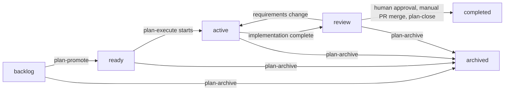

# A Repeatable Plan Lifecycle from Preparation Through Verified Delivery

## Summary

Extend RoboRepo's Plan Suite with `ready/` and `review/`, repeatable implementation, independent QA, explicit human review approval, and safe archiving. Replace `/plan-start` with `/plan-execute`; add `/plan-review` and `/plan-archive`; **retain the existing `/plan-close`** as the post-merge verifier and finalizer. Preserve its working integration checks, including current handling of squash merges.

Every successful lifecycle state change must commit the plan file's move and associated plan-only edits. Move Git, validation, and transition mechanics into shared deterministic Plan Suite operations that skills invoke. The human continues to merge feature branches into the base branch through GitHub; no GitHub integration or workflow automation is introduced here.

## Goals

- Use the lifecycle `backlog → ready → active → review → completed`, with `archived` as an exceptional exit.
- Make `/plan-promote` validate and commit `backlog → ready`.
- Make `/plan-execute` start or resume work from `ready` or `active`, and address QA findings in `review` without a new implementation command.
- Advance `active → review` when **implementation work is complete**; independent QA and human acceptance happen afterward.
- Make `/plan-review` perform independent QA, retain concise findings and resolutions in the plan, and require explicit human approval before manual merge and `/plan-close`.
- Keep corrections to existing requirements in `review`; return to `active` only when scope or acceptance criteria must materially change, preserving the current branch and worktree.
- Merge the current base branch **into the feature branch** during review, including subsequent review rounds when needed. Never merge the feature branch into base automatically.
- Preserve `/plan-close` as a **post-manual-merge** command that verifies landed work, checks completion/approval evidence, moves `review → completed`, commits the move, and performs existing guarded cleanup.
- Commit each state transition in the appropriate checkout, with deterministic authority, worktree, Git, and validation safeguards.
- Update the Plans portal, CLI, packages, documentation, and tests consistently.

## Non-goals

- Backward compatibility, aliases for `/plan-start`, or migration support for obsolete command contracts. Breaking changes are acceptable.
- Introducing `/plan-ship`, a chat-held merge approval/wait loop, or pre-merge shipping modes. Reconsider `/plan-ship` when GitHub PR interaction is introduced separately.
- CodeRabbit or any other external reviewer integration; GitHub APIs, PR creation, PR comments, or automated base-branch merges.
- Automated session launching, watchers, queues, continuous orchestration, or configurable progression.
- A separate review database, elaborate finding IDs/round schemas, or a separately stored lifecycle field. The **plan folder remains the lifecycle source of truth**.
- Replacing the known-working `/plan-close` merge-verification algorithm merely because squash or rebase merges exist.

## Current state

- Plans live in `docs/plans/{backlog,active,completed,archived}/`; lifecycle is derived from folders. Structural readiness and the existing `reviewed_commit` freshness concept are separate from the proposed QA lifecycle state.
- `/plan-write` creates the backlog plan and its initial executable checklist. `/plan-promote` reconciles and improves that plan but currently does not change state. `/plan-start` enters `active/` and implements work in an associated Git worktree. `/plan-close` verifies landed implementation and completes or archives. `/session-close` provides cross-session handoff.
- The initial start transition is committed in the base checkout. An assigned worktree's plan is authoritative during active implementation; current portal authority rules are specialized to `active/`.
- Existing Plan Suite policy, parser, findings, authority, move/CLI, and Git integrations should be extended rather than reimplemented inside skills. The current `/plan-close` integration and cleanup behavior is the baseline for closeout.
- `docs/plans/plans-config.json` declares the `plan-lifecycle` namespace and worktree policy.

Reference points: `globals/packages/plan-write/skills/plan-write/`, `globals/packages/plan-promote/skills/plan-promote/`, `globals/packages/plan-start/skills/plan-start/`, `globals/packages/plan-close/skills/plan-close/`, `modules/plan-suite/`, `docs/user/guides/plan/lifecycle/plan-suite.md`, and `docs/user/reference/plans-portal.md`.

## Proposed design

### Lifecycle and command contract



| Command | Accepts | Responsibility | State/result |
| --- | --- | --- | --- |
| `/plan-write` | New or existing plan | Create or revise the plan and executable checklist | New plan in `backlog`; no implicit move |
| `/plan-promote` | `backlog`, `ready` | Validate/reconcile requirements, tests, dependencies, and tasks | Commit `backlog → ready`, or refine an existing `ready` plan |
| `/plan-execute` | `ready`, `active`, `review` | Start/resume implementation; in `review`, remediate recorded findings | `ready → active`; `active → review` on implementation completion; remain `review` while fixing findings |
| `/plan-review` | `active`, `review` | Check implementation readiness, synchronize base into branch, independently review, record findings and request human approval | `active → review` if eligible; remain `review` until approved or scope changes |
| `/plan-close` | `review` (after manual merge) | Verify landed implementation and review approval, commit completion, safely clean up | `review → completed` after integration is verified |
| `/plan-archive` | `backlog`, `ready`, `active`, `review` | Record reason; preserve unmerged code; archive | Commit move to `archived` |
| `/session-close` | Any agent session | Record progress and handoff for a fresh session | No lifecycle transition |

A command may be invoked before its normal entry transition or again after that transition; it inspects current state and does not duplicate work. Commands **never invoke the next skill**. A later manual invocation starts the next phase, normally in a separate agent session. No process exit or session handoff implies stage completion.

### Implementation completion is not QA

`/plan-execute` uses a shared completion preflight that deterministically checks observable requirements: required tasks are accounted for, unresolved blockers and decisions are surfaced, applicable automated tests/checks have recorded results, relevant changes are committed, and implementation evidence is present. The agent must assess whether stated requirements were implemented; **a deterministic gate cannot independently prove semantic correctness**, and should not attempt to perform QA.

- **Incomplete or blocked:** keep `active`, record the remaining tasks or blockers and an actionable `next_action`; later `/plan-execute` resumes the existing worktree.
- **Implementation complete:** commit progress as appropriate, move and commit `active → review`. QA has not yet passed.
- **`/plan-review` invoked while `active`:** run the same implementation-readiness check. If ready, commit `active → review` and begin QA; otherwise report precisely what is incomplete without moving the plan.
- Track genuinely unverified manual checks under the existing `## Not tested` mechanism. Do not treat them as passed. Keep the existing rule that they must be resolved before `/plan-close`; do not turn implementation completion into manual QA.

### QA, remediation, and human approval

Keep review evidence in a **small `## Review` section of the authoritative plan**: current findings, their resolutions, automated/manual verification performed, the reviewed implementation commit, and explicit human approval. Ordinary Markdown checkboxes are sufficient for findings. Avoid stable finding-ID infrastructure, a formal review-round database, or duplicate review records; retain previous findings as needed for readable history.

For example:

```md
## Review

### Findings
- [x] Missing retry test — added and verified
- [x] Error handling gap — corrected

### Verification
- Unit and integration tests passed
- Manual checks confirmed

### Approval
- Decision: approved
- Reviewed implementation commit: <full SHA>
- Confirmed by: human
```

Only a human can grant approval. Record the exact reviewed implementation revision and check freshness against implementation content: code changes or newly resolved merge conflicts require another review and approval, whereas a plan-only findings/approval commit does not by itself invalidate approval. Keep the existing frontmatter `reviewed_commit` (plan freshness) concept distinct from this human-approved implementation revision. Use deterministic approval checks, but do not over-specify the prose format for findings.

1. `/plan-review` may begin from a completed `active` plan or resume in `review`. Synchronize the current base branch into the assigned feature branch before QA, then inspect requirements, changes, tests, and evidence independently from the implementation agent.
2. Record findings and verification in the plan and commit the updated plan. `/plan-execute` may then be invoked in `review` in a **separate session** to address those findings; no additional `plan-fix` skill is needed.
3. Re-run `/plan-review` after fixes. Corrections within the approved requirements stay in `review`.
4. If review identifies a material change to requirements or acceptance criteria, revise the plan/tasks, invalidate prior approval, commit `review → active`, and use `/plan-execute` to continue. Preserve the implementation worktree and completed work; do not return to `ready`.
5. Once findings and required manual checks are resolved, ask the human for explicit review approval and commit the approval record. An agent cannot infer approval from passing tests.
6. Approval must not authorize closing a different implementation revision; stale approvals cause `/plan-close` to refuse with a clear next action. Keep this conservative without inventing a new approval service.

### Base synchronization belongs to review

Use one deterministic `sync-base` operation, invoked by `/plan-review`, to merge the configured base branch **into the implementation branch**. Repeat in later review rounds when base has moved; the operation is idempotent when nothing needs merging.

- Verify repository, worktree, target branch, base ref, and Git safety before changing anything; surface a stale base ref or dirty worktree rather than silently rewriting local state.
- On conflicts, pause for semantic resolution by the agent or a human; never discard changes or blindly choose one side. A deterministic continuation verifies conflicts were resolved, checks passed, and the result was committed.
- Review findings and any approval must be refreshed if synchronization changes the reviewed implementation. Branch synchronization does not itself move the lifecycle state.
- **Do not synchronize in `/plan-close`**: by then the user has already merged through GitHub. If `main` moves after approval but before that merge, the user can rerun `/plan-review` as needed, and GitHub's own merge protections remain independent.

### Manual merge and existing plan-close

Keep `/plan-close` a **single post-merge action**, not a two-stage `/plan-ship` replacement:

1. The user manually merges the reviewed implementation into the base branch through a GitHub PR, outside RoboRepo's workflow.
2. `/plan-close` verifies the reviewed implementation has landed in the current base checkout. Reuse its existing working integration detection (including squash-merge behavior); do not replace it with an ancestry-only requirement.
3. Confirm a valid human review approval for the landed implementation, resolve mandatory `## Not tested` entries, run applicable existing closeout checks, and record `## Verification`.
4. Move `review → completed` **on the base checkout** and commit the plan-only transition; then use the existing guarded worktree/branch cleanup mechanisms.
5. If integration cannot be verified or post-merge checks fail, do not claim completion or delete unmerged work. Report the specific next action and allow retry after the issue is resolved.

There is no `plan-ship` command, no in-chat waiting or polling for a PR merge, and no GitHub API integration in this plan. A future PR-enabled shipping workflow may reuse the same deterministic closeout operation behind a new `/plan-ship` interface.

### Deterministic state changes and Git commits

Centralize shared operations for plan ID/authority resolution, transition permissions, validation, file moves, **scoped staging and commits**, Git safety, base synchronization, approval freshness, landed verification, and cleanup. Skills coordinate decisions and agent work; they do not each invent their own Git commands.

- Every state move commits the moved plan file and any explicitly owned plan-only edits; never stage unrelated changes with `git add -A`.
- Commit `backlog → ready` and the initial `ready → active` handoff in the base checkout using the existing safe worktree-start pattern. Commit `active ↔ review` in the assigned implementation worktree. Commit `review → completed` in the base checkout after the manual merge.
- Use the stable plan ID to reconcile different paths in the base checkout and authoritative worktree. Extend current worktree authority to both `active` and `review` without silently overwriting copies.
- `plan-archive` commits its own safe transition and reason in the appropriate checkout. Do not discard unmerged implementation or delete a worktree without explicit authorization.
- An operation reports a completed transition **only after** the commit succeeds and its new path/identity are verified. Invalid moves fail without mutation. Repeated calls are safe and do not create duplicate commits. Never push automatically.
- Folder location remains lifecycle truth; no `lifecycle:` frontmatter field or separate tracking database.

### Portal, packaging, and terminology

- Add `ready` and `review` to scanners, lifecycle policy, validation, API/portal grouping, filters, counts, and available actions. Preserve plan authority through `active` and `review`, including divergence between base and feature worktrees.
- Display implementation progress and QA/review outcome separately. Name existing `reviewed_commit` status **plan freshness** or equivalent, so it cannot be mistaken for the new `review` lifecycle state or human approval.
- Provide portal copy-prompt actions for `plan-promote`, `plan-execute` (including review fixes), `plan-review`, `plan-close`, and `plan-archive`. The portal need not execute lifecycle mutations.
- Remove obsolete `/plan-start` package/commands/examples, and update suite manifests, registries, harness projections, CLI help, and docs. **Retain `/plan-close`** and update its accepted state and review approval checks. No compatibility aliases.

## Implementation checklist

The initial executable tasks belong in **`plan-write`**. `/plan-promote` must verify and refine them against the current repository before moving the plan to `ready`; it does not need to invent a checklist from scratch.

### Phase 1 — Shared lifecycle contract

- [ ] Inventory current Plan Suite lifecycle, authority, CLI, skill, portal, and Git operations; reconcile overlapping active plans and identify reusable implementation owners.
- [ ] Add `ready` and `review` to lifecycle policy, folder validation, transition rules, stable-ID discovery, and primary/worktree authority resolution.
- [ ] Implement deterministic lifecycle transition operations with scoped plan-only commits, idempotent retries, post-commit verification, and safe worktree/base handoffs.
- [ ] Implement a practical shared implementation-completion preflight (tasks, blockers, check results, evidence) without requiring independent QA or manual review.
- [ ] Implement lightweight review approval storage and revision freshness checks, reusing the plan's Markdown rather than creating a review database.

### Phase 2 — Lifecycle skills and Git workflow

- [ ] Update `/plan-promote` to validate/refine the existing task checklist and commit `backlog → ready`; support reruns in `ready`.
- [ ] Replace `/plan-start` with repeatable `/plan-execute` for `ready`, `active`, and review-fix work; reuse the existing worktree and move `active → review` only after implementation completion.
- [ ] Add `/plan-review` for independent QA, plan-owned findings, repeated review after fixes, human approval, and scope-driven `review → active`.
- [ ] Add one shared base-into-feature sync operation for `/plan-review`, with conflict-resolution continuation and approval invalidation when implementation changes.
- [ ] Extend **existing `/plan-close`** to accept the approved `review` state, verify the human-managed merge and landed approval evidence, commit `review → completed`, and retain its working cleanup/landing behavior.
- [ ] Add `/plan-archive` to commit an archive reason and protect unmerged implementation/worktrees from accidental deletion.

### Phase 3 — Portal and documentation

- [ ] Update Plans portal discovery, status/grouping, primary/worktree authority, freshness vocabulary, and copy-prompt actions for the new states and commands.
- [ ] Update package manifests, registries, CLI routing/help, and supported harness projections; remove `plan-start` references without introducing `plan-ship`.
- [ ] Update lifecycle, CLI, portal, skill-reference, and README documentation, including task-checklist ownership and manual merge/close behavior.

### Phase 4 — Verification

- [ ] Test valid/invalid transitions, scoped commits, idempotence, failures, worktree authority, implementation-completion checks, review approval freshness, and safe archive behavior.
- [ ] Test base synchronization/conflicts and the existing `/plan-close` integration verification with normal, squash, and rebase merge fixtures; preserve working behavior.
- [ ] Exercise the full manual workflow, including repeated execute sessions, review fixes, `review → active`, human approval, manual GitHub merge, closeout, and archiving.
- [ ] Run repository-native validation and applicable suites (`node scripts/test/plan-suite-findings-check.mjs`, `npm run test:unit`, `npm run test:portal-ui`, `npm run check`); record results and any remaining gaps.

## Validation

1. Both new lifecycle folders are first-class in CLI, validator, and portal; lifecycle remains folder-derived.
2. Every successful state transition produces the correctly scoped plan-file Git commit, with safe refusal/retry behavior when commits or moves fail.
3. `/plan-execute` resumes incomplete work across sessions and advances to `review` only upon **implementation completion**, not independent QA success.
4. `/plan-review` can start on a completed `active` plan, record findings, rerun after remediation, and obtain explicit human approval for a current implementation revision. Review fixes stay in `review`; requirement changes may return to `active`.
5. `/plan-review` can safely synchronize base into the feature branch and handle conflicts without overwriting work or incorrectly preserving approval.
6. The user merges through GitHub; `/plan-close` runs **after** that merge, retains existing landing detection, verifies approval and completion, commits `review → completed`, and performs guarded cleanup. No automatic merge into base or pre-merge `plan-ship` exists.
7. `/plan-archive` records why the plan was retired and never silently destroys unmerged work.
8. Portal and CLI resolve the authoritative plan correctly while base and the implementation worktree show different plan paths.
9. Packages and documentation use `plan-execute`, `plan-review`, `plan-close`, and `plan-archive`; no `plan-start` compatibility shim or `plan-ship` command is introduced.

## Documentation impact

- `docs/user/guides/plan/lifecycle/plan-suite.md`: lifecycle, tasks at writing/promotion, resumable implementation, review, manual merge, and `/plan-close`.
- `docs/user/reference/plans-portal.md`: folders, authority, review/freshness distinctions, available actions.
- `docs/user/reference/roborepo-cli.md`: deterministic transition, sync, review-approval, archive, and closeout behavior.
- `README.md`: lifecycle stages and entry-point command names.
- `globals/packages/plan-write/skills/plan-write/references/{plan-schema,lifecycle,workflow-create,workflow-update,workflow-validate}.md`: checklist ownership, new destinations, authority, `## Review`, and transition rules.
- `/plan-promote`, `/plan-execute`, `/plan-review`, `/plan-close`, `/plan-archive` skill and package instructions; update other related docs of record found during promotion.

## Risks and safeguards

| Risk | Safeguard |
| --- | --- |
| Base and assigned worktree disagree on the plan lifecycle/path | Stable ID and explicit authority across `active`/`review`; no blind copy-back |
| An incomplete implementation is mistaken for ready-to-review | Check tasks, evidence, blockers, and automated results before advancing; leave QA to review |
| Base synchronization changes code after review | Approval tied to reviewed implementation; rerun review after content changes |
| Auto-commits include unrelated edits | Stage only explicit plan paths and verify staged contents |
| A manual squash merge appears unlanded | Preserve `/plan-close`'s existing landed-check mechanism and regression-test its current behavior |
| Cleanup discards unmerged feature code | Guard worktree and branch removal; refuse when landing cannot be verified |
| Review rules grow into a second workflow engine | Simple Markdown findings and approval; no queue/session orchestrator or PR interaction |

## Decisions recorded

- Keep **`/plan-close`**; do not introduce `/plan-ship` until a separate GitHub integration effort has a real shipping workflow to own.
- Rename `/plan-start` to repeatable `/plan-execute`; allow execution in `review` strictly for findings remediation.
- `plan-write` provides the initial task checklist; `plan-promote` refines, validates, and commits the promoted plan to `ready`.
- Implementation completion advances to `review` without requiring QA. `/plan-review` is independent QA and requires explicit human approval, tied to reviewed implementation content.
- Fixes within requirements remain in review; material requirements/acceptance-criteria changes move `review → active` and preserve the worktree.
- `/plan-review` synchronizes base **into** feature as needed. `/plan-close` verifies the **human-managed** merge afterward; it does not perform base synchronization or wait in a chat for a merge event.
- Every lifecycle transition is committed. Shared deterministic operations own Git/validation behavior; skills own judgment and sequencing. No backwards compatibility requirement.

## Open questions

None blocking design. During `/plan-promote`, verify related plans, current commands/module paths, and existing closeout semantics against the live repository before choosing specific file edits. Do not expand scope into GitHub automation or CodeRabbit.
