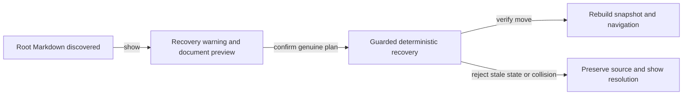

# Unclassified Plan Recovery

## Summary

Provide deliberate recovery for plan documents placed directly under `docs/plans/`, preserving
visibility and user confirmation while keeping unclassified separate from normal lifecycle states.

## Context

The scanner reports root-level Markdown as unclassified. `portal/plans/app.js` conditionally shows
the Unclassified view, and current validation/repair commands can diagnose or scaffold metadata.
The initial root-file migration already happened. Nested historical design notes were moved outside
the plan tree during backlog cleanup; they are not a root-level recovery use case.

Lifecycle mutations now run through atomic commands in `scripts/cli/plans-command.mjs`; the old
generic portal lifecycle endpoint/dropdown is not the implementation seam. This plan owns the
guided warning and an explicit recovery operation for a source that normal transitions may reject.

## Goals

- Keep misplaced documents visible until resolved and warn again if a new one appears.
- Confirm recovery of a genuine plan into backlog; allow non-plan documents to remain unmodified
      while the user chooses another home.
- Preserve IDs/body content and reject collisions or stale source changes.
- Hide recovery navigation when the last misplaced file is resolved.

## Proposed design

First characterize current atomic source-lifecycle restrictions and metadata repair. Add the
smallest explicit recovery contract rather than bypassing transition validation from the browser.
The portal may generate an actionable recovery prompt where direct mutation is not supported.
No unclassified destination, bulk all-or-nothing migration, or automatic classification is added.

## Implementation plan

- [ ] Characterize scanner, repair, canonical transitions, and source-identity checks on root files.
- [ ] Specify an explicit recovery operation/prompt that confirms the source is a plan and records
      any metadata repair before a guarded move.
- [ ] Enforce primary/worktree authority, stable identity when available, fresh path/content state,
      duplicate-ID rejection, destination containment/collision checks, and preservation of content.
- [ ] Add warning/count/preview and one per-file recovery action using that deterministic contract.
- [ ] Keep a failed source visible with an actionable reason; refresh the snapshot after success.
- [ ] Return navigation to backlog after the final recovery when the selected view becomes empty.

## Validation

Exercise root-file discovery, empty navigation, reappearance after refresh, missing metadata,
duplicate IDs, stale source edits, destination collisions, non-plan documents, and successful
content-preserving recovery. Use current plan-suite/portal-state check files and browser specs.
Validation/repair existing behavior must stay intact; run `npm run check` for implemented shared
lifecycle changes.

## Documentation impact

Update `docs/user/reference/plans-portal.md`, the plan-suite walkthrough, and
`docs/internal/plans-portal-internals.md` with the supported recovery path.

## Open questions

- Can current atomic operations safely compose recovery, or is an explicit recovery command needed?
- Should initial portal recovery execute directly or prepare the supported agent/CLI prompt?
