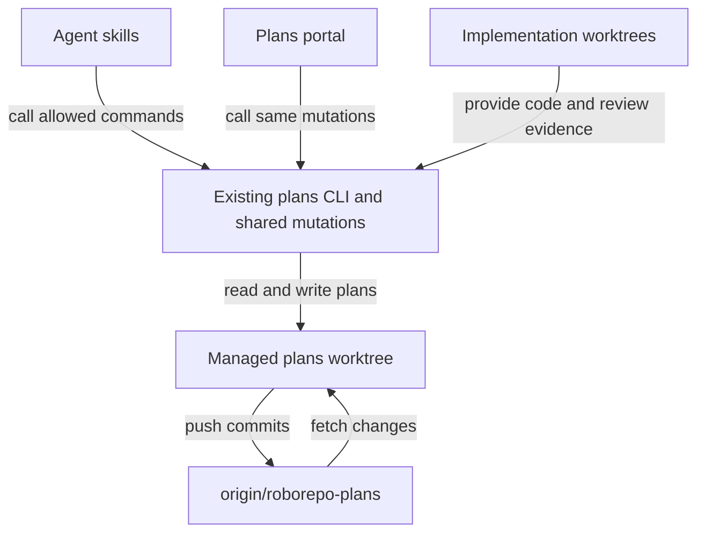

# Store plans on a dedicated Git branch

## Summary

Keep plan-suite Markdown and ordering metadata in `origin/roborepo-plans`, not in implementation branches. RoboRepo manages a persistent local plans worktree for each repository. Agent skills and the Plans portal read from that worktree and use constrained RoboRepo operations to save, commit, and push changes automatically.

## Context

Plan-suite derives a plan's lifecycle from its folder under `docs/plans/`. Today, lifecycle moves are committed in the primary checkout, while active and review plans can be edited in a feature worktree. These copies can disagree, and plan edits add noise and merges to code history. A separate, remotely backed branch retains Markdown and Git history without introducing a database.

## Goals

- One canonical plan per ID, with the existing lifecycle folders, metadata, ordering, and human approval gates.
- Automatic remote persistence after every successful save or lifecycle operation, including from other repositories and worktrees.
- Reconnection on a new Mac after cloning the repository, without manual branch checkout or push.
- Constrained CLI-backed writes for agents and the portal, including upload of externally authored `.md` plans.
- Safe routine writes to different plans by multiple agents, without adding collaborative editing infrastructure.

## Non-goals

- A database, hosted service, or merging the plans branch into `main`.
- Direct writes to the managed plans worktree by agents.
- Real-time editing or reconciliation of two conflicting edits to the same plan; this is a follow-up.
- Deleting plans, force pushes, configurable branch names/remotes, or a separate plans-worktree management interface.
- Markdown paste in the portal's first release. File upload is sufficient.

## Current state

- `canonical-scan.mjs`, `plan-copies.mjs`, and `plan-authority.mjs` select an authoritative plan from several checkouts.
- `transition.mjs` commits lifecycle moves in the primary checkout, without pushing.
- `review-gates.mjs`, `worktree-copy.mjs`, `landing-gate.mjs`, and `sync-base.mjs` assume plans may be present in implementation worktrees.
- `backlog-registry.mjs` reads and writes `docs/plans/plans-order.json` in the primary checkout.
- `plans-command.mjs` already owns validation, transitions, ordering, and review checks. `plan-suite-init` creates the folders and namespace config without committing them.
- `package.json` includes `docs/plans/plans-config.json` in the published package; the migration must preserve packaging behavior.

## Proposed design

### One Git-backed plans store

Reserve the orphan branch `roborepo-plans` on `origin`. It contains only `docs/plans/**`, including `plans-config.json`, `plans-order.json`, and the six existing lifecycle folders. Its remote history is durable; the local plans worktree is a disposable, reconstructible checkout of that branch. Derive its location from existing repository/worktree conventions rather than storing machine-specific paths in plan files or introducing a separate registry.

The plan's `worktree:` frontmatter still identifies its **implementation** worktree, not the plans worktree. A missing implementation worktree on another machine must not hide its plan. Evaluate `reviewed_commit`, approval freshness, and landing against code commits, never the plans branch HEAD.

### Reuse existing commands and one write path

Keep existing transition, ordering, validation, and review-check commands. Add only:

- `roborepo plans init`: create or reconnect the plans branch and worktree, including recovery from a missing local worktree.
- `roborepo plans show <id>`: refresh from the remote and read a plan for agents.
- `roborepo plans save <file.md>`: create a backlog plan or update an existing plan by ID, with validation. It does not move a plan between lifecycle folders or change human approval records.

The portal's **Import Plan** upload uses the same save logic; it does not need a separate import command. Existing lifecycle commands remain responsible for moving plans. Extend the relevant review operation to write its human-approved review record through the same guarded mutation path, rather than allowing `save` to forge an approval.

Put Git synchronization and guarded commits in one cohesive shared module under `modules/plan-suite/`. Do not introduce a generic persistence framework or duplicate the existing lifecycle rules.

Each mutation:

1. Acquire a short local lock for the repository's plans worktree. Fetch and fast-forward from `origin/roborepo-plans` before editing.
2. Validate the plan ID, requested operation, allowed `docs/plans/**` paths, and existing lifecycle rules. Stage only files affected by that operation.
3. Commit once and push immediately. Report success only when the remote accepts the push.
4. If the remote advanced meanwhile, synchronize and retry a limited number of times when the changed files do not overlap. Never force-push or automatically resolve edits to the same file.

If Git or the network fails, preserve the unpushed commit, report **not synchronized**, and allow a later retry. Reads use the managed plans worktree; refresh it for `plans show`, portal startup and explicit refresh, and before mutations rather than on every UI render.

### Constrained access

Agent permissions allow named `roborepo plans` operations, not arbitrary Git commands or direct edits to the managed worktree. CLI validation independently restricts committed files to `docs/plans/**`, rejects path escapes and unexpected staged changes, and disallows arbitrary Git options. Uploaded Markdown is content, never executable instructions. Repository credentials and host branch rules remain a separate security boundary; command allowlists cannot constrain an agent with unrestricted shell access.

### Initialization and migration

`/plan-suite-init` invokes idempotent `roborepo plans init`:

- **Existing remote branch:** fetch it and create or reconnect the local plans worktree. Use its stored config and plans.
- **No remote branch:** use the existing plan-authority rules to choose authoritative documents from current checkouts. Refuse ambiguous or conflicting copies. Create the orphan branch, copy plans/config/order/folders, and push it.
- **New repository:** scaffold folders and the agreed namespace config on the new branch, then push.
- **No remote or push permission:** return an actionable error; do not silently claim local-only initialization succeeded.

After confirming the remote copy, remove tracked `docs/plans/**` from the code branch in a separate, reviewable commit. Do not discard unresolved local edits. Ignore any obsolete copies still tracked on old feature branches when reading plans; document how to prevent or resolve their reintroduction during merges. Use the existing migration authority logic rather than a second reconciliation engine.

### Portal upload

Add an **Import Plan** action that accepts one `.md` file. Show the parsed title, ID, target lifecycle (`backlog` for new plans), validation errors, and preview before committing. Reject invalid filenames/namespaces and duplicate IDs for a new plan. For an update by existing ID, show a diff and require confirmation. Save through the shared mutation path and display remote push success or failure.

## Implementation checklist

- [ ] **Git store:** Resolve the reserved branch and managed worktree using existing repository utilities; implement init/reconnect and the shared fetch, guarded commit, push, local lock, and disjoint-file push retry. Test against temporary Git remotes.
- [ ] **Canonical reads and writes:** Point plan scanning, validation, namespace config, and backlog ordering at the plans worktree. Remove normal copy-reconciliation behavior. Route existing transitions and review-record writes through the shared mutation path; add `plans show` and `plans save`.
- [ ] **Preserve lifecycle gates:** Update review, approval, landing, and base-sync behavior to use the canonical plan but evaluate implementation Git state independently. Ensure implementation cleanup never removes the reserved plans worktree.
- [ ] **Agent and portal integration:** Update plan-suite skills and generated agent permissions to use allowed CLI commands. Add portal `.md` upload, preview, duplicate/diff confirmation, validation, and push feedback using the same save logic.
- [ ] **Migration and onboarding:** Make `plan-suite-init` call `plans init`; migrate existing authoritative plans and ordering, retire tracked copies from code branches, test a fresh clone and reconnect, and verify npm packaging.
- [ ] **Verification and docs:** Test creating, saving, ordering, reviewing, and closing a plan from different code worktrees and from two clones of one remote. Run focused plan-suite tests, `npm run test:portal-ui`, `npm run pack:dry-run`, and the repository CI checks (`npm run check`) where applicable. Update affected plan-suite and user-facing docs.

## Validation

- A plan created, edited, ordered, or transitioned by an agent or portal is committed and pushed without manual Git work.
- A fresh clone and one `roborepo plans init` restore the same IDs, folders, config, ordering, and Markdown.
- Review approval and code-landing checks still gate completion, with no plan merge into `main`.
- Two clones changing different plans can push successfully despite a remote race; neither change is lost.
- A failed push is visibly unsynchronized and recoverable; an invalid file or forbidden change never reports success.
- Portal upload saves a valid new plan to Backlog and requires confirmation before updating an existing one.
- Migration preserves authoritative plan content and does not let the reserved worktree enter implementation cleanup.
- Package installation and tests still work after `docs/plans/plans-config.json` moves out of the code branch.

## Risks

| Risk | Minimum safeguard |
| --- | --- |
| Another machine pushes between fetch and push | Retry only non-overlapping changes; never force-push |
| Two local agents use the same Git index | Short lock around one mutation |
| Remote is unavailable | Preserve the local commit and show unsynchronized status |
| Existing code branches still track old plan files | Ignore them for reads; remove tracked plans in migration and document merge cleanup |
| Review logic assumes plans live with code | Keep code Git checks independent of the plans worktree |
| Git hooks assume a full source checkout | Test commits on the orphan branch; preserve appropriate plan validation |

## Documentation impact

Update `globals/packages/plan-suite/skills/` and their shared references, especially `plan-write`, `plan-suite-init`, `plan-execute`, `plan-review`, and `plan-close`. Update the Plans portal and CLI instructions in `docs/user/`, plus installation/migration guidance. Replace primary-checkout plan authority instructions while retaining folder-based lifecycle semantics.

## Follow-up task

After rollout, plan **same-document concurrent editing**: detect edits made since an agent read a plan, present differences, and define user-guided resolution. The initial implementation only refuses overlapping automatic push retries.
