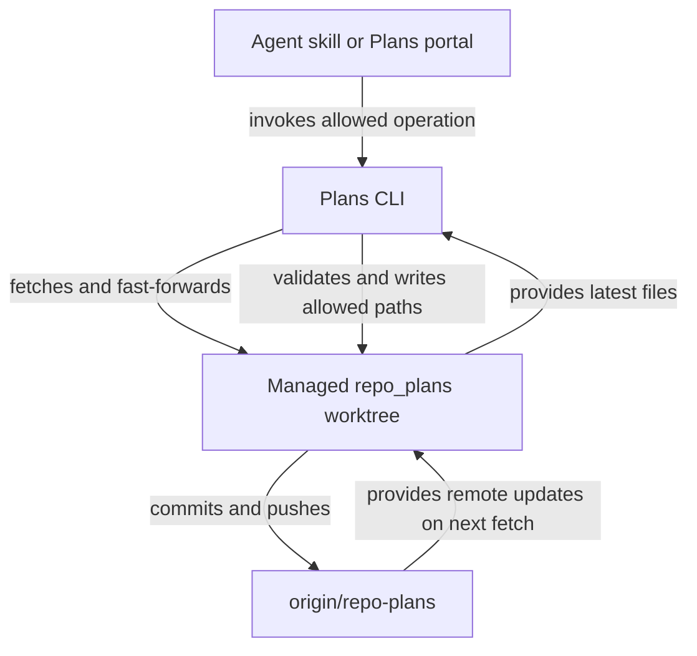

# Store plans on a dedicated Git branch

## Summary

Store plan-suite Markdown and ordering metadata under `plans/` on the remote orphan branch `origin/repo-plans`. RoboRepo maintains a persistent `repo_plans` worktree per repository. Agents and the Plans portal read plans there and use narrowly scoped RoboRepo commands to validate, commit, and push changes automatically. The plans branch never merges into a code branch.

## Context

Plan-suite derives a plan's lifecycle from its folder. Today, plan files under `docs/plans/` can exist in the primary checkout and an implementation worktree. Edits produce noisy code history and sometimes competing authoritative copies. A dedicated remote Git branch removes that duplication while retaining Markdown as the source of truth.

## Goals

- One canonical plan per ID, with the same lifecycle folders, plan metadata, ordering, and human approval gates; keep the branch root available for other artifacts.
- Automatic remote persistence for saves and lifecycle changes, from any implementation checkout, skill, or portal action.
- One-command setup on a new Mac after cloning the code repository, without manual branch checkout or push.
- Plan writes restricted to named CLI operations, including portal upload of externally authored Markdown.
- Ordinary different-file writes by multiple agents, without building collaborative same-document editing.

## Non-goals

- A database, hosted service, or merging `repo-plans` into `main`.
- Backward-compatible reads or writes of `docs/plans/` after the switch.
- Direct agent writes to the managed plans worktree.
- Same-document conflict resolution; this remains a follow-up task.
- Plan deletion, force pushes, configurable branch names/remotes, or a separate worktree-management UI.
- Portal Markdown paste in the initial release; `.md` upload is sufficient.

## Current state

- `canonical-scan.mjs`, `plan-copies.mjs`, and `plan-authority.mjs` choose plan copies across checkouts.
- `transition.mjs` commits lifecycle moves on the primary branch without pushing; review and landing gates assume implementation worktrees can contain plans.
- `backlog-registry.mjs` stores order in `docs/plans/plans-order.json`; `plans-command.mjs` handles validation, lifecycle actions, and ordering.
- `plan-suite-init` scaffolds `docs/plans/` but does not create a branch or commit.
- `docs/plans/plans-config.json` already supports `worktreeRoot` and `worktreeRepoName`; `package.json` also references that config path.

## Proposed design

### Canonical branch layout and worktree

Create the orphan branch `repo-plans` on `origin`. Put plan-suite content under a top-level `plans/` directory, without the `docs/` wrapper. Leave the branch root available for other artifact types later; those artifacts are out of scope for this plan:

```text
repo-plans (branch root)
└── plans/
    ├── plans-config.json
    ├── plans-order.json
    ├── backlog/
    ├── ready/
    ├── active/
    ├── review/
    ├── completed/
    └── archived/
```

The remote branch is authoritative. Its local worktree is a rebuildable checkout, not another source of truth. Use existing `plans-config.json` values rather than a new path setting:

```text
<worktreeRoot>/<worktreeRepoName>/repo_plans
~/.worktrees/roborepo/repo_plans
```

Reserve `repo_plans` for the plans branch; resolve `worktreeRoot` and `worktreeRepoName` from remote `plans/plans-config.json` on reconnect. For initial setup, use existing repository defaults until the new config is available. Reject an occupied destination belonging to another repository; never replace or delete it. Repositories must have distinct `worktreeRepoName` values when they share a root.

Protect the reserved worktree from RoboRepo's normal cleanup commands and exclude it from agent cleanup permissions. Agent allowlists must not grant raw write, worktree removal, or arbitrary Git access to this path. Use Git-host branch rules where available to disallow remote branch deletion and force pushes while still permitting authorized direct pushes. These are application/permission safeguards, not a claim that a same-user process with unrestricted shell access cannot delete local files.

The plan frontmatter `worktree:` field still identifies its **implementation** worktree, not `repo_plans`. A missing implementation worktree on a newly cloned machine must not hide a plan. Approval freshness and `reviewed_commit` are checked against code commits, never the plans branch HEAD.

### CLI-only writes and synchronization

Reuse existing validation, lifecycle, order, and review commands. Add only:

| Command | Purpose |
| --- | --- |
| `roborepo plans init` | Create or reconnect `origin/repo-plans` and the reserved local worktree; recover a missing local checkout |
| `roborepo plans show <id>` | Refresh remote state and read a plan from the managed worktree |
| `roborepo plans save <file.md>` | Validate and create a Backlog plan or update an existing plan by ID, without changing lifecycle or granting approval |

The portal uses the same `save` operation for uploads, not an additional import API. Existing lifecycle commands own moves and human approval records. Put Git synchronization and guarded writes in one shared module under `modules/plan-suite/`, not a general storage framework.

Each mutation follows one sequence:



1. Serialize local mutations with a short repository-level lock; fetch and fast-forward before editing.
2. Validate the operation, plan ID, existing lifecycle rules, and paths within **`plans/`**. Stage only affected plan and metadata files.
3. Commit once and push automatically; report success only after the remote accepts the push.
4. If another machine pushed first, fetch and retry a bounded number of times for non-overlapping changes. Never force-push or silently overwrite edits to the same file.

Preserve unpushed changes on network or Git failure and report **not synchronized**. `plans show` refreshes before reading; the portal refreshes on startup and explicit refresh; mutations always refresh before writing. Avoid fetching on every UI render.

Agent permissions allow named `roborepo plans` commands, not direct writes or arbitrary Git commands. The CLI also validates the target branch, worktree, paths, and staged changes. Uploaded Markdown is untrusted document content, never an executable instruction. Whitelists only provide real isolation when agents do not also have unrestricted shell/filesystem access.

### Initialization and temporary migration

`/plan-suite-init` invokes idempotent `roborepo plans init`:

- If `origin/repo-plans` exists, fetch and reconnect its reserved worktree, using `plans/plans-config.json`. Do not search code branches for plan copies.
- Otherwise, create and push a scaffolded orphan branch with config, order, and lifecycle folders inside `plans/`. Scaffold namespaces using the existing init flow.
- If a remote is missing, credentials fail, or the reserved path belongs to another repository, explain the failure; never report a local-only success.

**No permanent backward-compatibility or migration layer.** Deliver a small, temporary `migrate-plans-once` script for the three existing repositories, run **after** `plan-suite-init`:

1. Read the old `docs/plans/` folder from the code checkout.
2. Confirm the source config’s `worktreeRoot` and `worktreeRepoName` agree with the initialized worktree location; stop for correction if not. Copy `plans-config.json`, `plans-order.json`, and lifecycle folders into the worktree’s `plans/` directory, preserving IDs, lifecycle positions, and review records. Reject overwrites of nonempty destination plans.
3. Commit and push the imported files on `repo-plans`, then verify the remote copy before reporting success.
4. Have the operator remove tracked `docs/plans/**` files from the code branch in a separate, reviewable commit. Existing feature branches may require ordinary Git merge cleanup.
5. Run the same helper for the remaining repositories, then delete the script; do not ship or maintain it as a supported CLI feature.

The helper is an explicit operator-only exception to normal CLI-only agent writes. It must not delete the source files or modify the code branch automatically. Keep normal runtime code focused exclusively on the new `plans/` layout.

### Portal upload location and behavior

On the **Plans lifecycle header panel**, place a **`+` icon button immediately to the right of the Filters control**. Clicking it opens a modal dialog containing the **Import Plan** `.md` upload form.

The modal validates and previews the title, plan ID, filename, and target folder before saving. New plans enter `backlog/`. For an existing ID, show a diff and request confirmation before updating it; never use upload to change lifecycle or approval records. Display validation errors or remote push status in the dialog. The portal calls the shared CLI-backed `save` operation.

## Implementation checklist

- [ ] **Git store and path:** Implement `origin/repo-plans`, `plans/`-level lifecycle directories/config/order, and `<worktreeRoot>/<worktreeRepoName>/repo_plans` resolution. Add init/reconnect, safeguards against path collisions and managed-worktree cleanup, and shared fetch/commit/push with a local lock and bounded retry.
- [ ] **Canonical plan access:** Redirect scanning, validation, ordering, existing transitions, review records, and CLI reads/writes to the new `plans/` paths. Remove old copy-authority and `docs/plans/` compatibility behavior. Add `plans show` and `plans save`.
- [ ] **Lifecycle and code separation:** Preserve review, approval, landing, and close gates while evaluating code commits independently of plans commits. Update code-base sync and implementation-worktree cleanup to leave `repo_plans` untouched.
- [ ] **Agent permissions:** Update plan-suite skills and generated allowlists to permit named plan CLI operations while excluding direct canonical worktree writes/removal. Add remote branch protection guidance.
- [ ] **Portal:** Add the `+` button immediately after Filters on the lifecycle header, modal `.md` upload, validation/preview, diff confirmation for updates, and push feedback through the existing save path.
- [ ] **One-time migration:** Deliver a disposable helper to move existing `docs/plans/` contents into an initialized plans branch for three repositories, verify remote persistence, and document code-branch cleanup. Do not retain migration logic in the product.
- [ ] **Tests and docs:** Test init/reconnect on a fresh clone; save, order, review, close, upload, path conflicts, protections against normal cleanup, and two clones editing different plans. Update packaging paths and run focused suite checks, `npm run test:portal-ui`, `npm run pack:dry-run`, and `npm run check` where applicable.

## Validation

- Only `repo-plans` contains canonical plan files, under `plans/`; no plan-document merge into a code branch is required.
- A fresh clone and `roborepo plans init` expose existing remote plans in `~/.worktrees/<worktreeRepoName>/repo_plans` without manual Git work.
- CLI and portal saves and lifecycle transitions validate, commit, and push automatically; failed pushes are reported as unsynchronized and recoverable.
- Existing review approval and code landing gates still operate against the implementation branch.
- RoboRepo cleanup cannot target its reserved plans worktree; another repository's occupied path is never overwritten.
- Clicking `+` immediately right of Filters opens a modal that uploads a valid Markdown plan to Backlog; an existing plan requires preview and explicit confirmation.
- A one-time helper migrates all six folders, config, and ordering to `plans/` in each of the three existing repositories without modifying code branches, and can then be deleted.
- Packaging and tests succeed without `docs/plans/plans-config.json` on the main code branch, using `plans/plans-config.json` on `repo-plans` instead.

## Risks

| Risk | Minimum safeguard |
| --- | --- |
| Two machines push between fetch and push | Retry non-overlapping mutations; never force-push |
| Concurrent local Git writes | Short lock around a mutation |
| Remote is unavailable | Preserve local changes and report unsynchronized state |
| A worktree path is shared by two repositories | Check ownership and stop before touching the path |
| Agent deletes canonical local files using unrestricted shell access | Do not promise absolute prevention; limit permissions and recreate checkout from the protected remote |
| Old feature branches reintroduce `docs/plans/` on merge | Treat these files as obsolete and remove them from code branches during ordinary merge cleanup |
| Git hooks assume code is in the orphan checkout | Test hooks and commit behavior with plan-only branch contents |

## Documentation impact

Update plan-suite skills and shared references, especially `plan-write`, `plan-suite-init`, `plan-execute`, `plan-review`, `plan-close`, and worktree cleanup guidance. Update Plans portal/CLI instructions under `docs/user/`, and installation/packaging guidance for the new `plans/` layout. Provide a short operator guide for the temporary three-repository migration and remove it when migration completes.

## Follow-up task

After rollout, design same-document concurrent editing: detect a plan changed since an agent read it, display differences, and require user-guided conflict resolution. The initial release only refuses overlapping automatic retries.
