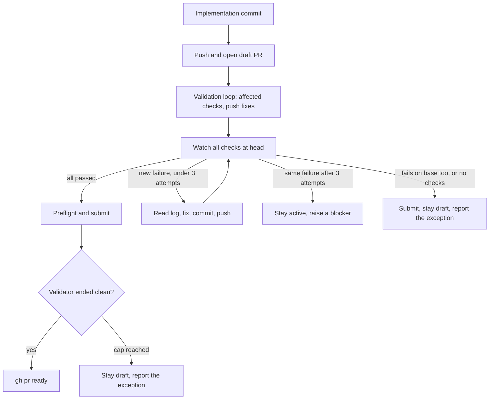

# Deliver finished plans as a watched pull request

## Summary

A plan that reaches review today has a pushed branch at best: no pull request, no body explaining
the change, nobody watching CI, and fixes from `/plan-review` that never reach GitHub. The user
fills each gap by hand. This plan makes `/plan-execute` and `/plan-review` carry the work to a pull
request with a written body and a known CI result. The user still approves and merges.

The long-term goal is that an approved plan reaches a green, mergeable pull request without
babysitting. Topics held back from this plan, and what would unblock each, are recorded in
[Plan Suite Deferred Topics](../../internal/plan-suite-deferred-topics.md).

## Goals

- A draft pull request exists from the first feature-branch push, with a body a reviewer can read.
- CI is watched to a result, and a failure is fixed or raised rather than left for the user to find.
- A pull request leaves draft only when the validator ended clean and every check passed at its
  head commit.
- Fixes and records made during review reach the pull request.
- Merge readiness refuses a branch whose local tip differs from what was pushed.

## Non-goals

- Lifecycle file moves, the branch lifecycle commits land on, and who pushes the base branch. The
  start and submit commits stay local, as they are today. Store plans on a dedicated Git branch
  (`pvgx8oh7`) owns this.
- Merging. `gh pr merge` stays denied, and the user merges.
- Starting a next stage automatically. Stages keep running in separate sessions that the user starts.
- Replying to or resolving review threads. GitHub Integration Part 02 (`f0jwe76j`) owns those, and
  needs the `gh api` access Part 01 (`w7vls1yk`) provides.
- Fixing the validator loop's churn or changing the plan record's shape.
- Changing `manifests/platform/plan-lifecycle.json`. The "Fix findings" action stays as the path for
  sending a finding to a separate session.

## Current state

Skill paths such as `plan-execute/SKILL.md` are under `globals/packages/plan-suite/skills/`.

| Step | Today | Source |
| --- | --- | --- |
| First push | After the submit transition | `plan-execute/SKILL.md`, Push the feature branch |
| Pull request | No skill opens one; the user does, often with an empty or commit-list body (#56, #59) | `plan-review/SKILL.md:370` forbids it |
| Validator's gate evidence | Asks for CI on the head commit, which cannot exist before the first push | `plan-execute/references/validation-loop.md:29` |
| CI after the push | Nothing watches it; runs take 15–22 minutes | No caller of `gh pr checks` in the skills |
| Fixes in review | Committed in the worktree, never pushed: "which this skill never does itself" | `plan-review/SKILL.md:235` |
| Merge readiness | Reads local refs only | `modules/plan-suite/review-gates.mjs:123` |

`gh pr checks --required` is not usable here: it reported "no required checks" on pull request #59
before required checks existed, and the plan suite installs into repos that may never require any.
The skills therefore watch all reported checks.

## Proposed design

### The delivery sequence

The submit transition itself does not change: it is the same plan-only commit on the base branch,
left unpushed. Only its position moves, to after the CI wait.

### One shared procedure

A new reference, `plan-execute/references/pr-delivery.md`, holds the steps below. `/plan-review`
links to it at `../plan-execute/references/pr-delivery.md`, so both skills follow the same rules.

**Open or find the pull request.** Before pushing, read `gh pr view --json number,isDraft,headRefOid`.
Without one, push and run `gh pr create --draft --head <branch> --base <base> --title "<plan title>"
--body-file <file>`. Never use `--fill`. A resumed run reuses the existing pull request.

**Write the body.** Cover what changes for a person using the work, how it was verified, what was not,
and the plan's path. Leave out commit lists. Refresh it with `gh pr edit --body-file` before marking
the pull request ready.

**Watch CI.** Run `gh pr checks <number> --watch` in the background where the harness allows, so
waiting spends no tokens. Then confirm the result is for the head commit:

| Result at head | Meaning | Action | Pull request |
| --- | --- | --- | --- |
| At least one check, all passed | Green | Continue | May leave draft |
| A failure that does not occur on base | Red | Read `gh run view --log-failed`, fix, commit, push, watch again. One `gh run rerun --failed` is allowed for a failure that looks like infrastructure | Stays draft |
| The same failure after 3 fix attempts | Blocked | Stop, record a blocker, keep the plan in `active/` | Stays draft |
| A failure that also occurs on base | Not green | Record it under `### Verification`, name it as an exception | Stays draft |
| No checks reported after a short wait for CI to register | Not green | Run the canonical completion gate locally once, and name the exception | Stays draft |

Base failures and missing checks never count as passing. Attempts are counted per run, so a rerun of
the skill starts fresh, because a person chose to try again.

**Mark ready.** Run `gh pr ready` only when the validator ended clean, CI is green at the head commit,
and no `escalate` finding is open. A validator that stopped at its cap never marks the pull request
ready; `/plan-review` does so after its own pass.

**When a push is refused.** Keep the existing behavior: no retries or workarounds, report the exact
command under Needs you, and let the plan's lifecycle stand. This is the expected path on Codex until
`w7vls1yk` lands, because its sandbox cannot reach GitHub.

**Report base commits that rode along.** A feature branch built on a local base can carry lifecycle
commits not yet on the remote. When `<upstream base>..<branch>` includes any, add one Needs you line
telling the user to push the base branch before merging.

### `/plan-execute` changes

| Part | Change |
| --- | --- |
| Implementation Workflow | After the first implementation commit, open the draft pull request; push later commits as they land |
| `references/validation-loop.md` | Gate evidence becomes the affected checks' commands and output, plus the latest finished CI result when one exists. Passes never wait for CI, because a run takes 15–22 minutes and the loop can run eight passes |
| New step after the loop | Push, then watch CI per the shared procedure |
| Implementation Completion | Preflight, submit, then mark ready, in that order. A blocked CI failure keeps the plan in `active/` |
| Review Findings | Commit the fix, push, watch CI |
| "Push the feature branch" section | Replaced by a link to `references/pr-delivery.md` |
| `references/final-report.md` | The Record gains the pull request link. Replace the example row "plan-review never pushes", and show the push row only when a push failed |
| Boundaries | Allow opening, editing, and marking ready this plan's pull request; merging stays forbidden |

### `/plan-review` changes

| Part | Change |
| --- | --- |
| Step 2, after base synchronization | Push the merge, opening the draft pull request first if none exists |
| Step 5, fixing findings | Push each fix and use CI's result at the fixed commit, per the shared procedure |
| Step 6, before presenting | Run `git fetch`, confirm with `gh pr view` that the pull request's head equals the local tip, and confirm CI is green there or name the exception. Link the pull request in the packet |
| Step 6a, after approval | Push the approval commit, run `roborepo plans merge-readiness`, mark ready when the conditions hold, and tell the user to merge |
| Boundaries | Line 370 forbids only merging the feature branch into the base branch and merging pull requests. Pushing the plan's feature branch and managing its pull request are allowed |

The approval commit is plan-only, so it does not make approval stale, but pushing it reruns CI. Once
this repo requires checks, the user waits one more CI run after approving. Not pushing it would leave
the local and pull request heads permanently different, and `pvgx8oh7` is expected to remove the
commit from the feature branch altogether.

### Merge readiness

`mergeReadiness` in `modules/plan-suite/review-gates.mjs` gains one check, "branch tip is pushed":

| State | Result |
| --- | --- |
| The branch's tip equals `<branch>@{upstream}` | Pass |
| The tip differs, or the repo has a remote but the branch has no upstream | Fail, with "push the branch" as the fix |
| The repo has no remote | Pass, observed as "no remote" |

It reads only local refs, so the command stays offline and fast, and it depends on the `git fetch` in
step 6 for a current upstream. The pull request head is compared by the skill through `gh pr view`,
because `modules/forge/`, the one module meant to call the host, does not exist until `w7vls1yk`.

## Implementation plan

- [ ] Write `plan-execute/references/pr-delivery.md` with the procedure above.
- [ ] Update `plan-execute/SKILL.md` and `references/validation-loop.md`, and `references/final-report.md`.
- [ ] Update `plan-review/SKILL.md` steps 2, 5, 6, and 6a, and its Boundaries.
- [ ] Update the pins in `scripts/test/plan-suite-skills-check.mjs`, including the plan-review boundary
      phrase, and add pins for `pr-delivery.md`: `--draft`, the 3-attempt limit, and the rule that no
      checks is not green.
- [ ] Add the "branch tip is pushed" check, and give the `scripts/test/plan-landed-recovery-check.mjs`
      fixture an upstream so its passing case stays meaningful.
- [ ] Add merge-readiness cases: tip ahead of upstream fails; no upstream with a remote fails; no remote
      passes.
- [ ] Update the docs under Documentation impact.

## Validation

- `node scripts/test/plan-suite-skills-check.mjs` passes, with pins for the new procedure.
- `node scripts/test/plan-landed-recovery-check.mjs` passes, with the new merge-readiness cases
  failing before the check exists.
- `bash scripts/doctor.sh --quiet` passes. CI runs the full gate, because skills are package outputs.
- This plan's own pull request was opened as a draft by the skill, and left draft until its checks
  passed.

## Not tested

- [ ] A complete plan run on a real change: draft pull request at first push, CI watched without
      polling, a failing check fixed, marked ready, review fixes pushed, approval pushed, and the user
      merges. Text pins cannot show an agent follows the procedure, and behavior evals (`0jped168`) do
      not exist yet.

## Documentation impact

| Doc | Update |
| --- | --- |
| `docs/user/guides/plan/lifecycle/plan-suite.md` | The push paragraph under `/plan-execute`, the review steps, and "open and merge the pull request yourself", which becomes "merge" |
| `docs/user/reference/roborepo-cli.md` | The new check in the `merge-readiness` row |
| `docs/user/reference/plans-portal.md`, `docs/internal/plans-portal-internals.md` | What merge readiness requires |

## Risks

| Risk | Mitigation |
| --- | --- |
| Approval is followed by a 15–22 minute CI wait | Accepted for now, because `pvgx8oh7` is expected to remove it. Merge readiness does not wait on CI, so only the required checks do |
| A squash merge carries unpushed lifecycle commits, and local `main` diverges from the remote | Today's flow has the same exposure when a branch contains them. The Needs you line asks the user to push base first |
| A long CI run outlasts the session | Nothing is stored about the wait. Rerunning `/plan-execute` finds the pull request and reads its current checks |
| More pushes mean more CI runs | `.github/workflows/ci.yml` cancels superseded runs on the same ref |
| Plan-record commits appear in the pull request diff | Already true once a branch is pushed; a draft only makes them visible sooner |
