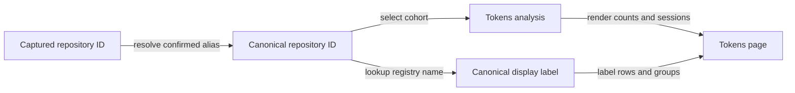

# Unify Repository Attribution and Add Telemetry Reset Controls

## Summary

Make the Tokens page treat a repository, its linked worktrees, and its confirmed historical identities as one repository. Show its canonical display name throughout reports. Add explicit controls to clear telemetry for one repository or for every repository, without requiring manual file deletion.

This plan separates observed implementation behavior from choices still to be made. It does not assume RoboRepo can change how the Claude desktop app organizes its own chat sidebar.

## Goals

- Attribute captures from main checkouts and linked worktrees to one canonical repository in every telemetry view.
- Include confirmed historical repository identities (for example, an old Git remote name) when filtering by the current repository.
- Display the repository registry's name, rather than worktree directory names, wherever a repository is shown.
- Allow a user to clear one repository's telemetry or all local telemetry from the Tokens UI.
- After a reset, show an empty report for the affected scope while preserving unaffected data and making subsequent capture behavior explicit.
- Preserve privacy, repository boundaries, and correctness across CLI and portal operations.

## Non-goals

- Reorganize, relocate, or delete Claude/Codex conversations or transcripts.
- Control the Claude desktop app's native sidebar grouping or change the working directory of independently launched sessions.
- Infer repository equivalence solely from similar directory names or a reused checkout path.
- Rewrite historical capture records just to rename a repository.
- Delete repository registry entries, Git worktrees, plans, configuration, or harness settings as part of telemetry reset.

## Current state

Verified against the public `roborepo-alpha` source and telemetry documentation; live local spool contents and the user's registry were not available in this review.

| Area | Current behavior / gap |
| --- | --- |
| Capture identity | `scripts/cli/telemetry-capture.mjs` records `repo.repository_id` from the normalized Git remote when present, but `repo.label` from the checkout/worktree folder basename. Without a remote it falls back to a hash of that checkout root, which may split local-only worktrees. |
| Report labels | `scripts/cli/telemetry-analyze.mjs` groups and renders several repository fields using the captured `repo.label`, so a worktree name can appear as a separate repository. |
| Repository filtering | `scripts/cli/telemetry-repository.mjs` currently returns a record's ID directly; `scripts/cli/telemetry-cohort.mjs` matches repository IDs directly, without registry alias resolution. |
| Existing aliases | `modules/repositories/schema.mjs` and `registry.mjs` already support a cycle-checked alias map and `setAlias()`. The report pipeline does not consistently use it. |
| Repository scope | `scripts/cli/telemetry.mjs` builds repository cohorts from one selected ID, and an outside-activity cohort by excluding listed IDs. Analysis is cached by spool signature and scope. |
| Full purge | `roborepo telemetry purge --all [--backup]` removes the whole telemetry state directory and turns off telemetry selection. No per-repository purge is present in that CLI implementation. |
| Portal | `/tokens` polls `/api/data` every five seconds. Its no-data/setup states and report caches need explicit handling after a reset. |

The reported historical rename from `git:github.com/kirinmurphy/roborepo` to `git:github.com/kirinmurphy/roborepo-alpha` is **runtime evidence provided for investigation**, not an alias to install without confirming the actual registry and repository history. Likewise, the reported stray Claude sidebar sessions are app-level behavior, not evidence of telemetry capture failure.

## Proposed design

### 1. Resolve canonical repository identity at read time

Use the existing repository registry alias mechanism as the single authority for confirmed old IDs. Do not add a separate telemetry-only `previous_remote_ids` registry or rewrite the spool. A renamed repository should be explicitly joined after confirmation; RoboRepo must not automatically merge two IDs based only on a matching local path.

- Apply the same resolution in repository-scoped filtering, the "Activity outside listed repos" exclusion, aggregate grouping, session rows, and per-repository deletion.
- Make alias changes invalidate cached analysis even when capture files have not changed.
- Preserve an explicit `unresolved` state when a record has no attributable repository ID; never guess from its label or working-directory hash.
- Keep alias lookup out of the capture hot path where possible. For repositories without an origin remote, verify whether `resolveGitDir()` / `mainCheckoutPath()` can normalize linked worktrees to the same `local:` ID as their main checkout. Use shared repository-domain code rather than creating a second resolver.
- Resolve the reported pre-rename ID using the existing alias API only after verifying that both identities genuinely refer to the same repository.

### 2. Make labels stable across worktrees

Derive the display name from the resolved canonical repository record at analysis/presentation time. Use a documented fallback for absent registry records, and keep the captured worktree/cwd name available only as **checkout context**, never as a repository grouping key. Aggregate by canonical ID (not display name) to avoid combining unrelated repositories with identical names.

### 3. Add scoped clearing to the Tokens UI

Place a **Clear telemetry…** action in the Tokens page's secondary actions or settings area. The confirmation must identify its scope, the records affected, and the effect on ongoing capture.

| Action | Deletes | Preserves |
| --- | --- | --- |
| **Clear this repository** | Captures attributed to the selected canonical repository, including confirmed aliases and worktrees; repository-owned related records where safe | Other repositories, unattributed activity, shared snapshots still referenced by retained data, repository registry, transcripts |
| **Clear all telemetry** | All local telemetry captures, markers, experiments, snapshots, and telemetry-only derived state | Repository registry, plans, harness configuration, native conversations, unrelated state |

Requirements:

- The selected-repository action is offered only for a valid repository scope; not for "All repos" or "Activity outside listed repos". Global clearing is always a separately named action.
- Show a preview/count for **all-time persisted data**, not merely the dashboard's current time window; require a second explicit confirmation for deletion.
- Offer an optional backup through the existing telemetry backup conventions. A retained backup must not be silently re-imported into reports.
- Route the UI and CLI through one storage-deletion implementation. Keep the current CLI contract stable unless an intentional CLI change is documented.
- Choose and document what happens to recording after a reset. **Proposed default:** a UI reset preserves the existing tracking-enabled setting; future hook events can appear immediately. The existing CLI full-purge behavior, which disables tracking, should not silently change.
- Do not remove shared configuration snapshots that remaining events or markers still reference. Define treatment of repository-scoped markers, experiments, cross-repository sessions, and ambiguous/unattributed records before implementing selective deletion.
- Avoid partial JSONL edits or capture writes racing a rewrite: serialize or otherwise safely coordinate writers, stage replacements, validate them, and recover cleanly from failure.
- Invalidate spool, analysis, session, marker, and experiment caches and reset stale browser state after success. An emptied scope must display zero counts/empty state, not old values or the simulated report.
- Use a POST-only mutation endpoint with the portal's existing loopback-origin and mutation-token protections. Return deleted counts, affected scope, backup outcome, and explicit error states.

### 4. Document the Claude sidebar boundary

RoboRepo can recommend starting sessions from the primary checkout and directing edits into worktrees, but it cannot guarantee grouping for chats that users start directly in worktree folders. Record this limitation in the relevant user guide; do not promise to migrate native chats. Investigate whether RoboRepo's **own** session launch flows can offer an optional, clearly labeled primary-checkout launch policy without directing Git operations at the wrong branch. Keep that optional launch change out of this telemetry implementation unless separately scoped.

## Implementation plan

### Repository identity and reporting

- [ ] Inspect current repository registry aliases and related plans; verify the old/new remote identity pair before applying an alias.
- [ ] Add failing regression fixtures for a main checkout, external linked worktree, app-created worktree, remote-less linked worktree, and renamed remote resolving to the same canonical ID.
- [ ] Reuse `resolveRegistryAlias()` in telemetry repository resolution and all cohort boundaries, including outside-activity accounting.
- [ ] Derive report labels from canonical registry records; group by ID and show worktree names only as optional checkout context.
- [ ] Include registry/alias revision in affected analysis cache keys and prove a newly confirmed alias refreshes an unchanged spool's report.

### Reset behavior and UI

- [ ] Inventory persisted telemetry stores and references (capture spools, markers, snapshots, experiments, collector state and caches); resolve the selective-deletion rules in Open questions.
- [ ] Extract a shared, testable purge/reset operation used by the existing CLI and new portal endpoint without changing unrelated CLI semantics.
- [ ] Implement repository-scoped deletion with canonical alias matching, safe JSONL updates, snapshot reachability checks, backup/error handling, and concurrent-writer protection.
- [ ] Implement clear-all deletion and reset cache invalidation while preserving the configured UI capture setting per the selected decision.
- [ ] Add the Tokens UI control, scope-specific confirmation, disabled/in-progress states, success/error feedback, and immediate empty-state refresh.
- [ ] Confirm that the first new hook event after a reset appears normally and that no retained session data reappears from a stale cache.

### Documentation and verification

- [ ] Document worktree attribution, confirmed rename aliases, deletion scope, backup/restore expectations, and the native Claude sidebar limitation.
- [ ] Add focused unit/integration coverage and browser tests for the destructive action and empty-state transition.

## Validation

- [ ] A current repo and both forms of worktree all appear under one selected repository, with one canonical label and correct total counts.
- [ ] A confirmed old remote ID joins the current repository without spool rewriting; removing/changing an alias updates the selected and outside cohorts without requiring a new capture.
- [ ] Same display name under different repository IDs does not merge unrelated work.
- [ ] Clearing a selected repository removes its matched events and related owned data without changing another repository's reports or unattributed activity.
- [ ] Clearing all empties real telemetry storage/reporting and leaves registry, configuration, and native chats untouched.
- [ ] After either action, page counts, cached responses, selectors, and empty states reflect the deletion immediately; tracking on/off remains as documented.
- [ ] Interrupted/malformed JSONL, a failed backup, and a concurrent hook append do not silently drop unrelated events or produce a falsely successful response.
- [ ] Test the shared report and portal surfaces with `npm run test:telemetry`, `npm run test:portal-ui`, then broader repository checks (`npm test`) if scoped tests pass.
- [ ] Run the repository's canonical plan validator in machine-readable mode and the technical-writing Validator before promoting this backlog plan.

## Documentation impact

- `docs/user/reference/telemetry.md`: alias-aware repository identity, reset scopes, capture behavior, backup/recovery, and CLI parity.
- `docs/user/guides/telemetry.md`: where to find Clear telemetry, what each scope does, and the post-reset empty state.
- `docs/internal/telemetry-internals.md`: canonical-resolution boundary, deletion ownership, consistency/caching rules, routes, and test coverage.
- `docs/internal/portal-architecture.md`: endpoint and mutation contract if the shared portal architecture needs an addition.
- Any relevant session-launching guide: the practical Claude sidebar limitation, without presenting it as a RoboRepo-controlled feature.

## Risks

| Risk | Mitigation |
| --- | --- |
| Alias merges unrelated repositories | Require evidence/user confirmation; reuse cycle-checked registry aliases. |
| Per-repository purge deletes shared records | Analyze references and preserve data used by remaining captures; verify before commit. |
| Capture appends while a JSONL file is rewritten | Coordinate writes and perform validated, recoverable file replacement. |
| Browser still shows stale pre-clear analysis | Explicitly invalidate caches and reload affected scope; test the five-second poll. |
| A reset appears permanent while recording continues | Explain tracking state and new-event behavior in confirmation and success feedback. |

## Open questions

1. **Markers and experiments:** Should repo-specific clearing delete associated markers/experiments, retain them without evidence, or reject deletion until their ownership is known? Decide based on actual persisted schemas.
2. **Multi-repository sessions:** Should the operation delete only matching events or an entire session that touched the selected repository? Default proposal: matching events only, with explicit treatment of linked markers.
3. **Unattributed activity:** Should the UI eventually offer a separate "Activity outside listed repos" clearing scope? Not required for the initial two actions.
4. **Live capture:** Is preserving the current tracking-enabled setting on UI reset the expected default? The CLI's existing `purge --all` currently disables tracking.
5. **Alias confirmation:** How should users register a verified repository rename when no existing UI affordance is available? Reuse the registry API; do not auto-merge solely from a path.
6. **Restore:** Is backing up enough for v1, or should the UI offer a matching restore workflow? Restoring is out of scope until explicitly chosen.

## Existing storage operations and reset ownership

Reuse registry alias resolution and shared repository scope; do not reintroduce a page-local
repository selector. Inventory current telemetry purge and `maintenance stores` reset behavior
before selecting selective-deletion semantics. Those operations do not establish the proposed
repository-scoped ownership, concurrency, or cache invalidation guarantee. [[n8kw3rp2]] owns retained
history/loss disclosure; this plan owns canonical selective deletion and the Tokens confirmation UI.
