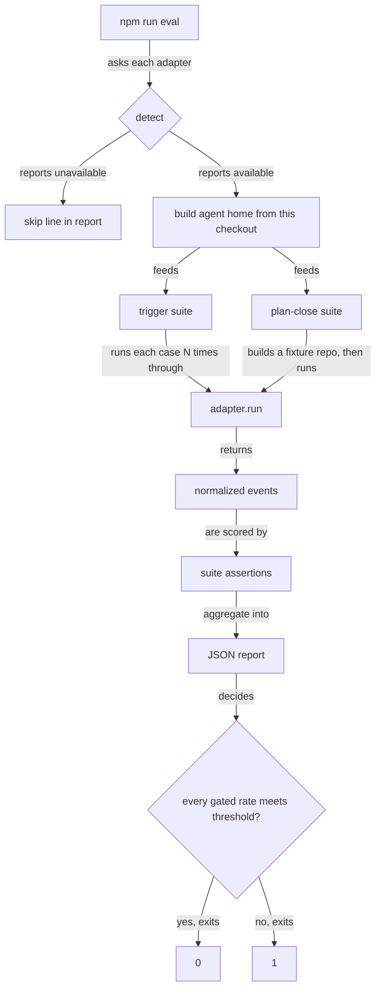

# Live Evals for Skill Routing and Plan Closing

## Summary

The checked-in test gates are deterministic and do not expose a repeatable hermetic live-agent
runner. Completed coding-conventions work recorded live-agent samples, but those samples do not
prove skill routing or the current plan-close contract across repeatable scenarios. This plan adds `npm run eval`, an opt-in gate that runs a real
headless agent against fixtures, checks the effects structurally, runs each case N times, and writes
a JSON report per run.

| Suite | Sends | Asserts on |
| --- | --- | --- |
| Trigger | Each prompt in the packages' skill trigger fixtures | Which skill the agent invoked, aggregated into per-skill rates |
| `/plan-close` scenarios | `/plan-close <id>` into a fixture repository | Where the plan file ends up, Git state, the tool-call stream, whether a fixture listener still runs, and whether the worktree still exists |

Claude is the first harness. The runner talks to harnesses through adapters so Codex and Gemini can
be added later. The gate costs money, needs an API key, and is non-deterministic, so it never runs
inside `npm run check`.

## Goals

- `npm run eval` runs the trigger suite and the `/plan-close` scenario suite against Claude, N times
  per case, and exits non-zero when a gated rate falls below its threshold.
- When no adapter can run (no CLI on `PATH`, no API key), the runner prints one skip line per
  harness and exits 0. `--require <harness>` makes that case exit 1.
- Every run writes one JSON report that a plan's `## Not tested` entry can cite as evidence.
- Adding a harness means adding one adapter file, with no change to the suites.
- The runner's deterministic parts (stream normalization, scoring, the skip path, the
  never-in-`check` guard) are covered by a `*-check.mjs` suite that runs without an agent.

## Non-goals

- Running evals in CI or inside `npm run check`.
- Codex and Gemini adapters. This plan defines the interface and leaves those two as stubs that
  report `unsupported`.
- Scenario evals for `/plan-write`, `/plan-promote`, and `/plan-execute`, apart from the optional
  paired-skill scenario in Phase 5.
- A model-as-judge. Every assertion in this plan is structural. A later plan may add a judge for
  qualitative output such as the close report's prose.

## Context

### Terms

| Term | Meaning |
| --- | --- |
| Eval | One prompt or scenario sent to a live agent, checked by structural assertions. Not deterministic. |
| Case | One trigger prompt or one `/plan-close` scenario. |
| Run | One execution of a case. A case runs N times (`--repeat`). |
| Adapter | The per-harness module that detects, launches, and normalizes one headless agent CLI. |
| Agent home | The temporary config directory the agent runs with, holding only skills installed from this checkout. |
| Invocation signal | Evidence in the event stream that the agent loaded a skill (see "Detecting a skill invocation"). |
| Canonical command | A command the plan-suite skills refer to by role ("the repository's canonical plan validator") rather than by name. |

### Current state

| Area | Today | Evidence |
| --- | --- | --- |
| Trigger check | Static. It checks that each trigger phrase appears in the skill description, that each `match` prompt contains a trigger phrase, and that no `nearMiss` prompt does. No prompt reaches a model. | `scripts/cli/skill-trigger-check.mjs` |
| Trigger fixtures | One optional `skill-triggers.json` per package. `loadSkillTriggerFixtures()` returns every package's cases tagged with `packageId` and passes unknown keys through. 6 skills, 14 `match` prompts (4 of them slash commands), 17 `nearMiss` prompts. | `scripts/cli/skill-trigger-fixtures.mjs`, `globals/packages/*/skill-triggers.json` |
| Fixture pattern | Hermetic HOME, a throwaway Git repository with plans in each lifecycle, the real CLI entry point, real HTTP listeners on macOS | `scripts/test/plan-suite-commands-check.mjs` |
| Skill install into a fixture HOME | `roborepo package enable <id>` under a temporary HOME links the skill and writes its command wrapper | `plan-suite-commands-check.mjs`, `package status` section; reproduced in a scratch HOME |
| Landed check | Walks the base branch's first-parent commits after the fork and looks for one that absorbs the branch, so squash and rebase merges count as landed. Needs the branch's reflog; scans at most 500 commits. | `modules/repositories/worktree-landed.mjs` |
| Worktree cleanup | `roborepo git worktrees cleanup [--plan <id>] [--apply]` removes landed worktrees behind guards | `scripts/cli/worktree-cleanup.mjs`, `modules/repositories/worktree-guards.mjs` |
| Test discovery | `run-checks.mjs` runs every `scripts/test/*-check.mjs` it finds. `doctor.sh` fails when a file under `scripts/test/` is reached by no runner. | `scripts/test/run-checks.mjs`, `scripts/test/orphan-test-check.mjs` |
| Agent CLIs | `claude`, `codex`, and `gemini` were not on `PATH` in the shell this plan was written from | `command -v` returned nothing |

### Constraints found in the code

These shape the design below. Each was checked against the repository.

1. **The eval files cannot live in `scripts/test/` with a `-check.mjs` suffix.** A bare
   `npm run test:unit` would run them, and the orphan check would require a runner for anything else
   under `scripts/test/`.
2. **The slash commands bypass the Skill tool.** The generated `plan-close` command wrapper says
   "Read `~/.claude/skills/plan-close/SKILL.md`, then follow its workflow". A `/plan-close` prompt
   can therefore show up as a file read with no Skill tool call.
3. **The slash-command prompts measure wiring, not routing.** The CLI expands `/plan-write …` before
   the model chooses anything.
4. **The `match` prompts are leading.** They contain description phrases verbatim ("help me with
   beginning implementation from an existing prepared repository plan"), because the static check
   fails any `match` prompt that lacks a trigger phrase. Natural phrasings cannot go into `match`
   without breaking `roborepo skill triggers --check`.
5. **Some near-misses belong to a sibling skill.** "close this plan now that it has merged" is a
   near-miss for `plan-execute` and a correct match for `plan-close`.
6. **Disabled paired skills stop a headless `/plan-close`.** The skill asks "Enable it, or skip it
   for this run?" for each disabled paired skill. `technical-writing` and `test-harness` are
   `optional` packages, and in headless mode the question ends the run before any close.
7. **The skills name commands by role, not by name.** No file an agent reads in a repository maps a
   role to a command; roborepo names them only in `docs/user/` and the CLI command catalog. Each
   fixture repository must declare them (see "Fixture repository").

   | Role in the skill | roborepo command |
   | --- | --- |
   | Canonical completion gate | Discovered from `package.json`, a `Makefile`, or CI config |
   | Canonical plan validator | `roborepo plans validate <plan> --json` |
   | Canonical linked-worktree server cleanup command | `roborepo plans stop-servers <plan> --json` |
   | Canonical worktree cleanup command | `roborepo git worktrees cleanup --plan <id> --apply` |
   | The host's skill/package manager | `roborepo package status <id> --json`, `roborepo package enable <id>` |

8. **`/plan-close` repairs before it decides.** It fixes a plan-relevant failing test it can fix in
   scope (step 1), implements agent-resolvable gaps (step 3), and runs any `## Not tested` check it
   can perform (step 5). A refusal fixture whose problem the agent can fix will be fixed and closed,
   which is correct behavior. Each refusal fixture must present a problem only the user can resolve.
9. **The landed check accepts squash merges.** A branch counts as landed when some first-parent
   commit on the base absorbs it. A branch with no reflog, or with no commit of its own, reads as
   `landed: unconfirmed`.
10. **A successful close stages, then cleans up.** `/plan-close` stages the move to `completed/`
    without committing, stops the worktree's servers, then runs worktree cleanup. The cleanup's
    "plan not closed" guard reads plan folders on disk (`activeWorktreeNames` in
    `scripts/cli/worktree-policy.mjs`), so a staged move counts as closed. The guards a fixture must
    satisfy include: landed, inside the configured worktree root, clean, and free of running servers
    (`modules/repositories/worktree-guards.mjs` lists the rest). Server cleanup is macOS-only; it
    returns `supported: false` elsewhere.
11. **Installed skill copies drift from source.** While this plan was first written,
    `~/.claude/skills/plan-write/references/plan-schema.md` differed from its source under
    `globals/packages/`. An eval that read the user's installed copy would measure an old skill.
12. **Code comments cannot cite plans.** `scripts/test/plan-citation-comments-check.mjs` scans
    `scripts/` and fails on a comment naming a plan file, id, or phase. Eval code states its reasons
    directly.

## Proposed design

### Flow



### Placement

Keep orchestration and execution readable; separate modules only at meaningful ownership,
consumer, or testability boundaries. Do not split files by size.

```text
scripts/eval/
  run.mjs                    # entry: args, adapter selection, suites, report, exit code
  config.mjs                 # defaults: repeat, thresholds per case kind, minimum gated sample
  report.mjs                 # report shape, threshold evaluation, write
  agent-home.mjs             # builds the agent home: enables packages from this checkout
  harness-adapters/
    index.mjs                # adapter registry
    claude.mjs               # detect, run, normalize
    unsupported.mjs          # stub used for codex and gemini
  trigger/
    cases.mjs                # maps loadSkillTriggerFixtures() output to { skill, prompt, kind }
    suite.mjs                # runs trigger cases
    score.mjs                # pure: classifies one run, aggregates rates
  plan-close/
    scenarios.mjs            # scenario table: fixture builder + expected effects
    suite.mjs                # runs scenarios
    assertions.mjs           # pure: checks effects against expectations
scripts/test/lib/plan-fixtures.mjs   # planDoc, fixtureRepository, git, listen — extracted
scripts/test/eval-runner-check.mjs   # deterministic coverage, runs in the normal suite
```

`scripts/eval/` is not in `package.json` `files`, so it does not ship. `package.json` gains one
script, `"eval": "node scripts/eval/run.mjs"`. The fixture helpers now inline in
`plan-suite-commands-check.mjs` move to `scripts/test/lib/plan-fixtures.mjs`, and both that check
and the eval suite import them. The trigger suite reads fixtures only through
`loadSkillTriggerFixtures()`.

### Command

```text
npm run eval -- [--suite trigger|plan-close] [--harness claude] [--repeat N]
                [--model <id>] [--skill <id>] [--scenario <name>]
                [--require <harness>] [--max-cost-usd <n>] [--report-dir <dir>]
```

| Flag | Default | Effect |
| --- | --- | --- |
| `--suite` | both | Runs one suite |
| `--harness` | every registered adapter | Restricts to one adapter |
| `--repeat` | 3 | Runs per case |
| `--model` | the harness default | Passed to the adapter. Routing depends on the model, so the report records it. |
| `--require` | none | Exits 1 when that harness is unavailable instead of skipping |
| `--max-cost-usd` | none | Stops starting new runs once reported cost passes the cap; the report marks the run `truncated` |
| `--report-dir` | `eval-reports/` (gitignored) | Where the JSON report goes |

### Adapter interface

Each `harness-adapters/<id>.mjs` has these named exports:

| Export | Takes | Returns |
| --- | --- | --- |
| `id` | — | The harness id, matching its provider id (`claude`) |
| `detect(env)` | The caller's environment | `{ available: true, version }` or `{ available: false, reason }` |
| `run(options)` | `{ prompt, cwd, env, model, allowedTools, stopWhen }` | The raw event list |
| `normalize(rawEvents)` | The raw event list | A `NormalizedRun` |

```text
NormalizedRun
  toolCalls         [{ name, input }]
  skillInvocations  [{ skill, via }]
  finalText, costUsd, durationMs, exitCode, stoppedEarly
```

`detect` is false when the CLI is not on `PATH` or the API key variable is unset; the reason names
which. The suites see only `NormalizedRun`, so they never read a harness's native stream format.

The Claude adapter is expected to run `claude -p <prompt> --output-format stream-json --verbose`
with `--model`, `--allowedTools`, and a permission mode. **None of these flags has been checked
against the installed CLI yet; Phase 0 confirms them.** Codex (`codex exec --json`) and Gemini
(headless `-p`) adapters are stubs in this plan.

### Agent home

Each suite run gets a fresh agent home with nothing from the user's own config, so user hooks, rules,
and stale installed skills cannot change the result (constraint 11).

1. Create a temporary HOME as `plan-suite-commands-check.mjs` does.
2. Run `roborepo package enable <id>` from this checkout for every package under test. The trigger
   suite enables every package that owns a fixture skill at the same time, so sibling skills compete
   as they do in real use. The `/plan-close` suite also enables `technical-writing` and
   `test-harness`, so the paired-skill question (constraint 6) cannot end a scenario; the report
   records which packages were enabled.
3. Put a `roborepo` shim that runs this checkout's `bin/roborepo` first on the agent's `PATH`.
4. Pass the API key through from the caller's environment. Authentication with the real HOME replaced
   is unverified on macOS, where credentials can live in the Keychain. Phase 0 decides between
   swapping HOME and pointing the harness's own config-directory variable at the agent home.

### Detecting a skill invocation

| Signal in the stream | Recorded as |
| --- | --- |
| A Skill tool call whose input names skill `X` | `{ skill: X, via: "skill-tool" }` |
| A file read of `<skills-root>/X/SKILL.md` | `{ skill: X, via: "skill-file-read" }` (the command-wrapper path, constraint 2) |

A run's routed skill is its first invocation signal. A trigger run stops at the first invocation
signal, at the third tool call, or at the end of the turn, whichever comes first, because nothing
after the routing decision affects the score. Adapters without a Skill tool (Codex) emit only
`skill-file-read`.

### Trigger suite

`trigger/cases.mjs` turns each fixture into cases of three kinds:

| Kind | Source | One run passes when | Gated by default |
| --- | --- | --- | --- |
| `routing` | non-slash `match` prompts, plus a new optional `liveMatch` array | The routed skill is the target | Hit rate ≥ 0.8 per skill |
| `wiring` | `match` prompts that start with `/` | The target appears in any invocation signal | Hit rate ≥ 0.95 per skill |
| `nearMiss` | `nearMiss` prompts | The target is not invoked; whatever was routed is recorded | False-trigger rate ≤ 0.2 per skill |

`liveMatch` holds natural phrasings that need not contain a trigger phrase (constraint 4). It goes in
each package's `skill-triggers.json`. The loader passes unknown keys through and the static check
reads only its own fields, so adding it leaves `roborepo skill triggers --check` green. Each skill
must get at least two `liveMatch` prompts before its routing rate is gated. A rate is gated only when
its sample holds at least 6 runs; smaller samples are reported but not gated.

The report also carries a per-skill confusion table of target against routed skill, which shows
sibling routing (constraint 5) rather than counting it as noise.

### Fixture repository

Each `/plan-close` scenario builds one repository with `scripts/test/lib/plan-fixtures.mjs`:

- a primary checkout on `main` with one active plan, and a linked worktree, created with
  `git worktree add -b` so its branch has a reflog, named in the plan's `worktree:` field;
- `docs/plans/plans-config.json` with a `worktreeRoot` that contains the linked worktree, which the
  cleanup guards require;
- a `package.json` whose `test` script is the completion gate;
- a project instructions file mapping each role in constraint 7 to its command. Phase 0 confirms that
  the headless agent loads it from the working directory;
- plan claims that each map to one fixture file (for example, "`src/greet.mjs` exports `greet`"
  with that file present), so judging the plan against the code is not ambiguous;
- on macOS, one HTTP listener in the worktree and one in the primary checkout.

The prompt is `/plan-close <id>`. The agent runs with a fixed tool allowlist (file reads and edits,
`git`, `npm test`, `roborepo`) and permission checks left on. Phase 0 confirms the exact flag shape.

### `/plan-close` scenarios

Refusal scenarios use problems only the user can resolve (constraint 8), and the two landed
scenarios cover both merge shapes the landed check accepts (constraint 9).

| Scenario | Fixture differs from a complete plan by | Expected effects |
| --- | --- | --- |
| `unrelated-red-suite` | A test the plan does not own fails, on the branch and on `main` | Plan stays in `active/`; HEAD unchanged; the failing test file unchanged; the test command appears in tool calls; no server or worktree cleanup call; worktree listener alive |
| `open-task-needs-decision` | One unchecked task that only the maintainer can decide, such as choosing a public name | Plan stays in `active/` (it may be edited); HEAD unchanged; no server or worktree cleanup call; worktree listener alive |
| `manual-not-tested` | `## Not tested` has one unchecked entry only a person can confirm | Plan stays in `active/`; that entry still unchecked; no server or worktree cleanup call; worktree listener alive |
| `unlanded-branch` | The worktree branch has a commit that no `main` commit absorbs | Plan stays in `active/`; HEAD unchanged; `main` lacks the branch's change; no server or worktree cleanup call; worktree listener alive |
| `merge-landed` | — (branch merged with a merge commit) | See "Successful close" below |
| `squash-landed` | Branch content squash-merged into `main` as one commit | See "Successful close" below |
| `worktree-not-integrated` | Branch merged, then the worktree's plan copy gains an edit `main` never had (committed or not) | Run stops at the integration check, before the tests: the report says `plan: not integrated` and names the worktree and plan path; no plan file changes in either checkout; HEAD unchanged; the test command is absent from tool calls; no server or worktree cleanup call; worktree listener alive |
| `refusal-notes-rerun` | `squash-landed`, plus an earlier refusal's notes committed to the primary copy | The integration check passes; then as a successful close |
| `archive-carry` | The plan is abandoned: the worktree branch's plan copy records progress and why the work stopped, the primary copy is unchanged since the start transition, and nothing merged | The plan is staged as moved to `archived/`, with the worktree copy's progress and stop reason in it; `next_action` empty; HEAD unchanged; no file-edit tool call targets the linked worktree; the worktree's branch is unchanged |
| `archive-conflicting-copies` | `archive-carry`, plus a commit on `main` that edits the primary copy | Report says `plan: conflicting copies`; no file changes in either checkout; HEAD unchanged; no server or worktree cleanup call |

The two archive scenarios prompt `/plan-close <id>` followed by a sentence stating that the work was
abandoned, since abandonment is the user's decision and no fixture state implies it. The four rows
after `squash-landed` cover the integration check and archive handoff that [[6q16tocb]] added to
`/plan-close`; its fixture checks cover only the Git commands those steps run.

A successful close shows all of these:

1. The plan is staged as renamed to `completed/`, and HEAD is unchanged.
2. `next_action` is empty, and `## Verification` has content.
3. `roborepo plans validate` reports no blocking finding on the moved file.
4. After the `git mv`, the tool calls show `roborepo plans stop-servers`, then
   `roborepo git worktrees cleanup` with `--plan` and `--apply`, in that order.
5. The worktree listener has exited, and the primary listener is alive.
6. The linked worktree directory and its branch are gone.
7. No file-edit tool call targets a path inside the linked worktree: after the integration check,
   every plan edit goes to the primary copy.

On non-macOS hosts the fixture starts no listeners, as in `plan-suite-commands-check.mjs`. Effect 5
becomes "server cleanup called" for the landed scenarios, and the refusal scenarios' listener
assertion becomes "server cleanup not called". Effect 6 still applies, since no server holds the
worktree.

### Report

```json
{
  "schemaVersion": 1,
  "runId": "20261004T153000Z-claude",
  "commit": "<sha>",
  "dirty": false,
  "harness": { "id": "claude", "version": "<cli version>", "model": "<model id>" },
  "repeat": 3,
  "enabledPackages": ["plan-close", "technical-writing", "test-harness"],
  "suites": {
    "trigger": {
      "skills": {
        "plan-close": {
          "routing": { "passes": 5, "runs": 6, "rate": 0.83, "threshold": 0.8, "gated": true, "pass": true },
          "confusion": { "plan-close": 5, "none": 1 }
        }
      },
      "cases": [{ "skill": "plan-close", "packageId": "plan-close", "kind": "routing", "prompt": "…", "runs": [{ "routed": "plan-close", "via": "skill-tool", "costUsd": 0.01 }] }]
    },
    "plan-close": {
      "scenarios": {
        "unrelated-red-suite": { "passes": 3, "runs": 3, "rate": 1, "threshold": 1, "pass": true, "failures": [] }
      }
    }
  },
  "skipped": [{ "harness": "codex", "reason": "codex not on PATH" }],
  "truncated": false,
  "pass": true
}
```

`pass` is `null` when every harness was skipped, so an empty run is never cited as evidence. A
`## Not tested` entry cites a report by scenario name, `runId`, commit, model, and rate. Scenario
thresholds default to 1.0: a close that happens when it should have been refused, even once, is a
defect. A failed scenario run records the agent's final text and the fixture's `git diff`, so a
repair the agent made (constraint 8) is visible.

## Affected touchpoints

| Path | Change |
| --- | --- |
| `scripts/eval/**` | New |
| `scripts/test/lib/plan-fixtures.mjs` | New, extracted from `plan-suite-commands-check.mjs` |
| `scripts/test/plan-suite-commands-check.mjs` | Imports the extracted helpers |
| `scripts/test/eval-runner-check.mjs` | New deterministic suite |
| `scripts/test/fixtures/eval/` | Recorded stream transcripts captured in Phase 0 |
| `package.json` | `eval` script |
| `.gitignore` | `eval-reports/` |
| `globals/packages/*/skill-triggers.json` | Optional `liveMatch` arrays |
| `manifests/inventory/README.md` | Describes `liveMatch` beside the existing `skill-triggers.json` note |
| `docs/internal/testing.md` | A Test Layers row for `npm run eval` |

## Implementation plan

### Phase 0 — Spike the headless contract

- [ ] Capture one `claude -p` stream-json transcript each for a Skill tool call, a command-wrapper
  `SKILL.md` read, and a Bash call, run against a hermetic agent home. Save them under
  `scripts/test/fixtures/eval/`.
- [ ] Decide how the agent home authenticates (HOME swap or the harness config-directory variable)
  and record the decision.
- [ ] Confirm the flags for model, tool allowlist, permission mode, and turn limit, and whether a
  tool call the allowlist denies still appears in the stream.
- [ ] Confirm the headless agent loads a project instructions file from its working directory.
- [ ] Confirm the adapter can stop a run early by ending the process once the stop condition is met.

### Phase 1 — Runner skeleton

- [ ] `harness-adapters/` with `claude.mjs` and the `unsupported.mjs` stub for codex and gemini.
- [ ] `config.mjs`, `agent-home.mjs`, `report.mjs`, and `run.mjs` with the skip path and `--require`.
- [ ] `package.json` `eval` script and the `eval-reports/` ignore entry.
- [ ] `eval-runner-check.mjs`: recorded transcripts normalize to the expected `NormalizedRun`; a
  `PATH` with no agent CLI produces a skip line and exit 0, and exit 1 under `--require`; `ci.sh`
  and `check-groups.json` never reference `scripts/eval/`.

### Phase 2 — Extract fixture helpers

- [ ] Move `planDoc`, `fixtureRepository`, `git`, and `listen` into
  `scripts/test/lib/plan-fixtures.mjs`; `plan-suite-commands-check.mjs` passes unchanged in behavior.

### Phase 3 — Trigger suite

- [ ] `trigger/cases.mjs`, `trigger/score.mjs`, and `trigger/suite.mjs`, reading fixtures through
  `loadSkillTriggerFixtures()`.
- [ ] At least two `liveMatch` prompts in each package's `skill-triggers.json`;
  `roborepo skill triggers --check` stays green.
- [ ] Scoring covered in `eval-runner-check.mjs` with synthetic runs: routing, wiring, near-miss,
  sibling routing in the confusion table, and the minimum-sample rule.

### Phase 4 — `/plan-close` scenarios

- [ ] The fixture repository builder, including the worktree root config and the project
  instructions file.
- [ ] `plan-close/scenarios.mjs` with the ten scenarios, `assertions.mjs`, and `suite.mjs`.
- [ ] Assertions covered in `eval-runner-check.mjs` against synthetic fixture states and recorded
  tool-call lists.
- [ ] One live run of each scenario at `--repeat 3`, with the report summarized in this plan's
  Verification.

### Phase 5 — Optional: `/plan-write` paired-skill scenario

- [ ] A scenario with `technical-writing` disabled in the agent home: `roborepo package status
  technical-writing` appears in tool calls and no file is created under `docs/plans/` before the
  turn ends.

### Phase 6 — Docs

- [ ] `docs/internal/testing.md` Test Layers row: command, what it covers, that it costs money and
  is never in `check`.
- [ ] `manifests/inventory/README.md`: `liveMatch`, and how the live suite reads the fixtures.

## Validation

- [ ] `npm run check` passes, and no step in it invokes `scripts/eval/`.
- [ ] `node scripts/test/eval-runner-check.mjs` passes on a machine with no agent CLI.
- [ ] `npm run eval` with no API key prints one skip line per harness, writes a report with
  `pass: null`, and exits 0; with `--require claude` it exits 1.
- [ ] `npm run eval -- --suite trigger --repeat 3` writes a report with per-skill rates and a
  confusion table for all 6 fixture skills.
- [ ] `npm run eval -- --suite plan-close --repeat 3` passes all ten scenarios at threshold 1.0 on
  macOS, and the report records the enabled packages and the model.
- [ ] `roborepo skill triggers --check` passes with the new `liveMatch` arrays.

## Risks

| Risk | Mitigation |
| --- | --- |
| Routing rates swing between models and CLI versions | The report records model and CLI version; thresholds are per skill and configurable |
| The agent repairs a refusal fixture and closes it (constraint 8) | Each refusal problem needs the user to resolve; a failed run records the fixture diff so the repair is visible |
| A vague fixture plan makes the landed scenarios flaky | One claim per fixture file; a failed run records the agent's final text |
| Fixture-declared commands hide whether agents find canonical commands on their own | Recorded as an open question; the scenarios measure closing behavior, not command discovery |
| The agent acts outside the fixture directory | Fixed tool allowlist, fixture as working directory, permission checks on. A Docker sandbox is a later hardening step. |
| Cost grows with fixtures | `--repeat` default 3, early stop on trigger runs, `--max-cost-usd` |

## Decision Log

- **Reports go to a gitignored `eval-reports/`.** Reports change every run; a plan cites a report by
  `runId`, commit, model, and rate rather than linking a tracked file. Reversible by changing the
  default `--report-dir`.
- **Defaults: `--repeat 3`, routing ≥ 0.8, wiring ≥ 0.95, near-miss false-trigger ≤ 0.2, scenarios
  1.0, minimum gated sample 6 runs.** Starting points to tune once real rates exist.
- **Natural prompts go in a new `liveMatch` field in each package's `skill-triggers.json`**, because
  the static check requires every `match` prompt to contain a trigger phrase.
- **The `/plan-close` suite enables both paired skills** so the paired-skill question cannot end a
  scenario. The question itself is covered separately by the optional Phase 5 scenario.
- **Refusal scenarios use problems only the user can resolve.** `/plan-close` now repairs what it can
  before deciding, so the original "failing test" and "unchecked task" scenarios became an unrelated
  pre-existing failure and a task that needs a maintainer's decision.
- **A `squash-landed` scenario joins `merge-landed`.** The landed check now accepts squash merges,
  and that absorption walk is the riskiest logic in the close path.
- **Four scenarios cover the plan-authority steps of `/plan-close`** (added 2026-10-13):
  `worktree-not-integrated`, `refusal-notes-rerun`, `archive-carry`, and
  `archive-conflicting-copies`. [[6q16tocb]] confirmed the integration check and archive handoff by
  hand; what the agent does with each verdict has no automated coverage until this suite runs.

## Open Questions

- **Where do eval adapters live?** Recommended: `scripts/eval/harness-adapters/`, because headless
  invocation is a dev-only concern and `scripts/eval/` does not ship. The alternative is a `headless`
  capability on each provider under `scripts/harnesses/<id>/`, which keeps every native harness
  shape in its provider, as `docs/internal/harness-provider-interface.md` prefers, but adds
  dev-only code to the shipped package.
- **Should `/plan-close` scenarios run in Docker?** The fixed allowlist is the baseline in this plan.
  Docker would contain a misbehaving agent completely, but needs the API key and the agent CLI inside
  the image.
- **How should a real repository declare its canonical commands?** The fixtures declare them in a
  project instructions file. Nothing in roborepo renders that mapping for real repositories, so a
  `/plan-close` run outside the fixtures has to find them unaided. Recommended: leave this to its own
  plan, and add a discovery scenario with no declaration once that plan picks a mechanism.

## Current evidence and scenario refresh

[[7e21olcs]] records real agent samples; reuse their lessons while preserving this runner's distinct
routing/closure purpose. There is still no `eval` script in `package.json`. Refresh fixture counts,
current `plan-execute` near misses, native invocation, package availability, approval freshness,
and landing/cleanup behavior from current code before freezing the scenario contract. Do not
reuse historical auth availability or host PATH as a present fact. The Phase 0 authenticated spike
remains an explicit prerequisite, and paid live runs stay outside deterministic CI.
