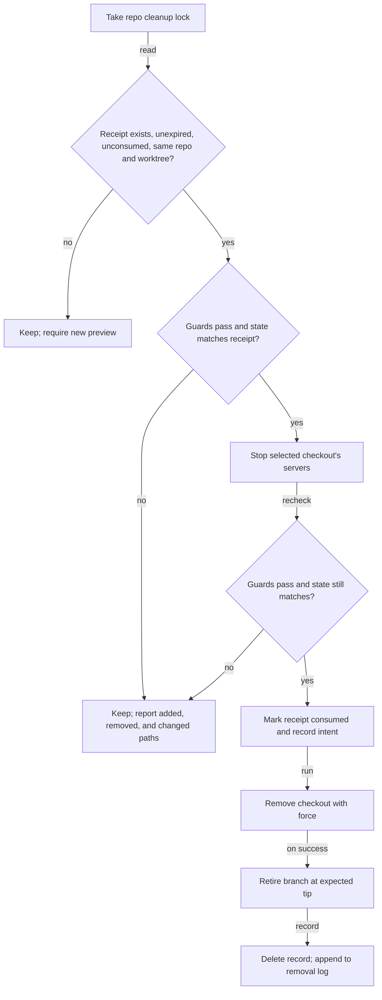

# Finish worktree cleanup without recovery copies

## Summary

Make intentional worktree deletion permanent and routine post-merge cleanup quiet. A closed
plan should leave its merged result in the base branch, without a recovery copy or a stranded
checkout full of generated files. When unique or uncertain work remains, keep the checkout and
offer one explicit confirmation to discard the displayed leftovers.

This combines permanent deletion with actionable cleanup of ignored build and environment
artifacts. Existing recovery data receives a separate, consent-based migration.

## Goals

- Remove future committed-tip backups and full recovery snapshots from every removal path.
- Automatically remove landed work and local layers proven preserved in merged history.
- Recognize common ignored generated artifacts without treating every ignored file as disposable.
- Give unfamiliar leftovers a clear discard-all or keep choice, bound to the exact reviewed state.
- Complete durable plan closure even when checkout or branch cleanup cannot finish.
- Bound cleanup bookkeeping and resolve legacy recovery data without silently losing unique work.

## Current state

The following behavior was inspected at the commit recorded above.

| Surface | Current behavior | Source |
| --- | --- | --- |
| UI deletion | Boolean `discardChanges` consent; always writes a committed-tip backup | `portal/home/worktree-dialogs.js`, `modules/repositories/worktree-removal.mjs` |
| Archive and remove | Captures local layers and offers restore details; its route also serves as the dialog's preview | `portal/home/index.html`, `portal/home/api.js`, `scripts/cli/worktree-cleanup.mjs` |
| Automatic cleanup | Proves preservation; snapshots preserved local layers before removal. The plan-close step and the `post-merge` hook both use this path | `modules/repositories/worktree-preservation.mjs`, `scripts/cli/worktree-cleanup.mjs`, `scripts/cli/worktree-hook.mjs` |
| CLI confirmed removal | `cleanup --remove <name> --confirm --apply` removes a clean checkout even with unmerged commits; only the backup protects them | `scripts/cli/worktree-cleanup.mjs` |
| Ignored paths | Only root `node_modules` and `test-results` are disposable; other ignored paths can block confirmed discard. The guard parses unquoted `status --porcelain=v1` output | `modules/repositories/worktree-snapshot.mjs`, `modules/repositories/worktree-guards.mjs` |
| Inventory | Refuses filter or merge-driver config, `core.autocrlf`, sparse and split indexes, index flags, special files, nested repositories, unsafe names, and files over 64 MiB; holds file bytes in memory | `modules/repositories/worktree-snapshot.mjs` |
| Home survey | Runs the guard without a preservation result, then shows its reason, such as `valuable ignored path: .venv/`. The dialog also compares that reason text to detect a dirty checkout | `scripts/cli/worktree-observations.mjs`, `portal/developer-runtime/repository-root-row.js`, `portal/home/worktree-dialogs.js` |
| CLI discard | Backend accepts `discardChanges`; cleanup argument parser does not expose it | `scripts/cli/worktree-cleanup.mjs` |
| Retry | Archive removal can retire a leftover branch using snapshot metadata | `modules/repositories/worktree-removal.mjs` |
| Landing | Accepts a name under `refs/heads/` and needs its reflog, so it cannot assess a legacy ref as it stands | `modules/repositories/worktree-landed.mjs` |
| Storage | Removal log is append-only and absent from the retention registry | `modules/repositories/worktree-removal.mjs`, `modules/retention/registry.mjs` |
| Unused routes | `GET .../worktrees/:branch/assessment` and `GET .../worktrees/archives` have no portal or test consumer | `scripts/cli/portal-routes-repositories.mjs` |

Preservation checks assess staged and filesystem layers against an absorbing base commit,
including squash landing and plan-path moves. Removing snapshot creation must retain these proofs.

The motivating case is a durably closed transcript-export plan whose checkout retained ignored
`.venv/`, `build/`, `*.egg-info/`, and `__pycache__/` directories. A prototype reported those
directories eligible; no native deletion ran. This plan does not claim that prototype shipped or
authorize removal of that real checkout.

Read-only inspection of this RoboRepo clone found 11 committed-tip backup refs and 3 snapshot
refs. Four backup tips are ancestors of local `main`; seven are not proven by that check, which
does not establish uniqueness after squash merges. Snapshot manifests list 1,294, 1,295, and
1,283 entries. All but one or two entries per manifest are tracked files, and none are ignored.
Backup ref names do not reliably state their tip: `runtime-row-layout-skill-f8086e` points at
`d19c7b19`, which a second ref also holds. Payload contents and their preservation were not
assessed. No recovery refs were changed.

### Related plans

The `active/`, `ready/`, and `review/` folders hold no plans at the recorded commit.

| Plan | Classification | Reconciliation |
| --- | --- | --- |
| Retire worktrees safely ([[4xc0gjuw]]) | Landed dependency; completed. Squash `c6d14d32` is an ancestor of `HEAD` | Keeps its preservation proof, plan-path mapping, landed recovery, and merge readiness. Supersedes its Archive and remove, its verified snapshot for dirty automatic cleanup, its boolean Delete consent, and its "no CLI discard flag" rule. Its archives stay readable until the migration resolves them. No lifecycle change |
| Worktree lifecycle cleanup ([[a7bslb00]]) | Landed dependency; completed. Squash `7627bfc` is an ancestor of `HEAD` | Supersedes its committed-tip refs and clean-only confirmed removal. Keeps its guards and landing scan. No lifecycle change |
| Finish safe worktree cleanup reliably ([[z3j2x3x1]]) | Archived; its hashing fix `f101af02` is an ancestor of `HEAD` | The fix stays. This plan does not revive the retired scope |
| Cleanup as a reversible setting ([[b2sgiejd]]) | Unlanded adjacent story; backlog | Owns hook enablement, settings, and `hook.log`; this plan owns removal semantics, and neither waits for the other. Stale prose for its own promotion: `next_action` waits on a plan that has completed, and Risks says removal requires a clean worktree |
| Windows test environment ([[l1mz96d9]]) | Unlanded adjacent story; backlog | Its task to verify snapshot capture and restore narrows to restore once capture is gone. Update it through `/plan-write` after this lands |
| Agent behavior evals ([[0jped168]]) | Unlanded adjacent story; backlog | Relies on `cleanup --plan <id> --apply`, which stays. No conflict |

## Proposed behavior

### Ordinary cleanup and explicit deletion

| Entry point or result | Action | User attention |
| --- | --- | --- |
| Closed plan; committed and local work preserved | Remove checkout and local branch without capture | No prompt; brief completion result |
| Same, with recognized ignored artifacts | Remove artifacts with checkout | No prompt |
| Closed plan; unique or uncertain leftovers | Keep checkout and branch; closure stays committed | Show paths and discard-all or keep |
| `post-merge` hook; same outcomes | Same removals; a kept checkout stays | None; the reason goes to the hook log and Home |
| CLI `cleanup --remove`, work proven preserved | Remove checkout and branch | `--confirm --apply` |
| CLI `cleanup --remove`, anything unproven | Keep, and name the `discard` command | Run `discard` |
| UI Delete worktree | Preview loss, confirm, then permanently remove selected checkout and branch | One destructive confirmation |
| State changed after preview | Keep target and show the change | Renew confirmation |
| Checkout removed; branch retirement fails | Report each outcome and allow guarded retry | Only unresolved failure needs attention |

The UI has one Delete worktree action and cancel/keep. Remove Archive and remove, backup labels,
restore snippets, and archive lifecycle details from the deletion workflow. Warn about unmerged
commits, tracked changes, untracked files, ignored files, and an active plan when present. State
that no recovery copy is created and remote branches and PRs are untouched. Do not promise secure
erasure or immediate Git object reclamation. Dialog copy says "repo", never "repository".

For `/plan-close`, durable closure precedes cleanup. Routine cleanup produces no archive choices,
retention prompts, or per-artifact chatter. An already-completed retry performs only pending
cleanup, without repeating closure. PR approval and invoking `/plan-close` do not authorize
discarding later edits.

### Generated artifacts

One shared policy serves the guards, preservation inventory, and consent preview. A directory is
disposable only when all of these hold: Git reports it ignored, it is a real directory rather than
a symlink, it has no tracked descendants, it contains no `.git` entry at any depth, and it matches
a row below.

| Directory, at any depth | Required shape |
| --- | --- |
| `node_modules`, `test-results` | At the checkout root, nothing further. Nested, `package.json` in the parent |
| `.venv` | Contains `pyvenv.cfg` |
| `__pycache__` | Contains only `*.pyc` and `*.pyo` files |
| `*.egg-info` | Contains `PKG-INFO` |
| `build` | Parent holds `pyproject.toml`, `setup.py`, `setup.cfg`, `package.json`, `CMakeLists.txt`, or `Makefile` |

Anything else ignored, including `.env` and a `build/` with no project file beside it, stays
protected and reaches the leftover choice. Discovery uses NUL-separated Git output. It walks only
the entries Git aggregates, so a wholly ignored `src/` is searched for matching directories rather
than treated as an artifact. A directory hiding tracked descendants is never pruned: staged and
unstaged tracked changes still participate in preservation. Removing a disposable directory
removes symlinks inside it without following them.

### Complete loss inventory

Preservation keeps `inventoryWorktree`. Destructive consent gets its own inventory, because the
existing refusals would make Delete fail in repos where it works today, such as any machine with a
global Git LFS filter configured.

| Concern | Consent inventory |
| --- | --- |
| Git filter, driver, `autocrlf`, sparse, or index-flag config | Allowed; files are read raw and no filter runs |
| Detached worktree | Allowed |
| Tracked content | Index mode, object id, stage, and flags, plus the file's own type, mode, and SHA-256 |
| Untracked and unknown ignored files | Path, type, mode, size, and streamed SHA-256, with no 64 MiB limit |
| Symlinks | Target bytes hashed and never followed |
| Sockets, FIFOs, and devices | Listed by type |
| Disposable directories | Path, file count, and bytes, from `lstat` only |
| Nested repository or submodule outside a disposable directory | Blocker |
| Unreadable entry, or over the 120-second budget | Blocker |

A blocker keeps the worktree and names the path. Disposable directories are shown, but a change
inside one does not invalidate a confirmation, because automatic cleanup removes them with no
consent at all.

### One-time discard consent

Policy and transaction checks live in the shared repository backend. CLI and portal adapters
present the same assessment and invoke the same operation; skill prose must not implement an
alternate deletion procedure.

A preview issues a **receipt**: a one-use, backend-held record of exactly what the user reviewed.
Applying requires it, and a boolean is never sufficient. Writing the receipt is the only change a
preview makes.

```text
roborepo git worktrees discard <branch-or-name> --scope leftovers|all [--base <branch>] [--json]
roborepo git worktrees discard --plan <id> [--base <branch>] [--json]
roborepo git worktrees discard <branch-or-name> --receipt <id> --apply [--json]
```

| Scope | Requires | Discards | Used by |
| --- | --- | --- | --- |
| `leftovers` | Committed work proven landed | Local state only | `/plan-close`; `--plan` implies this scope and rejects `all` |
| `all` | Nothing further | Local state and unmerged commits, listed with count and subjects | UI Delete; explicit CLI request |

A preview returns the data below, as JSON with `--json`. The groups list every path, except that
disposable directories appear as one entry each. Exit status is 0 for a preview with a receipt
and 1 for a blocker or any apply that does not end with `action: "removed"`.

```json
{
  "action": "preview",
  "eligible": true,
  "scope": "leftovers",
  "receipt": "<uuid>",
  "expiresAt": "<iso-8601>",
  "target": { "repositoryId": "<id>", "path": "<checkout>", "name": "<name>", "branch": "<branch>", "tip": "<sha>", "baseRef": "<ref>", "baseCommit": "<sha>" },
  "commits": { "landed": true, "unmerged": 0, "subjects": [] },
  "groups": {
    "tracked": [{ "path": "src/a.js", "change": "modified" }],
    "untracked": [{ "path": "notes.md", "bytes": 120 }],
    "ignored": [{ "path": ".env", "bytes": 42 }],
    "disposable": [{ "path": ".venv", "files": 4120, "bytes": 88000000 }]
  },
  "servers": [{ "pid": 123, "ports": [3000] }],
  "warnings": ["plan still active"],
  "blockers": []
}
```

The receipt stores the target, scope, state digest, and per-path identities needed to report a
difference. It never stores file contents and holds no Git refs. Above 2 MiB it keeps only one
digest per group, and a later change names the changed groups rather than paths. The portal uses
the same operation with `all` scope:

```text
POST /api/repositories/:id/worktrees/remove-preview   { branch }           -> preview, without target.path
POST /api/repositories/:id/worktrees/remove           { branch, receipt }  -> result
```

A removal request without a valid receipt is refused. The `discardChanges` and
`requiresDiscardConfirmation` fields leave the contract.

`/plan-close` shows the grouped preview, then asks **Discard all listed leftovers and remove** or
**Keep worktree**. It runs the apply form only after the user chooses to discard. Confirmation
wording says no backup will be created.



Each recheck covers identity, tip, local content, index, relevant base evidence, and all removal
guards. A failed recheck never refreshes the receipt silently. A consumed receipt authorizes only
the recorded remaining branch retirement; it cannot delete a recreated checkout or new work.

`leftovers` consent cannot authorize unmerged commits: the apply step reproves landing for that
scope, so an agent cannot turn it into whole-branch discard. Git's `--force` is passed only after a
matching receipt or a fresh `preserved` proof with an unchanged fingerprint.

Primary/current-checkout, locks, submodule, active-plan, and branch-occupancy protections keep
their existing modes. Stop external writers operationally; a lock does not prevent arbitrary editor
writes after the last check. Report that limitation honestly rather than claiming atomic filesystem
deletion. Do not kill agent sessions or bypass a refusal with manual folder removal.

### Partial cleanup without snapshots

Each removal writes one small JSON record to
`<stateRoot>/worktree-cleanup/transactions/<uuid>.json`. A receipt is this record in its earliest
state; automatic removal starts directly at `applying`, with its proof in place of a receipt.

| Field | Value |
| --- | --- |
| `state` | `previewed`, `applying`, or `checkout-removed` |
| Identity | Repository id, worktree name and path, branch, expected tip |
| Authority | `scope` (`leftovers`, `all`, or `proof`), plus the receipt digest or evidence commit |
| Bounds | `createdAt`, `expiresAt` |

Writing the `applying` state must succeed before any mutation, or the worktree is kept. A later
recording failure is reported alongside the actual filesystem and Git outcome. The record is
deleted on completion.

`cleanup --remove <branch-or-name> --confirm --apply` finds a `checkout-removed` record when the
checkout is gone. It verifies checkout absence, branch occupancy, and expected tip before retiring
the branch. Ambiguous crashes, moved branches, or a recreated checkout require reassessment rather
than replayed discard. The portal reports the partial outcome and names this command, since the
row is gone once its checkout is. The snapshot-based retry leaves with `archive-remove`; a branch
stranded by an older partial removal stays an ordinary branch.

Receipts expire after 24 hours, long enough for an agent to wait on a user's answer. Records older
than 7 days are pruned. After either, prove landing afresh or obtain fresh consent. The removal
log is never a source of permission, because it will be compacted.

### Legacy recovery migration and public commands

No legacy recovery data is deleted during plan authoring or merely because new removals stop
archiving. The migration is CLI-only and acts on the repo containing the working directory.

```text
roborepo git worktrees legacy-recovery [--discard <ref>]... [--json]
roborepo git worktrees legacy-recovery [--discard <ref>]... --approve <digest> --apply [--json]
roborepo git worktrees restore <archive-id-or-abandoned-ref> --destination <new-path> [--apply] [--json]
```

The first form is the dry-run inventory: every item under `refs/roborepo/abandoned/` and
`refs/roborepo/worktree-archives/`, with exact ref and object identity, date where known, layer
counts, class, proof limits, and paths without payloads. Its `digest` covers the exact set of
refs, objects, and classes proposed for deletion. Approval names that digest, so it cannot cover a
report the user did not see.

| Legacy class | Resolution |
| --- | --- |
| Tip backup proven reachable or absorbed in retained base history | Proposed for deletion, with recorded proof |
| Snapshot whose committed and every captured local layer are proven preserved | Proposed for deletion, with layer-specific evidence |
| Unique or uncertain data | Stays until the user names it with `--discard`, or restores it and then names it |
| Invalid or unreadable recovery data | Reported unresolved; deleted only when named with `--discard` |

Proof uses the object recorded in the ref and the manifest's own layers. Age is never inferred from
a ref name, a tip never from a name suffix, and preservation never from an archive's commit parent
alone. Apply deletes with the expected object id, so a changed ref requires renewed review. It is
idempotent, reports individual failures, and never runs forced pruning.

Restoring a backup ref creates a detached worktree at its tip; the existing snapshot restore keeps
its verification. Verification compares every entry in the captured manifest, independently of the
disposable policy, and keeps captured index and filesystem versions, modes, symlinks, and empty
directories. Fixtures are synthetic rather than real credential files.

A cancelled migration stays pending, derived from the refs themselves with no extra state. When
refs remain, `cleanup` adds `legacyRecoveryPending: <count>` to its JSON and one line to its text
output, and `/plan-close` relays it. No timeout destroys uncertain data.

| Command or route | Change |
| --- | --- |
| `git worktrees archive-remove`, `POST .../worktrees/archive-remove` | Removed, with no alias |
| `GET .../worktrees/archives`, `GET .../worktrees/:branch/assessment` | Removed, as they have no consumer |
| `git worktrees discard`, `git worktrees legacy-recovery`, `POST .../worktrees/remove-preview` | Added |
| `git worktrees restore` | Also accepts backup refs |
| `git worktrees archives` | Unchanged. It and `restore` stay for installs that have not migrated; this plan does not retire them, and retiring them needs a later decision |
| `git worktrees cleanup` | Same flags. `--remove` narrows as described above and gains the retry |
| `POST .../worktrees/remove` | Takes `receipt` in place of `discardChanges` |

### Storage housekeeping

Two stores join the retention registry, and neither adds settings or archive UI.

| Store id | Target | Shape | Bound |
| --- | --- | --- | --- |
| `worktree-removal-log` | `worktree-cleanup/removals.jsonl` | Log | 30 days, 2 MiB, `floorBytes: 0` |
| `worktree-cleanup-transactions` | `worktree-cleanup/transactions/` | File set | 7 days, 5 MiB |

The log compacts on append with the temp-file rename used by Runtime history. Writers from
different repos can interleave, and an append landing between compaction's read and rename would
be lost, so every append and compaction holds a state-root lock with a bounded wait. A failed
intent write keeps the worktree; a failed outcome write is reported. Pruning a live transaction
fails closed: its receipt is simply missing. Let ordinary Git maintenance reclaim unreachable
objects; never run aggressive immediate pruning as part of cleanup or migration.

`hook.log` is written by the hook's shell redirect and stays with the cleanup-setting plan.

## Implementation plan

Module ownership: `modules/repositories/worktree-artifacts.mjs` holds the disposable policy, and
`modules/repositories/worktree-discard.mjs` holds the consent inventory, receipts, and transaction
records. `worktree-snapshot.mjs` keeps inventory, listing, reading, and restore, and loses capture.
`scripts/cli/worktree-cleanup.mjs` and the portal routes stay thin adapters.

- [x] Inventory consumers of `archive-remove`, `createWorktreeSnapshot`, `archiveBranchTip`,
      `retryArchivedBranchRetirement`, `verifiedSnapshot`, and `discardChanges` before changing them.
- [x] Add the disposable policy with `-z` discovery. Use it in `worktree-guards.mjs` and the
      preservation inventory; retain tracked-descendant visibility and nested-repository detection.
- [x] Add the consent inventory, and the receipt and transaction records, with cross-process
      locking, one-use consumption, expiry, and evidence-write failure handling.
- [x] Remove backup and snapshot creation from `removeWorktree` and `cleanupWorktrees`. Replace
      `verifiedSnapshot` with explicit preservation evidence or a validated receipt, and gate
      `--force` on them. Narrow `cleanup --remove`, and add the record-based retry.
- [x] Add the `discard` command definition and adapter, remove the `archive-remove` definition and
      `worktreeArchiveCommand` branch, and wire `scripts/cli/telemetry.mjs` handlers and
      `scripts/cli/portal-routes-repositories.mjs` to the contract above.
- [x] Simplify `portal/home/worktree-dialogs.js`, `portal/home/index.html`, `portal/home/api.js`, and
      related styles; replace backup promises with complete loss warnings and stale-preview
      handling. Preserve existing stop-server and active-plan behavior.
- [x] Stop `scripts/cli/worktree-observations.mjs` reporting recognized artifacts as blocking
      reasons, and stop the dialog parsing reason text to detect a dirty checkout.
- [x] Update `globals/packages/plan-suite/skills/plan-close/SKILL.md` step 10 to close durably,
      clean quietly, and request exact-set discard only for unresolved work.
- [x] Extract the layer-absorption step of `worktree-preservation.mjs` and a commit-based landing
      entry in `worktree-landed.mjs`, so proofs accept a legacy ref and manifest. Add
      `legacy-recovery`, extend `restore`, and disable disposable pruning in its verification.
      Move the snapshot writer into a test fixture helper under `scripts/test/`.
- [x] Register both stores, add the shared log lock and compaction to `appendRemoval`, and prune
      transaction records through the file-set measurement.
- [x] Complete required verification in the external terminal: nine native suites, focused
      browser tests, and the full regression gate passed.

## Validation

Use real Git fixtures and harmless synthetic files. First demonstrate the relevant failures against
the current behavior, then assert final outcomes rather than only helper calls.

| Suite | Coverage |
| --- | --- |
| `scripts/test/worktree-lifecycle-check.mjs` | Removal, guards, consent, retry, and routes |
| `scripts/test/worktree-snapshot-check.mjs` | Legacy read, restore, and migration |
| `scripts/test/retention-policy-check.mjs` | New stores, compaction, and concurrent writers |
| `scripts/test/plan-close-integration-check.mjs`, `scripts/test/plan-suite-skills-check.mjs` | Close followed by cleanup; skill text |
| `scripts/test/cli-command-catalog-check.mjs`, `scripts/test/cli-surface-integration-check.mjs` | Command changes |
| `scripts/test/portal-ui/portal-ui.spec.mjs` | The Delete worktree dialog |

| Scenario | Required assertion |
| --- | --- |
| Clean landed branch; normal and squash merges | Checkout and branch removed; no new recovery refs |
| Local index/filesystem versions absorbed in merged history | Both proofs retained; actual removal succeeds without capture |
| Ignored Python/Node artifacts, including nested directories | Automatic cleanup succeeds; no broad parent exclusion |
| Unignored artifacts, tracked descendants, unknown ignored configuration | Unique work remains protected |
| `build/` with no project file; a disposable name containing `.git` | Not disposable; reaches the leftover choice |
| Ignored environment symlink; symlink inside `.venv` | External target survives; no traversal or automatic environment assumption |
| Ignored path needing Git quoting, such as a name with a space | Classified correctly |
| Approved unfamiliar ignored/untracked/tracked leftovers | One discard-all confirmation removes exactly the previewed target |
| Plan-leftover consent with unmerged implementation | Removal refused; broader discard not inferred |
| `cleanup --remove` on a clean checkout with unmerged commits | Refused, naming `discard`; commits intact |
| File/index/mode/tip/base change, new file, removed file after preview | Consent rejected; difference reported; no deletion |
| Change inside a disposable directory after preview | Consent still valid |
| Server writes a file during shutdown | Consent rejected after the post-shutdown recheck |
| Wrong repository, replayed receipt, expiry, recreated checkout | Refused without deleting new work |
| Removal request with no receipt, or the old boolean | Refused |
| File larger than 64 MiB; incomplete inventory | Large files can be safely previewed, or a concrete blocker keeps checkout |
| Global LFS filter config, detached worktree, unusual file names | Preview and Delete still work |
| Nested repository, unreadable entry | Named blocker keeps the checkout |
| Main/current checkout, locks, active plan, submodules, servers | Existing protections retained; no unrelated process stopped |
| Branch retirement or log/transaction write failure | Accurate partial outcomes; retry cannot discard moved/new work |
| Already-completed plan with cleanup remaining | Closure commit unchanged; cleanup resumes independently |
| UI deletion | One action, honest loss warning, complete categories, stale-preview refresh; no archive details |
| Legacy captured artifacts now classified disposable | Restore still verifies every captured entry |
| Legacy backup whose name suffix does not match its tip | Proof uses the object, not the name |
| Legacy unknown/unique/corrupt refs or changed ref identity | No deletion without required resolution and approval |
| Apply with a stale digest | Refused; report must be re-reviewed |
| Migration retry | Already-removed refs harmless; per-ref failures explicit; no forced pruning |
| Log and receipt pressure, concurrent repository writers | Fixed bounds enforced without losing valid concurrent records or widening consent |

Run the suites above, then these checks. CI runs the full gate; do not repeat it locally. Report
eligibility separately from actual native deletion if host restrictions block it.

```bash
npm run test:portal-ui -- --grep 'worktree'
bash scripts/doctor.sh --quiet
node scripts/test/docs-reference-check.mjs
bin/roborepo skill render-commands --check
bin/roborepo skill triggers --check
git diff --check
```

## Documentation impact

| Source | Required update |
| --- | --- |
| `docs/user/reference/repositories.md` | Permanent deletion, artifact policy, remaining-work choices, migration and partial retry; remove restore instructions for new removals |
| `docs/user/reference/roborepo-cli.md` | `discard` and `legacy-recovery`, narrowed `--remove`, `archive-remove` removal |
| `docs/user/reference/plans-portal.md` | Single deletion flow and separation of plan closure from cleanup |
| `docs/user/reference/architecture.md` | Two new rows in the local stores table |
| `docs/user/guides/plan/lifecycle/plan-suite.md` | Quiet cleanup, explicit leftover consent, already-closed retry |
| `docs/internal/cli-internals.md` | Replace "Worktree snapshot transactions" with shared transaction ownership, bounded metadata and migration |
| `globals/packages/plan-suite/skills/plan-close/SKILL.md` | Canonical calls, consent boundaries and concise result reporting |
| `local/skills/roborepo-development/SKILL.md` | Remove the claim that worktrees are archived before removal; update the command list |

## Risks

| Risk | Safeguard |
| --- | --- |
| A confirmed deletion cannot be undone | Complete preview, one-use receipt, rechecks before mutation, and wording that says no backup exists |
| An external writer changes files after the last check | Stop writers operationally; report the limitation rather than claim atomic deletion |
| A recognized `build/` holds something unique | Ignore evidence plus project-file shape; anything else reaches the leftover choice |
| Hashing a large unknown ignored directory is slow | Streamed hashing and a 120-second budget, then a named blocker |
| Receipts hold paths and file digests in the state root | No contents, 7-day and 5 MiB bounds, machine-local storage |
| Removing archive creation strands old data | `archives` and `restore` remain; pending items surface through `cleanup` |

## Scope and decisions

Selective preservation is handled by keeping the checkout and moving valuable work through ordinary
workflows before a fresh cleanup preview; no per-file archive picker is introduced. Plan lifecycle
`archived/` still means an abandoned plan and is unaffected.

No remote branches or PRs are changed. No real worktree or legacy ref may be destroyed merely to
validate this feature. Ask before creating or switching implementation branches or worktrees.

Destroying this clone's legacy refs requires the user's approval of its concrete inventory at
implementation time. This plan does not grant that approval.

## Decision log

Decided during promotion, each reversible by refining this plan before implementation starts:

| Decision | Reason |
| --- | --- |
| A new `discard` command rather than more flags on `cleanup` | Preview and apply carry a receipt and a scope; `cleanup` keeps meaning proven-safe removal |
| `cleanup --remove` refuses unproven work | With no backup, `--confirm` alone would permanently delete unmerged commits with no preview |
| One transaction record per removal, also serving as the receipt | One-use consumption needs stored state, and a single file makes consumption and intent one atomic step |
| Disposable directories bound by identity, not content | Automatic cleanup removes them without consent, so binding adds no protection, and hashing `node_modules` is slow |
| `build/` needs a project file beside it | It has no marker of its own; an unrecognized one costs a single confirmation, not lost work |
| Consent inventory separate from `inventoryWorktree` | Reuse would break Delete wherever LFS or `autocrlf` is configured |
| Migration is CLI-only, with pending state derived from refs | The plan adds no archive UI, and refs are already the source of truth |


## Execution decisions

- User decision: take over the existing uncommitted implementation in the recorded worktree.
  No new branch or worktree was created.
- Shared artifact discovery changes Home's guard result through its existing consumer; no duplicate
  observation-specific artifact policy was added.
- Plan-scoped apply requires a leftovers receipt even if a caller supplies a broader receipt.
  This preserves the contract that plan closure cannot authorize loss of committed work.
- Receipt file identities use dictionary keys without prototypes and keep index metadata separate
  from path keys, so arbitrary filenames cannot hide content changes.
- Legacy migration binds the selected base commit into approval and rechecks it before deleting
  a preserved ref. A ref's unchanged object is insufficient if the preservation base has moved.
- The existing completed-plan cleanup path now resolves recorded branch retirement even when its
  checkout is already absent; closure is not repeated.
- Procedural delegation was not used: the skill's prescribed Sonnet worker is not available in this
  environment. Independent validation uses the session model, as the skill requires.

## Open Questions

None. The external terminal completed the full regression gate after the targeted checks passed.

## Not tested

None. The user supplied successful external-terminal results for the native, browser, and full
regression checks below.

## Decision Log

- Removed the two host-blocked Not tested entries after the user supplied successful native
  suite output and the browser runner's `16 passed (13.1s)` result on 2026-11-05. This is
  user-provided execution evidence, not an agent rerun or a screenshot-based visual review.

## Review

### Findings

- [x] Check every ref in an occupied checkout’s symbolic branch chain — fixed in review (0e579737).
- [x] Keep a replacement lock created after its prior owner exits — fixed in review (6b6ee7e5).
- [x] Fall back to primary HEAD when the implicit Delete base is unusable — fixed in review (4d198da2).
- [x] Serialize contenders reclaiming a stale cleanup lock — fixed in review (98b29b86).
- [x] Protect checkouts using the selected symbolic branch — fixed in review (f863ed8d).
- [x] Count and label commits with an empty subject in Delete previews — fixed in review (576db77e).
- [x] Serialize transaction updates, pruning, log append, and maintenance resets — fixed in review (86211a41).
- [x] Enable Delete with a custom primary branch or detached primary HEAD — fixed in review (d8be2cca).
- [x] Require a new discard preview when the active-plan warning changes — fixed in review (fdc8b459).
- [x] Retire the selected ref without following it to another branch — fixed in review (0dad1284).
- [x] Report pending legacy recovery even when cleanup has no candidates — fixed in review (7e812077).
- [x] Require an independent branch to prove landing before issuing a leftovers receipt — fixed in review (a2045fe1).
- [x] Pending branch retirement collided across repos sharing a branch name — filter owning
  repo before checking ambiguity; the regression failed before the fix and passed afterward.
- [x] Artifact tests asserted classification only — added real squash-landed automatic removal,
  no-recovery-ref, branch-retirement, and external-symlink-target assertions. Native removal is
  still blocked by host permissions; this fixture reports failure rather than weakening checks.
- [x] Legacy restore lacked captured disposable artifacts — added an unpruned capture and
  byte-for-byte restoration regression; those assertions passed before a later host-blocked step.

- [x] The Plans portal reference still offered Archive and remove after closure; corrected it to
  exact-preview discard-all or keep, with no recovery copy.

### Verification

- Plan document validator: no findings before implementation.
- `bash scripts/doctor.sh --quiet`: passed 97 checks; installed skill drift reported separately.
- `node scripts/test/docs-reference-check.mjs`: passed.
- `node scripts/test/plan-suite-skills-check.mjs`: passed.
- `bin/roborepo skill render-commands --check`: passed, 12 commands, no generated changes.
- `bin/roborepo skill triggers --check`: passed, 10 trigger fixtures.
- `git diff --check`: passed.
- `node scripts/test/worktree-artifacts-check.mjs`: artifact assertions passed; exit failed during
  temporary fixture cleanup with EPERM, including an escalated attempt.
- `node scripts/test/retention-policy-check.mjs`: all retention assertions passed, including age,
  byte pressure, and 40 cross-process appends; exit failed only during fixture cleanup with EPERM.
- `node scripts/test/cli-command-catalog-check.mjs`: blocked at fixture cleanup with EPERM.
- `node scripts/test/plan-close-integration-check.mjs`: blocked at fixture cleanup with EPERM.
- `node scripts/test/worktree-lifecycle-check.mjs`: stopped at a candidate comparison that included
  differing temporary-cleanup warning paths under the host's directory-removal restriction.
- `node scripts/test/worktree-snapshot-check.mjs`: blocked removing a synthetic empty directory.
- Browser environment start attempted through the repository's test runner; no shareable URL
  became available because the host refused the localhost listener. No server was left running
  by that runner.

### Takeover verification — 2026-11-05

- Resumed the existing clean feature worktree at `30028eaf`; no branch/worktree was created
  or switched. The user explicitly authorized taking over the mid-flight work.
- Package manager confirmed code-style, javascript-typescript, test-harness, and
  feature-verification enabled. React does not apply to this framework-less portal.
- Plan validator: zero blocking findings; the two existing Not tested entries remain advisory.
- Health check passed 97 checks; docs references, plan-suite skill contracts, command rendering
  (12 commands), trigger fixtures (10), and whitespace checks passed. Installed global skill drift
  remains a separate warning; no global configuration was changed.
- Native lifecycle and snapshot checks were attempted normally and once with escalation. Both
  executions still encounter EPERM removing temporary directories. Lifecycle stops at the candidate
  comparison because the otherwise-identical cleanup warning contains a different temporary path;
  snapshot stops at removal of its synthetic `directory-only` fixture.
- Browser startup was attempted normally and once with escalation. Both refuse `127.0.0.1` binding
  with EPERM before any browser assertion runs. No shareable server URL or screenshot is available.
- Discard assertions for stale content/index/mode/tip/base, scope restrictions, raw large-file
  inventory, intent-write refusal, and serialized logs execute successfully. The suite then stops
  at the recreated-checkout fixture's directory rename with EPERM, so its overall result is blocked.
- Legacy recovery assertions report success for reachable/squash proofs, layer protection, exact
  approval, concurrent ref protection, and detached restore; final fixture cleanup fails with EPERM.
- Retention assertions pass age/size bounds and 40 cross-process appends; final fixture cleanup
  fails with EPERM. Plan-close integration reports its assertions passed before the same cleanup
  restriction. Command catalog stops at fixture cleanup with EPERM.
- Full local parity `npm run check` was attempted once because the implementation changes the
  test-group registry. It passes doctor, then fails in test-cli with three package authoring rollback
  assertions and an EPERM removing a temporary skill symlink. This is not a passing parity gate;
  no claim is made that all three assertions share the EPERM cause.
- No real checkout or legacy recovery ref was deleted for verification.
- Artifact policy assertions and CLI surface integration assertions report success; each exits
  nonzero during final fixture cleanup with EPERM. These are partial assertion results, not passing
  suites.
- Independent validation found the stale Archive and remove wording in the Plans portal reference;
  corrected it and reran docs references and whitespace checks successfully.

### Continued verification — 2026-11-05

- Reconfirmed package activation and resumed the user-authorized existing worktree, including
  the pending documentation correction and verification record. No new branch was created.
- Reran lifecycle, snapshot, discard, legacy recovery, artifact, retention, plan-close,
  command catalog, and CLI surface checks. Required native operations still hit EPERM;
  partial successful assertions are not passing suites.
- Snapshot verification still fails at synthetic directory removal with broader permissions.
  Browser startup also fails to bind localhost both normally and with broader permissions.
  No review submission or feature-branch push was attempted while required checks remain blocked.
- Docs references, plan-suite skill contracts, health (97 checks), command rendering
  (12 commands), trigger fixtures (10), and whitespace checks passed again.
- Existing full-parity failure remains unresolved; it was not rerun because the implementation
  and test orchestration have not changed since that recorded attempt.

- Validation pass 1 (fresh-context subagent) reported the three findings above; all were fixed.
- The shared-state retry regression failed before the code correction and passed afterward,
  including checking that the other repo branch remains intact until its own retry. The discard
  suite subsequently remains blocked at synthetic checkout rename.
- The new artifact cleanup fixture proves eligibility and preservation, then Git reports
  Operation not permitted deleting its synthetic checkout and administrative directory. Actual
  deletion, branch retirement, and external-target postconditions remain unverified.
- The new legacy disposable-artifact snapshot and restore assertions passed, including all
  captured payload bytes. The snapshot suite still stops later at synthetic empty-directory removal.
- Syntax checks for all four changed JavaScript files, health (97 checks), docs references,
  and whitespace checks passed after these corrections.

- Validation pass 2: no new findings at `bfbbd0a2` (fresh-context subagent). Prior findings
  are resolved; native deletion and browser outcomes remain blocked rather than passed.
- Completion preflight refuses submission only because the required-verification objective
  remains unchecked; it confirms the assigned worktree, clean Git state, feature commits,
  empty dependency blockers, and review-validator checks. The plan stays active and unpushed.

### External-terminal verification supplied by the user — 2026-11-05

- All nine native suites completed successfully: worktree-artifacts, worktree-discard,
  worktree-lifecycle, worktree-snapshot, worktree-legacy-recovery, retention-policy,
  plan-close-integration, cli-command-catalog, and cli-surface-integration.
- The native output includes actual automatic checkout/branch removal, isolated retry,
  recreated-checkout refusal, legacy artifact restore, and concurrent log assertions.
- `npm run test:portal-ui -- --grep worktree`: 16 passed in 13.1 seconds. The temporary
  portal started successfully; the reported ephemeral URL is not a persistent demo link.
- These external results supersede the earlier targeted EPERM failures.

### Full regression verification supplied by the user — 2026-11-06

- `env -u ROBOREPO_ASSUME_INTERACTIVE npm run check </dev/null` completed in the external
  terminal. The supplied output ends with `165 passed (2.0m)` and `CI checks passed`.
- The run resolves the remaining verification objective. The last independent validation pass
  found no new issues, and only plan evidence has changed since that pass.

### Human review verification — 2026-11-06

- Synchronized local `main` at `da88e4f38c535afa61afe212a0e56698d369b076` into the feature worktree at `7f9e7fdd70235f5693385b20d429eac2f54276f6` without conflicts.
- `bash scripts/doctor.sh --quiet` passed 97 checks. Docs references, plan-suite skill checks, command rendering, trigger fixtures, and `git diff --check main...HEAD` passed.
- Base failure: `env -u ROBOREPO_ASSUME_INTERACTIVE npm run check </dev/null` reached `test-cli.sh`, where three package authoring rollback checks failed before temporary symlink removal was refused. `bash scripts/test/test-cli.sh --quiet </dev/null` on the synchronized base reproduced all three failures and the removal refusal. The full gate did not reach later suites.
- `npm run test:portal-ui -- --grep worktree` could not start its local listener on either attempt. No browser assertion ran on the synchronized commit.

- Validator passes 1–4 reproduced preview, branch-retirement, migration-reporting, and retention issues. Every listed review fix has a focused regression.
- Discard regressions exercised before native worktree removal was refused. Retention assertions passed for bounds, 40 cross-process appends, concurrent transaction refresh, and stale-lock recovery. Both suites returned nonzero. Legacy recovery assertions completed before fixture removal was refused.
- Validator pass 5 reproduced the intermediate-alias and replacement-lock scenarios against `6b6ee7e5` and found no further issues in those fixes.
- The full gate on `6b6ee7e5` repeated the synchronized base’s three CLI failures and stopped before the worktree and browser suites. Earlier external-terminal results cover the pre-review implementation only.
- The feature branch incorporated `main` at `4013387f86c7fc77c299881ce593318aaee2d337` in merge `e271cc64`.
- CI reported that the snapshot suite imported `readTransaction` from its former module. Commit `8664a017` updates the import, and a targeted Validator pass found no other stale consumers. The snapshot suite loaded and verified restored legacy payloads before local permissions blocked synthetic directory removal.
- The full local gate at `8664a017` passed all 97 doctor checks and hit the same three CLI failures and temporary symlink removal refusal as `test-cli.sh --quiet` on `4013387f`. The user reported green CI for the pushed revision after the import fix. The local and upstream-tracking tips both matched `4c4740dadd53da88703896d1eaa67deca29ec2ef`, which differs from `8664a017` only in this plan record. GitHub was unreachable from this session, so the CI result is user-supplied.
- Final Validator pass against `4013387f` found no open findings or required manual checks. The base merge preserved both sides of the overlapping plan-close documentation and skill checks. Plan-suite skill checks, docs references, and `git diff --check main...HEAD` passed.

### Result

- Status: complete
- Reviewed implementation commit: 4c4740dadd53da88703896d1eaa67deca29ec2ef
- Base commit: 4013387f86c7fc77c299881ce593318aaee2d337

### Approval

- Decision: approved
- Reviewed implementation commit: 4c4740dadd53da88703896d1eaa67deca29ec2ef
- Confirmed by: human

The user selected “Approve this commit” in the exact-commit review prompt on 2026-11-06.

## Completion

Proven-preserved worktrees can be removed without creating recovery copies. Unresolved
leftovers require consent tied to the exact preview, and legacy recovery remains a separate
migration. Plan closure commits before checkout cleanup begins.

## Verification

- Absorbing commit: d9663f9f500e14c8cc66d595271ed5a83fd23e59
- RoboRepo confirmed fresh human approval at `4c4740dadd53da88703896d1eaa67deca29ec2ef`.
  That revision and the absorbing commit have identical content outside `docs/plans/`.
- The user confirmed that CI passed on the pull request. This is user-supplied evidence.
  The repository's CI runs `npm run check`, including the native worktree suites and portal
  browser tests. The earlier external-terminal verification records the focused results.
- Checked the repository, CLI, Plans portal, architecture, and lifecycle references, the
  CLI internals, and both affected skills against the landed deletion, retry, and migration
  behavior.
- `env -u ROBOREPO_ASSUME_INTERACTIVE npm run check </dev/null` passed all 97 doctor checks
  and stopped at the three package-authoring rollback failures already reproduced on the
  review base. Removing the temporary skill symlink returned `Operation not permitted`.
- The artifact and discard suites classified their synthetic worktrees as eligible. Git
  returned `Operation not permitted` when removing the checkouts, so those assertions failed.
  The lifecycle comparison differed in temporary cleanup warning paths. The snapshot suite
  was blocked at removal of a synthetic directory. Legacy recovery and retention passed their
  assertions before fixture removal failed. The close-integration, command-catalog, and
  CLI-surface suites also exited nonzero during fixture removal.
- `npm run test:portal-ui -- --grep worktree` could not bind to `127.0.0.1` on either attempt.
  No browser assertions ran during this closure attempt.
- Plan validation, docs references, plan-suite skill checks, slash command rendering, trigger
  fixtures, and `git diff --check` passed.
