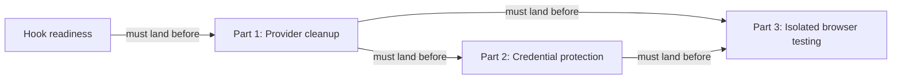

# Keep local agent work within useful boundaries: Codex — Part 1: Provider cleanup

## Summary

Put the remaining Codex-specific hook and headless-command details behind the provider boundary
before adding credential protection or isolated browser execution. This is the prerequisite for
the other two parts of the series; it changes ownership and dispatch without widening permissions.

## Context

A provider is RoboRepo's adapter for one agent harness. Shared orchestration reads its manifest
and calls its adapters; provider code owns native paths, formats, and command syntax.

| Current touchpoint | Remaining work |
| --- | --- |
| `scripts/cli/hook-composition.mjs` | Main branches on Codex for both file routing and writing. Hook-readiness replaces both in its unlanded branch; consume that implementation after landing |
| `globals/system/hooks/codex/` | Codex scripts still live in the shared system tree. Move their sources provider-side while retaining installed paths and command strings |
| `scripts/cli/telemetry.mjs` | `findDeepReadCli` uses a fixed CLI list and `runDeepRead` passes `-p` to every CLI. Recorded Codex help identifies `-p` as profile selection, not its non-interactive prompt syntax |
| `scripts/cli/worktree-policy.mjs` and provider manifests | The optional Codex worktree-folder declaration depends on the Claude companion's `agentWorktreeDirs` contract and verified app provenance |

Historical preparation evidence (superseded by the execution record below): checked against local main `890f56fe688b314408ee313af01b3601b747b019` on October 24.
The configured origin is `kirinmurphy/roborepo-alpha`; the checkout directory is named `roborepo`.
No remote freshness or push status is inferred. Hook-readiness remains in review. Its authoritative
worktree tip `caa888b897fe0e2c9e4a6ad413b7e3d3e48b29d9` and frontmatter reviewed commit
`7d72487f8461f0243f6ba98e716c8713dba7bd32` are not ancestors of this main; branch containment
lists only its worktree branch. Its reviewed-commit field predates later implementation and review
records. The primary plan copy still describes unfinished work already present in that worktree.

The worktree's latest review records report a package-install smoke failure reproduced on clean
main, separate passing browser checks, and Windows parity deferred to its own plan. Those records
are historical evidence, not checks rerun during this preparation. Landing, current completion-gate
results, and the final accepted contract must be checked before implementation starts. Promotion
prepares this document; it does not clear the dependency recorded in `blocked_by`.

### Related-plan reconciliation

| Plan | Classification | Contract for this cleanup |
| --- | --- | --- |
| [[wjlt1zvf]] | Unlanded dependency; primary-copy and reviewed-commit prose drift | Wait for landing. Preserve manifest-backed routing/writing, Codex append order, optional core bundle, metadata, owned files, and trust safeguards. Its lifecycle stays under its own review workflow |
| [[4zyo2woj]] | Unlanded downstream dependency; backlog | Part 2 depends on this plan and owns native credential denial. Its existing path and original id remain valid |
| [[8bjltk2n]] | Unlanded downstream dependency; backlog | Part 3 depends on Parts 1 and 2 and owns isolated browser execution |
| [[46qth5z8]] | Plan-vs-plan ownership drift; unlanded adjacent story | Its older prose assigns Codex relocation to Part 2. The series split assigns relocation here; Claude relocation and `agentWorktreeDirs` stay with that companion. Separate prose cleanup is needed there |
| [[7k3m9qd]] | Unlanded adjacent story | Retains delivery redesign. Relocation consumes the landed installer contract without adding a delivery planner |
| [[harness-capability-derived-resource-targeting]] | Unlanded adjacent story | Retains resource target selection. Headless eligibility uses enabled providers, independent of package-resource targeting |

Desktop discovery is already landed: `cc4d97b2` is an ancestor of this main, and
`scripts/harnesses/discovery.mjs` exposes `selectedHarnessExecutable`, preferring a validated PATH
executable before a desktop runtime. Reuse it rather than restoring telemetry's `which` loop.

## Series and prerequisites

| Part | Plan | Ownership |
| --- | --- | --- |
| 1 | This plan | Provider cleanup |
| 2 | [[4zyo2woj]] | Native credential denial; retains the original plan id and probe evidence |
| 3 | [[8bjltk2n]] | One constrained offline app/browser workflow |

`46qth5z8` owns Claude source relocation and the worktree-folder contract. `7k3m9qd` owns package
delivery redesign; capability-derived targeting owns resource selection. These adjacent backlog
plans do not authorize a delivery or permissions-model redesign here.

## Goals

- Shared hook routing consumes provider manifest paths, preserving hook-readiness's contract.
- Codex hook sources have one provider-owned home, with unchanged install destinations.
- Eligible headless providers declare validated argv templates; selection works for a synthetic
  provider without editing a fixed harness list.
- Parts 2 and 3 start only after this prerequisite has landed and been rechecked.

## Proposed design

| Concern | Required implementation |
| --- | --- |
| Hook routing | Consume `hasHarnessPath` / `resolveHarnessPath` routing from hook-readiness. Preserve root-config fixture overrides, checkout-link protection, and `recordConfigWrite`; add only missing regression coverage |
| Hook source ownership | Move `globals/system/hooks/codex/*` to `globals/harnesses/codex/hooks/`. Repoint the dependency's per-file-owned `managed_files` row, preserving `~/.codex/hooks`, native labels, command strings, removal semantics, and standalone manifest discovery/state-root overrides |
| Hook order and trust | Retain appended fragments and existing positions. Preserve foreign-file/symlink conflict handling; never write trust records or restore directory-wide copying |
| Headless invocation | Add `extensions.app.headlessPromptArgs` with one whole-argument prompt placeholder, validated by schema and runtime contract. Discover enabled eligible providers in registry order with existing executable selection, including desktop-only runtimes. Spawn argv directly; preserve public `deepread_cli` report values |
| Worktree folders | Add the Codex declaration only after the companion's field lands and app provenance is verified. Otherwise record the conditional item as deferred; do not invent a second field or block the mandatory cleanup on Claude research |

### Headless contract and ownership

Keep selection and invocation beside their telemetry consumer in `scripts/cli/telemetry.mjs`.
Use `createHarnessRuntime().enabledProviders()` from `scripts/harnesses/harness-runtime.mjs` for
registry-ordered enablement and `selectedHarnessExecutable` for the executable path. The current
`deepread_cli` report field and result `cli` field contain provider command names, not executable
paths; preserve those values while spawning the resolved path. Preserve the existing 60-second
timeout, summary-only prompt, and best-effort error/empty-output handling.

Define `extensions.app.headlessPromptArgs` as a nonempty array of nonempty strings containing
exactly one whole argument `{prompt}`. Reject missing, embedded, or repeated placeholders and
nonstring entries when the field is present; omission means ineligible. Add the same constraints
to `scripts/harnesses/provider-manifest.schema.json` and `scripts/harnesses/contract.mjs`.
The runtime must not spawn an ineligible provider, including malformed data supplied by a fixture.
Substitute the summary prompt as one literal argv element without shell expansion. Real-provider
templates are added only after their selected executable's own help confirms the headless syntax;
this preparation does not claim successful native synthesis.

### Source relocation and ownership

Main still uses `managed_copy` for the Codex script directory. The dependency's worktree uses
`managed_files`, handled by `scripts/cli/shared-target-rows.mjs` and
`scripts/cli/managed-files-row.mjs`. Repoint that landed row rather than reintroducing a directory
copy. `permission-check.mjs` must remain standalone with Node built-ins, preserving `REPO_ROOT`,
`ROBOREPO_STATE_ROOT`, `ROBOREPO_STATE_DIR`, app-root/install-state discovery, and missing-manifest
behavior. Relocation changes source ownership, not the permission classification or trust policy.

Missing or malformed templates, disabled providers, and unavailable runtimes remain explicitly
ineligible. Verify each real argv template with the selected executable's own help; a synthetic
process test proves argument transport, not successful native model synthesis.

## Implementation plan

- [x] Confirm `wjlt1zvf` has landed and inspect current routing, source ownership, trust safeguards,
      config-write logging, and tests. Verify Git ancestry and current behavior before clearing
      `blocked_by`. If unlanded, stop implementation without merging its branch or recreating it.
- [x] Add missing source-relocation and install/remove/idempotence coverage before moving scripts.
- [x] Move Codex sources provider-side and update `manifests/platform/manifest.tsv`, source-path
      references in `scripts/test/test-cli.sh`, and affected docs; preserve installed commands.
- [x] Add failing headless selection/argv cases for omitted/malformed templates, disabled and
      unavailable providers, desktop-only discovery, shell metacharacters, and a synthetic provider.
- [x] Validate the optional template in schema and runtime contract. Extend
      `scripts/test/harness-registry-check.mjs` with valid and invalid manifest fixtures; use existing
      discovery fixtures for PATH preference and desktop fallback, without probing real model calls.
- [x] Add verified eligible-provider templates and migrate both headless selection and invocation.
      Extend `scripts/test/telemetry-synthetic-provider-check.mjs` for a literal prompt argument.
- [x] Recheck the conditional worktree-folder contract; implement only if its prerequisites hold,
      otherwise record why it remains with the companion and does not block Parts 2 and 3.
- [x] Run focused checks and the full local parity gate; document any native synthesis checks
      that need separate authorization rather than making an unapproved model call.
- [x] Update the documentation listed below and scan current source/test/doc references for the
      old source path. Follow the moved file in adjacent backlog plans; preserve historical evidence
      in completed plans and keep their lifecycle unchanged.

## Validation

- Shared hook routing contains neither `harness === "codex"` nor `codexHooksPath` and retains
  manifest-backed synthetic-provider behavior.
- Clean installation and removal preserve user-owned files, native labels, positions, trust
  safeguards, config-write logging, and the existing installed script destinations/commands.
- A synthetic headless provider receives exactly one literal prompt argument. Invalid or missing
  templates degrade gracefully, and no fixed CLI list or shell-string interpolation remains.
- Disabled and unavailable providers are skipped in registry order. PATH and desktop-only fixtures
  receive the resolved executable path; `deepread_cli` and result `cli` retain command-name values.
  Cover whitespace, quotes, newlines, leading dashes, and shell metacharacters in a single prompt,
  plus timeout, nonzero exit, and empty output, without contacting a model service.
- Run `node scripts/test/hook-composition-check.mjs`,
  `node scripts/test/harness-registry-check.mjs`,
  `node scripts/test/telemetry-synthetic-provider-check.mjs`,
  the dependency's `node scripts/test/shared-target-rows-check.mjs`,
  `bash scripts/test/test-cli.sh --quiet`, `bash scripts/test/test-install-collisions.sh --quiet`,
  `env CLEAN_MACHINE_STRICT=1 npm run test:clean-machine-permissions-sandbox`,
  `bash scripts/doctor.sh --quiet`, `git diff --check`, and `npm run check` before handoff.

## Documentation impact

- `docs/user/reference/architecture.md`: update Codex source ownership and retain install paths.
- `docs/internal/hooks-internals.md`, `docs/internal/harness-anatomy.md`,
  `docs/internal/harnesses-explained.md`, `docs/internal/backlog-review.md`: update moved source paths.
- `docs/internal/harness-provider-interface.md`: document headless argv eligibility and templates.
- `docs/user/reference/telemetry.md`: replace the fixed installed-CLI fallback description with
  enabled-provider eligibility, graceful unavailability, and summary-only synthesis.
- `docs/internal/telemetry-internals.md`: document selection, resolved executable invocation,
  unchanged report identifiers, and fixture versus native verification.

## Risks

| Risk | Mitigation |
| --- | --- |
| Hook-readiness advances before cleanup starts | Reinspect landed code; preserve its routing, ownership, ordering, logging, and trust contracts |
| Relocation loses installed standalone manifest discovery | Test installed command strings and state-root overrides, not just source imports |
| Headless argv is mistaken for permission to call a model | Verify transport synthetically; obtain separate authorization for real synthesis when needed |

## Decision Log

- October 24: split provider cleanup out of the combined Codex boundary plan. The user made it
  a prerequisite for all credential and runner implementation. Parts share the same base title,
  with numbered descriptions. The optional Claude-owned folder contract remains conditional.
- October 24 preparation: verified main and the authoritative hook-readiness worktree. Recorded
  the unlanded dependency as an implementation blocker, reconciled the companion's stale ownership
  prose, and made headless validation, state/discovery reuse, report compatibility, and documentation
  touchpoints explicit. The optional folder declaration is still conditional; no code was implemented.

### Additional implementation decisions

- Use the existing runtime and discovery functions beside the telemetry consumer, as specified;
  retain command-name report identifiers while spawning the resolved path.
- Verify Claude and Codex templates from local help and leave Gemini ineligible. Adding an
  unverified template would violate the contract; omission is explicitly supported.
- Use schema draft 2020-12 so `minContains` / `maxContains` enforce exactly one placeholder.
  The existing schema already uses `$defs`; no external draft-07 validator consumer was found in
  scripts. Runtime contract separately rejects malformed templates supplied outside schema validation.
- Correct the standalone source-root fallback to four parent directories. Source-relative lookup
  otherwise resolves `globals/`; explicit repo root, both state-root overrides, recorded app-root,
  install-state, and missing-manifest behavior have executed standalone tests.
- Defer optional Codex worktree-folder declaration: `agentWorktreeDirs` is still proposed in the
  Claude companion backlog and absent from current code. Do not invent a parallel contract.

## Open questions

None. Hook-readiness landing was verified before implementation; no design decision is blocked.

## Execution record

- Start: main `374936e746d7d1a8ab7818a2ece7b1a9d5a96a23`; hook-readiness squash merge
  `b134ef42` is an ancestor, its plan is completed, and current shared hook routing uses
  `hasHarnessPath` / `resolveHarnessPath`. The platform row uses `managed_files`.
- Branch: `codex/harness-codex-provider-cleanup`; Git worktree name:
  `harness-codex-provider-cleanup`. Start transition `b183753b` passed all six checks with zero
  correction passes. Base main's pre-existing telemetry and repository-scope edits are untouched.
- Enabled paired skills: code-style, javascript-typescript, test-harness. React does not apply.
- Provider sources relocated; installed commands and generated hook definitions unchanged.
- Ran local selected-executable help only: Claude desktop runtime `2.1.308` documents `-p`;
  Codex desktop runtime documents `exec [OPTIONS] [PROMPT]`. Gemini has no selected executable.
- Headless template rejection was observed failing before implementation (empty array accepted),
  then passing after implementation. Source-relocation suite initially failed on the missing new
  provider source directory, then passed after relocation.
- Focused assertions passed: hook composition, registry, synthetic headless processes, desktop
  discovery and invocation, and shared-target install/removal/idempotence/conflict handling.
- Strict Docker permissions sandbox passed after retry with Docker access. Doctor passed 107 checks.

- Package build: `npm run build` passed (pack dry run). No running UI is needed for this source
  ownership and argv change; fixture processes exercise invocation and the package build is the
  reviewable delivery artifact. No shareable server URL applies.
- The first full gate encountered localhost `listen EPERM` in the sandbox. The final full gate passed
  with required local-server and Docker access; the first run is not counted as passing.

- Full-gate follow-ups: authorized run had four rules-package assertions fail; the original
  prefix through those assertions passed 146/146 on replay, and the next full run did not repeat
  them. No cause or baseline classification is claimed for those failures.
- The next full run had one existing discovery assertion fail. Instrumented repetition reproduced
  a valid fixture executable's `ETIMEDOUT` at the production two-second probe deadline. The fake
  manifest now grants ten seconds for validity checks; production discovery timing is unchanged.
  The failing assertion and discovery implementation precede this change; the fixture correction
  is included because this run extends the same suite. Diagnostic repetition observed a valid
  executable time out at the production two-second deadline.
- Validation pass 1 at `71af81cf`: fresh-context validator reported no fix/escalate findings after
  reviewing the full diff, acceptance criteria, docs, schema/runtime parity, and skills; reran
  registry, synthetic provider, desktop runtime, shared-target rows, and diff checks successfully.
  Full-gate evidence was pending, so this was not a completion claim.

## Review

### Findings

- [x] The Codex headless argv example in `docs/internal/harness-provider-interface.md` omitted
  `--skip-git-repo-check`; corrected to match the provider — fixed in review (f9772b07).

No implementation fix or escalate findings in the validation passes.

- [x] Durable review evidence contained temporary log paths; replaced them with the observed
  outcomes required by the updated review guidance (d62ba4d5).
- [x] Codex Deep Read required a Git working directory; added `--skip-git-repo-check` before
  the prompt separator and updated existing desktop argv expectations (b4cd7228).
- [x] Runtime discovery test rejected incidental PID/port digit sequences inside a hash;
  replaced the substring assertion with the opaque-key format assertion (b4cd7228).

### Verification

- Pass 1: clean at `71af81cf`; full parity evidence pending at review time.
- Pass 2: clean at `7997eb72`; independently rechecked the full diff, acceptance criteria, docs,
  schema/runtime constraints, ownership/trust preservation, and paired skills. Registry, synthetic
  provider, desktop runtime, shared-target rows, and diff checks passed. Full parity evidence was
  still pending at review time.

### Completion evidence

- October 25: `npm run check` passed on implementation `7997eb72`, exit 0. It includes doctor
  (107 checks), CLI smoke (457 passed, zero failed), all install-collision checks, 60/60 grouped
  suites, package-install smoke, four strict Docker scenarios, and 130 browser tests.
  The executed gate exited successfully; counts and platform exclusions are recorded here.
- Windows installer parity was skipped because `pwsh` is unavailable. The optional active-root
  verification fixture also reported `uvx` unavailable. Those optional platform/dependency checks
  are not claimed as passed; wider Windows parity remains in its adjacent backlog plan.
- `npm run build`, focused hook composition, registry, synthetic headless invocation, desktop
  runtime, shared-target rows, strict permissions sandbox, and `git diff --check` passed.
- Current source/test/docs scan found no retired Codex source path outside this plan's historical
  context and completed/archived records. All listed docs of record and adjacent backlog pointers
  were updated. No generated hook commands or trust records changed.
- Validation: clean on pass 2 at `7997eb72`, fresh-context subagent; zero fix/escalate findings,
  zero verified base failures, no open questions. Conditional worktree-folder declaration deferred
  as designed. No runtime server is needed for this non-UI change; package build and executed
  fixture processes provide the verification environment, without a persistent shareable URL.
- Implementation commits: `71af81cf` (provider cleanup) and `7997eb72` (fixture startup allowance).
  No push, merge, publication, or native model call was performed.

### Human-review round — October 25

- Base synchronization: user explicitly authorized `roborepo plans sync-base`; merged main
  `6b6521d54433113b4b7afcfc224f09ed6e0104cd` as
  `576f295064e05a5c99f3a4466475bbd69725b7d4`, without conflicts.
- Independent Validator pass: clean at the synchronized commit; zero fix findings and zero
  escalations. Checked every acceptance criterion, docs of record, observable test coverage,
  flow/cohesion, data/state, and comments/abstractions. Registry, synthetic-provider, desktop-runtime,
  shared-target-rows, hook-composition, and diff checks passed.
- Base failure: `npm run check` stops in doctor because `generated/claude/CLAUDE.md` differs from
  rendered rules. `git diff main...HEAD -- globals/system/rules generated` is empty: the failing
  inputs are identical on synchronized main. The command exited 1 at the doctor stage.
- Remaining gate stages are being checked separately. Initial sandbox runs hit local-server
  `listen EPERM` and npm access restrictions; authorized retries are pending. No initial failed
  attempt is counted as passing.
- Review made no implementation fixes. Primary checkout has unrelated edits; they remain outside
  this worktree and are not part of review commits.

### Result
- Status: complete
- Reviewed implementation commit: 9a21ab28df5a7e2c9481db66d0d7229f34785416
- Base commit: bb8209b55e069d657cf70b0f585199231c8f89a3

### Approval
- Decision: approved
- Reviewed implementation commit: 9a21ab28df5a7e2c9481db66d0d7229f34785416
- Confirmed by: human
- Evidence: October 26, 2026, the human answered "Approve this implementation" to the
  post-merge recovery approval prompt naming this plan and exact commit
  `9a21ab28df5a7e2c9481db66d0d7229f34785416`. The human directed that approval be recorded on main.
- Previous decision: approved
- Previous reviewed implementation commit: a8aa353fbb1b7cb45ad2822314385354b0f6f5f6
- Previous confirmed by: human
- Previous evidence: October 26, 2026, the human answered "Approve this implementation" to the
  earlier approval prompt naming that implementation. Subsequent base integration made it stale.
- Earlier approval: d62ba4d5b9f3f987c2be3eea4410efd1c51e78f6, explicitly approved by the human
  on October 25, 2026; superseded after feedback fixes. These prior approvals remain historical.

### Review evidence before PR feedback

- Final `npm run check` passed, exit 0, on the synchronized implementation, with only plan-record
  commits afterward. Health: 106 checks; CLI: 457 passed, zero failed; install collisions: all
  passed; grouped CI suites: 60/60; package-install smoke: passed; strict Docker clean-machine,
  install, permissions, and onboarding scenarios: all passed; browser assertions: 130 passed.
  `git diff --check` passed. Windows installer parity was skipped because `pwsh` is unavailable;
  the optional active-root fixture reported `uvx` unavailable. Neither is claimed as passed.
- Earlier generated-rules base failures are historical and resolved in synchronized main. No
  current base failures, open implementation findings, escalations, or required manual checks
  remain. Both primary and worktree statuses were clean before committing this final evidence.
- Review commits: `8b6a424e` recorded the initial review; `d62ba4d5` recorded the second-sync
  acceptance evidence and the sole documentation correction. No implementation fix commit exists.
- Main advanced while verification ran. A second authorized synchronization merged base
  `9211dab11354fbf36de3275584b5481987f15481` without conflicts, producing implementation
  `cdb37fda4d3f31400ab126586e6057f4dee47df5`. That base repairs the earlier generated-rules drift.
- Validator pass 2 found no implementation issues or escalations. Its sole plan-record finding
  was removal of temporary-log references; those now record actual outcomes instead. Incoming
  telemetry projection caching is separate from headless invocation. Synthetic-provider and
  repository-scope assertions passed again.
- The isolated hook-readiness suite passed after the earlier grouped run reported `missing`
  instead of `active`. No cause is claimed for that earlier failure; the final full gate remains
  the completion check.
- Before the second synchronization, all 130 browser tests, the strict permissions Docker
  sandbox, and install-collision tests passed. Other lifecycle failures referred to the now-fixed
  generated-rules drift. These results describe the previous synchronized implementation.
- No code or test fixes were made in review. The optional folder declaration remains deferred by
  design. Real model synthesis is excluded from required manual checks for this cleanup.

| Acceptance area | Code and executed evidence |
| --- | --- |
| Manifest-backed hook routing | Existing shared composition retains path overrides, link protection, and logging; hook-composition assertions passed |
| Provider-owned sources and installed behavior | Provider hook directory and per-file manifest row; shared-target assertions cover install, removal, ownership, conflicts, and standalone lookup |
| Validated headless contract | Schema and runtime contract reject omitted/malformed eligibility; registry and synthetic-provider assertions passed |
| Literal summary transport and failures | Telemetry consumer spawns resolved executable argv; synthetic processes assert summary-only input, metacharacters, timeout, empty output, and nonzero exit |
| Enablement, order, desktop/PATH selection | Runtime registry filtering and discovery; synthetic-provider and desktop-runtime assertions passed |
| Documentation and conditional scope | Architecture, hook, provider, and telemetry docs follow current behavior; old source-path scan found no active source/test/doc references |

### PR feedback fixes and verification — October 26

- Fixes are committed in `b4cd722843c1d824838324f0265d592dbc7b1b6e` (three files, four line
  replacements). The local Codex executable's `exec --help` confirms that
  `--skip-git-repo-check` permits running outside Git repositories. The provider template now
  places that flag before `--` and the literal prompt argument. Existing desktop process
  assertions were updated; no additional test suite or real model call was introduced.
- The CI-reported hash is valid but contains `101` by chance. The old assertion was reproduced
  rejecting it. The replacement checks the `a`-prefixed 24-digit hexadecimal format; existing
  restart assertions still verify the association key survives PID and port changes.
- Focused checks passed: `node scripts/test/developer-runtime-check.mjs`,
  `node scripts/test/harness-desktop-runtime-check.mjs`,
  `node scripts/test/harness-registry-check.mjs`, and
  `node scripts/test/telemetry-synthetic-provider-check.mjs`. The first runtime attempt hit
  sandbox `listen EPERM`; the authorized retry passed. The failed attempt is not counted as passing.
- `npm run check` passed, exit 0, on the three-file fix content subsequently committed as
  `b4cd7228`: health 106 checks; CLI 457 passed, zero failed; install collisions all passed;
  grouped suites 60/60; package-install smoke passed; all four strict Docker scenarios passed;
  browser tests 130 passed. `git diff --check` passed.
- Windows installer parity was skipped because `pwsh` is unavailable. The optional active-root
  fixture reported `uvx` unavailable. Neither is claimed as passed. These are local verification
  results, not a claim that remote CI has rerun successfully.
- Renewed review and explicit approval of the changed implementation remain pending. Earlier
  validator passes cover the implementation before these feedback fixes.

### Synchronized feedback review — October 26

- User completed the base merge: synchronized main
  `fb068616abc30baaaf6194e7ba6871f32e78e496` into the feature branch as
  `767405be0f3a2f3a726f2728f29459ab1a1f7ebb`. The canonical landed check reports `not absorbed`:
  the feature has not yet landed in local main. No additional synchronization was needed.
- Fresh-context Validator reviewed acceptance criteria, the full feature diff, changes since
  the prior reviewed implementation, observable assertions, documentation, and conventions.
  No code/test fix or escalation findings. One stale Codex argv documentation example was fixed
  separately in `f9772b07`; no implementation behavior changed in this review.
- Validator checks passed: registry, synthetic-provider transport, desktop-runtime selection,
  shared-target install/removal, hook composition, and diff checks. The provider-interface fix
  also passed `node scripts/test/docs-reference-check.mjs` and `git diff --check`.
- Validator recheck at `f9772b07` confirmed the documentation fix; zero fix or escalate findings
  remain. No code or test fix was needed during this synchronized review.
- Final `npm run check` passed, exit 0, on the synchronized implementation with only the recorded
  documentation correction and plan evidence commits afterward: health 107 checks; CLI 457 passed,
  zero failed; install collisions all passed; grouped suites 60/60; package-install smoke passed;
  all four strict Docker scenarios passed; browser tests 130 passed. Documentation references
  and `git diff --check` passed after the documentation correction.
- Windows installer parity was skipped because `pwsh` is unavailable; it is not claimed as passed.
  No current base failures remain. Both primary and feature checkouts were clean before writing
  this final evidence. No claim is made that remote CI has rerun successfully.
- No required manual tests remain; native model synthesis stays explicitly optional. Human's
  statement that they are ready to approve is readiness, not explicit approval of a new commit.

### Post-merge recovery review — October 26

- Resume path: changes since review; recover approval after landing. The prior complete review
  and approval covered `a8aa353fbb1b7cb45ad2822314385354b0f6f5f6`; the current reviewed
  implementation is `9a21ab28df5a7e2c9481db66d0d7229f34785416`.
- Landing evidence reused after fresh Git checks: repository `kirinmurphy/roborepo-alpha`, branch
  `codex/harness-codex-provider-cleanup`, base `main`, unchanged branch tip `9a21ab28`, and
  absorbing commit `b79bf35dac5f6c430c85b1352331a8c943d61038` still in main's first-parent
  history. Post-merge recovery did not synchronize base or change implementation.
- The tracked implementation comparison between feature `9a21ab28` and current base
  `bb8209b55e069d657cf70b0f585199231c8f89a3` is empty outside `docs/plans/`. Main's
  post-landing changes are plan-only. Pending portal edits in primary belong to other work and
  are excluded from this review and its commits.
- Reviewed the changes since approval: the incoming package consolidation updates plan-suite
  enablement, package presentation and inspection, resource cost reporting, and generated command
  ownership. The cleanup's provider sources, manifest row, argv templates, contract validation,
  and invocation behavior are unchanged; the telemetry changes concern package onboarding.
- Reused the full completion gate executed in the preceding closure attempt on this identical
  implementation, rather than rerunning it: `npm run check` passed, exit 0; health 107 checks;
  CLI 464 passed, zero failed; installation collisions all passed; grouped integration suites
  60/60; package-install smoke passed; all four strict Docker scenarios passed; browser 133 passed.
  The primary-only documentation link correction accommodates a later plan lifecycle move and
  does not change the reviewed implementation. Its reference check passed separately.
- Fresh-context independent Validator pass: clean, zero fix findings and zero escalations.
  Checked every acceptance criterion against code and tests, original provider relocation,
  standalone permission-manifest discovery, installed ownership/trust behavior, summary transport,
  documentation, and incoming package interactions. Applied code-style, JavaScript/TypeScript,
  test-harness, and RoboRepo development conventions, including flow/cohesion, data/state, and
  comments/abstractions. React is not applicable.
- Fresh Validator assertions passed: `node scripts/test/harness-registry-check.mjs`,
  `node scripts/test/telemetry-synthetic-provider-check.mjs`,
  `node scripts/test/harness-desktop-runtime-check.mjs`,
  `node scripts/test/shared-target-rows-check.mjs`,
  `node scripts/test/hook-composition-check.mjs`, and `git diff --check`.
  `node scripts/test/docs-reference-check.mjs` passed in the worktree and primary checkout.
- Reconciled only this chat's closure evidence from primary into the authoritative worktree after
  verifying the worktree's committed plan matched the primary document before those notes.
  Independent plan edits were absent. Review records preserve the preceding approval as history;
  they do not renew it or imply approval of this commit.
- Base failures: none in the reused gate. Windows installer parity (`pwsh` unavailable) and the
  optional active-root fixture (`uvx` unavailable) were skipped and are not claimed as passed.
  Native model synthesis remains explicitly optional; no real model call was made.
- Human directed that renewed review evidence be committed on main only. The authoritative
  worktree plan is kept byte-for-byte aligned as an uncommitted evidence-only edit; its
  implementation and branch tip are unchanged. No worktree commit is made.
- Findings: zero open, zero fixed in this recovery, zero escalated. No required manual checks
  remain. Lifecycle stays in review. Explicit human approval of the exact reviewed commit is
  requested during review. The human subsequently approved this exact implementation; see Approval.

## Not tested

- Deferred, optional: native model synthesis using the real provider templates. Local help and synthetic processes
      verify syntax and transport; a real model call requires separate authorization and is not
      needed for the provider cleanup's automated acceptance checks.

## Closure attempt — October 26

Closure is blocked by stale human approval. The plan remains in review; no lifecycle transition,
closure commit, server shutdown, or worktree removal was performed.

- Primary and assigned-worktree plan bytes matched at the start of verification (blob
  `03e23bb9d6c1d95d127a7892d93669f5c309995e`), confirming integration of the worktree's plan state.
- The canonical validator reported zero findings and zero blocking findings.
- The canonical approval check reported `stale`: approved implementation
  `a8aa353fbb1b7cb45ad2822314385354b0f6f5f6` differs outside `docs/plans/` from branch tip
  `9a21ab28df5a7e2c9481db66d0d7229f34785416` on
  `codex/harness-codex-provider-cleanup` (114 paths). This command cannot renew approval.
  Run `/plan-review hr78g4sj` for the current implementation and obtain explicit human approval.
- The canonical landed check passed with newly scanned content-level evidence on local main.
  Its first sandbox attempt returned `scan unavailable`; the authorized retry verified the merge.
- Absorbing commit: b79bf35dac5f6c430c85b1352331a8c943d61038
- Current code confirms provider-owned hook sources and the per-file `managed_files` platform row,
  manifest-backed hook routing, schema/runtime template validation, registry-ordered enabled
  provider selection, direct resolved-executable invocation, literal summary-only argv transport,
  unchanged command-name report identifiers, and best-effort failures with a 60-second timeout.
- Fresh focused assertions passed: `node scripts/test/hook-composition-check.mjs`,
  `node scripts/test/harness-registry-check.mjs`,
  `node scripts/test/telemetry-synthetic-provider-check.mjs`,
  `node scripts/test/harness-desktop-runtime-check.mjs`, and
  `node scripts/test/shared-target-rows-check.mjs` (all exit 0).
- All eight documentation-impact references were checked against the current source ownership
  and headless behavior. The documentation reference check initially found a stale link in
  `docs/internal/backlog-review.md` to the package-state plan's former backlog path. Corrected
  it to that plan's current active path; `node scripts/test/docs-reference-check.mjs` then passed.
  The current source/test/reference-doc scan found no retired Codex hook source path.
- The conditional worktree-folder field remains absent and explicitly deferred. No required
  unchecked manual entries remain; native model synthesis is optional and was not run.
- Full completion gate: `npm run check` passed, exit 0, in the authorized retry. Health:
  107 checks; CLI: 464 assertions, zero failed; installation collisions: all passed; grouped
  integration suites: 60/60; package-install smoke: passed; all four strict Docker clean-machine,
  installation, permissions, and onboarding scenarios: passed; browser tests: 133 passed.
  Windows installer parity was skipped because `pwsh` is unavailable and is not claimed as passed.
  The initial sandbox gate exited 1 with `Claude Code has no validated CLI or desktop runtime`;
  that run is not counted as passing. No cause beyond the observed output is asserted.
- `git diff --check` and the primary plan's review-lifecycle content validation passed. The
  canonical validator reports zero blocking findings and the expected advisory
  `PLAN_EDITED_OUTSIDE_WORKTREE` for these closure notes in the primary checkout. The assigned
  worktree's copy was left unchanged, as required after plan-integration verification.
- Primary main advanced during verification with another plan's lifecycle-only commit
  `bb8209b55e069d657cf70b0f585199231c8f89a3`; no branch was moved by this closure attempt.

Paths changed since the approved implementation (114)

- `docs/internal/backlog-review.md`
- `docs/internal/history/plan-lifecycle/README.md`
- `docs/internal/plans-portal-internals.md`
- `docs/internal/portal-architecture.md`
- `docs/user/guides/plan/lifecycle/plan-suite.md`
- `docs/user/guides/setup-and-daily-use.md`
- `docs/user/reference/config-control-panel.md`
- `docs/user/reference/plans-portal.md`
- `docs/user/reference/repositories.md`
- `docs/user/reference/roborepo-cli.md`
- `generated/packages/plan-suite/claude/commands/plan-archive.md`
- `generated/packages/plan-suite/claude/commands/plan-close.md`
- `generated/packages/plan-suite/claude/commands/plan-execute.md`
- `generated/packages/plan-suite/claude/commands/plan-promote.md`
- `generated/packages/plan-suite/claude/commands/plan-review.md`
- `generated/packages/plan-suite/claude/commands/plan-write.md`
- `generated/packages/plan-suite/codex/commands/plan-archive.md`
- `generated/packages/plan-suite/codex/commands/plan-close.md`
- `generated/packages/plan-suite/codex/commands/plan-execute.md`
- `generated/packages/plan-suite/codex/commands/plan-promote.md`
- `generated/packages/plan-suite/codex/commands/plan-review.md`
- `generated/packages/plan-suite/codex/commands/plan-write.md`
- `generated/packages/plan-suite/gemini/commands/plan-archive.md`
- `generated/packages/plan-suite/gemini/commands/plan-close.md`
- `generated/packages/plan-suite/gemini/commands/plan-execute.md`
- `generated/packages/plan-suite/gemini/commands/plan-promote.md`
- `generated/packages/plan-suite/gemini/commands/plan-review.md`
- `generated/packages/plan-suite/gemini/commands/plan-write.md`
- `globals/packages/plan-archive/package.config.json`
- `globals/packages/plan-archive/skill-triggers.json`
- `globals/packages/plan-close/package.config.json`
- `globals/packages/plan-close/skill-triggers.json`
- `globals/packages/plan-execute/package.config.json`
- `globals/packages/plan-execute/skill-triggers.json`
- `globals/packages/plan-promote/package.config.json`
- `globals/packages/plan-promote/skill-triggers.json`
- `globals/packages/plan-review/package.config.json`
- `globals/packages/plan-review/skill-triggers.json`
- `globals/packages/plan-suite/package.config.json`
- `globals/packages/plan-suite/rules.md`
- `globals/packages/plan-suite/skill-triggers.json`
- `globals/packages/plan-suite/skills/plan-archive/SKILL.md`
- `globals/packages/plan-suite/skills/plan-archive/agents/openai.yaml`
- `globals/packages/plan-suite/skills/plan-close/SKILL.md`
- `globals/packages/plan-suite/skills/plan-close/agents/openai.yaml`
- `globals/packages/plan-suite/skills/plan-close/references/verdict.md`
- `globals/packages/plan-suite/skills/plan-execute/SKILL.md`
- `globals/packages/plan-suite/skills/plan-execute/agents/openai.yaml`
- `globals/packages/plan-suite/skills/plan-execute/references/start-validation.md`
- `globals/packages/plan-suite/skills/plan-execute/references/validation-loop.md`
- `globals/packages/plan-suite/skills/plan-promote/SKILL.md`
- `globals/packages/plan-suite/skills/plan-promote/agents/openai.yaml`
- `globals/packages/plan-suite/skills/plan-review/SKILL.md`
- `globals/packages/plan-suite/skills/plan-review/agents/openai.yaml`
- `globals/packages/plan-suite/skills/plan-review/references/resume-review.md`
- `globals/packages/plan-suite/skills/plan-write/SKILL.md`
- `globals/packages/plan-suite/skills/plan-write/agents/openai.yaml`
- `globals/packages/plan-suite/skills/plan-write/references/lifecycle.md`
- `globals/packages/plan-suite/skills/plan-write/references/plan-schema.md`
- `globals/packages/plan-suite/skills/plan-write/references/prompt-contracts.md`
- `globals/packages/plan-suite/skills/plan-write/references/workflow-create.md`
- `globals/packages/plan-suite/skills/plan-write/references/workflow-update.md`
- `globals/packages/plan-suite/skills/plan-write/references/workflow-validate.md`
- `globals/packages/plan-suite/skills/plan-write/references/writing-guidelines.md`
- `globals/packages/plan-write/package.config.json`
- `globals/packages/plan-write/skill-triggers.json`
- `local/skills/roborepo-development/SKILL.md`
- `local/skills/roborepo-development/references/package-development.md`
- `manifests/inventory/package-categories.json`
- `manifests/platform/cli/command-definitions/package/dev-add-skill.command.json`
- `modules/plan-suite/canonical-scan.mjs`
- `portal/config/app.js`
- `portal/config/elements/config-item.js`
- `portal/config/index.html`
- `portal/config/panels.js`
- `portal/config/state.js`
- `portal/config/styles.css`
- `portal/config/templates.js`
- `portal/home/app.js`
- `portal/plans/api.js`
- `portal/plans/app.js`
- `portal/plans/elements/plan-card.js`
- `portal/plans/plan-drawer-partial.html`
- `portal/plans/plan-drawer.js`
- `portal/plans/templates.js`
- `scripts/cli/config-bulk.mjs`
- `scripts/cli/config-cli-print.mjs`
- `scripts/cli/config.mjs`
- `scripts/cli/context-cost.mjs`
- `scripts/cli/mock-home.mjs`
- `scripts/cli/packages.mjs`
- `scripts/cli/plans.mjs`
- `scripts/cli/portal-routes-config.mjs`
- `scripts/cli/repository-overview-projections.mjs`
- `scripts/cli/telemetry.mjs`
- `scripts/dev/docs-screenshots.mjs`
- `scripts/test/config-bulk-toggle-check.mjs`
- `scripts/test/context-cost-check.mjs`
- `scripts/test/fixtures/multi-skill-package.mjs`
- `scripts/test/package-catalog-check.mjs`
- `scripts/test/package-lifecycle-check.mjs`
- `scripts/test/package-retired-ids-check.mjs`
- `scripts/test/plan-close-integration-check.mjs`
- `scripts/test/plan-suite-check.mjs`
- `scripts/test/plan-suite-commands-check.mjs`
- `scripts/test/plan-suite-skills-check.mjs`
- `scripts/test/portal-ui/helpers.mjs`
- `scripts/test/portal-ui/portal-ui.spec.mjs`
- `scripts/test/portal-ui/repository-scope.spec.mjs`
- `scripts/test/portal-ui/repository-sources.spec.mjs`
- `scripts/test/repository-overview-check.mjs`
- `scripts/test/skill-reference-matrix-characterization-check.mjs`
- `scripts/test/system-package-ownership-characterization-check.mjs`
- `scripts/test/test-cli.sh`

## Completion summary

Provider cleanup is complete and accepted. Codex hook sources are provider-owned while installed
paths, per-file ownership, trust safeguards, and hook ordering remain intact. Headless telemetry
uses validated provider argv templates, enabled-provider discovery, and literal summary transport.
The optional worktree-folder declaration remains deferred until the companion contract exists.

## Verification

- October 26, 2026: `npm run check` passed, exit 0, from primary main
  `3c04ac2f769ebaf20f33c2d6a8594a46f3c9394a`. Doctor: 107 checks; CLI: 464 assertions,
  zero failed; install collisions: all passed; grouped integration suites: 60/60; package-install
  smoke: passed; all four strict Docker scenarios: passed; browser tests: 139 passed.
  The initial restricted run failed with localhost `listen EPERM`; the authorized retry above
  passed. Windows installer parity was skipped because PowerShell is unavailable and is not
  claimed as passed. Unrelated primary-checkout edits were present during the run and are excluded
  from the closure commit; this gate result describes that checkout as tested.
- Focused checks passed: `node scripts/test/hook-composition-check.mjs`,
  `node scripts/test/harness-registry-check.mjs`,
  `node scripts/test/telemetry-synthetic-provider-check.mjs`,
  `node scripts/test/harness-desktop-runtime-check.mjs`,
  `node scripts/test/shared-target-rows-check.mjs`,
  `node scripts/test/docs-reference-check.mjs`, and `git diff --check`.
- Checked every required implementation task against landed code and focused assertions. Shared
  routing remains manifest-backed; schema and runtime validate templates; enabled-provider order,
  executable discovery, literal argv, report identifiers, and best-effort failures are preserved.
  No required unchecked tasks, review findings, or manual checks remain.
- Checked all eight documentation-impact references against current code: architecture, hook
  internals, harness anatomy, harness explanations, backlog review, provider interface, telemetry
  reference, and telemetry internals. Source/test/reference-doc scan found no retired Codex source
  path. Documentation reference assertions passed.
- Integration: primary and linked-worktree plan bytes matched before verification, blob
  `084f052d88f7d0fb5362bc0a8868041545acf1d6`. The primary copy owns these closure notes.
- Human-approved implementation: 9a21ab28df5a7e2c9481db66d0d7229f34785416.
  The canonical approval check reported fresh at that branch tip; approval was not altered here.
- Landing: newly scanned content-level evidence confirmed the branch landed on local main.
  The restricted attempt reported scan unavailable; the authorized retry passed.
- Absorbing commit: b79bf35dac5f6c430c85b1352331a8c943d61038
- Native model synthesis remains optional and was not performed. Local help and synthetic process
  checks establish template syntax and transport, not successful native model synthesis.
- The canonical plan validator reported zero findings before closure edits. The close transition
  rechecks completed-document requirements, integration, approval freshness, and recorded landing.
