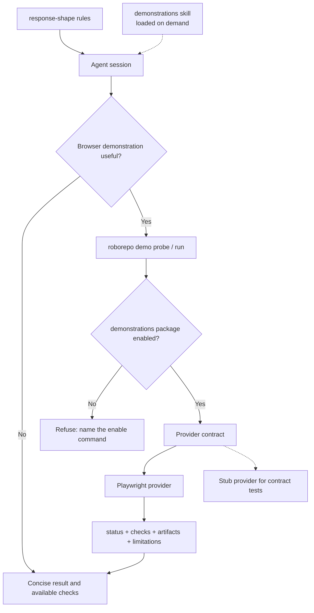

# Make Agent Conversations Easier to Understand and Results Easier to Verify

## Summary

Improve **interactive conversations in RoboRepo-managed agent sessions**, not just sessions developing
RoboRepo. Agents should communicate outcomes before implementation mechanics, adapt depth to the
task, surface consequential architectural decisions, and demonstrate completed behavior when doing
so helps the human understand or trust the result. Agents should perform safe verification
themselves instead of routinely assigning it to the user.

The work has two independently toggleable parts:

| Part | Delivered as | Loaded |
| --- | --- | --- |
| Communication policy | Additions to the existing optional `response-shape` rules package | Every turn, while the package is enabled |
| Browser demonstrations | A new optional `demonstrations` package (a skill with the Playwright guidance) plus a core `roborepo demo probe` / `demo run` namespace that refuses unless the package is enabled | Only when an agent decides a demonstration is worth running |

Playwright is the first demonstration provider. Normalize provider capabilities, execution, and
evidence results; do not build a generic browser automation language. Optimize **total time to
understanding**: agent execution time plus human comprehension time.

## Goals

- Make agent responses easier to understand without merely minimizing word count or hiding technical depth.
- Lead with the user-relevant result, significance, or decision; explain mechanisms when they help.
- Adapt explanations to investigation, architecture, debugging, implementation, and completion without explicit personas or modes.
- Keep meaningful alternatives, risks, uncertainty, and decisions visible to the human who owns architecture.
- Prefer concrete examples and visual representations when they communicate faster than dense prose.
- Verify behavior autonomously when safe and feasible; present **actual, accessible evidence**, not just verification instructions.
- Support Claude Code, Codex, and Gemini CLI through the same rendered rules and one portable demonstration command.
- Keep tooling optional, startup lazy, agent responses fast, and implementation maintainable.

## Non-goals

- Changing the primary format of plan documents, skill documentation, or formal closeout artifacts.
- Building a new browser engine, general visualization framework, browser-action DSL, video editor, evidence portal, or session analytics platform.
- Requiring screenshots or videos for every code change, or prescribing word limits.
- Treating screenshots, videos, or conceptual diagrams as substitutes for executed assertions/tests.
- Requiring individual projects to install Playwright or alter their dependency/test configuration to obtain ad hoc demonstrations.
- Forking conversational policy by harness, adopting one harness's native output style as the common standard, or adding a second harness adapter hierarchy.
- Storing full transcripts or sensitive user data for evaluation, or automating production/destructive actions to capture evidence.
- Turning either package on by default (`defaultEnabled`), or folding either into the Plan Suite category. Both stay standalone and opt-in for now.
- Changing how Plan Suite packages are toggled. Whether Plan Suite should be all-or-nothing belongs to the package-state work in [[o9zwxuav]], not here.

## Current state

Verified on `main` at `8ec0adb7`.

| Area | Today | Gap this plan closes |
| --- | --- | --- |
| Rule rendering | `scripts/cli/rules-render.mjs` renders `globals/system/rules/shared/` + `globals/system/rules/<harness>/` + enabled packages' `rules.md` into each harness's global file (`~/.claude/CLAUDE.md`, `~/.codex/AGENTS.md`, Gemini) | None; reuse as is |
| Answer-first and form | `globals/packages/response-shape/rules.md` (optional, category `chat-time-output`, 78 lines) already requires re-orientation, answer first, corrections up front, tables/code/Mermaid over prose, bolded load-bearing claims, and a DONE/DEFERRED/NEXT STEPS close | Adaptive depth, explaining unfamiliar terms, meaningful progress updates, choosing visual evidence, and evidence categories are missing |
| Evidence honesty | Shared `04-claims-and-evidence.md` requires verified causes and marking unverified reasoning | Does not separate *passed* checks from *observed but unasserted* behavior or conceptual illustrations |
| Surfacing decisions | Shared `07-decide-dont-ask.md` defines when to decide vs. escalate and forbids narrating settled decisions; `impact-awareness` (requires `response-shape`) flags collisions | None; the new rules must defer to these rather than restate them |
| Shared communication baseline | Deliberately absent: an earlier rules audit deleted the shared `00-communication.md` fragment and moved chat-output behavior into toggleable packages (`docs/internal/rules-parity-and-layering.md`) | None; this plan follows that convention |
| Terse mode | Optional `caveman` package rules say "terse, no filler, fragments OK" | No stated precedence between caveman and response-shape |
| Package dependents | `impact-awareness`, `convention-capture`, and `skill-visibility` each `require` `response-shape` | Anything added to `response-shape` is pulled in by those packages |
| Default-on mechanism | `defaultEnabled: true` exists (`branch-safety`, `usage-statusline`) | Not used here, by decision |
| CLI routing | Core commands are JSON definitions under `manifests/platform/cli/command-definitions/<namespace>/` (`namespace.json` + `<name>.command.json` with a `module`/`export` execution) | No `demo` namespace |
| Package CLI commands | Package `cli-command` resources (`scripts/cli/package-commands.mjs`) only wrap an external process (`commandOrUrl` + `args`) that a core command such as `index code` spawns; they cannot register a new namespace | `demo` must be a core namespace gated on the package, the same way `index code` resolves its enabled owning package |
| Playwright | `@playwright/test` is a **devDependency** only; `package.json` `files` does not ship it. The repo's own browser suite lives in `scripts/test/portal-ui/` (hermetic portal, `capture.mjs` screenshots, skips cleanly when Chromium is absent) | The shipped CLI cannot import Playwright; a provider must resolve it from the target project or a RoboRepo-managed tool directory |
| Optional-tool provisioning | No general facility. `scripts/cli/index.mjs` `requireUvx()` probes for a binary and exits with an install hint | Needs the smallest equivalent: probe, report, install only with permission |
| Running local apps | `roborepo runtime --json` reports discovered local HTTP apps and origins while the user's auto-discovery consent is on (`modules/developer-runtime/`) | Usable as one source of already-running URLs; never as a source of processes the demo may stop |
| Bounded storage | `modules/retention/registry.mjs` `retentionStores(stateRoot)` lists every bounded local store; `roborepo maintenance stores` and doctor read it. `measureFileSet` handles flat directories of files (default filter: `.json`) | Evidence needs a registered store; per-demonstration subdirectories need a directory-aware measurement or a flat naming scheme |
| Agent command permissions | `manifests/inventory/agent-permissions.json` + `scripts/cli/agent-run-policy.mjs`: prefix allowlisting of wrapper commands authorizes every payload, so wrappers stay out of the allowlist | `demo run` executes scripts and must never be prefix-allowlisted |

Reported friction includes walls of prose, unexplained jargon, buried conclusions, implementation
details presented without meaning, incomplete context, and verification delegated to the human.
These are observed user problems, not a measured baseline.

## Proposed design

### 1. Communication policy inside `response-shape`

Extend `globals/packages/response-shape/rules.md` instead of adding a shared fragment or a new
package. It already owns answer-first output, so a second home would duplicate it. Add only what is
missing, compactly, and defer to the shared rules for what they already cover:

- **Provide sufficient context:** explain unfamiliar terms and reconnect to the user's goal without repeating the whole conversation.
- **Adapt detail:** default to outcomes; explain architecture/tradeoffs when material and code-level mechanics when necessary or requested.
- **Use meaningful updates:** report changed understanding, actual progress, or blockers rather than narrating each tool call.
- **Choose the clearest medium:** prefer an example, comparison, diagram, screenshot, recorded interaction, or actual output when it reduces explanation effort.
- **Report evidence by kind:** distinguish passed checks, observed but unasserted behavior, conceptual illustrations, and unavailable verification. This extends `04-claims-and-evidence.md`; it does not restate it.
- **Precedence:** an explicit user request for more or less detail wins. Enabling `caveman` counts as such a request, so caveman governs length and style. Even then, the outcome, decisions the human must make, material uncertainty, and whether a check passed or was only observed are never dropped.

Surfacing consequential choices is already governed by `07-decide-dont-ask.md` and
`impact-awareness`; the additions must not reintroduce narration of settled decisions.

No mandated new headings, fixed verbosity levels, persona selection, or universal visualization
requirement. Operational Playwright instructions belong in the `demonstrations` skill, **not** the
always-loaded rules.

| Conversation | Default information | More depth when |
| --- | --- | --- |
| Investigation | Finding, significance, uncertainty | Evidence changes the conclusion |
| Architecture | Decision, options, tradeoffs | Interfaces, maintainability, or future changes are affected |
| Debugging | Symptom, supported cause/hypothesis, next check | Logs or reproduction are relevant |
| Progress | Meaningful change and blocker, if any | Assumptions or decisions change |
| Completion | Outcome, real verification/evidence, attention needed | Failures, untested conditions, or significant risks remain |

These are selection cues, not separate modes. Clear responses must remain possible without any
demonstration tooling. Keep the additions small enough that `response-shape` stays near its current
size; it is loaded every turn and pulled in by three dependent packages.

### 2. Progressive evidence, not automatic media production

Choose the **fastest sufficient** form of evidence. Reuse artifacts already produced during relevant
testing before running additional browser work. Plan capture ahead of verification when a recording
is needed; don't rerun work just to improve presentation unless the new evidence is materially
useful.

| Change or question | Default evidence | Use more when |
| --- | --- | --- |
| Static UI | One screenshot or before/after frames | Additional states are necessary |
| Interactive UI | Key frames; short recording if sequence or motion matters | Still frames cannot show the behavior clearly |
| Browser failure | Failure and selective screenshot | A trace is required to diagnose it |
| CLI / backend | Executed input/output and test/assertion result | An unexpected result needs diagnosis |
| Architecture / workflow | Mermaid when relationships are difficult to explain | Alternatives or tradeoffs need additional context |
| Performance | Measured before/after values | A chart conveys trends/distributions better |
| Simple or nonvisual work | Brief result and proportionate checks | A material question remains |

A diagram is **explanatory**, not proof that code ran. A screenshot or recording shows observed
behavior, not necessarily correctness. Only executed verification checks support a claim that
behavior **passed**. Trace capture is primarily for diagnostics and should not be enabled
indiscriminately. This table is guidance for the `demonstrations` skill; only the one-line
"report evidence by kind" rule is always loaded.

### 3. `demonstrations` package and the `roborepo demo` namespace



**Package.** `globals/packages/demonstrations/` with `package.config.json` (`lifecycle: "optional"`,
no `defaultEnabled`, no `requires`) and one auto-invoked skill holding the operational guidance:
when a demonstration is worth it (Section 2's table), how to call `demo probe` / `demo run`, how
to pick capture types, the safety rules in Section 5, and how to present the result. Choose a
category in `manifests/inventory/package-categories.json` that fits a tool rather than chat-time
output; add one only if no existing category fits.

**Command.** A core namespace at `manifests/platform/cli/command-definitions/demo/` (`namespace.json`,
`probe.command.json`, `run.command.json`) executing a module under `scripts/cli/`. Package
`cli-command` resources cannot register namespaces (see Current state), so the core command checks
that the `demonstrations` package is effective and otherwise exits non-zero with
`roborepo package enable demonstrations` in the message, mirroring how `index code` resolves its
owning package.

```sh
roborepo demo probe --json
roborepo demo run --provider playwright --scenario ./tests/search.spec.js --capture screenshot --json
```

Exact flags follow live CLI conventions; `demo probe` and `demo run` and their machine-readable
results are the contract. No server, plugin protocol, or session command.

Minimal provider contract:

```js
probe() -> { available, capabilities }
run({ scenario, capture }) -> { status, checks, artifacts, limitations }
```

- `scenario` is an **existing provider-supported test/script path** or an ephemeral provider-specific script created for the demonstration, not a RoboRepo browser-action DSL.
- `capture` requests evidence types (screenshot, video, trace); unsupported capture produces a limitation or `blocked` result, never fabricated output.
- `status` is `passed` (executed assertions passed), `failed` (execution or assertion failed), `unverified` (interaction ran without a meaningful assertion), or `blocked` (could not execute, including missing tool or refused install). Check outcomes are reported independently from capture success.
- `artifacts` are actual file paths with types; `limitations` explain missing capabilities, incomplete checks, or delivery constraints.
- Replacing Playwright must not change the CLI result shape or the rules, **but script portability is not promised**.

Implement the Playwright provider plus a stub provider used only by contract tests. No provider
registry or configuration machinery beyond a static map of the two.

Module layout follows `code-style`: the CLI entry orchestrates (gate, parse, call provider, print);
provider execution, the result-shape validator, and artifact/retention helpers are separate units.

### 4. Playwright provider and lazy provisioning

The shipped CLI does not contain Playwright, so the provider resolves it at run time:

1. The target project's own installed `playwright` or `@playwright/test`, resolved from the scenario's directory. Prefer the project's existing tests when present.
2. Otherwise a RoboRepo-managed tool directory under the state root (for example `<stateRoot>/demo/tools/`). Installing into it, and downloading browser binaries, happens only after the agent gets the user's permission through the harness's normal approval. Never write to the target project's manifest or lockfile.
3. Otherwise `blocked`, with the exact install command in `limitations`.

- `probe` reports availability and each capture capability independently, without launching a browser or downloading anything.
- Never initialize Playwright, start a browser, or download binaries for unrelated conversations.
- When recording, set it up before execution; videos finalize only after the browser context closes. Do not rerun passing tests just to get a video.
- A captured interaction alone is not an assertion; mark ad hoc, unasserted runs `unverified`.
- `scripts/test/portal-ui/capture.mjs` and `run.mjs` show the working patterns for screenshot capture and for skipping when Chromium is missing; reuse their approach, not their hermetic-portal specifics.

### 5. Safe autonomous execution and application lifecycle

For changed behavior in a locally runnable web app, agents should exercise relevant behavior where
safe and permitted. Browser work is never forced onto backend-only tasks or unrelated conversations.

1. **Reuse:** first look for already running services (including `roborepo runtime --json` when the user's auto-discovery is on), existing tests, and their evidence. If sufficient, do not launch or repeat anything.
2. **Start when justified:** use only an established development command and known local URL. Track processes and browser contexts **started by this demonstration**; never terminate pre-existing or user-owned services, and never use Runtime's stop action for them.
3. **Verify and capture together:** run relevant checks and requested capture in one workflow where practical; prefer the smallest useful artifact.
4. **Clean up safely:** stop only owned temporary processes and contexts, keep still-needed evidence, report cleanup errors, and respect timeouts.
5. **Fallback truthfully:** missing tools, blocked access, unavailable apps, or unasserted behavior are stated as such, with actual alternative test/CLI evidence if available.

**Permissions.** `demo run` executes scripts, so a prefix allowlist entry such as
`Bash(roborepo demo run:*)` would authorize arbitrary code without a prompt (the problem
`scripts/cli/agent-run-policy.mjs` documents). Do not add `demo run` to
`manifests/inventory/agent-permissions.json`; it stays under the harness's normal approval.
`demo probe` is read-only and may be allowlisted.

Do not guess production endpoints or deployments. No purchases, emails, external mutations, or
irreversible actions to stage a demonstration. Prefer mock data and fixtures, limit capture scope,
and avoid credentials, tokens, private tabs, and unnecessary network payloads. Traces deserve extra
care because they can include page and network state.

### 6. Artifact handling and accessible delivery

- Write evidence under the state root (for example `<stateRoot>/demo/evidence/`), outside tracked files, grouped per demonstration.
- Register the store in `modules/retention/registry.mjs` with explicit bounds so `roborepo maintenance stores` and doctor report it. `measureFileSet` only measures flat files; either flatten names (`<demo-id>-<n>.png`) with a matching filter, or add the smallest directory-aware measurement. Decide during implementation.
- Retain current-result artifacts long enough to inspect; never delete evidence referenced by the current completion response.
- Return exact paths and confirm each file exists. Before calling evidence *inspectable*, confirm the active session can actually open it; a provider success does not guarantee that.
- Show or link **one primary evidence item**; reference secondary artifacts only if needed.
- When the harness cannot deliver a viewable artifact, give a real verification summary and disclose the limitation. Never invent a URL or pretend a local path works remotely.

### 7. Completion responses

The default is short and outcome-oriented: the **result**, the **best available evidence**, and
**what needs attention**, if anything, within `response-shape`'s existing close. Include architecture
details when a consequential decision, uncertainty, or risk needs the human's judgment. Do not block
a useful response for decorative captures.

Example (illustrative; not an actual verification claim):

> Search results now update while typing. Browser assertions passed; one screenshot shows the filtered state. No decisions or follow-up required.

## Related plans

| Plan | Relationship | Classification |
| --- | --- | --- |
| [[o9zwxuav]] One package state model (backlog) | Will add `recommends`; once it lands, `plan-execute` / `plan-review` could recommend `demonstrations`. Also the home for the Plan Suite all-or-nothing question | Unlanded, not a dependency; this plan uses only shipped package fields |
| [[0jped168]] Agent behavior evals (backlog) | Headless agent eval runner could later score comprehension | Unlanded, not a dependency; this plan's clarity check stays a small manual sample |
| [[package-cli-test-guide]] (backlog) | Its prose says Playwright is "not currently installed"; `@playwright/test` and `scripts/test/portal-ui/` have since landed | Plan-vs-code prose drift in that plan; no conflict with this one. Left for that plan's own revision |
| `agent-config-code-quality-conventions` (completed) | Rewrote `code-style` guidance this plan's module layout follows | Landed (`eafd8e25`, ancestor of HEAD) |

## Implementation checklist

- [ ] Extend `globals/packages/response-shape/rules.md` with the Section 1 additions and the caveman precedence sentence; keep it compact and free of duplicates of `04-claims-and-evidence.md` and `07-decide-dont-ask.md`. Regenerate tracked snapshots with `scripts/build/render-rules.sh` (`--check` verifies) and confirm Claude, Codex, and Gemini outputs match.
- [ ] Create `globals/packages/demonstrations/` (optional, not default-enabled) with its skill and trigger fixtures following existing skill-package conventions; pick or add a category.
- [ ] Add the `demo` namespace under `manifests/platform/cli/command-definitions/demo/` and its `scripts/cli/` module; gate both commands on the package being effective.
- [ ] Implement the provider contract, result-shape validation, and a stub provider; status values `passed` / `failed` / `unverified` / `blocked`.
- [ ] Implement the Playwright provider with the Section 4 resolution order, independent capability probing, and recording lifecycle.
- [ ] Implement evidence paths under the state root and register a bounded retention store; handle per-demo grouping per Section 6.
- [ ] Keep `demo run` out of `manifests/inventory/agent-permissions.json`; decide whether `demo probe` is allowlisted.
- [ ] Add tests (see Validation) and register each new check in `scripts/test/check-groups.json`.
- [ ] Add concise before/after communication examples (architecture, investigation, debugging, progress, completion) to the skill or a doc, distinguishing explanatory diagrams from executed verification.
- [ ] Run a small set of real workflows in Claude Code and Codex, compare comprehension and extra agent time, and record findings in this plan.
- [ ] Update documentation of record (see Documentation impact).

## Validation

| Criterion | Acceptance evidence |
| --- | --- |
| Shared policy | Rendered rules for Claude, Codex, and Gemini contain the same `response-shape` text when the package is enabled and none of it when disabled; no sentence duplicates a shared fragment |
| Caveman coexistence | With `caveman` and `response-shape` both enabled, the rendered file contains the precedence sentence and no contradictory instruction about dropping outcomes, decisions, or evidence status |
| Package gate | With `demonstrations` disabled, `roborepo demo probe` and `demo run` exit non-zero with the enable command in the message |
| Portable invocation | Both harnesses invoke the same `roborepo demo` commands; no harness-specific demonstration code |
| Provider replaceability | The stub provider passes the same probe/run contract tests as Playwright without changes to the result shape |
| Proof integrity | `passed` requires executed assertions; a capture-only run is `unverified`; failures and blocked runs never report `passed` |
| Lazy availability | `demo probe` with no Playwright reachable reports unavailable without installing or launching anything; missing video support and an unavailable local service return actionable `limitations` |
| No target mutation | A `demo run` against a fixture project leaves its `package.json` and lockfile byte-identical |
| Safe lifecycle | A process started by the demo is gone afterward; a pre-existing fixture server is still running |
| Accessible evidence | Every artifact path in a result exists on disk; the response falls back to text when the session cannot open it |
| Retention | The evidence store appears in `roborepo maintenance stores` with non-null bounds (`assertBounded` passes) |
| Permissions | `demo run` does not appear in rendered agent allowlists |
| Clarity | In a small before/after sample of real responses, a reviewer can find the outcome, next action, uncertainty, and consequential choices; technical depth remains available |
| Regression | `npm run check` passes |

Targeted checks while iterating: new `scripts/test/demo-*-check.mjs` files (contract, CLI gate,
provider), `scripts/test/package-catalog-check.mjs`, `scripts/test/maintenance-stores-check.mjs`,
`scripts/test/cli-command-catalog-check.mjs`, `scripts/test/rules-render-characterization-check.mjs`, and `scripts/build/render-rules.sh --check`. The Playwright provider
check skips with a visible `skip:` line when Chromium is absent, matching `scripts/test/portal-ui/run.mjs`.
Completion gate: `npm run check`.

Compare a small representative set of responses for **human time to comprehension** and record
**additional agent execution time** separately. Do not build an evaluation service; [[0jped168]]
is where automated scoring would go.

## Risks and safeguards

| Risk | Safeguard |
| --- | --- |
| `response-shape` grows bulky; it loads every turn and three packages require it | Add only missing items; operational guidance lives in the on-demand skill |
| Concision obscures decisions, especially under caveman | Precedence sentence keeps outcome, decisions, uncertainty, and evidence status |
| Provider abstraction grows into a browser platform | Two operations, provider-native scenarios, one real provider plus a stub |
| Extra demonstration work slows answers | Prefer existing evidence, combine verify/capture, no decorative reruns |
| Capture mistaken for passed verification | Explicit `unverified`, `failed`, and `blocked` states |
| `demo run` becomes an unprompted code-execution path | Never prefix-allowlisted; stays under harness approval |
| Browser capture exposes secrets | Local fixtures, narrow capture, minimal traces, permission boundaries |
| Artifacts inaccessible or removed early | Check deliverability; registered bounded store; never delete referenced evidence |
| Users never discover the opt-in packages | Accepted for now; revisit defaults or `recommends` with [[o9zwxuav]] |

## Documentation impact

- `docs/user/reference/config-control-panel.md`: the `demonstrations` package and the new `response-shape` behavior.
- `docs/user/reference/roborepo-cli.md` and `docs/internal/cli-internals.md`: `demo probe` / `demo run`, the package gate, optional Playwright prerequisites, and result fields.
- `docs/user/reference/roborepo-cli.md` maintenance-stores rows and `docs/user/reference/architecture.md`: the evidence store, its location, and retention.
- `docs/internal/docs-map.md`: a Feature Areas row for demonstrations.
- `docs/internal/rules-parity-and-layering.md`: only if the caveman/response-shape precedence needs a layering note.

Each doc explains what agents demonstrate, how optional browser prerequisites work, where evidence
lives, how to open it, and what capture does **not** prove.

## Decision log

- Applies to RoboRepo-managed sessions with the relevant package enabled, across projects and harnesses.
- Optimize **total time to understanding**, not short responses or polished reports in isolation.
- Preserve architectural tradeoffs and human decision ownership while reducing cognitive effort.
- Use progressive evidence; visual artifacts are optional, not mandatory.
- Normalize probe/run capabilities, results, and artifact locations; **do not** promise portable Playwright scripts or design a browser DSL.
- Distinguish passed assertions from capture-only observations, failures, and blocked verification.
- Prefer external, optional tooling; never require target repositories to add Playwright.
- Reuse existing runtime-storage and retention machinery; keep evidence truthful, temporary, and privacy-conscious.
- Diagrams, CLI verification, and existing tests stay usable directly without the demo command.
- 2026-10-21: The communication policy extends the existing `response-shape` package rather than a new shared fragment (which would reverse the earlier audit that removed `00-communication.md`) or a new package (which would duplicate answer-first rules).
- 2026-10-21: Demonstrations ship as a separate standalone `demonstrations` package, because `response-shape` is a dependency of three other packages and would otherwise pull browser tooling in with them, and because the rules load every turn while the demo guidance should load on demand.
- 2026-10-21: Neither package is default-enabled yet, and neither joins Plan Suite. Plan Suite's toggle model is out of scope.
- 2026-10-21: Caveman, when enabled, is treated as an explicit request for less detail and governs length; the outcome, required decisions, uncertainty, and evidence status are never dropped.
- 2026-10-21: `roborepo demo` is a core CLI namespace gated on the package, because package `cli-command` resources only wrap external processes and cannot register namespaces.
- 2026-10-21: `demo run` is never prefix-allowlisted for agents.

## Implementation-time choices

- Exact module file names and CLI flags, preserving the `demo probe` / `demo run` contract.
- Package category for `demonstrations`.
- Flat vs. directory-aware evidence retention (Section 6).
- Whether `demo probe` joins the agent allowlist.
- Which existing local browser tests and real responses to use for the acceptance sample.
