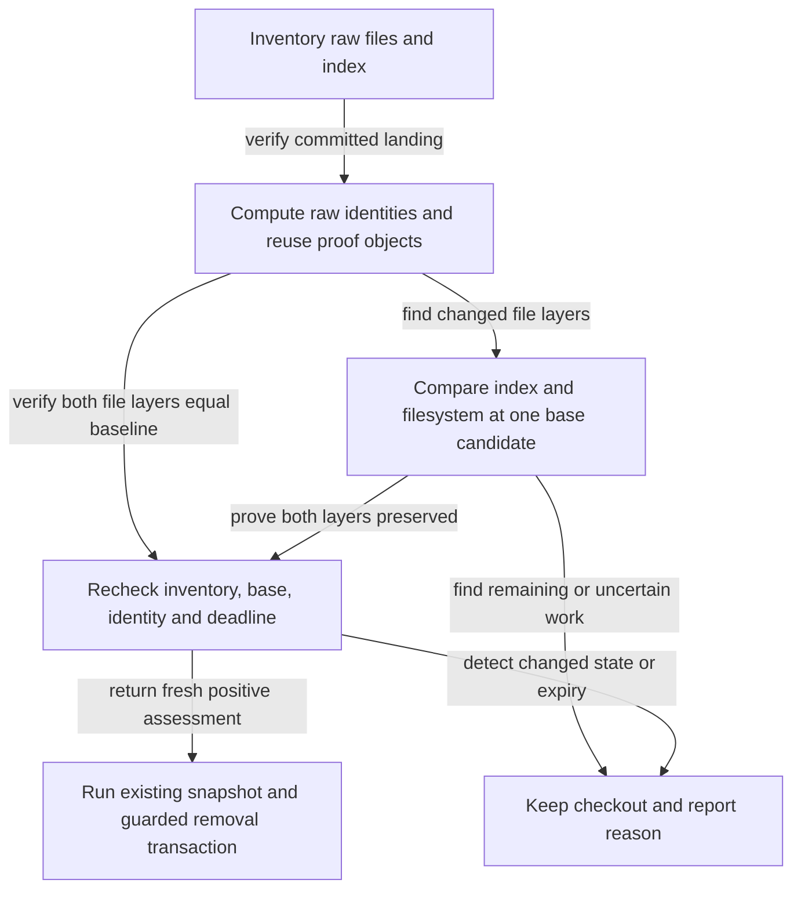

# Finish safe worktree cleanup reliably

## Summary

Make post-merge worktree cleanup finish reliably for ordinary repositories, and explain clearly
when preservation assessment runs out of time. Remove test residue, reduce repeated Git processes,
and preserve the distinction between a durably closed plan and its unfinished checkout cleanup.
Keep all preservation, snapshot, approval, landing, and removal safeguards.

## Context

Closing [[4xc0gjuw]] committed completion successfully, but automatic cleanup retained its worktree
after reporting a generic `git mktree -z` failure. A diagnostic retry proved preservation in about
18 seconds. With an intentionally reduced 14-second assessment budget, the same code reproduced
the exact failure text: the final Git command received a one-millisecond timeout, returned no
stderr or exit code, and assessment reported `unknown`.

That controlled reproduction establishes a timeout mechanism matching the incident. The original
run did not retain timeout metadata, so its historical cause is strongly supported rather than
conclusively established. The later canonical cleanup succeeded, verified a recovery snapshot,
and removed both checkout and branch. The predecessor remains completed.

The worktree had no Git-reported changes, but inventory found the empty directory
`generated/packages/__char_test_pkg__/claude`. The slash-command characterization test creates a
fixture below that directory and removes only its `commands` child. Empty directories count as
local content, so the residue triggered the full local-preservation comparison. Removing only
that directory from a diagnostic inventory selected the clean-content path; no real files were
deleted by that experiment.

| Current owner | Relevant behavior |
| --- | --- |
| `scripts/test/slash-commands-characterization-check.mjs` | Creates fixture output inside the repository and leaves empty parent directories |
| `modules/repositories/worktree-preservation.mjs` | Sets a 30-second assessment deadline; hashes each filesystem file with a separate Git process |
| `modules/repositories/worktree-snapshot.mjs` | Reads raw inventory, rebuilds trees, preserves empty directories, and verifies snapshots |
| `modules/repositories/git-exec.mjs` | Bounds Git execution but returns generic errors without explicit timeout classification |
| `scripts/cli/worktree-cleanup.mjs` | Retains the checkout unless preservation is proven; coordinates capture and final removal guards |
| `modules/repositories/worktree-landed.mjs` | Applies its own deadline and can collapse failed commands into generic landing verdicts |
| `modules/plan-suite/copy-integration.mjs` | Reads plan blobs separately for each comparison layer and candidate |
| Canonical plan-close skill | Commits completion before cleanup and supports resuming cleanup for already closed plans |

The successful diagnostic issued 1,282 file-hashing calls, 541 blob-reading calls, and 759
tree-building calls. These are measurements from this repository, not portable timing targets.
They explain why tiny disposable fixtures alone do not establish adequate assessment performance.
Those incident measurements are inherited evidence from plan creation; promotion did not reproduce
the retired worktree or recover its original command logs.

The current outer deadline does not cover its initial object-store lookup, and the clean-content
return has no final deadline check after filesystem work. Landing can replace a command's failure
with `scan unavailable`. Classification must therefore survive nested helpers, and deadline
enforcement must cover setup, inventory, local computation, and the successful return as well as
subprocess timeouts.

## Goals

- Finish preservation assessment within its existing budget on a representative repository fixture.
- Prevent characterization tests from leaving repository-local fixture content or empty parents.
- Distinguish assessment timeout, Git command failure, remaining work, and unsupported content.
- Report closure and cleanup outcomes independently, with a concrete retry action when needed.
- Preserve local content, including empty directories, through the existing verified snapshot path.

## Scope and related work

This plan extends the shared cleanup behavior delivered by [[4xc0gjuw]], which has landed and
closed. There is no unresolved implementation dependency on that plan.

[[b2sgiejd]] owns cleanup settings, hooks, and repository exceptions. Leave those controls there.
[[git-exec-consolidation]] owns migration of private Git wrappers to the shared execution seam.
This plan owns the timeout metadata and performance needed by preservation assessment; it does
not migrate unrelated callers. Coordinate any shared return-shape changes with existing consumers.

The implementation does not broaden deletion consent, disposable-directory exclusions, or archive
policy. A retry cannot substitute for fresh proof, and a timeout cannot authorize deletion.
Native Windows coverage remains owned by its existing platform plans; this work must retain the
portable Git and filesystem behavior of the shared modules.

### Related-plan reconciliation

Promotion reviewed local `main` at the frontmatter commit. No remote freshness is inferred.

| Plan | Classification | Reconciliation |
| --- | --- | --- |
| [[4xc0gjuw]] | Landed dependency; completed | Extend performance/diagnostics; retain safety contract |
| [[b2sgiejd]] | Unlanded adjacent story; backlog | Settings/hooks stay separate; package prose needs separate refresh |
| [[git-exec-consolidation]] | Unlanded adjacent story; backlog | Private-wrapper migration stays separate; preserve existing result fields |
| [[developer-runtime-remote-branch-status]] | Unlanded adjacent story; backlog | Forge calls stay separate; Git seam stays offline |
| [[l1mz96d9]] | Unlanded verification follow-up; backlog | Native Windows recovery remains deferred there |

The predecessor's absorbing commit `c6d14d3299b931b47df86ffea08e7f640c3df575` is an ancestor of
`HEAD` and contained by `main`; assessment, snapshot, Git-execution, and cleanup modules are
unchanged since that commit. Its reviewed feature tip
`e7d4d82205a4ef2b67fbd85cd3b900abf18feac5` is not an ancestor, consistent with the recorded
squash landing. No lifecycle cleanup remains for that completed story.

The consolidation plan's recorded base `57f8f2199b6db87d829af8d41e387800518024c9` is an ancestor
contained by `main`, but its three private wrappers and capture's direct diff subprocess still
exist. Likewise, the current cleanup path has no proposed global-settings reconciler. The
settings plan's `plan-close` versus `plan-suite` package prose needs separate refresh when promoted;
this plan leaves that document and its scope untouched.

Searches of backlog, ready, active, and review plans for the shared module paths and worktree
cleanup found no competing implementation of this optimization. Other review plans mention
their assigned worktrees but do not own preservation assessment. No active-story conflict or
unresolved dependency blocks this plan.

## Proposed design

### Remove redundant preservation work

Keep preservation decisions in the shared repository modules and cleanup orchestration in its
existing coordinator. CLI, portal, and plan-close consumers must receive the same assessment.

Use a disposable test app root or fully owned fixture subtree for slash-command characterization,
and clean the whole fixture in its finalizer. Assert that pre-existing repository content survives.
Preserve meaningful empty directories in real worktrees; removing test residue is not permission
to ignore all empty directories during assessment.

Separate file-layer changes from directory metadata that needs snapshot recovery. Today
`hasLocalContent` combines both and sends an empty-directory-only worktree through the candidate
scan and synthetic-tree comparisons. When the index and filesystem file mappings both equal the
branch baseline and committed landing is proven, those local file comparisons add no evidence.
Return preserved only after fresh state and deadline checks, while retaining `hasLocalContent`
for directory metadata so the existing cleanup transaction still captures and verifies a snapshot.
Any file-layer difference continues through the coherent candidate proof. This fast path must
compare raw identities and modes, not rely on Git's clean-status summary.

Use in-process raw Git blob identities plus assessment-local object reuse. The repository already
implements the raw `blob <byte-length>\0<bytes>` identity algorithm in
`modules/plan-suite/plan-authority.mjs`; reuse that algorithm without making generic repository
object handling depend on plan authority. Keep any shared extraction under the repository owner
and update the existing consumer if extraction is needed.

| Repeated work | Selected reduction | Correctness boundary |
| --- | --- | --- |
| One `hash-object -w` per filesystem entry | Read the repository's object format once; compute raw SHA-1/SHA-256 blob ids in process; reuse known baseline/index objects and write each missing blob only once | Validate supported format; compare bytes against Git in tests; raw bytes and executable/symlink modes remain separate |
| Repeated `cat-file` for plan identity | Cache immutable blob bytes by oid within the assessment and temporary-store lifetime, including concurrent reads | Never cache a branch, path, fingerprint, or positive assessment across calls; retain binary size bounds |
| Repeated identical subtree construction | Reuse known whole-layer trees when the full path/mode/oid mapping matches; memoize identical subtree inputs within the temporary-store lifetime | Use Git's existing tree construction on cache misses; retain both index and filesystem proofs |

Snapshot capture and restore keep their existing publication and verification transaction. Scope performance
caches to assessment callers; a cached temporary oid must never escape into later persistent capture.
Keep temporary proof objects outside persistent repository storage, avoid filters and hooks, and
retain fresh inventory/base/identity checks after optimization.



Promotion's read-only hashing microbenchmark used the same 9,139-byte source buffer 1,282 times:
in-process SHA-1 hashing took 5 ms, while 1,282 hardened `git hash-object --stdin` calls took
8,961 ms; all 1,282 identities matched. No objects were written. This isolates process overhead;
it is not an end-to-end assessment result, a distinct-file fixture, SHA-256 coverage, or a portable
latency promise. Implementation must measure the full representative fixture before and after.
Measurement environment: Darwin arm64, Node v26.12.1, Apple Git 2.50.1 (Apple Git-155).

### Make interruption actionable

Preserve timeout and termination information at the Git execution seam. Assessment should identify
whether a command timed out within the remaining overall budget or failed for another reason.
Include the failed operation and elapsed/budget information without exposing file contents or
configuration secrets. Retain existing output fields; assess downstream compatibility before
adding structured diagnostics.

Keep `state: unknown` for failed or interrupted proof. Add bounded diagnostic metadata alongside
the existing reason: stable failure kind, operation/subcommand, elapsed assessment time, assessment
budget, command timeout, and termination signal where available. Distinguish overall budget
exhaustion, a shorter per-command timeout, non-timeout termination, output-limit failure, and
ordinary Git failure. Do not infer timeout from empty stderr, null exit status, or signal alone.
Preserve the executor's actual termination evidence in both async and sync results; carry it through
`required`, landing, assessment, cleanup rows, and portal assessment responses. Existing
`ok`, `stdout`, `stderr`, `code`, `error`, and preservation states retain their meanings.

Use one outer assessment deadline. Bound setup and every nested Git operation by its remaining
budget; retain the current 10-second per-command ceiling. Check the deadline around filesystem
inventory and CPU loops and immediately before every positive return. Synchronous filesystem I/O
cannot be preempted mid-read; document that limit and refuse an over-budget result when control
returns. Deterministic tests inject time/execution dependencies at the owning seam, while real
Git tests establish raw-byte equivalence and failure behavior.

| Result | Required behavior |
| --- | --- |
| Preservation proven; guards pass | Complete the existing snapshot/removal transaction |
| Assessment budget exhausted | Keep checkout; report timeout and a scoped retry action |
| Unique work or unsupported content | Keep checkout; report the existing remaining-work or blocker details |
| Plan closed; cleanup unfinished | Report durable closure separately from retained checkout and branch |
| Cleanup succeeds on retry | Verify removal and report any recovery reference |

The canonical recovery command for a closed plan already exists:

```sh
roborepo git worktrees cleanup --plan <id> --base <base-branch> --apply --json
```

Generate the concrete command from the known plan and base. For non-plan callers, report the
original command or existing portal assessment action with its original consent/preview mode;
do not claim that the confirmed `--remove` action is an automatic-preservation retry. Add no new
cleanup selector or consent bypass. CLI text and JSON and the repository dialog must expose the
same failure kind and usable recovery action; closure remains reported independently by plan-close.

An already-closed retry resumes guarded cleanup using the committed completion evidence. It does
not repeat closure tests, request renewed approval, or make another completion commit solely to
retry cleanup. Update canonical workflow guidance and its generated command projections when
the selected recovery behavior changes those instructions.

### First-attempt completion and exceptional recovery

Ordinary supported repositories must finish assessment on the first attempt within the existing
30-second budget. Automatic retries and timeout increases are outside scope. The performance
acceptance check measures a single assessment; a successful later attempt cannot satisfy it.

If assessment still times out, retain the checkout and report the failed operation and existing
recovery command. That command supports deliberate recovery after the reported problem is
addressed; it does not establish acceptable normal performance. Every later invocation starts a
fresh bounded assessment and repeats identity, content, base evidence, configuration, server, and
removal checks. No expired positive result or guard refusal becomes deletion permission.
The cleanup coordinator must not launch its fallback landing scan after a classified assessment
timeout; propagate the timeout and retain the target immediately.

## Implementation plan

- [ ] Capture a representative before-measurement and add failing cleanup/timeout regressions plus a fixture-leak assertion. Include at least 1,282 distinct tracked files, hundreds of nested directories and plan documents, and an empty local directory that forces the local-content proof path.
- [ ] Isolate slash-command fixture output and remove its owned directory tree without touching pre-existing content.
- [ ] Separate unchanged file-layer proof from directory snapshot requirements. Avoid candidate-tree reconstruction for directory-only local content, while retaining fresh checks and verified snapshot recovery.
- [ ] Implement raw object identities and assessment-local blob/tree reuse; compare operation counts and elapsed time against the unchanged algorithm on the same fixture. Test SHA-1/SHA-256 equivalence, binary bytes, and lifetime boundaries without changing snapshot publication.
- [ ] Preserve classified diagnostics through async/sync Git execution, `required`, landing, assessment, cleanup rows, and portal responses. Enforce the outer deadline through setup and positive returns; check existing consumers of extended fields.
- [ ] Update CLI/portal reporting and canonical plan-close guidance so closure and cleanup outcomes remain distinct and retries remain actionable.
- [ ] Run focused regression suites and the full local parity gate; record measured results and any platform limits.

## Validation

Use disposable real repositories and raw filesystem/index round trips. Assert outcomes and
refusals; use deterministic injected timing for deadline tests rather than machine-speed races.

| Scenario | Acceptance criterion |
| --- | --- |
| Slash-command characterization | No owned fixture files or empty parents remain; pre-existing content is unchanged |
| Representative local-content fixture, including lifecycle-moved plans | First assessment succeeds inside 30 seconds without retries or budget increases; at least 50% fewer combined hash/blob-read/tree-build subprocesses than the unchanged implementation on the same fixture; record host, per-operation counts, and elapsed time |
| Raw object ids, reused blobs and trees | Git-equivalent identities in SHA-1 and SHA-256 repositories; binary/symlink bytes and modes survive; previews change no persistent objects, refs, or index; temporary-cache results never leak to capture |
| Empty directory in an otherwise clean landed worktree | Skip local candidate-tree reconstruction, retain snapshot requirement, and recover the directory exactly after cleanup; assert first-attempt success |
| Assessment expires during setup, inventory, landing, hashing, or a Git operation | Stable budget classification and elapsed/budget context; no late positive result; checkout and branch retained |
| Per-command timeout, other termination, or output overflow | Distinct classifications based on execution evidence; no automatic removal |
| Git fails without a timeout | Ordinary failure remains distinguishable from budget exhaustion |
| Already closed plan with retained worktree | Retry rechecks current safety and reports closure separately; on success no additional closure commit, tests, or renewed approval |
| Files, index, base, configuration, or branch change | Existing fresh-state guards retain the target or report the protected partial outcome |
| Assessment timeout | One assessment per invocation; no automatic retry; later explicit recovery starts fresh and retains every guard |
| CLI and portal consumers | Consistent assessment reason and separate closure/cleanup presentation where applicable |

Start with the existing focused suites, including Git seam coverage:

```sh
node scripts/test/slash-commands-characterization-check.mjs
node scripts/test/worktree-snapshot-check.mjs
node scripts/test/worktree-lifecycle-check.mjs
node scripts/test/plan-close-integration-check.mjs
node scripts/test/developer-runtime-git-check.mjs
node scripts/test/plan-lifecycle-transitions-check.mjs
node scripts/test/plan-suite-skills-check.mjs
```

Add repository-route/projection checks for diagnostic propagation and a focused browser assertion
in `scripts/test/portal-ui/portal-ui.spec.mjs` for the repository dialog's timeout/retry presentation.
The existing plan-close integration suite checks documented integration commands, not the entire
already-closed cleanup retry: extend lifecycle/skill coverage to establish that missing assertion.
Record Node/Git versions, OS, fixture dimensions, baseline/optimized counts, and timing. Keep the
wall-clock measurement separate from deterministic deadline tests; do not gate correctness on
machine-speed races. Rerun unique-stage, lifecycle rename, external-driver refusal, and final
file/index/base/config/branch mutation regressions after adding reuse.
Register new suites through existing orchestration rather than adding an independent runner.
Run `npm run check` before implementation handoff because the work crosses shared repository
behavior and test fixtures. Run command rendering and trigger checks if canonical skill or
command content changes. Promotion itself needs only plan validation, documentation-reference
checks, and whitespace checks.

## Documentation impact

- `docs/user/reference/repositories.md`: assessment timeouts, retained-worktree outcomes, and retry behavior.
- `docs/user/reference/roborepo-cli.md`: cleanup diagnostics and existing explicit recovery commands.
- `docs/user/reference/plans-portal.md` and `docs/user/guides/plan/lifecycle/plan-suite.md`: closed-plan cleanup recovery.
- `docs/internal/cli-internals.md`: measured preservation approach, deadline classification, and shared callers.
- `docs/internal/plans-portal-internals.md`: plan-scoped cleanup recovery, diagnostics handoff, and unchanged durable-closure boundary.
- Canonical `globals/packages/plan-suite/skills/plan-close/` guidance and generated command projections: actionable timeout recovery without repeating durable closure.

## Open questions

None. Fix redundant work directly; retain bounded failure reporting and existing explicit recovery.

## Promotion decisions and evidence

- October 29: the user challenged retries as a workaround for an underlying code smell. Scope
  preparation around eliminating redundant work, including the directory-only proof path.
  Automatic retries and larger timeout budgets are excluded; first-attempt completion is required.
- October 29: selected raw object identities and assessment-local blob/tree reuse, supported by
  the hashing microbenchmark and verified repeated call sites. Full-fixture gains remain an
  implementation acceptance criterion rather than an achieved result.
- October 29: preserve the landed 30-second proof bound, 500-commit scan limit, separate staged
  and filesystem comparisons, verified snapshot path, consent, and final guards. Improve deadline
  coverage and error propagation without replacing the preservation algorithm.
- Historical incident causation remains strongly supported rather than proven: the original
  failed run had no termination metadata. No worktree was retired and no feature code changed
  during promotion.
