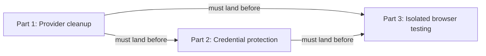

# Keep local agent work within useful boundaries: Codex — Part 2: Credential protection

## Summary

Make known credential paths unavailable to sandboxed Codex processes using native filesystem
read-and-write denial. Reuse RoboRepo's existing credential-pattern list, preserve readable templates
and unrelated configuration, and report exactly which runtime/tool surfaces are covered.

This retains the original credential-follow-up id and recorded synthetic evidence. Provider cleanup
is now owned by Part 1; isolated app/browser execution is owned by Part 3.

## Context

The original write-scope plan (`ia1q1z9`) showed that restricting writes did not also restrict
credential reads. Local main at `60d2ba76` still renders Codex workspace roots and a network boolean
without credential-denial entries. Its read-only branch selects `:read-only` directly and renders
no filesystem entries either. The user selected native denial even though matching files
also become unwritable. Host networking remains restricted throughout this work.

| Layer | Responsibility |
| --- | --- |
| Native sandbox | Enforces file reads/writes and process network restrictions |
| Approval policy | Decides when a requested operation needs approval |
| Command hook | Classifies commands; it is not the proposed credential scanner |
| Hook trust | Determines whether installed hooks run; native file denial must not depend on it |
| Desktop/organization policy | May constrain effective settings; verify it separately |

| Existing source | Behavior to preserve or extend |
| --- | --- |
| `manifests/inventory/agent-permissions.json` | `read-secrets` is the credential-pattern source; `.env` variants are enumerated so `.env.example` and `.env.sample` remain readable |
| `scripts/harnesses/codex/index.mjs` | Resolves behavior overrides and calls the pure renderer; owns native projection and runtime-specific reporting |
| `scripts/harnesses/permissions-render.mjs` | Codex profile generation and `foreignBlockContent`; extend or delegate Codex-specific projection without changing Claude rendering |
| `scripts/cli/permissions-render.mjs` | Live render orchestration passes workspace roots, but currently supplies no explicit target-home option; preserve target creation rules and logged writes |
| `scripts/build/render-agent-permissions.mjs` | Build-time provider rendering passes a synthetic home; keep tracked output portable and distinct from live home materialization |
| `generated/codex/config.toml` | Derived install baseline; regenerate through provider adapters after source changes |
| `scripts/test/codex-permissions-foreign-lines-check.mjs` | Protect merged foreign-line preservation from `8f17eb2f`, including `notify` and unrelated tables |

### Series and prerequisites



| Part | Plan | Ownership |
| --- | --- | --- |
| 1 | [[hr78g4sj]] | Provider routing, hook source ownership, headless invocation; mandatory prerequisite |
| 2 | This plan | Credential protection and historical characterization evidence |
| 3 | [[8bjltk2n]] | Disconnected app/browser workflow and scoped approval verification |

Part 1 landed through squash merge `b79bf35dac5f6c430c85b1352331a8c943d61038`, an ancestor
of current main. Its provider-owned sources, standalone manifest lookup, hook ownership/trust
safeguards, and declared headless invocation were rechecked against current code and focused
assertions. The implementation prerequisite is satisfied; `depends_on` retains the series
relationship and `blocked_by` is empty. Part 3 still requires credential protection to land before
using source staging. This plan does not relocate hooks itself.

### October 26 repository reconciliation

Verified against local main `60d2ba76e5a9ca0cc5dbb5d98ab73330c674d5de` in the primary checkout.
Origin identifies `kirinmurphy/roborepo-alpha`; its directory name is `roborepo`. Remote freshness
was not checked. The initial preparation read the related plans and Part 1 worktree copy; the
post-merge review rechecked Part 1's integrated record and the adjacent plan changes in its squash merge.

| Plan | Classification | Contract retained here |
| --- | --- | --- |
| [[hr78g4sj]] | Landed dependency; lifecycle/prose drift | Consume provider cleanup; close its review record separately |
| [[wjlt1zvf]] | Landed dependency | Preserve hook routing, logging, ownership, order, and readiness |
| [[ia1q1z9]] | Landed dependency; historical prose drift | Preserve write roots; supersede its Codex credential-read gap |
| [[8bjltk2n]] | Unlanded downstream dependency | Owns source staging, browser isolation, and repeat approvals |
| [[46qth5z8]] | Unlanded adjacent work; residual prose drift | Related-plan row now assigns Codex cleanup to Part 1; Claude entry/folders stay there |
| [[permva27]] | Unlanded adjacent audit | Owns editor/product decisions and broad fidelity audit |
| [[permissions-ui-revamp]] | Unlanded adjacent UI work | Consumes the audit; retains editor and gate/scope choices |
| [[codex-cmux-hook-trust-review]] | Unlanded adjacent study | Owns trust bypass research |
| [[harness-capability-derived-resource-targeting]] | Unlanded adjacent targeting work | Owns resource selection, independently of credential projection |
| [[7k3m9qd]] | Unlanded adjacent delivery work | Owns package delivery redesign; retain existing render integration here |
| [[o9zwxuav]] | Unlanded active adjacent package work | Owns selected/effective package and bundle state; no native credential projection |

Part 1's integrated review records explicit approval of implementation
`a8aa353fbb1b7cb45ad2822314385354b0f6f5f6`. Its feature tip `9facb7ee` need not be an ancestor
after squash: merge `b79bf35d` is an ancestor, and current code contains the accepted source and
headless contracts. The plan remains in `review/` with a merge/close next action and historical
unlanded prose. That is lifecycle/prose drift, not an implementation blocker. Closing it belongs
to its own workflow and was not performed in this review.

Hook-readiness squash `b134ef424292ece32822ce05efa5a41fc0df1fa8` is an ancestor of main.
Original reviewed commits need not be ancestors after squash. Current code confirms manifest-backed
hook routing, logged writes, per-file ownership, appended Codex entries, and provider readiness.
Its completed lifecycle needs no cleanup here.

Write-scope merge `e58a81927fb99bf460eb6a5ea9185224c2a585fd` and subsequent completion squash
`2d1dd799abc0234f4c9250793856b50d9975b4b0` are ancestors of main. Its later native evidence
contradicts older Not verified prose; historical prose cleanup remains separate. The Claude
companion's related-plan row now assigns Codex relocation to Part 1 and credential protection here.
Its introduction and non-goals still use older combined-companion wording; the approved series
split remains authoritative, with no unresolved scope choice.

Main installs Codex hook scripts from `globals/harnesses/codex/hooks` using `managed_files`,
retaining installed paths under `~/.codex/hooks`. Telemetry now selects an enabled eligible provider
and spawns its declared argv with a literal prompt. Codex's template is
`["exec", "--skip-git-repo-check", "--", "{prompt}"]`. Source relocation preserved standalone
state/app-root discovery, with its source-relative fallback corrected for the new depth.
The optional worktree-folder declaration remains deferred to the Claude companion and does not
block credential protection.

Capability-derived targeting remains adjacent, with its own unresolved resource-selection model.
This plan uses the existing provider `permissions.render` contract and a dedicated parity check;
it does not depend on that model or the audit's eventual product decision. The active package-state
plan [[o9zwxuav]] changes package selection and bundle dependencies, not native credential projection;
it introduces no additional implementation prerequisite here.

### Observed behavior

**Localhost, October 21, 2026.** During the hook-banner work, the browser-suite server failed inside
the Codex desktop session sandbox with `listen EPERM: operation not permitted 127.0.0.1`. Running the
suite with sandbox escalation succeeded, but repeated requests for local tests, portal inspection,
and restarts interrupted the user. This establishes a failure under that session's policy, not every
supported runtime's network capabilities.

**Reads and writes, Codex 0.140.0.** Recorded by `ia1q1z9` (repo-scoped write permissions) under the
profile then named `roborepo-workspace`:

| Path | Read | Write |
| --- | --- | --- |
| Active worktree | allowed | allowed |
| Sibling worktree of this repo (`~/.worktrees/roborepo/...`) | allowed | allowed |
| Primary checkout (outside `~/.worktrees`) | allowed | blocked (`Operation not permitted`) |
| `$HOME` (arbitrary file) | allowed | blocked (`Operation not permitted`) |
| `/etc/hosts` | allowed | — |
| `~/.ssh/config` | allowed | — |

`ia1q1z9` resolved the read question as "no hook needed" for its write-scope goal, and recorded
credential reads as this follow-up.

### October 23 characterization and decisions

All probes used synthetic fixture files. Native policy was supplied through temporary `-c`
overrides to `codex sandbox -P probe -C <fixture> -- <probe command>`; no installed permission
configuration was rewritten. The inner native sandbox could not start inside the chat sandbox
(`sandbox_apply: Operation not permitted`). The unrestricted control succeeded after explicit
sandbox permission, so the matrix ran there while the tested commands remained inside Codex's
native sandbox.

| Probe | Result | Evidence limit |
| --- | --- | --- |
| Baseline `:workspace` | Protected-directory fixture and `.env` readable; public and protected writes allowed | Synthetic paths only; no real credentials read |
| Native filesystem path and glob denial | Direct, shell, `xargs`, and symlink reads denied; protected writes denied; public file and `.env.example` readable | Passed positive/negative control assertions on macOS 0.163.0-alpha.11.2, not every manifest pattern or provider tool |
| New directory plus matching `.env` | Directory creation succeeded; writing its new `.env` was denied | Observed separately from startup-existing files; no Linux or Windows claim |
| Network disabled, local-binding flag changed | IPv4/IPv6 loopback binds and connections and wildcard bind denied | Does not run the app/browser suite |
| Proxy active, exact local allowlist, `allow_local_binding = true` | IPv4/IPv6 loopback binds and connections and wildcard bind allowed; direct reserved-address connect denied; HTTP proxy returned 403 for that destination | Fails the user's strict listener boundary despite these outbound checks |
| Proxy explicitly enabled, exact local allowlist, `allow_local_binding = false`, no upstream proxy | IPv4/IPv6 loopback binds and raw connections and wildcard bind denied; reserved-address HTTP request rejected with 403 | Fails the local test-server requirement |
| Loopback-to-nonloopback forwarding | Unavailable: host-side positive control timed out before the native test step | No forwarding success or failure is inferred |
| Disposable `node:22-bookworm-slim` runner | Only loopback interfaces; IPv4/IPv6 roundtrips passed; nonloopback connect returned `ENETUNREACH` | No host mounts, published ports, or downloads; native Codex and browser suite were not installed or run inside it |

The disposable-runner check used the already-installed image (Node v22.23.2) with:

```sh
docker run --rm --pull=never --network=none --cap-drop=ALL \
  --security-opt=no-new-privileges --read-only --user=node \
  -i node:22-bookworm-slim node --input-type=module -
```

Its assertions covered interface isolation, local roundtrips, and the unreachable external route.
A wildcard listener succeeds inside that namespace but has no nonloopback interface to expose it.
This differs from granting wildcard listeners or access to existing local relays on the host.

A read-only native `config/read` plus `configRequirements/read` query for this checkout returned
project, user, and system layers; effective `approval_policy = "on-request"`,
`default_permissions = "managed-workspace"`, and `features.network_proxy = true`; the selected
profile extends `:workspace`, has network disabled, and has no filesystem entries. The query
returned no managed requirements. This describes that CLI configuration lookup, not the policy
inherited by every existing desktop session. The sandboxed query timed out; the explicitly
permitted unrestricted query succeeded without a model call or config write.

The native fixture profile used these filesystem entries, expressed as equivalent TOML:

```toml
[permissions.probe]
extends = ":workspace"

[permissions.probe.filesystem]
"<fixture>/protected" = "deny"
"<fixture>/**/.env" = "deny"
```

The user selected **native read-and-write denial** for credential patterns and **strict
loopback-only enforcement** for networking. A heuristic command scanner is no longer the proposed
credential mechanism. The tested host-native networking combinations do not meet both strict
binding and working local test-server requirements. The user subsequently approved an isolated
app/browser runner; keep host networking disabled. A runner changes where tests execute and does not authorize host portal
restarts or solve fresh-session approval persistence.

Official guidance checked October 23:
[Permissions](https://learn.chatgpt.com/docs/permissions) distinguishes enabling command networking
from activating its filtering proxy; its local/private-target flag is not documented as a
listener-address allowlist. It also describes filesystem deny entries and platform-specific glob
behavior. The native probe results above, rather than those docs alone, establish the observed
macOS behavior.


## Goals

- Deny reads and writes to every credential path form the supported native mechanism claims.
- Preserve ordinary source reads, approved workspace/temp writes, and readable templates.
- Preserve foreign configuration and make unsupported tool/runtime states explicit.
- Supply verified credential protection before Part 3 stages source for the runner.

## Proposed design

### Credential-read enforcement

Render native filesystem `deny` entries from resolved `read-secrets` intent. The accepted boundary
denies both reads and writes to matching paths. Preserve the explicit template exceptions
(`.env.example` and `.env.sample`); do not replace the enumerated environment-file patterns with an
unrestricted `.env.*` glob. Normalize the manifest's home and absolute glob anchors for the native
provider, and test every pattern under synthetic roots before applying anything to a real home.
Use resolved behaviors after overrides: a resolved `deny` produces native denial; other buckets
must not silently retain denial or be advertised as credential protection. Do not invent native
path-specific prompting for `ask`; report unsupported intent explicitly.

The manifest currently has 15 patterns: five home-directory patterns and ten absolute-glob
patterns. Cover each independently, including `*.pem`, `id_rsa`, `id_ed25519`, and all enumerated
`.env` forms. Preserve native glob semantics rather than scanning only files present at startup.
Home anchors and Claude's `//` spelling need Codex-specific translation. Build output must contain
neither the packer's home nor the build script's synthetic `/Users/you` home as a literal deny
root. Verify whether the supported runtime resolves portable home anchors; if it requires concrete
paths, materialize against the target home only on live apply and test packed installation under a
different synthetic home. Never derive the target from the contributor's ambient home.

Keep native projection in the Codex provider, reusing the existing render/apply path. Preserve
`foreignBlockContent`, `notify`, unrelated tables, read-only mode, configured workspace roots, and
reapply idempotence. Apply the credential boundary in both writable and read-only modes; choosing
`:read-only` alone must not drop the denies. Use a named profile extending `:read-only` when
filesystem entries are needed, without adding writable roots. Keep the existing resolved network
policy and approval behavior intact in each mode. Document the accepted restriction on
credential-file edits and the fact that separately escalated processes require their own boundary
assessment; denial inside a native sandbox does not certify an unrestricted process.

Use a dedicated provider parity check, not a new required `permissions` method. Gemini remains
explicitly unsupported; Claude keeps its current renderer. This uses existing policy intent and
leaves the global audit's editor/product decision intact. Verify the selected runtime supports and
enforces the projection before reporting protection. Unsupported versions or inherited policy must
produce an explicit limitation, not a heuristic fallback or a confinement claim.

Native `codex sandbox` evidence concerns sandboxed processes. Establish separately which command,
structured-read, browser, MCP, and nested execution surfaces use that policy. No native process test
certifies all tools. Read effective managed requirements in each claimed runtime and verify native
denial in a fresh session. Record approval interactions as evidence only; the scoped repeat-approval
workflow stays with Part 3. Every coverage record must name the executable/version, platform, policy source,
profile, surface, controls, and result. Unsupported or unverified surfaces remain explicit and
cannot satisfy Part 3's source-staging prerequisite by inference.


## Implementation plan

### Confirm prerequisites and remaining coverage

- [x] Verify Part 1's final implementation landed and clear `blocked_by`. October 26 post-merge
      review confirmed squash `b79bf35d` is an ancestor of main; current provider routing, relocated
      sources, ownership/trust safeguards, logging, and foreign-config preservation were checked.
      Five focused checks passed; see Preparation verification below.
- [ ] Resolve desktop and CLI executables through `scripts/harnesses/discovery.mjs`
      (`selectedHarnessExecutable`) and their provider detection data. Record versions and effective
      permission layers separately for each claimed runtime; do not add a hardcoded binary picker.
      Retain historical fixture results as scoped evidence, not certification of a newer runtime.
- [ ] Extend fixtures across every `read-secrets` pattern, template exception, deep/new paths,
      links, and supported command/structured-read/nested-tool surface. Use synthetic files only.
- [ ] Establish platform-specific glob behavior before claiming Linux or Windows enforcement;
      list unsupported or unverified surfaces explicitly.

### Implement native credential protection

- [ ] Add dedicated Codex native-projection and enforcement parity checks, with explicit unsupported
      runtime/tool states. Preserve Gemini and the generic capability contract.
- [ ] Add focused native-projection fixtures before implementation; assert missing denies fail.
      Cover all 15 manifest patterns, resolved deny/allow/ask intent, both write modes, TOML
      escaping, home and absolute anchors, templates, workspace roots, and idempotence.
      Extend `scripts/test/codex-permissions-foreign-lines-check.mjs` for both resulting profiles.
- [ ] Add a synthetic native enforcement runner that consumes provider-rendered configuration,
      asserts an unrestricted positive control and sandboxed negative controls, and fails when
      denial is missing. A missing binary, unsupported platform, or unusable nested sandbox must
      report unavailable instead of passing. Record supported runtime/platform coverage separately.
- [ ] Implement native filesystem denial from `read-secrets` in both writable and read-only Codex
      profiles. Preserve resolved intent, workspace roots, foreign config, and safe reapply; leave
      command classification in `permission-check.mjs` unchanged.
- [ ] Register deterministic projection/parity checks in `scripts/test/check-groups.json` using
      existing group ownership. Missing or overstated coverage must fail; explicitly unsupported
      providers remain loadable without advertising protection. Keep native enforcement verification
      explicit so a skipped local probe cannot satisfy a claimed supported-runtime gate.
- [ ] Pass any required target-home context through the existing live/build provider-render path,
      and extend live-render, packed-install, and clean-machine permission fixtures for target-home
      isolation, read-only denial, update/reapply, and preservation of unrelated settings.
- [ ] Update every document listed under Documentation impact with the measured coverage and limits.
- [ ] Verify live against the shipped Codex binary, since shell quoting and expansion only show up
      when a real shell runs the command.


## Validation

- Every known credential match is denied in both writable and read-only profiles for each claimed
  runtime/tool surface. Public fixtures and `.env.example`/`.env.sample` remain readable; approved
  workspace/temp operations retain their boundaries.
- Direct, shell, `xargs`, symlink, deep, and newly created credential fixtures have positive and
  negative controls. Rendered TOML or direct hook invocation alone does not prove native enforcement.
- Missing/overstated coverage fails dedicated parity checks; unsupported providers stay loadable
  without advertising protection. Claude behavior and the generic capability contract are retained.
- Reapply/update retains native denies, workspace roots, `notify`, unrelated keys/tables, and
  command-hook responsibilities. Native denial does not depend on hook trust or command parsing.
- Run the new deterministic projection/parity check and native enforcement runner (paths chosen
  during implementation), then the existing checks below. New check paths are deliverables, not
  commands available in the current checkout.
- Run `node scripts/test/permissions-render-live-characterization-check.mjs`,
  `node scripts/test/codex-permissions-foreign-lines-check.mjs`,
  `node scripts/test/permission-rule-home-path-check.mjs`,
  `node scripts/test/gemini-adapter-characterization-check.mjs`,
  `node scripts/test/root-config-write-policy-check.mjs`,
  `node scripts/test/hook-composition-check.mjs`, `npm run test:package-install`,
  `env CLEAN_MACHINE_STRICT=1 npm run test:clean-machine-permissions-sandbox`,
  `bash scripts/doctor.sh --quiet`, `git diff --check`, and `npm run check` before handoff.
- Run synthetic native enforcement checks with the actual supported Codex binary. Document
  separately which desktop, nested execution, browser, and MCP paths inherit the policy.

## Documentation impact

- `docs/user/reference/config-control-panel.md`: explain known credential patterns, both read/write
  denial, template exceptions, and unsupported provider/tool states.
- `docs/user/reference/codex-hooks.md`: distinguish native file denial from command-hook trust,
  approval, and sandbox escalation.
- `docs/internal/harness-provider-interface.md`: describe provider-native projection and dedicated
  parity without adding a universal enforcement method.
- `docs/internal/config-panel-internals.md`: document resolved intent, native anchor translation,
  target-home materialization, writable/read-only profiles, and shared build/live rendering.
- `docs/internal/testing.md`: list deterministic parity versus native enforcement checks, required
  runtime evidence, and unavailable-platform handling.

## Risks

| Risk | Mitigation |
| --- | --- |
| Credential edits also fail | User accepted read-and-write denial; document it and preserve template exceptions |
| Pattern projection widens or loses policy | Normalize anchors and test each pattern in both writable/read-only modes |
| One native process probe is presented as all-tool coverage | Characterize tool surfaces independently; report unsupported or unverified states |
| Re-rendering removes user config | Retain merged foreign-line handling and its regression coverage |
| Runtime or inherited policy cannot enforce the projection | Report the specific limitation; no scanner fallback or silent widening |

## Decision Log

- October 22: split the Codex boundary work from the Claude companion, retaining this id because
  the landed write-scope plan references its credential-read gap.
- October 23: user selected native credential read-and-write denial and dedicated provider parity.
  Synthetic macOS 0.163.0-alpha.11.2 fixtures passed the matrix above. Host-native network candidates
  failed the selected strict boundary; the no-mount Node container established feasibility only.
- October 24: user adopted the isolated app/browser runner with strict host networking and separate
  host-portal restart approval. Those implementation requirements now belong to Part 3.
- October 24: user approved splitting the work and required provider cleanup first. This document
  becomes Part 2 while retaining `4zyo2woj`, its existing path/lifecycle, and the original probe
  evidence. Part 1 owns provider cleanup; Part 3 owns browser isolation. No implementation result,
  approval persistence, forwarding result, or other plan's completion is inferred from the split.
- October 24: at the user's request, return Part 2 from ready to backlog while retaining its id,
  title, evidence, and provider-cleanup prerequisite.
- October 26 initial preparation, before Part 1 merged: checked local main `d6b7fea2`,
  the Part 1 worktree at `9facb7ee`, related plans, render/apply sources, fixtures, and docs of record. Hook-readiness is landed;
  Part 1 remains unlanded despite its worktree's approval. Recorded it in `blocked_by`, reconciled
  stale ownership notes, specified target-home portability and read-only projection, and separated
  deterministic checks from native coverage. Preparation changes no feature code or related lifecycle.

- October 26 post-merge review: verified provider-cleanup squash `b79bf35d` on main
  `60d2ba76`, rechecked its source/headless contracts and five focused checks, and cleared the
  implementation blocker. Part 1's separate lifecycle closure remains outstanding. No credential
  enforcement implementation or new runtime certification is inferred from its merge.

## Preparation verification

Post-merge review on main `60d2ba76` passed:

```text
node scripts/test/codex-permissions-foreign-lines-check.mjs
node scripts/test/permissions-render-live-characterization-check.mjs
node scripts/test/hook-composition-check.mjs
node scripts/test/shared-target-rows-check.mjs
node scripts/test/telemetry-synthetic-provider-check.mjs
```

These assertions cover foreign-config preservation, live render behavior, hook composition,
per-file install/removal and standalone discovery, and synthetic headless invocation. They do not
prove native credential denial, which remains unimplemented. The selected-plan reference/command
scan passed. The broader docs-reference check found a pre-existing stale link in
`docs/internal/backlog-review.md` to the package-state plan's old backlog location; that plan is now
active. This review does not change that unrelated document.
No full parity gate or historical native probes were rerun for this plan-only refinement.

## Open questions

No unresolved policy choice or implementation dependency blocker remains. Actual runtime/tool
coverage is implementation verification; unsupported surfaces must be explicit, and Part 3 cannot
use source staging until its native boundary is established. Historical runtime probes above were
not rerun during preparation.
