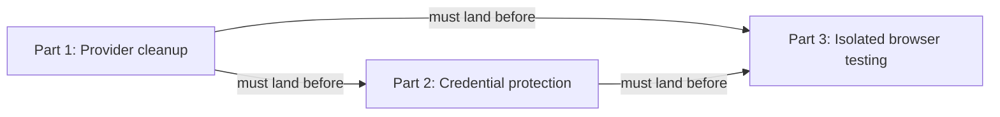

# Keep local agent work within useful boundaries: Codex — Part 2: Credential protection

## Summary

Make known credential paths unavailable to sandboxed Codex processes using native filesystem
read-and-write denial. Reuse RoboRepo's existing credential-pattern list, preserve readable templates
and unrelated configuration, and report exactly which runtime/tool surfaces are covered.

This retains the original credential-follow-up id and recorded synthetic evidence. Provider cleanup
is now owned by Part 1; isolated app/browser execution is owned by Part 3.

## Context

The original write-scope plan (`ia1q1z9`) showed that restricting writes did not also restrict
credential reads. Local main at `31268f2c` still renders Codex workspace roots and a network boolean
without credential-denial entries. The user selected native denial even though matching files
also become unwritable. Host networking remains restricted throughout this work.

| Layer | Responsibility |
| --- | --- |
| Native sandbox | Enforces file reads/writes and process network restrictions |
| Approval policy | Decides when a requested operation needs approval |
| Command hook | Classifies commands; it is not the proposed credential scanner |
| Hook trust | Determines whether installed hooks run; native file denial must not depend on it |
| Desktop/organization policy | May constrain effective settings; verify it separately |

| Existing source | Behavior to preserve or extend |
| --- | --- |
| `manifests/inventory/agent-permissions.json` | `read-secrets` is the credential-pattern source; `.env` variants are enumerated so `.env.example` and `.env.sample` remain readable |
| `scripts/harnesses/permissions-render.mjs` | Add Codex-native denial through provider rendering; retain workspace roots, resolved intent, writable/read-only behavior, and reapply idempotence |
| `generated/codex/config.toml` | Derived install baseline; regenerate through provider adapters after source changes |
| `scripts/test/codex-permissions-foreign-lines-check.mjs` | Protect merged foreign-line preservation from `8f17eb2f`, including `notify` and unrelated tables |

### Series and prerequisites



| Part | Plan | Ownership |
| --- | --- | --- |
| 1 | [[hr78g4sj]] | Provider routing, hook source ownership, headless invocation; mandatory prerequisite |
| 2 | This plan | Credential protection and historical characterization evidence |
| 3 | [[8bjltk2n]] | Disconnected app/browser workflow and scoped approval verification |

Parts 2 and 3 must not start implementation before Part 1 has landed and its current behavior has
been rechecked. The existing `ready/` lifecycle records prior promotion, not permission to bypass
the newly required prerequisite. Part 1 consumes the still-unlanded hook-readiness work; this plan
consumes that contract transitively rather than relocating hooks itself.

`ia1q1z9` is landed (merge `e58a81927fb99bf460eb6a5ea9185224c2a585fd`, evidence
`bea08c6d42e11a0477a4111ce053eef9950740d4`); its older Not verified prose conflicts with its later
live evidence and remains separate cleanup. The global audit (`permva27`) retains its product/editor
ownership, and the UI revamp consumes it. This plan projects existing native intent, with dedicated
provider parity checks and no new portable permission model. The cmux trust study remains separate:
trust bypass alone does not prove a permission hook is skipped.

### Observed behavior

**Localhost, October 21, 2026.** During the hook-banner work, the browser-suite server failed inside
the Codex desktop session sandbox with `listen EPERM: operation not permitted 127.0.0.1`. Running the
suite with sandbox escalation succeeded, but repeated requests for local tests, portal inspection,
and restarts interrupted the user. This establishes a failure under that session's policy, not every
supported runtime's network capabilities.

**Reads and writes, Codex 0.140.0.** Recorded by `ia1q1z9` (repo-scoped write permissions) under the
profile then named `roborepo-workspace`:

| Path | Read | Write |
| --- | --- | --- |
| Active worktree | allowed | allowed |
| Sibling worktree of this repo (`~/.worktrees/roborepo/...`) | allowed | allowed |
| Primary checkout (outside `~/.worktrees`) | allowed | blocked (`Operation not permitted`) |
| `$HOME` (arbitrary file) | allowed | blocked (`Operation not permitted`) |
| `/etc/hosts` | allowed | — |
| `~/.ssh/config` | allowed | — |

`ia1q1z9` resolved the read question as "no hook needed" for its write-scope goal, and recorded
credential reads as this follow-up.

### October 23 characterization and decisions

All probes used synthetic fixture files. Native policy was supplied through temporary `-c`
overrides to `codex sandbox -P probe -C <fixture> -- <probe command>`; no installed permission
configuration was rewritten. The inner native sandbox could not start inside the chat sandbox
(`sandbox_apply: Operation not permitted`). The unrestricted control succeeded after explicit
sandbox permission, so the matrix ran there while the tested commands remained inside Codex's
native sandbox.

| Probe | Result | Evidence limit |
| --- | --- | --- |
| Baseline `:workspace` | Protected-directory fixture and `.env` readable; public and protected writes allowed | Synthetic paths only; no real credentials read |
| Native filesystem path and glob denial | Direct, shell, `xargs`, and symlink reads denied; protected writes denied; public file and `.env.example` readable | Passed positive/negative control assertions on macOS 0.163.0-alpha.11.2, not every manifest pattern or provider tool |
| New directory plus matching `.env` | Directory creation succeeded; writing its new `.env` was denied | Observed separately from startup-existing files; no Linux or Windows claim |
| Network disabled, local-binding flag changed | IPv4/IPv6 loopback binds and connections and wildcard bind denied | Does not run the app/browser suite |
| Proxy active, exact local allowlist, `allow_local_binding = true` | IPv4/IPv6 loopback binds and connections and wildcard bind allowed; direct reserved-address connect denied; HTTP proxy returned 403 for that destination | Fails the user's strict listener boundary despite these outbound checks |
| Proxy explicitly enabled, exact local allowlist, `allow_local_binding = false`, no upstream proxy | IPv4/IPv6 loopback binds and raw connections and wildcard bind denied; reserved-address HTTP request rejected with 403 | Fails the local test-server requirement |
| Loopback-to-nonloopback forwarding | Unavailable: host-side positive control timed out before the native test step | No forwarding success or failure is inferred |
| Disposable `node:22-bookworm-slim` runner | Only loopback interfaces; IPv4/IPv6 roundtrips passed; nonloopback connect returned `ENETUNREACH` | No host mounts, published ports, or downloads; native Codex and browser suite were not installed or run inside it |

The disposable-runner check used the already-installed image (Node v22.23.2) with:

```sh
docker run --rm --pull=never --network=none --cap-drop=ALL \
  --security-opt=no-new-privileges --read-only --user=node \
  -i node:22-bookworm-slim node --input-type=module -
```

Its assertions covered interface isolation, local roundtrips, and the unreachable external route.
A wildcard listener succeeds inside that namespace but has no nonloopback interface to expose it.
This differs from granting wildcard listeners or access to existing local relays on the host.

A read-only native `config/read` plus `configRequirements/read` query for this checkout returned
project, user, and system layers; effective `approval_policy = "on-request"`,
`default_permissions = "managed-workspace"`, and `features.network_proxy = true`; the selected
profile extends `:workspace`, has network disabled, and has no filesystem entries. The query
returned no managed requirements. This describes that CLI configuration lookup, not the policy
inherited by every existing desktop session. The sandboxed query timed out; the explicitly
permitted unrestricted query succeeded without a model call or config write.

The native fixture profile used these filesystem entries, expressed as equivalent TOML:

```toml
[permissions.probe]
extends = ":workspace"

[permissions.probe.filesystem]
"<fixture>/protected" = "deny"
"<fixture>/**/.env" = "deny"
```

The user selected **native read-and-write denial** for credential patterns and **strict
loopback-only enforcement** for networking. A heuristic command scanner is no longer the proposed
credential mechanism. The tested host-native networking combinations do not meet both strict
binding and working local test-server requirements. The user subsequently approved an isolated
app/browser runner; keep host networking disabled. A runner changes where tests execute and does not authorize host portal
restarts or solve fresh-session approval persistence.

Official guidance checked October 23:
[Permissions](https://learn.chatgpt.com/docs/permissions) distinguishes enabling command networking
from activating its filtering proxy; its local/private-target flag is not documented as a
listener-address allowlist. It also describes filesystem deny entries and platform-specific glob
behavior. The native probe results above, rather than those docs alone, establish the observed
macOS behavior.


## Goals

- Deny reads and writes to every credential path form the supported native mechanism claims.
- Preserve ordinary source reads, approved workspace/temp writes, and readable templates.
- Preserve foreign configuration and make unsupported tool/runtime states explicit.
- Supply verified credential protection before Part 3 stages source for the runner.

## Proposed design

### Credential-read enforcement

Render native filesystem `deny` entries from resolved `read-secrets` intent. The accepted boundary
denies both reads and writes to matching paths. Preserve the explicit template exceptions
(`.env.example` and `.env.sample`); do not replace the enumerated environment-file patterns with an
unrestricted `.env.*` glob. Normalize the manifest's home and absolute glob anchors for the native
provider, and test every pattern under synthetic roots before applying anything to a real home.

Keep native projection in the Codex provider, reusing the existing render/apply path. Preserve
`foreignBlockContent`, `notify`, unrelated tables, read-only mode, configured workspace roots, and
reapply idempotence. Apply the credential boundary in both writable and read-only modes; choosing
`:read-only` alone must not drop the denies. Document any new restriction on credential-file edits.

Use a dedicated provider parity check, not a new required `permissions` method. Gemini remains
explicitly unsupported; Claude keeps its current renderer. This uses existing policy intent and
leaves the global audit's editor/product decision intact. Verify the selected runtime supports and
enforces the projection before reporting protection. Unsupported versions or inherited policy must
produce an explicit limitation, not a heuristic fallback or a confinement claim.

Native `codex sandbox` evidence concerns sandboxed processes. Establish separately which command,
structured-read, browser, MCP, and nested execution surfaces use that policy. No native process test
certifies all tools. Approval persistence and effective managed requirements remain to be checked
in fresh supported sessions.


## Implementation plan

### Confirm prerequisites and remaining coverage

- [ ] Verify Part 1 has landed; recheck provider rendering, hook ownership/trust safeguards,
      config-write logging, and foreign-config preservation before modifying integration points.
- [ ] Re-resolve the supported desktop and CLI executable versions and effective permission layers.
      Retain historical fixture results as scoped evidence, not certification of a newer runtime.
- [ ] Extend fixtures across every `read-secrets` pattern, template exception, deep/new paths,
      links, and supported command/structured-read/nested-tool surface. Use synthetic files only.
- [ ] Establish platform-specific glob behavior before claiming Linux or Windows enforcement;
      list unsupported or unverified surfaces explicitly.

### Implement native credential protection

- [ ] Add dedicated Codex native-projection and enforcement parity checks, with explicit unsupported
      runtime/tool states. Preserve Gemini and the generic capability contract.
- [ ] Add a focused test listing the credential-path forms the mechanism must block and the ordinary
      commands it must not block, including readable `.env.example` and `.env.sample` templates,
      before implementing it.
- [ ] Implement native filesystem denial from `read-secrets` in both writable and read-only Codex
      profiles. Preserve resolved intent, workspace roots, foreign config, and safe reapply; leave
      command classification in `permission-check.mjs` unchanged.
- [ ] Wire the coverage check so missing or overstated enforcement fails validation; explicitly
      unsupported providers remain loadable and cannot advertise a guard they do not implement.
- [ ] Verify live against the shipped Codex binary, since shell quoting and expansion only show up
      when a real shell runs the command.


## Validation

- Every known credential match is denied in both writable and read-only profiles for each claimed
  runtime/tool surface. Public fixtures and `.env.example`/`.env.sample` remain readable; approved
  workspace/temp operations retain their boundaries.
- Direct, shell, `xargs`, symlink, deep, and newly created credential fixtures have positive and
  negative controls. Rendered TOML or direct hook invocation alone does not prove native enforcement.
- Missing/overstated coverage fails dedicated parity checks; unsupported providers stay loadable
  without advertising protection. Claude behavior and the generic capability contract are retained.
- Reapply/update retains native denies, workspace roots, `notify`, unrelated keys/tables, and
  command-hook responsibilities. Native denial does not depend on hook trust or command parsing.
- Run `node scripts/test/permissions-render-live-characterization-check.mjs`,
  `node scripts/test/codex-permissions-foreign-lines-check.mjs`,
  `node scripts/test/hook-composition-check.mjs`,
  `env CLEAN_MACHINE_STRICT=1 npm run test:clean-machine-permissions-sandbox`,
  `bash scripts/doctor.sh --quiet`, `git diff --check`, and `npm run check` before handoff.
- Run synthetic native enforcement checks with the actual supported Codex binary. Document
  separately which desktop, nested execution, browser, and MCP paths inherit the policy.

## Documentation impact

- `docs/user/reference/config-control-panel.md`: explain known credential patterns, both read/write
  denial, template exceptions, and unsupported provider/tool states.
- `docs/user/reference/codex-hooks.md`: distinguish native file denial from command-hook trust,
  approval, and sandbox escalation.
- `docs/internal/harness-provider-interface.md`: describe provider-native projection and dedicated
  parity without adding a universal enforcement method.

## Risks

| Risk | Mitigation |
| --- | --- |
| Credential edits also fail | User accepted read-and-write denial; document it and preserve template exceptions |
| Pattern projection widens or loses policy | Normalize anchors and test each pattern in both writable/read-only modes |
| One native process probe is presented as all-tool coverage | Characterize tool surfaces independently; report unsupported or unverified states |
| Re-rendering removes user config | Retain merged foreign-line handling and its regression coverage |
| Runtime or inherited policy cannot enforce the projection | Report the specific limitation; no scanner fallback or silent widening |

## Decision Log

- October 22: split the Codex boundary work from the Claude companion, retaining this id because
  the landed write-scope plan references its credential-read gap.
- October 23: user selected native credential read-and-write denial and dedicated provider parity.
  Synthetic macOS 0.163.0-alpha.11.2 fixtures passed the matrix above. Host-native network candidates
  failed the selected strict boundary; the no-mount Node container established feasibility only.
- October 24: user adopted the isolated app/browser runner with strict host networking and separate
  host-portal restart approval. Those implementation requirements now belong to Part 3.
- October 24: user approved splitting the work and required provider cleanup first. This document
  becomes Part 2 while retaining `4zyo2woj`, its existing path/lifecycle, and the original probe
  evidence. Part 1 owns provider cleanup; Part 3 owns browser isolation. No implementation result,
  approval persistence, forwarding result, or other plan's completion is inferred from the split.

## Open questions

No unresolved policy choice before preparation. Actual runtime/tool coverage remains implementation
verification; Part 1 landing is mandatory before this plan starts.
