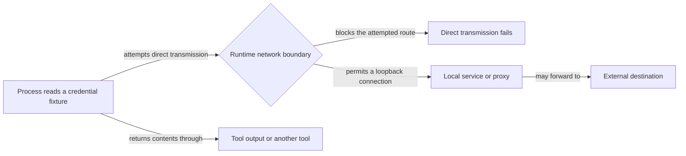

# Keep local agent work within useful boundaries: Codex

## Summary

Routine local development under Codex should run without repeated approvals, while credentials stay
unreadable and external networking stays off. Three reported problems motivate a joint investigation
of native policy, hook behavior, and approvals:

| Problem | Evidence and remaining limit |
| --- | --- |
| Localhost | The portal browser-test server failed with `listen EPERM` on `127.0.0.1` inside a Codex desktop session |
| Repeated approvals | Local tests, portal inspection, and restarts each asked for escalation again |
| Credential reads | Historical Codex 0.140.0 evidence records `~/.ssh/config` readable. Tracked config has no credential guard; proposed native denial is now verified with synthetic fixtures, but is not installed |

One characterization pass covers all three because the boundaries interact. The tracked profile
sets `network.enabled = false`, but that setting alone does not establish that credential contents
cannot leave through tool output, another tool, or a local service. Localhost work changes one of
these boundaries. Network widening requires verified credential protection and the strict network
boundary selected by the user. The tested host profiles do not meet that boundary.

This plan also reconciles three Codex-side harness details with provider ownership,
as `docs/internal/harness-provider-interface.md` requires. The companion plan, Keep local agent work
within useful boundaries: Claude (`46qth5z8`), owns the Claude worktree-entry hook and the Claude-side
leaks.

Do not silently enable unrestricted networking, suppress all approvals, or describe a partial
credential guard as complete.

## Context

### Permission layers

A Codex prompt or failure can come from any of these layers, and each one needs a different fix.
Identify which layer produced a request before changing policy.

| Layer | What it controls | Where RoboRepo configures it |
| --- | --- | --- |
| Native sandbox | Filesystem reads and writes, network, local port binding | Generated `[permissions.<profile>]` block in `~/.codex/config.toml` |
| Approval policy | When Codex asks before running a command | `approval_policy` in the same file |
| PreToolUse hook | Allow, ask, or deny per command, by matching rules from `manifests/inventory/agent-permissions.json` | `globals/system/hooks/codex/permission-check.mjs` |
| Desktop and organization policy | Settings inherited from the Codex app or a managed install | Not configured by RoboRepo; must be observed |

An allowed command can still fail to bind a local port, and a trusted hook cannot be assumed to
grant a permission the native sandbox withholds.

### Current state

Rechecked on `main` at the recorded commit on October 24, 2026; a fresh fetch confirmed
`origin/main` at the same commit. Unrelated dirty browser/runtime/config-write files are not
a landed baseline and must be rechecked before implementation. Source checks do not establish runtime
enforcement; the native fixture matrix below supplies separate, scoped evidence.

| Source | Current behavior |
| --- | --- |
| `manifests/inventory/agent-permissions.json` | `go-online` defaults to `deny`; named test and build commands, including `npm run check`, are allowed. The `read-secrets` behavior lists credential path patterns (`.ssh`, `.aws`, `.env` variants), but only Claude's renderer consumes it |
| `scripts/harnesses/permissions-render.mjs` | `renderCodexWorkspaceProfile` extends `:workspace` and renders a single `network.enabled` boolean from `go-online`; no loopback or read-deny setting is rendered. Commit `8f17eb2f` now preserves foreign top-level keys and tables found inside the generated block; retain that behavior |
| `generated/codex/config.toml` | Profile `managed-workspace` with `network.enabled = false` and `approval_policy = "on-request"` |
| `globals/system/hooks/codex/permission-check.mjs` | Handles `exec_command`, `shell`, `local_shell`, and `bash` calls; tokenizes the command by whitespace and matches leading tokens with `matchesPrefix()`. It never inspects path arguments |
| `scripts/harnesses/contract.mjs` | `validateCapabilityAdapters` fails a provider that declares a capability without its required methods. `permissions` requires `adapters.permissions.render`, and Claude and Codex route through `permissions-render.mjs` |
| `scripts/test/portal-ui/run.mjs` | Starts a hermetic portal server on `127.0.0.1` and a browser that connects to it |

The shared renderer emits Claude credential rules for the `Read` tool because `read-secrets.tools`
contains only `Read`. That output does not prove protection for shell, `Grep`, `Glob`, or other
read-capable tools. The Codex hook recognizes four command-tool names and reads only
`tool_input.command`; nested execution tools and non-command tools need separate characterization.
Do not assume every Codex read reaches this hook.

Local help on October 23 reports `codex-cli 0.163.0-alpha.11.2`; `-p` selects a profile and
`codex exec` accepts a positional or stdin prompt. The October 22 check used 0.162.0-alpha.17.2.
Executable discovery may be cached: re-resolve the actual binary before probing instead of assuming
that the recorded version or former bundle path still exists.

### Observed behavior

**Localhost, October 21, 2026.** During the hook-banner work, the browser-suite server failed inside
the Codex desktop session sandbox with `listen EPERM: operation not permitted 127.0.0.1`. Running the
suite with sandbox escalation succeeded, but repeated requests for local tests, portal inspection,
and restarts interrupted the user. This establishes a failure under that session's policy, not every
supported runtime's network capabilities.

**Reads and writes, Codex 0.140.0.** Recorded by `ia1q1z9` (repo-scoped write permissions) under the
profile then named `roborepo-workspace`:

| Path | Read | Write |
| --- | --- | --- |
| Active worktree | allowed | allowed |
| Sibling worktree of this repo (`~/.worktrees/roborepo/...`) | allowed | allowed |
| Primary checkout (outside `~/.worktrees`) | allowed | blocked (`Operation not permitted`) |
| `$HOME` (arbitrary file) | allowed | blocked (`Operation not permitted`) |
| `/etc/hosts` | allowed | — |
| `~/.ssh/config` | allowed | — |

`ia1q1z9` resolved the read question as "no hook needed" for its write-scope goal, and recorded
credential reads as this follow-up.

### October 23 characterization and decisions

All probes used synthetic fixture files. Native policy was supplied through temporary `-c`
overrides to `codex sandbox -P probe -C <fixture> -- <probe command>`; no installed permission
configuration was rewritten. The inner native sandbox could not start inside the chat sandbox
(`sandbox_apply: Operation not permitted`). The unrestricted control succeeded after explicit
sandbox permission, so the matrix ran there while the tested commands remained inside Codex's
native sandbox.

| Probe | Result | Evidence limit |
| --- | --- | --- |
| Baseline `:workspace` | Protected-directory fixture and `.env` readable; public and protected writes allowed | Synthetic paths only; no real credentials read |
| Native filesystem path and glob denial | Direct, shell, `xargs`, and symlink reads denied; protected writes denied; public file and `.env.example` readable | Passed positive/negative control assertions on macOS 0.163.0-alpha.11.2, not every manifest pattern or provider tool |
| New directory plus matching `.env` | Directory creation succeeded; writing its new `.env` was denied | Observed separately from startup-existing files; no Linux or Windows claim |
| Network disabled, local-binding flag changed | IPv4/IPv6 loopback binds and connections and wildcard bind denied | Does not run the app/browser suite |
| Proxy active, exact local allowlist, `allow_local_binding = true` | IPv4/IPv6 loopback binds and connections and wildcard bind allowed; direct reserved-address connect denied; HTTP proxy returned 403 for that destination | Fails the user's strict listener boundary despite these outbound checks |
| Proxy explicitly enabled, exact local allowlist, `allow_local_binding = false`, no upstream proxy | IPv4/IPv6 loopback binds and raw connections and wildcard bind denied; reserved-address HTTP request rejected with 403 | Fails the local test-server requirement |
| Loopback-to-nonloopback forwarding | Unavailable: host-side positive control timed out before the native test step | No forwarding success or failure is inferred |
| Disposable `node:22-bookworm-slim` runner | Only loopback interfaces; IPv4/IPv6 roundtrips passed; nonloopback connect returned `ENETUNREACH` | No host mounts, published ports, or downloads; native Codex and browser suite were not installed or run inside it |

The disposable-runner check used the already-installed image (Node v22.23.2) with:

```sh
docker run --rm --pull=never --network=none --cap-drop=ALL \
  --security-opt=no-new-privileges --read-only --user=node \
  -i node:22-bookworm-slim node --input-type=module -
```

Its assertions covered interface isolation, local roundtrips, and the unreachable external route.
A wildcard listener succeeds inside that namespace but has no nonloopback interface to expose it.
This differs from granting wildcard listeners or access to existing local relays on the host.

A read-only native `config/read` plus `configRequirements/read` query for this checkout returned
project, user, and system layers; effective `approval_policy = "on-request"`,
`default_permissions = "managed-workspace"`, and `features.network_proxy = true`; the selected
profile extends `:workspace`, has network disabled, and has no filesystem entries. The query
returned no managed requirements. This describes that CLI configuration lookup, not the policy
inherited by every existing desktop session. The sandboxed query timed out; the explicitly
permitted unrestricted query succeeded without a model call or config write.

The native fixture profile used these filesystem entries, expressed as equivalent TOML:

```toml
[permissions.probe]
extends = ":workspace"

[permissions.probe.filesystem]
"<fixture>/protected" = "deny"
"<fixture>/**/.env" = "deny"
```

The user selected **native read-and-write denial** for credential patterns and **strict
loopback-only enforcement** for networking. A heuristic command scanner is no longer the proposed
credential mechanism. The tested host-native networking combinations do not meet both strict
binding and working local test-server requirements. The user subsequently approved an isolated
app/browser runner; keep host networking disabled. A runner changes where tests execute and does not authorize host portal
restarts or solve fresh-session approval persistence.

Official guidance checked October 23:
[Permissions](https://learn.chatgpt.com/docs/permissions) distinguishes enabling command networking
from activating its filtering proxy; its local/private-target flag is not documented as a
listener-address allowlist. It also describes filesystem deny entries and platform-specific glob
behavior. The native probe results above, rather than those docs alone, establish the observed
macOS behavior.

### How the problems interact



Loopback can reach forwarding services. Probe the permitted destinations rather than equating
localhost access with no egress. A process network restriction also does not establish the policy
for browser tools, web search, MCP, or tool-result transport. Record these surfaces separately;
never emit real credentials in a probe.

### Desired development policy

| Operation | Intended boundary |
| --- | --- |
| Ordinary source reads | Preserve existing readable source paths; this plan adds credential protection, not a repository-wide read boundary |
| Reversible edits | Preserve the active workspace, configured associated-worktree roots, and explicit temp roots |
| Test scratch files | Explicit temporary fixture roots; no expansion to arbitrary home directories |
| Named local tests/builds and restarting the isolated test app | Proceed through the constrained runner within the authorized task without repeated human prompts |
| Host-portal restarts | Remain separately approved actions; runner approval does not cover them |
| Loopback servers and browser connections | App and browser share a disconnected network namespace; no host listeners, port publishing, or relays |
| External networking | Keep sandboxed process egress restricted; record separately which layer controls browser, search, and MCP networking |
| Credential and environment-file reads | Known `read-secrets` matches retain the deny intent; unsupported forms are listed explicitly; no complete-tool-coverage claim |
| Pushes, destructive operations, and branch or worktree moves | Preserve explicit authorization requirements |

### Provider leaks in platform code

Each row is a place where platform code names Codex directly instead of reading it from the
provider's manifest (`globals/harnesses/<id>/provider.json`):

| Leak | Location | What is hardcoded | Provider data that already exists |
| --- | --- | --- | --- |
| Hooks file branch | `scripts/cli/hook-composition.mjs` `writeHooksFile`, `hookFilePath` | `main` still branches on Codex; the unlanded dependency already routes through manifest paths | Preserve its `hasHarnessPath` / `resolveHarnessPath` routing after landing; no parallel storage selector is needed |
| Codex hook sources | `globals/system/hooks/codex/` (`permission-check.mjs`, `minimize-bash-output.mjs`) | Codex-only hook scripts live in the system tree | `manifests/platform/manifest.tsv` maps the folder to `~/.codex/hooks` |
| Headless prompt CLI | `scripts/cli/telemetry.mjs` `findDeepReadCli`, `runDeepRead` | Loops over `["claude", "codex", "gemini"]` and runs each as `<cli> -p <prompt>`. Local 0.162.0-alpha.17.2 help confirms `-p` selects a profile and `exec` runs non-interactively; successful synthesis has not been tested | Manifests declare `commandName` |

### Related plans and landing evidence

| Plan | Classification at the reviewed checkout | Reconciliation |
| --- | --- | --- |
| `wjlt1zvf` (`review/harness-hook-readiness-provider-adapters.md`) | Unlanded dependency | Its assigned worktree is authoritative and has a newer title, completed implementation tasks, pending review, seven unchecked native/platform checks, and two still-unchecked review findings despite later prose reporting their fixes. Leave that tracking drift with its owner. Implementation `b3df1d76aff6f085d9b003e12123a66c767d74cd` and worktree tip `8b9414c90455258603731a0be1aa4fcef533c5a1` are not ancestors of `main`; the tip is on `claude/harness-hook-readiness-provider-adapters` only. Recheck landing before integration |
| `ia1q1z9` (`completed/agent-config-repo-scoped-write-permissions.md`) | Landed dependency with prose drift | Merge `e58a81927fb99bf460eb6a5ea9185224c2a585fd` and evidence commit `bea08c6d42e11a0477a4111ce053eef9950740d4` are ancestors of `main`. Current renderer and hook preserve the write profile and Claude credential rules. Its older “Not verified” paragraphs contradict later live Codex evidence; retain those observations as historical and leave separate document cleanup to its owner |
| `46qth5z8` (`backlog/harness-claude-worktree-entry-and-provider-leaks.md`) | Unlanded conditional dependency | No `agentWorktreeDirs` field exists in the current schema or manifests. Codex worktree-folder declaration waits for that contract and provenance evidence; all Claude entry-hook and process-label work stays there |
| `permva27` (`backlog/agent-config-permissions-global-audit.md`) | Unlanded audit; scope reconciled | This plan maps existing `read-secrets: deny` intent into the Codex native provider, with dedicated parity tests. It adds no new portable bucket, mandatory capability method, or permission editor. The audit retains its retain/simplify/defer-to-native decision |
| `permissions-ui-revamp` (`backlog/agent-config-permissions-ui-revamp.md`) | Unlanded downstream consumer | It consumes the audit; no editor redesign or gate/scope simplification belongs here |
| `codex-cmux-hook-trust-review` (`backlog/agent-config-codex-cmux-hook-trust.md`) | Unlanded research overlap | Its bypass/source-loading claims are explicitly hypotheses to refresh. A bypass of trust review does not by itself prove a permission hook is skipped. Verify loading, enabled state, and decision handling separately |
| `7k3m9qd` (`backlog/package-resource-provider-delivery.md`) | Unlanded contract overlap | It changes capability/delivery validation in `contract.mjs`. Keep package-delivery redesign there; reconcile any new permissions requirement before editing that shared contract |
| `harness-capability-derived-resource-targeting` (`backlog/harness-capability-derived-resource-targeting.md`) | Unlanded adjacent work | It owns resource targets and fidelity reconciliation. It already calls for reuse of the existing Codex hook; do not add a second command-permission mechanism |

The hook-readiness worktree already removes the Codex branch with manifest-path routing, preserves
checkout-symlink protection, and changes Codex hook installation from `managed_copy` to
`hook_fragment` plus per-file-owned `managed_files`. Its core fragments append after package
hooks, preserving existing positions. Current `main` also records hook writes through
`recordConfigWrite` (`28a202fd`); preserve that reporting when consuming the dependency. This plan
consumes that contract; it must not restore
whole-directory copying, prepend hooks, change native labels, or replace manifest routing with a
second `hooksStorage` decision. The primary plan copy is stale relative to its authoritative
worktree, but its `review` lifecycle is consistent with pending manual review. No other lifecycle
transition or document cleanup is performed here.

## Goals

- Routine authorized local tests, browser inspection, and isolated test-app restarts run through
  the constrained runner without repeated permission requests in supported Codex sessions.
  Host-portal restarts remain separately approved.
- Credential paths from `read-secrets` are protected under Codex across every form the selected
  mechanism covers, with uncovered forms documented rather than claimed.
- Network widening never ships ahead of verified credential-read protection and strict
  loopback-only isolation; host wildcard-listener and relay exposure remain rejected.
- Command permission, sandbox networking, filesystem scope, and tool approval are distinguished, so
  unsupported controls are reported honestly rather than widened silently.
- `read-secrets` stays the single credential-pattern source. Codex native coverage and unsupported
  states are documented and checked by dedicated provider parity tests, without widening the
  generic `permissions` capability contract.
- The remaining leaks are resolved through provider data, and the dependency’s hook routing stays intact.

## Non-goals

- Unrestricted network or full-disk access, blanket interpreter allowlists, or disabling all
  approvals.
- A credential shell-argument scanner. Native filesystem denial is the selected mechanism; the
  existing command-prefix hook retains its separate command-permission responsibility.
- Matching Claude's repo-wide read boundary on Codex; `ia1q1z9` resolved that.
- The permission-editor redesign (`permissions-ui-revamp`).
- Gemini. Its Policy Engine has neither a path predicate nor a hook surface, as `ia1q1z9`
  established.
- The Claude worktree-entry hook and Claude-side leaks (`46qth5z8`).

## Proposed design

### One characterization pass

Before rollout, extend the recorded probes for supported Codex desktop and CLI versions and record,
for each concern, which layer controls it and what the native settings can express:

| Concern | Question the probe answers |
| --- | --- |
| Policy sources | Which settings are in effect, and can inherited desktop or organization policy override them? |
| Loopback | Can a server bind `127.0.0.1` and `::1`, can a client connect to it, and does either work with external access denied? Does wildcard listening or DNS behave differently? |
| Credential reads | Can a native read-deny setting block `read-secrets` paths, and how does it interact with workspace reads? |
| Approvals | Which layer prompts for tests, portal inspection, and restarts, and can a narrow approval persist across sessions? |

Use installed help, schema output, and local probes with synthetic fixtures. Never read real
credential or environment files to test a restriction, and do external research only with the
user's authorization. Record exact settings, commands, and results; accepted TOML or an allowlisted
command prefix does not prove runtime enforcement.

### Credential-read enforcement

Render native filesystem `deny` entries from resolved `read-secrets` intent. The accepted boundary
denies both reads and writes to matching paths. Preserve the explicit template exceptions
(`.env.example` and `.env.sample`); do not replace the enumerated environment-file patterns with an
unrestricted `.env.*` glob. Normalize the manifest's home and absolute glob anchors for the native
provider, and test every pattern under synthetic roots before applying anything to a real home.

Keep native projection in the Codex provider, reusing the existing render/apply path. Preserve
`foreignBlockContent`, `notify`, unrelated tables, read-only mode, configured workspace roots, and
reapply idempotence. Apply the credential boundary in both writable and read-only modes; choosing
`:read-only` alone must not drop the denies. Document any new restriction on credential-file edits.

Use a dedicated provider parity check, not a new required `permissions` method. Gemini remains
explicitly unsupported; Claude keeps its current renderer. This uses existing policy intent and
leaves the global audit's editor/product decision intact. Verify the selected runtime supports and
enforces the projection before reporting protection. Unsupported versions or inherited policy must
produce an explicit limitation, not a heuristic fallback or a confinement claim.

Native `codex sandbox` evidence concerns sandboxed processes. Establish separately which command,
structured-read, browser, MCP, and nested execution surfaces use that policy. No native process test
certifies all tools. Approval persistence and effective managed requirements remain to be checked
in fresh supported sessions.

### Disconnected app/browser runner

The selected environment runs the app and headless browser together in one disposable container
with `--network=none`. Codex stays on the host under its offline native profile. Only the trusted
launcher crosses the host sandbox boundary; neither the agent nor the container receives general
Docker access. A listener on all addresses inside the disconnected namespace has no nonloopback
interface or published host port. Host networking remains unchanged.

1. A trusted staging step runs under the native credential-denial policy and creates a filtered
   snapshot of the authorized checkout, including authorized uncommitted edits. The constrained
   host launcher validates that snapshot and the named workflow before creating a container.
2. A prebuilt local image supplies matching Linux dependencies and Chromium. The launcher copies
   the snapshot into disposable working storage, starts the app and browser there, and waits for
   the named verification workflow.
3. The workflow returns exit status, assertion results, screenshots, and other requested evidence
   through its dedicated output directory. The launcher stops only its own container and children.

| Surface | Required boundary |
| --- | --- |
| Source | Read-only bind of a newly staged snapshot, never the raw checkout or repository family. Exclude `.git`, host `node_modules`, caches, sockets, credential-pattern matches, and unrelated files. Copy regular files only; reject symlinks, hard links with unproven provenance, special files, and escaping paths. Inspect names/metadata before contents. Native denial protects the unprivileged staging step, not the escalated Docker launcher. Revalidate the snapshot before launch and prevent path-swap races with no-follow opens and stable file identities. Preserve `.env.example` and `.env.sample` |
| Working files | Copy source into per-run container-local writable storage. Tests may edit this disposable copy. No automatic copyback or host source writes |
| Output | One newly created empty host directory per run, writable at a fixed container destination. Export only bounded regular evidence files; reject traversal, links, and special files. Treat artifacts as untrusted data; never execute them on the host or overwrite source/config |
| Home and temp | Fresh uncredentialed home, state, cache, and temp directories in disposable storage. Never mount host HOME, harness homes, SSH agent, Git config, npm credentials, cloud credentials, browser profiles, daemon sockets, or inherited file descriptors |
| Environment | Construct an explicit allowlist of nonsecret settings; drop proxy variables, tokens, credential helpers, Docker context overrides, and host browser/debug endpoints. Use synthetic test secrets only |
| Networking | No host network, published ports, extra hosts, external interface, proxy, relay, shared host IPC/PID namespace, or browser connection to a host service. Browser and app communicate inside the same disconnected namespace |
| Process | Fixed image digest and entrypoint; nonroot user, all capabilities dropped, no-new-privileges, read-only image filesystem, bounded writable scratch, time/memory/process/output limits, and cleanup on success, failure, timeout, or interruption. Chromium must work without privileged mode or a host sandbox bypass |

A secret-bearing fixture needed by a test must be synthetic. If filtering removes a required file,
report the missing input instead of mounting credentials or broadening the source root. Path-based
exclusion cannot detect credentials embedded in otherwise ordinary source; document that limit and
do not copy unrelated files or claim content-based secret detection.

### Browser-image preparation and invocation authority

Image preparation is a separate, explicitly authorized provisioning operation with network access.
Use a minimal credential-free build context containing the lockfile, package metadata, and reviewed
image recipe. Pin the base image by digest, install the lockfile-matched Linux dependencies and the
matching Playwright Chromium revision plus OS libraries, and record the resulting image identity
and tool versions. Never use host dependency/browser caches, credentials, SSH forwarding, Docker
socket mounts, or a whole-checkout build context. Run offline smoke checks before accepting it.
A lockfile/browser/recipe mismatch or absent image blocks the run with preparation instructions;
routine execution uses `--pull=never` and does not install or download anything.

The staging step and host launcher are trusted installed code outside agent-writable source/output
roots. The host launcher reads only the validated snapshot, never restages the raw checkout with
elevated privileges. Snapshot and output roots must be launcher-owned per-run locations, not
arbitrary mount paths; validate containment again at launch and at evidence collection. It accepts
only a validated checkout selector and named workflow, with a small validated capture/filter set
where needed. It constructs Docker argv itself and owns image, entrypoint, network, mounts, user,
and resource limits. Reject arbitrary flags, image names, command strings, environment passthrough,
mounts, privilege options, Docker contexts, or daemon endpoints. Test against launcher replacement
and argument injection, including repo-supplied config and environment overrides. Repo test code
executes only inside the container. Never approve a generic `docker`, interpreter, npm-script, or
agent-writable wrapper prefix. If the supported Codex approval mechanism cannot bind authorization
to this immutable constrained invocation, report it as unsupported and retain per-run approval;
do not claim the no-repeat goal passed or relax the boundary.

The one host-side launch permission does not authorize Docker management, image provisioning,
host-portal restart, or native hook trust. No container orchestration endpoint is exposed to repo
code. Do not start a model session inside the runner or supply Codex authentication to it.

### Runner ownership and existing browser integration

Keep portable permission intent in `manifests/inventory/agent-permissions.json` and Codex native
projection under the existing provider render/apply path; preserve unrelated config. The runner
owns execution isolation, not a new global permission model or editor.

Use `scripts/cli/browser.mjs` and `scripts/cli/browser/` as the existing browser workflow/evidence
boundary. Reuse their result, evidence, and owned-resource contracts where applicable, but start
and stop the app inside the container; do not call the host `ensureLocalService` path for an
isolated run. Its existing host workflows keep their authorization behavior. Put constrained
launcher/image orchestration in a focused runner module beside the browser execution code, with
only minimal CLI/catalog wiring. Keep Codex policy/support checks in `scripts/harnesses/codex/`.
`scripts/test/lib/docker-sandbox.mjs` remains the clean-machine helper;
reuse applicable mechanics without weakening its existing scenario contracts or treating it as a
security boundary. Add a separate runner integration scenario rather than putting browser isolation
into the install-only sandbox. Recheck the dirty browser/lifecycle work before editing these files.

### Approvals

After the sandbox boundary is fixed, identify whether a scoped persistent approval is still needed.
Keep native hook-trust review distinct from command approval and runtime sandbox escalation.
Preserve `read-secrets: deny` through native filesystem enforcement. Unclassifiable shell commands
are not a new credential policy tier; their actual file opens remain subject to the native guard.
Do not allow arbitrary `node`, Python, or all npm scripts. Record whether each permission is
native-enforced, command-scoped, or only an agent instruction. The agent should run already-authorized
routine work directly and explain a genuine platform-imposed approval boundary once, rather than
repeatedly requesting the same declined escalation.

### Leak fixes

| Leak | Change |
| --- | --- |
| Hooks file branch | Consume the dependency’s manifest-path routing and its synthetic/provider regression coverage. Recheck after landing; add only missing behavior tests. Leave `hooksStorageOf` in `config.mjs` unless another demonstrated consumer needs it |
| Codex hook sources | Move `globals/system/hooks/codex/*` to `globals/harnesses/codex/hooks/` and repoint the dependency’s `managed_files` row in `manifest.tsv`, keeping the `~/.codex/hooks` destination and command strings unchanged. The native credential guard does not require editing `permission-check.mjs`; preserve its standalone manifest discovery |
| Headless prompt CLI | Add `extensions.app.headlessPromptArgs` to manifests, holding an argv template with one whole-argument prompt placeholder, validated by the manifest schema and runtime contract. `findDeepReadCli` iterates enabled eligible providers in registry order and uses the existing executable selection path, including desktop-only runtimes. Keep public `deepread_cli` report values stable; spawn argv directly, never a shell string |

## Implementation plan

### Phase 1: characterize native boundaries

- [x] Probe synthetic direct, shell, `xargs`, and symlink reads with positive controls on native
      Codex 0.163.0-alpha.11.2; confirm the selected denial also blocks credential writes.
- [x] Compare the native localhost candidates with network disabled and with an active proxy;
      record that the tested candidates do not satisfy the strict listener requirement.
- [x] Prove loopback-only network-namespace feasibility in a disposable no-mount Node container;
      keep browser and Codex integration explicitly unverified.
- [ ] Record supported Codex desktop and CLI versions and the effective permission sources,
      including inherited policy.
- [ ] Define the remaining DNS, proxy-alias, and forwarding cases for Phase 4 using the recorded
      bind/connect matrix. Require a replacement passing forwarding control before drawing a
      forwarding conclusion; runtime execution waits for the runner, not a wider host profile.
- [ ] Extend native fixtures across all `read-secrets` patterns, template exceptions, deep and
      newly created paths, and the actual supported tool surfaces. Verify platform-specific glob
      behavior before claiming Linux or Windows enforcement.
- [ ] Identify which layer issues each prompt for tests, portal inspection, and restarts, and
      whether a narrow approval persists across sessions.
- [ ] Check whether the Codex app creates worktrees under `~/.codex/worktrees/` (one was observed at
      `~/.codex/worktrees/<name>/roborepo`; its creator was not confirmed).
- [ ] After the probes, record a decision packet covering the supported runtime, native controls,
      tool coverage, and approval limitations. Native denial, dedicated provider parity, and
      the disconnected app/browser runner are selected; confirm enforceability before rollout.
- [x] Record the user-approved runner scope: app and browser in a disconnected container;
      host-portal restarts remain separately approved. Full integration remains implementation work.

### Phase 2: Codex-side leaks

- [ ] After `wjlt1zvf` lands, re-read its source ownership and tests. Move Codex script sources
      and repoint the `managed_files` source without changing per-file ownership or removal semantics,
      and update source references in `scripts/test/test-cli.sh`. Preserve standalone manifest
      discovery from installed copies and state-root overrides. Run
      `bash scripts/doctor.sh --quiet` and
      `env CLEAN_MACHINE_STRICT=1 npm run test:clean-machine-permissions-sandbox` to prove the install
      destination and command strings are unchanged.
- [ ] Hooks file routing: after `wjlt1zvf` merges, confirm it has removed the Codex branches.
      Preserve `rootConfigPath` fixture overrides, manifest routing, and symlink protections. Extend
      `scripts/test/hook-composition-check.mjs` only for missing synthetic-provider behavior.
- [ ] Headless prompt CLI: check the Codex CLI's non-interactive syntax against its own help output.
      Add failing tests for an omitted field, malformed template, disabled provider, desktop-only
      executable, prompt text containing shell metacharacters, and successful synthetic-provider
      selection. Add verified argv templates to eligible manifests and switch both selection and
      `runDeepRead` invocation; leave unsupported providers explicitly ineligible.
- [ ] Extend `scripts/test/telemetry-synthetic-provider-check.mjs` so the `acme` provider proves
      `headlessPromptArgs` generalizes.
- [ ] If Phase 1 confirms the Codex app's worktree folder and `46qth5z8` has added
      `agentWorktreeDirs`, declare `.codex/worktrees` in the Codex manifest.

### Phase 3: credential-read enforcement

- [ ] Add dedicated Codex native-projection and enforcement parity checks, with explicit unsupported
      runtime/tool states. Preserve Gemini and the generic capability contract.
- [ ] Add a focused test listing the credential-path forms the mechanism must block and the ordinary
      commands it must not block, including readable `.env.example` and `.env.sample` templates,
      before implementing it.
- [ ] Implement native filesystem denial from `read-secrets` in both writable and read-only Codex
      profiles. Preserve resolved intent, workspace roots, foreign config, and safe reapply; leave
      command classification in `permission-check.mjs` unchanged.
- [ ] Wire the coverage check so missing or overstated enforcement fails validation; explicitly
      unsupported providers remain loadable and cannot advertise a guard they do not implement.
- [ ] Verify live against the shipped Codex binary, since shell quoting and expansion only show up
      when a real shell runs the command.

### Phase 4: disconnected runner and approvals

- [ ] Recheck the hook-readiness dependency and concurrent browser/runtime changes before touching
      shared integration points. Hook source relocation waits for landing; native fixture and
      runner design work can proceed independently. Reconcile landed code instead of duplicating it.
- [ ] Add launcher argument-rejection, source-filtering, output-containment, and lifecycle tests
      before implementation. Include symlinks, traversal, spaces, denied `.env` variants, readable
      templates, injected Docker/environment options, and an agent-writable replacement wrapper.
- [ ] Verify native credential enforcement before source staging is used. Implement source
      staging under that policy, disposable working storage, output validation, and the trusted
      constrained launcher under the boundary above; wire only named workflows into the CLI.
      Preserve existing browser result/evidence contracts and avoid host service startup/cleanup.
- [ ] Add the pinned browser-image recipe and separate preparation operation. Verify dependency,
      Chromium, and image identity matching. Missing/mismatched images block offline execution;
      obtain specific provisioning authorization before any build/download.
- [ ] Run the real `npm run test:portal-ui` in the disconnected runner using its staged source and
      prepared dependencies. Require actual browser assertions; the current driver's missing-browser
      skip is not a pass. Verify screenshot export and test-app restart inside the same boundary.
- [ ] Exercise IPv4/IPv6 loopback, DNS, direct/proxy external access, host gateway and host-service
      access, wildcard host exposure, and forwarding with synthetic fixtures and passing positive
      controls. Replace the inconclusive historical forwarding control; any timeout is unavailable
      evidence, never a denial. Inspect effective container networking and mounts as well as probes.
- [ ] Verify cleanup after success, failed assertions, timeout, and interruption; leave unrelated
      host processes untouched. Prove host source/config are unchanged and outputs cannot escape.
- [ ] Verify the fixed invocation twice in fresh supported Codex desktop and CLI sessions without
      repeated prompts, after native credential enforcement passes. Keep provisioning, host-portal
      restarts, native hook trust, and unsupported approval persistence explicitly separate.
- [ ] Reapply/update policy and repeat writable/read-only and foreign-config preservation checks.
      Keep host networking disabled; report unsupported runtime/organization policies explicitly.

## Validation

- Phase 1 records version, effective policy, and evidence for every probed environment. A container
  pass does not establish host-native parity, and rendered config or fake binaries do not establish
  runtime enforcement.
- Under the `managed-workspace` profile, a command reaching a known `read-secrets` path is denied
  for every form the selected mechanism claims to cover, and each enumerated form it does not cover
  appears in the documented boundary.
- Ordinary repository commands touching non-credential paths are unaffected; the existing Codex hook
  coverage in `scripts/test/clean-machine-permissions-sandbox.mjs` and `scripts/test/test-cli.sh`
  still passes.
- Missing or falsely claimed credential coverage is caught by the selected contract/parity check.
  Gemini and a synthetic unsupported provider remain explicit unsupported cases, not forced
  implementations of the Codex guard.
- In the selected supported environment, the real portal browser suite binds and connects on
  localhost, produces actual browser assertions and exported evidence, and the allowed workflow
  succeeds twice in fresh supported desktop and CLI sessions without recurring prompts. A skipped
  browser run, missing image, or broader launch approval fails this acceptance criterion. Keep any retained
  host-portal restart approval distinct from an isolated test-app restart; do not claim the latter
  establishes the former.
- Controlled probes show external egress and unauthorized filesystem writes remain blocked, while
  approved repo, worktree, and temp operations succeed.
- `scripts/cli/hook-composition.mjs` no longer contains `harness === "codex"` or `codexHooksPath`,
  and `findDeepReadCli` no longer holds a fixed CLI list. A synthetic headless provider receives
  exactly one literal prompt argument; invalid or omitted templates and unavailable runtimes degrade
  gracefully, preserving `deepread_cli` consumers. Codex hook sources are covered by
  `doctor.sh` and the sandbox.
- `node scripts/test/permissions-render-live-characterization-check.mjs`,
  `node scripts/test/hook-composition-check.mjs`, `bash scripts/doctor.sh --quiet`,
  `node scripts/test/codex-permissions-foreign-lines-check.mjs`, and `git diff --check` pass.
  `npm run check` passes before implementation handoff or push, because this work changes install
  mapping and permission profiles.

## Documentation impact

| Doc | Update |
| --- | --- |
| `docs/user/reference/config-control-panel.md` | Document the Codex credential guard and its covered and uncovered forms alongside Claude's `read-secrets`; explain local-server versus external-network access and which approvals remain; record that Gemini stays out of scope |
| `docs/user/reference/codex-hooks.md` | Distinguish native file denial from command-hook trust prerequisites, command approval, and sandbox escalation; explain verified limits |
| `docs/user/reference/architecture.md` | Update the Codex hook source-to-install map while preserving its destination and per-file ownership |
| `docs/internal/hooks-internals.md` | Point the Codex hook sources at `globals/harnesses/codex/hooks/`; explain that native credential denial is separate from command-prefix classification |
| `docs/internal/harness-anatomy.md`, `docs/internal/harnesses-explained.md`, `docs/internal/backlog-review.md` | Update the Codex system hook source paths |
| `docs/internal/harness-provider-interface.md` | Document provider-native credential projection and unsupported states without adding a universal enforcement method; document `headlessPromptArgs` |
| `docs/internal/docker-test-sandboxes.md` | Document runner image preparation, snapshot/output mounts, isolation controls, negative probes, and the distinction from clean-machine install tests |
| `docs/user/reference/roborepo-cli.md`, `docs/user/reference/runtime.md` | Document the constrained runner invocation, offline preparation prerequisite, evidence access, and separate host-portal restart approval |

## Risks

| Risk | Mitigation |
| --- | --- |
| A loopback allowance exposes unrelated host services or forwarding proxies | User rejected that exposure; preserve offline host policy and require strict isolation for any runner |
| Native denial also prevents credential-file writes | User accepted this boundary; document it and preserve template exceptions |
| Command-permission hooks are inactive or untrusted | Native credential denial is independent of hook trust; preserve readiness reporting for the hook’s separate command decisions |
| Cross-provider contract scope expands | Use dedicated native parity checks; leave shared capability methods and the global editor unchanged |
| Native or managed policy cannot express the boundary | Keep a capability gate and an explicit user decision; never silently broaden access |
| A native process guard is mistaken for all-tool coverage | Verify tool surfaces independently; no credential scanner is added |
| Hook relocation regresses `wjlt1zvf` installation or trust | Wait for landing, consume its existing routing, and preserve `managed_files`, labels, positions, and symlink guards |
| Moving Codex hook sources orphans old install copies | Keep the destination unchanged |

## Decision Log

- October 21: the localhost and approval work was added to `46qth5z8`, alongside the Claude
  worktree-entry hook.
- October 22: split by provider at the user's request. This plan keeps the credential-read guard's
  ID, because `ia1q1z9` references it for the same gap, and absorbs the Codex half of `46qth5z8`:
  localhost, approvals, the hooks-file branch, Codex hook sources, and the headless prompt CLI.
  Merged because one characterization pass serves both, and because loosening network policy
  changes one potential route for transmitting a credential read; complete confinement remains unverified.

- October 22 promotion review: verified `main` at `e201ba8b`, the unlanded hook-readiness
  implementation and authoritative review copy, and the landed write-scope commits. Removed the
  duplicate hook-routing refactor and preserved the dependency’s per-file ownership contract.
  Corrected overbroad read/network claims, confirmed Codex headless CLI syntax from installed help,
  and distinguished stale cached discovery from the installed runtime. No runtime enforcement,
  approval persistence, or forwarding claim was certified, and no implementation task was checked.

- October 23 continuation: rechecked `main` at `0cd270ea` after the user's merges. Prior plan
  corrections are committed in `9ad9c0c4`; this run does not recommit them. `8f17eb2f` supplies foreign
  permission-block preservation and `28a202fd` supplies config-write logging; both are required
  baselines. The hook-readiness branch remains unlanded at `8b9414c9`, with separate native/manual
  review pending. No other plan's lifecycle was changed.
- October 23 user decision: **Use native read-and-write denial** after the synthetic credential
  checks. Adopt dedicated provider parity checks and existing `read-secrets` intent; no scanner,
  new global bucket, or mandatory cross-provider credential method is needed.
- October 23 user decision: **Keep strict loopback-only enforcement; investigate further** rather
  than accepting host wildcard listeners and local-relay exposure. Tested native host profiles
  fail either local server operation or that strict boundary. The disconnected container check
  establishes socket-level feasibility only; this historical decision was superseded by the
  runner adoption below.

- October 24 continuation: user approved the disconnected app/browser runner while preserving
  strict host networking and separate host-portal restart approval. Added filtered snapshot and
  evidence mounts, credential-free image preparation, immutable constrained invocation, and full
  browser/negative-boundary acceptance checks. No general Docker/socket access is authorized.
- October 24 reconciliation: fresh `git fetch origin` confirmed `main` and `origin/main` at
  `0cd270ea0c2244438fccbdc93636bd2252c95be5`. The hook-readiness implementation and tip remain
  unlanded; its authoritative review copy has seven native/platform checks and two unchecked review
  findings with later fix claims. Preserve its manifest routing, per-file ownership, append order,
  native labels/trust safeguards, checkout-link protection, and `recordConfigWrite`. Leave its
  review/approval and tracking cleanup to its owner. The merged `8f17eb2f` foreign-config behavior
  remains a required regression baseline. Unrelated dirty source edits were inspected, not adopted
  as landed implementation or included in this plan commit.

## Promotion readiness

No material design decision remains open. The native read/write denial, strict host network policy,
and disconnected app/browser runner are selected. Runtime/tool coverage, constrained approval
persistence, and full browser integration are executable verification tasks, not completed claims.
Failure of those gates requires an explicit unsupported result or a revised decision; it never
permits widening the boundary.

The hook-readiness dependency is still unlanded. This plan is prepared for `ready/`, with dependent
hook relocation gated on its landing and reinspection. That dependency does not prevent independent
native fixtures and runner work; it prevents claiming the combined implementation complete.
The optional Codex worktree-folder declaration likewise waits for the Claude plan's field and
verified provenance. No other plan's lifecycle is changed.

## Open questions

None requiring a user decision before promotion. Supported session/tool coverage and narrow launch
approval persistence remain verification tasks with explicit fail-closed outcomes. Full app/browser
integration and the replacement forwarding control remain unverified; preparation starts no model
session, runner integration, image provisioning, or host-portal restart.
